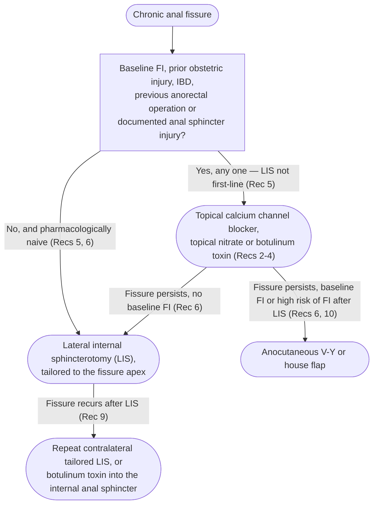

## Contents
- [[#Assessment]]
  - [[#Establishing the Diagnosis]]
  - [[#Severity Assessment]]
- [[#Differential Diagnosis]]
- [[#Diagnostics]]
- [[#Therapeutics]]
  - [[#Acute Fissure]]
  - [[#Chronic Fissure — Medical Management (First Line)]]
  - [[#Chronic Fissure — Surgical]]
- [[#See Also]]
- [[#Sources]]

## Assessment

### Establishing the Diagnosis

- **Anal fissure** = ulcer-like longitudinal tear in the **midline of the anal canal, distal to the dentate line**, extending toward the anal verge; pain and bleeding with defecation. **Clinical diagnosis** from history and inspection. [[acg-2021-anorectal-disorders]]
- **Clinical hallmark:** **tearing sensation** ("passing glass") on passing a hard stool or with diarrhea, sharp and often lasting hours after defecation; bleeding **usually limited to minimal bright red blood on toilet tissue**.
- **Causes:** local trauma from hard stool, hypertension of the internal anal sphincter, multiparity, or previous surgery; ischemia contributes to pathogenesis. Also associated with [[crohns-disease|Crohn's disease]]. [[asge-2010-anorectal-disorders]]
- **Treatment target follows the pathophysiology:** soften stool and reduce sphincter spasm to improve perfusion to the fissure. [[acg-2021-anorectal-disorders]]
- **Examination:** best visualized in the **lateral knee-to-chest position, distracting the buttocks**. Anoscopy is often too painful acutely; defer it. [[asge-2010-anorectal-disorders]]
- **Location:** **posterior midline 73%** · **anterior midline in 13% of women and 8% of men** · **both simultaneously 2.6%** ([[ascrs-2023-anal-fissures]]). These supersede American College of Gastroenterology (ACG) 2021's "almost 90% posterior" and [[asge-2010-anorectal-disorders]]'s anterior 19%.
- **Lateral or multiple fissures are an atypical presentation → more comprehensive evaluation** for human immunodeficiency virus (HIV) infection, Crohn's disease, syphilis, tuberculosis and hematologic malignancies ([[ascrs-2023-anal-fissures]]); also dermatologic conditions (e.g. psoriasis) and [[anal-cancer-screening|anal carcinoma]] ([[acg-2021-anorectal-disorders]]).

### Severity Assessment

**Acute vs chronic is the treatment-determining split.**

| | Acute fissure | Chronic fissure |
|---|---|---|
| **Duration** | **<6 weeks** ([[ascrs-2023-anal-fissures]]); <8 weeks ([[acg-2021-anorectal-disorders]]) | **>6 weeks** ([[ascrs-2023-anal-fissures]]); >8–12 weeks ([[acg-2021-anorectal-disorders]]) |
| **Appearance** | Longitudinal tear / laceration | **≥1 stigma of chronicity: hypertrophied anal papilla proximally · sentinel tag distally · exposed internal anal sphincter in the fissure base.** Also a linear white-based lesion with horizontally oriented fibers; overhanging edges, edema, fibrosis |

- **Duration is a continuum and healing falls steadily with it** — conservative therapy heals **100%** at **<1 month** of symptoms vs **33.3% at >6 months**, and symptoms beyond **1 year** predict failure of medical therapy altogether.
- **Pathogenesis of the chronic fissure:** internal anal sphincter hypertonicity → local ischemia → impaired wound healing. ([[ascrs-2023-anal-fissures]])

---

## Differential Diagnosis

*Anorectal bleeding workup: see [[acute-lower-gi-bleeding]].*

| Condition | Key Features |
|-----------|-------------|
| [[hemorrhoids\|Hemorrhoids]] | Painless bright red bleeding; prolapse; visible on anoscopy. **Sharp pain on defecation or on digital rectal examination (DRE) points to fissure** — hemorrhoids hurt only when acutely thrombosed. The two **coexist in up to 20% of cases, and the fissure is treated first** [[aga-2026-hemorrhoids]]. The sentinel tag is often described as "a painful hemorrhoid" [[acg-2021-anorectal-disorders]] |
| Perianal abscess/fistula | Indurated or fluctuant perianal tissue; constant pain, not just with defecation. **A fissure with an abscess or fistula is the exception to initial medical therapy** [[asge-2010-anorectal-disorders]] |
| Crohn's perianal disease | Multiple/atypical fissures; skin tags; fistulas |
| Anal carcinoma | Persistent non-healing fissure-like lesion |
| Syphilis, HIV/acquired immunodeficiency syndrome (AIDS), tuberculosis | Lateral fissures |
| [[rectal-prolapse#Solitary Rectal Ulcer Syndrome\|Solitary rectal ulcer syndrome]] | Rectal location; association with straining/prolapse |

---

## Diagnostics

**Endoscopy is not needed to diagnose a typical fissure.** Consider it when the **diagnosis is in doubt**, **bleeding occurs**, to **rule out associated [[inflammatory-bowel-disease|inflammatory bowel disease (IBD)]]**, or the patient is **due for a screening [[colorectal-cancer-screening|colonoscopy]]**. [[asge-2010-anorectal-disorders]]

- **Timing:** **defer [[colonoscopy]] until after initial treatment of the fissure** — avoids the discomfort of [[bowel-preparation|bowel preparation]] and scoping an acutely painful anal canal. [[asge-2010-anorectal-disorders]]
- **Sphincter tone before surgery** is judged clinically: whether anal pressures are high is "**usually made by digital examination only**", and ACG 2021 does **not** make [[anorectal-manometry|anorectal manometry]] a routine fissure test. Low or normal pressure changes the operation (see Therapeutics).
- No cited guideline, including the American Society of Colon and Rectal Surgeons (ASCRS) one, gives an examination-under-anesthesia rule, a biopsy rule for the non-healing fissure, or an age threshold for first-presentation colonoscopy.

---

## Therapeutics

The acute fissure is treated conservatively; in the chronic fissure the route turns on baseline [[fecal-incontinence|fecal incontinence (FI)]] and prior sphincter injury.

*Chronic anal fissure: medical therapy, sphincterotomy, and the sphincter-preserving alternative*
*Source: built from ASCRS 2023 Recommendations 2–6, 8, 9 and 10 (the guideline has no treatment flowchart)*
*[[ascrs-2023-anal-fissures|ASCRS 2023 Clinical Practice Guidelines for the Management of Anal Fissures]]*
*FI = fecal incontinence · IBD = inflammatory bowel disease · LIS = lateral internal sphincterotomy · Rec = recommendation number as printed in ASCRS 2023*

### Acute Fissure

- **First step: sitz baths + a fiber supplement such as psyllium** or another bulking agent, ± **topical anesthetic or anti-inflammatory ointment** — **almost half of acute fissures heal**, with relief of pain and bleeding and virtually no side effects ([[acg-2021-anorectal-disorders]]; [[ascrs-2023-anal-fissures]] Rec 1, Strong/moderate 1B).
- **Sitz baths + fiber beat the topical agents on pain relief** — randomized, 103 patients: **91%** vs anesthetic **60%** vs hydrocortisone **68%** (*p* < 0.05).
- **If [[chronic-constipation|constipation]] is present:** stool softeners, fiber, fluids, and lubricants (mineral oil, flaxseed oil). [[asge-2010-anorectal-disorders]]
- **Keep the fiber going after it heals.** Maintenance fiber cut recurrence to **16% vs 60%** on placebo (*p* < 0.01). **No data favour one type of fiber over another.**
- No cited guideline gives a sitz-bath frequency, a psyllium dose, or a named topical anesthetic agent or strength.

### Chronic Fissure — Medical Management (First Line)

**Which agent first — the two guidelines differ, and the newer one is flatter.** [[ascrs-2023-anal-fissures]] grades **topical nitrates (Rec 2)**, **topical calcium channel blockers (CCBs, Rec 3)** and **[[botulinum-toxin|botulinum toxin]] (Rec 4)** each **Strong / moderate-quality (1B)** — all three first-line, CCBs preferred over nitrates on **side-effect profile, not efficacy**. [[acg-2021-anorectal-disorders]] sequences CCB → nitrate → botulinum toxin. Either way the first move is the same:

> *"We recommend that local application of a calcium channel blocker should be the initial medical treatment of chronic anal fissure."* — [[acg-2021-anorectal-disorders]] Table 9, Strong recommendation / low quality, consensus score 27

| Agent | Strength studied | Healing | Recurrence | Main adverse effect |
|---|---|---|---|---|
| **Topical CCB** — diltiazem **2%**, nifedipine **0.2–0.5%** | no dose escalation reported; **no application frequency or duration given** | **67–90%**; long-term **~70%** | **12%** | headache **~20%**; **~10% stop** treatment for it |
| **Topical nitroglycerin** | **0.1–0.4%**, **twice daily × 8 weeks** | **~50%** (Cochrane **48.9%** vs **35.5%** placebo) | **32%** | headache **6–20%**, dose-related |
| **Botulinum toxin A** into internal anal sphincter | **5–100 units**; **no consensus** protocol | **60–80%** (series range **37–92%**) | **up to 42%** | temporary incontinence — flatus **up to 18%**, stool **5%** |
| Placebo, same head-to-head trial | — | **33%** | **50%** | — |

- Healing, recurrence and adverse-effect figures from [[acg-2021-anorectal-disorders]] (series range from [[asge-2010-anorectal-disorders]]); the recurrence column is one head-to-head trial of nifedipine vs nitroglycerine vs placebo. Cochrane reads both nitroglycerin and botulinum toxin as only **marginally better than placebo**.

**Topical calcium channel blocker — the practical detail:**

- **Diltiazem 2% is preferred to nitroglycerin** on adverse effects. Head-to-head healing **91.7% vs nitroglycerine 0.2% 60%** *(same study: headache 0% with diltiazem vs 100% with glyceryl trinitrate (GTN) — ACG calls a 0% rate "implausible", so read the healing figure, not the safety figure)*; nifedipine **80%** vs GTN 0.2% **73%** vs placebo **33%**. [[acg-2021-anorectal-disorders]]
- **Use the topical route.** Systemic side effects **4.3% topical vs 38.0% oral** (*p* < 0.0001), and one randomized trial healed **73.3% topical vs 49.5% oral** (*p* < 0.05) while another found the routes equal ([[ascrs-2023-anal-fissures]]) — oral is a fallback when topical is impractical, not an equal option. ACG 2021 is more permissive (healing **90% topical vs 76% oral**, oral side effects not significantly increased); the newer guideline governs.
- **Caveat:** given the paucity of randomized controlled trials (RCTs), ACG states there are **insufficient data to conclude that CCBs are superior to placebo** for healing — the first-line position rests on consensus and the headache advantage over nitrates.

**Topical nitroglycerin — concentration changes the headache, not the healing:**

| Glyceryl trinitrate | Healing — ASCRS 2023 | Healing — ACG 2021 | Severe headache |
|---|---|---|---|
| **0.1%** | 47% | 50% | **2%** |
| **0.2%** | 40% | 36% | **6.5%** |
| **0.4%** | 54% | 57% | **24%** |
| Placebo | — | 26% | — |

- Both guidelines report the **same multicentre trial of 200 patients** and print slightly different healing figures; healing did not differ by concentration (*p* = 0.3).
- **Extending treatment beyond 8 weeks does not increase healing rates** — a non-responder at 8 weeks is escalated, not continued.

> [!pitfall] Don't escalate the nitroglycerin concentration
> Severe headache climbs steeply across concentrations while healing does not (table above). Headache affects **≥30%** of treated patients and **stops therapy in up to 20%** ([[ascrs-2023-anal-fissures]]). A non-responder needs a different agent or an operation, not a stronger tube.

**Botulinum toxin A — where it sits:**

- ACG *suggests* it **where a CCB fails, or as an alternative to a CCB** (Conditional recommendation / low quality, Table 9, consensus score 27), calling its role **uncertain** — perhaps an attempt to avoid sphincterotomy. **Patients failing medical treatment *or* botulinum toxin are referred for LIS.** ASCRS 2023 rates it higher: similar to topical therapy as **first-line**, modest healing gain as **second-line** after topical failure (Rec 4).
- **Dose, injection site and number of injections: no consensus**, with little evidence that efficacy or incontinence risk is dose-related — dose detail on [[botulinum-toxin]]. One described technique: palpate the internal anal sphincter and inject a **total of 20 U through a 27-gauge needle in divided doses on either side of the fissure** ([[asge-2010-anorectal-disorders]]).
- **Retreatment gives similar results to the first injection**, and may benefit initial non-responders or relapses. Predictors of efficacy: **female sex, satisfaction with the first procedure, lower body mass index (BMI)**.

### Chronic Fissure — Surgical

> [!pearl] Surgery does not have to wait for medical failure
> **LIS may be offered in selected pharmacologically naive patients** — [[ascrs-2023-anal-fissures]] Rec 5, **Strong / high-quality (1A)** — and is **the treatment of choice in selected patients without baseline FI** (Rec 6, 1A). Across multiple randomized trials it heals **88%–100%** with FI **8%–30%** at follow-up to 6 years. Part of the reason is compliance, not biology: long-term topical therapy is poorly adhered to, and symptoms beyond 1 year predict medical failure. [[acg-2021-anorectal-disorders]] does not offer this route at all.

**Who should *not* get LIS as first-line** ([[ascrs-2023-anal-fissures]] Rec 5) — any one closes the door: women with **prior obstetric injury** · **IBD** · **previous anorectal operations** · **documented anal sphincter injury**. **Baseline FI** excludes it as well (Rec 6).

**How far to cut — tailored vs conventional** (Rec 8; ⚠ the document prints this grade as **1A in its "what's new" table and 1B in the body text**):

| | Conventional LIS | Tailored LIS |
|---|---|---|
| Extent | Internal sphincter divided **up to the dentate line** | Divided **only to the apex of the fissure** |
| Healing | **95%–100%** | **95%–100%** — equivalent (3 randomized trials, 259 patients) |
| FI | **11%**; mean Wexner incontinence score rose vs baseline (**0.58 vs 0.16**, *p* = 0.02) | **2%** (*p* = 0.04); no significant rise vs baseline (0.42 vs 0.29, *p* = 0.13); 287-patient series **1.4% flatus incontinence, no stool incontinence** |

- **The quantitative anchor:** in 31 women studied by endoanal ultrasound after tailored LIS, mean **Wexner score was 1 when <25% of sphincter length was divided vs 3 when ≥25%** (*p* = 0.004). **25% of sphincter length is the number to stay under.**
- **Open vs closed technique: equivalent** (Rec 7, 1A) — healing **90%–100% open** vs **85%–100% closed**, minor FI **5%–25%** vs **2.5%–25%**. ACG prefers a **minimal-incision approach** since outcomes do not differ.
- **Fissurectomy alone is inferior** — randomized, 62 patients: no incontinence and no recurrence after LIS vs **6.2% incontinence and 3.1% recurrence** after fissurectomy. Combined with **high-dose botulinum toxin (100 units)**, fissurectomy healed **95%** in two nonrandomized series.
- **Do not dilate.** Cochrane, 493 patients in 7 studies: manual anal dilation carried **incontinence OR 4.03 (95% CI 2.04–7.96)** vs LIS with no healing advantage. **Controlled pneumatic balloon dilation** is promising in one small series only and is not standard therapy; **surgical referral remains prudent** for most medical failures.

**The fissure that recurs after LIS** (Rec 9, Weak / low-quality **2C** — one study each, so offer with that caveat):

- **Repeat contralateral tailored LIS** — 57 patients: **98% healing, 4% minor FI** at 12.5 years.
- **Botulinum toxin into the internal anal sphincter** — 80 patients: **74% healing, 10% temporary flatus incontinence**.

**Anocutaneous flap — the sphincter-preserving alternative** (Rec 10, Weak / moderate **2B**):

- **Dermal V-Y or "house" flap** for the patient at higher FI risk after LIS, or with baseline FI and an inadequate response to previous treatment: healing **81%–100%**, minor FI **0%–6%**.
- vs LIS: FI **2.5% vs 17%** and **2% vs 17%** in two prospective studies (*p* = 0.01 each) — ⚠ **neither measured healing**.
- **Adding a flap to botulinum toxin or to LIS** may cut postoperative pain and allow primary wound healing (Rec 11, **2C**). Randomized, 150 patients at 1 year — LIS / flap / both: healing **84% / 48% / 94%**, FI **14% / 0% / 2%** (*p* ≤ 0.03). **Flap alone healed worst; flap added to LIS healed best.**

**LIS per [[acg-2021-anorectal-disorders]]** — the surgical treatment of choice for a chronic fissure that does not heal with nonsurgical measures (Strong recommendation / high quality, consensus score 29):

- **Procedure:** cut fibers of the internal anal sphincter **up to the apex of the fissure or the dentate line**; under **general, spinal, or local anesthesia**. Healing **94–98%**, more efficacious than any topical or injectable treatment.
- **Complications** — ACG gives no pooled rate, only a "**low but real incidence of fecal incontinence**". Individual series in its Table 10: minor incontinence **4%**, incontinence **16%**, delayed wound healing **4%**, urinary retention **44%**.
- **Decision point — sphincter tone:** **use LIS with caution when anal pressures are not high**; then **anal advancement flap repair or V-Y plasty is recommended instead.** The trigger is the **pressure**, not the fissure's location.
- **Crohn's disease:** medical management, with a CCB first for refractory fissures; **LIS with great caution** and **only with rectal-sparing disease and good resting and squeeze pressures.**

> **The pendulum swung back.** [[asge-2010-anorectal-disorders]] offered **nitrate *or* CCB *or* botulinum toxin** as co-equal first-line nonsurgical therapy (low quality); ACG 2021 narrowed that to **CCB first**; ASCRS 2023 returns to **all three (each 1B)** and adds **LIS in the pharmacologically naive (1A)**.

---

## See Also

[[hemorrhoids]], [[crohns-disease]], [[anorectal-manometry]], [[defecation-disorders]], [[proctalgia-syndromes]], [[fecal-incontinence]], [[rectal-prolapse]], [[colonoscopy]], [[colorectal-cancer-screening]], [[anal-cancer-screening]], [[inflammatory-bowel-disease]], [[acute-lower-gi-bleeding]], [[chronic-constipation]], [[botulinum-toxin]]

---

## Sources

1. [[ascrs-2023-anal-fissures|ASCRS 2023 Clinical Practice Guidelines for the Management of Anal Fissures]]
2. [[acg-2021-anorectal-disorders|ACG 2021 Clinical Guidelines: Management of Benign Anorectal Disorders]]
3. [[asge-2010-anorectal-disorders|ASGE 2010: The Role of Endoscopy in Patients With Anorectal Disorders]]
4. [[aga-2026-hemorrhoids|AGA Clinical Practice Update on Diagnosis and Treatment of Hemorrhoids: Expert Review]]
