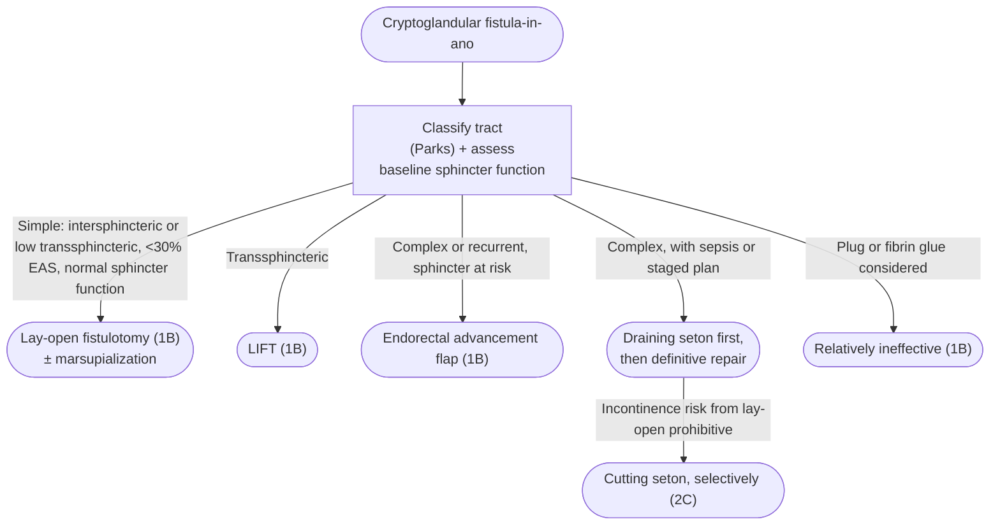

An **epithelialized tract connecting the perianal skin with the anal canal**. The accepted cause is cryptoglandular: an [[anorectal-abscess]] results from obstruction of an anal gland, and the fistula is produced by chronic infection and epithelialization of the abscess drainage tract ([[ascrs-2022-anorectal-abscess-fistula|American Society of Colon and Rectal Surgeons (ASCRS) 2022]]).

**The central trade-off is tract obliteration versus sphincter preservation** — the whole operative decision turns on how much external sphincter the tract crosses, so classifying the fistula is the decision, not a preamble. Fistula associated with [[crohns-disease|Crohn's disease]] is a different process (penetrating inflammation rather than gland infection) and is covered on [[perianal-fistulizing-crohns-disease]].

---

## Contents
- [[#Assessment]]
  - [[#Establishing the Diagnosis]]
  - [[#Parks Classification]]
  - [[#Simple vs Complex]]
- [[#Differential Diagnosis]]
- [[#Diagnostics]]
- [[#Therapeutics]]
  - [[#Choosing the Operation]]
  - [[#Fistulotomy]]
  - [[#Endorectal Advancement Flap]]
  - [[#LIFT]]
  - [[#Cutting Seton]]
  - [[#Plug and Fibrin Glue]]
  - [[#Minimally Invasive Techniques]]
- [[#See Also]]
- [[#Sources]]

---

## Assessment

### Establishing the Diagnosis

- **A disease-specific history and physical examination should be performed**, evaluating symptoms, relevant history, abscess and fistula location, and presence of secondary cellulitis ([[ascrs-2022-anorectal-abscess-fistula]] rec 1, *strong recommendation, low-quality evidence, 1C*).
- Typical presentation: **intermittent anorectal swelling and drainage**.
- History must capture **baseline anal sphincter function**, prior anorectal operations, family history of [[inflammatory-bowel-disease|inflammatory bowel disease (IBD)]], obstetric history, and associated gastrointestinal, genitourinary or gynecologic pathology — these drive the choice of sphincter-sparing versus sphincter-dividing repair.
- **Gentle probing of an external opening may confirm the tract but must be done with care to avoid creating false tracts.**
- **Goodsall's rule:** an **anterior** fistula has a **radial** tract to the anus; a **posterior** fistula has a **curvilinear** tract. Generally accurate for anterior fistulas, **less accurate for posterior fistulas**.
- **30–70%** of patients with an anorectal abscess present with a concomitant fistula; of those who do not, roughly **30–50%** are ultimately diagnosed with a fistula in the months to years after abscess drainage.

### Parks Classification

The fistula is classified by the relationship of the tract to the **internal and external anal sphincters** ([[ascrs-2022-anorectal-abscess-fistula]] Table 1, adapted from Parks et al).

| Fistula type | Description |
|---|---|
| **Submucosal** | Superficial fistula tract. Does **not** involve any sphincter muscle |
| **Intersphincteric** | Crosses the internal sphincter, then has a tract to the perianal skin. Does **not** involve the external anal sphincter muscle |
| **Transsphincteric** | Tracks from the internal opening across the dentate line via the internal **and** external anal sphincters, then terminates in the ischiorectal fossa or perineum |
| **Suprasphincteric** | Courses superiorly into the intersphincteric space over the top of the puborectalis muscle, then descends through the iliococcygeus muscle and into the ischiorectal fossa and the perianal skin |
| **Extrasphincteric** | Passes from the perineal skin through the ischiorectal fossa and levator muscles, then into the rectum, and lies **completely outside** the external sphincter complex |

- **Intersphincteric and transsphincteric fistulas are more frequently encountered** than suprasphincteric, extrasphincteric, and submucosal tracts.
- The Parks grade predicts how much magnetic resonance imaging (MRI) adds: MRI contributed significant findings in **5%** of grade 1, **48%** of grade 2, **86%** of grade 3, and **87.5%** of grade 4 fistulas.

### Simple vs Complex

**This is the classification that picks the operation.**

| | Criteria ([[ascrs-2022-anorectal-abscess-fistula]]) |
|---|---|
| **Simple** | **Intersphincteric** or **low transsphincteric** fistulas involving **<30% of the external anal sphincter**, with none of the complex features below |
| **Complex** | Transsphincteric fistula involving **>30% of the external sphincter** · **suprasphincteric** · **extrasphincteric** · **horseshoe** · associated with **IBD, radiation, malignancy, preexisting fecal incontinence, or chronic diarrhea** |

- **Recurrent or branching** fistulas may also be described as complex.
- **Anterior fistulas in women deserve special consideration and may also be considered complex** — given the attenuated nature of the anterior sphincter in women.
- A fistula may additionally be classified by **level**, which matters in [[rectovaginal-fistula|rectovaginal fistula]].

> [!pearl] 30% of the external sphincter is the line
> Everything in the operative menu sorts on it: at or below ~30% external sphincter involvement, lay-open fistulotomy is a strong recommendation with >90% healing; above it, fistulotomy carries **10–40%** significant fecal incontinence and a sphincter-sparing repair (flap or LIFT) is used instead ([[ascrs-2022-anorectal-abscess-fistula]]).

---

## Differential Diagnosis

[[anorectal-abscess]] · [[anal-fissure]] · [[hemorrhoids|thrombosed hemorrhoid]] · pilonidal disease · hidradenitis suppurativa · anorectal neoplasia · [[crohns-disease|Crohn's disease]] · sexually transmitted infections · [[rectovaginal-fistula]] ([[ascrs-2022-anorectal-abscess-fistula]]).

- **Crohn's disease:** fistula-in-ano incidence is **10–20%** in population-based studies and **50%** in longitudinal studies; nearly **80%** of patients with Crohn's disease cared for at tertiary referral centers have a history of fistula-in-ano. Management is multidisciplinary — see [[perianal-fistulizing-crohns-disease]].

---

## Diagnostics

**Routine diagnostic imaging is not typically necessary.** Imaging **may be considered** in selected patients with an **occult anorectal abscess, recurrent or complex anal fistula, immunosuppression, or anorectal Crohn's disease** ([[ascrs-2022-anorectal-abscess-fistula]] rec 2, *strong recommendation, moderate-quality evidence, 1B*).

| Modality | Performance | Notes |
|---|---|---|
| **MRI** | Suspected anal fistula (50 patients, prospective): sensitivity **95%**, specificity **80%**, positive predictive value **97%** for detecting and grading the **primary** fistula tract | Identifies secondary (blind) tracts, horseshoe abscesses, and abscesses missed on examination in **34%** of patients. Significantly better at evaluating secondary extensions in complex fistulas than endoanal ultrasound (**97% vs 74%**, *p* = 0.04) |
| **Endoanal ultrasound (EAUS)** | Concordance with operative findings **73–100%** | 2 or 3 dimensions, ± peroxide enhancement. Preoperative EAUS may **preserve anorectal function**: significantly worse Fecal Incontinence Severity Scores at mean 34-week follow-up in 230 patients without preoperative imaging vs 109 with it |
| **Transperineal ultrasound (TPUS)** | Diagnostic accuracy nearly identical to EAUS and MRI (23 patients with Crohn's disease) | Noninvasive, low cost, available — but **operator-dependent** and not widely adopted |
| **Examination under anesthesia (EUA)** | Accurate in 91% of 34 patients with anorectal Crohn's disease | Combining **any 2** of EUA, EAUS and MRI achieved **100%** accuracy |

- MRI provided significant findings more often in **complex** than simple fistulas (**54% vs 5%**, *p* < 0.001).
- 3-dimensional EAUS and MRI had comparable accuracy in **simple** fistulas (prospective trial, 126 patients) but MRI was significantly better for secondary extensions in **complex** fistulas.

---

## Therapeutics

### Choosing the Operation

The primary goals of operative treatment are to **obliterate the internal opening and associated epithelialized tracts** and to **preserve anal sphincter function**. **No single technique is appropriate for all fistulas** — the choice weighs cause and anatomy of the tract, degree of symptoms, comorbidities, surgeon experience, and the interplay between extent of sphincter division and the risks of healing problems, recurrence, and poor functional outcome ([[ascrs-2022-anorectal-abscess-fistula]]).

*Operative choice in cryptoglandular fistula-in-ano*
*Source: built from ASCRS 2022 recommendations 6, 7, 8, 9 and 10 (the guideline has no flowchart)*
*[[ascrs-2022-anorectal-abscess-fistula|ASCRS 2022 Anorectal Abscess, Fistula-in-Ano, and Rectovaginal Fistula]]*
*EAS = external anal sphincter · LIFT = ligation of the intersphincteric fistula tract*

### Fistulotomy

**Patients with a simple fistula-in-ano and normal anal sphincter function may be treated with lay-open fistulotomy** ([[ascrs-2022-anorectal-abscess-fistula]] rec 6, *strong recommendation, moderate-quality evidence, 1B*).

- **Fistula resolution rates >90%**, with high patient satisfaction.
- **Continence:** in appropriately selected patients with **low-lying** fistulas involving **less than one-third of the external anal sphincter**, the risk of clinically significant fecal incontinence is **minimal**. Fistulotomy for **high-lying or otherwise complex** fistulas may result in significant postoperative fecal incontinence in **10–40%** of patients.
  - A multicenter retrospective study of 537 patients with low fistulas nonetheless reported a **28%** incidence of major postprocedure fecal incontinence — retrospective methodology and absent preoperative continence evaluation may have influenced the result.
- **Risk factors for sphincter dysfunction after fistulotomy:** preoperative [[fecal-incontinence]] · recurrent fistula · female sex · complex fistula · previous anorectal surgery. **Women with anterior fistulas, or with possible occult sphincter damage from previous birthing trauma, are also at risk** — use an intervention other than fistulotomy to preserve function.
- **Factors related to recurrence after fistulotomy:** branching fistulas · failure to accurately identify the internal opening · fistulas associated with Crohn's disease.
- **Marsupialization** of the fistulotomy wound: 4 RCTs found **less postoperative bleeding and improved wound healing**.
- **Topical adjuncts:** 10% sucralfate and 2% phenytoin applied to the fistulotomy site were associated with **decreased postoperative pain and improved healing** compared with placebo.
- **Fistulectomy (coring out the tract) rather than laying it open:** a 1985 RCT (n = 47) found **longer healing times, larger defects and a higher risk of fecal incontinence** with comparable recurrence rates; a meta-analysis of 6 RCTs did not offer conclusive evidence that fistulectomy was associated with worse outcomes in **low-lying** fistulas.

### Endorectal Advancement Flap

**Fistula-in-ano may be treated with endorectal advancement flap** ([[ascrs-2022-anorectal-abscess-fistula]] rec 7, *strong recommendation, moderate-quality evidence, 1B*).

- **Technique:** curettage of the fistula tract, suture closure of the internal opening, and covering of the internal opening with a mobilized segment of rectum.
- **Healing 66–87%** for cryptoglandular fistula; **57–100%** when repeated after a failed initial approach (including after LIFT).
- **Factors associated with flap failure:** history of pelvic radiation therapy · underlying active proctitis · history of abscess drainage · [[rectovaginal-fistula|rectovaginal fistula]] · smoking · malignancy · obesity · **more than 1 previous attempted repair**.
- **A diverting stoma has not been shown to improve outcomes after endorectal advancement flap and is not typically recommended.**
- **Caveats:** internal anal sphincter fibers may be included in the flap to preserve blood flow, and mild-to-moderate decreased manometric resting and squeeze pressures have been reported in up to **35%** of patients. Flaps in the **posterior position**, especially in men with deep buttocks, can be technically challenging. In patients with fistulas whose **internal opening is distal to the dentate line**, the flap may result in **mucosal ectropion** — consider another approach.

### LIFT

**Transsphincteric fistulas may be treated with ligation of the intersphincteric fistula tract (LIFT)** ([[ascrs-2022-anorectal-abscess-fistula]] rec 8, *strong recommendation, moderate-quality evidence, 1B*).

- **Technique:** suture ligation and division of the fistula tract in the intersphincteric plane. A draining seton may be used beforehand to allow for fibrosis of the tract, but this **has not been shown to affect the success rate**.
- **Meta-analysis of 1378 LIFT procedures (26 studies):** overall success **76%**, overall complication rate **14%**, fecal incontinence rate **1.4%**.
- **Risk factors for failure:** horseshoe anatomy · Crohn's disease fistula · history of fistula surgery.
- **Long-term primary healing is lower** (42–62%), but LIFT is associated with significant rates of **secondary healing after surgical reintervention** — typically fistulotomy for an intersphincteric recurrence — ranging from **77% to 86%**.
- **Modifications of the LIFT procedure** (excising the lateral aspect of the tract, incorporating a fistula plug or biologic mesh interposition, video-assisted techniques) have in some studies been associated with improved healing rates, but the supporting evidence is limited to small studies and such modifications are **typically not recommended**.

### Cutting Seton

**A cutting seton may be used selectively in the management of complex cryptoglandular anal fistulas** ([[ascrs-2022-anorectal-abscess-fistula]] rec 9, *weak recommendation, low-quality evidence, 2C* — downgraded from 2B in the 2016 guideline).

- **Staged strategy:** complex fistulas are often treated initially by placing a **draining seton to control local sepsis**, followed by a staged definitive procedure to eradicate the fistula. Healing under these circumstances ranges **62–100%** depending on the definitive operation.
- **Cutting seton specifically:** left in place and **tightened at intervals**, gradually dividing the fistula and any involved anal sphincter. It is **not a sphincter-sparing procedure** — it was historically performed when the risk of fecal incontinence from a lay-open fistulotomy was considered prohibitively high.
- **Outcomes:** healing **~90%** with preservation of anal sphincter function in the majority. In 121 patients with low-lying or complex fistulas treated by a single surgeon, a **98%** healing rate with only 8 patients (7%) developing incontinence. An earlier pooled review of 37 studies (1460 patients) reported postoperative fecal incontinence ranging **0–67%**, with variable functional outcomes depending on tract type and the definition of incontinence used.
- **Because a cutting seton can result in functional impairment, use it in carefully selected patients.**

### Plug and Fibrin Glue

**The anal fistula plug and fibrin glue are relatively ineffective treatments for fistula-in-ano** ([[ascrs-2022-anorectal-abscess-fistula]] rec 10, *strong recommendation, moderate-quality evidence, 1B* — the recommendation grade changed from 2B in 2016).

| Technique | What it is | Outcome |
|---|---|---|
| **Anal fistula plug** | Bioprosthetic acellular collagen matrix placed to close the internal opening; a scaffold for native tissue in-growth | Early data **70–100%** success; more recently **≤50%**. Early plug failure, typically from localized sepsis or plug dislodgement, in **4–41%** |
| **Fibrin glue** | Injected into the tract | 2019 randomized controlled double-blind trial: complete fistula healing in **10 of 24 (41%)** |

- **Plug failure is more common** in patients with Crohn's disease, anovaginal fistula, recurrent fistula, and active smokers.
- In a retrospective review of 462 patients undergoing sphincter-preserving surgery for cryptoglandular anal fistula (2005–2015), use of the plug (healing 24%) and fibrin glue (healing 18%) **decreased significantly over the interval** while overall fistula healing rose from **32% to 64%**.
- Their **sphincter-sparing nature** allows for continued but selective use despite the poor healing rates.

### Minimally Invasive Techniques

**Minimally invasive approaches to treat fistula-in-ano that use endoscopic or laser closure techniques have reasonable short-term healing rates but unknown long-term fistula healing and recurrence rates** ([[ascrs-2022-anorectal-abscess-fistula]] rec 11, *weak recommendation, low-quality evidence, 2C* — new in 2022; these techniques were not addressed in the 2016 guideline).

| Technique | Method | Reported outcome |
|---|---|---|
| **VAAFT** (video-assisted anal fistula treatment) | Fistuloscopy through the external opening to identify the internal opening; closure of the internal orifice with sutures, clips or a stapling device; selective debridement or obliteration of the tract | Healing **71–85%**, follow-up intervals typically **<12 months**, minor or no fecal incontinence reported. The majority of institutional experience is **preliminary** |
| **FiLaC** (fistula laser closure) | Radially emitting laser probe passed along the tract traumatizes the epithelium and, in theory, obliterates the tract | Meta-analysis of 7 case series and comparative studies (454 patients; 69% transsphincteric, 35% recurrent): **65% healed** at median 24 months, **4%** complications, mean incontinence rate **1%** |
| **Over-the-scope clip (OTSC)** | Super-elastic nitinol clip placed over the fistula's internal opening with a transanal applicator, frequently combined with a fistuloscopy | Primary healing **79–90%** in small single-institution series, limited follow-up; clip removal required for pain in a minority. In a German series of 100 (55 transsphincteric, 38 suprasphincteric, 2 extrasphincteric, 5 rectovaginal fistulas), healing at 6 months was **79%** for first-time fistula therapy vs **26%** for recurrent fistulas |

---

## See Also

[[anorectal-abscess]], [[rectovaginal-fistula]], [[perianal-fistulizing-crohns-disease]], [[crohns-disease]], [[anal-fissure]], [[hemorrhoids]], [[fecal-incontinence]], [[anorectal-manometry]], [[inflammatory-bowel-disease]]

---

## Sources

1. [[ascrs-2022-anorectal-abscess-fistula|The American Society of Colon and Rectal Surgeons Clinical Practice Guidelines for the Management of Anorectal Abscess, Fistula-in-Ano, and Rectovaginal Fistula (2022)]]
