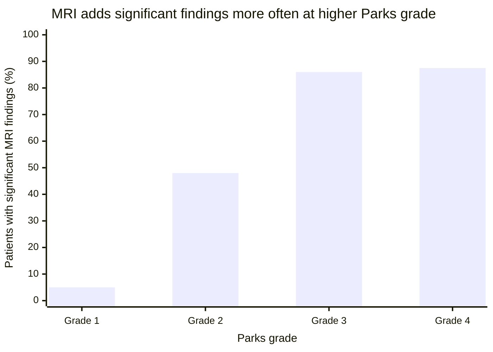

An **epithelialized tract connecting the perianal skin with the anal canal**. The accepted cause is cryptoglandular: an [[anorectal-abscess]] results from obstruction of an anal gland, and the fistula is produced by chronic infection and epithelialization of the abscess drainage tract ([[ascrs-2022-anorectal-abscess-fistula|American Society of Colon and Rectal Surgeons (ASCRS) 2022]]).

**The central trade-off is tract obliteration versus sphincter preservation** — the operative decision turns on the tract's anatomy and how much sphincter it crosses, so classifying the fistula is the decision, not a preamble.

---

## Contents
- [[#Assessment]]
  - [[#Establishing the Diagnosis]]
  - [[#Parks Classification]]
  - [[#Simple vs Complex]]
- [[#Differential Diagnosis]]
- [[#Diagnostics]]
- [[#Therapeutics]]
  - [[#Choosing the Operation]]
  - [[#Fistulotomy]]
  - [[#Endorectal Advancement Flap]]
  - [[#LIFT]]
  - [[#Cutting Seton]]
  - [[#Plug and Fibrin Glue]]
  - [[#Minimally Invasive Techniques]]
- [[#See Also]]
- [[#Sources]]

---

## Assessment

### Establishing the Diagnosis

- **A disease-specific history and physical examination should be performed**, evaluating symptoms, relevant history, abscess and fistula location, and presence of secondary cellulitis ([[ascrs-2022-anorectal-abscess-fistula]] rec 1, *strong recommendation, low-quality evidence, 1C*).
- Typical presentation: **intermittent anorectal swelling and drainage**.
- History should typically include **baseline anal sphincter function**, prior anorectal operations, family history of [[inflammatory-bowel-disease|inflammatory bowel disease (IBD)]], obstetric history, and associated gastrointestinal, genitourinary or gynecologic pathology.
- **Gentle probing of an external opening, when tolerated, may confirm the tract — done with care to avoid creating false tracts.**
- **Goodsall's rule:** an **anterior** fistula has a **radial** tract to the anus; a **posterior** fistula has a **curvilinear** tract. Generally accurate for anterior fistulas, **less accurate for posterior fistulas**.
- **30–70%** of patients with an anorectal abscess present with a concomitant fistula; of those who do not, roughly **30–50%** are ultimately diagnosed with a fistula in the months to years after abscess drainage.

### Parks Classification

The fistula is classified by the relationship of the tract to the **internal and external anal sphincters** ([[ascrs-2022-anorectal-abscess-fistula]] Table 1, adapted from Parks et al).

| Fistula type | Description |
|---|---|
| **Submucosal** | Superficial fistula tract. Does **not** involve any sphincter muscle |
| **Intersphincteric** | Crosses the internal sphincter, then has a tract to the perianal skin. Does **not** involve the external anal sphincter muscle |
| **Transsphincteric** | Tracks from the internal opening at the dentate line via the internal **and** external anal sphincters, then terminates in the perianal skin or perineum |
| **Suprasphincteric** | Courses superiorly into the intersphincteric space over the top of the puborectalis muscle, then descends through the iliococcygeus muscle and into the ischiorectal fossa and the perianal skin |
| **Extrasphincteric** | Passes from the perineal skin through the ischiorectal fossa and levator muscles, then into the rectum, and lies **completely outside** the external sphincter complex |

*Parks classification of fistula-in-ano*
*Source: redrawn from Table 1 of ASCRS 2022 (adapted from Parks et al)*
*[[ascrs-2022-anorectal-abscess-fistula|ASCRS 2022 Anorectal Abscess, Fistula-in-Ano, and Rectovaginal Fistula]]*

- **Intersphincteric and transsphincteric fistulas are more frequently encountered** than suprasphincteric, extrasphincteric, and submucosal tracts.

### Simple vs Complex

| | Criteria ([[ascrs-2022-anorectal-abscess-fistula]]) |
|---|---|
| **Simple** | **Intersphincteric** or **low transsphincteric** fistulas involving **<30% of the external anal sphincter**, with none of the complex features below |
| **Complex** | Transsphincteric fistula involving **>30% of the external sphincter** · **suprasphincteric** · **extrasphincteric** · **horseshoe** · associated with **IBD, radiation, malignancy, preexisting [[fecal-incontinence\|fecal incontinence]], or chronic diarrhea** |

- **Recurrent or branching** fistulas may also be described as complex.
- **Anterior fistulas in women deserve special consideration and may also be considered complex** — given the attenuated nature of the anterior sphincter in women.
- [[rectovaginal-fistula|Rectovaginal fistula]] has its own level (low / middle / high) and simple-vs-complex definitions — on its page.

---

## Differential Diagnosis

- **[[crohns-disease|Crohn's disease]]-associated fistula** is a different process — penetrating inflammation rather than anal gland infection — managed multidisciplinarily: see [[perianal-fistulizing-crohns-disease]].
  - Fistula-in-ano incidence in Crohn's disease: **10–20%** in population-based studies, **50%** in longitudinal studies; nearly **80%** of patients with Crohn's disease at tertiary referral centers have a history of it.
- ASCRS 2022 gives its differential ([[anal-fissure|fissure]], [[hemorrhoids|thrombosed hemorrhoid]], pilonidal disease, hidradenitis, neoplasia, Crohn's disease, sexually transmitted infection) for the abscess presentation — see [[anorectal-abscess#Differential Diagnosis]].

---

## Diagnostics

**Routine diagnostic imaging is not typically necessary.** Imaging **may be considered** in selected patients with an **occult anorectal abscess, recurrent or complex anal fistula, immunosuppression, or anorectal Crohn's disease** ([[ascrs-2022-anorectal-abscess-fistula]] rec 2, *strong recommendation, moderate-quality evidence, 1B*).

| Modality | Performance | Notes |
|---|---|---|
| **Magnetic resonance imaging (MRI)** | Suspected anal fistula (50 patients, prospective): sensitivity **95%**, specificity **80%**, positive predictive value **97%** for detecting and grading the **primary** tract | "Significant" findings (secondary blind tracts, horseshoe abscesses, abscesses missed on physical examination or examination under anesthesia [EUA]) in **34%** of 136 patients — more often in **complex** than simple fistulas (**54% vs 5%**, *p* < 0.001). Vs 3-dimensional endoanal ultrasound (126 patients): comparable in simple fistulas; more sensitive for secondary extensions in complex fistulas (**97% vs 74%**, *p* = 0.04) |
| **Endoanal ultrasound (EAUS)** | Concordance with operative findings **73–100%** | 2 or 3 dimensions, ± peroxide enhancement. Preoperative EAUS may **preserve anorectal function**: worse Fecal Incontinence Severity Scores at mean 34 weeks in 230 patients without preoperative imaging vs 109 with it |
| **Transperineal ultrasound (TPUS)** | Diagnostic accuracy nearly identical to EAUS and MRI (23 patients with Crohn's disease) | Noninvasive, low cost, available — but **operator-dependent** and not widely adopted |
| **EUA** | Accurate in 91% of 34 patients with anorectal Crohn's disease (EAUS 91%, MRI 87%) | Combining **any 2** of EUA, EAUS and MRI achieved **100%** accuracy |

*Share of patients in whom preoperative MRI gave significant findings, by Parks grade*
*Source: data from a retrospective study of 136 patients with anal fistula (Konan et al), cited in ASCRS 2022*
*[[ascrs-2022-anorectal-abscess-fistula|ASCRS 2022 Anorectal Abscess, Fistula-in-Ano, and Rectovaginal Fistula]]*
*MRI = magnetic resonance imaging*

---

## Therapeutics

### Choosing the Operation

The primary goals of operative treatment are to **obliterate the internal opening and associated epithelialized tracts** and to **preserve anal sphincter function**. **No single technique is appropriate for all fistulas** — the choice weighs cause and anatomy of the tract, degree of symptoms, comorbidities, surgeon experience, and the interplay between extent of sphincter division and the risks of healing problems, recurrence, and poor functional outcome ([[ascrs-2022-anorectal-abscess-fistula]]).

| Operation | ASCRS 2022 recommendation (grade) | Healing | Continence |
|---|---|---|---|
| **Lay-open fistulotomy** | Rec 6: **simple** fistula with **normal anal sphincter function** *may be treated* with it (strong, 1B) | Resolution **>90%** | Minimal risk in selected **low-lying** fistulas (less than one-third of the external anal sphincter); significant incontinence in **10–40%** when used for high-lying or otherwise complex fistulas |
| **Endorectal advancement flap** | Rec 7: fistula-in-ano *may be treated* with it (strong, 1B) | **66–87%** initial; **57–100%** when repeated after a failed flap or other failed approach (incl. ligation of the intersphincteric fistula tract [LIFT]) | Mild-to-moderate incontinence with lower [[anorectal-manometry\|manometric]] resting and squeeze pressures in up to **35%** |
| **LIFT** | Rec 8: **transsphincteric** fistulas *may be treated* with it (strong, 1B) | **76%** overall (meta-analysis, 1378 procedures, 26 studies); long-term primary healing **42–62%** | Incontinence **1.4%**; complications 14% |
| **Cutting seton** | Rec 9: *selectively* for **complex** cryptoglandular fistulas (weak, 2C; was 2B in 2016) | **~90%** | Not sphincter-sparing; incontinence **0–67%** across 37 pooled studies |
| **Anal fistula plug, fibrin glue** | Rec 10: **relatively ineffective** (strong, 1B; was 2B in 2016) | Plug **≤50%** in recent series; glue **41%** (10/24) in a 2019 double-blind randomized controlled trial (RCT) | Sphincter-preserving |
| **Endoscopic or laser closure** — video-assisted anal fistula treatment (VAAFT), fistula laser closure (FiLaC), over-the-scope clip (OTSC) | Rec 11: reasonable short-term healing, **unknown** long-term healing and recurrence (weak, 2C; new in 2022) | See [[#Minimally Invasive Techniques]] | See [[#Minimally Invasive Techniques]] |

*Operative options for cryptoglandular fistula-in-ano*
*Source: built from ASCRS 2022 recommendations 6–11 and their supporting text*
*[[ascrs-2022-anorectal-abscess-fistula|ASCRS 2022 Anorectal Abscess, Fistula-in-Ano, and Rectovaginal Fistula]]*
*LIFT = ligation of the intersphincteric fistula tract · RCT = randomized controlled trial · VAAFT = video-assisted anal fistula treatment · FiLaC = fistula laser closure · OTSC = over-the-scope clip*

- ASCRS 2022 does not rank recommendations 6–8 against each other.

### Fistulotomy

> [!pitfall] Screen for sphincter risk before laying open
> Preoperative fecal incontinence, recurrent fistula, female sex, complex fistula, previous anorectal surgery, anterior fistula in a woman, or possible occult obstetric sphincter damage → interventions other than fistulotomy are generally recommended to preserve function ([[ascrs-2022-anorectal-abscess-fistula]]).

- High patient satisfaction.
- Even low fistulas carry some risk: a multicenter retrospective study of 537 patients reported **28%** major postprocedure incontinence (retrospective, no preoperative continence evaluation).
- **Recurrence after fistulotomy:** branching fistulas · failure to identify the internal opening · Crohn's disease–associated fistula.
- **Wound adjuncts:** marsupialization → less bleeding, better wound healing (4 RCTs); topical 10% sucralfate or 2% phenytoin → less pain, better healing vs placebo.
- **Fistulectomy (coring out the tract):** 1985 RCT (n = 47) — longer healing, larger defects, more incontinence, similar recurrence vs fistulotomy; a 6-RCT meta-analysis was inconclusive for **low-lying** fistulas.

### Endorectal Advancement Flap

- **Technique:** curettage of the tract → suture closure of the internal opening → cover it with a mobilized segment of rectum. Internal anal sphincter fibers may be included in the flap to preserve blood flow.
- **Failure factors:** pelvic radiation therapy · underlying Crohn's disease · active proctitis · prior abscess drainage · rectovaginal fistula · smoking · malignancy · obesity · **more than 1 previous attempted repair**.
- **Diverting stoma:** not shown to improve outcomes; **not typically recommended**.
- **Posterior** flaps, especially in men with deep buttocks, can be technically challenging.
- **Internal opening distal to the dentate line** → flap may cause **mucosal ectropion**; consider another approach.

### LIFT

- **Technique:** suture ligation and division of the tract in the intersphincteric plane. A preceding draining seton (to let the tract fibrose) may ease the procedure but **has not been shown to change success**.
- **Failure risk factors:** horseshoe anatomy · Crohn's disease fistula · prior fistula surgery.
- **After failure:** secondary healing after reintervention (typically fistulotomy for an intersphincteric recurrence) **77–86%**.
- **Modifications** (lateral tract excision, added plug or biologic mesh, video-assisted): small studies only → **typically not recommended**.

### Cutting Seton

- **Common staged route for complex fistulas:** **draining seton to control local sepsis** → staged definitive procedure; healing **62–100%** depending on the definitive operation.
- **Cutting seton:** left in place and **tightened at intervals**, gradually dividing the fistula and any involved sphincter. Historically used when lay-open fistulotomy's incontinence risk was considered prohibitively high.
- Sphincter function preserved in the majority in retrospective series, but incontinence in pooled data varies with tract type and the definition used → can impair function; **carefully selected patients only**.

### Plug and Fibrin Glue

- **Plug:** bioprosthetic acellular collagen matrix closing the internal opening, a scaffold for tissue in-growth. Early data **70–100%** success; later outcomes less encouraging. Early failure (localized sepsis or dislodgement) **4–41%** (2016 systematic review); failure more common with Crohn's disease, anovaginal fistula, recurrent fistula, and active smoking.
- **Fibrin glue:** injected into the tract; use has declined on disappointing contemporary data.
- **Continued selective use** of both is justified by the chance of success plus their sphincter-preserving nature.

### Minimally Invasive Techniques

Described in small single-institution series with limited follow-up and varying industry support; not addressed in the 2016 guideline.

| Technique | Method | Reported outcome |
|---|---|---|
| **VAAFT** | Fistuloscopy through the external opening to find the internal opening; closure of the internal orifice with sutures, clips or stapler; selective debridement or obliteration of the tract | Healing **71–85%**, follow-up typically **<12 months**, minor or no incontinence. Experience mostly **preliminary** |
| **FiLaC** | Radially emitting laser probe passed along the tract traumatizes the epithelium and, in theory, obliterates it | Meta-analysis of 7 series (454 patients; 69% transsphincteric, 35% recurrent): **65% healed** at median 24 months, **4%** complications, mean incontinence **1%** |
| **OTSC** | Super-elastic nitinol clip over the internal opening via a transanal applicator, often with fistuloscopy | Primary healing **79–90%**, limited follow-up; clip removal for pain in a minority. German series of 100: **79%** healed at 6 months for first-time therapy vs **26%** for recurrent fistulas |

---

## See Also

[[anorectal-abscess]], [[rectovaginal-fistula]], [[perianal-fistulizing-crohns-disease]], [[crohns-disease]], [[anal-fissure]], [[hemorrhoids]], [[fecal-incontinence]], [[anorectal-manometry]], [[inflammatory-bowel-disease]]

---

## Sources

1. [[ascrs-2022-anorectal-abscess-fistula|The American Society of Colon and Rectal Surgeons Clinical Practice Guidelines for the Management of Anorectal Abscess, Fistula-in-Ano, and Rectovaginal Fistula (2022)]]
