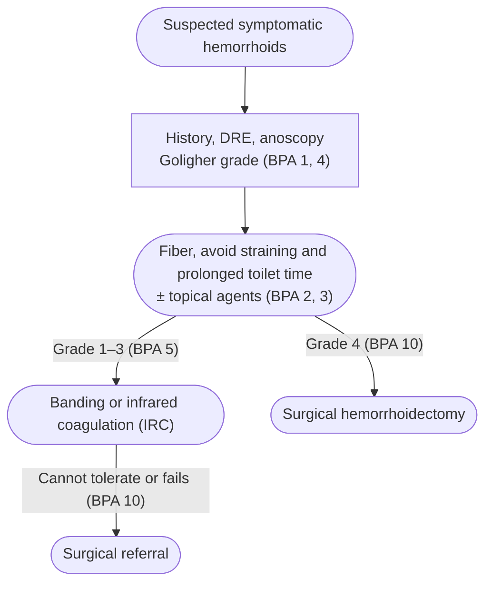

## Contents
- [[#Assessment]]
  - [[#Establishing the Diagnosis]]
  - [[#Severity Assessment / Classification]]
- [[#Differential Diagnosis]]
- [[#Diagnostics]]
- [[#Therapeutics]]
  - [[#Treatment by Grade]]
  - [[#Conservative (All Grades — First Line)]]
  - [[#Office-Based Procedures (Grades 1–3, Medical Therapy Failures)]]
  - [[#Thrombosed External Hemorrhoids]]
  - [[#Surgery (Grade 3–4, Office Procedure Failures)]]
  - [[#Special Populations (AGA 2026)]]
- [[#See Also]]
- [[#Sources]]

## Assessment

### Establishing the Diagnosis

- **Definition:** anal cushions (vascular tissue normally present in the anal canal; part of anal sensation and continence) are termed **internal hemorrhoids** when they bleed, or enlarge and protrude into the anal canal from above the dentate line *([[acg-2021-anorectal-disorders|American College of Gastroenterology (ACG) 2021]])*
- **Diagnosis = history + examination** *([[aga-2026-hemorrhoids|American Gastroenterological Association (AGA) 2026]] Best Practice Advice (BPA) 1)* — perineal inspection, careful digital rectal exam (DRE), anoscopy *([[asge-2010-anorectal-disorders|American Society for Gastrointestinal Endoscopy (ASGE) 2010]])*
- **Symptoms:** bleeding, itching, discomfort, and/or prolapse; **significant pain only when acutely thrombosed** — sharp pain on defecation → most likely [[anal-fissure|anal fissure]] *(BPA 1)*
- **Internal hemorrhoids** (above the dentate line): cardinal signs *(ACG 2021)*
  - **Hemorrhoid-pattern bleeding** — painless bleeding with bowel movements
  - **Intermittent, reducible protrusion**
  - Diagnosis of exclusion — rule out other sources of bleeding and protrusion
- **External hemorrhoids** (distal to the dentate line; squamous epithelium): painless unless acutely thrombosed → sudden pain and swelling external to or just inside the anal verge *(ACG 2021)*
- Bleeding is more likely internal; itching more likely external *(AGA 2026)*

### Severity Assessment / Classification

**Goligher's classification** — internal hemorrhoids graded by **degree of prolapse** *(Table 1, AGA 2026)*:

| Grade | Description |
|-------|-------------|
| Grade 1 | Do **not** prolapse below the dentate line; bleeding only |
| Grade 2 | Prolapse below the dentate line during defecation but **spontaneously reduce** |
| Grade 3 | Prolapse below the dentate line and require **manual reduction** |
| Grade 4 | Prolapse and **stay** below the dentate line; **not reducible** |

- Graded mostly from the **history** — exam can confirm, but a good history classifies the grade *(AGA 2026)*
- **No standard classification for external hemorrhoids** — description is frequently subjective *(AGA 2026)*
- Grade drives treatment — see [[#Treatment by Grade]]

---

## Differential Diagnosis

*Workup: see [[acute-lower-gi-bleeding]].*

| Condition | Distinguishing features |
|-----------|-------------|
| [[rectal-prolapse\|Rectal prolapse]] | Intussusception of the rectal wall through the anal canal — **circular** folds of pink rectal mucosa; prolapsed hemorrhoids have **radial** folds and engorged vessels *(AGA 2026)* |
| [[anal-fissure\|Anal fissure]] | Sharp pain on defecation or on DRE. **Coexists with hemorrhoid disease in up to 20%** — when both are present, **treat the fissure first** *(AGA 2026; ASGE 2010 also ~20%)* |
| [[colorectal-cancer\|Colorectal cancer]] or other concomitant disease | Colonoscopy — see [[#Diagnostics]] |
| Condylomas, early anal cancer | Anoscopy views the entire anal canal so these are not missed *(AGA 2026)* |
| [[crohns-disease\|Crohn's disease]] | Anal skin tags in a young patient with abdominal pain and/or diarrhea → work up to exclude Crohn's *(AGA 2026)* |
| Anal skin tags | Residual redundant skin from prior inflammation and thrombosis; painless *(ACG 2021)*; harmless, best left alone *(AGA 2026)* |
| Rectal varices | Mid and more proximal rectum, in [[portal-hypertension\|portal hypertension]] — see [[#Special Populations (AGA 2026)]] |

---

## Diagnostics

- **Anoscopy — BPA 4:** perform, **whenever possible**, on every new patient with suspected hemorrhoids, **before treatment**, to ensure an accurate diagnosis *(AGA 2026)*
  - **Superior to flexible endoscopy** and the preferred method to examine the anal canal
  - Left lateral decubitus, after the DRE; easy to learn; usually in the office, but can also follow a [[colonoscopy]] for better assessment of the anal canal
  - **Best scopes: disposable, slotted or beveled, with a built-in light.** A **beveled** scope can be rotated without trauma to the hemorrhoid column; a **slotted** scope cannot be rotated inside the anal canal without damaging the column
  - Tense or nervous patient → ask the patient to bear down during insertion (relaxes the pelvic floor)
  - Not **high-resolution anoscopy**, which uses a colposcope to detect anal intraepithelial neoplasia or early anal cancer
- **Flexible endoscopy:** if being performed, view internal hemorrhoids on **retroflexion** *(ASGE 2010)*
- **Colonoscopy:** consider full colonoscopy in patients with rectal bleeding to rule out concomitant or more serious disease *(AGA 2026)*; endoscopic evaluation for colorectal cancer depends on the clinical situation — age, symptoms, previous evaluation, family history *(ASGE 2010)*

---

## Therapeutics

### Treatment by Grade

*Hemorrhoid treatment by Goligher grade*
*Source: built from AGA 2026 BPA 1, 2, 3, 4, 5 and 10 and its BPA 10 text (the update has no flowchart)*
*[[aga-2026-hemorrhoids|AGA 2026 Hemorrhoids Clinical Practice Update]]*
*DRE = digital rectal exam · BPA = Best Practice Advice · IRC = infrared coagulation*

> **Guidelines differ on grade 3.** AGA 2026 BPA 5: banding or IRC **should be employed prior to** hemorrhoidectomy for **grades 1–3** — yet its Conclusion limits banding/IRC to **grade 1 and 2**, with surgical referral individualized. ACG 2021 Rec 3 (Strong; moderate quality on the basis of grade 2, none for grade 1): office procedures for **grade 1–2** failing medical therapy; grade 3 → Doppler-guided ligation (Rec 4). ASGE 2010 Rec 7 (recommend; moderate quality): rubber band ligation (RBL) is the initial treatment of choice for chronic bleeding and/or prolapsing **grade 2–3** after failed conservative care. The page follows the newer, ungraded AGA 2026.

### Conservative (All Grades — First Line)

- **ACG 2021 Rec 1 (Strong / moderate quality):** dietary modification with adequate fluid and fiber intake **plus counseling to minimize straining at defecation** = first-line therapy for symptomatic hemorrhoids
- **AGA 2026 BPA 2:** diet and lifestyle changes — more fiber, avoid straining or prolonged time on the toilet — are reasonable first-line therapies
- Fiber **20–30 g/day**; fluids **6–8 glasses/day** *(ACG 2021)*
- Discourage prolonged sitting on the toilet, including reading and cell phone use *(ACG 2021)*; a study cited by AGA 2026 advised limiting toilet time to **3 minutes** and defecating **once daily**
- Unable to increase dietary fiber → **polyethylene glycol 3350 or docusate** *(ACG 2021)*
- **Sitz baths:** often advised, but scientific data are limited *(BPA 2)*
- Bidets may limit pruritus — better hygiene, less friction from toilet paper *(AGA 2026)*
- **Topical agents (BPA 3)** — can be considered; little data support efficacy. Pick by symptom:
  - Burning / soreness → lidocaine, pramoxine, or benzocaine ointment
  - Inflammation + swelling with intense itching → **brief** course of hydrocortisone cream or suppository
  - Minor itching / irritation → witch hazel
  - Vasoactive: some Preparation H products contain phenylephrine — temporarily shrinks vessels, reduces swelling or bleeding
  - Barrier: zinc oxide, mineral oil, petrolatum
  - **Topical steroids ≤2 weeks at a time** — prolonged use thins the skin and makes it more sensitive

### Office-Based Procedures (Grades 1–3, Medical Therapy Failures)

**AGA 2026 BPA 5:** banding and IRC are both safe, effective and easy to do in the office; similar benefit short term; **RBL has longer-term benefit for prolapse and recurrent bleeding**.

| Procedure | Grades | Efficacy | Notes |
|-----------|--------|----------|-------|
| **[[endoscopic-band-ligation\|RBL]]** | 1–3 *(AGA 2026)*; ACG Rec 3: 1–2; ASGE Rec 7: chronic bleeding/prolapsing 2–3; ASGE Rec 6 (suggest; low quality): RBL **or** sclerotherapy for grade 1 that bleeds without prolapse after failed conservative care | **Most effective office procedure — success 66%–94%** (symptom resolution + treated prolapse) *(AGA 2026)*. Less need for repeat treatment than sclerotherapy or IRC in grade 1–3 (meta-analysis, ACG 2021). Cochrane: **as effective as excision for grade 2, less effective than excision for grade 3** *(AGA 2026)* | Complications **2%** — urinary retention, bleeding, secondary fissure *(AGA 2026)*; ACG 2021: pain, bleeding, external thrombosis, vasovagal symptoms in **1%–3%**; life-threatening sepsis vanishingly rare |
| **IRC** | Particularly 1–2, also **many grade 3**; **not for large, prolapsing hemorrhoids** *(AGA 2026)* | See BPA 5 above | Less post-procedure discomfort than RBL *(AGA 2026)* |
| **Sclerotherapy** | **Largely abandoned** — misplaced sclerosing injection, reduced efficacy vs safer modalities *(AGA 2026)*. Still an ACG 2021 Rec 3 alternative; ASGE 2010: effective for grade 1–2 | 75%–90% success in grade 1–3; recurrence frequent *(ACG 2021)* | Rare complications: mucosal necrosis, abscess, prostatitis, erectile dysfunction, portal pyemia *(ASGE 2010)* |
| **Bipolar coagulation** | ACG 2021 Rec 3 alternative | Chronic bleeding grade 2–3 (45-patient trial): success **92% RBL vs 62% bipolar**, similar safety; recurrence similar at 1 year *(ASGE 2010)* | — |

**RBL technique:**
- Office, **without sedation**; lubricated anoscope, identify the internal hemorrhoid, place the band **above (proximal to) the dentate line** → well tolerated; ischemic tissue necroses, ulcer scars and tacks mucosa to the rectal wall *(AGA 2026)*
- Rigid or flexible scope; multiple ligations easier with flexible, but more discomfort and cost *(ASGE 2010)*
- Experts caution against RBL in **sedated** patients — errant placement too close to or below the dentate line causes significant pain *(ASGE 2010)*
- Usually **≤3 hemorrhoidal groups per session** (some experts band 1 at a time); needing **4 or more bands** showed only a **trend toward** higher failure and later hemorrhoidectomy *(ASGE 2010)*

> [!pitfall] Band too close to the dentate line
> It causes pain — remove it immediately: roll it off with a finger or massage the hemorrhoid in a circular fashion ([[aga-2026-hemorrhoids]]).

**IRC technique *(AGA 2026)*:** under direct vision through an anoscope; **1–1.5-second bursts just proximal to the visible internal hemorrhoid column, 5 or 6 spots**, repeated for each column (white spot); may need repeating in a few weeks. **Pain or burning = possible transmural burn → reduce the energy.**

**Choosing RBL vs IRC *(AGA 2026)*:**
- Default **RBL** — most effective, longest-lasting
- **IRC favored** on [[anticoagulation-gi-bleeding|anticoagulants or antiplatelet agents]] — bleeding when the band falls off. ACG 2021 instead names sclerotherapy (effective in acute bleeding on anticoagulants or when immunocompromised) and RBL with caution; follow AGA 2026
- **IRC may also be preferred** in pregnancy (see below) and in young patients with significant [[irritable-bowel-syndrome|irritable bowel syndrome]] symptoms (more sensitive to banding; very little evidence)
- Post-procedure discomfort after either: over-the-counter acetaminophen or nonsteroidal anti-inflammatory drugs

**Pelvic sepsis — consent and counseling (BPA 6):**
- Informed consent for any hemorrhoid therapy covers the **small possibility of pelvic sepsis**; can follow surgery or office procedures such as RBL
- Written instructions: go to the emergency department (ED) immediately for **severe pain, urinary retention, fever, chills, or significant bleeding** (severe pain and urinary retention are most frequent; also perineal swelling/induration, muscle aches, altered mental status)
- Diagnosis → immediate, aggressive intervention, which may or may not require surgery
- Other infectious complications of RBL: liver abscess, Fournier's gangrene, tetanus, bacterial endocarditis. Aggressive IRC energy → transmural burn → abscess

> [!pitfall] Pelvic sepsis appears days later
> It can develop any time **3–10 days after banding** — give every banded patient the warning signs in writing ([[aga-2026-hemorrhoids]]).

### Thrombosed External Hemorrhoids

**AGA 2026 BPA 9:** acute thrombosed hemorrhoids are often extremely painful; **best treated surgically with incision and drainage (I&D)**. Early I&D gives the most effective, rapid relief vs conservative measures.

- Presentation: painful mass or nodule, may bleed *(AGA 2026)*
- **"De-roof" the cavity** so it does not reform with the incision closing over
- I&D can be done by a **gastroenterologist in the office or in the ED**; **antibiotics not required** afterward
- **Thrombectomy** (vs I&D): removes the entire thrombosed part, closed with sutures, usually by surgeons; immediate pain relief very similar
- **Most resolve without surgery**; excision offers early relief. **If excision is done: complete excision and evacuation of the clot** *(AGA 2026)*
- Conservative care: docusate stool softening, sitz baths, pain control — effective, but slower relief and higher recurrence *(ACG 2021)*

| | [[aga-2026-hemorrhoids\|AGA 2026]] (BPA 9) | [[acg-2021-anorectal-disorders\|ACG 2021]] (Rec 2, Strong / low quality) |
|---|---|---|
| **Procedure** | **I&D**, with de-roofing | **Either** surgical excision **or** incision and evacuation of the thrombus; text: excision of the clot **with removal of overlying skin** to prevent recurrence |
| **Timing** | No window stated for I&D; **72 hours** is cited only as the historical window for offering excision | **Within the first 4 days** |

*Follow AGA 2026 (newer); both favor early operative treatment over conservative care, and differ on excising the overlying skin.*

### Surgery (Grade 3–4, Office Procedure Failures)

**Refer to surgery *(AGA 2026 BPA 10 and its text)*:**
- Grades 1–3 that **cannot tolerate or fail** office procedures
- Concomitant **external** hemorrhoids
- Grade 3 **not responding to banding**
- **All grade 4** — grade 4 internal hemorrhoids **require surgical hemorrhoidectomy** (ACG 2021 also names traditional hemorrhoidectomy for grade 4)
- ASGE 2010: surgery is the treatment of choice for all grade 4, **strangulated** hemorrhoids, and failure of other therapy

Large skin tags not associated with significant hemorrhoids can be removed without a hemorrhoidectomy; AGA 2026 gives no size threshold.

**Excisional hemorrhoidectomy** — the definitive procedure *(AGA 2026)*:
- Entire internal + external complex dissected off the internal anal sphincter and excised
- **Closed wound → less postoperative bleeding, faster healing** than leaving it open
- Complications **1%–2%**: urinary retention, bleeding, infection, fistula, rare pelvic sepsis; counsel on bleeding, recurrence, pelvic sepsis
- vs office procedures: more effective for grade 3, but more painful with more complications in 1 study *(ACG 2021)*

**Stapled hemorrhoidopexy:** circular stapler plicates the mucosa; less pain than excision but **higher long-term recurrence** and significant complications ([[rectovaginal-fistula|rectovaginal fistula]], rectal perforation, bleeding, staple-line stricture) — **fallen out of favor** *(AGA 2026)*; used less often in recent years *(ACG 2021)*.

**Doppler-guided hemorrhoidal artery ligation:** Doppler probe identifies and ligates the artery, **no excision**; mucosal pexy may be added for prolapse → less pain, minimal complications *(AGA 2026)*. **ACG 2021 Rec 4 (Conditional / very low quality):** outcomes similar to hemorrhoidectomy for symptomatic **grade 3**; may not treat the external component of grade 4.

### Special Populations (AGA 2026)

| Population | Approach |
|-----------|----------|
| Active [[crohns-disease\|Crohn's disease]] or [[ulcerative-colitis\|ulcerative colitis]] | **BPA 7: delay treatment until complete remission.** Consultation with an [[inflammatory-bowel-disease|inflammatory bowel disease (IBD)]] expert **and** a surgeon is often required first. Hemorrhoidectomy carries higher complication risk in IBD (lower in recent studies, possibly biologics). Conservative care fails → surgery only in highly selective cases. **Anal skin tags (common in Crohn's): surgery not advised** |
| Pregnancy | **BPA 8:** up to two-thirds of women; usually **third trimester**. Conservative — fiber, treat constipation, topical ointments incl. hydrocortisone suppositories (minimal systemic absorption → **considered safe**). **Banding/IRC delayed until postpartum**; if a procedure cannot wait, **IRC may be preferred** (less post-procedural discomfort). Banding or IRC can be considered if symptoms persist postpartum or more pregnancies are planned. **Involve the obstetrician.** Mostly expert opinion |
| [[cirrhosis\|Cirrhosis]] | **BPA 11:** examine carefully — don't confuse hemorrhoids with **rectal varices** (below). Banding or IRC. **Significant coagulopathy → IRC preferred** — for most clinicians, **platelets <50,000/µL or international normalized ratio (INR) >2.0**. Concomitant portal hypertension does not alter this approach |

**Hemorrhoids vs rectal varices *(AGA 2026)*:**

| | Rectal varices | Hemorrhoids |
|---|---|---|
| **Location** | Mid and **more proximal rectum** | Usually **distal**, **cross the dentate line** |
| **Setting** | Portosystemic collaterals of portal hypertension — **30%** of cirrhotic patients with portal hypertension | Also common in cirrhosis |
| **Bleeding** | Uncommon, but can be **life-threatening** | A main symptom (BPA 1) |
| **Treatment** | Cyanoacrylate injection or coils often control bleeding, but **embolism risk and high rebleeding**. **In bleeding rectal varices, managing the underlying portal hypertension is essential** — [[tips\|transhepatic portosystemic shunts]] or, alternatively, [[variceal-obliteration\|balloon-occluded retrograde transvenous obliteration]] by interventional radiology | Banding or IRC, as above |

---

## See Also

[[anal-fissure]], [[fecal-incontinence]], [[rectal-prolapse]], [[irritable-bowel-syndrome]], [[colorectal-cancer]], [[colorectal-cancer-screening]], [[crohns-disease]], [[ulcerative-colitis]], [[inflammatory-bowel-disease]], [[colonoscopy]], [[endoscopic-band-ligation]], [[acute-lower-gi-bleeding]], [[anticoagulation-gi-bleeding]], [[chronic-idiopathic-constipation]], [[cirrhosis]], [[portal-hypertension]], [[tips]], [[variceal-obliteration]], [[rectovaginal-fistula]]

---

## Sources

1. [[acg-2021-anorectal-disorders|ACG 2021 Clinical Guidelines: Management of Benign Anorectal Disorders]]
2. [[asge-2010-anorectal-disorders|ASGE 2010: The Role of Endoscopy in Patients With Anorectal Disorders]]
3. [[aga-2026-hemorrhoids|AGA Clinical Practice Update on Diagnosis and Treatment of Hemorrhoids: Expert Review]]
