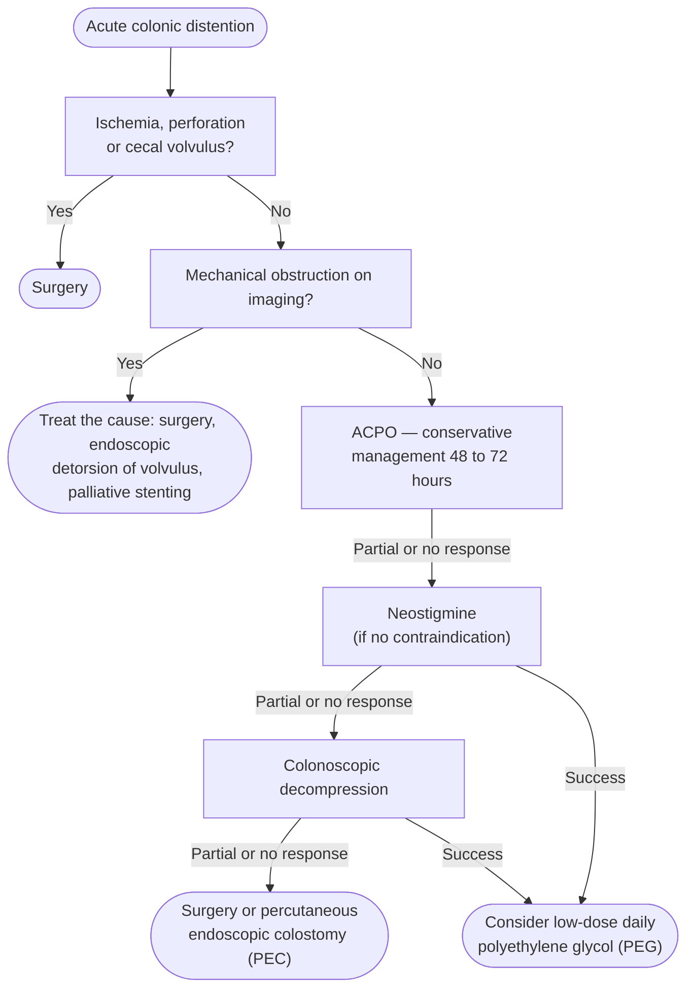

# Acute Colonic Pseudo-Obstruction (Ogilvie's Syndrome)

**Acute colonic pseudo-obstruction (ACPO)** — acute massive dilation of the large intestine with **no mechanical cause**, from altered autonomic regulation of colonic function producing colonic atony. Synonymous with **Ogilvie's syndrome**. Most patients are hospitalized at onset. ([[asge-2020-acpo-volvulus]])

## Contents
- [[#Assessment]]
  - [[#Establishing the Diagnosis]]
  - [[#Severity Assessment]]
- [[#Differential Diagnosis]]
- [[#Diagnostics]]
- [[#Therapeutics]]
  - [[#Conservative Therapy]]
  - [[#Neostigmine]]
  - [[#Endoscopic Decompression]]
  - [[#Percutaneous Cecostomy and Colostomy]]
  - [[#Surgery]]
- [[#See Also]]
- [[#Sources]]

## Assessment

### Establishing the Diagnosis
- Clinical picture: [[abdominal-bloating-and-distention|abdominal distention]] and pain, nausea/vomiting, obstipation — typically elderly, debilitated, hospitalized, multiple comorbidities
- **Mechanical obstruction must be excluded** before the diagnosis is made
- Risk factors: critical illness, recent surgical procedure, metabolic imbalance, nonoperative trauma
- Narcotics are a predisposing factor to look for and stop; infection is a contributor to treat
- Annual incidence ~100 per 100,000 inpatient admissions

### Severity Assessment
- **Uncomplicated ACPO** = absence of ischemia, peritonitis, cecal diameter >12 cm, and/or significant abdominal pain — this is the group eligible for conservative therapy
- **Cecal diameter** is the key risk marker: risk of ischemia and perforation rises with cecal diameter **>10–12 cm** and with distention lasting **>6 days**
- ~10% have some degree of right-[[colon-ischemia|colon ischemia]] at colonoscopy
- Spontaneous perforation risk **3–25%**, with up to **50% mortality** once perforation occurs

## Differential Diagnosis
*Workup: see [[nausea-and-vomiting]] for the broader obstruction/ileus evaluation.*
- Mechanical large-bowel obstruction ([[colorectal-cancer|malignancy]], stricture) — primary exclusion
- [[colonic-volvulus]] (sigmoid or cecal) — mechanical twist; cecal volvulus is a surgical, not endoscopic, problem
- Postoperative ileus
- [[toxic-megacolon|Toxic megacolon]] ([[clostridioides-difficile]], [[ulcerative-colitis]])

## Diagnostics
- **Plain abdominal radiograph** — usually sufficient to make the diagnosis, but **cannot always reliably distinguish mechanical from functional** obstruction
- **Contrast-enhanced computed tomography (CT)** — differentiates ACPO from volvulus and from mechanical obstruction; ACPO findings are colonic dilatation with a possible transition zone and **no obvious mechanical cause**; CT has largely replaced contrast enema
- **Water-soluble contrast enema** of the rectum and distal colon — an alternative diagnostic option
- **Serial assessment of cecal diameter** is prudent, given the perforation risk above 12 cm
- Identify and correct metabolic, infectious and pharmacologic contributors; the guideline does not name specific laboratory tests

> [!pearl] A patient admitted for something else rarely has true obstruction
> Mechanical obstruction rarely arises in a patient admitted for an unrelated illness (e.g. pneumonia, elective non-gastrointestinal surgery) — in that setting colonic dilatation is far more likely to be ACPO ([[asge-2020-acpo-volvulus]]).

## Therapeutics

*Management of acute colonic distention, from first triage through refractory ACPO*
*Source: redrawn from Figure 1 of the ASGE 2020 guideline*
*[[asge-2020-acpo-volvulus|ASGE Guideline on the Role of Endoscopy in the Management of Acute Colonic Pseudo-Obstruction and Colonic Volvulus (2020)]]*
*ACPO = acute colonic pseudo-obstruction · PEC = percutaneous endoscopic colostomy · PEG = polyethylene glycol*

### Conservative Therapy
- **First-line in uncomplicated ACPO** — recommended as the preferred initial management
- Components: identify and discontinue predisposing drugs (e.g. narcotics) · correct fluid and electrolyte disorders · nothing by mouth · ambulation · treat infection · decompress the proximal gut with a **nasogastric (NG) tube**
- Success rate **77–96%**
- **Duration 48–72 h.** Not a candidate for conservative management, or symptoms persisting beyond 48–72 h → neostigmine *or* endoscopic decompression as the next step

### Neostigmine
Short-acting anticholinesterase parasympathomimetic — the **pharmacologic agent of choice**. Recommended for patients who are **not candidates for conservative therapy, have failed it (up to 72 h), or are at risk for perforation**, and have no contraindication.

| Route | Dose | Role / notes |
|---|---|---|
| **Intravenous (IV) bolus** | **2 mg IV over 3–5 min** | The recommended regimen; effective in **85–94%** across 3 placebo-controlled double-blind trials |
| Second IV bolus | A second dose; the guideline does not restate the amount | For no response, partial response, or recurrence — clinical response **40–100%** |
| Subcutaneous | Guideline gives no subcutaneous dose | For bolus-refractory disease; median time to passage of stool **29 h** in a mixed ileus/ACPO/refractory-constipation series |
| Continuous IV infusion | **0.4 mg/h** (5 mg in 50 mL 0.9% saline); **0.4–0.8 mg/h over 24 h** in the original critical-illness protocol | For bolus-refractory disease; initial response similar to bolus but **slower** (mean time to response 510 vs 165 min), greater 24-h bowel-diameter reduction, possibly fewer side effects |

*Built from [[asge-2020-acpo-volvulus]] Recommendations 6, 7 and 8 and its pharmacologic-therapy text. The guideline gives no subcutaneous dose.*

- **Absolute contraindications:** evidence of intestinal or urinary obstruction; known hypersensitivity reaction
- **Relative contraindications:** bradycardia, asthma, renal insufficiency, [[peptic-ulcer-disease|peptic ulcer disease]], recent myocardial infarction, acidosis
- **Predictors of non-response:** male sex, younger age, postsurgical status, electrolyte imbalance
- Other adverse events: nausea, vomiting, diarrhea, abdominal pain, sweating. **Co-administered glycopyrrolate** may prevent hypersalivation and bronchospasm
- Agents tried after neostigmine failure — oral pyridostigmine, methylnaltrexone, metoclopramide, erythromycin, prucalopride — **are not yet recommended for routine use**; further safety and efficacy research is needed
- **Recurrence prophylaxis:** daily **PEG** via NG tube decreases recurrence

> [!pitfall] Neostigmine is given at the monitor, not at the bedside
> **Continuous cardiac-rhythm and respiratory monitoring with immediate access to atropine** is required during administration, because of the bradycardia risk ([[asge-2020-acpo-volvulus]]).

### Endoscopic Decompression
- **[[colonoscopy|Colonoscopic]] decompression with decompression-tube placement** is suggested as an **alternative to neostigmine** for the same patients — not candidates for conservative therapy, or failed it (up to 72 h) — with no contraindication to endoscopy
- Traditionally reserved for persistent marked dilatation failing conservative measures, disease refractory to medical management, or when neostigmine is contraindicated
- Efficacy never established in randomized trials; initial and sustained decompression reported in up to **~95%**
- Adverse events: **~2% perforation, ~1% mortality**
- Recurrence **~40%**, especially when no decompression tube is placed, so repeat colonoscopy is commonplace. Randomized data on tubes are lacking and cohort studies **conflict** on whether a tube adds benefit
- Predictors of poor response to medical treatment (i.e. who may need the scope): younger age at diagnosis, abdominal distention as the chief complaint, greater cecal diameter
- Independent risk factors for colonoscopy failure: female sex, emergent admission, greater comorbidity (specifically chronic obstructive pulmonary disease and metastatic cancer)
- Two retrospective studies found decompression **superior to neostigmine** as initial therapy with equivalent perforation risk; other reviews found them equivalent. The evidence for first-line colonoscopic therapy is limited, so the guideline makes **no recommendation** favouring it over neostigmine

> [!howto] Decompressing the colon in ACPO
> 1. Plain abdominal radiograph within several hours beforehand to **exclude perforation** — especially with fever, leukocytosis or worsening pain.
> 2. Experienced endoscopist; leave the colon **unprepped**.
> 3. Sedate with benzodiazepines or other non-narcotic agents — narcotics potentiate colonic atony.
> 4. Advance using **water infusion with minimal to no carbon dioxide insufflation**, not air.
> 5. Reach **at least the distal transverse colon**, then suction air extensively.
> 6. Place a decompression tube; PEG solution afterwards lowers the recurrence rate. ([[asge-2020-acpo-volvulus]])

### Percutaneous Cecostomy and Colostomy
- **PEC of the cecum (PEC-cecum)** — alternative decompression route, placed endoscopically or radiographically, reported success up to **100%**
- Invasive, with serious adverse events: wound infection, bleeding/hematoma, perforation, granuloma, buried bumper. Comparative studies against other decompression methods are lacking
- [[asge-2014-constipation|ASGE 2014]] likewise recommends colonoscopy to allow **creation of a percutaneous cecostomy** when clinically appropriate and feasible *(⊕⊕⊕○ moderate quality)* — in adults it may be effective in ACPO when conservative treatment fails

### Surgery
- **Recommended for overt perforation or signs of peritonitis**
- Also refer for ischemia, clinical deterioration, **cecal diameter >12 cm**, or failure of conservative, pharmacologic and endoscopic options
- Options: surgically placed cecostomy tube, percutaneous cecostomy, or subtotal colectomy — surgically placed cecostomy tubes carry substantial morbidity and mortality
- Surgical mortality as high as **44%** with ischemic or perforated bowel, so **every effort should be made to manage these patients nonoperatively**

## See Also
[[colonic-volvulus]], [[colonoscopy]], [[chronic-idiopathic-constipation]], [[nausea-and-vomiting]], [[abdominal-bloating-and-distention]], [[clostridioides-difficile]], [[colon-ischemia]], [[toxic-megacolon]], [[ulcerative-colitis]], [[colorectal-cancer]], [[peptic-ulcer-disease]]

---

## Sources

1. [[asge-2020-acpo-volvulus|ASGE Guideline on the Role of Endoscopy in the Management of Acute Colonic Pseudo-Obstruction and Colonic Volvulus (2020)]]
2. [[asge-2014-constipation|ASGE 2014: The Role of Endoscopy in the Management of Constipation]]
