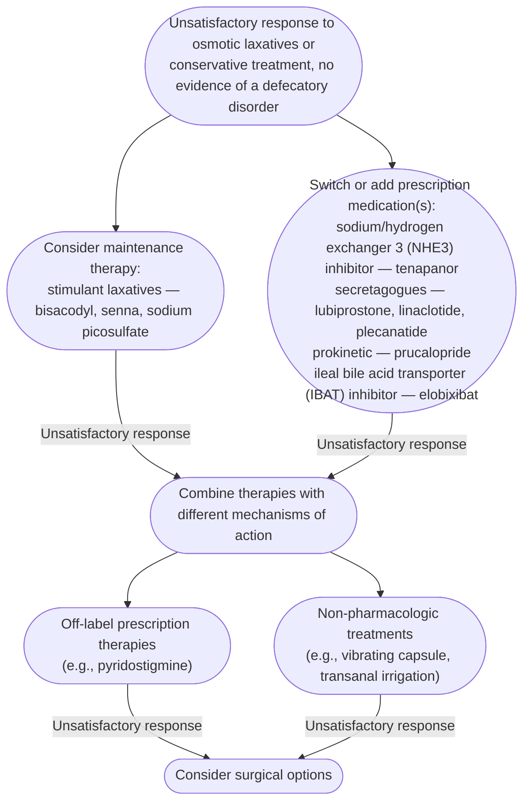
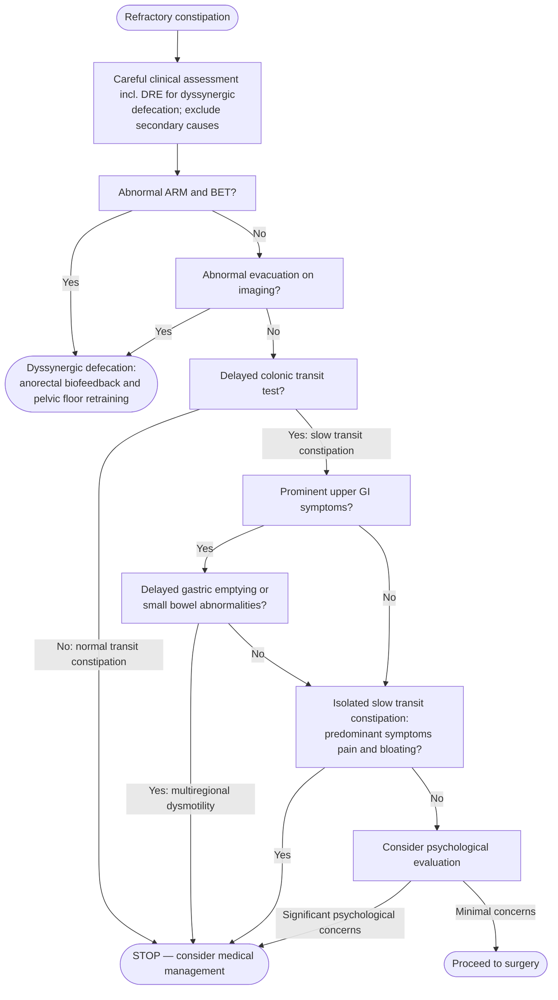

## Contents
- [[#Assessment]]
  - [[#Establishing the Diagnosis]]
  - [[#Severity Assessment]]
  - [[#Classification / Typing]]
- [[#Differential Diagnosis]]
- [[#Diagnostics]]
  - [[#Initial Workup]]
  - [[#Anorectal Physiology Testing (if outlet dysfunction suspected)]]
  - [[#Role of Endoscopy (ASGE 2014)]]
- [[#Therapeutics]]
  - [[#Step 1: Lifestyle and Behavioral Measures]]
  - [[#Step 2: OTC Pharmacotherapy (AGA-ACG 2023)]]
  - [[#Step 3: Prescription Agents (when OTC fails)]]
  - [[#Defecation Disorder: Biofeedback]]
  - [[#Refractory Constipation (AGA 2026)]]
  - [[#Percutaneous Endoscopic Cecostomy]]
- [[#See Also]]
- [[#Sources]]

---

## Assessment

### Establishing the Diagnosis

**Chronic idiopathic constipation (CIC)** = chronic constipation without an identifiable structural, metabolic or pharmacologic cause. A **positive diagnosis** can be made in most patients from typical symptoms and the absence of alarm features, without extensive testing [[rome-v-2026-bowel-disorders]].

- **Names:** chronic constipation (CC), functional constipation (FC) and CIC are interchangeable. Rome V chose **CC** — bowel [[disorders-of-gut-brain-interaction|disorder of gut–brain interaction (DGBI)]] category **C2** — to drop "functional" and stress that CC is rarely secondary to organic disease [[rome-v-2026-bowel-disorders]]. [[opioid-induced-constipation|Opioid-induced constipation]] is a separate category (C6) [[rome-v-2026-dgbi]].
- **Criteria:** Rome V C2 — the full criteria box is on [[chronic-constipation#Definition / Scope|chronic constipation]]. Older papers and [[asge-2014-constipation|American Society for Gastrointestinal Endoscopy (ASGE) 2014]] use Rome III; the items changed:

| Item | Rome III ([[asge-2014-constipation]] Table 2) | Rome V C2 ([[rome-v-2026-bowel-disorders]]) |
|---|---|---|
| Name | Functional constipation | Chronic constipation |
| Threshold for straining, hard stools, incomplete evacuation, blockage, manual maneuvers | At least 25% of defecations | More than one-fourth (25%) of defecations |
| Hard stools | Lumpy or hard stools | Lumpy or hard stools (Bristol 1–2) |
| Frequency item | Fewer than 3 defecations per week | Fewer than 3 spontaneous bowel movements (SBMs) per week |
| Unchanged | ≥2 items; loose stools rare without laxatives; insufficient criteria for irritable bowel syndrome (IBS); 3 months, onset ≥6 months before diagnosis | Same |

- **CC vs IBS with constipation (IBS-C):** the distinction is **predominant abdominal pain or discomfort** — pain may occur in CC but is not the predominant feature [[rome-v-2026-bowel-disorders]]. Rome V lowered the IBS pain threshold to **≥3 days/month in the last 3 months** (Rome IV: ≥1 day/week) and re-added "discomfort" [[rome-v-2026-dgbi]]. IBS-C regimens: [[irritable-bowel-syndrome]].
- **Outside the AGA–ACG evidence base:** the 2023 joint guideline of the American Gastroenterological Association (AGA) and American College of Gastroenterology (ACG) excluded IBS-C, opioid-induced constipation, and constipation from hypothyroidism or [[celiac-disease|celiac disease]], and does not address malignancy or pregnancy [[aga-acg-2023-constipation]].

### Severity Assessment

**Response to treatment** sets the next step:

| Stage | Defined by | Next step |
|---|---|---|
| Uncomplicated | No alarm features | Fiber and over-the-counter (OTC) agents (Steps 1–2) |
| OTC failure | Fails or is intolerant of OTC therapies | Lactulose (Rec 4), secretagogues or prucalopride (Recs 7–10) [[aga-acg-2023-constipation]] |
| Refractory constipation (RC) | Unsatisfactory despite an adequate trial of lifestyle, dietary, medical and/or (when indicated) biofeedback therapy | [[#Refractory Constipation (AGA 2026)]]; [[chronic-constipation#Definition / Scope\|operational criteria]] [[aga-2026-refractory-constipation]] |

### Classification / Typing

| Subtype | Frequency and overlap |
|---|---|
| Normal-transit | **Most patients** with CC [[rome-v-2026-bowel-disorders]] |
| Defecatory disorder (DD) | **Second most common** type; may co-occur with slow transit [[rome-v-2026-bowel-disorders]] — see [[defecation-disorders]] |
| Slow-transit | A **small proportion** [[rome-v-2026-bowel-disorders]]; overlap with DD up to **40%** [[aga-2026-refractory-constipation]] |

How each subtype is proven: [[chronic-constipation#The three physiologic subtypes]].

---

## Differential Diagnosis

*Workup: see [[chronic-constipation]].*

| Condition | Key feature |
|---|---|
| [[irritable-bowel-syndrome\|IBS-C]] | Predominant abdominal pain/discomfort ≥3 days/month [[rome-v-2026-dgbi]] |
| [[opioid-induced-constipation\|Opioid-induced constipation]] | New or worsening symptoms when initiating, changing or increasing opioid therapy [[rome-v-2026-bowel-disorders]]; laxatives first, a [[pamoras\|peripherally acting μ-opioid receptor antagonist (PAMORA)]] once laxative-refractory [[aga-2019-opioid-induced-constipation]] |
| [[defecation-disorders\|Defecatory disorder]] | Excessive straining, sense of blockage, manual maneuvers, incomplete evacuation; abnormal anorectal tests; treated with [[biofeedback-therapy\|biofeedback]] [[acg-2021-anorectal-disorders]] |
| Secondary causes | Medications (opioids, anticholinergics incl. antipsychotics, iron), disordered eating, neurologic disease (Parkinson's disease, multiple sclerosis), endometriosis [[aga-2026-refractory-constipation]]; hypothyroidism, hypercalcemia-inducing disease [[rome-v-2026-bowel-disorders]] |
| [[colorectal-cancer\|Colorectal cancer (CRC)]], stricture, extrinsic compression | Alarm features → [[colonoscopy]] [[asge-2014-constipation]] |
| Hirschsprung disease | Suspected → [[anorectal-manometry\|anorectal manometry (ARM)]] **+ deep biopsy** for absent myenteric neurons [[asge-2014-constipation]] |

Alarm features: [[chronic-constipation#Red Flags / Alarm Features]].

---

## Diagnostics

### Initial Workup

- **Rectal examination in every patient** before physiologic testing — gauges the likelihood of a DD [[aga-2026-refractory-constipation]].
- **Labs:** complete blood count (CBC) to exclude anemia (an alarm feature). Thyroid-stimulating hormone (TSH) and serum calcium **only when clinically indicated** (suspected hypothyroidism or hypercalcemia) [[rome-v-2026-bowel-disorders]].
- **Imaging** (barium enema, ultrasound, computed tomography, magnetic resonance): minimal diagnostic value **in the absence of alarm features or relevant comorbidities**; not generally recommended [[rome-v-2026-bowel-disorders]].
- Full Rome V do-not-order list: [[chronic-constipation#Key Tests]].

### Anorectal Physiology Testing (if outlet dysfunction suspected)

- **When:**
  - Rome V: for patients who **do not respond to therapeutic interventions**, not at initial evaluation — earlier if digital rectal examination (DRE) strongly suggests a DD [[rome-v-2026-bowel-disorders]].
  - ACG 2021: all patients with symptoms **refractory to standard therapy** → anorectal testing to exclude a DD [[acg-2021-anorectal-disorders]].
  - AGA 2026: **most** CC patients get ARM + balloon expulsion test (BET), and a biofeedback course when indicated, **before** being labeled refractory (best practice advice [BPA] 2) [[aga-2026-refractory-constipation]].
- **[[anorectal-manometry|ARM]] + BET:** BET with a 50 mL commercial balloon, seated — upper limit of normal **1 minute**; ACG discourages Foley catheter balloons [[acg-2021-anorectal-disorders]]. How many abnormal tests diagnose a DD differs by guideline — see [[defecation-disorders]].
- **Defecography (barium or magnetic resonance imaging [MRI]):** when clinical features and initial tests disagree, ARM and BET disagree, and/or pelvic organ prolapse is suspected [[acg-2021-anorectal-disorders]]. Modality choice: [[chronic-constipation#Key Tests]].
- **Colonic transit** (radiopaque markers, scintigraphy, wireless motility capsule): only in patients who **do not respond to biofeedback, or who have normal anorectal function** on testing [[acg-2021-anorectal-disorders]]; Rome V places it after a DD is excluded, for persistent symptoms despite medical therapy [[rome-v-2026-bowel-disorders]].

> [!pitfall] Slow transit in a DD is often secondary
> Up to 50% of DD patients have delayed colonic transit. Treat with biofeedback first — slow transit often normalizes once the pelvic floor is corrected ([[acg-2021-anorectal-disorders]]).

### Role of Endoscopy (ASGE 2014)

All from [[asge-2014-constipation]]:

- **No endoscopy in the initial evaluation** without alarm features or suspicion of organic gastrointestinal (GI) disease (Rec 1, moderate quality). Yield in isolated constipation is low — comparable to average-risk screening.
- **Colonoscopy:** rectal bleeding, heme-positive stool, iron deficiency anemia, weight loss, or obstructive symptoms; before surgery for constipation; age >50 y never screened (Rec 3; current screening ages: [[colorectal-cancer-screening]]).
  - **Should be considered** in selected patients to exclude obstruction from cancer, stricture or extrinsic compression.
  - Younger patients: flexible sigmoidoscopy may suffice to exclude distal disease.
- **Incidental findings:** [[rectal-prolapse#Solitary Rectal Ulcer Syndrome|solitary rectal ulcer syndrome]] (indicates [[rectal-prolapse]]), [[anal-fissure]], melanosis coli (chronic laxative use).
- **Therapy:** dilation of fibrotic strictures from inflammatory bowel disease (IBD), surgery or [[colon-ischemia|ischemia]]; percutaneous endoscopic cecostomy ([[#Percutaneous Endoscopic Cecostomy]]). **No role in stool disimpaction.**
- Chronic constipation is an independent risk factor for inadequate [[bowel-preparation]] → consider a more aggressive cleansing regimen.

---

## Therapeutics

### Step 1: Lifestyle and Behavioral Measures

- **Physical activity, a regular bathroom routine, a footstool** to elevate the feet — supporting evidence limited [[rome-v-2026-bowel-disorders]].
- **Fiber:** total intake (diet + supplement) **20–30 g/d**; usually no benefit above 25–30 g; encourage adequate hydration with fiber [[aga-acg-2023-constipation]]. Kiwi and prunes helped some patients in small randomized trials [[rome-v-2026-bowel-disorders]].
- **Conservative measures in a DD** [[acg-2021-anorectal-disorders]]:
  - Soluble fiber (psyllium, Sterculia) or laxatives for **hard** stools; insoluble fiber for **loose** stools.
  - Meals of **≥500 kcal** to induce the gastrocolonic response.
  - Heed the call to defecate; avoid straining and excessive toilet time.
  - Stop medications that cause or worsen constipation; treat [[anal-fissure]] or symptomatic [[hemorrhoids]] concurrently.
  - Insufficient → oral osmotic or stimulant laxatives, secretagogues, or 5-hydroxytryptamine type 4 (5-HT4) agonists. Enemas/suppositories **as needed (e.g. no bowel movement for 2 days)** add predictability.

### Step 2: OTC Pharmacotherapy (AGA-ACG 2023)

All from [[aga-acg-2023-constipation]] Table 1 (strength / certainty) and Table 4 (doses); titrate every agent to symptom response.

| Agent | Rec | Strength / certainty | Starting dose | Maximum | Notes |
|---|---|---|---|---|---|
| Fiber supplement | 1 | Conditional / Low | Total fiber 20–30 g/d | Usually no benefit >25–30 g | Only **psyllium** appeared effective — effective at **7–20 g/d** [[rome-v-2026-bowel-disorders]]; flatulence common |
| Polyethylene glycol (PEG) | 2 | **Strong / Moderate** | 17 g daily | No clear maximum | Response durable over 6 mo; a fiber trial may precede or accompany it |
| Magnesium oxide | 3 | Conditional / Very low | 400–500 mg daily | No clear maximum (trials used 1,000–1,500 mg) | **Avoid in renal insufficiency** (hypermagnesemia; creatinine clearance <20 mg/dL as printed); caution in pregnancy |
| [[lactulose\|Lactulose]] | 4 — after **failure of or intolerance to OTC therapies** | Conditional / Very low | 15 g daily | No clear maximum; hypernatremia, hypokalemia with significant diarrhea | Only osmotic agent studied in **pregnancy**; dose-dependent bloating and flatulence |
| Bisacodyl or sodium picosulfate | 5 — **short term (daily ≤4 wk) or rescue** | **Strong / Moderate** | Bisacodyl 5 mg daily | 10 mg orally daily | Cramping, diarrhea; contraindicated in ileus, intestinal obstruction, severe dehydration, acute inflammatory bowel conditions |
| Senna | 6 | Conditional / Low | 8.6–17.2 mg daily | AGA–ACG: no clear maximum (often 4 tablets twice daily). AGA 2026: Food and Drug Administration (FDA) maximum **35 mg twice daily**; up to 1.0 g/day for up to 8 weeks reported safe [[aga-2026-refractory-constipation]] | Trial dose higher than practice — start lower |

- **Cost:** every OTC agent **<$50/month** (PEG $10–45); prescription agents $374–563 [[aga-acg-2023-constipation]].
- **Docusate** was reviewed, but the guideline makes no recommendation on it [[aga-acg-2023-constipation]].
- **Rome V adds:** lactulose **15–30 mL once or twice daily** often causes cramping and bloating; magnesium may cause electrolyte imbalance **at high doses in older individuals or renal impairment** [[rome-v-2026-bowel-disorders]].

> [!pearl] Stimulant laxatives are safe for regular use
> No evidence they are habit forming or damage the colon ([[rome-v-2026-bowel-disorders]]). Concerns about chronic use in refractory adult constipation are unfounded; selected patients benefit from regular use ([[aga-2026-refractory-constipation]]).

### Step 3: Prescription Agents (when OTC fails)

For adults with CIC **who do not respond to OTC agents**; each may replace or be added to OTC agents [[aga-acg-2023-constipation]]. The guideline compared each drug with placebo only and did not aim to rank agents.

| Agent | Class | Rec | Strength / certainty | Dose (Table 4) |
|---|---|---|---|---|
| [[linaclotide\|Linaclotide]] | Guanylate cyclase-C (GC-C) agonist | 8 | **Strong / Moderate** | 72–145 µg daily; maximum 290 µg daily (the IBS-C dose) |
| [[plecanatide\|Plecanatide]] | GC-C agonist | 9 | **Strong / Moderate** | 3 mg daily (also the maximum; same dose for IBS-C) |
| [[prucalopride\|Prucalopride]] | 5-HT4 agonist | 10 | **Strong / Moderate** | 1–2 mg daily; maximum 2 mg daily |
| [[lubiprostone\|Lubiprostone]] | Chloride channel type 2 activator | 7 | Conditional / Low | 24 µg twice daily (also the maximum) |

- Diarrhea leading to discontinuation is the shared risk of the GC-C agonists; lubiprostone's main adverse event is nausea (35%, lower with food and water) [[aga-acg-2023-constipation]].
- Contraindications, renal and hepatic dose changes, and safety warnings: on each drug page.

### Defecation Disorder: Biofeedback

Abnormal ARM + BET → instrumented anorectal **[[biofeedback-therapy|biofeedback therapy]]** (ACG 2021 Rec 1: Strong, moderate quality) [[acg-2021-anorectal-disorders]]. Protocol and evidence: [[defecation-disorders]].

### Refractory Constipation (AGA 2026)

All from [[aga-2026-refractory-constipation]] (ungraded BPA statements) unless marked.

- **Definition (BPA 1):** infrequent and/or unsatisfactory bowel habits, with or without abdominal pain, despite an **adequate trial** of lifestyle, dietary, medical and/or (when indicated) pelvic floor biofeedback therapy, in adults meeting criteria for CC or IBS-C.
- **Before the label:** ARM + BET and a biofeedback course when indicated (BPA 2); exclude secondary causes — medications, disordered eating, neurologic disease (BPA 3); set realistic expectations (BPA 4).
- **Confirm slow transit (BPA 5):** colonic transit testing **off treatment**, ideally also **on a maximal laxative regimen** to document refractoriness. Washout and repeat-testing rules: [[chronic-constipation#Test conditions that change the answer]].
  - Normal transit on laxatives → symptoms driven by other factors (DD, visceral hypersensitivity, laxative side effects).
  - Slow transit on laxatives → colonic dysmotility contributes; colectomy may be considered in select cases once a DD is excluded.
- **Defecography should be considered** (BPA 6).

**Medical escalation (BPA 7–9)**

*Medical treatment of refractory constipation*
*Source: redrawn from AGA 2026 Figure 1 (suggested algorithm)*
*[[aga-2026-refractory-constipation|AGA Clinical Practice Update on Refractory Constipation (2026)]]*
*NHE3 = sodium/hydrogen exchanger 3 · IBAT = ileal bile acid transporter*

- Combination data are anecdotal (e.g. PEG + bisacodyl, PEG + prucalopride). Bisacodyl appears particularly effective at increasing SBMs.
- Off-label: **pyridostigmine** (no dose given); [[tenapanor]] and elobixibat may be considered; colchicine and misoprostol not advised routinely (limited efficacy, side effects).
- Adjuncts (BPA 9): **transanal irrigation** (particularly neurogenic bowel dysfunction), **vibrating capsule**, **electroacupuncture**. [[sacral-nerve-stimulation|Sacral nerve stimulation]] did not improve CC.
- Suppositories and enemas help particularly with pelvic floor dysfunction; **bowel cleanouts** clarify constipation's contribution or precede maintenance therapy — use sparingly.

**Surgery (BPA 10–14)**

*Selecting patients for surgery in refractory constipation*
*Source: redrawn from AGA 2026 Figure 2 (suggested algorithm)*
*[[aga-2026-refractory-constipation|AGA Clinical Practice Update on Refractory Constipation (2026)]]*
*DRE = digital rectal examination · ARM = anorectal manometry · BET = balloon expulsion test · GI = gastrointestinal*

- **Only after confirming slow transit and excluding pelvic floor dysfunction** (BPA 10). **Colectomy with ileorectal anastomosis** is the most evidence-based operation — offered only with **no ongoing DD**.
- **Preoperative:** regional gut transit testing (BPA 11) and psychological evaluation (BPA 12). Rome V likewise requires upper gut transit evaluation to exclude a diffuse GI motility disorder [[rome-v-2026-bowel-disorders]].
- **Relative contraindications (BPA 13):** severe untreated psychiatric disease (incl. active eating disorders, unresolved sexual trauma); predominant bloating and/or abdominal pain; reversible secondary causes; multiregional GI dysmotility.
- **Diverting loop [[ostomy-management|ileostomy]] as a diagnostic trial (BPA 14)** — when efficacy, relative contraindications or poor functional outcome are the concern → completion colectomy with ileorectal anastomosis **potentially offered 6–12 months later** if symptoms improve significantly. Many patients keep the stoma because it improved their quality of life.

> [!pitfall] Do not operate on an untreated defecatory disorder
> Colectomy without first addressing a DD leads to persistent pain and constipation and low satisfaction; trial biofeedback before colectomy ([[aga-2026-refractory-constipation]]).

### Percutaneous Endoscopic Cecostomy

ASGE 2014 supports colonoscopic cecostomy "when clinically appropriate and feasible" (Rec 4) — in adults it may be effective in [[acute-colonic-pseudo-obstruction|acute colonic pseudo-obstruction]] and neurogenic bowel when conservative treatment fails — but gives no antibiotic, fixation or technique guidance [[asge-2014-constipation]]. Those come from the European Society of Gastrointestinal Endoscopy (ESGE) 2020. Tube placed directly into the colon (technique comparable to percutaneous endoscopic gastrostomy) for colonic obstruction or **antegrade irrigation in colonic motility disorders**; higher complication risk and a significant mortality → **intractable cases only**. ESGE numbers none of its recommendations; R-numbers are this wiki's reading-order labels [[esge-2020-gi-motility-part-2]].

| Decision | ESGE recommendation | Strength; evidence; agreement |
|---|---|---|
| Indication (R16) | Only after **conservative management with medical therapies or retrograde lavage has failed** | Strong recommendation, low quality evidence; 93.3% |
| Antibiotics (R17) | Prophylaxis starting **before** and continuing for **3 days after** | Strong recommendation, very low quality evidence; 93.3% |
| Cecal fixation (R18) | Fix the cecum to the abdominal wall at **three points** (T-anchors, double-needle suturing device, or laparoscopic fixation), whatever method is used — prevents leaks and infection | Strong recommendation, very low quality evidence; 86.7% |
| Technique (R19) | Critically ill → **endoscopic route**; good clinical condition → **laparoscopically assisted percutaneous endoscopic cecostomy (LAPEC)** | Weak recommendation, very low quality evidence; 86.7% |
| Site (R20) | **Cecum only** — no other colonic location unless technically not feasible | Strong recommendation, very low quality evidence; 93.3% |

- **Bowel preparation (ungraded):** rigorous preparation mandatory — fecal remnants raise septic risk; some expert centers use 7 days of fiber-free diet + 3 days of PEG solution.
- **Antibiotic regimen:** per local protocol — could be amoxicillin–clavulanic acid (1 g) or ofloxacin + metronidazole (500 mg) 1 hour before, mostly maintained until 72 hours after.
- **Outcomes:** purely endoscopic — technical success >80%, complications 30%–40% (mostly minor; deaths from fecal peritonitis reported); LAPEC success 95%; no direct comparison. Metal anchors removed within 3–4 weeks.
- Left-sided colostomy: feasible but no advantage (one series of 31 — 13 of 14 constipation patients needed tube removal, two deaths from fecal peritonitis).
- Refractory Ogilvie's syndrome: see [[acute-colonic-pseudo-obstruction#Percutaneous Cecostomy and Colostomy]].

---

## See Also
[[chronic-constipation]], [[opioid-induced-constipation]], [[pamoras]], [[defecation-disorders]], [[irritable-bowel-syndrome]], [[disorders-of-gut-brain-interaction]], [[colorectal-cancer]], [[colorectal-cancer-screening]], [[biofeedback-therapy]], [[linaclotide]], [[plecanatide]], [[prucalopride]], [[lubiprostone]], [[lactulose]], [[tenapanor]], [[anorectal-manometry]], [[sacral-nerve-stimulation]], [[acute-colonic-pseudo-obstruction]], [[anal-fissure]], [[hemorrhoids]], [[ostomy-management]]

---

## Sources

1. [[aga-acg-2023-constipation|AGA-ACG 2023 Pharmacologic Management of Chronic Idiopathic Constipation]]
2. [[acg-2021-anorectal-disorders|ACG 2021 Clinical Guidelines: Management of Benign Anorectal Disorders]]
3. [[asge-2014-constipation|ASGE 2014: The Role of Endoscopy in the Management of Constipation]]
4. [[aga-2026-refractory-constipation|AGA Clinical Practice Update on Evaluation and Management of Refractory Constipation: Expert Review]]
5. [[rome-v-2026-bowel-disorders|Bowel Disorders (Rome V, 2026)]]
6. [[rome-v-2026-dgbi|Disorders of Gut–Brain Interaction and the Rome V Process]]
7. [[aga-2019-opioid-induced-constipation|American Gastroenterological Association Institute Guideline on the Medical Management of Opioid-Induced Constipation]]
8. [[esge-2020-gi-motility-part-2|Endoscopic management of gastrointestinal motility disorders – part 2: European Society of Gastrointestinal Endoscopy (ESGE) Guideline (2020)]]
