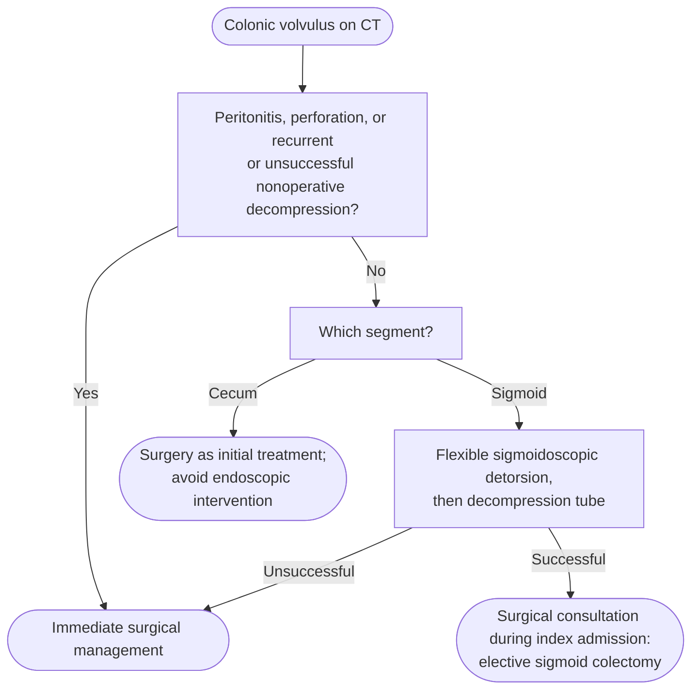

# Colonic Volvulus

Mechanical **twisting (torsion) of a redundant colon segment along its mesenteric axis**, producing closed-loop large-bowel obstruction. Most common in the **sigmoid** colon, less often the **cecum** ([[asge-2020-acpo-volvulus|American Society for Gastrointestinal Endoscopy (ASGE) 2020]]).

## Contents
- [[#Assessment]]
  - [[#Establishing the Diagnosis]]
  - [[#Severity Assessment]]
  - [[#Classification / Typing]]
- [[#Differential Diagnosis]]
- [[#Diagnostics]]
- [[#Therapeutics]]
  - [[#Sigmoid Volvulus]]
  - [[#Cecal Volvulus]]
- [[#See Also]]
- [[#Sources]]

## Assessment

### Establishing the Diagnosis
- Presenting symptoms: nausea, vomiting, abdominal pain, [[abdominal-bloating-and-distention|distention]], obstipation
- Risk factors: long redundant colon with a narrow mesenteric attachment, [[chronic-idiopathic-constipation|constipation]], colonic dysmotility, prior abdominal surgery
- Delay in diagnosis carries substantial morbidity and mortality — recognize and treat early

### Severity Assessment

**"Uncomplicated" is the word that decides scope vs. knife**, and ASGE 2020 defines it only by exclusion. Refer **immediately for surgical management** any patient with:

- **Signs of peritonitis**
- **Perforation**
- **Recurrent, or unsuccessful, nonoperative decompression**

**What follows from that split:**

- **Uncomplicated sigmoid volvulus** = none of the three above. "In the absence of these aforementioned adverse events," endoscopic detorsion ± decompression tube is **first-line** *(ASGE Rec 1)*.
- **Cecal volvulus never enters this pathway** — surgery is the **initial** treatment modality whatever the severity, with avoidance of endoscopic intervention *(ASGE Rec 3)*.
- There is no further severity grading: no staging system, no degree-of-torsion cutoff, and no colonic-diameter threshold for volvulus (unlike the cecal-diameter rule in [[acute-colonic-pseudo-obstruction|acute colonic pseudo-obstruction (ACPO)]]).

### Classification / Typing
- **Sigmoid volvulus** — most common site; adult men **>70 y**, African Americans, diabetes or neuropsychiatric disorders
- **Cecal volvulus** — less common; younger females

## Differential Diagnosis
*Workup: see [[nausea-and-vomiting]] for the broader obstruction evaluation.*
- Mechanical large-bowel obstruction ([[colorectal-cancer|malignancy]], [[colonic-stricture|stricture]])
- [[acute-colonic-pseudo-obstruction]] (functional dilatation, no twist)
- Small-bowel obstruction

## Diagnostics
- **Contrast-enhanced computed tomography (CT)** — preferred study for **both** cecal and sigmoid volvulus, having replaced abdominal radiographs and water-soluble contrast enemas. For sigmoid volvulus: **near 100% sensitivity, >90% specificity**
- **CT findings:** dilated colon with the **mesenteric whirl sign** — versus ACPO, where CT shows colonic dilatation with a possible transition zone and no obvious mechanical cause
- **Abdominal radiograph** — diagnostic in **60%** of sigmoid volvulus; less reliable than CT
- **Endoscopy** ([[colonoscopy|flexible sigmoidoscopy]]) — sigmoid volvulus shows **two points of abruptly twisted or converging mucosa**, with the colon between the distal and proximal points of torsion dilated by closed-loop obstruction. Endoscopy is therapeutic *and* allows assessment of colon viability

## Therapeutics

*Segment- and severity-based management of colonic volvulus*
*Source: built from [[asge-2020-acpo-volvulus]] Recommendations 1 to 4 and its endoscopic-treatment and recurrence text (the guideline's Figure 1 is the broader acute-colonic-distention algorithm)*
*[[asge-2020-acpo-volvulus|ASGE Guideline on the Role of Endoscopy in the Management of Acute Colonic Pseudo-Obstruction and Colonic Volvulus (2020)]]*
*CT = computed tomography*

### Sigmoid Volvulus
- **Indication for endoscopic detorsion:** uncomplicated disease (none of the three surgical triggers above) — first-line therapy *(ASGE Rec 1)*
- **Success rate 55–94%** across series. In one single-centre series of 21 patients, detorsion succeeded in **61.9%** and the remainder needed emergency surgery
- **Predictors of successful detorsion:** absence of abdominal tenderness, laxative use, history of open abdominal surgery
- **Decompression tube** after successful detorsion — maintains the reduction, allows continued colonic decompression, and lowers recurrence risk; advocated despite the absence of randomized data
- **Recurrence after successful endoscopic decompression: up to 86%.** In a 168-patient cohort, **84%** recurred within a median of **58 days**, with a median of **2 recurrences**; a smaller retrospective series reported **46.2%** (6 of 13)
- **Definitive treatment:** mortality is high with recurrent sigmoid volvulus, so elective **sigmoid colectomy** is generally recommended in surgical candidates **during the index admission or shortly thereafter**; obtain surgical consultation during that admission *(ASGE Rec 2)*
- **Not a surgical candidate:** **percutaneous endoscopic colostomy (PEC)** or percutaneous endoscopic sigmoidopexy fixes the involved segment to the anterior abdominal wall. Both carry a relatively high rate of immediate and delayed serious adverse events — infection, tube migration, perforation, obstruction, abdominal-wall bleeding, death; PEC specifically **~21% morbidity, ~5% mortality**
- **Children:** endoscopic detorsion is likewise preferred (efficacy 47% in an early series, all 13 cases in a later one), but recurrence is reported in up to **100%**; a rectal tube while awaiting surgery is common practice

> [!howto] Detorsing a sigmoid volvulus
> 1. Advance the endoscope to the point of obstruction.
> 2. Gently attempt to pass through the twisted segment.
> 3. Decompress the dilated segment aggressively — detorsion often then follows spontaneously.
> 4. Place a decompression tube proximal to the point of torsion. ([[asge-2020-acpo-volvulus|ASGE 2020]])

### Cecal Volvulus
- **Surgery is the initial treatment modality and endoscopic intervention is avoided** *(ASGE Rec 3)* — endoscopic reduction is rarely effective and carries a higher risk of perforation
- **Alternative decompression:** PEC of the cecum (PEC-cecum), placed endoscopically or radiographically, can be used in cecal volvulus — detail on [[acute-colonic-pseudo-obstruction]]
- ASGE 2020 gives no detorsion success rate or recurrence rate for cecal volvulus

## See Also
[[acute-colonic-pseudo-obstruction]], [[colonoscopy]], [[colonic-stricture]], [[chronic-idiopathic-constipation]], [[nausea-and-vomiting]], [[abdominal-bloating-and-distention]], [[colorectal-cancer]], [[colon-ischemia]]

---

## Sources

1. [[asge-2020-acpo-volvulus|ASGE Guideline on the Role of Endoscopy in the Management of Acute Colonic Pseudo-Obstruction and Colonic Volvulus (2020)]]
