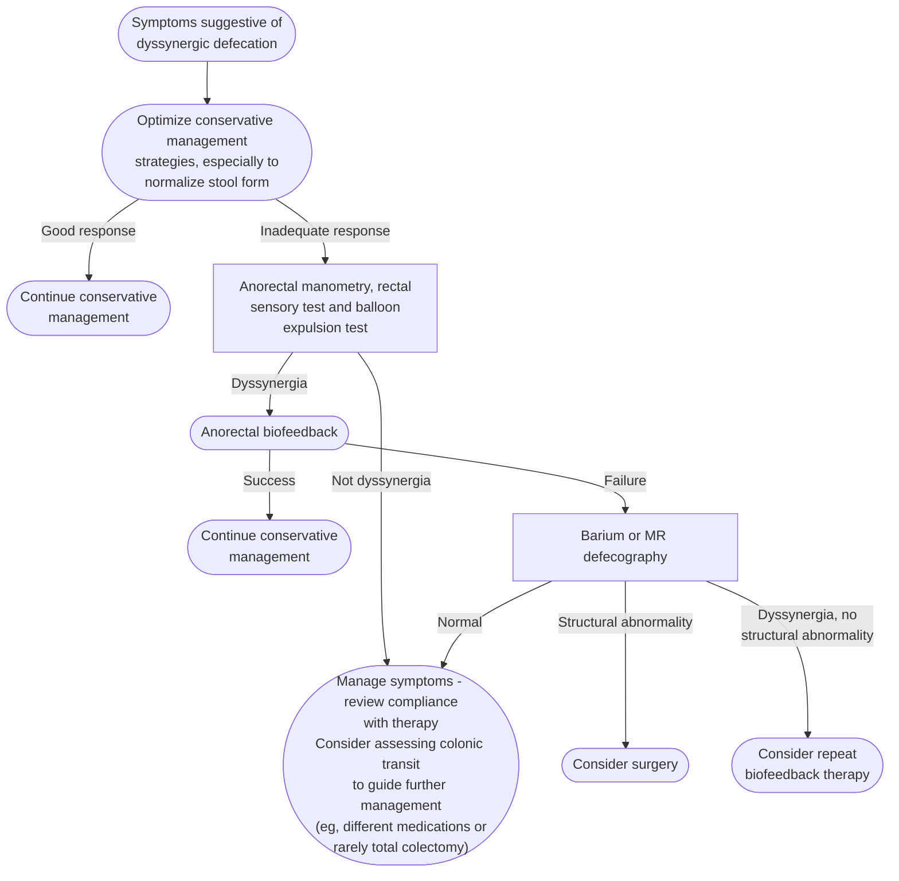

## Contents
- [[#Assessment]]
  - [[#Establishing the Diagnosis]]
  - [[#Severity Assessment]]
  - [[#Classification / Typing]]
- [[#Differential Diagnosis]]
- [[#Diagnostics]]
  - [[#Diagnostic Algorithm]]
  - [[#Evidence Grades for Diagnostic Tests]]
  - [[#Digital Rectal Examination]]
  - [[#Anorectal Manometry and Balloon Expulsion]]
  - [[#Defecography]]
  - [[#Colonic Transit]]
- [[#Therapeutics]]
  - [[#Conservative Measures]]
  - [[#Biofeedback]]
  - [[#Surgery and Device Therapies]]
- [[#See Also]]
- [[#Sources]]

---

## Assessment

### Establishing the Diagnosis

**Dyssynergic defecation (DD)** = paradoxical contraction or inadequate relaxation of the pelvic floor muscles and/or inadequate propulsive forces during attempted defecation ([[rome-v-2026-anorectal-disorders]]). Diagnosis = **difficult-evacuation symptoms + objective evidence of impaired evacuation**; an abnormal test alone does not make it.

**Rome V F3 criteria — must include all of the following:**

1. The patient reports **1 or more symptoms suggestive of difficult evacuation** (excessive straining, use of digital maneuvers to evacuate, sensation of anorectal blockage, and/or feeling of incomplete evacuation) with **at least 25% of bowel movements**, and **may** satisfy diagnostic criteria for chronic constipation or [[irritable-bowel-syndrome|irritable bowel syndrome (IBS)]]
2. During attempted defecation, features of impaired evacuation demonstrated by **any 1 of the following 3 tests**:
   - a. Reduced rectoanal pressure gradient **or** abnormal anorectal evacuation pattern on [[anorectal-manometry|anorectal manometry (ARM)]]
   - b. Abnormal balloon expulsion test (BET)
   - c. Impaired rectal evacuation on defecography

*Criteria fulfilled for the last 3 months with symptom onset at least 6 months before diagnosis.* Abnormalities are identified by comparing the data with **age- and gender-appropriate normal values for that particular manometry system**. Structural abnormalities such as rectocele, rectal mucosal intussusception and/or rectal sensory disorders **may coexist** with DD. ([[rome-v-2026-anorectal-disorders]])

> [!pearl] One abnormal test = probable, two = definite
> Patients with **1** abnormal test are classified as **probable DD**; those with **≥2** as **definite DD** ([[rome-v-2026-anorectal-disorders]]).

**How many abnormal tests? — the rule changed:**

| Source | Test requirement | Question it answers |
|---|---|---|
| [[rome-v-2026-anorectal-disorders\|Rome V]] (2026, current) | **Any 1 of 3** (above) | Does this patient **have** DD |
| [[acg-2021-anorectal-disorders\|American College of Gastroenterology (ACG) 2021]] | **≥2** — ARM **and** BET both required | Diagnosing DD in the physiology lab |
| [[aga-2026-refractory-constipation\|American Gastroenterological Association (AGA) 2026]] | **2 of 3** typically — reduced gradient, BET ≥1 minute, inadequate evacuation on defecography | May this constipation be called **refractory** and move toward **surgery** |

- **Not three answers to one question.** Rome V is the newest consensus, so **the diagnosis follows the any-1 rule**; the stricter AGA bar gates the refractory label and any operation.
- **ARM with BET is generally sufficient**, and predicts who benefits from [[biofeedback-therapy|biofeedback therapy (BT)]] ([[aga-2026-refractory-constipation]]).

**What changed from Rome IV, and why** ([[rome-v-2026-anorectal-disorders]]):

- **≥2 of 3 abnormal tests → any 1.** Concordance among tests was limited (was a prolonged BET with a normal gradient DD?); in 474 constipated patients and 184 healthy participants findings were concordant and a **reduced rectoanal gradient best predicted prolonged balloon expulsion or reduced evacuation**. One test also spares unnecessary testing and radiation.
- **Type 3 dyssynergia and electromyography (EMG) removed** — EMG is rarely used clinically.
- **"Functional" dropped**; "defecation disorders" (which swept in structural disease such as [[rectal-prolapse|rectal prolapse]]) replaced by the specific "dyssynergic defecation."
- **Symptom spectrum broadened** to patients with difficult evacuation who do **not** meet criteria for chronic constipation or IBS — including those with **increased stool frequency or loose stools** — provided ≥1 symptom occurs in at least 25% of bowel movements and the physiology criteria are met; such patients respond to BT.
- **No subclassification of DD** — see [[#Classification / Typing]].
- **Rectoanal coordination, such as the rectoanal gradient, is the best manometry measure of abnormal evacuation.**

**Also new in Rome V — F4 anorectal sensory dysfunction disorders** (rectal hyposensitivity, hypersensitivity): same outlet complaints from blunted or heightened rectal sensation, and may coexist with DD — criteria and sensory thresholds on [[anorectal-sensory-dysfunction]].

**Pathophysiology:** an acquired behavioral disorder — patients "unlearn" normal defecation and can often relearn it through BT. Cardinal abnormality = incoordination: **inadequate rectal propulsive force and/or impaired relaxation or paradoxical contraction of the external anal sphincter/puborectalis** ([[rome-v-2026-anorectal-disorders]]).

- **~37% of chronic-constipation patients who undergo pelvic floor testing have DD** ([[aga-2026-refractory-constipation]]).
- Associated: IBS, anxiety, depression; prior pelvic surgery, trauma, sexual/physical abuse; eating disorders.

### Severity Assessment

- Graded by symptom burden, laxative dependence, impact on quality of life, and response to initial conservative management.
- Dyssynergia **plus** slow colonic transit may be more severely affected.

### Classification / Typing

**Rome V does not subclassify DD** — precise criteria for inadequate propulsion and paradoxical contraction vary across techniques, do not reliably discriminate healthy people from patients with DD, and do not predict response to BT ([[rome-v-2026-anorectal-disorders]]).

The 4 manometric types are **historical and descriptive, not Rome V diagnostic criteria** (early study of 35 constipated patients):

| Type | Rectal propulsion | Anal relaxation |
|---|---|---|
| **I** | Adequate (≥45 mm Hg) | Paradoxical anal contraction |
| **II** | Inadequate (<45 mm Hg) | Paradoxical contraction or insufficient relaxation |
| **III** | Adequate (≥45 mm Hg) | Absent/insufficient relaxation (<20%) |
| **IV** | Inadequate (<45 mm Hg) | Inadequate relaxation (<20%) |

> [!pitfall] "Abnormal" patterns are common in healthy people
> A controlled study found **87% of healthy participants** had abnormal patterns suggestive of DD. Interobserver agreement is substantial for types I and IV, moderate for normal vs dyssynergic patterns, and only **fair for types II and III** — by themselves the patterns may have limited utility ([[rome-v-2026-anorectal-disorders]]).

- Patterns in current reporting come from the [[london-classification|London Classification]] (*dyssynergia*, *poor propulsion*, or *both*, by propulsion and anal relaxation) — none of them a major finding there, and an abnormal pattern with a normal expulsion is only *inconclusive* ([[london-2020-anorectal-classification]]).

---

## Differential Diagnosis

*Workup: see [[chronic-constipation]].*

| Condition | Key features |
|---|---|
| Slow-transit constipation | Delayed marker transit throughout the colon; normal anorectal physiology; BT ineffective for isolated slow transit — but the two overlap often (below) |
| [[chronic-idiopathic-constipation\|Chronic idiopathic constipation]] (normal transit) | Normal ARM + BET; responds to osmotic laxatives and secretagogues |
| Rectocele | Structural defect on exam or defecography; **common in asymptomatic women**; often coexists with dyssynergia |
| [[rectal-prolapse\|Rectal prolapse]] (full-thickness) | Circular folds visible; inspect squatting or on the toilet |
| Hirschsprung disease | Usually diagnosed in childhood; aganglionic segment; suction rectal biopsy |
| [[anorectal-sensory-dysfunction\|Rectal sensory dysfunction]] (Rome V F4) | Same complaints from blunted or heightened rectal sensation, not incoordination; separated by rectal balloon distention testing |
| Secondary causes | Parkinson disease, ileal pouch-anal anastomosis, [[inflammatory-bowel-disease\|inflammatory bowel disease (IBD)]] proctitis; treat the cause |

---

## Diagnostics

### Diagnostic Algorithm

*Evaluation of chronic constipation with symptoms of dyssynergic defecation*
*Source: redrawn from the ACG 2021 benign anorectal disorders evaluation algorithm*
*[[acg-2021-anorectal-disorders|ACG 2021 Benign Anorectal Disorders Guideline]]*
*MR = magnetic resonance*

### Evidence Grades for Diagnostic Tests

Rome V grades for **constipation with DD**: **A1** = excellent evidence in favor of the test based on high specificity, sensitivity, accuracy and positive predictive values (PPV); **B2** = good evidence; **B3** = fair evidence; **C** = poor evidence, on the same measures ([[rome-v-2026-anorectal-disorders]]).

| Test | Evidence | Grade | Comment |
|---|---|---|---|
| Anorectal manometry | Excellent | **A1** | Identifies DD, weak/hypertonic sphincters or puborectalis, rectal hypo-/hypersensitivity, compliance, Hirschsprung disease |
| Balloon expulsion test | Excellent | **A1** | Identifies DD and impaired evacuation |
| Fluoroscopic defecography | Good | **B2** | Seated; for when manometry/BET are inconclusive |
| Colonic transit, radiopaque markers | Good | **B2** | Identifies slow-transit constipation |
| Colonic transit, scintigraphy | Good | **B2** | Classifies pathologic subtypes |
| Wireless motility capsule | Good | **B2** | Slow transit plus upper-gut transit abnormalities |
| Plain abdominal radiograph | Fair | **B2** | Not routine without alarming features |
| Pelvic magnetic resonance imaging (MRI) | Fair | **B3** | Adjunct to manometry |
| Anal ultrasound | Fair | **B3** | Interobserver bias, availability, limited normative data |
| Blood tests (thyroid, calcium, glucose, electrolytes) | No evidence | **C** | Not routine without alarming features |
| Barium enema | Poor | **C** | — |
| Flexible sigmoidoscopy / colonoscopy | Poor | **C** | Not cost-effective; procedure and sedation risks |

### Digital Rectal Examination

- Anal tone at rest and on squeeze, then **simulate defecation**: failure of the puborectalis and external sphincter to relax ("pulling in") or paradoxical contraction is the cardinal sign of dyssynergia — **not pathognomonic, as 37% of asymptomatic women** show it ([[acg-2021-anorectal-disorders]]).
- Sensitivity 75% / specificity 87% against manometry; **80% / 56% against the BET** — so **a normal digital rectal examination (DRE) is probably more useful than an abnormal one**.
- **Refractory constipation is itself an indication for anorectal testing**, whatever the DRE shows.

### Anorectal Manometry and Balloon Expulsion

- ARM documents resting tone, squeeze and push pressures, the rectoanal inhibitory reflex and defecation dynamics; the DD pattern is **impaired relaxation or paradoxical contraction** of the external anal sphincter and/or puborectalis on push, and/or **inadequate rectal propulsive force**. Catheter types, position mechanics and the sex-specific normal rectoanal gradient ranges: [[anorectal-manometry]].
- **Rectoanal gradient:** abnormal **only when below the lower limit of normal** for sex and, in women, age; an abnormal gradient on the Manoscan catheter is **36% sensitive and 85% specific** for a prolonged BET ([[rome-v-2026-anorectal-disorders]]).
- **Position:** pressures and the gradient are **greater seated than left lateral**, and seated [[high-resolution-manometry|high-resolution manometry]] discriminates better, but catheter displacement makes it challenging — in practice manometry is done left lateral.
- **BET method:** expel a water-filled rectal balloon with either **50 mL of water** or inflated to the patient's own defecatory desire, **in privacy and seated on a commode**. Normal **20 seconds to 2 minutes, although a 1-minute cutoff is recommended**; reproducible in 90% of individuals across days ([[rome-v-2026-anorectal-disorders]]). Not with a Foley catheter — its 2-minute limit misclassifies 25% of healthy individuals ([[acg-2021-anorectal-disorders]]).
- Against defecography the BET is **~88% sensitive and ~88% specific, PPV 64%, negative predictive value 97%** — a normal BET largely excludes a defecation disorder, a positive one needs corroboration ([[acg-2021-anorectal-disorders]]).

Probability of reduced rectal evacuation in constipated patients, by rectoanal gradient **and** BET result ([[rome-v-2026-anorectal-disorders]]):

| Gradient + BET | Probability of reduced rectal evacuation |
|---|---|
| Both normal | **14%** |
| Either abnormal | **45%** |
| Both abnormal | **75%** |

- **Why defecography is often unnecessary:** an abnormal BET and an abnormal gradient are **81%** and **86% specific**, respectively, for predicting reduced rectal evacuation ([[rome-v-2026-anorectal-disorders]]).
- **Caveats** ([[acg-2021-anorectal-disorders]]): false positives and negatives are not uncommon — read the tests against the clinical features. A **negative rectoanal gradient is common in healthy people**, as are decreased rectal pressure and high anal pressure during evacuation or at rest, so no single manometric feature rules DD in.

### Defecography

- Indicated when ARM + BET are discordant or inconclusive, BT fails, a structural abnormality is suspected (rectocele, prolapse, enterocele), or rectal prolapse is not seen on exam. **Most helpful when the rectoanal gradient is abnormal but the BET is normal** ([[aga-2026-refractory-constipation]]).
- Findings: inadequate or excessive widening of the **anorectal angle** and/or **perineal descent**; internal intussusception; [[rectal-prolapse#Solitary Rectal Ulcer Syndrome|solitary rectal ulcer]]; rectocele; enterocele; bladder and uterovaginal prolapse.
- Barium vs MRI modality choice: [[anorectal-manometry]].
- **Two rectocele size numbers — different questions:**

| Threshold | Question it answers |
|---|---|
| **>4 cm** ([[aga-2026-refractory-constipation]]) | Is this **imaging finding likely clinically relevant**? (as is normal ARM with impaired contrast evacuation) |
| **>5 cm** plus trapping/non-emptying on dynamic assessment ([[acg-2021-anorectal-disorders]]) | Is this patient a **surgical candidate** after BT failure? |

- Not a conflict — do not read the smaller number as an operative indication.

### Colonic Transit

- Ordered if ARM + BET are normal (to look for slow-transit constipation), or if the patient fails BT despite confirmed dyssynergia. Radiopaque markers (day 5) or wireless motility capsule.
- Transit improved after BT in one study, suggesting DD delays colon transit ([[rome-v-2026-anorectal-disorders]]); stool held in the rectosigmoid activates rectocolonic inhibitory reflexes ([[aga-2026-refractory-constipation]]).

> [!pitfall] Slow colonic transit does not excuse anorectal testing
> Up to **two-thirds of patients with DD also have slow colonic transit**, so slow colon transit **does not** remove the need for anorectal testing ([[rome-v-2026-anorectal-disorders]]).

---

## Therapeutics

### Conservative Measures

- Management begins with **explanation, education and lifestyle measures** ([[rome-v-2026-anorectal-disorders]]).
- Normalize stool form ([[bristol-stool-form-scale|Bristol]] 3–4): fiber supplement + adequate hydration + polyethylene glycol (PEG) if needed.
- Toileting: scheduled defecation, footstool, avoid excessive straining.
- Treat concurrent [[anal-fissure|anal fissure]] or [[hemorrhoids]] that reinforce voluntary sphincter contraction; address constipating medications.

### Biofeedback

- **BT is the mainstay** — it restores bowel function by improving rectoanal coordination, and **a multicomponent BT is preferred**. Large randomized controlled trials (RCTs) confirm efficacy short- and long-term; BT is **superior to sham feedback, pelvic floor exercises, laxatives and muscle relaxant drugs** ([[rome-v-2026-anorectal-disorders]]). ACG 2021: **strong recommendation, moderate quality evidence**, on 8 RCTs.
- **BT is ineffective for isolated slow-transit constipation.**
- **Predictors of favorable outcome:** anal digitation, hard stools, greater patient motivation, **undergoing ≥5 sessions**, and prolonged balloon expulsion time.
- **Home-based BT achieves success rates comparable with office BT (68% vs 70%)** at lower cost.
- Protocol (4–6 sessions several weeks apart; education, manometric relaxation, balloon expulsion retraining, sensory retraining) and patient selection: [[biofeedback-therapy]].
- **Pelvic floor physical therapy** is a widely used alternative, but evidence and standardization are lacking and it **differs significantly from BT**.
- Barriers: labor-intensiveness, lack of dedicated equipment and standardized protocol, limited therapist availability, poor insurance coverage.
- Two RCTs found surgery superior to BT, but one included patients whose symptoms were due to **structural** pelvic floor abnormalities and the other used a **suboptimal biofeedback protocol**.

### Surgery and Device Therapies

> [!pitfall] Treat the dyssynergia before calling constipation refractory
> ARM + BET **plus a completed BT course** gate the refractory label, and **only patients with no evidence of an ongoing DD should be offered colectomy with ileorectal anastomosis** ([[aga-2026-refractory-constipation]]).

- **Surgery is needed in <5% of patients with DD** — generally those with considerable pelvic organ and/or rectal prolapse. **Structural correction alone does not restore function:** the lesions are probably *caused* by the functional disorder (impaired relaxation, straining), which an operation does not correct, and symptom–size and symptom–anatomic correlations are both weak ([[aga-2017-surgical-device-fecal-incontinence]]).

| Finding after conservative measures + BT fail | Option | Outcomes / cautions |
|---|---|---|
| Full-thickness rectal prolapse (symptomatic grades 3–4; asymptomatic grades 1–2 need no operation) | Laparoscopic rectopexy (posterior or ventral mesh preferred); Altemeier for elderly/frail. Avoid bowel resection with pre-existing diarrhea or incontinence | 73–91% "some benefit"; 5–15% mesh erosion; 2–7% recurrence |
| Symptomatic rectocele (criteria below) | Rectovaginal wall reinforcement, **vaginal or transanal** — vaginal more favorable for pelvic-organ-prolapse syndromes; avoid vaginal mesh (withdrawn by the US Food and Drug Administration) | 30–50% improvement in constipation; 67–78% satisfactory; **7–17% occasional serious complications** |
| Symptomatic rectocele or rectal intussusception | **Stapled transanal rectal resection (STARR)** — predominantly European, seldom US; **AGA advises against routine use** | 68–76% moderate reduction in obstructed defecation; 4% recurrence; morbidity 16.9–23% (especially urgency) |
| No structural abnormality, dyssynergia fails BT | [[botulinum-toxin\|Botulinum toxin]] A into the puborectalis | Limited evidence, not recommended long-term; global improvement 29.2–100%, harm 14.2% |

**Rectocele — read the indication in order** ([[acg-2021-anorectal-disorders]]):

1. **Bothersome gynecological symptoms** (perineal bulging, protrusion through the vaginal introitus) — the primary indication for surgery.
2. **Without** those symptoms, defecatory dysfunction + coexistent rectocele is managed **conservatively first, including BT**.
3. Only on failure do the two suggested selection features apply — **significant size (e.g. >5 cm)** on clinical assessment/imaging **and** **trapping or non-emptying on dynamic assessment**. Others hold that size alone is not a criterion for surgery.

- **STARR vs biofeedback** (Best Practice Advice 15; multicenter RCT, 119 patients): **82% vs 33%** achieved >50% reduction in obstructed-defecation scores at 1 year, but **25% of biofeedback patients withdrew** and **15% of STARR patients had adverse events** (vs 1 with anal pain) ([[aga-2017-surgical-device-fecal-incontinence]]).
- **[[sacral-nerve-stimulation|Sacral nerve stimulation]] — not effective** for DD or slow-transit constipation (Strong recommendation, low quality evidence; Best Practice Advice 13 agrees): in an 18-week randomized sham-controlled cross-over trial, neither subsensory nor suprasensory stimulation increased complete bowel movements.
- **Anterograde colonic enemas (Malone appendicostomy, button cecostomy) — not an effective long-term solution in adults** (Best Practice Advice 14): success ~**50%** vs **80% in children**, and **>50% fail by 3 years**, needing revision, reversal or a stoma.

---

## See Also
[[chronic-constipation]], [[chronic-idiopathic-constipation]], [[anorectal-sensory-dysfunction]], [[fecal-incontinence]], [[proctalgia-syndromes]], [[irritable-bowel-syndrome]], [[hemorrhoids]], [[anal-fissure]], [[rectal-prolapse]], [[anorectal-manometry]], [[high-resolution-manometry]], [[london-classification]], [[biofeedback-therapy]], [[sacral-nerve-stimulation]], [[disorders-of-gut-brain-interaction]], [[inflammatory-bowel-disease]]

---

## Sources

1. [[rome-v-2026-anorectal-disorders|Anorectal Disorders (Rome V, 2026)]]
2. [[acg-2021-anorectal-disorders|ACG 2021 Clinical Guidelines: Management of Benign Anorectal Disorders]]
3. [[aga-acg-2023-constipation|AGA-ACG 2023 Pharmacologic Management of Chronic Idiopathic Constipation]]
4. [[rome-v-2026-dgbi|Disorders of Gut–Brain Interaction and the Rome V Process]]
5. [[aga-2017-surgical-device-fecal-incontinence|Surgical Interventions and the Use of Device-Aided Therapy for the Treatment of Fecal Incontinence and Defecatory Disorders]]
6. [[aga-2026-refractory-constipation|AGA Clinical Practice Update on Evaluation and Management of Refractory Constipation: Expert Review]]
7. [[london-2020-anorectal-classification|The International Anorectal Physiology Working Group (IAPWG) Recommendations: Standardized Testing Protocol and the London Classification for Disorders of Anorectal Function]]
