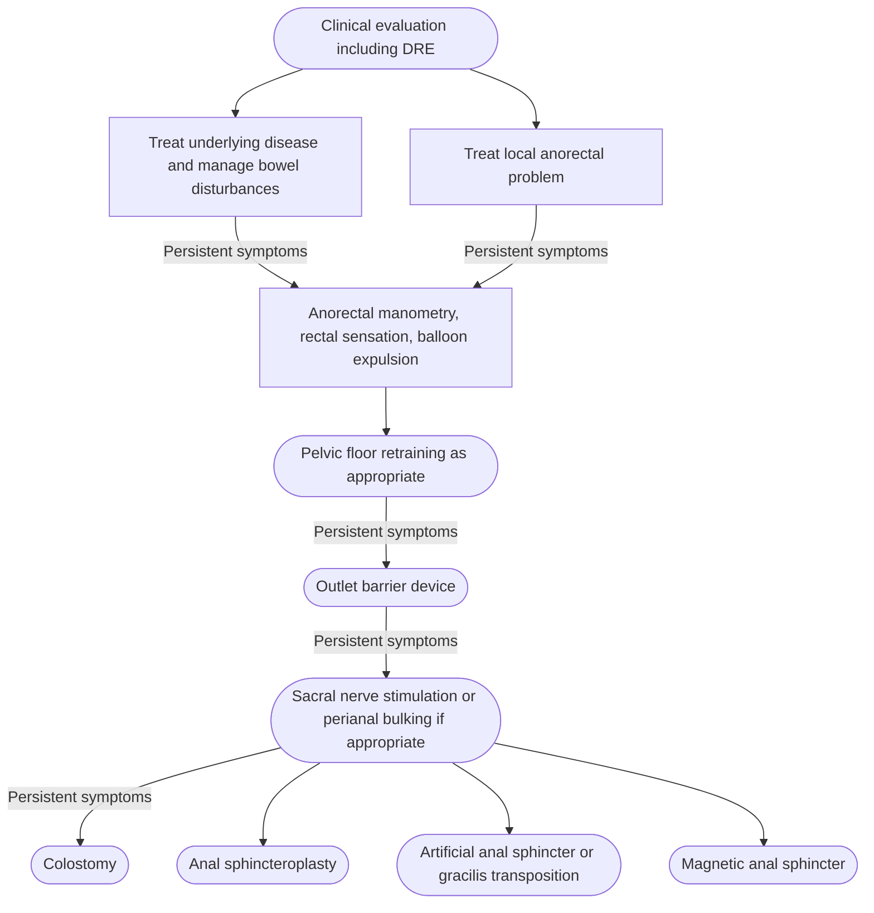

## Contents
- [[#Assessment]]
  - [[#Establishing the Diagnosis]]
  - [[#Severity Assessment]]
  - [[#Classification / Typing]]
- [[#Differential Diagnosis]]
- [[#Diagnostics]]
  - [[#Initial Assessment (All Patients)]]
  - [[#Anorectal Physiology]]
  - [[#Graded Test Recommendations]]
- [[#Therapeutics]]
  - [[#Stepwise Pathway]]
  - [[#Step 1: Optimize Stool Form and Bowel Habits]]
  - [[#Step 2: Biofeedback]]
  - [[#Step 3: Devices, Bulking and Neuromodulation]]
  - [[#Step 4: Surgery]]
  - [[#Treatment Costs]]
- [[#See Also]]
- [[#Sources]]

---

## Assessment

### Establishing the Diagnosis

**Fecal incontinence (FI)** = recurrent uncontrolled passage of fecal material for at least 3 months. **Fecal staining of underwear is included; clear mucus secretion and flatus incontinence are not** ([[rome-v-2026-anorectal-disorders]]). The broader term **anal incontinence** includes involuntary flatus ([[acg-2021-anorectal-disorders]]).

**Rome V criteria — F1 fecal incontinence** ([[disorders-of-gut-brain-interaction|disorder of gut-brain interaction (DGBI)]] category F1). Must include **all** of ([[rome-v-2026-anorectal-disorders]]):

1. **Two or more** episodes of uncontrolled passage of fecal material
2. **At least 1 episode of fecal incontinence per month on a 4-week stool diary**

> Criteria fulfilled for the last 3 months with symptom onset at least 6 months before diagnosis. For clinical purposes: 2 or more episodes of uncontrolled passage of fecal material in the past 12 months.

- **What changed from Rome IV:** the qualitative "recurrent uncontrolled passage" became "**2 or more** episodes" plus the stool-diary frequency floor; required symptom onset moved from 3 to 6 months before diagnosis ([[rome-v-2026-anorectal-disorders]]).

> [!pitfall] Infrequent leakage still counts as FI
> Up to half of patients have fewer than 1 episode per month, yet have significant quality-of-life (QoL) impairment and respond to biofeedback equally well — do not withhold evaluation for low frequency ([[rome-v-2026-anorectal-disorders]]).

- **Ask actively — FI is significantly underreported**, particularly in patients with predisposing conditions ([[acg-2021-anorectal-disorders]]).

**Key history** ([[acg-2021-anorectal-disorders]], [[rome-v-2026-anorectal-disorders]]):

- Type — urge vs passive vs staining/soiling; stool type (solid, liquid and/or gas)
- Frequency and quantity; awareness of the urge before leakage
- Associated [[chronic-diarrhea|diarrhea]] or [[chronic-idiopathic-constipation|constipation]]
- Obstetric history (vaginal or instrument-assisted delivery, tears, forceps) — **obstetric anal sphincter injury is the leading cause of anal sphincter trauma**
- Neurologic disease, prior pelvic/anorectal surgery, radiation
- Other risk factors: age, female sex, diarrhea, cholecystectomy, diabetes, smoking, obesity

### Severity Assessment

Severity is determined by **type** (solid, liquid and/or gas), **quantity**, **frequency**, and **awareness of the urge** before the episode ([[rome-v-2026-anorectal-disorders]]). With QoL impact, response to conservative management, patient age, probable etiology and test availability, these determine which diagnostic tests are done and when to escalate ([[acg-2021-anorectal-disorders]]).

- **Staining** = leakage of small amounts of stool (1–2 tablespoons). **Soiling** = more extensive leakage, specified further as underwear, outer clothing, or furnishings/bedding ([[rome-v-2026-anorectal-disorders]]).
- Predictors of worse outcome: older age, diarrhea-predominant habits, rectal urgency, severe FI, multiple comorbidities.

> The guidelines name the FI severity instruments (Cleveland Clinic/Wexner score, Fecal Incontinence Severity Index) without printing their items or point values; score from the original instruments.

### Classification / Typing

Phenotype points to the mechanism to test and treat ([[rome-v-2026-anorectal-disorders]]):

| Symptom | Implied mechanism |
|---|---|
| Incontinence for **solid** stool | More severe sphincter weakness than liquid stool alone |
| **Nocturnal** incontinence | Uncommon; often **internal anal sphincter (IAS)** dysfunction (diabetes, scleroderma) |
| **Urge** incontinence — strong desire to defecate before leakage | Reduced squeeze pressure and duration, and/or reduced rectal capacity with rectal hypersensitivity ([[anorectal-sensory-dysfunction]]) |
| **Passive** incontinence — no awareness of stooling | Lower resting pressure |

- Anal sphincter weakness is the most frequent abnormality — in older women with FI, ~40% had reduced resting and ~80% reduced squeeze pressure. **Resting pressure is the strongest predictor of future FI after obstetric anal sphincter injury.** Up to one-third of patients with FI have **normal** anal sphincter pressures ([[rome-v-2026-anorectal-disorders]]).
- **Rectal hyposensitivity is present in 12%–19% of FI** and is treatable with sensory retraining, so abnormal rectal sensation is not an incidental finding. Suspect it when stool is found in the rectum on digital rectal examination (DRE) and the patient is unaware ([[rome-v-2026-anorectal-disorders]], [[anorectal-sensory-dysfunction]]).

---

## Differential Diagnosis

*Workup of the bowel-habit driver — overflow FI from impaction, and constipation-associated FI: see [[chronic-constipation]]. The FI-specific stepwise evaluation is under [[#Diagnostics]] below.*

| Cause | Key Features |
|-------|-------------|
| Obstetric sphincter injury | Women; vaginal or instrumental delivery, tears; sphincter defects on **endoanal ultrasound (EAUS)** or **magnetic resonance imaging (MRI)** |
| Neurogenic FI | Spinal cord injury, multiple sclerosis, diabetic peripheral neuropathy, pudendal neuropathy |
| [[inflammatory-bowel-disease\|Inflammatory bowel disease (IBD)]] | Diarrhea and urgency in [[crohns-disease\|Crohn's]] proctitis or [[ulcerative-colitis\|ulcerative colitis]]; treating the IBD may improve FI |
| [[rectal-prolapse\|Rectal prolapse]] | Visible prolapse; associated with FI and constipation |
| Overflow incontinence | Fecal impaction with liquid feces leaking around it; impaction on rectal exam |
| [[radiation-proctopathy\|Radiation proctopathy]] | Pelvic radiation history; proctitis with urgency |
| Scleroderma | Dysmotility, malabsorption; distinctive manometry pattern |
| Post-surgical sphincter disruption | Prior anorectal surgery, [[hemorrhoids\|hemorrhoidectomy]], fistulotomy, lateral internal sphincterotomy |

---

## Diagnostics

### Initial Assessment (All Patients)

- **[[bristol-stool-form-scale|Bristol Stool Form Scale]] + 4-week stool diary** — characterizes stool consistency and frequency (soft/liquid stools worsen FI) and documents the Rome V frequency criterion
- **DRE** — resting and squeeze tone, masses, fecal impaction, pelvic floor motion during simulated defecation
- **Laboratory** — complete blood count (CBC); thyroid function if diarrhea-prominent or systemic features
- **Structural endoscopic evaluation** — flexible sigmoidoscopy or [[colonoscopy]] as indicated by age, family history and prior endoscopy, to exclude mucosal disease (IBD, [[colorectal-cancer|neoplasia]], radiation proctopathy) *(American Society for Gastrointestinal Endoscopy (ASGE) 2010)* [[asge-2010-anorectal-disorders]]

### Anorectal Physiology

For patients not responding to conservative measures:

- **[[anorectal-manometry|Anorectal manometry (ARM)]]** — resting and squeeze pressures, rectal sensation, rectal compliance; the key parameters for targeting biofeedback. Technique, normal values and the rectoanal gradient: [[anorectal-manometry]]
- **Rectal balloon expulsion test (BET)** — evacuation dynamics; relevant when constipation coexists. Dyssynergia criteria: [[defecation-disorders]]
- **EAUS** — best modality for sphincter defects; identifies disruption amenable to sphincteroplasty. **Endoscopic anal ultrasound is not reliable**
- **Pelvic floor MRI / magnetic resonance (MR) defecography** — superior to EAUS for **external anal sphincter (EAS)** atrophy and scar; also shows rectocele, enterocele and levator defects; preferable if surgery is considered
- **Translumbosacral anorectal magnetic stimulation** — identifies anorectal neuropathy
- **Needle electromyography (EMG)** — research laboratories only; painful; poor reliability alone. Surface EMG is largely a biofeedback tool

### Graded Test Recommendations

Rome V grades the **diagnostic tests only** — it issues no graded treatment recommendations. Grades as the document gives them: **A1** = excellent evidence in favor of the test (high specificity, sensitivity, accuracy and positive predictive value); **B2** = good evidence; **B3** = fair evidence ([[rome-v-2026-anorectal-disorders]]).

| Test | Evidence | Grade |
|---|---|---|
| ARM | Good | **A1** |
| Translumbosacral anorectal magnetic stimulation | Good | **B2** |
| Anal ultrasound | Good | **B2** |
| MR defecography | Good | **B2** |
| Needle EMG | Fair | **B3** |
| Surface EMG | Fair | **B3** |
| Pudendal nerve terminal motor latency | Fair | **B3** |

---

## Therapeutics

### Stepwise Pathway

Conservative therapies **benefit approximately 25% of patients** and are tried first (American Gastroenterological Association (AGA) 2017 Best Practice Advice 1) ([[aga-2017-surgical-device-fecal-incontinence]]).

*Stepwise diagnosis and management of fecal incontinence*
*Source: redrawn from the AGA 2017 fecal incontinence algorithm*
*[[aga-2017-surgical-device-fecal-incontinence|Surgical Interventions and the Use of Device-Aided Therapy for the Treatment of Fecal Incontinence and Defecatory Disorders]]*
*DRE = digital rectal examination*

**Escalation thresholds:**

- **Sacral nerve stimulation (SNS)** — after a **3-month or longer** trial of conservative measures *and* biofeedback, for **moderate or severe** FI without contraindications (Best Practice Advice 4). The guideline does not say whether the 3 months counts conservative therapy, biofeedback, or both combined ([[aga-2017-surgical-device-fecal-incontinence]]).
- **Permanent SNS implantation is contingent on response to a 2- to 4-week test period** ([[rome-v-2026-anorectal-disorders]]).
- **Major anatomic defects** (rectovaginal fistula, full-thickness [[rectal-prolapse|rectal prolapse]], fistula in ano, cloaca-like deformity) are **rectified with surgery** rather than worked through this ladder (Best Practice Advice 9).

### Step 1: Optimize Stool Form and Bowel Habits

**Primary goal: optimize stool form and restore normal bowel habits**, especially with loose stools ([[rome-v-2026-anorectal-disorders]]).

**Diet and fiber:**

- **Psyllium improved FI vs placebo; gum arabic and carboxymethylcellulose did not** ([[rome-v-2026-anorectal-disorders]])
- Low-lactose or low–fermentable oligosaccharides, disaccharides, monosaccharides and polyols (FODMAP) diet
- Identify and reduce triggers — poorly absorbed sugars (sorbitol, fructose), caffeine; high-fiber diet in constipation-associated FI

**Drugs** — **American College of Gastroenterology (ACG) 2021 Rec 1 (Strong / low):** *antidiarrheal drugs when FI is accompanied by diarrhea* ([[acg-2021-anorectal-disorders]]):

| Drug | Dose | Notes |
|---|---|---|
| [[loperamide\|Loperamide]] | **2 mg tablets — 1 tablet 30 min before breakfast, titrate up to 16 mg/d** ([[aga-2017-surgical-device-fecal-incontinence]]) | First-line, most evidence; reduces stool frequency and urgency, and increases IAS tone |
| Diphenoxylate-atropine | — | Alternative antidiarrheal; use only without fecal impaction |
| Cholestyramine or colesevelam | — | For diarrhea with FI, incl. [[bile-acid-diarrhea\|bile acid malabsorption]] (post-cholecystectomy, ileal disease) |
| Amitriptyline | — | May improve FI via anticholinergic effect |
| Clonidine **+** colesevelam | **Clonidine 0.1 mg twice daily + colesevelam 1875 mg twice daily** | Improved stool form, FI episodes for semi-formed stool, and FI severity. **Clonidine alone was no better than placebo** ([[rome-v-2026-anorectal-disorders]]) |

Neither guideline gives a dose for the agents marked —.

**Transanal therapies:**

- Suppositories (glycerine, bisacodyl), low-volume enemas and irrigation may help FI with abnormal evacuation, but studies are lacking
- **Older adults: lactulose 10 mL twice daily plus weekly enemas** improved FI ([[rome-v-2026-anorectal-disorders]])
- **Transanal irrigation** has randomized controlled trial (RCT) support in neurogenic bowel/spinal cord injury, spina bifida and anterior resection syndrome, but **more than one-third discontinue within 1 year**
- **Fecal seepage** = an evacuation disorder with overflow of retained rectal stool → [[biofeedback-therapy|pelvic floor biofeedback]] directed at the evacuation disorder; **rectal cleansing with a small enema or tap water** reduces leakage ([[aga-2017-surgical-device-fecal-incontinence]])

> [!pitfall] Most "refractory" patients never had an optimal trial
> An optimal conservative trial = characterize bowel habits and the circumstances of leakage and prior treatment; with diarrhea, a dietary history for poorly absorbed sugars then elimination, loperamide, fiber and a bile-salt binder; with constipation, laxatives plus anorectal testing for an evacuation disorder (Best Practice Advice 1) ([[aga-2017-surgical-device-fecal-incontinence]]).

### Step 2: Biofeedback

**ACG 2021 — Strong / moderate:** [[biofeedback-therapy|biofeedback]] for patients not controlled by education plus conservative measures ([[acg-2021-anorectal-disorders]]). Protocol, patient selection and limitations: [[biofeedback-therapy]].

- Multiple RCTs show efficacy; **more than half maintain benefit at a median 7-year follow-up** ([[rome-v-2026-anorectal-disorders]])
- **Patients failing initial biofeedback rarely respond to it later and should be referred for alternative therapies** ([[rome-v-2026-anorectal-disorders]])
- Intact baseline rectal sensation and improved sensory discrimination predict greater success
- With proper teaching and follow-up, up to 20% of patients need no further treatment ([[acg-2021-anorectal-disorders]])

### Step 3: Devices, Bulking and Neuromodulation

![[fecal-incontinence-2026-neuromodulation-therapies-07.png|750x384]]
*Device, bulking and neuromodulation options for fecal incontinence*
*Source: figure 1 of [[rome-v-2026-anorectal-disorders]], open access (CC BY-NC-ND 4.0)*
*[[rome-v-2026-anorectal-disorders|Anorectal Disorders (Rome V, 2026)]]*
*Biofeedback panels: left = baseline (weak anal squeeze with an abnormal rise in rectal pressure); right = after training (increased anal squeeze without rectal pressure change)*

| Therapy | Role / outcome | Notes |
|---|---|---|
| Anal insert device | **≥50% reduction in FI frequency in 77% of 73 completers** | Conditional / very low (ACG 2021); hard to tolerate, acceptable in selected patients |
| Vaginal bowel control device | **65 of 110 women could be fitted; 79% of those achieved ≥50% reduction at 1 month** | Inflatable balloon compressing the rectum; US Food and Drug Administration (FDA)–approved |
| Dextranomer in stabilized hyaluronic acid (bulking) | **≥50% reduction in 52% vs 31% sham — number needed to treat (NNT) 4.4** | Conditional / low. Adverse events (AEs) mostly mild (proctalgia, bleeding), rare abscess. At 2 y comparable with biofeedback. Best responders: shorter FI duration, obstetric cause, no prior therapy |
| [[sacral-nerve-stimulation\|SNS]] | **Strong / low (ACG 2021)** for moderate–severe FI failing conservative measures, biofeedback and low-risk interventions | Two-staged — implant only after the 2- to 4-week test period responds. Candidacy, outcomes, contraindications and AEs: [[sacral-nerve-stimulation]] |
| Translumbosacral neuromodulation therapy (TNT) | Dose-ranging RCT of 1 vs 5 vs 15 Hz: **1 Hz superior, 91% responders** (>50% reduction in FI episodes); confirmed in a sham-controlled study | Repetitive magnetic stimulation of the lumbar and sacral plexus |
| Percutaneous tibial nerve stimulation | **Should not be used** (Best Practice Advice 5) — no benefit over sham in multiple RCTs including a large trial | May be combined with biofeedback when FI and obstructive defecation coexist ([[rome-v-2026-anorectal-disorders]]) |
| Intrarectal botulinum A toxin | Reduced FI plus urgency episodes vs placebo in a randomized study | Investigational; of interest for urge FI |
| SphinKeeper | 10 self-expandable prostheses (**20 mm × 1.8 mm**) implanted in the intersphincteric space | **Prosthetic displacement 14%, anorectal pain 71%** ([[rome-v-2026-anorectal-disorders]]) |
| Radiofrequency anal sphincter remodeling (SECCA) | **Not routinely recommended** (ACG 2021) — FI improved in 55%–80% but no RCTs and complications in 20% | 465 kHz, 2–5 W to the anorectal junction; ARM and EAUS show no change afterwards |

> **Rome V 2026 is markedly more sceptical of SNS than [[aga-2017-surgical-device-fecal-incontinence|AGA 2017]]**, whose ladder the pathway above follows: no high-quality multicenter sham-controlled RCT, uncertain mechanism, and clinically meaningful improvement with sham stimulation. Counsel accordingly ([[rome-v-2026-anorectal-disorders]]).

### Step 4: Surgery

| Procedure | Indication | Outcome |
|---|---|---|
| Overlapping anterior sphincteroplasty | Documented acute EAS injury (e.g. post-obstetric tear); best shortly after the injury is recognized — delayed repair is less durable | **60%–85% improved short-term, failure ~50% at 40–60 months** |
| Magnetic anal sphincter | Last-line (Best Practice Advice 11), after barrier devices, bulking, SNS, sphincteroplasty and colostomy | 57% achieved ≥50% reduction at 36 mo; **20% explanted**; **40% moderate or severe complications**; FDA humanitarian device exemption only |
| Artificial bowel sphincter | Only after barrier devices, SNS, bulking, sphincteroplasty and colostomy fail or are unsuitable (Best Practice Advice 8) | Full continence seldom achieved; 14% device-related infection, **32% explantation** |
| Dynamic graciloplasty | Last-line in AGA 2017; **ACG 2021 does not use it** | ≥50% reduction in 62% at 12 mo, 56% at 2 y; infection 28%, stimulator malfunction 15%, leg pain 13% |
| [[ostomy-management\|End stoma / colostomy]] | Last resort for severe FI not responding to other treatments | QoL improves in selected patients who accept a stoma; median score 8 of 10 for ability to live with it |

> **ACG 2021 and AGA 2017 disagree on dynamic graciloplasty.** ACG 2021 calls its morbidity and mortality unacceptable; AGA 2017 keeps it last-line while noting no recent trials have been published. **ACG 2021 governs this page** as the newer guideline.

### Treatment Costs

2013 US dollars ([[aga-2017-surgical-device-fecal-incontinence]]):

| Treatment | Cost (range) |
|---|---|
| Conservative treatment | **$2584** ($2067–$3101) |
| [[biofeedback-therapy\|Biofeedback]], 3-month trial | **$796** ($638–$955) |
| Dextranomer (physician + procedure) | **$5181** ($3165–$7197) |
| [[sacral-nerve-stimulation\|SNS]] | **$35,818** ($28,654–$42,982) |

---

## See Also
[[anorectal-sensory-dysfunction]], [[defecation-disorders]], [[proctalgia-syndromes]], [[chronic-constipation]], [[chronic-idiopathic-constipation]], [[chronic-diarrhea]], [[hemorrhoids]], [[anal-fissure]], [[rectal-prolapse]], [[radiation-proctopathy]], [[colorectal-cancer]], [[sacral-nerve-stimulation]], [[biofeedback-therapy]], [[anorectal-manometry]], [[loperamide]], [[bile-acid-diarrhea]], [[ostomy-management]], [[inflammatory-bowel-disease]], [[crohns-disease]], [[ulcerative-colitis]], [[bristol-stool-form-scale]], [[disorders-of-gut-brain-interaction]]

---

## Sources

1. [[rome-v-2026-anorectal-disorders|Anorectal Disorders (Rome V, 2026)]]
2. [[acg-2021-anorectal-disorders|ACG 2021 Clinical Guidelines: Management of Benign Anorectal Disorders]]
3. [[aga-2017-surgical-device-fecal-incontinence|Surgical Interventions and the Use of Device-Aided Therapy for the Treatment of Fecal Incontinence and Defecatory Disorders]]
4. [[asge-2010-anorectal-disorders|ASGE 2010: The Role of Endoscopy in Patients With Anorectal Disorders]]
5. [[rome-v-2026-dgbi|Disorders of Gut–Brain Interaction and the Rome V Process]]
