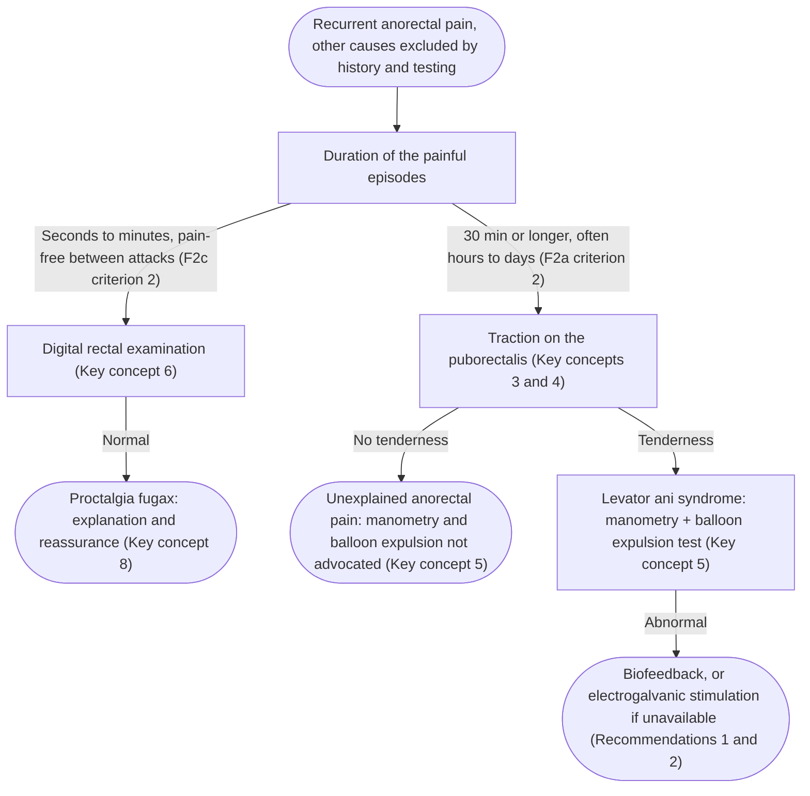

## Contents
- [[#Assessment]]
  - [[#Establishing the Diagnosis]]
  - [[#Classification / Typing]]
- [[#Differential Diagnosis]]
- [[#Diagnostics]]
- [[#Therapeutics]]
  - [[#Levator Ani Syndrome]]
  - [[#Unexplained Anorectal Pain]]
  - [[#Proctalgia Fugax]]
- [[#See Also]]
- [[#Sources]]

## Assessment

### Establishing the Diagnosis

**Proctalgia syndromes** = recurrent episodes of anorectal pain with no other known cause on history and diagnostic testing. They sit in the [[rome-v-2026-dgbi|Rome V]] anorectal [[disorders-of-gut-brain-interaction|disorders of gut–brain interaction]] under **F2 — anorectal pain disorders**, three named entities distinguished by **pain duration** and by **presence or absence of levator ani tenderness on digital rectal examination (DRE)** ([[rome-v-2026-anorectal-disorders]]).

- Diagnosis rests on **symptoms plus the DRE** — no physiologic test is required to make any of the three diagnoses.
- Anorectal manometry (ARM) and the balloon expulsion test (BET) are not diagnostic here; they select who gets biofeedback (see Therapeutics).

*Duration and the rectal examination decide both the diagnosis and who is offered biofeedback*
*Source: built from the Rome V F2a and F2c duration criteria plus ACG 2021 key concepts 3, 4, 5, 6 and 8 (Table 6) and treatment recommendations 1 and 2 (Table 7); neither document prints an anorectal-pain algorithm*
*[[acg-2021-anorectal-disorders|ACG 2021 Clinical Guidelines: Management of Benign Anorectal Disorders]] · [[rome-v-2026-anorectal-disorders|Anorectal Disorders (Rome V, 2026)]]*
*F2a = levator ani syndrome · F2c = proctalgia fugax*

**F2a. Levator ani syndrome — must include all of:**

1. Chronic or recurrent anorectal pain
2. Episodes last **30 minutes or longer**
3. **Tenderness during traction on the puborectalis**
4. Exclusion of other causes of anorectal pain, such as anal fissure, thrombosed hemorrhoids, malignancy, and infectious or inflammatory causes, such as inflammatory bowel disease, perianal abscess, fistula, prostatitis, coccygodynia, and gynecologic causes of pelvic pain

**F2b. Unexplained anorectal pain:** symptom criteria for levator ani syndrome but **no tenderness** during traction on the puborectalis muscle.

**F2c. Proctalgia fugax — must include all of:**

1. Recurrent episodes of pain localized to the anorectum and **unrelated to defecation**
2. Episodes last **from seconds to minutes**
3. There is **no anorectal pain between episodes**
4. Exclusion of other causes of anorectal pain, such as anal fissure, thrombosed hemorrhoids, malignancy, and infectious or inflammatory causes, such as inflammatory bowel disease, perianal abscess and fistula, prostatitis, coccygodynia, and major structural disorders of the pelvic floor

> All three: criteria fulfilled for the last 3 months with symptom onset at least 6 months before diagnosis.

**What changed in Rome V (4 changes):**

- **"Posterior traction" → "traction"** — traction at other quadrants also evokes pain.
- The term **"functional" was removed**.
- The order of the "other conditions" exclusion list was changed to **match the frequency** of those disorders.
- **"Structural alterations" was replaced with "disorders."**

**Duration cut-points differ between the two documents** — act on the Rome V figures above. ACG 2021 defined chronic proctalgia as episodes lasting **at least 20 minutes** and proctalgia fugax as **a few seconds to less than 20 minutes**; Rome V sets levator ani syndrome at **30 minutes or longer** and proctalgia fugax at **seconds to minutes**. ACG also notes that it is **duration, not frequency**, of episodes that makes the diagnosis in the general population.

### Classification / Typing

| Rome V | Rome V name | ACG 2021 equivalent |
|---|---|---|
| **F2a** | Levator ani syndrome | Chronic proctalgia **with** levator tenderness (levator / puborectalis syndrome) |
| **F2b** | Unexplained (unspecified) anorectal pain | Chronic idiopathic proctalgia syndrome |
| **F2c** | Proctalgia fugax | Proctalgia fugax |

- **Levator ani syndrome and unexplained anorectal pain:** a vague, dull ache or pressure sensation in the rectum, **worse sitting** than standing or lying down; episodes often last **hours or even days**. Left-sided tenderness was formerly thought more common, but DRE reproduced pain in **1 or more anal quadrants with similar pain severity**. The split between the two rests largely on 1 study, and Rome V applies the same evaluation and treatment discussion to both. Associated with psychological disturbance; prior sexual abuse was more prevalent in a case-control study.
- **Proctalgia fugax:** sudden severe pain described as cramping, gnawing, aching or stabbing, uncomfortable to unbearable, then disappearing completely; attacks are infrequent — **fewer than 5 times per year in 51%** — often recalled as nocturnal but can occur anytime, and **interrupt activities in 50%**. Attacks are often triggered by stressful life events or anxiety. **Pathophysiology unknown** with no consistently identified trigger; abnormal smooth muscle contraction is proposed, and **internal anal sphincter hypertrophy/thickening with elevated resting pressure** has been reported in a hereditary form.

---

## Differential Diagnosis

*Workup is history + DRE (algorithm above); the pelvic-floor testing limb — the ARM/BET evaluation that decides biofeedback eligibility — is on [[defecation-disorders]].*

| Condition | Key Features |
|-----------|-------------|
| [[rectal-prolapse#Solitary Rectal Ulcer Syndrome\|Solitary rectal ulcer syndrome]] | Endoscopic ulceration; straining history |
| Coccydynia | Tailbone pain; tenderness over coccyx |
| Chronic pelvic pain syndrome (women) | Gynecological source; pelvic examination |
| Chronic prostatitis (men) | Perineal/prostatic tenderness; urinary symptoms |
| Pudendal neuralgia | Burning quality; sitting-provoked |
| Levator spasm secondary to [[anal-fissure\|anal fissure]] or [[hemorrhoids]] | Structural cause present; treat underlying condition |
| [[crohns-disease\|Crohn's]] perianal disease | Fistulas, skin tags, atypical fissures |
| Endometriosis | Women; cyclical pain; pelvic magnetic resonance imaging (MRI) |

- Symptoms overlap substantially with **chronic prostatitis in men and chronic pelvic pain syndrome in women** — ACG endorses excluding these with appropriate testing **before** starting a trial of conservative treatment.
- Prolapsed [[hemorrhoids]], chronic anal fissure, or other anorectal pathology **does not invalidate a diagnosis of proctalgia fugax** — manage concurrently.

---

## Diagnostics

- **Proctalgia fugax:** clinical history and a **normal DRE alone are sufficient**; no further testing.
- **Anoscopy and sigmoidoscopy:** in chronic anorectal pain, to exclude a fissure and identify mucosal disease.
- **Cross-sectional imaging:** if perianal disease (abscess or fistula) is suspected.
- **[[anorectal-manometry|ARM]] + BET:** in levator ani syndrome, to identify patients eligible for [[biofeedback-therapy|biofeedback]] — **not advocated in idiopathic chronic proctalgia / unexplained anorectal pain**. Defecography and the translumbosacral anorectal magnetic stimulation test may also be considered.
- **[[colonoscopy|Colonoscopy]]:** only if rectal bleeding, change in bowel habit, or other alarm features.

**What the physiology shows in levator ani syndrome:**

- **85% of patients with levator tenderness had dyssynergia** on manometry — without constipation — in a randomized controlled trial (RCT) of 157 patients with chronic anorectal pain, and **reversal of the dyssynergia with biofeedback strongly predicted symptom relief**.
- **34%** of patients with levator ani syndrome met criteria for dyssynergic defecation; elevated resting pressures and a more contracted puborectalis at rest and on straining have been shown on imaging.
- Weak anal sphincters and a **prolonged balloon expulsion time**.
- Prolonged motor evoked potential latencies on translumbosacral anorectal magnetic stimulation, indicating lumbar or sacral plexus neuropathy.

---

## Therapeutics

### Levator Ani Syndrome

> [!pitfall] Biofeedback is for tender levators with an abnormal manometry
> Both ACG recommendations are written for **levator syndrome with abnormal ARM** — so the DRE plus the manometry, not the pain history, select who is treated. In the pivotal RCT, **patients without levator tenderness did not benefit from any of the three therapies** ([[acg-2021-anorectal-disorders]], [[rome-v-2026-anorectal-disorders]]).

- **[[biofeedback-therapy|Biofeedback]] to teach pelvic floor muscle reconditioning, for levator syndrome with abnormal ARM** — *strong recommendation, quality of evidence: very low*. Cornerstone of treatment: **87% of patients with levator tenderness reported adequate pain relief after biofeedback, vs 45% after electrical stimulation and 22% after massage**.
  - There has been **no independent confirmation in the 10 years** since the pivotal study; ACG keeps the strong recommendation because biofeedback carries no significant risk and there are no effective alternatives.
- **Electrogalvanic stimulation (EGS) may be attempted for levator syndrome with abnormal ARM if biofeedback is not available** — *conditional recommendation, quality of evidence: very low*. Less effective than biofeedback but superior to conservative treatment; both recommendations are availability-driven, with biofeedback the preferred option.
- **Translumbosacral neuromodulation therapy:** repetitive magnetic stimulation of the lumbar and sacral plexus; an open-label study reported significant improvement in anorectal pain and in lumbosacral neuropathy.
- **[[botulinum-toxin|Botulinum toxin]]** (intra-anal or intra-levator): retrospective studies suggested improvement, but 1 RCT found no benefit over placebo. **ACG: no evidence supports botulinum toxin or digital rectal massage** in levator syndrome or chronic idiopathic proctalgia syndrome (ungraded statement).
- **Ineffective:** muscle relaxants, diazepam, [[sacral-nerve-stimulation|sacral nerve stimulation]], sitz baths, radiofrequency, pudendal infiltration, transgluteal decompression, transcutaneous electrical nerve stimulation, laparoscopic decompression.

### Unexplained Anorectal Pain

- **No therapy has shown benefit** in patients without levator tenderness — the non-tender arm of the pivotal RCT improved with none of biofeedback, electrical stimulation or massage.
- ARM/BET is not advocated, so the ARM-gated recommendations above do not apply; botulinum toxin and digital massage are unsupported here as well.

### Proctalgia Fugax

- **Explanation of the disorder and reassurance** is the preferred approach and is often sufficient — the condition has been described as "harmless, unpleasant, and incurable," and the brevity of attacks leaves little for an intervention to improve.
- **Frequent or severe attacks may require therapy** (Rome V). **Inhaled salbutamol shortened the duration of severe and prolonged attacks** vs placebo in an RCT. Clonidine, amyl nitrite, nitroglycerine, neuromodulators and behavioral therapies have been suggested, with no comparative studies.
- **ACG 2021 took the stricter line:** given the brevity of episodes, no evidence supports treating or preventing attacks, and it endorsed no treatment of any kind — the salbutamol study was 25 years old, worked **only where pain lasted longer than 20 minutes**, and has not been duplicated.

---

## See Also
[[defecation-disorders]], [[fecal-incontinence]], [[anal-fissure]], [[hemorrhoids]], [[rectal-prolapse]], [[crohns-disease]], [[biofeedback-therapy]], [[anorectal-manometry]], [[colonoscopy]], [[disorders-of-gut-brain-interaction]]

---

## Sources

1. [[acg-2021-anorectal-disorders|ACG 2021 Clinical Guidelines: Management of Benign Anorectal Disorders]]
2. [[rome-v-2026-dgbi|Disorders of Gut–Brain Interaction and the Rome V Process]]
3. [[rome-v-2026-anorectal-disorders|Anorectal Disorders (Rome V, 2026)]]
