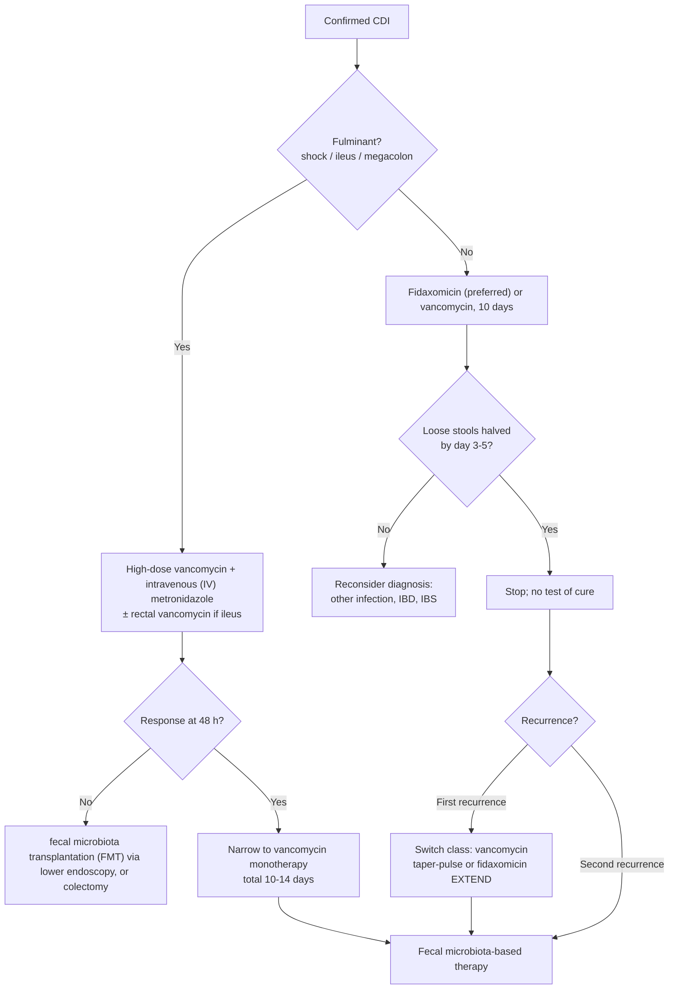

## Contents
- [[#Assessment]]
  - [[#Establishing the Diagnosis]]
  - [[#Severity Assessment]]
  - [[#Classification / Typing]]
- [[#Differential Diagnosis]]
- [[#Diagnostics]]
- [[#Therapeutics]]
  - [[#Overall Pathway]]
  - [[#Choosing Initial Therapy (nonfulminant)]]
  - [[#Severe Initial CDI]]
  - [[#Fulminant CDI]]
  - [[#Recurrent CDI]]
  - [[#Prevention]]
  - [[#Special Populations]]
- [[#See Also]]
- [[#Sources]]

---

## Assessment

### Establishing the Diagnosis

- **Clostridioides difficile infection (CDI) = clinical diagnosis:** compatible symptoms (typically acute diarrhea after antibiotics) **plus** supportive lab testing; an organism alone never makes it. [[aga-2026-cdiff-adults]]
- **Who to test:** ≥3 unformed stools in 24 h with unexplained new-onset diarrhea. [[acg-2021-cdiff]]
  - Also a **traveler with diarrhea and antimicrobials within the preceding 8–12 weeks** *(strong, moderate)*; healthcare, long-term-care, and prison exposure are recognized settings. [[idsa-2017-infectious-diarrhea]]
- **Don't test:** formed stool; asymptomatic patients after treatment (no test of cure — shedding persists up to 4 weeks after symptoms resolve). [[acg-2021-cdiff]]
- **Test-positive but suspect another diagnosis:** no vancomycin response in nonsevere disease; chronic intermittent or nonprogressive diarrhea; alternating constipation; [[postinfectious-ibs|post-infection irritable bowel syndrome (IBS)]] pattern.

### Severity Assessment

- **Classify every hospitalized patient at diagnosis** — severity sets drug, route, and recurrence-prevention plan. Outpatients are usually nonsevere; order severity labs case-by-case. [[aga-2026-cdiff-adults]]

| Severity | Criteria |
|---|---|
| **Nonsevere** | **Neither** severe criterion — white blood cell (WBC) <15,000 cells/mm³ **AND** creatinine ≤1.5 mg/dL (or ≤1.5 × premorbid baseline) [[acg-2021-cdiff]] |
| **Severe** | WBC **≥15,000 cells/mm³** ([[acg-2021-cdiff\|American College of Gastroenterology (ACG) 2021]] / Infectious Diseases Society of America (IDSA) 2018; [[aga-2026-cdiff-adults\|American Gastroenterological Association (AGA) 2026]]: >15,000 cells/µL) **OR** creatinine **>1.5 mg/dL** **or >1.5 × premorbid baseline** |
| **Fulminant** | Severe criteria **PLUS** hypotension/shock **OR** ileus **OR** megacolon |

> [!pitfall] Absolute creatinine cutoff misleads in kidney disease
> IDSA 2010 used the ratio (≥1.5× baseline); 2018 switched to absolute >1.5 mg/dL because baseline is often unavailable, but conceded it is unhelpful in underlying renal disease ([[acg-2021-cdiff]]). AGA 2026 accepts either — use the ratio when a premorbid creatinine exists (especially chronic kidney disease), the absolute cutoff when not.

- Severe disease also marks **higher recurrence risk** → pulls microbiota restoration earlier. [[aga-2026-cdiff-adults]]
- Other poor-outcome markers (not criteria): low albumin, fecal calprotectin >2,000 µg/g, eosinopenia, fever >38.5°C (~1% of severe), pseudomembranes on [[colonoscopy]], NAP1/BI/027 strain. [[acg-2021-cdiff]]

### Classification / Typing

- **Initial CDI:** first confirmed episode.
- **Recurrent CDI:** diarrhea + positive stool test within **8 weeks** of treating a prior episode (~90% of recurrences; events up to **1 year** still count). ~20% recur after a first episode, more after each further one. [[aga-2026-cdiff-adults]]
- **Fulminant CDI:** **1%–3%** of CDI; mortality **30%–40%** → intensive care unit-level care, early surgical consult. [[aga-2026-cdiff-adults]]

> [!pearl] No pseudomembranes in "fulminant CDI" — look elsewhere
> Pseudomembranes are universally present in fulminant CDI in the AGA authors' experience; their absence should prompt a search for another cause ([[aga-2026-cdiff-adults]]). Exception: inflammatory bowel disease (IBD) often lacks them (see *Special Populations*).

---

## Differential Diagnosis

*Workup: see [[acute-diarrhea]].*

- Infectious colitis — [[salmonella-infection|Salmonella]], [[campylobacter-infection|Campylobacter]], [[shigellosis|Shigella]], [[shiga-toxin-producing-e-coli|Shiga toxin–producing *E. coli*]] (no antimicrobials), [[enterotoxigenic-e-coli|enterotoxigenic *E. coli*]], [[norovirus]], cytomegalovirus (CMV) if immunocompromised
- [[inflammatory-bowel-disease|IBD]] flare ([[ulcerative-colitis]], [[crohns-disease]]) — CDI colonization is common in IBD; distinguish CDI + flare from either alone
- [[microscopic-colitis|Microscopic colitis]] (collagenous or lymphocytic)
- Antibiotic-associated diarrhea without CDI (disrupted microbiome, osmotic)
- Post-infection [[irritable-bowel-syndrome|IBS]] (~25% after treated CDI; shedding may persist)
- [[colon-ischemia|Ischemic colitis]]
- Medication-induced diarrhea

---

## Diagnostics

**Two-step stool testing** (unformed stool only; with ileus, rectal swab polymerase chain reaction [PCR] may help):

| Step | Test | Sensitivity / specificity | What it detects |
|---|---|---|---|
| 1 — sensitive | Nucleic acid amplification test (NAAT; PCR or loop-mediated isothermal amplification) | 95–96% / 94–98% | Toxin B gene, not free toxin — can't separate colonization from infection |
| 1 — sensitive (alt.) | Glutamate dehydrogenase (GDH) antigen enzyme immunoassay (EIA) | 94–96% / 90–96%; negative predictive value ~100% | Organism — can't separate toxigenic from nontoxigenic |
| 2 — specific | Toxin A/B EIA | 57–83% / 99% | Free toxin — separates colonization from active infection |

- **Both positive** → CDI confirmed. **Both negative** → CDI unlikely.
- **NAAT/GDH+ / toxin−** → colonization vs toxin below detection; rarely complicated, course like non-CDI even untreated.
- **Not NAAT alone:** colonization is common (community adults 4%–15%; hospitalized 3%–21%; long-term care up to 50%) → over-treats carriers. [[aga-2026-cdiff-adults]]

> [!pitfall] A negative toxin does not rule out CDI when suspicion is high
> Toxin EIA can be falsely negative (low fecal toxin, poor sample collection/processing) — don't withhold treatment on it alone ([[aga-2026-cdiff-adults]]).

- **Retest after treatment only** for relapse of **≥3 watery stools/day, sustained ≥2 days or worsening, consistent with prior episodes** — confirm by lab, not empirically (insurers often require it for microbiota therapy); negative/discordant → other causes. [[aga-2026-cdiff-adults]]
- **Endoscopy/imaging:** pseudomembranes on colonoscopy are diagnostic and predict severe disease (IBD: mucopurulent exudate instead); computed tomography (CT) abdomen/pelvis in fulminant disease for colitis severity, megacolon, perforation; colonic biopsy (microscopic colitis, IBD) when CDI tests are negative/discordant.
- **Labs:** complete blood count (WBC), creatinine, albumin if hospitalized; lactate if fulminant suspected.

![[cdiff-2021-testing-algorithm-07.png|700x976]]
*Figure 1 — Proposed CDI testing algorithm (two-step: GDH or NAAT → Toxin EIA). ([[acg-2021-cdiff]])*

---

## Therapeutics

### Overall Pathway

*Figure 2 — CDI management pathway, after [[aga-2026-cdiff-adults]] Figures 2A–C. Doses, thresholds, and eligibility criteria are in the sections below.*

### Choosing Initial Therapy (nonfulminant)

*Doses, trial data, and agent detail: [[cdiff-antibiotics|antibiotics for Clostridioides difficile infection]]. This page carries the choice.*

- **Fidaxomicin 200 mg by mouth (PO) twice daily (BID) × 10 days — preferred for all nonfulminant CDI** (narrower spectrum, **6%–11% fewer recurrences**; generic now available). [[aga-2026-cdiff-adults]]
- **Vancomycin 125 mg PO four times daily (QID) × 10 days — acceptable**; choose by shared decision-making (recurrence risk, convenience, access, cost). Doses may be spread over waking hours. [[aga-2026-cdiff-adults]]
- **No metronidazole outside fulminant disease** — AGA 2026 supersedes the ACG 2021 low-risk-outpatient carve-out ([[cdiff-antibiotics#Choosing Between Fidaxomicin and Vancomycin|detail]]).
- **Day 3–5 check:** expect **≥50% fewer loose stools/day within 3 days, no later than 5**. Not met → look for another explanation (other infection, noninfectious cause such as IBS) rather than extending therapy. [[aga-2026-cdiff-adults]]
- **Don't add:** bile acid binders (bind vancomycin/fidaxomicin; psyllium OK after recovery), [[loperamide]] before anti-CDI therapy starts (contraindicated in untreated/fulminant CDI and severe colonic IBD — [[toxic-megacolon|toxic megacolon]] risk), [[rifaximin]], tigecycline — see [[cdiff-antibiotics#What Not to Use]]. [[aga-2026-cdiff-adults]], [[acg-2021-cdiff]]

### Severe Initial CDI

- **Vancomycin 125 mg PO QID × 10 days** (ACG strong) or fidaxomicin (ACG conditional — severe excluded from trials; AGA 2026 no carve-out). **No metronidazole** (higher 30-day mortality). **Don't raise the vancomycin dose** — nonresponse → look for another cause. [[acg-2021-cdiff]]
- **Refractory severe** — hospitalized, ongoing diarrhea + persistent leukocytosis after **5–7 days** of vancomycin 125 mg every 6 hours (q6h) (AGA authors' working definition) → consider [[fmt|FMT]]. [[aga-2026-cdiff-adults]]

### Fulminant CDI

- **Multidisciplinary:** gastroenterology, infectious diseases (ID), critical care, surgery.
- **Triple therapy from the start** (not stepwise): oral/enteral vancomycin **500 mg q6h** + **IV metronidazole 500 mg every 8 h**; **add rectal vancomycin 500 mg q6h if ileus**. High dose is for colonic delivery, not proven benefit — rationale on [[cdiff-antibiotics#Fulminant Disease]]. [[aga-2026-cdiff-adults]]
- **De-escalate** after response (typically 3–5 days) → vancomycin 125 mg QID; total **≥10 days, 14 favored**. [[aga-2026-cdiff-adults]]
- **No empiric non-CDI antibiotics** (worsen dysbiosis); a real coinfection → treat with ID input + suppressive vancomycin 125 mg daily/BID alongside. [[aga-2026-cdiff-adults]]
- Volume resuscitation; watch renal function and urine output; low threshold for CT (megacolon, perforation).
- **No response or worse at 48 h** (ACG: 48–72 h) → team reassessment for **FMT or colectomy**. [[aga-2026-cdiff-adults]], [[acg-2021-cdiff]]

**FMT for refractory severe/fulminant CDI** (donor source, follow-up on the FMT page):

- **When:** after 48–72 h of failed maximal therapy, especially poor surgical candidates (ACG strong/low); AGA 2024: within **2–5 days** of starting treatment. [[acg-2021-cdiff]], [[aga-2024-fmt]]
- **How:** first dose by colonoscopy or flexible sigmoidoscopy; no nasoenteric tube; no Food and Drug Administration (FDA)-approved products; not with perforation, obstruction, or high-grade stricture. [[aga-2024-fmt]], [[aga-2026-cdiff-adults]]
- **Sequential protocol:** repeat colonoscopic FMT **every 3–5 days until pseudomembranes resolve** (most need 2–3), with vancomycin 125 mg q6h (or fidaxomicin 200 mg every 12 h) between doses. Cure 100% severe / 87% fulminant (retrospective); mortality 43.2% → 12.1% in one series. [[acg-2021-cdiff]], [[aga-2026-cdiff-adults]]
- **After colitis resolves:** vancomycin 125 mg QID to **14 days total** → 125 mg daily/BID suppression → **final outpatient fecal microbiota–based therapy**. [[aga-2026-cdiff-adults]]

**Surgery** — perforation, toxic megacolon, ischemia, or failure of maximal medical therapy:

| Option | Notes |
|---|---|
| Total colectomy + [[ostomy-management\|end ileostomy]] + stapled rectal stump | Traditional; removes infected colon |
| Diverting loop ileostomy + intraoperative colonic lavage (8 L polyethylene glycol) + 10 days postoperative intraluminal vancomycin via ileostomy | Less physiologically demanding; adjusted mortality 17.2% vs 39.7% (matched cohort) |

- Late surgery raises postoperative mortality — but don't operate too early assuming diversion is low-risk. [[acg-2021-cdiff]]

### Recurrent CDI

*Schedules (taper/pulse, EXTEND) and evidence: [[cdiff-antibiotics#Recurrence]]. Microbiota-therapy eligibility and administration: [[fmt]].*

**First recurrence — switch class from the agent that failed** ([[aga-2026-cdiff-adults]]):

| Initial treatment | First-recurrence options |
|---|---|
| **Fidaxomicin** | Vancomycin **taper/pulse**, *or* fidaxomicin **EXTEND** pulsed |
| **Vancomycin** | Fidaxomicin — standard 10-day *or* **EXTEND** pulsed |

- **No metronidazole** for recurrence; one lifetime course max (neurotoxicity). [[acg-2021-cdiff]]
- Ongoing risk (systemic antibiotics, cytotoxic chemotherapy) → suppressive vancomycin 125 mg daily after the course until those finish. [[aga-2026-cdiff-adults]]
- **Counsel now:** higher risk of further episodes; pre-position test-collection materials and a vancomycin/fidaxomicin refill at the pharmacy. [[aga-2026-cdiff-adults]]

**Second or further recurrence → fecal microbiota–based therapy** (ACG: FMT strong/moderate). [[acg-2021-cdiff]], [[aga-2024-fmt]]

> [!pitfall] Check immune status before any microbiota therapy
> Immunocompetent → FMT or an FDA-approved product; mild/moderate immunocompromise → **conventional FMT only**; **severe → none** (criteria on [[fmt]]) ([[aga-2024-fmt]]). AGA 2026 triggers: cytotoxic chemotherapy, recent stem cell transplant, absolute neutrophil count <500/µL, advanced/untreated human immunodeficiency virus (CD4 <200/mm³) — usually transient, so **defer** and bridge with suppressive vancomycin ([[aga-2026-cdiff-adults]]).

- **Prevents recurrence, doesn't treat active CDI:** finish the antibiotic course, bridge with vancomycin **≥125 mg daily** until approved/accessible (FDA stool-bank limits, insurance), washout 1–3 days (AGA 2024) / 1–4 days (AGA 2026). [[aga-2024-fmt]], [[aga-2026-cdiff-adults]]
- **Earlier (after initial infection or first recurrence)** if high risk of morbid recurrence — age >65, immunocompromised, skilled-nursing resident, or severe/fulminant/refractory prior episode. [[aga-2024-fmt]], [[aga-2026-cdiff-adults]]
- **Route (ACG):** colonoscopy or capsules (equivalent, 96.2% each in one trial; both strong); enema only if neither available. AGA 2024 favors no route. [[acg-2021-cdiff]], [[aga-2024-fmt]]
- **FMT failure** (recurrence within 8 weeks; most within 4): restart anti-CDI antibiotics, repeat FMT — colonoscopic if the first was enema/capsule; <5% fail a second. [[acg-2021-cdiff]]
- **Oral spore product (SER-109, fecal microbiota spores live-brpk):** 8-week recurrence **12% vs 40%** placebo (ECOSPOR III). [[feuerstadt-2022-ser109-cdiff]]
- **Bezlotoxumab:** no longer commercially available (supersedes ACG 2021 Rec 19). [[aga-2026-cdiff-adults]]

**Suppressive vancomycin 125 mg daily (long-term)** — multiple recurrences and **not a candidate** for microbiota therapy (comorbidity, limited life expectancy, frequent systemic antibiotics, pregnancy, severe immunosuppression, active chemotherapy, extreme frailty, no access) **or** failed it repeatedly. Recurrence >40% without it and >30% after stopping; microbiota therapy stays preferred when feasible. [[aga-2026-cdiff-adults]]

> [!pitfall] No prophylactic vancomycin during later antibiotic courses
> AGA 2026 (Best Practice Advice 12) reverses ACG 2021 Rec 18 — the only randomized trial showed no significant benefit. Instead: watch for diarrhea, test and treat promptly; a standing order for *C. difficile* testing helps. IBD exception below ([[aga-2026-cdiff-adults]]; detail on [[cdiff-antibiotics#Suppressive and Prophylactic Vancomycin]]).

### Prevention

- **Antibiotic stewardship** — restricting high-risk and unnecessary antibiotics is the most effective prevention in healthcare settings (outbreak or not). [[acg-2021-cdiff]]
- **Counsel every patient with prior CDI:** tell other clinicians, require an indication for any antibiotic (dental prophylaxis no longer routine for most prosthetic-joint/cardiac patients), but take indicated antibiotics without fear. [[aga-2026-cdiff-adults]]
- **[[probiotics|Probiotics]] not advised** for initial or recurrent CDI; advise a varied **high-fiber** diet instead, no bland/clear-liquid diets. [[acg-2021-cdiff]], [[aga-2026-cdiff-adults]]
- **[[proton-pump-inhibitors|Proton pump inhibitors]]:** keep if indicated, discuss stopping if not — **never dose-reduce** (binary decision; risk data on that page). [[aga-2026-cdiff-adults]]
- **Infection control** (IDSA/Society for Healthcare Epidemiology of America; not formally graded by ACG): isolate suspected/confirmed CDI; gown + gloves; **soap-and-water** hand hygiene; not needed for asymptomatic carriers. [[acg-2021-cdiff]]

**Household counseling** (most useful with multiple recurrences) — [[aga-2026-cdiff-adults]] Table 1:

| Domain | Advice |
|---|---|
| **Hand hygiene** | Alcohol sanitizers **don't kill spores** — soap-and-water handwashing, especially after the bathroom and before meals |
| **Cleaning** | Spores survive **up to 6 months**. Sporicidal agent (e.g. **bleach 1:9 with water**) on high-touch surfaces, **≥10 min contact**; dry bedding/clothes on high heat |
| **Household** | Shoes off at the door; wipe pet paws; pets and **children <2 years** may carry toxigenic strains; wash produce |
| **Risk to others** | Absolute household risk **<5%**; separate bathroom unnecessary if regularly disinfected. Less contagious once diarrhea resolves |

### Special Populations

**IBD** — [[aga-2026-cdiff-ibd|AGA 2026 IBD clinical practice update]] unless noted:

- **Test every IBD flare with diarrhea** (ACG strong) with a **multistep toxin-based assay** (NAAT alone over-calls colonization). CDI risk **4.8-fold** higher; recurrence 32% vs 24% (33% relative increase). [[acg-2021-cdiff]]
- **Drug: prefer fidaxomicin** (vancomycin if unavailable/cost-prohibitive; no metronidazole) — supersedes ACG's vancomycin ≥14 days first-line; EXTEND and prolonged-vancomycin options on [[cdiff-antibiotics#IBD]].
- **Continue IBD immunosuppression** (no class has differential CDI risk; steroids OK if concurrent moderate–severe flare). **Fulminant CDI:** consider holding nonessential immunosuppressants until CDI improves.
- **Persisting 48–72 h** after starting CDI treatment → endoscopy for IBD activity **and exclude CMV**. (ACG: no improvement at 3 days → escalate IBD therapy.) [[acg-2021-cdiff]]
- **Hospitalize** for severe colitis/systemic toxicity: >6 bowel movements/day, severe pain, marked leukocytosis, hemodynamic instability, sepsis.
- **End ileostomy or [[pouchitis|ileo-anal pouch]]** with worsening diarrhea → exclude/treat CDI. Retest a recurrence **≥72 h after stopping vancomycin** (else falsely negative).
- Loperamide may be considered once inflammation/infection improve but diarrhea persists.
- **After ≥1 recurrence** → microbiome therapy (fecal microbiota live-jslm, spores live-brpk, or FMT). FMT clears CDI in 79–91%; 7–25% have IBD worsening. FMT **for IBD itself** (ulcerative colitis, Crohn's, pouchitis): against, except in trials *(AGA 2024 Recs 4–6)*. [[acg-2021-cdiff]], [[aga-2024-fmt]]
- **Oral vancomycin prophylaxis may be considered** (IBD-only exception, weak evidence): prior CDI + systemic antibiotics → **125 mg once–twice daily** from start of antibiotics to **5 days after** they end, after informed decision.

**Pregnancy/lactation:** vancomycin first-line; fidaxomicin only after vancomycin failure; avoid metronidazole; **defer FMT to postpartum** — agent table on [[cdiff-antibiotics#Pregnancy and Lactation]]. [[acg-2021-cdiff]]

**Immunocompromised:** vancomycin or fidaxomicin; avoid metronidazole ([[cdiff-antibiotics#Immunocompromise and Cancer]]). Microbiota therapy gated by degree of immunocompromise (see *Recurrent CDI*). [[acg-2021-cdiff]], [[aga-2024-fmt]]

---

## See Also

[[acute-diarrhea]], [[ulcerative-colitis]], [[crohns-disease]], [[inflammatory-bowel-disease]], [[colonoscopy]], [[salmonella-infection]], [[campylobacter-infection]], [[shigellosis]], [[enterotoxigenic-e-coli]], [[norovirus]], [[irritable-bowel-syndrome]], [[postinfectious-ibs]], [[microscopic-colitis]], [[colon-ischemia]], [[toxic-megacolon]], [[ostomy-management]], [[pouchitis]], [[fmt]], [[cdiff-antibiotics]], [[probiotics]], [[loperamide]], [[rifaximin]], [[proton-pump-inhibitors]], [[potassium-competitive-acid-blockers]]

---

## Sources

1. [[acg-2021-cdiff|ACG 2021: Prevention, Diagnosis, and Treatment of Clostridioides difficile Infections]]
2. [[aga-2024-fmt|AGA Clinical Practice Guideline: Fecal Microbiota-Based Therapies for Select GI Diseases (2024)]]
3. [[aga-2026-cdiff-adults|AGA Clinical Practice Update on Management of Clostridioides difficile Infection in Adults: Expert Review (2026)]]
4. [[aga-2026-cdiff-ibd|AGA Clinical Practice Update on Management of Clostridioides difficile Infection in Inflammatory Bowel Disease: Expert Review (2026)]]
5. [[feuerstadt-2022-ser109-cdiff|SER-109, an Oral Microbiome Therapy for Recurrent Clostridioides difficile Infection (ECOSPOR III)]]
6. [[idsa-2017-infectious-diarrhea|IDSA 2017 Clinical Practice Guidelines for the Diagnosis and Management of Infectious Diarrhea]]
