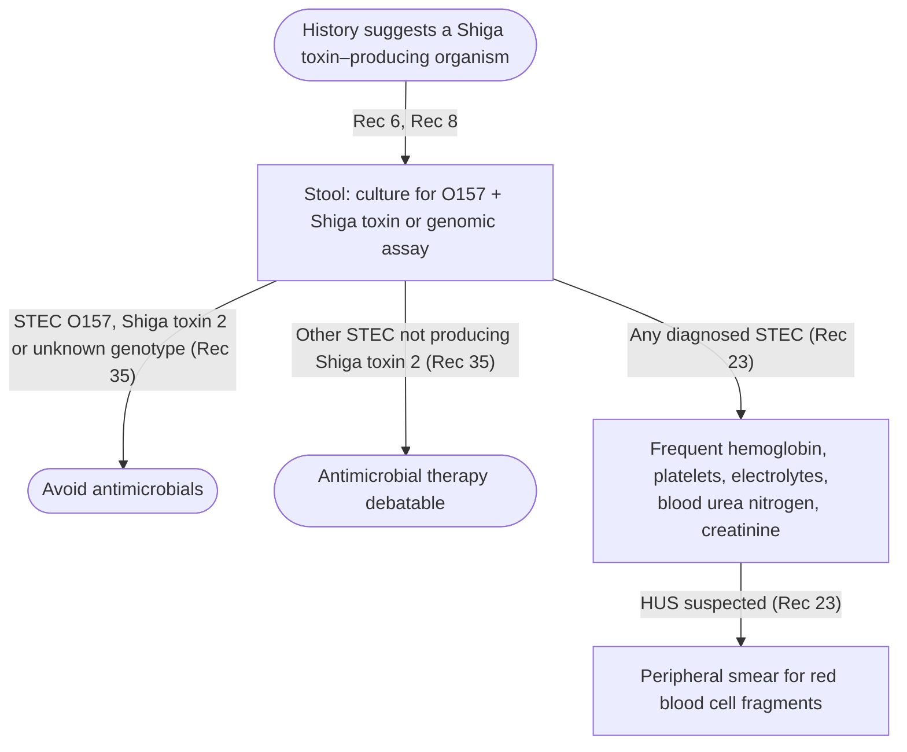

Shiga toxin–producing *Escherichia coli* (STEC): a cause of bloody diarrhea where identifying the organism changes management mainly by what *not* to give — antimicrobials are to be avoided — and by monitoring for hemolytic uremic syndrome (HUS) ([[idsa-2017-infectious-diarrhea]]).

## Contents
- [[#Assessment]]
  - [[#Establishing the Diagnosis]]
  - [[#Who to Suspect It In]]
  - [[#Severity Assessment]]
  - [[#Classification / Typing]]
- [[#Differential Diagnosis]]
- [[#Diagnostics]]
  - [[#Stool Testing]]
  - [[#Tests Not to Use]]
  - [[#Monitoring for HUS]]
- [[#Therapeutics]]
  - [[#Antimicrobials — Avoid]]
  - [[#Supportive Care]]
  - [[#Follow-Up, Clearance and Public Health]]
- [[#See Also]]
- [[#Sources]]

## Assessment

### Establishing the Diagnosis

- **Microbiologic diagnosis.** When the clinical or epidemic history suggests a Shiga toxin–producing organism → use tests that **detect Shiga toxin (or its genes)** and **distinguish *E. coli* O157:H7 from other STEC** in stool *(strong, moderate)* ([[idsa-2017-infectious-diarrhea]] Rec 6).
- **If available, distinguish Shiga toxin 1 from Shiga toxin 2** (typically more potent) *(weak, moderate)* — the toxin type drives the antibiotic decision.
- ***Shigella dysenteriae* type 1**, and rarely other pathogens, may produce Shiga toxin → consider as a cause of HUS, especially with suggestive international travel or personal contact with a traveler *(strong, moderate)* — see [[shigellosis]].

*Stool diagnosis, antibiotic decision and HUS monitoring in suspected STEC*
*Source: built from Infectious Diseases Society of America (IDSA) 2017 Recommendations 6, 8, 23 and 35 (the guideline has no flowchart)*
*[[idsa-2017-infectious-diarrhea|IDSA 2017 Infectious Diarrhea Guideline]]*
*STEC = Shiga toxin–producing E. coli · HUS = hemolytic uremic syndrome*

### Who to Suspect It In

> [!pitfall] Absence of fever points toward STEC
> Patients with STEC are usually **not febrile at presentation**; consider STEC in any bloody diarrhea, even with fever, particularly without it ([[idsa-2017-infectious-diarrhea]] Table 3 and Rec 35 evidence summary).

| Signal | Detail ([[idsa-2017-infectious-diarrhea]]) |
|---|---|
| **Bloody diarrhea** | Consider STEC in any patient with bloody diarrhea — **even when fever is present, particularly when absent** |
| **Non-bloody diarrhea** | Does not exclude it: **~10%** of patients with laboratory-confirmed STEC who develop HUS do not have bloody diarrhea |
| **Abdominal tenderness, absence of fever** | Each **independently** associated with increased risk of STEC O157 vs other enteric infections, at first medical evaluation |
| **Leukocytosis** | **~65%** of patients infected with *E. coli* O157 have a peripheral white blood cell (WBC) count **>10,000 cells/µL** — but a WBC count should not be used to establish the etiology of diarrhea *(strong, low)* (Rec 22) |

**Exposures linked to STEC** (Table 2): raw or undercooked **beef**; **unpasteurized milk** or dairy products; fruits, **unpasteurized fruit juices**, vegetables, **leafy greens and sprouts**; swimming in or drinking **untreated fresh water**; visiting a **farm or petting zoo**; **child care** attendance or employment; **healthcare, long-term care or prison** exposure or employment; foodborne outbreaks in hotels, cruise ships, resorts, restaurants and catered events.

### Severity Assessment

- No STEC severity score in either source; severity = progression toward HUS, tracked by the labs under [[#Monitoring for HUS]].
- **Features tied to more severe disease** ([[idsa-2017-infectious-diarrhea]]):

| Feature | What it signals |
|---|---|
| **Shiga toxin 2 (*stx2*) genes** | Increased risk of both bloody diarrhea and HUS; most US STEC strains isolated from HUS patients are serogroup **O157** and *stx2*-positive |
| **Shiga toxin 2 subtypes 2a, 2c, 2d** | More severe disease; clinical laboratories typically cannot differentiate subtypes |
| **Shiga toxin 2 producer or bloody diarrhea** | The groups Rec 23 singles out for HUS monitoring |
| **High WBC and neutrophil count** | Often present in STEC O157 patients who subsequently develop HUS |
| **Dehydration on admission** (children with postdiarrheal HUS) | Associated with increased need for dialysis |

### Classification / Typing

| Axis | Categories | Why it matters |
|---|---|---|
| **Serotype** | **O157:H7** vs **other (non-O157) STEC** | Detection method differs ([[#Stool Testing]]) |
| **Toxin genotype** | **Shiga toxin 2** vs **not Shiga toxin 2** (generally non-O157) vs **unknown** | Drives the antimicrobial decision ([[#Antimicrobials — Avoid]]) |

## Differential Diagnosis

*Workup: see [[acute-diarrhea]].*

- **[[shigellosis|*Shigella*]]** — *S. dysenteriae* type 1 also produces Shiga toxin and causes HUS (Rec 6; Table 4). Unlike STEC, antimicrobials may be indicated; empiric therapy is an exception (Rec 30b) only for ill immunocompetent people with **fever documented in a medical setting**, abdominal pain, bloody diarrhea and bacillary dysentery presumptively due to *Shigella* ([[idsa-2017-infectious-diarrhea]]).
- **Severe abdominal pain, often grossly bloody stools, minimal or no fever** — also [[salmonella-infection|*Salmonella*]], [[campylobacter-infection|*Campylobacter*]], *Yersinia enterocolitica* (Table 3).
- **Other causes of visible blood in stool** — [[entamoeba-histolytica-infection|*Entamoeba histolytica*]], noncholera *Vibrio*, *Balantidium coli*, *Plesiomonas* (Table 3). Higher temperatures suggest a bacterial etiology or *E. histolytica*.
- **[[clostridioides-difficile|*C. difficile*]]** — tested in the same stool panel, but bloody stools are not an expected manifestation (Rec 8).
- **[[enterotoxigenic-e-coli|Enterotoxigenic *E. coli* (ETEC)]]** — another *E. coli* pathotype, linked to travel to resource-challenged countries (Table 2); needs specialized culture or molecular assay (Table 5).
- **Noninfectious bloody diarrhea** — identifying a bacterial agent can prevent unnecessary colonoscopy, abdominal surgery, or treatment for suspected [[ulcerative-colitis]] ([[idsa-2017-infectious-diarrhea]]).

## Diagnostics

### Stool Testing

**Indication** ([[idsa-2017-infectious-diarrhea]] Rec 8, *strong, moderate*): test stool for ***Salmonella*, *Shigella*, *Campylobacter*, *Yersinia*, *C. difficile* and STEC** in diarrhea with **fever, bloody or mucoid stools, severe abdominal cramping or tenderness, or signs of sepsis**.

**Method — do both** (Table 5: culture for *E. coli* O157:H7 **and** Shiga toxin immunoassay or nucleic acid amplification test [NAAT] for Shiga toxin genes):

| Target | Method | Grade (Rec 8) |
|---|---|---|
| **STEC O157** | **Culture**; screen on **sorbitol-MacConkey agar or an appropriate chromogenic alternative** | *Strong, low* (culture); *strong, moderate* (agar) |
| **Non-O157 STEC** | **Shiga toxin or genomic assays** — detection of other serotypes first requires detecting Shiga toxin (or its genes) | *Strong, low*; Shiga toxin detection needed *(strong, moderate)* |

> [!pitfall] Ask what "stool culture" covered
> Laboratories are recommended to process all stool specimens sent for bacterial culture for STEC including O157:H7, but **some test for O157:H7 only by specific request** ([[idsa-2017-infectious-diarrhea]] Table 5).

- Routine stool culture in most laboratories is designed to detect *Salmonella*, *Shigella*, *Campylobacter*, and *E. coli* O157 or STEC — confirm with the testing laboratory (Table 5).

### Tests Not to Use

- **Serology** — not recommended to establish an etiology of infectious diarrhea *(strong, low)* ([[idsa-2017-infectious-diarrhea]] Rec 21).
  - **Exception:** may be considered in **postdiarrheal HUS when stool culture did not yield a Shiga toxin–producing organism** *(weak, low)*. Centers for Disease Control and Prevention (CDC)–validated serology covers serogroups O157 and O111.

### Monitoring for HUS

In diagnosed *E. coli* O157 or other STEC infection — **especially Shiga toxin 2 producers or bloody diarrhea** — frequent monitoring detects the hematologic and renal abnormalities that are **early manifestations of HUS and precede renal injury** *(strong, high)* ([[idsa-2017-infectious-diarrhea]] Rec 23):

| Test | When |
|---|---|
| **Hemoglobin and platelet count** | Frequent monitoring |
| **Electrolytes, blood urea nitrogen (BUN), creatinine** | Frequent monitoring |
| **Peripheral blood smear for red blood cell (RBC) fragments** | **Necessary when HUS is suspected** *(strong, high)* |

- **A single complete blood count (CBC) is not sufficient to define risk**; a near-normal hemoglobin may suggest dehydration.
- **Decreasing platelet count during days 1–14 of the diarrheal illness** → greater risk of HUS.
- **Daily monitoring can stop** when the platelet count begins to increase or stabilize in a patient with resolved or resolving symptoms.
- **Rising creatinine and blood pressure, signs of volume overload** → monitor closely; care in a center that can manage acute renal failure.

## Therapeutics

### Antimicrobials — Avoid

**Rec 35** ([[idsa-2017-infectious-diarrhea]]):
- **STEC O157 and other STEC producing Shiga toxin 2 (or unknown toxin genotype) → antimicrobial therapy should be avoided** *(strong, moderate)*.
- **Other STEC not producing Shiga toxin 2 (generally non-O157) → therapy is debatable**: insufficient evidence of benefit, or potential harm with some antimicrobial classes *(strong, low)*.

> [!pearl] Unknown genotype is handled like Shiga toxin 2
> The Shiga toxin profile is often unknown when treatment is considered and no clear benefit exists for less virulent STEC, so IDSA recommends avoiding antibiotics in those too ([[idsa-2017-infectious-diarrhea]]).

- **Which drugs:** **fluoroquinolones, β-lactams, trimethoprim-sulfamethoxazole (TMP-SMX) and metronidazole** → avoid **at all ages** in STEC O157 and likely non-O157 Shiga toxin 2 producers (evidence of harm). **Macrolides:** very limited data; insufficient benefit and some evidence of harm favor avoiding them too.
- **[[acg-2016-acute-diarrhea|American College of Gastroenterology (ACG) 2016]] Figure 1:** dysenteric diarrhea with no or low-grade fever (**≤100°F**) → microbiologic assessment, then an antimicrobial directed to the cause **"for all but STEC infection."**
- **HUS risk:** antimicrobials (and antidiarrheals) given in STEC may increase the risk of HUS ([[idsa-2017-infectious-diarrhea]]); ACG 2016 likewise says antibacterials appear to increase HUS risk, possibly more in children.
  - **Contradiction:** ACG 2016 cites a meta-analysis showing **no association** between antimicrobial therapy and HUS in **adults** with O157:H7 hemorrhagic colitis. The newer IDSA 2017 guideline still says avoid at all ages — follow IDSA.

### Supportive Care

- **Intravenous fluid during the diarrhea phase** reduces the risk of oligoanuric renal failure in children who subsequently develop HUS ([[idsa-2017-infectious-diarrhea]]).
- **Reduced-osmolarity oral rehydration solution (ORS)** — first-line for mild to moderate dehydration from any cause *(strong, moderate)* (Rec 39).
- **[[loperamide|Antimotility agents]] — avoid:**
  - Not to be given to children **<18 years** with acute diarrhea *(strong, moderate)*; avoid at any age in suspected or proven cases where **toxic megacolon may result in inflammatory diarrhea or diarrhea with fever** *(strong, low)* (Rec 47).
  - Clinical conditions have worsened after antimotility agents in STEC infection ([[idsa-2017-infectious-diarrhea]]).

### Follow-Up, Clearance and Public Health

- **No routine test of cure** — follow-up testing not recommended in most people after diarrhea resolves *(strong, moderate)* ([[idsa-2017-infectious-diarrhea]] Rec 26).
- **Clearance is set by public health:** serial culture-dependent stool specimens for STEC are recommended in certain situations by local health authorities for return to child care, employment or group activities *(strong, moderate)*; collaborate with local public health authorities *(strong, high)*.
  - **Child care:** children excluded until diarrhea resolves; **2 stool cultures negative for the organism** typically required for readmission. Some jurisdictions now base exclusion on observed virulence of the illness and the strain's virulence gene profile.
  - When repeat testing is required, use **traditional culture** — culture-independent tests do not show living organisms and are not validated as proof of cure.
- **Report:** STEC and postdiarrheal HUS are each nationally notifiable; report to the state, territorial or local health department **with isolate submission** *(strong, high)* (Rec 60).
- **After diarrhea-associated HUS:** regular, consistent follow-up until laboratory and clinical parameters normalize (renal function, anemia, thrombocytopenia); no consensus on follow-up testing frequency beyond that point.
- **Late sequela:** STEC is among the causes of [[postinfectious-ibs|postinfectious irritable bowel syndrome]] (Table 4).

## See Also

[[acute-diarrhea]], [[shigellosis]], [[enterotoxigenic-e-coli]], [[salmonella-infection]], [[campylobacter-infection]], [[clostridioides-difficile]], [[entamoeba-histolytica-infection]], [[ulcerative-colitis]], [[postinfectious-ibs]], [[fever-returning-traveler]], [[loperamide]], [[norovirus]], [[rotavirus]], [[cryptosporidiosis]], [[giardiasis]]

---

## Sources

1. [[idsa-2017-infectious-diarrhea|2017 Infectious Diseases Society of America Clinical Practice Guidelines for the Diagnosis and Management of Infectious Diarrhea]]
2. [[acg-2016-acute-diarrhea|ACG Clinical Guideline: Diagnosis, Treatment, and Prevention of Acute Diarrheal Infections in Adults (2016)]]
