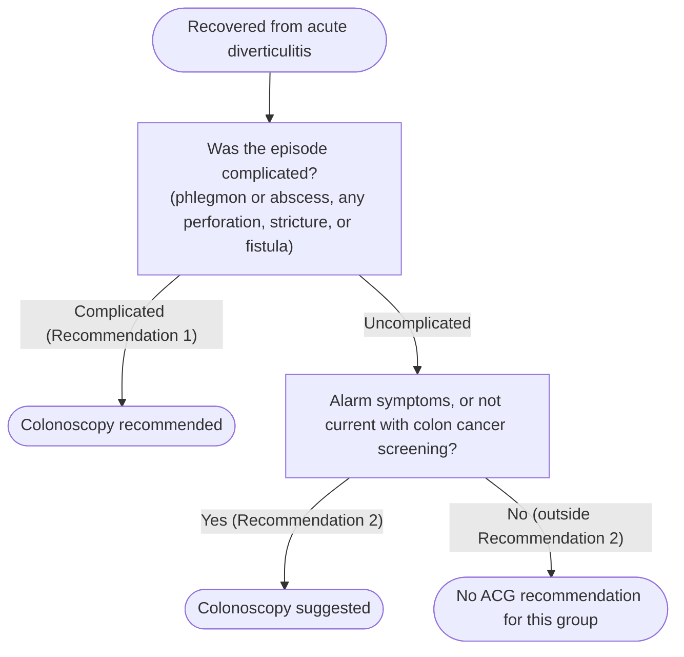

Inflammation in and around a colonic diverticulum. Lifetime risk ~3% (men) / 5% (women). **88%** present as acute *uncomplicated* disease. Two modern reversals define management: antibiotics are **selective, not routine** for low-risk uncomplicated disease, and the number of episodes no longer drives elective surgery ([[acg-2026-diverticulitis|American College of Gastroenterology (ACG) 2026]]).

---

## Contents
- [[#Assessment]]
  - [[#Establishing the Diagnosis]]
  - [[#Severity Assessment]]
  - [[#Classification / Typing]]
- [[#Differential Diagnosis]]
- [[#Diagnostics]]
- [[#Therapeutics]]
  - [[#Acute episode — antibiotics]]
  - [[#Post-recovery colonoscopy]]
  - [[#Preventing recurrence]]
  - [[#Elective surgery]]
  - [[#What does NOT work (recommend against, for recurrence prevention)]]
- [[#See Also]]
- [[#Sources]]

---

## Assessment

### Establishing the Diagnosis

- **Clinical evaluation alone is inaccurate in most cases** — confirm with imaging. Clinical suspicion alone is correct in only 40%–65% ([[aga-2021-colonic-diverticulitis|American Gastroenterological Association (AGA) 2021]]).
- Features raising likelihood: older age, prior episodes, **left lower-quadrant pain and tenderness**, pain with movement, lack of vomiting, elevated C-reactive protein (CRP).
- **Computed tomography (CT) is essential** — especially at first presentation and in severe cases — to confirm diverticulitis, exclude alternatives, grade severity, and localize disease if surgery is contemplated (ACG 2026).
  - CT of uncomplicated disease: colonic wall thickening and/or increased pericolic fat stranding.
  - AGA 2021 best practice advice (BPA) 1: also image when failing to improve, immunocompromised, or contemplating surgery after multiple recurrences. CT with oral and intravenous (IV) contrast: sensitivity/specificity 95%.
- **Which imaging — Infectious Diseases Society of America (IDSA) 2024** ([[idsa-2024-ciai-risk-imaging-microbiology]]; unnumbered — R11–R13 are the wiki's):
  - Nonpregnant adults: **CT first** (R11; conditional recommendation, very low certainty of evidence). IV contrast usually appropriate; CT without IV contrast may be appropriate.
  - **CT unavailable or contraindicated → ultrasound or magnetic resonance imaging (MRI)** (R12; conditional, very low certainty).
  - Pregnant adults: ultrasound or MRI can be considered; IDSA is unable to recommend one over the other (R13; knowledge gap).
  - AGA 2021: MRI very sensitive but less specific than CT, generally not used acutely; plain radiographs cannot confirm the diagnosis.

### Severity Assessment

- **Uncomplicated:** localized inflammation without abscess, perforation, stricture, or fistula.
- **Complicated:** inflammation + **phlegmon, abscess, perforation, peritonitis, stricture, or fistula.** Abscess is the most common complication.
  - **Risk of complicated disease is highest at the *initial* presentation and falls with each subsequent recurrence.**
- **High-risk features** predicting progression (~5% of uncomplicated cases complicate within 3 months, most in the first 10 days). **Any one of these → treat as high risk and give antibiotics** (AGA 2021 BPA 7):

| Feature | Cut-point |
|---|---|
| Comorbidity burden | American Society of Anesthesiologists (ASA) Physical Status Classification **III or IV**; frailty |
| Symptom duration before presentation | **>5 days** |
| Vomiting | present (also: refractory symptoms) |
| **CRP** | **>140 mg/L** |
| **White blood cell (WBC) count** | **baseline >15 × 10⁹ cells/L** |
| CT findings | **fluid collection**, or a **longer segment of inflammation — 86 mm vs 65 mm** in those who progressed vs those who did not |

- **Immunocompromise** is an antibiotic indication in its own right (AGA 2021 BPA 8), independent of these cut-points.

### Classification / Typing

**Modified Hinchey classification (CT-based) — grades severity to guide management:**

| Stage | Findings |
|---|---|
| **0** | Mild clinical diverticulitis (colonic wall thickening, pericolic inflammation) |
| **Ia** | Confined pericolic inflammation or phlegmon |
| **Ib** | Pericolic or mesocolic abscess |
| **II** | Pelvic, intra-abdominal, or retroperitoneal abscess |
| **III** | Generalized purulent peritonitis |
| **IV** | Generalized fecal peritonitis |

- **Stages 0–I** → typically nonoperative. **Higher stages** → often drainage or surgery depending on severity and patient factors. [[colonic-stricture|Strictures]]/fistulas may develop as delayed complications (strictures: new-onset constipation or obstructive symptoms; fistulas: variable, sometimes subtle).

**Other presentations:**
- **Smoldering / chronic diverticulitis** — inflammation persisting weeks to months; partial/complete improvement on antibiotics then relapse shortly after stopping (contrast with recurrent disease, which has inflammation-free intervals). 6% of new diagnoses at 6-month follow-up (ACG 2026; AGA 2021: ~5%). Confirm with cross-sectional imaging; some ultimately need segmental resection.
- **[[segmental-colitis-associated-with-diverticulosis|segmental colitis associated with diverticulosis (SCAD)]]** — chronic inflammation of diverticula-bearing segments, sparing the rectum; histology can resemble [[ulcerative-colitis]] or [[crohns-disease]]; unclear whether distinct entity or [[inflammatory-bowel-disease|inflammatory bowel disease (IBD)]] manifestation.
- **SUDD** (symptomatic uncomplicated diverticular disease) — controversial: [[abdominal-bloating-and-distention|bloating]], chronic/recurrent abdominal pain, or altered bowel habits (diarrhea or [[chronic-constipation|constipation]]) with diverticulosis, without systemic inflammation or overt diverticulitis.
- **Diverticulosis** — mucosa and submucosa herniating through the muscularis propria at the points where the vasa recta penetrate the wall. **Among people with diverticulosis, only ~1%–4% develop diverticulitis over 7 years of follow-up.**

---

## Differential Diagnosis

*Diverticular bleeding is a separate entity — see [[acute-lower-gi-bleeding]].*

- **[[colorectal-cancer]]** — can be misdiagnosed as diverticulitis; the reason for post-recovery colonoscopy (see [[#Post-recovery colonoscopy]]).
- Ulcerative colitis / Crohn's disease — especially when SCAD histology mimics IBD (both linked above).
- Alternative diagnoses to exclude when symptoms persist (AGA 2021): [[colon-ischemia|ischemic colitis]], constipation, IBD, ongoing diverticular inflammation, diverticular stricture or fistula.
- Chronic post-diverticulitis symptoms may reflect a [[disorders-of-gut-brain-interaction|disorder of gut-brain interaction]] — **more than one-third of patients report persistent abdominal pain or altered bowel habits 1–2 years after an episode** (ACG 2026).
  - Evaluate with **both cross-sectional imaging and colonoscopy**; no diverticulitis → consider visceral hypersensitivity; persistent pain may be treated with a low to modest dose of a tricyclic antidepressant (AGA 2021 BPA 4).

---

## Diagnostics

- **CT abdomen/pelvis** — primary confirmatory test (see Assessment); grades modified Hinchey stage.
- **CRP** — supports diagnosis and stratifies risk (**>140 mg/L** = high-risk feature).
- **[[colonoscopy|Colonoscopy]]** — *not* for acute diagnosis; role is post-recovery cancer exclusion (indications and timing: [[#Post-recovery colonoscopy]]).
  - **Absence of a mass lesion on CT does not exclude an underlying colonic neoplasm** ([[aga-2015-acute-diverticulitis|AGA 2015]]).
  - Yield of colonoscopy after imaging-proven diverticulitis: **colorectal cancer 15 cases/1000 patients; advanced adenomas 38 cases/1000** (AGA 2015).

---

## Therapeutics

### Acute episode — antibiotics

- **Suggest against routine antibiotics for low-risk acute uncomplicated diverticulitis; antibiotics appropriate with high-risk features, immunocompromise, frailty, or inability to ensure safe outpatient management** (ACG Rec 3; *conditional, moderate certainty*). Randomized controlled trial (RCT) meta-analysis (4 trials, n=1,809): antibiotics had little/no effect on mortality, progression to complicated disease, surgery, readmission, or recurrence.
- **Low-risk = nonantibiotic candidate — ALL of the following must be present** (ACG Table 6):
  - Immunocompetent · outpatient · no evidence of complicated disease · hemodynamically stable · no systemic inflammatory response (fever, tachycardia, leukocytosis) · not medically frail · tolerating oral intake · no recent antibiotic use · reliable follow-up + adequate social support.
- **Antibiotics ARE reasonable when** (ACG Table 6): immunocompromise · frailty · significant comorbidities · clinical deterioration or persistent/worsening symptoms · unable to tolerate oral intake · vomiting · markedly elevated CRP · higher-risk imaging (fluid collection, longer inflamed segment) · inadequate outpatient support/follow-up. Cut-points: [[#Severity Assessment]].
- **Regimens when indicated (outpatient, usual duration 4–7 days; AGA 2021: can be longer):**

| | Regimen |
|---|---|
| **Monotherapy** | Amoxicillin-clavulanate **875/125 mg by mouth (PO) q12h** *or* moxifloxacin **400 mg PO daily** |
| **Combination** | Metronidazole **500 mg PO q8h** **plus** one of: trimethoprim-sulfamethoxazole (TMP-SMX) 1 double-strength (DS) tab (160/800 mg) q12h · ciprofloxacin 500 mg q12h · levofloxacin 500 mg q24h |

  - Amoxicillin-clavulanate ≈ metronidazole + fluoroquinolone for outpatient diverticulitis, and may reduce fluoroquinolone harms (incl. *[[clostridioides-difficile|C. difficile]]*).
- **Immunocompromised** (AGA 2021 BPA 8): low threshold for cross-sectional imaging, antibiotics, and colorectal surgery consultation; uncomplicated disease → treat with antibiotics — broad-spectrum gram-negative + anaerobic coverage, longer course (**10–14 days**).
- AGA 2015 agreed (*conditional, low quality*); its trial evidence (**inpatients, CT-confirmed uncomplicated disease**) does not extend to abscess or fistula, severe infection or sepsis, immunosuppression, or significant comorbidities.
- **Complicated disease needing drainage or surgery** — [[sis-2024-intra-abdominal-infection|Surgical Infection Society (SIS) 2024]] guideline on intra-abdominal infection (acute diverticulitis is among the infections it covers):
  - **Higher risk** = sepsis or septic shock by Surviving Sepsis Campaign criteria, or APACHE-II ≥10 *(1-B)*.
  - **Source control within 12 hours** in lower-risk patients; **within 6 hours** in higher-risk patients with septic shock *(both 1-B)* — in septic shock from gastrointestinal perforation, survival was zero with operative delays >6 hours. Start antimicrobials **within an hour** in higher-risk patients with sepsis *(1-B)*.
  - **No more than four days (96 h) after adequate source control** *(1-A)*; four days also after **percutaneous drainage**, in higher-risk patients with sepsis, and in patients with diabetes, obesity or higher illness severity *(each 1-B)*; suggest a limit of eight days in critically ill patients *(2-B)*.
  - Empiric choice: cefepime + metronidazole, imipenem-cilastatin or meropenem, or piperacillin-tazobactam *(each 1-A)*; lower-risk community-acquired infection → cefotaxime or ceftriaxone + metronidazole, or ertapenem *(1-A)*; serious β-lactam allergy (lower risk) → ciprofloxacin + metronidazole or moxifloxacin *(1-A)*.
  - **Not empirically:** vancomycin or tigecycline *(each 1-B)*; anti-enterococcal cover in lower-risk community-acquired infection *(1-B)* — but suggested in higher-risk patients *(2-B)*; antifungals *(against: lower risk 2-B, higher-risk community-acquired 1-B)*.
- **Diet during an acute episode:** clear liquids for the first few days may ease discomfort (ACG 2026: no proof it speeds healing; AGA 2021 BPA 5 advises it), advancing as symptoms improve. **Unable to advance diet after 3–5 days → follow up immediately** (AGA 2021).

### Post-recovery colonoscopy

*Colonoscopy after recovery from acute diverticulitis*
*Source: built from ACG 2026 Recommendations 1 and 2 (the guideline has no flowchart)*
*[[acg-2026-diverticulitis|ACG 2026 Colonic Diverticulitis Guideline]]*

- **Rec 1 — complicated** (*strong, moderate certainty*): vs uncomplicated, colon cancer **odds ratio (OR) 5.65** (95% confidence interval (CI) 2.95–10.8), advanced neoplasia **OR 3.85** (2.11–7.03); vs a screening population, OR 3.57 (1.59–8.01). Cancers sit in the **same colonic region** as the presumed diverticulitis — the signature of misdiagnosis.
- **Rec 2 — uncomplicated** (*conditional, low certainty*): alarm symptoms = unintentional weight loss, change in bowel habits, [[iron-deficiency-anemia|iron-deficiency anemia]], bloody stools, persistent abdominal pain; see [[colorectal-cancer-screening|colorectal cancer (CRC) screening]]. Cancer odds close to the screening population (**OR 1.57**, 0.70–3.51); advanced neoplasia **less** likely (**OR 0.68**, 0.52–0.90).
- Overall colon-cancer rate after any diverticulitis: **1.6%** (1.1–2.1); advanced neoplasia **5.5–6.7%** (not stratified by severity).
- **Timing: not within 6–8 weeks** of the acute episode (inflammation/edema/luminal narrowing → incomplete exam, more complications); post-diverticulitis colonoscopy: incomplete 3.7% (2.7–4.9), perforation 0.2% (ACG 2026).
  - AGA 2021 BPA 3: delay 6–8 weeks **or until complete resolution of acute symptoms, whichever is longer**; **sooner if alarm symptoms**.
  - AGA 2015: optimal timing uncertain; severity and duration of the episode are relevant.
- **Older AGA advice is broader than ACG Rec 2** (ACG 2026 is newer and sets the page):
  - AGA 2021 BPA 2: colonoscopy after complicated disease **and after a first uncomplicated episode**, deferred only if a high-quality colonoscopy within 1 year had no findings warranting short-interval follow-up; recurrent uncomplicated disease → routine screening/surveillance unless alarm symptoms.
  - AGA 2015: after **any** episode in appropriate candidates whose colon has not recently had a high-quality exam (*conditional, low quality*). Factors: timing and completeness of prior colonoscopy · comorbidities · persistent abdominal pain or diarrhea · patient preference. The risks of colonoscopy may be higher after **chronic, acute recurrent, or complicated** diverticulitis; recurrence or perforation after colonoscopy was not reported as an adverse event.

### Preventing recurrence

Recurrence is common and rises with each episode (10-yr risk: ≥22% after 1st, ≥55% after 2nd). Lifestyle evidence is mostly from *incident* disease (effects presumed similar); a healthy overall lifestyle ≈ **50% lower** incidence. ACG 2026 Recs 4–10:

- **Healthy diet** — high fruits/vegetables/whole grains/legumes; limit red meat, processed grains, trans fats, sweets (Rec 4; *conditional, very low*). Add fiber gradually; **supplemental fiber is not a substitute** for a high-quality diet. (Fiber's benefit is no longer attributed to relieving constipation.)
  - AGA 2015 accepts **either a fiber-rich diet or fiber supplementation** (*conditional, very low*); optimal daily dose unknown, no study of fiber for *recurrent* diverticulitis — weigh against bloating.
- **Do NOT avoid nuts, corn, seeds, or popcorn** — no association with risk (Rec 5; *conditional, very low*). AGA 2015 agrees (*conditional, very low*): relative risks 0.55–1.13, confidence intervals surrounding 1.0.
- **Avoid regular nonsteroidal anti-inflammatory drugs (NSAIDs)** unless clinically indicated (Rec 6; *conditional, low*): incident hazard ratio (HR) 1.72 nonaspirin, 1.25 aspirin; do not stop NSAIDs with a compelling indication. AGA 2021 BPA 9: regular use = 2 or more times per week.
  - **Aspirin:** AGA 2015 suggests **against routinely advising aspirin avoidance** (*conditional*): any episode relative risk (RR) 1.25 (1.05–1.47), complicated disease RR 1.13 (0.61–2.10); the value of aspirin as secondary prevention in established coronary artery disease outweighs that risk; primary prevention needs an individualized decision. AGA 2021 BPA 9 likewise exempts aspirin for secondary cardiovascular prevention.
  - Nonaspirin NSAIDs — avoid if possible (AGA 2015, *conditional, very low*).
- **Smoking cessation** (Rec 7; *conditional, very low*) — complicated-disease RR 2.54.
- **Alcohol moderation** in heavy drinkers (Rec 8; *conditional, very low*).
- **Weight loss** if [[obesity|overweight/obese]] (Rec 9; *conditional, low*) — in a cohort of women, body mass index (BMI) ≥30.0 vs <22.5 kg/m² → recurrence HR 1.66 (1.09–2.51); visceral adiposity may matter more; whether weight loss reduces recurrence is unknown.
- **Regular physical activity** (Rec 10; *conditional, very low*) — incident RR 0.76. AGA 2015 suggests **vigorous** activity (*conditional, very low*) — modest reduction in incident episodes in a 47,288-man cohort.

### Elective surgery

- **Recurrent, uncomplicated diverticulitis that significantly impairs quality of life → surgical referral** to discuss risks/benefits of elective colon resection, individualized (ACG Rec 11; *conditional, low certainty*).
- **The number of episodes should NOT determine surgery** (also AGA 2021 BPA 13) — the old "colectomy after 2 episodes" rule is abandoned; recurrence does not increase the risk of complicated disease, elective surgery is no longer recommended to prevent emergency operations, and young age alone is not an indication.
- **Trade-offs to counsel:** 5-yr recurrence ~15% after elective colectomy vs ~60% without; DIRECT/LASER RCTs showed quality of life (QoL) gains, but QoL was unchanged/worse in 30% (DIRECT), and in LASER 73% had abdominal pain at baseline with 63% still in pain 6 months postoperatively; major surgical complications 10–34%; nearly one-third report decision regret. Confirm diagnosis by CT before elective resection.
- **Rec 11 does not apply to** strictures, fistulas, chronic diverticulitis, or prior abscess/perforation; ACG 2026 does not say how to manage these.
  - AGA 2021 on prior complicated disease managed without surgery: higher recurrence (25% within 5 years after an abscess); personalized approach — long-term emergency surgery/death low (5%), and elective resection was not associated with fewer emergency operations or deaths (observational data).
  - **Chronically immunosuppressed** patients recovered without surgery → colorectal surgery consultation about elective resection (AGA 2021 BPA 8).

**After a FIRST episode of acute uncomplicated diverticulitis — suggest against elective colonic resection**; individualize (AGA 2015, *conditional, very-low quality*). The numbers behind that:

| | |
|---|---|
| Recurrence within 5 years, acute uncomplicated diverticulitis | ~**20%** |
| Future diverticular complications / emergency surgery on medical management alone | **low, <5%** |
| Short-term complications of elective sigmoid resection after an episode of acute diverticulitis (wound infection, anastomotic leak, cardiovascular/thrombotic events) | ~**10%**, higher if **>65 years** |
| Long-term abdominal distention, cramping, altered defecation, [[fecal-incontinence\|fecal incontinence]] after elective surgery | **25%** |

- Recurrence rates are higher and operative risk lower in **younger** patients, but the data do not support elective surgery in that subgroup after an uncomplicated episode.
- For elective surgery for **recurrent** diverticulitis, AGA 2015 weighs: age · access to medical care for recurrence · immunosuppression · operative comorbidities · patient preference.

### What does NOT work (recommend against, for recurrence prevention)

- **[[mesalamine-5-asa|Mesalamine]]** — recommend against (ACG Rec 13; *strong, moderate certainty*): American College of Physicians (ACP) 2022 meta-analysis, 6 RCTs n=1,898: OR 1.15, no benefit; more adverse-event discontinuation OR 1.59. AGA 2015 made the same strong/moderate recommendation from 6 studies in >1,800 patients — evidence more robust than for most other agents it reviewed.
- **[[rifaximin|Rifaximin]]** — recommend against (ACG Rec 14; *conditional, very low*): only 1 small open-label trial, stopped early (AGA 2015: numerical reduction, not statistically significant).
- **[[probiotics|Probiotics]]** — recommend against (ACG Rec 12; *conditional, very low*): RCT showed no benefit; cost/burden.
- AGA 2021 BPA 11 agrees on all three: mesalamine showed no benefit; evidence is insufficient for any probiotic or cyclic rifaximin.
- **AGA 2015 scope limit:** its mesalamine, rifaximin and probiotic recommendations cover use **after acute uncomplicated diverticulitis**; mesalamine and rifaximin advice does not apply to SUDD or to multiple recurrent/relapsing disease (mesalamine) / chronic recurrent symptoms (rifaximin).

---

## See Also

[[colorectal-cancer]], [[colorectal-cancer-screening]], [[colonoscopy]], [[colonoscopy-surveillance]], [[acute-lower-gi-bleeding]], [[colonic-stricture]], [[colon-ischemia]], [[ulcerative-colitis]], [[crohns-disease]], [[segmental-colitis-associated-with-diverticulosis]], [[disorders-of-gut-brain-interaction]], [[rifaximin]], [[probiotics]], [[iron-deficiency-anemia]], [[abdominal-bloating-and-distention]], [[clostridioides-difficile]], [[obesity]], [[mesalamine-5-asa]], [[fecal-incontinence]]

---

## Sources

1. [[acg-2026-diverticulitis|ACG Clinical Guideline: Colonic Diverticulitis (2026)]]
2. [[aga-2021-colonic-diverticulitis|AGA Clinical Practice Update on Medical Management of Colonic Diverticulitis: Expert Review (2021)]]
3. [[aga-2015-acute-diverticulitis|American Gastroenterological Association Institute Guideline on the Management of Acute Diverticulitis (2015)]]
4. [[sis-2024-intra-abdominal-infection|The Surgical Infection Society Guidelines on the Management of Intra-Abdominal Infection: 2024 Update]]
5. [[idsa-2024-ciai-risk-imaging-microbiology|IDSA 2024 Clinical Practice Guideline Update on Complicated Intra-abdominal Infections: Risk Assessment, Diagnostic Imaging, and Microbiological Evaluation]]
