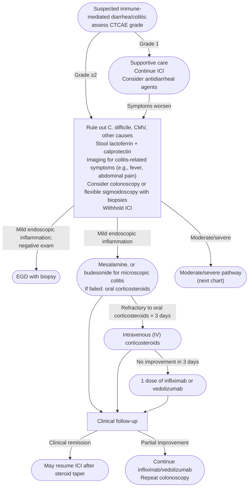
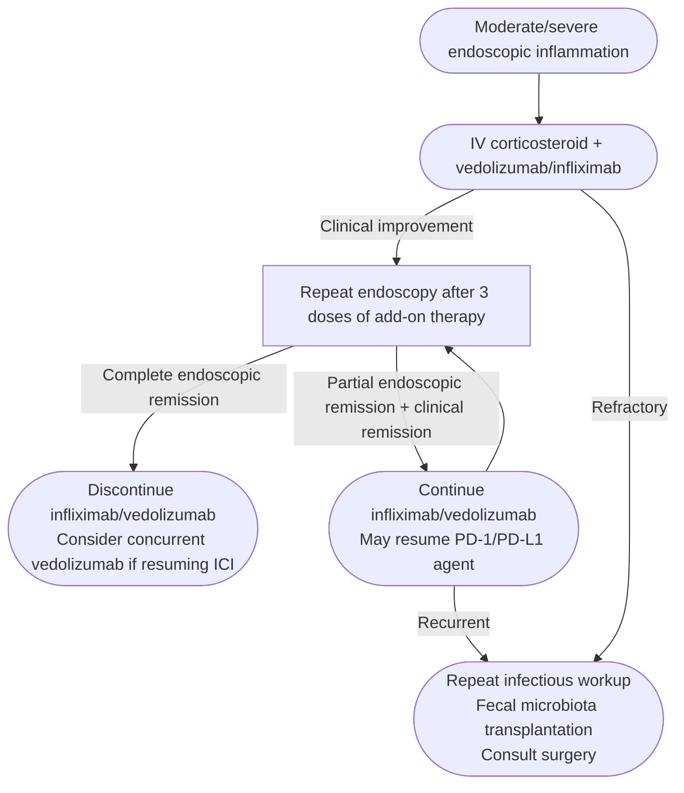

Colitis, with or without accompanying enteritis, is the **single most common gastrointestinal (GI) toxicity** of immune checkpoint inhibitors (ICIs) — an immune-related adverse event (irAE) of CTLA-4 and PD-1/PD-L1 blockade. [[aga-2021-ici-colitis-hepatitis]]

- Affects **up to 40%**, by pathway; **severe** enterocolitis (needing treatment + ICI delay or discontinuation) **2%–5%** on PD-1/PD-L1 vs **~10%** on CTLA-4 inhibitors; mortality rare.
- American Society of Clinical Oncology (ASCO) 2021: colitis **8%–27%**; perforation **~1%** of colitis cases. [[asco-2021-immune-related-adverse-events]]
- Isolated enteritis and/or gastritis: ASCO **uncommon** — endoscopy with biopsy, may be managed like colitis ([[asco-2021-immune-related-adverse-events]]); American Gastroenterological Association (AGA) — isolated upper GI inflammation **likely >10%**, isolated severe gastritis rare ([[aga-2021-ici-colitis-hepatitis]]).

## Contents
- [[#Assessment]]
  - [[#Establishing the Diagnosis]]
  - [[#Severity Assessment]]
  - [[#Classification / Typing]]
- [[#Differential Diagnosis]]
- [[#Diagnostics]]
- [[#Therapeutics]]
  - [[#Management Algorithm (AGA)]]
  - [[#Management by Grade]]
  - [[#Second line — biologics]]
  - [[#Budesonide (BPA 7) — the two opposite answers]]
  - [[#Retreatment with immunotherapy (BPA 8)]]
  - [[#Patients with pre-existing IBD (BPA 9)]]
- [[#See Also]]
- [[#Sources]]

---

## Assessment

### Establishing the Diagnosis

**Symptoms do not track with disease** — they correlate poorly with endoscopic severity, radiologic findings and treatment response; **Common Terminology Criteria for Adverse Events (CTCAE) grade is not predictive** of who needs second-line immunosuppression. Endoscopic findings *do* predict treatment response. [[aga-2021-ici-colitis-hepatitis]]

**Clinical presentation**

- Mild: more frequent loose stools, ± upper GI symptoms (nausea, vomiting, decreased appetite, reflux). More severe: cramping, urgency, watery diarrhea; **bloody diarrhea can occur**; fevers less typical.
- **Tempo is the hallmark** — escalates over **days**, generally after a recent infusion, especially with **ipilimumab** (anti–CTLA-4); more like colonic infection than [[inflammatory-bowel-disease|inflammatory bowel disease (IBD)]] → expedited testing and treatment (**Best Practice Advice (BPA) 5**).
- **Onset** most often **5–10 weeks** after ICI start; can occur or recur months after stopping. PD-1/PD-L1 inhibitor + chemotherapy → possible early-onset diarrhea (1–2 weeks) — identify the causative agent. Nonsteroidal anti-inflammatory drug use is associated with more ICI enterocolitis ([[asco-2021-immune-related-adverse-events]]).

**Test rather than treat empirically** when new diarrhea interferes with activities of daily living or comes with abdominal pain, incontinence, bleeding, fever, nausea, vomiting, or inadequate intake; mild diarrhea is usually managed empirically.

**Exclude infection first (BPA 1)** — in all patients before immunosuppression, although infection causes **<5%** of diarrhea on ICIs.

### Severity Assessment

**CTCAE v5 grading** — ASCO assigns management by the diarrhea row ([[#Management by Grade]]); AGA uses it for stool-marker and endoscopy triage:

| Variable | Grade 1 | Grade 2 | Grade 3 | Grade 4 | Grade 5 |
|---|---|---|---|---|---|
| **Diarrhea** | Increase of <4 stools/d over baseline; mild increase in [[ostomy-management\|ostomy]] output | Increase of 4–6 stools/d over baseline; moderate increase in ostomy output; limiting instrumental activities of daily living (ADL) | Increase of ≥7 stools/d over baseline; incontinence (ASCO); hospitalization indicated; severe increase in ostomy output; limiting self-care ADL | Life-threatening consequences; urgent intervention indicated | Death |
| **Enterocolitis** | Asymptomatic; clinical or diagnostic observations only; intervention not indicated | Abdominal pain; mucus or blood in stool | Severe or persistent abdominal pain; fever; ileus; peritoneal signs | Life-threatening consequences; urgent intervention indicated | Death |

*CTCAE v5, as reproduced in [[aga-2021-ici-colitis-hepatitis]]; [[asco-2021-immune-related-adverse-events]] uses the diarrhea row (grades 1–4) and adds incontinence at grade 3.*

- **No validated severity index for ICI colitis exists**; AGA presents the two endoscopic tools below without stating a preference.
- **Colonic ulceration** is the only established endoscopic predictor of treatment response and of needing second-line immunosuppression — identifying it is one of the important roles of endoscopy.

### Classification / Typing

**MD Anderson Cancer Center endoscopic inflammation grading**

| Severity | Endoscopic features |
|---|---|
| Mild | Normal endoscopy **and** normal histology |
| Moderate | Normal colon appearance with pathology showing inflammation; small ulcer <1 cm, shallow ulcer <2 mm, and/or number of ulcers <3; inflammation limited to the left colon only; nonulcer inflammation |
| High | Large ulcer ≥1 cm, deep ulcer ≥2 mm, and/or number of ulcers ≥3; extensive inflammation beyond the left colon |

**High-risk endoscopic features (ASCO)** — the trigger for early infliximab or vedolizumab: **large deep ulceration, multiple ulcers, or extensive colitis beyond the left colon**. ASCO does not quantify "large" or "deep". [[asco-2021-immune-related-adverse-events]]

**Mayo Clinic endoscopic scoring**

| Disease activity | Score | Endoscopic features |
|---|---|---|
| Normal or inactive | 0 | None |
| Mild | 1 | Erythema, decreased vascular pattern, mild friability |
| Moderate | 2 | Marked erythema, absent vascular pattern, friability, erosions |
| Severe | 3 | Spontaneous bleeding, ulceration |

**Endoscopic phenotypes** — **ulcerative-colitis pattern** (diffuse and patchy erythema, loss of vasculature, edema, friability, exudate) or **Crohn's-colitis pattern** (edema, friability, cobblestoning, serpiginous and multiple large deep ulcerations). *See Figure 2 in [[aga-2021-ici-colitis-hepatitis]] for example images.*

**ICI-associated [[microscopic-colitis]]** — **histologic lymphocytic colonic inflammation without macroscopic inflammation or small-bowel involvement**; diagnosable *only* by endoscopy with biopsies; responds to budesonide.

---

## Differential Diagnosis

*Workup: see [[acute-diarrhea]].*

- **Infection** — [[clostridioides-difficile|*C. difficile*]] and other stool pathogens (exclude first; [[#Establishing the Diagnosis]])
- **No mucosal inflammation at all** — **20%–30%** of patients with suspected ICI enterocolitis have none (possibly fewer among ipilimumab-treated)
- Immune-mediated **[[exocrine-pancreatic-insufficiency|pancreatic insufficiency]]** — uncommon but important; suspect with steatorrhea or non-response
- New-onset **[[celiac-disease|celiac disease]]** — rare but reported as an ICI complication
- Thyroid dysfunction
- **[[ulcerative-colitis|Ulcerative colitis]]** / **[[crohns-disease|Crohn's disease]]** — similar endoscopic patterns; pre-existing IBD raises risk ([[#Patients with pre-existing IBD (BPA 9)]])
- **[[colon-ischemia|Ischemic colitis]]** — indistinguishable on computed tomography (CT)

---

## Diagnostics

**Stool studies (first)**

- ***C. difficile* testing and stool cultures in all patients**; stool pathogen panels a reasonable alternative. Ova and parasites by risk factors and local prevalence.
- **ASCO grade 2 workup:** stool culture, *C. difficile*, parasite, cytomegalovirus (CMV) or other viral etiology, ova and parasites if appropriate; complete blood count, comprehensive metabolic panel, thyroid-stimulating hormone ([[asco-2021-immune-related-adverse-events]]).
- **Stool inflammatory markers — lactoferrin and calprotectin (BPA 2).** Test early in CTCAE **grade ≥2** colitis/diarrhea (>4 bowel movements daily above baseline) and in selected milder cases, to stratify who needs endoscopy. **Lactoferrin sensitivity can be 90%** for histologic inflammation (retrospective; [[aga-2021-ici-colitis-hepatitis]]). ASCO: lactoferrin for who needs more urgent endoscopy, calprotectin to follow activity; GI-tract cancers can raise calprotectin ([[asco-2021-immune-related-adverse-events]]).
- **Fecal elastase** ± fecal fat — in non-responders or with steatorrhea.

**Blood tests are rarely informative** — white blood cell count and inflammatory markers may rise, but specificity is low.

- **Tissue transglutaminase immunoglobulin A (IgA) + total IgA** — reasonable in any patient on ICI with new diarrhea.
- **Before biologic immunosuppression:** **hepatitis B** ([[chronic-hepatitis-b|hepatitis B surface antigen (HBsAg), hepatitis B surface antibody (anti-HBs), hepatitis B core antibody (anti-HBc)]]) and **latent tuberculosis** if not sent before ICI start; human immunodeficiency virus (HIV) and hepatitis C virus (HCV) also suggested.
  - ASCO screening labs: HIV, hepatitis A and B, tuberculosis — repeated annually in patients who need a biologic for >1 year, until treatment is completed ([[asco-2021-immune-related-adverse-events]]).
- **Review drugs that alter the gut microbiome** (proton pump inhibitors, antibiotics, probiotics) and their indications for prolonged use ([[asco-2021-immune-related-adverse-events]]).

**Endoscopy (BPA 3)**

- **ASCO:** endoscopy ([[upper-endoscopy|esophagogastroduodenoscopy (EGD)]] or [[colonoscopy]]) **highly recommended for grade ≥2**, to stratify for early biologics; consider for positive stool inflammatory markers or colitis-related symptoms ([[asco-2021-immune-related-adverse-events]]).
- **AGA:** endoscopic confirmation of diagnosis and severity **should be considered before** high-dose systemic glucocorticoids. ASCO does not tie endoscopy to steroid start; special consideration when the ICI is combined with chemotherapy or tyrosine kinase inhibitors (also cause diarrhea).
- **Flexible sigmoidoscopy is often adequate** — ~**95%** have **left-colon** inflammation on biopsy, mostly visible; pancolitis is the most common pattern. Optimal examination not established.
- **EGD after a negative flexible sigmoidoscopy** may be higher yield than a full colonoscopy.

**Cross-sectional imaging (BPA 4)** — limited role.

- CT **sensitivity 53%–85%, specificity 75%–78%** → low negative predictive value; pattern **indistinguishable** from infectious and ischemic colitis.
- Use only when pain, fever or bleeding dominate, to rule out complications (ASCO: typhlitis, bowel perforation, abscess). **Diarrhea alone should not warrant abdominal imaging.**

---

## Therapeutics

### Management Algorithm (AGA)

AGA triages by endoscopic severity ([[#Classification / Typing]]); ASCO triages by CTCAE grade ([[#Management by Grade]]).

*ICI colitis management — grade 1, grade ≥2 workup, and mild endoscopic inflammation*
*Source: redrawn from AGA 2021 Figure 1 (ICI colitis management algorithm)*
*[[aga-2021-ici-colitis-hepatitis|AGA 2021 ICI Colitis and Hepatitis CPU]]*
*CTCAE = Common Terminology Criteria for Adverse Events · ICI = immune checkpoint inhibitor · CMV = cytomegalovirus · EGD = esophagogastroduodenoscopy · IV = intravenous*

*ICI colitis management — moderate/severe endoscopic inflammation*
*Source: redrawn from AGA 2021 Figure 1 (ICI colitis management algorithm)*
*[[aga-2021-ici-colitis-hepatitis|AGA 2021 ICI Colitis and Hepatitis CPU]]*
*ICI = immune checkpoint inhibitor · IV = intravenous · PD-1 = programmed death 1 · PD-L1 = programmed death ligand 1*

- **AGA vs ASCO:** AGA's mild arm starts mesalamine (or budesonide for microscopic colitis) before oral steroids; ASCO starts prednisone at grade 2 unless diarrhea is transient.

### Management by Grade

*Grade = CTCAE diarrhea grade ([[#Severity Assessment]]). All rows [[asco-2021-immune-related-adverse-events]].*

| Grade | ICI | Corticosteroids | Escalation and setting |
|---|---|---|---|
| **1** | Continue; or hold temporarily, resume if toxicity stays ≤ grade 1 or resolves | None — conservative therapy; temporary [[loperamide]] only if infection ruled out and no colitis-related symptoms; watch for dehydration; dietary changes | Phone/electronic check every 3 days or more often until stable; prolonged grade 1 → may obtain GI consult, consider endoscopy with biopsies |
| **2** | Hold at least until ≤ grade 1 | Prednisone **1 mg/kg/day** or equivalent (unless diarrhea is transient) until ≤ grade 1, then taper over **4–6 weeks** | Loperamide as for grade 1; consider GI consult; endoscopy highly recommended ([[#Diagnostics]]). Add infliximab or vedolizumab if steroid-refractory (**no decrease by one grade in 72 hours**), steroid-dependent, or high-risk endoscopic features |
| **3** | Hold; should consider permanently discontinuing CTLA-4 agents | Prednisone **1–2 mg/kg/day** or equivalent until ≤ grade 1, taper over 4–6 weeks; consider IV methylprednisolone, especially if concurrent upper GI inflammation suspected | Consider **early** infliximab or vedolizumab with steroids for high-risk endoscopic features or persistent symptoms after 3 days; consider inpatient care (hospitalization for dehydration or electrolyte imbalance); consider repeat colonoscopy if immunosuppression-refractory |
| **4** | **Permanently discontinue** | Methylprednisolone **1–2 mg/kg/day** or equivalent until ≤ grade 1, taper over 4–6 weeks | Inpatient care; consider early infliximab or vedolizumab if inadequate steroid response after 3 days; lower GI endoscopy if refractory or new infection suspected |

- **Grade ≥2:** consider permanently discontinuing CTLA-4 agents; PD-1/PD-L1 agents may be restarted after recovery to ≤ grade 1 ([[asco-2021-immune-related-adverse-events]]).
- **Taper:** shorter tapers may be considered if also on a biologic. ASCO's narrative puts first-line steroid at **1–2 mg/kg** from grade ≥2 (its table: 1 mg/kg/day at grade 2) ([[asco-2021-immune-related-adverse-events]]).
- **AGA steroid dose (BPA 6):** **0.5–2 mg/kg prednisone equivalent daily**, oral or IV, not tied to grade, taper over **4–6 weeks**; not rigorously examined; systemic glucocorticoids may dampen antitumor responses. **~One-third** respond inadequately ([[aga-2021-ici-colitis-hepatitis]]).
- **AGA escalation triggers** (any): **no response within 72 hours** of high-dose glucocorticoids; **no complete response within 1 week**; **recurrence during or after the taper** ([[aga-2021-ici-colitis-hepatitis]]).
- Interleukin-6 (IL-6) inhibitors (used for immune-related arthritis) **should not be used with concomitant immune-related colitis** — extremely rare intestinal perforation ([[asco-2021-immune-related-adverse-events]]).

### Second line — biologics

Both are effective; **no data distinguish them** ([[aga-2021-ici-colitis-hepatitis]]). ASCO's grade table offers either; its appendix lists vedolizumab for colitis refractory to infliximab or when infliximab is contraindicated ([[asco-2021-immune-related-adverse-events]]).

| Agent | Dose and schedule (ASCO) | AGA |
|---|---|---|
| **Infliximab** ([[anti-tnf-agents\|anti–tumor necrosis factor (TNF)]]) | 5 mg/kg IV; second dose may be repeated 14 days later | 5 mg/kg IV, weeks 0, 2, 6 |
| **[[vedolizumab\|Vedolizumab]]** | 300 mg IV at weeks 0, 2, 6, then every 8 weeks | 300 mg IV, weeks 0, 2, 6 |

- **Response is typically rapid — generally <1 week** (contrast with IBD); many need the full loading dose, and maintenance may still be needed in certain cases ([[aga-2021-ici-colitis-hepatitis]]).

**Choosing between them** — weigh malignancy, comorbidities, infection risk, expected treatment duration and other irAEs:

- **Avoid infliximab in hematologic malignancy** — TNF-α inhibitors are associated with rare lymphomas. One report linked infliximab to worse cancer outcomes (AGA: interpret with caution — confounded).
- **Heart failure:** infliximab doses **>5 mg/kg contraindicated** in moderate–severe heart failure ([[asco-2021-immune-related-adverse-events]]); AGA: caution in severe congestive heart failure.
- **Concurrent [[immune-checkpoint-inhibitor-hepatitis|ICI hepatitis]] and colitis:** ASCO — infliximab **contraindicated** for hepatic irAE; may permanently discontinue the ICI and use systemic agents that treat both (e.g., prednisone and [[mycophenolate-mofetil|mycophenolate]]) ([[asco-2021-immune-related-adverse-events]]). AGA — infliximab case by case (can induce a rare hepatitis).
- **Vedolizumab** may blunt antitumor responses in the GI mucosa with **primary GI malignancies or GI metastases** (AGA). ASCO: not with active severe infection until controlled; progressive multifocal leukoencephalopathy risk cannot be ruled out — monitor neurologic symptoms.

**Non-response to the first biologic → switch class** (infliximab ↔ vedolizumab) **without waiting for a standard washout** — within a few weeks of the last infusion.

**Failing both biologics** — not well established:

- **[[fmt|Fecal microbiota transplantation]]** — reported in 2 such patients (AGA); ASCO cites 75% efficacy in 15 refractory cases.
- **[[il-23-and-il-12-23-inhibitors|Ustekinumab]]** (p40 inhibitor) — ASCO dose: single IV induction by weight (≤55 kg 260 mg; >55 to 85 kg 390 mg; >85 kg 520 mg), then 90 mg subcutaneously every 8 weeks starting 8 weeks after induction.
- **[[jak-inhibitors|Tofacitinib]]** (Janus kinase inhibitor) — ASCO dose: 10 mg by mouth twice a day for 30 days.
- AGA: ustekinumab, tofacitinib and **abatacept** (CTLA-4-Ig) may be considered in life-threatening cases, each with substantial risk of interfering with antitumor responses.

### Budesonide (BPA 7) — the two opposite answers

- **As prophylaxis: ineffective** — randomized trial of colonic budesonide against ipilimumab enterocolitis: **no benefit**.
- **For ICI-associated microscopic colitis: effective** — highly responsive; **many continued their ICI** on concurrent budesonide.
- **Grade 1 diarrhea (ASCO):** conservative therapy alone; caution with short-term immunosuppressants incl. topical budesonide — no efficacy evidence ([[asco-2021-immune-related-adverse-events]]).

### Retreatment with immunotherapy (BPA 8)

> [!pearl] Resume the ICI on a healed mucosa
> Mucosal healing on repeat endoscopy and/or **fecal calprotectin ≤116 µg/g** is the target for stopping biologics and resuming the ICI; repeat colonoscopy may be considered after grade ≥2 to document complete remission ([[asco-2021-immune-related-adverse-events]]).

- **ASCO — resuming after ≤ grade 1** may be considered once the steroid taper is complete, risks/benefits reviewed if maintained on a biologic, and/or endoscopic + histologic remission achieved ([[asco-2021-immune-related-adverse-events]]):
  - PD-1/PD-L1 inhibitor → lower flare risk; CTLA-4 inhibitor still possible in selected cases (no response yet or inadequate response).
  - Objective response already achieved → resumption may not be advisable. No ICI dose reductions (interrupt or discontinue instead).
  - Concurrent immunosuppressant maintenance only if clinically indicated.
- AGA: permitted **under select conditions**, particularly when no alternative effective cancer therapy exists; risk data are **retrospective** and likely **underestimate** risk.
- **Recurrence ≈ 30%** for most regimens; **higher** after enterocolitis on **PD-1/PD-L1** then switching to **CTLA-4**; ipilimumab → PD-1/PD-L1 generally lower (AGA). ASCO: up to one third — higher with anti–CTLA-4 than anti–PD-1 alone, and after more severe index colitis.
- Maintenance infliximab or vedolizumab may reduce recurrence on continued immunotherapy (small case series; long-term safety and tumor effect undetermined). Recurrences typically still respond to standard therapy (AGA).
- **Enterocolitis before ICI initiation is not an absolute contraindication** if ICIs are the only option.

### Patients with pre-existing IBD (BPA 9)

*Managing the IBD drugs themselves once a malignancy is present: see [[ibd-in-malignancy]].*

- Multicenter retrospective analysis, >100 patients (half ulcerative colitis, half Crohn's; nearly all quiescent; 50% on no IBD-directed therapy; mostly PD-1/PD-L1): GI irAEs **41%** vs **11%** in a multicenter control cohort; **21%** severe (including perforations); **no deaths** from GI irAEs; tumor responses similar to the general population.
- **Higher GI irAE risk, but cancer benefit preserved** → ICI can be **cautiously used case by case**, with close oncology–gastroenterology collaboration.
- Autoimmune disease, including IBD, has been **excluded from ICI trials** — no prospective data.

---

## See Also

[[immune-checkpoint-inhibitor-hepatitis]], [[microscopic-colitis]], [[ulcerative-colitis]], [[crohns-disease]], [[inflammatory-bowel-disease]], [[acute-diarrhea]], [[chronic-diarrhea]], [[clostridioides-difficile]], [[celiac-disease]], [[colon-ischemia]], [[anti-tnf-agents]], [[vedolizumab]], [[fmt]], [[colonoscopy]], [[upper-endoscopy]], [[chronic-hepatitis-b]], [[ibd-in-malignancy]], [[exocrine-pancreatic-insufficiency]], [[ostomy-management]], [[jak-inhibitors]], [[loperamide]], [[mesalamine-5-asa]], [[mycophenolate-mofetil]], [[il-23-and-il-12-23-inhibitors]]

---

## Sources

1. [[aga-2021-ici-colitis-hepatitis|AGA Clinical Practice Update on Diagnosis and Management of Immune Checkpoint Inhibitor Colitis and Hepatitis: Expert Review]]
2. [[asco-2021-immune-related-adverse-events|ASCO 2021: Management of Immune-Related Adverse Events in Patients Treated With ICI Therapy — Guideline Update]]
