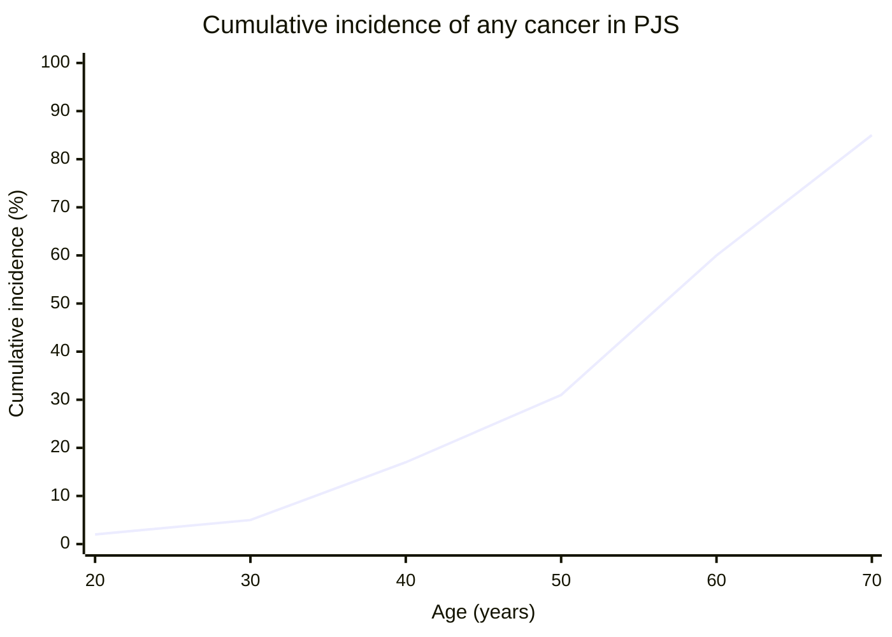

## Contents
- [[#Assessment]]
  - [[#Establishing the Diagnosis]]
  - [[#Severity Assessment — Cancer Risks]]
- [[#Differential Diagnosis]]
- [[#Diagnostics]]
  - [[#Endoscopic and Imaging Evaluation]]
- [[#Therapeutics]]
  - [[#Endoscopic Management]]
  - [[#Surgical Management]]
  - [[#Chemoprevention]]
- [[#See Also]]
- [[#Sources]]

## Assessment

### Establishing the Diagnosis

- Peutz-Jeghers syndrome (PJS): autosomal-dominant hamartomatous polyposis; germline **STK11** (LKB1) variant, chromosome 19p [[acg-2015-hereditary-gi-cancer]]
- Incidence 1 in 50,000–200,000 births; ~25% of new cases are de novo [[acg-2015-hereditary-gi-cancer]]
- Childhood: labial pigmentation, gastrointestinal (GI) bleeding, intussusception · adulthood: multiple cancers [[aga-2022-hamartomatous-polyposis]]

**Refer for genetic evaluation — any one of** *(Strong, low quality — [[aga-2022-hamartomatous-polyposis|US Multi-Society Task Force on Colorectal Cancer (USMSTF) 2022]])*:

1. **≥2 histologically confirmed Peutz-Jeghers (PJ) polyps**
2. **Any number** of PJ polyps + **family history of PJS in a first-degree relative**
3. **Characteristic mucocutaneous pigmentation** + family history of PJS
4. **Any number** of PJ polyps + the **characteristic mucocutaneous pigmentation**

- Any hamartomatous polyposis: refer if **≥2 lifetime hamartomatous polyps**, family history of hamartomatous polyps, or a syndrome-associated cancer in a **first- or second-degree relative**; test with a **multigene panel** *(Strong, low — USMSTF 2022)*
- [[acg-2015-hereditary-gi-cancer|American College of Gastroenterology (ACG) 2015]] used a looser trigger: perioral/buccal pigmentation and/or ≥2 characteristic hamartomatous polyps and/or family history of PJS

**Mucocutaneous pigmentation** [[acg-2015-hereditary-gi-cancer]]:

- Melanin spots 1–5 mm; >95% of patients; perioral area and buccal mucosa most common (94%)
- Lip spots cross the vermilion border; darker and more densely clustered than common freckles
- Also face, forearms, digits, palms, soles, perianal area; rarely intestinal mucosa
- Appear in infancy; may fade with age, less so on buccal mucosa

**GI polyps**:

- Polyposis in 88–100%; mostly small bowel (60–90%) and colon (50–64%) [[aga-2022-hamartomatous-polyposis]] — ACG 2015 gave small bowel 96%, colon 27%, stomach 24%, rectum 24%
- Number 1–100; size 0.1–3 cm; growth begins by age 10 in 33%; 68% symptomatic (bleeding, pain, intussusception, obstruction) by age 18 [[aga-2022-hamartomatous-polyposis]]
- Histology: nondysplastic; normal epithelium of the host segment; arborizing bands of muscularis mucosae extending into branching fronds [[acg-2015-hereditary-gi-cancer]]
- Adenoma and cancer may occur within PJ polyps [[acg-2015-hereditary-gi-cancer]]

> [!pitfall] Pseudoinvasion is not cancer
> Epithelial infolding in PJ polyps can mimic invasion and lead to an incorrect diagnosis of cancer ([[acg-2015-hereditary-gi-cancer]]).

**Genetic testing**:

- Test for STK11 variants [[acg-2015-hereditary-gi-cancer]]; up to 94% of PJS families have one
- Large deletions: up to a third ([[acg-2015-hereditary-gi-cancer|ACG 2015]]) · ~15% ([[aga-2022-hamartomatous-polyposis|USMSTF 2022]]); some are Alu-mediated deletions/inversions — the testing platform must detect these
- Genotype–phenotype: ACG 2015 found no correlation with variant location; USMSTF 2022 reports **missense variants → later symptom onset**

### Severity Assessment — Cancer Risks

*Cumulative incidence of any cancer by decade of age in Peutz-Jeghers syndrome*
*Source: data from 419 PJS cases (297 with a confirmed STK11 variant), cited in USMSTF 2022*
*[[aga-2022-hamartomatous-polyposis|USMSTF 2022 GI Hamartomatous Polyposis Syndromes]]*
*PJS = Peutz-Jeghers syndrome*

- Same risks with a clinical diagnosis and no detectable STK11 variant [[aga-2022-hamartomatous-polyposis]]
- ACG 2015 cited an earlier estimate: 1%, 3%, 19%, 32%, 63%, 81% at ages 20–70 [[acg-2015-hereditary-gi-cancer]]

| Cancer site | General population lifetime risk | PJS lifetime risk | Mean age at diagnosis (y) |
|---|---|---|---|
| [[colorectal-cancer\|Colorectal]] | 4.3% | 39% | 42–46 |
| Stomach | <1% | 29% | 30–40 |
| Small bowel | <1% | 13% | 37–42 |
| Breast (women) | 12.9% | 32–54% | 37–59 |
| Ovarian (mostly sex cord tumor with annular tubules [SCTAT]) | 1.2% | 21% | 28 |
| Cervix (adenoma malignum) | <1% | 10–23% | 34–40 |
| Uterus | 3.1% | 9% | 43 |
| [[pancreatic-cancer\|Pancreas]] | 1.7% | 11–36% | 41–52 |
| Testicular (Sertoli cell tumor) | <1% | 9% | 6–9 |
| Lung | 6.3% | 7–17% | 47 |

*Lifetime cancer risk by site in Peutz-Jeghers syndrome*
*Source: Table 3 of USMSTF 2022*
*[[aga-2022-hamartomatous-polyposis|USMSTF 2022 GI Hamartomatous Polyposis Syndromes]]*
*SCTAT = sex cord tumor with annular tubules*

- ACG 2015 (Tables 5 and 7) gives the same PJS risks and ages, except cervix **10%** [[acg-2015-hereditary-gi-cancer]]
- **Breast:** both guidelines' narrative text prints **24–54%**; risk overlaps [[brca-pathogenic-variants|BRCA1/BRCA2]] carriers (40–85%) [[aga-2022-hamartomatous-polyposis]]
- **Ovary/testis:** almost all women develop SCTAT, ~20% become malignant; 10–20% of benign Sertoli cell tumors become malignant [[acg-2015-hereditary-gi-cancer]]. Sertoli cell tumors present as testicular masses; may cause gynecomastia, hyperestrogenism, accelerated height growth [[aga-2022-hamartomatous-polyposis]]
- **Pancreas:** relative risk (RR) up to **132-fold** [[acg-2015-hereditary-gi-cancer]]; highest RR of the pancreatic cancer syndromes **except hereditary pancreatitis**; 95% of cases after age 24 [[aga-2022-hamartomatous-polyposis]]
- **Lung:** cumulative risk >5% by age 55; RR similar to a >30 pack-year smoker who quit 10–15 years ago; never adjusted for smoking status [[aga-2022-hamartomatous-polyposis]]

---

## Differential Diagnosis

*Workup: see [[colorectal-polyposis]].*

| Syndrome | Gene | Polyps | Distinguishing features |
|---|---|---|---|
| **PJS** | STK11 | PJ polyps — broad bands of mucosal smooth muscle | Labial pigmentation; childhood bleeding/intussusception |
| [[juvenile-polyposis-syndrome\|Juvenile polyposis syndrome]] | SMAD4 or BMPR1A | Juvenile polyps — inflammatory infiltrate, cystic dilated glands, no smooth muscle core | Childhood bleeding, anemia; adult colorectal and gastric cancer |
| [[cowden-syndrome\|Cowden syndrome]] | PTEN | Hyperplastic, juvenile-like, ganglioneuromas, lipomas, adenomas | Mucocutaneous lesions, macrocephaly; multiple adult cancers |
| Bannayan-Riley-Ruvalcaba syndrome | PTEN | As Cowden | Pediatric; macrocephaly, developmental delay, pigmented macules of toes and glans penis |
| [[hereditary-mixed-polyposis-syndrome\|Hereditary mixed polyposis syndrome]] | GREM1 duplication | Mixed adenomatous, hyperplastic, inflammatory features | Colonic polyposis and colorectal cancer risk |

*Hamartomatous polyposis syndromes compared*
*Source: built from Table 2, Figure 1 and syndrome text of USMSTF 2022, and ACG 2015 juvenile polyp histology*
*[[aga-2022-hamartomatous-polyposis|USMSTF 2022]] · [[acg-2015-hereditary-gi-cancer|ACG 2015]]*
*PJS = Peutz-Jeghers syndrome · PJ = Peutz-Jeghers*

- [[familial-adenomatous-polyposis|Familial adenomatous polyposis]] — adenomatous, not hamartomatous, polyps [[acg-2015-hereditary-gi-cancer]]
- Solitary juvenile polyp — most juvenile polyps are solitary and sporadic, in infants and children [[aga-2022-hamartomatous-polyposis]]

---

## Diagnostics

### Endoscopic and Imaging Evaluation

- **Organs to survey:** breast, small bowel, colon, stomach, pancreas, ovaries, testes, lungs — multidisciplinary approach *(Strong, low — [[aga-2022-hamartomatous-polyposis|USMSTF 2022]])*; ACG 2015 Rec 14 also lists uterus and cervix

**Luminal surveillance — [[aga-2022-hamartomatous-polyposis|USMSTF 2022]]** (supersedes ACG 2015 Table 10: all three sites from age 8; polyps → every 3 years; none → restart at 18, then every 3 years):

| Site | Baseline | Polyps at baseline | No polyps at baseline | Strength |
|---|---|---|---|---|
| **Small bowel** — video [[capsule-endoscopy\|capsule endoscopy]] (VCE) or magnetic resonance enterography (MRE) | **Ages 8–10**; earlier if symptomatic | Individualize by polyp size and location | **Resume at 18** | Strong, low |
| **Small bowel, adulthood** | — | **Every 2–3 years, lifelong** (intussusception risk) | Same | Strong, low |
| **Stomach/duodenum** — [[upper-endoscopy\|esophagogastroduodenoscopy (EGD)]] | **Ages 8–10**; can be done at capsule placement or if MRE shows polyps | **Every 2–3 years** | **Age 18** (sooner if symptoms), **then every 3 years** | Weak, very low |
| **Colon** — [[colonoscopy]] | Start age uncertain; **same time as EGD** | **Every 2–3 years** | **Age 18** (sooner if symptoms), **then every 3 years** | Weak, very low |

*Luminal surveillance schedule in Peutz-Jeghers syndrome*
*Source: built from the USMSTF 2022 small-bowel and colon/stomach/duodenum recommendations and narrative*
*[[aga-2022-hamartomatous-polyposis|USMSTF 2022 GI Hamartomatous Polyposis Syndromes]]*
*VCE = video capsule endoscopy · MRE = magnetic resonance enterography · EGD = esophagogastroduodenoscopy*

> [!pearl] Small-bowel surveillance is about intussusception
> Adult small-bowel imaging continues every 2–3 years for life because of intussusception risk ([[aga-2022-hamartomatous-polyposis]]).

- **Modality:** VCE detects small-bowel polyps with greater sensitivity than MRE and is an alternative for patients who cannot undergo MRE; VCE findings may not predict future obstruction [[aga-2022-hamartomatous-polyposis]]
- Computed tomography (CT) enterography detects polyps, particularly ≥1 cm, but repeated X-ray exposure is problematic [[acg-2015-hereditary-gi-cancer]]

**[[pancreatic-cancer-screening|Pancreatic surveillance]]** — PJS start ages by source (modality, findings and follow-up live on [[pancreatic-cancer-screening]]):

| Source | Start age | Test and interval | Strength |
|---|---|---|---|
| [[aga-2022-hamartomatous-polyposis\|USMSTF 2022]] | **35** | **Annual** [[mri-mrcp\|magnetic resonance cholangiopancreatography (MRCP)]] or [[endoscopic-ultrasound\|endoscopic ultrasound (EUS)]]; ideally alternate annually (complementary) | Weak, low |
| [[asge-2022-pancreatic-cancer-screening\|American Society for Gastrointestinal Endoscopy (ASGE) 2022]] | **35 or 10 years earlier than the youngest relative with pancreatic cancer** (Rec 6f) | **Annual** (Rec 4) | Rec 4: conditional, very low |
| [[acg-2015-hereditary-gi-cancer\|ACG 2015]] | **35** (Rec 23) · Table 10: 30 | EUS and/or magnetic resonance imaging (MRI) annually (Rec 23) · Table 10: MRCP or EUS every 1–2 years | Conditional, very low |
| [[caps-2020-pancreatic-surveillance\|Cancer of the Pancreas Screening (CAPS) Consortium 2020]] (international) | **40**, or 10 y younger than the youngest relative with pancreatic cancer (all PJS carriers qualify regardless of family history) | — | — |

*Pancreatic surveillance start in Peutz-Jeghers syndrome by source*
*Source: built from USMSTF 2022 pancreatic recommendation, ASGE 2022 Recs 4 and 6f, ACG 2015 Rec 23 and Table 10, CAPS 2020 Table 3*
*[[aga-2022-hamartomatous-polyposis|USMSTF 2022]] · [[asge-2022-pancreatic-cancer-screening|ASGE 2022]] · [[acg-2015-hereditary-gi-cancer|ACG 2015]] · [[caps-2020-pancreatic-surveillance|CAPS 2020]]*
*MRCP = magnetic resonance cholangiopancreatography · EUS = endoscopic ultrasound · MRI = magnetic resonance imaging · ASGE = American Society for Gastrointestinal Endoscopy · ACG = American College of Gastroenterology · CAPS = Cancer of the Pancreas Screening · USMSTF = US Multi-Society Task Force on Colorectal Cancer*

- **US guidelines start at 35**; CAPS 2020 (non-US) says 40 — US sources govern. USMSTF chose 35 because PJS pancreatic cancers have been reported before age 40 [[aga-2022-hamartomatous-polyposis]]
- Early pancreatic cancer in a relative → ASGE's "10 years earlier" clause can start screening before 35 [[asge-2022-pancreatic-cancer-screening]]
- **Modality** [[asge-2022-pancreatic-cancer-screening]]: PJS is very high risk (with [[fammm-syndrome|familial atypical multiple mole melanoma (FAMMM)]]) → **EUS may be preferred** as the initial test and when combinable with screening EGD/colonoscopy; **MRI may be preferred** when combinable with enterography, or with higher anesthesia/procedural risk
- CAPS adds fasting glucose and/or hemoglobin A1c (HbA1c) at baseline; USMSTF 2022 awaits definitive data before making a recommendation on this [[aga-2022-hamartomatous-polyposis]] [[caps-2020-pancreatic-surveillance]]

**Extraintestinal surveillance** — not graded USMSTF recommendations: the task force limits its recommendations to GI cancers and reviews other expert groups' advice for the remaining organs [[aga-2022-hamartomatous-polyposis]]:

| Organ | USMSTF 2022 (reviewing other groups) | ACG 2015 Table 10 |
|---|---|---|
| **Breast** (women) | Monthly self-exam from 18 · biannual clinical breast exam from 25 · annual breast MRI ages 25–29 · ages 30–75: mammography (± tomosynthesis) alternating every 6 months with contrast breast MRI | Annual self-exam from 18 · annual breast MRI and/or mammogram from 25 |
| **Ovary, uterus, cervix** | Pelvic exam + Pap smear + transvaginal ultrasound, **annually from 25** | Annually from 25: pelvic exam + pelvic or transvaginal ultrasound (cancer antigen 125 [CA-125] probably not helpful); Pap smear |
| **Testes** | Annual history and physical incl. self-exam **from birth**, watching for feminizing changes · testicular ultrasound every 2 years from birth to 12 has been suggested | Annual testicular exam, birth to teenage years; ultrasound if abnormality palpated or feminization |
| **Lung** | No proven benefit; annual low-dose CT may be considered; smoking-cessation counseling advisable | Education on symptoms and smoking cessation; Rec 14: consider annual chest radiograph or chest CT in smokers (conditional, low) |

*Extraintestinal cancer surveillance in Peutz-Jeghers syndrome*
*Source: built from USMSTF 2022 breast, gynecologic, testicular and lung text, and ACG 2015 Table 10 and Rec 14*
*[[aga-2022-hamartomatous-polyposis|USMSTF 2022]] · [[acg-2015-hereditary-gi-cancer|ACG 2015]]*
*MRI = magnetic resonance imaging · CT = computed tomography · CA-125 = cancer antigen 125*

- Breast: refer to a breast cancer specialist; prophylactic mastectomy case-by-case, factoring in family history, with a breast surgeon involved [[aga-2022-hamartomatous-polyposis]]

> [!pitfall] Adenoma malignum is hard to see on Pap
> An unusual share of PJS cervical cancers are adenoma malignum, a well-differentiated adenocarcinoma with poor prognosis that is difficult to diagnose on Pap smear — keep a high index of suspicion ([[aga-2022-hamartomatous-polyposis]]).

---

## Therapeutics

### Endoscopic Management

**Polyp size thresholds for removal** [[aga-2022-hamartomatous-polyposis]]:

| Site | Remove if |
|---|---|
| **Small bowel** | **Symptomatic or ≥10 mm** — prevents intussusception and bleeding *(Strong, low)*; preferably by [[device-assisted-enteroscopy\|enteroscopy]] |
| **Stomach and colorectum** | **>0.5 cm**; attempt to remove all polyps if endoscopically feasible |

- ACG 2015 (older): remove probably all polyps >0.5 or 1 cm at EGD/colonoscopy [[acg-2015-hereditary-gi-cancer]]
- Balloon enteroscopy and MRE: similar diagnostic yield for lesions ≥15 mm, but endoscopy permits removal [[aga-2022-hamartomatous-polyposis]]
- Clearing all polyps preferable but not always possible [[acg-2015-hereditary-gi-cancer]]
- Focus: childhood → large polyps that obstruct or bleed; adulthood → cancer risk [[aga-2022-hamartomatous-polyposis]]

**Intussusception** — primary complication of small-bowel polyps, from a young age and lifelong [[acg-2015-hereditary-gi-cancer]]:

- First episode: median age 16 (range 3–50); 50% by age 20; 80% present as an acute abdomen; mean causative polyp 3.5 cm [[acg-2015-hereditary-gi-cancer]]
- 23 of 34 adults (68%) had a laparotomy by 18, 70% of them emergencies; 30% by age 10 [[aga-2022-hamartomatous-polyposis]]
- Surgery often needed → examine the entire small bowel and remove all significant polyps; intraoperative endoscopy helps; also remove sizable gastric and duodenal polyps then [[acg-2015-hereditary-gi-cancer]]
- **"Clean sweep"** — clearing the small bowel at laparotomy by intraoperative endoscopy with [[polypectomy]] (enterotomy for larger polyps) — appears to decrease recurrent small-bowel surgery [[aga-2022-hamartomatous-polyposis]]
- Capsule endoscopy, double-balloon enteroscopy and CT enterography allow earlier detection and nonoperative removal in many cases [[acg-2015-hereditary-gi-cancer]]

### Surgical Management

- **Colectomy** — sometimes needed to control colonic polyps; consider if colonoscopic management is difficult, especially if neoplastic change is found in colonic polyps [[acg-2015-hereditary-gi-cancer]]
- Small-bowel intussusception: see [[#Endoscopic Management]]

### Chemoprevention

- **No chemopreventive agent in clinical practice** for PJS polyps or cancers [[aga-2022-hamartomatous-polyposis]]
- Celecoxib (cyclooxygenase-2 [COX-2] inhibitor): 2 of 6 patients with diffuse gastric polyposis had fewer polyps after 200 mg twice daily for 6 months [[aga-2022-hamartomatous-polyposis]]
- Everolimus (mechanistic target of rapamycin [mTOR] inhibitor): trial stopped for poor accrual (2 patients), no efficacy data [[aga-2022-hamartomatous-polyposis]]
- Ruxolitinib (Janus kinase 1/2 inhibitor): reduces polyposis in mice only [[aga-2022-hamartomatous-polyposis]]

---

## See Also

[[colorectal-polyposis]], [[familial-adenomatous-polyposis]], [[lynch-syndrome]], [[juvenile-polyposis-syndrome]], [[cowden-syndrome]], [[hereditary-mixed-polyposis-syndrome]], [[brca-pathogenic-variants]], [[colorectal-cancer]], [[colonoscopy]], [[upper-endoscopy]], [[capsule-endoscopy]], [[endoscopic-ultrasound]], [[pancreatic-cancer]], [[pancreatic-cancer-screening]], [[gastric-adenocarcinoma]], [[gastric-polyps]], [[device-assisted-enteroscopy]], [[polypectomy]], [[mri-mrcp]], [[fammm-syndrome]]

---

## Sources

1. [[acg-2015-hereditary-gi-cancer|ACG 2015: Genetic Testing and Management of Hereditary Gastrointestinal Cancer Syndromes]]
2. [[aga-2022-hamartomatous-polyposis|US Multi-Society Task Force Guideline: GI Hamartomatous Polyposis Syndromes (2022)]]
3. [[asge-2022-pancreatic-cancer-screening|ASGE Guideline on Screening for Pancreatic Cancer in Individuals with Genetic Susceptibility: Summary and Recommendations (2022)]]
4. [[caps-2020-pancreatic-surveillance|CAPS 2020: Management of Patients with Increased Risk for Familial Pancreatic Cancer — Updated Recommendations from the International Cancer of the Pancreas Screening (CAPS) Consortium]]
