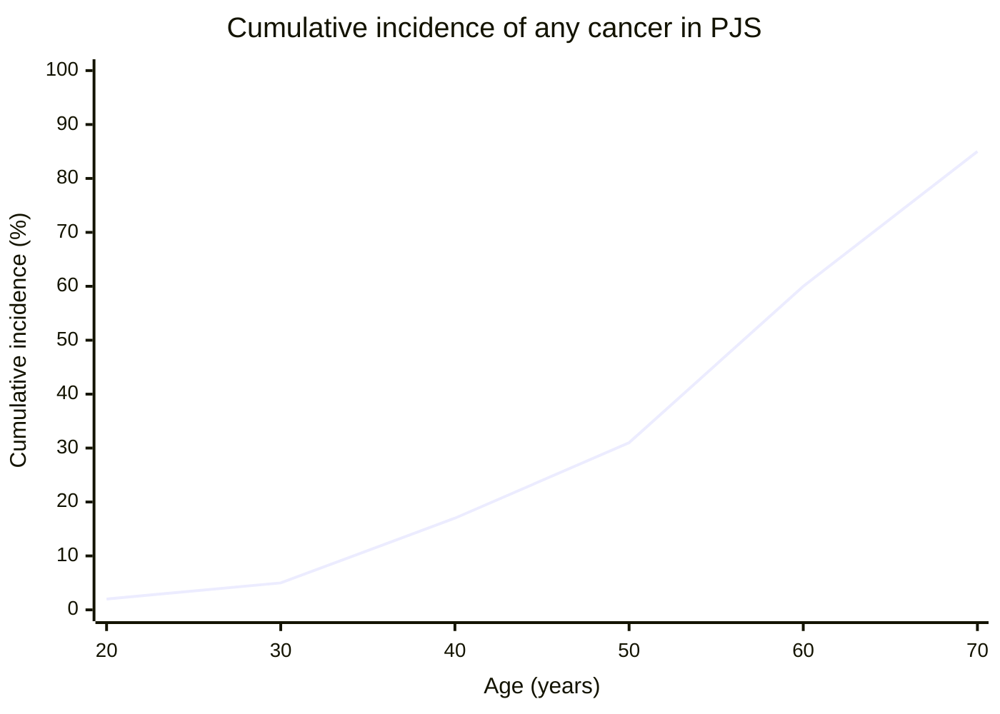

## Contents
- [[#Assessment]]
  - [[#Establishing the Diagnosis]]
  - [[#Severity Assessment — Cancer Risks]]
- [[#Differential Diagnosis]]
- [[#Diagnostics]]
  - [[#Endoscopic and Imaging Evaluation]]
- [[#Therapeutics]]
  - [[#Endoscopic Management]]
  - [[#Surgical Management]]
  - [[#Chemoprevention]]
- [[#See Also]]
- [[#Sources]]

## Assessment

### Establishing the Diagnosis

- Peutz-Jeghers syndrome (PJS): autosomal-dominant hamartomatous polyposis; germline **STK11** (LKB1) variant, chromosome 19p [[acg-2015-hereditary-gi-cancer]]
- Incidence 1 in 50,000–200,000 births; ~25% of new cases are de novo [[acg-2015-hereditary-gi-cancer]]
- Childhood: labial pigmentation, gastrointestinal (GI) bleeding, intussusception · adulthood: multiple cancers [[aga-2022-hamartomatous-polyposis]]

**Refer for genetic evaluation — any one of** *(Strong, low quality — [[aga-2022-hamartomatous-polyposis|US Multi-Society Task Force on Colorectal Cancer (USMSTF) 2022]])*:

1. **≥2 histologically confirmed Peutz-Jeghers (PJ) polyps**
2. **Any number** of PJ polyps + **family history of PJS in a first-degree relative**
3. **Characteristic mucocutaneous pigmentation** + family history of PJS
4. **Any number** of PJ polyps + the **characteristic mucocutaneous pigmentation**

- Any hamartomatous polyposis: refer if **≥2 lifetime hamartomatous polyps**, family history of hamartomatous polyps, or a syndrome-associated cancer in a **first- or second-degree relative**; test with a **multigene panel** *(Strong, low — USMSTF 2022)*
- [[acg-2015-hereditary-gi-cancer|American College of Gastroenterology (ACG) 2015]] used a looser trigger: perioral/buccal pigmentation and/or ≥2 characteristic hamartomatous polyps and/or family history of PJS

**Mucocutaneous pigmentation** [[acg-2015-hereditary-gi-cancer]]:

- Melanin spots 1–5 mm; >95% of patients; perioral area and buccal mucosa most common (94%)
- Lip spots cross the vermilion border; darker and more densely clustered than common freckles
- Also face, forearms, digits, palms, soles, perianal area; rarely intestinal mucosa
- Appear in infancy; may fade with age, less so on buccal mucosa

**GI polyps**:

- Polyposis in 88–100%; mostly small bowel (60–90%) and colon (50–64%) [[aga-2022-hamartomatous-polyposis]] — ACG 2015 gave small bowel 96%, colon 27%, stomach 24%, rectum 24%
- Number 1–100; size 0.1–3 cm; growth begins by age 10 in 33%; 68% symptomatic (bleeding, pain, intussusception, obstruction) by age 18 [[aga-2022-hamartomatous-polyposis]]
- Histology: nondysplastic; normal epithelium of the host segment; arborizing bands of muscularis mucosae extending into branching fronds [[acg-2015-hereditary-gi-cancer]]
- Adenoma and cancer may occur within PJ polyps [[acg-2015-hereditary-gi-cancer]]

> [!pitfall] Pseudoinvasion is not cancer
> Epithelial infolding in PJ polyps can mimic invasion and lead to an incorrect diagnosis of cancer ([[acg-2015-hereditary-gi-cancer]]).

**Genetic testing**:

- Test for STK11 variants [[acg-2015-hereditary-gi-cancer]]; up to 94% of PJS families have one
- Large deletions: up to a third ([[acg-2015-hereditary-gi-cancer|ACG 2015]]) · ~15% ([[aga-2022-hamartomatous-polyposis|USMSTF 2022]]); some are Alu-mediated deletions/inversions — the testing platform must detect these
- Genotype–phenotype: ACG 2015 found no correlation with variant location; USMSTF 2022 reports **missense variants → later symptom onset**

### Severity Assessment — Cancer Risks

*Cumulative incidence of any cancer by decade of age in Peutz-Jeghers syndrome*
*Source: data from 419 PJS cases (297 with a confirmed STK11 variant), cited in USMSTF 2022*
*[[aga-2022-hamartomatous-polyposis|USMSTF 2022 GI Hamartomatous Polyposis Syndromes]]*
*PJS = Peutz-Jeghers syndrome*

- Same risks with a clinical diagnosis and no detectable STK11 variant [[aga-2022-hamartomatous-polyposis]]
- ACG 2015 cited an earlier estimate: 1%, 3%, 19%, 32%, 63%, 81% at ages 20–70 [[acg-2015-hereditary-gi-cancer]]

| Cancer site | General population lifetime risk | PJS lifetime risk | Mean age at diagnosis (y) |
|---|---|---|---|
| [[colorectal-cancer\|Colorectal]] | 4.3% | 39% | 42–46 |
| Stomach | <1% | 29% | 30–40 |
| Small bowel | <1% | 13% | 37–42 |
| Breast (women) | 12.9% | 32–54% | 37–59 |
| Ovarian (mostly sex cord tumor with annular tubules [SCTAT]) | 1.2% | 21% | 28 |
| Cervix (adenoma malignum) | <1% | 10–23% | 34–40 |
| Uterus | 3.1% | 9% | 43 |
| [[pancreatic-cancer\|Pancreas]] | 1.7% | 11–36% | 41–52 |
| Testicular (Sertoli cell tumor) | <1% | 9% | 6–9 |
| Lung | 6.3% | 7–17% | 47 |

*Lifetime cancer risk by site in Peutz-Jeghers syndrome*
*Source: Table 3 of USMSTF 2022*
*[[aga-2022-hamartomatous-polyposis|USMSTF 2022 GI Hamartomatous Polyposis Syndromes]]*
*SCTAT = sex cord tumor with annular tubules*

- ACG 2015 (Tables 5 and 7) gives the same PJS risks and ages, except cervix **10%** [[acg-2015-hereditary-gi-cancer]]
- **Breast:** both guidelines' narrative text prints **24–54%**; risk overlaps [[brca-pathogenic-variants|BRCA1/BRCA2]] carriers (40–85%) [[aga-2022-hamartomatous-polyposis]]
- **Ovary/testis:** almost all women develop SCTAT, ~20% become malignant; 10–20% of benign Sertoli cell tumors become malignant [[acg-2015-hereditary-gi-cancer]]. Sertoli cell tumors present as testicular masses; may cause gynecomastia, hyperestrogenism, accelerated height growth [[aga-2022-hamartomatous-polyposis]]
- **Pancreas:** relative risk (RR) up to **132-fold** [[acg-2015-hereditary-gi-cancer]]; highest RR of the pancreatic cancer syndromes **except hereditary pancreatitis**; 95% of cases after age 24 [[aga-2022-hamartomatous-polyposis]]
- **Lung:** cumulative risk >5% by age 55; RR similar to a >30 pack-year smoker who quit 10–15 years ago; never adjusted for smoking status [[aga-2022-hamartomatous-polyposis]]

---

## Differential Diagnosis

*Workup: see [[colorectal-polyposis]].*

| Syndrome | Gene | Polyps | Distinguishing features |
|---|---|---|---|
| **PJS** | STK11 | PJ polyps — broad bands of mucosal smooth muscle | Labial pigmentation; childhood bleeding/intussusception |
| [[juvenile-polyposis-syndrome\|Juvenile polyposis syndrome]] | SMAD4 or BMPR1A | Juvenile polyps — inflammatory infiltrate, cystic dilated glands, no smooth muscle core | Childhood bleeding, anemia; adult colorectal and gastric cancer |
| [[cowden-syndrome\|Cowden syndrome]] | PTEN | Hyperplastic, juvenile-like, ganglioneuromas, lipomas, adenomas | Mucocutaneous lesions, macrocephaly; multiple adult cancers |
| Bannayan-Riley-Ruvalcaba syndrome | PTEN | As Cowden | Pediatric; macrocephaly, developmental delay, pigmented macules of toes and glans penis |
| [[hereditary-mixed-polyposis-syndrome\|Hereditary mixed polyposis syndrome]] | GREM1 duplication | Mixed adenomatous, hyperplastic, inflammatory features | Colonic polyposis and colorectal cancer risk |

*Hamartomatous polyposis syndromes compared*
*Source: built from Table 2, Figure 1 and syndrome text of USMSTF 2022, and ACG 2015 juvenile polyp histology*
*[[aga-2022-hamartomatous-polyposis|USMSTF 2022]] · [[acg-2015-hereditary-gi-cancer|ACG 2015]]*
*PJS = Peutz-Jeghers syndrome · PJ = Peutz-Jeghers*

- [[familial-adenomatous-polyposis|Familial adenomatous polyposis]] — adenomatous, not hamartomatous, polyps [[acg-2015-hereditary-gi-cancer]]
- Solitary juvenile polyp — most juvenile polyps are solitary and sporadic, in infants and children [[aga-2022-hamartomatous-polyposis]]

---

## Diagnostics

### Endoscopic and Imaging Evaluation

**Luminal surveillance — [[aga-2022-hamartomatous-polyposis|USMSTF 2022]]** (supersedes ACG 2015 Table 10: all three sites from age 8; polyps → every 3 years; none → restart at 18, then every 3 years):

| Site | Baseline | Polyps at baseline | No polyps at baseline | Strength |
|---|---|---|---|---|
| **Small bowel** — video [[capsule-endoscopy\|capsule endoscopy]] (VCE) or magnetic resonance enterography (MRE) | **Ages 8–10**; earlier if symptomatic | Individualize by polyp size and location | **Resume at 18** | Strong, low |
| **Small bowel, adulthood** | — | **Every 2–3 years, lifelong** (intussusception risk) | Same | Strong, low |
| **Stomach/duodenum** — [[upper-endoscopy\|esophagogastroduodenoscopy (EGD)]] | **Ages 8–10**; can be done at capsule placement or if MRE shows polyps | **Every 2–3 years** | **Age 18** (sooner if symptoms), **then every 3 years** | Weak, very low |
| **Colon** — [[colonoscopy]] | Start age uncertain; **same time as EGD** | **Every 2–3 years** | **Age 18** (sooner if symptoms), **then every 3 years** | Weak, very low |

*Luminal surveillance schedule in Peutz-Jeghers syndrome*
*Source: built from the USMSTF 2022 small-bowel and colon/stomach/duodenum recommendations and narrative*
*[[aga-2022-hamartomatous-polyposis|USMSTF 2022 GI Hamartomatous Polyposis Syndromes]]*
*VCE = video capsule endoscopy · MRE = magnetic resonance enterography · EGD = esophagogastroduodenoscopy*

> [!pearl] Small-bowel surveillance is about intussusception
> Adult small-bowel imaging continues every 2–3 years for life because of intussusception risk ([[aga-2022-hamartomatous-polyposis]]).

- **Modality:** VCE detects small-bowel polyps with greater sensitivity than MRE and is an alternative for patients who cannot undergo MRE; VCE findings may not predict future obstruction [[aga-2022-hamartomatous-polyposis]]
- Computed tomography (CT) enterography detects polyps, particularly ≥1 cm, but repeated X-ray exposure is problematic [[acg-2015-hereditary-gi-cancer]]

**[[pancreatic-cancer-screening|Pancreatic surveillance]]** — **[[mri-mrcp|magnetic resonance imaging (MRI)/magnetic resonance cholangiopancreatography (MRCP)]] or [[endoscopic-ultrasound|endoscopic ultrasound (EUS)]] annually starting at age 35** *(Weak, low — [[aga-2022-hamartomatous-polyposis|USMSTF 2022]] R7)*:

- Ideally **alternate MRCP and EUS** on an annual basis — they are complementary
- **[[asge-2022-pancreatic-cancer-screening|American Society for Gastrointestinal Endoscopy (ASGE) 2022]] agrees on the age and supplies the qualifier USMSTF omits:** start at **age 35 *or* 10 years earlier than the youngest relative with pancreatic cancer** *(Rec 6f)*, screening **annually** *(Rec 4; conditional, very low)*. The family-history clause is absent from the USMSTF statement, so a kindred with an early pancreatic cancer is the case in which the two guidelines' start ages come apart
- ⚠ **A third start age is in circulation.** [[caps-2020-pancreatic-surveillance|CAPS 2020]] puts it at **age 40** (67.2% consensus, grade 2 — "probably do it"), having voted down ages 30 and 35; surveillance is recommended **regardless of family history**. ASGE 2022 is the newer tier-1 document, so **35 stays** — but readers carry the CAPS number. Decision detail on [[pancreatic-cancer-screening]]
- **Modality choice** [[asge-2022-pancreatic-cancer-screening]]: PJS is one of the two conditions ASGE names as **very high risk** (with [[fammm-syndrome|familial atypical multiple mole melanoma (FAMMM)]]), for which **EUS may be preferred as the initial test** — and preferred again when it can be combined with the screening EGD/colonoscopy the patient is already due. **MRI may be preferred** when it can be combined with **MR enterography** for the small-bowel surveillance above, or when the patient is at higher anesthesia/procedural risk. Technique when MRI is used: **intravenous (IV) contrast, minimum 1.5-T magnet** (3-T may add small-lesion detection)
- The Cancer of the Pancreas Screening (CAPS) Consortium adds **fasting glucose + hemoglobin A1c (HbA1c)** at initiation; **USMSTF 2022 explicitly withholds a recommendation on this** pending definitive data — a non-recommendation, not a recommendation against
- Comparators, **as reported inside [[aga-2022-hamartomatous-polyposis|USMSTF 2022]]**: the CAPS consortium recommends MRI/MRCP and/or EUS **every 1–2 years from age 40**; **National Comprehensive Cancer Network (NCCN) starts at 30–35** (its Table 4 prints `~30–35, q1–2 y`, with the qualifier that "based on clinical judgment, early initiation age may be considered, such as 10 years younger than the earliest age of onset in the family"). USMSTF chose **annual from 35** because pancreatic cancers have been reported in PJS **before age 40**
- Pancreatic cancer lifetime risk and relative risk: see [[#Severity Assessment — Cancer Risks]]

> **Start age — sources differ.** [[acg-2015-hereditary-gi-cancer|ACG 2015]] Table 10 lists pancreas surveillance from **age 30, every 1–2 years**, while its own graded Recommendation 23 says PJS should start at **age 35**. The newer [[aga-2022-hamartomatous-polyposis|USMSTF 2022]] resolves this as **annual, from age 35** — the interval used above.

> **The extraintestinal schedules below are not graded USMSTF recommendations.** The task force "reserved our management recommendations to" gastroenterology and GI malignancy and **defers to other expert groups for the other cancers, which are reviewed here**. Breast, gynaecologic, testicular, and lung surveillance appear as **narrative text** in [[aga-2022-hamartomatous-polyposis|USMSTF 2022]] reporting other bodies' schedules, and the USMSTF column of its Table 4 is blank (`—`) for every one of them. Only the luminal, polypectomy, and pancreatic items above carry a Grading of Recommendations Assessment, Development and Evaluation (GRADE) rating.

**Breast surveillance** (women) — consensus schedule reported by [[aga-2022-hamartomatous-polyposis|USMSTF 2022]]:

| Age | Modality |
|---|---|
| From **18** | **Monthly** breast self-examination |
| From **25** | **Clinical breast examination every 6 months** |
| **25–29** | **Annual breast MRI** |
| **30–75** | **Mammography (± tomosynthesis) alternating every 6 months with contrast breast MRI** |

- Refer to a breast cancer specialist; **prophylactic mastectomy** case-by-case, factoring in family history, with a breast surgeon involved in the discussion
- ([[acg-2015-hereditary-gi-cancer|ACG 2015]] Table 10 gave the coarser "annual self-exam from 18, annual breast MRI and/or mammogram from 25")

**Ovarian / uterine / cervical**:

- **Pelvic examination with Pap smear and transvaginal ultrasound annually from age 25** [[aga-2022-hamartomatous-polyposis]] — an unusually high proportion of PJS cervical cancers are **adenoma malignum**, a rare well-differentiated adenocarcinoma with a poor prognosis that is **difficult to diagnose on Pap smear**, so a high index of suspicion is required. cancer antigen 125 (CA-125) is probably not helpful [[acg-2015-hereditary-gi-cancer]]
- NCCN 2020 puts pelvic examination and Pap smear earlier, at **~18–20 annually** (as reported in USMSTF 2022 Table 4)

**Testicular**:

- **Annual history and physical (including self-examination) from birth**, watching for feminizing changes and accelerated height velocity
- **Testicular ultrasound every 2 years from birth to age 12** has been suggested [[aga-2022-hamartomatous-polyposis]]; ACG advised ultrasound if abnormalities are palpated or feminization occurs

**Lung**:

- No proven benefit of lung surveillance in PJS. **Annual low-dose CT** (as used in high-risk smokers) **may be considered**; smoking-cessation counselling is advisable [[aga-2022-hamartomatous-polyposis]] — ACG 2015 framed this as annual chest X-ray (CXR) or chest CT in smokers *(Conditional/Low)*

---

## Therapeutics

### Endoscopic Management

**Polyp size thresholds for removal** [[aga-2022-hamartomatous-polyposis]]:

| Site | Remove if |
|---|---|
| **Small bowel** | **Symptomatic or ≥10 mm** — to prevent intussusception and bleeding *(R6; Strong, low)*; remove **preferably by [[device-assisted-enteroscopy\|enteroscopy]]** |
| **Stomach and colorectum** | **>0.5 cm**, and attempt to remove all polyps if endoscopically feasible |

- Balloon enteroscopy and MRE have similar diagnostic yield for lesions ≥15 mm, but **endoscopy permits removal**
- Clearing of all polyps preferable but not always achievable; should control colonic polyps
- Early management targets **obstruction and bleeding from large hamartomas**; as patients reach adulthood the focus shifts to **cancer risk**
- [[device-assisted-enteroscopy|Double-balloon enteroscopy]] and intraoperative endoscopy allow extensive small bowel polyp removal

**Intussusception** — the primary complication of PJS [[acg-2015-hereditary-gi-cancer]]:

- Median age of first intussusception 16 years (range 3–50); 50% of first episodes present by age 20
- 80% present as acute abdomen; average causative polyp size 3.5 cm
- Surgery is often necessary; should examine entire small bowel and remove all significant polyps
- Double-balloon enteroscopy can reduce laparotomy need for smaller polyps
- The **"clean sweep"** — clearing the small intestine at laparotomy by intraoperative endoscopy with [[polypectomy]] (or enterotomy for larger polyps) — appears to **decrease the need for recurrent small-bowel surgery** [[aga-2022-hamartomatous-polyposis]]

### Surgical Management

- **Colectomy + ileorectal anastomosis (IRA)** (or occasionally proctocolectomy + ileal pouch-anal anastomosis (IPAA)) is indicated for:
  - Cancer, high-grade dysplasia, or polyposis not manageable endoscopically
- Partial or complete gastrectomy may be needed for massive [[gastric-polyps|gastric polyposis]] or [[gastric-adenocarcinoma|gastric cancer]]
- Goal of surgery is polyp control; avoid total gastrectomy if possible

### Chemoprevention

**No chemopreventive agent is in clinical practice for PJS** [[aga-2022-hamartomatous-polyposis]] — nothing below is standard of care.

- **Celecoxib** (cyclooxygenase-2 (COX-2) inhibitor): PJS polyps overexpress COX-2. In a murine model, celecoxib produced a **>50% reduction in polyp burden**; in patients with diffuse gastric polyposis (tens to hundreds of polyps), **2 of 6** had a significant reduction in polyp number after **celecoxib 200 mg twice daily for 6 months** [[aga-2022-hamartomatous-polyposis]]
- **Everolimus** (mechanistic target of rapamycin [mTOR] inhibitor): *STK11* variants decrease inhibition of mTOR, the mechanistic rationale. A trial of oral selective everolimus was **stopped prematurely for poor accrual — only 2 patients enrolled**, one with progressive pancreatic cancer and one who withdrew for severe drug complications, so **no efficacy signal was obtained** [[aga-2022-hamartomatous-polyposis]]
- **Ruxolitinib** (Janus kinase 1/2 [JAK1/2] inhibitor): stromal LKB1 deficiency drives polyp formation via the **interleukin-11–JAK/STAT3** pathway, and ruxolitinib **dramatically reduces polyposis in mice** — raised as a therapeutic possibility only, no human data [[aga-2022-hamartomatous-polyposis]]

---

## See Also

[[colorectal-polyposis]], [[familial-adenomatous-polyposis]], [[lynch-syndrome]], [[juvenile-polyposis-syndrome]], [[cowden-syndrome]], [[hereditary-mixed-polyposis-syndrome]], [[brca-pathogenic-variants]], [[colorectal-cancer]], [[colonoscopy]], [[upper-endoscopy]], [[capsule-endoscopy]], [[endoscopic-ultrasound]], [[pancreatic-cancer]], [[pancreatic-cancer-screening]], [[gastric-adenocarcinoma]], [[gastric-polyps]], [[device-assisted-enteroscopy]], [[polypectomy]], [[mri-mrcp]], [[fammm-syndrome]]

---

## Sources

1. [[acg-2015-hereditary-gi-cancer|ACG 2015: Genetic Testing and Management of Hereditary Gastrointestinal Cancer Syndromes]]
2. [[aga-2022-hamartomatous-polyposis|US Multi-Society Task Force Guideline: GI Hamartomatous Polyposis Syndromes (2022)]]
3. [[asge-2022-pancreatic-cancer-screening|ASGE Guideline on Screening for Pancreatic Cancer in Individuals with Genetic Susceptibility: Summary and Recommendations (2022)]]
4. [[caps-2020-pancreatic-surveillance|CAPS 2020: Management of Patients with Increased Risk for Familial Pancreatic Cancer — Updated Recommendations from the International Cancer of the Pancreas Screening (CAPS) Consortium]]
