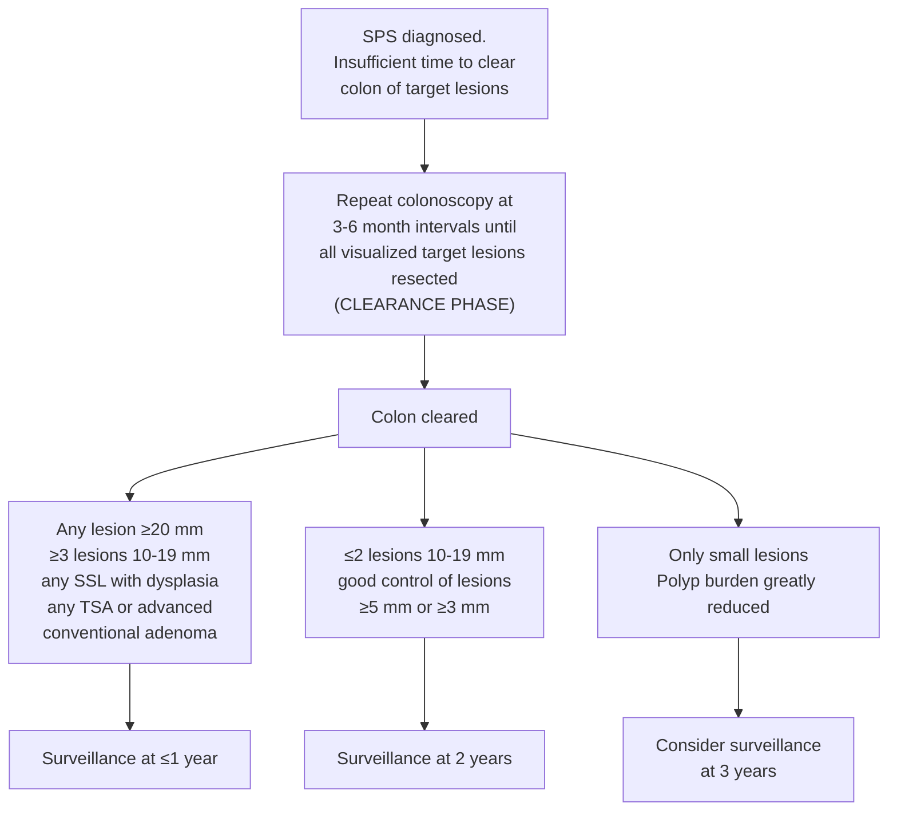

## Contents
- [[#Assessment]]
  - [[#Establishing the Diagnosis]]
  - [[#Severity Assessment]]
- [[#Differential Diagnosis]]
- [[#Diagnostics]]
  - [[#Detection and Documentation]]
  - [[#Genetic Testing]]
- [[#Therapeutics]]
  - [[#Endoscopic Management]]
  - [[#Surgical Management]]
  - [[#Family Member Surveillance]]
- [[#See Also]]
- [[#Sources]]

## Assessment

### Establishing the Diagnosis

- Predisposition to serrated polyps throughout the colorectum + increased risk of [[colorectal-cancer|colorectal cancer (CRC)]] [[acg-2015-hereditary-gi-cancer]]
- Previously called hyperplastic polyposis syndrome
- No clear genetic etiology established

**2019 World Health Organization (WHO) criteria** — the criteria recommended for diagnosis by the [[usmstf-2026-serrated-polyposis-syndrome|US Multi-Society Task Force on Colorectal Cancer (USMSTF) 2026]] *(Strong, Oxford Level 5)*. **SP = serrated polyp** = hyperplastic polyp, sessile serrated lesion (SSL), or traditional serrated adenoma (TSA):

| Type | Criterion |
|---|---|
| **Type 1** | **≥5 SPs proximal to the rectum**, all **≥5 mm**, and **≥2 being ≥10 mm** |
| **Type 2** | **>20 SPs throughout the colon**, with **≥5 proximal to the rectum** |

- **Either type qualifies**, and both may be met in the same patient.
- **Counting is cumulative over a lifetime** — the number can be reached by totalling serrated lesions resected over **all** of the individual's colonoscopies, not one exam.
- Type 1 and combined Type 1 + Type 2 carry **higher CRC risk than Type 2 alone**; Type 2 has the stronger smoking association.
- The cutoff is sharp but the risk is not: patients **approaching but not fully reaching** the criteria are **also at increased CRC risk** on surveillance

> [!pitfall] Count proximal to the rectum, not the sigmoid
> The 2019 revision moved the landmark from the sigmoid to the **rectum**, so **sigmoid polyps now count**, and added a **≥5 mm floor** to every polyp counted on the Type 1 limb. It also **dropped** the old criterion *any serrated polyp proximal to the sigmoid in a first-degree relative (FDR) of an SPS patient* — a change driven by the absence of a genetic basis for SPS. Older criteria from [[acg-2015-hereditary-gi-cancer|ACG 2015]] / [[asge-2020-fap|ASGE 2020]] (WHO 2010) and the [[usmstf-2020-followup-colonoscopy|USMSTF 2020]] footnote are superseded ([[usmstf-2026-serrated-polyposis-syndrome]]).

The landmark moved because roughly **half of CRCs in SPS occur in the rectosigmoid** — a distribution the 2010 criteria, which excluded the sigmoid, systematically missed.

**Polyp spectrum**:

- Original criteria included hyperplastic polyps only
- Preferred term now "serrated polyposis syndrome" — reflects inclusion of sessile serrated lesions (SSLs; formerly sessile serrated adenomas/polyps) and TSAs alongside hyperplastic polyps
- The overwhelming majority of serrated polyps in SPS are **hyperplastic polyps and SSLs, not TSAs**; most patients reach the diagnosis on SSL/hyperplastic-polyp count. Hyperplastic polyps **≥10 mm may be managed as SSLs**
- Both hyperplastic polyps and SSLs count, in part because **pathologic SSL-vs-hyperplastic-polyp differentiation has substantial interobserver variation** ([[usmstf-2026-serrated-polyposis-syndrome]])

**Epidemiology**:

- **Most common gastrointestinal polyposis syndrome — more common than all the others combined**; prevalence ~**1 in 250** in screening colonoscopy cohorts, so a busy endoscopist could diagnose it several times a year ([[usmstf-2026-serrated-polyposis-syndrome]])
- European screening-programme figures: **0.9% (1 per 111 colonoscopies)** in fecal occult blood test–positive patients and **0.42% (1 per 238)** where the indication was screening. Comparable earlier series: **5 of 755 (0.66%)** guaiac-based fecal occult blood test–positive patients in the National Health Service Bowel Cancer Screening Programme and **8 of 2,355 (0.34%)** of [[colorectal-cancer-screening|fecal immunochemical test]]-positive patients in Barcelona
- **Widely underrecognized** — in referral centers most patients referred for SPS had not been diagnosed by the referring physician despite having had enough serrated polyps resected there to qualify
- **Mean age at presentation ~60 years**; approximately equal sex distribution (some series predominantly women) ([[usmstf-2026-serrated-polyposis-syndrome]]; [[acg-2015-hereditary-gi-cancer|ACG 2015]] gave ~48 y — superseded). Pancolonic distribution (89–96% of index cases)
- **Strong association with cigarette smoking**, but many SPS patients are nonsmokers; cessation is advisable, yet **no evidence that cessation alters the clinical course** of SPS or CRC risk in SPS
- The serrated pathway accounts for up to **30% of sporadic CRC**, rising in importance from rectum to right colon
- **Appendix:** serrated lesions are highly prevalent there (generally not endoscopically visible), but appendiceal cancer incidence in SPS is low and **no consensus supports prophylactic appendectomy**

**Genetics**:

- **No consistent genetic basis has been identified** — the definition is clinical and carries an arbitrary element. Routine germline testing is **not** indicated for SPS itself (see [[#Diagnostics]])
- *RNF43* (Ring Finger Protein 43): a germline variant was found in one severely affected kindred, but **systematic testing found no germline *RNF43* variants** in SPS patients
- Multigene panel testing found variants in **9.6% of 73 patients** (6 different genes among the 7 positives). In **258 SPS patients** tested, only **4** had germline variants — **3 in [[lynch-syndrome|Lynch syndrome]] genes, 1 *RNF43*** ([[usmstf-2026-serrated-polyposis-syndrome]])
- Older age at diagnosis and absence of CRC family history in most SPS patients argue **against** SPS being a hereditary syndrome
- Overlap with [[mutyh-associated-polyposis|MUTYH-associated polyposis (MAP)]] runs in one direction more than the other: **3 of 17 biallelic MUTYH carriers (18%) met SPS criteria**, whereas only **1 of 126 SPS patients (0.8%)** carried biallelic MUTYH. In both series the patients meeting SPS criteria also had a history of adenomas — hence testing MUTYH only when adenomas are concurrent and/or there is a family history of adenomas
- GREM1 duplication has been described in [[hereditary-mixed-polyposis-syndrome|hereditary mixed polyposis syndrome (HMPS)]], which may overlap with SPS
- Conventional adenomas are found in the majority of SPS patients (78–80%). In CRCs arising in SPS patients: **BRAF V600E in 18 of 39 (46%)**, **KRAS in 2 of 40 (5.0%)**, and **loss of MLH1/PMS2 expression on immunohistochemistry (IHC) in 17 of 45 (38%)**

### Severity Assessment

**Most of the CRC risk is already realized by the time SPS is diagnosed** ([[usmstf-2026-serrated-polyposis-syndrome]]):

| Timepoint | CRC risk |
|---|---|
| **At the time of SPS diagnosis** | **14.7%** (meta-analysis, 36 studies, 2,788 patients) |
| **Before** diagnosis | **7.7%** |
| **During surveillance** | **2.8%**, mean interval 28.9 mo (range 4.3–80.4 mo); **5-y risk 0–7%** across nine published cohorts >60 patients, and **zero in several recent studies** |

- Most CRC diagnoses are made **at or before the index exam** — so the index colonoscopy, not the surveillance program, is where the cancer is usually found
- Markers of **higher** CRC risk within SPS: **Type 1 or combined Type 1 + 2** (vs Type 2 alone), **SSLs with dysplasia**, and **concurrent advanced conventional adenomas**
- Roughly **half of CRCs in SPS arise in the rectosigmoid** — the rest are predominantly right-sided and often flat/serrated in morphology
- Synchronous conventional adenomas are common and **more frequent in SPS patients with CRC**

---

## Differential Diagnosis

*Workup: see [[colorectal-polyposis]].*

- **[[familial-adenomatous-polyposis|familial adenomatous polyposis (FAP)]] / attenuated FAP (AFAP) / [[mutyh-associated-polyposis|MAP]]** — predominantly adenomatous polyps; APC or MUTYH mutations; consider if adenomas co-occur
- **[[hereditary-mixed-polyposis-syndrome|HMPS]]** — mixed juvenile-adenomatous-hyperplastic polyps; GREM1 duplication; HMPS and SPS are misdiagnosed for one another in both directions
- **[[lynch-syndrome]]** — fewer polyps; mismatch repair (MMR) gene mutations; microsatellite instability-high (MSI-H); may co-exist with SPS (MLH1/PMS2 loss found in some SPS CRCs)
- Sporadic serrated/hyperplastic polyps — isolated polyps without meeting SPS criteria
- **[[juvenile-polyposis-syndrome]]** — hamartomatous polyps; SMAD4/BMPR1A

---

## Diagnostics

### Detection and Documentation

The diagnosis is made by counting, so it is lost when the count is not recorded. USMSTF 2026 recommendations *(numbering the document's own)*:

- **Rec 3** *(Strong, Oxford Level 4)*: when **multiple serrated polyps** are detected at [[colonoscopy]], **describe the number, size, and location** of serrated polyps in the procedure report. Continue the practice **at least until an SPS diagnosis is established**
- **Rec 4** *(Strong, Oxford Level 5)*: colonoscopy in SPS should be performed by endoscopists with documented adequate SSL detection — **SSL detection rate ≥6%** on routine colonoscopy. US targets generally: **minimum acceptable 6%–7%**, **aspirational ~20%** (see [[colonoscopy-quality-indicators]])
- **Rec 5** *(Strong, Oxford Level 3)*: perform colonoscopy with **high-definition white light, with or without virtual or dye spray chromoendoscopy**

> [!pearl] Think SPS every time you see multiple serrated polyps
> SPS is significantly underdiagnosed. A planned 1-year colonoscopy in fecal immunochemical test–positive patients with **≥1 serrated lesion ≥5 mm proximal to the sigmoid**, aimed specifically at diagnosing SPS, **tripled the SPS diagnosis rate** ([[usmstf-2026-serrated-polyposis-syndrome]]).

Imaging-technique detail ([[usmstf-2026-serrated-polyposis-syndrome]]):

- **Narrow band imaging** improves detection of *sporadic* serrated polyps (best with excellent bowel prep) but has given **mixed results in SPS**
- In tandem colonoscopy in SPS, **indigo carmine + acetic acid** found more additional SSLs than indigo carmine alone or white light (**63.4% vs 39.1% vs 21.6%; P < 0.001**); nearly all extra lesions were **<10 mm**
- **Computer-aided detection benefits serrated polyps less than adenomas**, and some programs detect **large SSLs poorly** (see [[artificial-intelligence-endoscopy]])
- Counting reliably when polyps are numerous requires proficiency in **optical diagnosis** to separate conventional adenomas from serrated polyps — separate pathology containers for every polyp would be costly and inefficient

**After SPS is established, the documentation changes.** Tracking serrated-vs-conventional type lesion by lesion is no longer needed; instead record **total polyps resected and the numbers ≥10 mm, 6–9 mm, and ≤5 mm**, so polyp burden can be seen rising or falling across colonoscopies.

### Genetic Testing

- **Rec 2** *(Strong, Oxford Level 3)*: germline genetic testing in a patient with SPS **only when** either
  - **concurrent non-serrated polyps** independently meet an established testing indication — e.g. **>10 conventional adenomas** in a lifetime, or **>2 hamartomatous polyps**; **or**
  - **family history suggests a hereditary gastrointestinal cancer syndrome**
- **SPS by itself is not an indication for germline testing** ([[usmstf-2026-serrated-polyposis-syndrome]])
- Consider **MUTYH** germline testing when adenomas are concurrently present and/or family history of adenomas exists
- **Count the adenomas separately, and apply the adenomatous-polyposis testing rule if they add up.** Adenomas, including advanced adenomas, are detected in up to **80%** of SPS patients, and **10%** of SPS patients have **>10 cumulative lifetime adenomas**. Germline **multigene panel testing** for an adenomatous polyposis syndrome is warranted in SPS patients who meet the usual criteria — **≥10–20 cumulative lifetime adenomas** ([[acg-2026-adenomatous-polyposis]]); the thresholds and the minimum gene panel are on [[colorectal-polyposis]]
- **Therapy-associated polyposis (TAP)** — survivors of childhood and young-adult cancer treated with alkylating agents and/or radiotherapy — is the other non-genetic polyposis that overlaps this space; **53% of 34 TAP patients with negative panel testing had ≥10 cumulative adenomas**. A negative panel in either setting makes the patient [[colonic-polyposis-of-unknown-etiology|CPUE]], with its own surveillance
- No established role for tumor molecular profiling in guiding management at this time
- **No extracolonic cancer surveillance** — ACG Rec 21 *(Conditional / Very Low)*: there is no evidence to support extracolonic cancer surveillance in SPS at this time. Data are insufficient; in the two largest series (115 patients, and 105 patients with 341 FDRs) no excess extracolonic malignancy was seen in patients or relatives

---

## Therapeutics

### Endoscopic Management

**Endoscopy, not surgery, is the primary strategy** ([[usmstf-2026-serrated-polyposis-syndrome]]):

- **Rec 6** *(Strong, Oxford Level 3)*: in patients **without concurrent CRC**, endoscopic management is **preferred over surgery** for primary management of SPS
- **Rec 7** *(Weak, Oxford Level 5)*: if the polyp burden is judged **endoscopically unmanageable**, refer to an **expert in advanced endoscopic resection before referring for surgery**

Management runs in two phases:

*Figure — clearance and surveillance phases of SPS endoscopic management, recreated from Figure 2. ([[usmstf-2026-serrated-polyposis-syndrome]])*

- **Rec 9** *(Strong, Oxford Level 3)*: **clearance phase at 3–6-month intervals**, then a **surveillance phase of 1–2 years**
- **Rec 10** *(Weak, Oxford Level 5)*: patients with **greatly reduced polyp burdens** at surveillance **can be considered for 3-year intervals**. No substantial evidence supports extending beyond 3 years
- **Target lesions** for clearance: **all conventional adenomas**, **all lesions proximal to the sigmoid**, and **all rectosigmoid serrated polyps ≥5 mm (some programs ≥3 mm)**
- **Clearance endpoint** = a colonoscopy at which **all visualized lesions ≥5 mm are resected**; usually takes **≥2 colonoscopies**
- Intervals assume **cecal intubation, adequate bowel preparation, and a measured high-detection endoscopist**
- Figure 2 does not detail concurrent conventional adenomas: because advanced conventional adenomas raise CRC risk in SPS, **concurrent advanced conventional adenomas generally warrant surveillance at ≤1 year**
- Volume to expect: **10–16 polypectomies per colonoscopy in the clearance phase**, **5–7 in surveillance**; in one study **5% of patients needed >100 total resections** to clear

**Resection technique — Rec 8** *(Strong, Oxford level 3)*: resect SSLs and hyperplastic polyps by **cold snare, with or without submucosal injection for larger lesions**, **except where dysplastic areas are endoscopically evident**. See [[polypectomy]].

- **Cold snare is effective regardless of lesion size**; lesions **≥10 mm** can be resected piecemeal by cold snare ± submucosal injection. No randomized trial has compared injection vs no injection for SSL resection
- Cold resection has **fewer complications** than electrocautery and is efficient and cost-effective vs [[endoscopic-mucosal-resection|endoscopic mucosal resection (EMR)]] with electrocautery because it **requires no clip closure**
- **Electrocautery** is reserved for **endoscopically overt dysplasia** (recommended by the European Society of Gastrointestinal Endoscopy, though USMSTF notes the supporting evidence is lacking) and for **bulky SSLs** hard to remove cold
- **Minimum resection set:** all rectosigmoid lesions **≥5 mm** (half of SPS cancers arise there), **all conventional adenomas throughout the colon**, and **all serrated lesions proximal to the sigmoid**

SPS is excluded from routine post-polypectomy surveillance intervals and "may require specialized management" ([[usmstf-2020-followup-colonoscopy]]; general intervals: [[colonoscopy-surveillance]]).

### Surgical Management

- Surgery is expected when **cancer and SPS are diagnosed at the same colonoscopy**; otherwise it is for a polyp burden that cannot be controlled endoscopically, after expert endoscopic referral ([[usmstf-2026-serrated-polyposis-syndrome]])
- Options: **segmental colon resection** or **extended colectomy including subtotal colectomy**, depending on case characteristics. Subtotal colectomy with ileorectal anastomosis is reasonable given the risk of metachronous neoplasia
- **Surgery for benign polyps is not low-risk:** in one nationwide study, postoperative **morbidity 13%**, **mortality 0.3%–0.4%** — substantially greater than endoscopic resection
- [[acg-2015-hereditary-gi-cancer|ACG 2015]] Rec 20 *(Conditional / Low)* additionally listed **high-grade dysplasia in a serrated polyp that cannot be removed in its entirety** as an indication

### Family Member Surveillance

- **Rec 11** *(Weak, Oxford Level 4)*: FDRs of an SPS patient should undergo [[colonoscopy]] at **age 40**, or **10 y before the youngest age at CRC diagnosis**, or **5 y before the youngest age at SPS diagnosis in the family** — **whichever is earliest** ([[usmstf-2026-serrated-polyposis-syndrome]]). This supersedes [[acg-2015-hereditary-gi-cancer|ACG 2015]] Rec 21, which left family screening "unclear pending further data"
- Supporting risk data, and why the recommendation is weak:
  - FDRs of hyperplastic polyposis patients: **relative risk 5.4 (95% CI 3.7–7.8)** vs a population registry (347 patients)
  - Among 1,639 relatives of 100 serrated polyposis patients: **FDR standardized incidence ratio 5.16 (95% CI 3.70–7.30; P < 0.001)**; second-degree relatives **1.38 (95% CI 1.01–1.91; P = 0.04)**
  - A recent study found a **5-fold increased CRC risk** in FDRs of 37 SPS patients vs FDRs of normal-colonoscopy controls
  - But **two small screening-colonoscopy studies of FDRs gave mixed results** for neoplasia yield and SPS prevalence — USMSTF states the evidence for increased screening in FDRs is **currently mixed**

---

## See Also

[[colorectal-polyposis]], [[colonic-polyposis-of-unknown-etiology]], [[familial-adenomatous-polyposis]], [[mutyh-associated-polyposis]], [[hereditary-mixed-polyposis-syndrome]], [[lynch-syndrome]], [[juvenile-polyposis-syndrome]], [[colorectal-cancer]], [[colorectal-cancer-screening]], [[colonoscopy]], [[colonoscopy-surveillance]], [[colonoscopy-quality-indicators]], [[polypectomy]], [[endoscopic-mucosal-resection]], [[artificial-intelligence-endoscopy]]

---

## Sources

1. [[usmstf-2026-serrated-polyposis-syndrome|Serrated Polyposis Syndrome: A Review and Consensus Statement by the US Multi-Society Task Force on Colorectal Cancer (2026)]]
2. [[acg-2026-adenomatous-polyposis|ACG Clinical Guideline: Diagnosis and Management of Adenomatous Colorectal Polyposis Syndromes (2026)]]
3. [[acg-2015-hereditary-gi-cancer|ACG 2015: Genetic Testing and Management of Hereditary Gastrointestinal Cancer Syndromes]]
4. [[usmstf-2020-followup-colonoscopy|USMSTF 2020: Recommendations for Follow-Up After Colonoscopy and Polypectomy]]
5. [[asge-2020-fap|ASGE Guideline: The Role of Endoscopy in Familial Adenomatous Polyposis Syndromes (2020)]]
