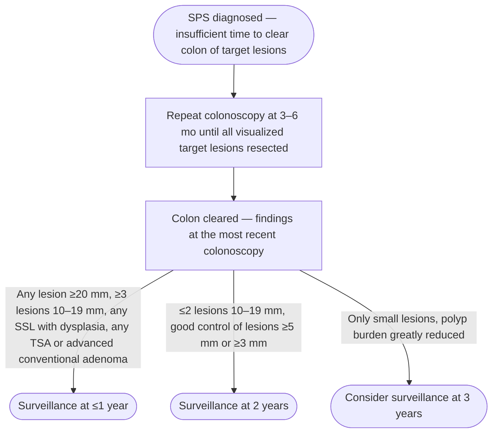

## Contents
- [[#Assessment]]
  - [[#Establishing the Diagnosis]]
  - [[#Severity Assessment]]
- [[#Differential Diagnosis]]
- [[#Diagnostics]]
  - [[#Detection and Documentation]]
  - [[#Genetic Testing]]
- [[#Therapeutics]]
  - [[#Endoscopic Management]]
  - [[#Surgical Management]]
  - [[#Family Member Surveillance]]
- [[#See Also]]
- [[#Sources]]

## Assessment

### Establishing the Diagnosis

- Serrated polyposis syndrome (SPS) = predisposition to serrated polyps throughout the colorectum + increased risk of [[colorectal-cancer|colorectal cancer (CRC)]]; previously called hyperplastic polyposis syndrome ([[acg-2015-hereditary-gi-cancer]])
- Diagnosis is **clinical** — no consistent genetic basis, so the definition carries an arbitrary element ([[usmstf-2026-serrated-polyposis-syndrome]])

**2019 World Health Organization (WHO) criteria** — recommended for diagnosis by the [[usmstf-2026-serrated-polyposis-syndrome|US Multi-Society Task Force on Colorectal Cancer (USMSTF) 2026]] *(Recommendation 1; Strong, Oxford Level 5)*. A **serrated polyp (SP)** = hyperplastic polyp, **sessile serrated lesion (SSL)**, or **traditional serrated adenoma (TSA)**:

| Type | Criterion |
|---|---|
| **Type 1** | **≥5 SPs proximal to the rectum**, all **≥5 mm**, and **≥2 being ≥10 mm** |
| **Type 2** | **>20 SPs throughout the colon**, with **≥5 proximal to the rectum** |

- **Either type qualifies**; both may be met in the same patient
- **Counting is cumulative over a lifetime** — total the serrated lesions resected over **all** of the patient's colonoscopies. One exam often suffices; otherwise the sum across exams makes the diagnosis

**Changed from the WHO 2010 criteria** — still quoted by [[acg-2015-hereditary-gi-cancer|ACG 2015]] and [[asge-2020-fap|ASGE 2020]], so readers carrying the old version will miscount:

| WHO 2010 | 2019 change |
|---|---|
| Counting landmark = proximal to the **sigmoid** | Moved to proximal to the **rectum** — sigmoid polyps now count |
| ≥5 SPs proximal to the sigmoid, ≥2 of them >10 mm | Adds a **≥5 mm floor** on every polyp counted (Type 1) |
| >20 SPs of **any size** throughout the colon | Adds **≥5 of them proximal to the rectum** (Type 2) |
| Any SP proximal to the sigmoid in a **first-degree relative (FDR)** of an SPS patient | **Dropped** — no genetic basis for SPS |

- Landmark moved because roughly **half of CRCs in SPS arise in the rectosigmoid**; the current criteria therefore put greater emphasis on sigmoid lesions ([[usmstf-2026-serrated-polyposis-syndrome]])

> [!pitfall] The cutoff is sharp; the risk is not
> Patients with multiple serrated polyps **approaching but not fully reaching** the WHO criteria are also at increased CRC risk during surveillance — "doesn't meet criteria" is not "average risk" ([[usmstf-2026-serrated-polyposis-syndrome]]).

**Polyp spectrum:**

- Original criteria counted hyperplastic polyps only; the current name reflects inclusion of SSLs (formerly sessile serrated adenomas/polyps) and TSAs
- Overwhelming majority of serrated polyps in SPS are hyperplastic polyps and SSLs, **not TSAs** — most patients reach the diagnosis on those counts
- Both hyperplastic polyps and SSLs count, in part because **pathologic SSL-vs-hyperplastic-polyp differentiation varies substantially between observers**; hyperplastic polyps **≥10 mm may be managed as SSLs**

*See Figure 1 in [[usmstf-2026-serrated-polyposis-syndrome]] for endoscopic example images of hyperplastic polyps, SSLs, SSLs with cytological dysplasia, and TSAs.*

**Who has it:**

- **Most common gastrointestinal polyposis syndrome — more common than all the others combined**; prevalence ~**1 in 250** in screening colonoscopy cohorts, so a busy endoscopist could diagnose it several times a year ([[usmstf-2026-serrated-polyposis-syndrome]])
- **Widely underrecognized** — in referral centers most patients had not been diagnosed by the referring physician, despite enough serrated polyps resected there to qualify
- **Mean age at presentation ~60 y**; approximately equal sex distribution (some series predominantly women). [[acg-2015-hereditary-gi-cancer|ACG 2015]] gave ~48 y — superseded. Pancolonic polyp distribution in **89–96%** of index cases
- **Strong association with cigarette smoking**, though many patients are nonsmokers; cessation is advisable, but no evidence it alters the course of SPS or CRC risk in SPS
- **Appendix:** serrated lesions are highly prevalent there (generally not endoscopically visible), but appendiceal cancer incidence in SPS is low and **no consensus supports prophylactic appendectomy**

**Genetic basis:**

- **None consistently identified.** In **258 SPS patients** tested, only **4** had germline variants — **3 in [[lynch-syndrome|Lynch syndrome]] genes, 1 in RNF43** (Ring Finger Protein 43). Older age at diagnosis and absence of a CRC family history in most patients argue against a hereditary syndrome ([[usmstf-2026-serrated-polyposis-syndrome]])
- Overlap with [[mutyh-associated-polyposis|MUTYH-associated polyposis (MAP)]] runs mostly one way: **3 of 17 biallelic MUTYH carriers (18%) met SPS criteria**, vs only **1 of 126 SPS patients (0.8%)** carrying biallelic MUTYH — in both series the patients meeting SPS criteria also had adenomas ([[acg-2015-hereditary-gi-cancer]])
- GREM1 duplication is described in [[hereditary-mixed-polyposis-syndrome|hereditary mixed polyposis syndrome (HMPS)]], which may overlap with SPS
- When to test: [[#Genetic Testing]]

### Severity Assessment

**Most of the CRC risk is already realized by the time SPS is diagnosed** ([[usmstf-2026-serrated-polyposis-syndrome]]):

| Timepoint | CRC risk |
|---|---|
| **At the time of SPS diagnosis** | **14.7%** (meta-analysis, 36 studies, 2,788 patients) |
| **Before** diagnosis | **7.7%** |
| **During surveillance** | **2.8%**, mean interval 28.9 mo (range 4.3–80.4 mo); **5-y risk 0–7%** across nine published cohorts of >60 patients, and zero in several recent studies |

- Most CRC diagnoses are made **at or before the index exam** — the index colonoscopy, not the surveillance program, is where the cancer is usually found
- Markers of **higher** CRC risk within SPS: **Type 1 or combined Type 1 + Type 2** (vs Type 2 alone), **SSLs with dysplasia**, **concurrent advanced conventional adenomas**
- Type 2 carries the stronger smoking association
- Synchronous conventional adenomas are common and **more frequent in SPS patients who have CRC** ([[acg-2015-hereditary-gi-cancer]])

---

## Differential Diagnosis

*Workup: see [[colorectal-polyposis]].*

- **[[familial-adenomatous-polyposis|familial adenomatous polyposis (FAP)]] / attenuated FAP (AFAP) / [[mutyh-associated-polyposis|MAP]]** — predominantly adenomatous polyps; APC or MUTYH mutations; consider when adenomas co-occur
- **[[hereditary-mixed-polyposis-syndrome|HMPS]]** — mixed juvenile–adenomatous–hyperplastic polyps; GREM1 duplication; HMPS and SPS are misdiagnosed for one another in both directions
- **[[lynch-syndrome]]** — fewer polyps; mismatch repair (MMR) gene mutations; microsatellite instability–high (MSI-H); may co-exist with SPS
- **[[juvenile-polyposis-syndrome]]** — hamartomatous polyps; SMAD4/BMPR1A
- Sporadic serrated/hyperplastic polyps — isolated polyps not meeting SPS criteria

---

## Diagnostics

### Detection and Documentation

The diagnosis is made by counting, so it is lost when the count is not recorded. USMSTF 2026 recommendations *(numbering the document's own)*:

- **Rec 3** *(Strong, Oxford Level 4)*: when **multiple serrated polyps** are detected at [[colonoscopy]], **describe their number, size and location** in the procedure report. Continue **at least until an SPS diagnosis is established**
- **Rec 4** *(Strong, Oxford Level 5)*: colonoscopy in SPS should be performed by endoscopists with documented adequate SSL detection — **SSL detection rate ≥6%** on routine colonoscopy. US targets generally: **minimum acceptable 6%–7%**, **aspirational ~20%** (see [[colonoscopy-quality-indicators]])
- **Rec 5** *(Strong, Oxford Level 3)*: perform colonoscopy with **high-definition white light, with or without virtual or dye-spray chromoendoscopy**

> [!pearl] Think SPS every time you see multiple serrated polyps
> A planned 1-year colonoscopy in fecal immunochemical test–positive patients with **≥1 serrated lesion ≥5 mm proximal to the sigmoid**, aimed specifically at diagnosing SPS, **tripled the SPS diagnosis rate**. An endoscopist doing **>200–300 colonoscopies a year** who is never diagnosing SPS should audit their serrated detection and their recording system ([[usmstf-2026-serrated-polyposis-syndrome]]).

Imaging-technique detail ([[usmstf-2026-serrated-polyposis-syndrome]]):

- **Narrow band imaging** improves detection of *sporadic* serrated polyps (best with excellent bowel prep) but has given **mixed results in SPS**
- In tandem colonoscopy in SPS, **indigo carmine + acetic acid** found more additional SSLs than indigo carmine alone or white light (**63.4% vs 39.1% vs 21.6%; P < 0.001**); nearly all extra lesions were **<10 mm**
- **Computer-aided detection benefits serrated polyps less than adenomas**, and some programs detect **large SSLs poorly** (see [[artificial-intelligence-endoscopy]])
- Counting reliably when polyps are numerous requires proficiency in **optical diagnosis** to separate conventional adenomas from serrated polyps — a separate pathology container for every polyp would be costly and inefficient

**After SPS is established, the documentation changes.** Tracking serrated-vs-conventional type lesion by lesion is no longer needed; instead record **total polyps resected and the numbers ≥10 mm, 6–9 mm, and ≤5 mm**, so polyp burden can be seen rising or falling across colonoscopies.

### Genetic Testing

- **Rec 2** *(Strong, Oxford Level 3)*: germline genetic testing in a patient with SPS **only when** either
  - **concurrent non-serrated polyps** independently meet an established testing indication — e.g. **>10 conventional adenomas** in a lifetime, or **>2 hamartomatous polyps**; **or**
  - **family history suggests a hereditary gastrointestinal cancer syndrome**
- **SPS by itself is not an indication for germline testing** ([[usmstf-2026-serrated-polyposis-syndrome]])
- Consider **MUTYH** germline testing when adenomas are concurrently present and/or there is a family history of adenomas ([[acg-2015-hereditary-gi-cancer]])
- **Count the adenomas separately, and apply the adenomatous-polyposis testing rule if they add up.** Adenomas, including advanced adenomas, are detected in up to **80%** of SPS patients, and **10%** have **>10 cumulative lifetime adenomas**. Germline **multigene panel testing** for an adenomatous polyposis syndrome is warranted at **≥10–20 cumulative lifetime colorectal adenomas** ([[acg-2026-adenomatous-polyposis]]); the thresholds and the minimum gene panel are on [[colorectal-polyposis]]
- **Therapy-associated polyposis (TAP)** — survivors of childhood and young-adult cancer treated with alkylating agents and/or radiotherapy — is the other non-genetic polyposis overlapping this space; **53% of 34 TAP patients with negative panel testing had ≥10 cumulative adenomas**. A negative panel with ≥10 cumulative adenomas, in either setting, makes the patient [[colonic-polyposis-of-unknown-etiology|colonic polyposis of unknown etiology (CPUE)]], with its own surveillance
- **Extracolonic surveillance — none.** [[acg-2015-hereditary-gi-cancer|ACG 2015]] Rec 21 *(Conditional, Very Low)*: no evidence supports extracolonic cancer surveillance in SPS. Data are insufficient; in the two largest series (115 patients, and 105 patients with 341 FDRs) no excess extracolonic malignancy was seen in patients or relatives

---

## Therapeutics

### Endoscopic Management

**Endoscopy, not surgery, is the primary strategy** ([[usmstf-2026-serrated-polyposis-syndrome]]):

- **Rec 6** *(Strong, Oxford Level 3)*: in patients **without concurrent CRC**, endoscopic management is **preferred over surgery** for primary management of SPS
- **Rec 7** *(Weak, Oxford Level 5)*: if the polyp burden is judged **endoscopically unmanageable**, refer to an **expert in advanced endoscopic resection before referring for surgery**

Management runs in two phases — a clearing phase, then surveillance set by the most recent colonoscopy's findings:

*Colonoscopy frequency in the clearing and surveillance phases of serrated polyposis syndrome*
*Source: redrawn from the USMSTF 2026 Figure 2 algorithm*
*[[usmstf-2026-serrated-polyposis-syndrome|USMSTF 2026: Serrated Polyposis Syndrome]]*
*SPS = serrated polyposis syndrome · SSL = sessile serrated lesion · TSA = traditional serrated adenoma*

- **Rec 9** *(Strong, Oxford Level 3)*: **clearance phase at 3–6-month intervals**, then a **surveillance phase of 1–2 years**
- **Rec 10** *(Weak, Oxford Level 5)*: patients with **greatly reduced polyp burdens** at surveillance **can be considered for 3-year intervals**. No substantial evidence supports extending beyond 3 years
- **Target lesions** (the asterisk in the algorithm): **all conventional adenomas throughout the colon**, **all serrated lesions proximal to the sigmoid**, and **all rectosigmoid serrated polyps ≥5 mm** (some programs ≥3 mm) — the rectosigmoid ≥5 mm floor is the minimum that must come out
- **Clearance endpoint** = a colonoscopy at which **all visualized lesions ≥5 mm are resected**; usually takes **≥2 colonoscopies**
- Intervals assume **cecal intubation, adequate bowel preparation, and a measured high-detection endoscopist**
- The algorithm does not account for concurrent conventional adenomas: because advanced conventional adenomas raise CRC risk in SPS, **concurrent advanced conventional adenomas generally warrant surveillance at ≤1 year**, and multiple nonadvanced adenomas may reasonably shorten the interval
- Volume to expect: **10–16 polypectomies per colonoscopy in the clearance phase**, **5–7 in surveillance**; in one study **5% of patients needed >100 total resections** to clear

**Resection technique — Rec 8** *(Strong, Oxford Level 3)*: resect SSLs and hyperplastic polyps by **cold snare, with or without submucosal injection for larger lesions**, **except where dysplastic areas are endoscopically evident**. See [[polypectomy]].

- **Cold snare is effective regardless of lesion size**; lesions **≥10 mm** can be resected piecemeal by cold snare ± submucosal injection. No randomized trial has compared injection vs no injection for SSL resection
- Cold resection has **fewer complications** than electrocautery and is efficient and cost-effective vs [[endoscopic-mucosal-resection|endoscopic mucosal resection (EMR)]] with electrocautery because it **requires no clip closure**
- **Electrocautery** is reserved for **endoscopically overt dysplasia** (recommended by the European Society of Gastrointestinal Endoscopy, though USMSTF notes the supporting evidence is lacking) and for **bulky SSLs** hard to remove cold

SPS is excluded from routine post-polypectomy surveillance intervals and "may require specialized management" ([[usmstf-2020-followup-colonoscopy]]; general intervals: [[colonoscopy-surveillance]]).

### Surgical Management

- Surgery is expected when **cancer and SPS are diagnosed at the same colonoscopy**; otherwise it is for a polyp burden that cannot be controlled endoscopically, after expert endoscopic referral ([[usmstf-2026-serrated-polyposis-syndrome]])
- [[acg-2015-hereditary-gi-cancer|ACG 2015]] Rec 20 *(Conditional, Low)* gives the indications as **inability to control serrated polyp growth** or **development of cancer**; its supporting text adds **high-grade dysplasia in a serrated polyp that cannot be removed in its entirety**
- Options: **segmental colon resection** or **extended colectomy including subtotal colectomy**, depending on case characteristics ([[usmstf-2026-serrated-polyposis-syndrome]]). **Subtotal colectomy with ileorectal anastomosis** is a reasonable option given the risk of metachronous neoplasia ([[acg-2015-hereditary-gi-cancer]])
- **Surgery for benign polyps is not low-risk:** in one nationwide study, postoperative **morbidity 13%**, **mortality 0.3%–0.4%** — substantially greater than endoscopic resection

### Family Member Surveillance

- **Rec 11** *(Weak, Oxford Level 4)*: FDRs of an SPS patient should undergo [[colonoscopy]] at **age 40**, or **10 y before the youngest age at CRC diagnosis**, or **5 y before the youngest age at SPS diagnosis in the family** — **whichever is earliest** ([[usmstf-2026-serrated-polyposis-syndrome]]). This supersedes [[acg-2015-hereditary-gi-cancer|ACG 2015]] Rec 21, which left family screening "unclear pending further data"
- Why the recommendation is weak — the risk signal is consistent but the screening yield is not:
  - Among 1,639 relatives of 100 serrated polyposis patients: **FDR standardized incidence ratio 5.16 (95% confidence interval 3.70–7.30; P < 0.001)**; second-degree relatives **1.38 (1.01–1.91; P = 0.04)**
  - FDRs of hyperplastic polyposis patients: **relative risk 5.4 (3.7–7.8)** vs a population registry (347 patients)
  - But **two small screening-colonoscopy studies of FDRs gave mixed results** for neoplasia yield and SPS prevalence — USMSTF states the evidence for increased screening in FDRs is **currently mixed**

---

## See Also

[[colorectal-polyposis]], [[colonic-polyposis-of-unknown-etiology]], [[familial-adenomatous-polyposis]], [[mutyh-associated-polyposis]], [[hereditary-mixed-polyposis-syndrome]], [[lynch-syndrome]], [[juvenile-polyposis-syndrome]], [[colorectal-cancer]], [[colorectal-cancer-screening]], [[colonoscopy]], [[colonoscopy-surveillance]], [[colonoscopy-quality-indicators]], [[polypectomy]], [[endoscopic-mucosal-resection]], [[artificial-intelligence-endoscopy]]

---

## Sources

1. [[usmstf-2026-serrated-polyposis-syndrome|Serrated Polyposis Syndrome: A Review and Consensus Statement by the US Multi-Society Task Force on Colorectal Cancer (2026)]]
2. [[acg-2026-adenomatous-polyposis|ACG Clinical Guideline: Diagnosis and Management of Adenomatous Colorectal Polyposis Syndromes (2026)]]
3. [[acg-2015-hereditary-gi-cancer|ACG 2015: Genetic Testing and Management of Hereditary Gastrointestinal Cancer Syndromes]]
4. [[usmstf-2020-followup-colonoscopy|USMSTF 2020: Recommendations for Follow-Up After Colonoscopy and Polypectomy]]
5. [[asge-2020-fap|ASGE Guideline: The Role of Endoscopy in Familial Adenomatous Polyposis Syndromes (2020)]]
