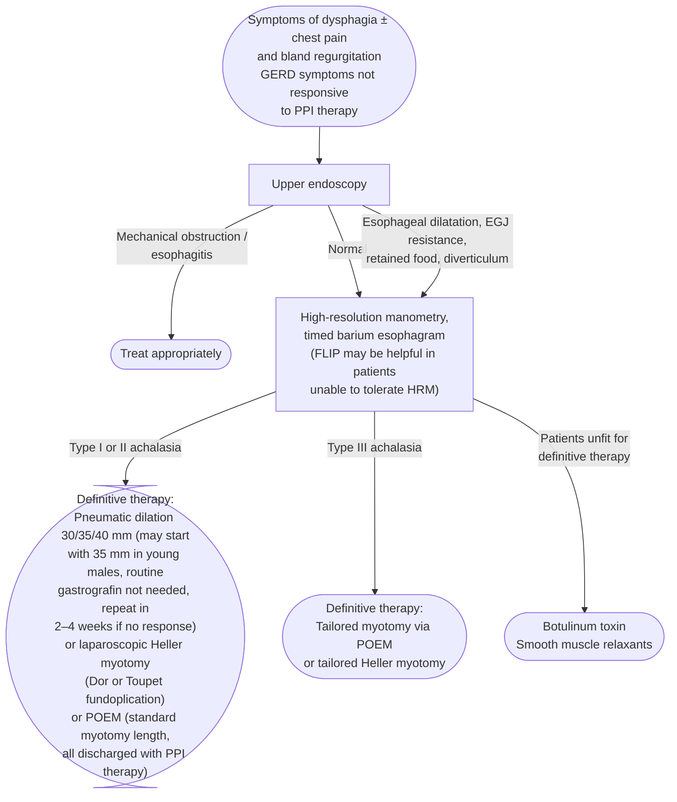

## Contents
- [[#Assessment]]
  - [[#Establishing the Diagnosis]]
  - [[#Severity Assessment]]
  - [[#Classification / Typing (Chicago Classification — clinically essential)]]
- [[#Differential Diagnosis]]
- [[#Diagnostics]]
  - [[#HRM (High-Resolution Manometry)]]
  - [[#Timed Barium Esophagram (TBE)]]
  - [[#Upper Endoscopy]]
  - [[#FLIP (Functional Lumen Imaging Probe)]]
- [[#Therapeutics]]
  - [[#Treatment Algorithm]]
  - [[#Treatment Choice by Subtype]]
  - [[#Pneumatic Dilation (PD)]]
  - [[#Laparoscopic Heller Myotomy (LHM)]]
  - [[#Per-Oral Endoscopic Myotomy (POEM)]]
  - [[#Botulinum Toxin Injection]]
  - [[#Pharmacotherapy]]
  - [[#Self-Expanding Metal Stents (SEMS)]]
  - [[#Esophagectomy]]
  - [[#Post-Therapy Monitoring and Retreatment]]
  - [[#Cancer Surveillance]]
- [[#See Also]]
- [[#Sources]]

## Assessment

### Establishing the Diagnosis

**Clinical presentation** ([[acg-2020-achalasia]]):

- Progressive dysphagia to solids **and** liquids
- Regurgitation; chest pain; varying weight loss or nutritional deficiency
- **Heartburn in 27–42%** → frequently misdiagnosed as [[gerd|gastroesophageal reflux disease (GERD)]] and treated with a proton pump inhibitor (PPI)

> **Recommendation (American College of Gastroenterology [ACG] 2020 Rec 1):** Patients initially suspected of GERD who do not respond to acid-suppressive therapy should be evaluated for achalasia. (Strong; Very low)

> [!pitfall] Always scope before calling it achalasia
> Every patient with suspected achalasia gets [[upper-endoscopy|upper endoscopy]] to rule out pseudoachalasia from an obstructing mass (ACG Table 3) — see [[#Differential Diagnosis]].

**How the diagnosis is made** ([[acg-2020-achalasia]]) — the tests sit in sequence:

1. **Suggestive** — endoscopy (dilated esophagus, retained saliva/food, puckered tight gastroesophageal junction (GEJ) needing more than usual pressure to traverse) and/or barium esophagram (dilated esophagus, "bird beaking," retained barium at 1, 2 and 5 min on timed barium esophagram [TBE]). In the appropriate clinical setting these findings can establish the diagnosis; endoscopy is less likely to show the classic picture in early disease.
2. **Confirmatory** — [[high-resolution-manometry|high-resolution manometry (HRM)]], the gold standard: impaired esophagogastric junction (EGJ) relaxation (elevated integrated relaxation pressure [IRP]) + absent peristalsis. Criteria under [[#HRM (High-Resolution Manometry)]]. Esophagram is complementary when manometry is equivocal or not classic.

> **Recommendation (ACG Rec 2):** Use esophageal pressure topography (HRM) over conventional line tracing for the diagnosis of achalasia. (Strong; High)
>
> - Inter-rater agreement κ 0.57 vs 0.32; odds of an incorrect diagnosis 3.4 times higher with conventional manometry

### Severity Assessment

**Eckardt score (ES)** — the standard severity/response metric: the 3 main symptoms (dysphagia, regurgitation, chest pain) plus weight loss as a marker of the ability to maintain nutrition.

| Property | Value |
|---|---|
| Components | Dysphagia, regurgitation, chest pain, weight loss — **all 4 equally weighted** |
| Per-item range | **0–3** each |
| Cumulative range | **0–12** |
| **Treatment success** | **ES ≤3** (ES >3 = suboptimal outcome) |

- Standard metric in almost all treatment trials; widespread use was based on expert opinion; preferred over the Vantrappen classification and the Modified Achalasia Dysphagia Score.
- Limitations: only marginal reliability and validity; most of the score is explained by the dysphagia component; post-treatment bolus retention is somewhat discordant with the ES ([[acg-2020-achalasia]], [[asge-2020-achalasia]]).
- ACG 2020 and the American Society for Gastrointestinal Endoscopy (ASGE) 2020 give the score's structure, not the per-item anchors (what earns 0, 1, 2 or 3 on each item).
- Not to be used alone to define failure — see [[#Post-Therapy Monitoring and Retreatment]].

### Classification / Typing (Chicago Classification — clinically essential)

> **Recommendation (ACG Rec 3):** Classifying achalasia subtypes by the Chicago Classification may help inform prognosis and treatment choice. (Conditional; Low)

All subtypes share **impaired EGJ relaxation**; the esophageal body pattern separates them ([[acg-2020-achalasia]]; criteria from [[chicago-v4-2021-esophageal-dysmotility]]):

| Subtype | Prevalence | Pattern | Outcomes | Treatment implication |
|---------|-----------|---------|----------|----------------------|
| **Type I** | 20–40% (2nd most common) | 100% failed peristalsis, **no** panesophageal pressurization >30 mmHg | [[heller-myotomy\|Laparoscopic Heller myotomy (LHM)]] 81% | Pneumatic dilation (PD), LHM or [[poem\|per-oral endoscopic myotomy (POEM)]] |
| **Type II** | 50–70% (most common) | 100% failed peristalsis + **panesophageal pressurization >30 mmHg** (Chicago Classification v4.0 [CCv4.0]: in **≥20% of swallows**) | LHM 92%; very good outcomes regardless of therapy | PD, LHM or POEM |
| **Type III** | 5% (least common) | **Premature/spastic contractions** (CCv4.0: **≥20% of swallows**, **no evidence of peristalsis**) ± panesophageal pressurization | LHM **71%** vs POEM **93%** (odds ratio [OR] 3.50, 1.39–8.77; P=0.007) | Needs a more extensive myotomy — tailored POEM or LHM; POEM preferred |

- The 81% / 92% / 71% are **LHM** success rates from one meta-analysis of 1,575 patients treated with various therapies — not head-to-head vs PD.
- The only PD-specific type III figure is an 18-patient subgroup of the European trial: LHM 86% vs PD 40%, P=0.12 — not significant. Different study from the 71%.
- Observational evidence of progression across subtypes, typically type III → type II; type I patients are typically more dilated than type II.

*See Figure 2 in [[acg-2020-achalasia|ACG 2020 Achalasia Guideline]] for example HRM tracings of type I (absent pressurization), type II (panesophageal pressurization) and type III (spastic contractions).*

---

## Differential Diagnosis

*Workup: see [[dysphagia]].*

- **Pseudoachalasia** — obstructing mass at the GEJ; suspect with significant short-term weight loss in an elderly patient → cross-sectional imaging and/or [[endoscopic-ultrasound|endoscopic ultrasound (EUS)]] ([[acg-2020-achalasia]])
- **Reflux-related stricture** — early achalasia with barium retained above the GEJ can be misread as one
- [[distal-esophageal-spasm|Distal esophageal spasm (DES)]] — ≥20% premature contractions but **normal** median IRP (type III has abnormal IRP)
- [[hypercontractile-esophagus|Hypercontractile esophagus]] (incl. jackhammer) — normal median IRP, ≥20% hypercontractile swallows
- [[esophagogastric-junction-outflow-obstruction|Esophagogastric junction outflow obstruction (EGJOO)]] — abnormal median IRP supine **and** upright, ≥20% elevated intrabolus pressure, peristalsis present; a manometric finding with many mimics, not a diagnosis in itself
- [[eosinophilic-esophagitis|Eosinophilic esophagitis]] — edema, rings, exudates, furrows; carries an increased risk of achalasia ([[aga-2024-esophageal-immunity-infection]])
- [[esophageal-dysfunction-systemic-disease|Systemic sclerosis]] — absent contractility with a low-amplitude lower esophageal sphincter (LES) on HRM
- **Secondary achalasia** — at initial evaluation ask about recent coronavirus disease (COVID) infection, Chagas risk (travel/exposure in Central/South America) and eosinophilic disease (American Gastroenterological Association [AGA] 2024 Best Practice Advice [BPA] 10). Framework and tests: [[esophageal-dysfunction-systemic-disease]].

---

## Diagnostics

### HRM (High-Resolution Manometry)

- Gold standard; esophageal pressure topography (Rec 2). ACG 2020 cites Chicago v3.0; current criteria are [[chicago-classification-v4|CCv4.0]] — the full algorithm lives there ([[chicago-v4-2021-esophageal-dysmotility]]).
- **Abnormal median IRP** — threshold depends on the manometry system:

| Position | Medtronic | Laborie/Diversatek |
|---|---|---|
| Supine | **≥15 mmHg** | **≥22 mmHg** |
| Upright | **≥12 mmHg** | **≥15 mmHg** |

- Abnormal median IRP in **either** primary position (supine or upright, where the 10 wet swallows are done) suffices for achalasia; both positions are not required.
- **Inconclusive with dysphagia → supportive TBE (preferably with tablet) and/or [[flip-panometry|functional lumen imaging probe (FLIP)]]:**
  - Absent contractility with IRP at the upper limit of normal in both positions, or appreciable peristalsis on changing position (type I/II pattern)
  - Absent contractility with borderline supine IRP 10–15 mmHg (Medtronic) → consider type I
  - Abnormal IRP with spasm but evidence of peristalsis (type III pattern)
- Opioids are associated with type III → study off opioids if possible (Low, Conditional).

### Timed Barium Esophagram (TBE)

- Barium column height at 1, 2 and 5 min after a large barium bolus; a barium tablet can show whether retention is from EGJ obstruction.
- Before therapy: retained barium. After successful therapy: complete emptying at 1 min.
- Post-intervention predictive value is conflicting — some studies find it useful for outcome and need for further therapy, others argue against it ([[acg-2020-achalasia]]).
- First-line test for recurrent symptoms after therapy — see [[#Post-Therapy Monitoring and Retreatment]].

### Upper Endoscopy

- Excludes pseudoachalasia and mechanical obstruction — **always**
- Findings: retained saliva/food, dilated esophagus, puckered tight GEJ
- After therapy with recurrent symptoms: reflux and reflux-related stricture vs recurrent achalasia

### FLIP (Functional Lumen Imaging Probe)

- Simultaneous cross-sectional area + pressure → EGJ distensibility; done during endoscopy under [[endoscopy-sedation|sedation]].
- In 145 patients, all 70 with manometric achalasia had reduced EGJ distensibility on FLIP.
- Useful when manometry is equivocal despite high suspicion, when manometry cannot be tolerated, and before/after treatment (ACG text and Table 3). Role still evolving.

---

## Therapeutics

All treatments are **palliative** — reduce LES hypertonicity, improve esophageal emptying, prevent further dilation.

### Treatment Algorithm

*Diagnostic and treatment algorithm for suspected achalasia*
*Source: redrawn from the ACG 2020 achalasia diagnostic and treatment algorithm*
*[[acg-2020-achalasia|ACG 2020 Achalasia Guideline]]*
*GERD = gastroesophageal reflux disease · PPI = proton pump inhibitor · EGJ = esophagogastric junction · FLIP = functional lumen imaging probe · HRM = high-resolution manometry · POEM = per-oral endoscopic myotomy*

- ACG algorithm text: perform all definitive therapies in centers of excellence with adequate volume and expertise; unresponsive to PD → surgical myotomy.

### Treatment Choice by Subtype

Choose by achalasia type, local expertise and patient preference (ASGE Rec 1; High). Society of American Gastrointestinal and Endoscopic Surgeons (SAGES) 2024 is the newest and governs where they differ.

| Patient | ACG 2020 | ASGE 2020 | AGA 2024 clinical practice update (CPU) | SAGES 2024 |
|---|---|---|---|---|
| **Types I/II, fit** | PD, LHM, POEM comparably effective (Table 2, ungraded); POEM ≈ PD in types I/II (Rec 15; Conditional, Low); not subtype-specific: PD and LHM equivalent short and long term (Rec 14; Strong, High), POEM ≈ LHM (Rec 16; Strong, Moderate) | LHM ≈ PD (Rec 7; recommend, Moderate); POEM ≈ LHM (Rec 8; suggest, Low) — shared decision | POEM, LHM, PD all effective; shared decision (BPA 2) | **POEM with appropriate PPI use or LHM with fundoplication**, shared decision (Conditional; Low); adults, not subtype-specific: **POEM over PD** (Conditional; Moderate) |
| **Type III** | Tailored POEM or LHM over PD (Rec 9; Strong, Moderate); POEM the better option (Table 2) | POEM preferred (Rec 3; suggest, Very low) | POEM preferred (BPA 2) | POEM over LHM (expert opinion) |
| **Unfit for definitive therapy** | Botulinum toxin first line (Rec 4; Strong, Moderate); drugs only after failed botulinum toxin (Table 3) | Against botulinum toxin as definitive therapy; may be reserved for non-candidates (Rec 2; recommend against, Moderate) | — | — |

- **Changed since ACG 2020:** SAGES 2024 suggests POEM **over** PD; ACG Rec 15 called them comparable in types I/II ([[sages-2024-poem]]).
- **"Appropriate PPI use"** (SAGES 2024) = treating objectively confirmed abnormal distal esophageal acid exposure.
- SAGES 2024: PD may still be preferred with repeated treatment failure, elderly or frail patients, or inability to tolerate prolonged procedures and general anesthesia.
- Also: LHM over botulinum toxin in patients fit for surgery (ACG, unnumbered Table 2; Strong, Moderate); PD over botulinum toxin (ASGE Rec 6; recommend, High).

### Pneumatic Dilation (PD)

- Graded Rigiflex balloons **3.0 → 3.5 → 4.0 cm**: start at 3.0 cm in most; reassess at 4–6 weeks; next size if still symptomatic (ACG Figure 8: repeat in 2–4 weeks if no response).
- **Men <45 y:** start at 3.5 cm, or LHM/POEM (thicker LES musculature). Favorable predictors: age >45 y, female sex, narrow (nondilated) esophagus, post-PD LES pressure <10 mmHg.
- No routine gastrografin esophagram after dilation; reserve it for suspected perforation (ACG Rec 6; Strong, Low).
- Efficacy: good–excellent relief 74% / 86% / 90% cumulatively with 3.0- / 3.5- / 4.0-cm balloons, mean follow-up 1.6 y (ACG); pooled clinical success (ES ≤3) **83%** (95% confidence interval [CI] 79–85%), 52 uncontrolled studies, 4,166 patients, 3–6 months ([[asge-2020-achalasia]]).
- PD vs LHM, European randomized controlled trial (RCT; 201 patients): 86% vs 90% at 2 y (P=0.3); 84% vs 82% at 5 y (P=0.9).
- **GERD after PD 15–35%** → [[proton-pump-inhibitors|PPI]]; recurrent dysphagia may be a GERD-related distal stricture.
- Technique, inflation parameters and perforation management: [[pneumatic-dilation]].

> [!pitfall] Every PD candidate must be a surgical candidate
> Perforation: median 1.9% (range 0–16%) in experienced hands (ACG); 2.8% (95% CI 2.3–3.5%) pooled (ASGE). It may need operative repair.

**PD vs botulinum toxin** — pooled RCTs; no difference within 4 weeks, PD more durable ([[asge-2020-achalasia]]):

| Follow-up | PD | Botulinum toxin | Risk ratio |
|---|---|---|---|
| 6 months | **80.7%** (46/57) | **51.8%** (29/56) | 1.57 (95% CI 1.19–2.08; P=.0015) |
| 12 months | **73.3%** (55/75) | **37.5%** (27/72) | 1.88 (95% CI 1.35–2.61; P=.0002) |

### Laparoscopic Heller Myotomy (LHM)

- Divides the LES muscle fibers; laparoscopic approach preferred (less morbidity, faster recovery).
- **Add [[antireflux-surgery|fundoplication]]** — ACG Rec 7: myotomy with fundoplication is superior to myotomy without for controlling distal esophageal acid exposure (Strong; Moderate).
  - GERD without fundoplication: thoracotomy 29%, laparotomy 28%, thoracoscopy 28%, laparoscopy 31%; with fundoplication 14%, 8%, 9% (thoracotomy, laparotomy, laparoscopy)
  - Double-blind RCT: abnormal acid exposure 47% without vs 9% with Dor fundoplication (relative risk 0.11; 95% CI 0.02–0.59)
- **Dor or Toupet** — either (ACG Rec 8; Conditional, Moderate); a meta-analysis update favored Toupet for hospital stay and quality of life, other outcomes equivalent.
- Efficacy: mean 89% symptom improvement (range 77–100%; 39 studies, 3,086 patients); declines with time — 89% at 6 months vs 57% at 6 years in a 73-patient series.

### Per-Oral Endoscopic Myotomy (POEM)

- Myotomy ≥6 cm into the esophagus and 2 cm below the squamocolumnar junction onto the cardia; length can be tailored to the spastic segment (HRM, EUS wall thickening or FLIP) — the advantage in type III. Technique and peri-procedure care: [[poem]].
- Success >90% in prospective cohorts. RCTs at 2 y: vs PD **92% vs 54%** (ES ≤3 without serious adverse event; 133 treatment-naïve adults); vs LHM + Dor **83% vs 82%** (noninferior).
- **More GERD** — ACG Rec 10: POEM is associated with a higher incidence of GERD than LHM with fundoplication or PD (Strong; Moderate).
  - 2018 meta-analysis (1,542 POEM vs 2,581 LHM with fundoplication): abnormal acid exposure **39.0%** (95% CI 24.5–55.8%) vs **16.8%** (10.2–26.4%); esophagitis **29.4%** (18.5–43.3%) vs **7.6%** (4.1–13.7%)
  - AGA 2024: after POEM, abnormal acid exposure **41–56%**, esophagitis **41–65%** ([[aga-2024-poem-advances]])
- After POEM: counsel on the higher reflux risk (ASGE Rec 5; suggest, Low); screen for erosive esophagitis and [[barretts-esophagus|Barrett's esophagus]] and advise that lifelong PPI may be needed (ACG, ungraded); empiric acid suppression ≥3–6 months, then [[ambulatory-reflux-monitoring|objective reflux testing]] at 6–12 months — off PPI if GERD is in question, on PPI if GERD is established or esophagitis is [[reflux-testing|Los Angeles (LA) grade]] B or higher (AGA 2024).

> [!pearl] Symptoms alone miss post-POEM reflux
> About one-quarter of patients with abnormal acid exposure or esophagitis after POEM are asymptomatic — monitor every patient for GERD with endoscopy and/or pH testing ([[aga-2024-poem-advances|AGA 2024]] BPA 10). SAGES 2024 puts the asymptomatic share near 60%.

### Botulinum Toxin Injection

- First line only for patients **unfit for definitive therapy** (ACG Rec 4; ASGE Rec 2 — see [[#Treatment Choice by Subtype]]).
- Short-lived: relief 78.7% at ≤30 days → 70% at 3 months, 53.3% at 6 months, **40.6% at 12 months**; 30% needed additional treatment (repeat injection, dilation or surgery) (9 studies, 315 patients).
- ACG Rec 5: prior botulinum toxin does not significantly affect performance and outcomes of myotomy (Conditional; Low). Data are small, observational and conflicting — one series found a fibrotic LES and less robust relief after surgery in prior responders; it did not seem to increase POEM complications.
- Dose and technique: [[botulinum-toxin]].

### Pharmacotherapy

- Nifedipine 10–30 mg sublingual before meals; isosorbide dinitrate 5 mg sublingual before meals.
- LES pressure falls in 13–65%, symptom improvement 0–87%, short term; action lasts 30–120 min → frequent dosing; headache, hypotension, pedal edema.
- **Reserved for patients who cannot undergo definitive therapy and have failed botulinum toxin** (ACG Table 3).
- ACG Rec 13: PD is superior to medical therapy for symptoms and esophageal emptying (Strong; Very low).

### Self-Expanding Metal Stents (SEMS)

- ACG Rec 12: recommend against stent placement for long-term dysphagia in achalasia (Strong; Low).

### Esophagectomy

- End-stage achalasia: severe dilatation (width >6 cm), sink-trap distortion, megaesophagus/sigmoid esophagus.
- ACG Rec 11: esophagectomy in surgically fit patients with megaesophagus who have failed other interventions (Strong; Low). Algorithm text: may be needed with a dilated esophagus >8 cm and poor response to an initial myotomy.
- Pneumonia 10%; mortality 2% at highly specialized centers → refer to high-volume centers.
- No recommendation on approach or substitute; one review found gastric interposition the first choice in most patients.

### Post-Therapy Monitoring and Retreatment

- **ACG Rec 17:** do not use the ES or HRM alone to define treatment failure; use **TBE as the first-line test** for continued or recurrent symptoms after definitive therapy (Strong; Very low).
- Improved symptoms but retention (**barium column >5 cm at 5 min**) → follow closely; offer treatment if retention worsens or dilatation increases.
- Failure after Heller myotomy or POEM 5–30% over 1–3 y (ACG); retreatment needed in 23–35% at 5–7 y after PD and 18–27% at a median 5.3 y after Heller myotomy (ASGE).

| Failed | Next option | Source and grade |
|---|---|---|
| LHM or POEM | PD — appropriate and safe; 89% success after failed LHM (systematic review, 87 patients); data after POEM scarce | ACG Rec 18 (Strong; Moderate) |
| LHM or POEM | PD or redo myotomy, same or alternative technique | ASGE Rec 4 (suggest; Very low) |
| LHM or POEM | POEM may be superior to PD; shared decision — only RCT (after failed LHM): **POEM 62% vs PD 27%**, no difference in esophagitis, reflux symptoms, PPI use or serious adverse events | AGA 2024 BPA 12 |
| PD or LHM | POEM is a safe option — 94% (51-patient registry) and 95.7% (46 patients), uncontrolled | ACG Rec 20 (Strong; Low) |
| PD **and** POEM | Heller myotomy before esophagectomy, **if** anatomy is conducive **and** there is evidence of incomplete myotomy | ACG Rec 19 (Strong; Very low) |

- Failed-myotomy workup and POEM detail: [[poem]].

### Cancer Surveillance

- [[esophageal-cancer|Esophageal squamous cell carcinoma]]: ~1 cancer per 300 patient-years (hazard ratio [HR] 28); [[esophageal-adenocarcinoma|adenocarcinoma]] risk increased but substantially lower (ACG). AGA 2024: 9,314-patient cohort, 5-fold esophageal cancer risk (HR 4.6; 95% CI 2.3–9.2).
- >400 endoscopies to detect one cancer; survival poor once diagnosed.
- **ACG Rec 21:** against routine endoscopic surveillance for esophageal carcinoma (Strong; Low). Many experts favor endoscopic or radiographic surveillance every 3 years once disease has been present >10–15 years (ungraded).
- After myotomy (not cancer screening): AGA 2024 BPA 11 encourages long-term surveillance after POEM for disease progression and GERD complications; SAGES 2024 suggests considering routine endoscopy after POEM and after LHM with fundoplication to detect silent significant reflux (expert opinion). AGA: specific endoscopy intervals not established; SAGES: exact timing undetermined, though its visual abstract lists upper endoscopy at 1 year post-treatment.

---

## See Also

[[dysphagia]], [[high-resolution-manometry]], [[chicago-classification-v4]], [[flip-panometry]], [[poem]], [[heller-myotomy]], [[pneumatic-dilation]], [[botulinum-toxin]], [[distal-esophageal-spasm]], [[hypercontractile-esophagus]], [[esophagogastric-junction-outflow-obstruction]], [[gerd]], [[eosinophilic-esophagitis]], [[esophageal-dysfunction-systemic-disease]], [[upper-endoscopy]], [[endoscopic-ultrasound]], [[esophageal-cancer]], [[esophageal-adenocarcinoma]], [[reflux-testing]], [[ambulatory-reflux-monitoring]], [[antireflux-surgery]], [[barretts-esophagus]], [[proton-pump-inhibitors]], [[endoscopy-sedation]]

---

## Sources

1. [[acg-2020-achalasia|ACG 2020: Diagnosis and Management of Achalasia]]
2. [[asge-2020-achalasia|ASGE Guideline: Management of Achalasia (2020)]]
3. [[sages-2021-poem|SAGES Guidelines for the Use of Peroral Endoscopic Myotomy (POEM) for the Treatment of Achalasia (2021)]]
4. [[sages-2024-poem|SAGES Guideline Update: Peroral Endoscopic Myotomy (POEM) for Achalasia (2024)]]
5. [[aga-2024-poem-advances|AGA Clinical Practice Update on Advances in Per-Oral Endoscopic Myotomy (POEM) and Remaining Questions—What We Have Learned in the Past Decade: Expert Review (2024)]]
6. [[aga-2024-esophageal-immunity-infection|AGA Clinical Practice Update on Esophageal Dysfunction Due to Disordered Immunity and Infection: Expert Review (2024)]]
7. [[chicago-v4-2021-esophageal-dysmotility|Esophageal Motility Disorders on High-Resolution Manometry: Chicago Classification Version 4.0]]
