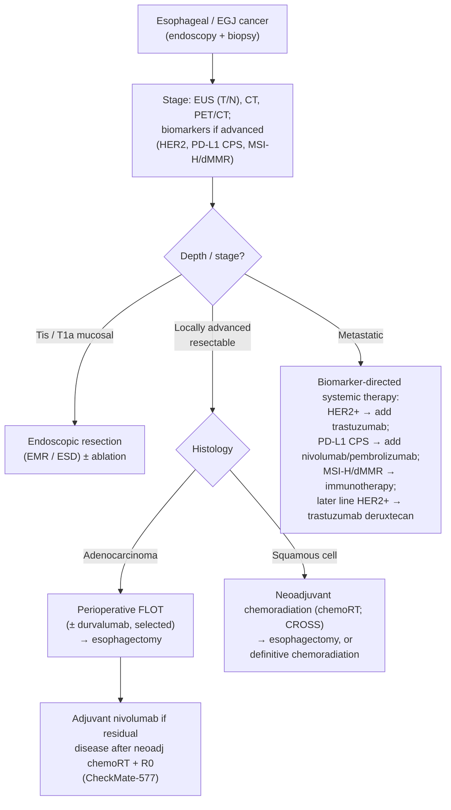

## Contents
- [[#Assessment]]
  - [[#Establishing the Diagnosis]]
  - [[#Severity Assessment (AJCC 8th ed. TNM staging)]]
    - [[#T1b Substaging and Nodal Risk]]
  - [[#Classification / Typing]]
- [[#Differential Diagnosis]]
- [[#Diagnostics]]
- [[#Therapeutics]]
  - [[#NCCN Treatment Algorithm]]
- [[#See Also]]
- [[#Sources]]

## Assessment

### Establishing the Diagnosis

- **Presentation:** progressive solid-food dysphagia, weight loss, odynophagia, [[iron-deficiency-anemia|iron-deficiency anemia]] — a classic alarm-feature presentation that mandates prompt [[upper-endoscopy|endoscopy]] with biopsy.
- Diagnosis is **histologic**; staging follows (see [[#Diagnostics]]).

### Severity Assessment (AJCC 8th ed. TNM staging)

Depth of invasion separates endoscopically curable disease (Tis/T1a mucosal) from disease requiring surgery or chemoradiation (T1b and deeper). Stage groups are **histology-specific** (separate tables for squamous cell carcinoma (SCC) and adenocarcinoma) and differ for clinical (cTNM), pathologic (pTNM), and post-neoadjuvant (ypTNM) staging; **grade (G)** and — for SCC — **tumor location** enter the pathologic stage groups ([[nccn-2026-esophageal-egj-cancer]], American Joint Committee on Cancer (AJCC) 8th ed. 2017).

| T — primary tumor | Definition |
|---|---|
| Tis | High-grade dysplasia — malignant cells confined to the epithelium by the basement membrane |
| T1 | Invades lamina propria, muscularis mucosae, or submucosa |
| T1a | Invades lamina propria or muscularis mucosae |
| T1b | Invades submucosa |
| T2 | Invades muscularis propria |
| T3 | Invades adventitia |
| T4a | Invades pleura, pericardium, azygos vein, diaphragm, or peritoneum |
| T4b | Invades other adjacent structures — aorta, vertebral body, or airway |

| N / M / G | Definition |
|---|---|
| N0 / N1 / N2 / N3 | No regional nodes / **1–2** nodes / **3–6** nodes / **≥7** nodes |
| M0 / M1 | No distant metastasis / distant metastasis |
| G1 / G2 / G3 | Well / moderately / poorly differentiated or undifferentiated |

**SCC location** (by epicenter of the tumor): **Upper** = cervical esophagus to lower border of the azygos vein; **Middle** = lower border of azygos vein to lower border of the inferior pulmonary vein; **Lower** = lower border of inferior pulmonary vein to the stomach, including the esophagogastric junction (EGJ).

**Clinical stage groups (cTNM) — the stage that drives the pretreatment decision.** Note the two histologies group differently at the same T/N (e.g. cT2N1: stage II for SCC, stage III for adenocarcinoma):

| Stage | Squamous cell carcinoma | Adenocarcinoma |
|---|---|---|
| 0 | Tis N0 | Tis N0 |
| I | T1 N0–1 | T1 N0 |
| IIA | — | T1 N1 |
| IIB | — | T2 N0 |
| II | T2 N0–1; T3 N0 | — |
| III | T3 N1; T1–3 N2 | T2 N1; T3 N0–1; T4a N0–1 |
| IVA | T4 N0–2; any T N3 | T1–4a N2; T4b N0–2; any T N3 |
| IVB | Any T, any N, **M1** | Any T, any N, **M1** |

*All rows are M0 except stage IVB. Pathologic (pTNM) and post-neoadjuvant (ypTNM) groupings differ from the above and additionally require **grade (G)** — and, for SCC, **tumor location** — to assign the stage.*

**How grade moves a pT1 tumor** ([[aga-2019-esd-t1b-esophageal-cancer|AGA 2019]], AJCC 8th ed.) — grade is the modifier that decides which stage a mucosal tumor lands in:

- **T1a G1 → stage IA**; **T1a G2–G3 → stage IB**; **all T1b → stage IB**, regardless of grade. **Not location-specific, even for SCC.**
- Differentiation is read off gland formation: **>95% well-formed glands = differentiated**, **<50% = poorly differentiated**. **GX** = differentiation cannot be assessed.

#### T1b Substaging and Nodal Risk

**T1b = submucosal invasion without muscularis propria involvement.** It splits by depth, and **the micrometer cut-point differs by histology** ([[aga-2019-esd-t1b-esophageal-cancer]]) — the single most error-prone number in early esophageal cancer:

| Stratum | SCC | Adenocarcinoma |
|---|---|---|
| **SM1** (superficial submucosa) | depth up to **200 µm** | depth up to **500 µm** |
| **SM2 / SM3** (deeper submucosa) | **>200 µm** | **>500 µm** |

**Lymph node metastasis (LNM) rate by depth and cell type** — the asymmetry drives management: at the same depth, **submucosal SCC metastasizes far more than submucosal adenocarcinoma** ([[aga-2019-esd-t1b-esophageal-cancer]], Table 2):

| Depth | SCC | Adenocarcinoma |
|---|---|---|
| **SM1** | **27%** | **6%** |
| **SM2** | **36%** | **23%** |
| **SM3** | **55%** | **58%** |

- Mucosal comparators (SCC): **M1** (epithelium) and **M2** (lamina propria) — negligible LNM; **M3** (muscularis mucosae) ≈ **10%**.
- Text ranges that sit beside the table: SCC **SM1 8%–26.5%**, SCC **SM2 up to 60%**. **The same document gives both 8%–26.5% and 27% for SM1 SCC** (different source series) — treat SM1 squamous as a meaningful, not a negligible, nodal risk.
- Adenocarcinoma, **well-differentiated and <2 cm: LNM 4.2%** (782 esophagectomies). Size matters steeply — **75% of T1b tumors >1.2 cm** had LNM in one T1 adenocarcinoma series.

**Predictors of higher LNM risk** ([[aga-2019-esd-t1b-esophageal-cancer]], Table 1):

| Factor | Higher-risk feature |
|---|---|
| Size | **>2 cm** |
| Morphology | **Paris 0-I** (protruded) or **0-III** (excavated) |
| Narrow-band imaging (NBI) | **type B3 intrapapillary capillary loop (IPCL)** pattern in SCC; **avascular area** |
| Histology | **poorly differentiated**; **lymphovascular invasion (LVI)** on the resected specimen |
| Depth | SCC **>200 µm**; adenocarcinoma **>500 µm** |
| Biologic markers | **E-cadherin**, **cyclin D1** (emerging) |

**Reading depth off the endoscopic picture** (SCC, where this is best studied — [[aga-2019-esd-t1b-esophageal-cancer]]):

- Features of invasion beyond SM1: **surface nodularity, granularity, deep depression, thick notch** (a very deep groove within a mass).
- **Paris morphology behaves opposite to the colon**: in SCC, **0-I protruding (79%) and 0-III excavated (84%)** carry the highest risk of deep submucosal invasion, whereas colonic 0-I protruding lesions are generally superficial. Subtype definitions and images: [[polypectomy#Paris Classification (type 0 superficial lesions)]].
- **Japan Esophageal Society NBI/IPCL classification:** type A = normal; **type B** = irregular, dilated, loop-forming; marked dilation, caliber increase or tortuosity within type B suggests **SM2**. Type B vessels predicted invasion depth with **90.5% accuracy** in early SCC. Needs magnifying endoscopy — limited US availability.
- **Lugol's chromoendoscopy** for SCC detection: normal squamous mucosa stains dark brown, neoplasia stays unstained ("voiding lesion"). **False positives over neosquamous tissue and in some well-differentiated SCCs** → still observe and biopsy. For margin definition in [[barretts-esophagus|Barrett's]], methylene blue or crystal violet highlights dysplastic pit patterns.
- **Micrometer depth reporting is harder to obtain in US centres** — agree it with the pathologist *before* starting endoscopic resection.

### Classification / Typing

Two dominant histologies drive distinct pathways ([[nccn-2026-esophageal-egj-cancer]]):

- **Adenocarcinoma** — distal esophagus/EGJ; arises through the metaplasia–dysplasia sequence from [[barretts-esophagus|Barrett's esophagus]]; risk factors [[gerd|gastroesophageal reflux disease (GERD)]], [[obesity]], male sex. See [[esophageal-adenocarcinoma]].
- **SCC** — more often mid/upper esophagus; risk factors smoking, alcohol, [[achalasia]], caustic injury, tylosis. SCC is more radiosensitive and more frequently managed with definitive chemoradiation.

EGJ tumors straddle the esophageal and gastric pathways and share systemic-therapy biomarkers. **Siewert type (I / II / III, by tumor epicenter relative to the EGJ) decides which guideline governs treatment** — types I and II are treated as esophageal/EGJ cancer, type III as gastric cancer; the cm-criteria table is on [[gastric-adenocarcinoma]].

## Differential Diagnosis

*Workup: see [[dysphagia]].*

[[gerd|Peptic stricture]] and other benign strictures, [[eosinophilic-esophagitis|eosinophilic esophagitis]], [[achalasia]] and other motility disorders, esophageal [[gastrointestinal-stromal-tumor|gastrointestinal stromal tumor (GIST)]] or other [[subepithelial-lesion|subepithelial lesions]], [[barretts-esophagus|Barrett's]] with dysplasia, and extrinsic compression.

## Diagnostics

- **[[upper-endoscopy|esophagogastroduodenoscopy (EGD)]] with biopsy** — establishes histology.
- **[[endoscopic-ultrasound|endoscopic ultrasound (EUS)]]** — T and N stage; enables fine-needle aspiration (FNA) of suspicious nodes. (For early [[barretts-esophagus|Barrett's]]-associated lesions, EUS is *not* used to separate T1a from T1b — resection histology is; see [[esophageal-adenocarcinoma]].)
  - In **SCC**, NBI with magnification was **more accurate than EUS** at separating tumors confined to superficial mucosa from those reaching muscularis mucosae or SM1 (174 patients, [[aga-2019-esd-t1b-esophageal-cancer]]).
- **Computed tomography (CT) chest/abdomen + positron emission tomography (PET)/CT** — distant spread. **In early-stage (T1) disease PET/CT does not appear to be needed** even though it is routinely part of esophageal-cancer staging: benign findings act as confounders and working them up delays therapy ([[aga-2019-esd-t1b-esophageal-cancer]]).
- **Biomarker testing on advanced/metastatic tumors** — HER2 (ERBB2), PD-L1 combined positive score (CPS), microsatellite instability-high (MSI-H)/mismatch repair deficient (dMMR). Positivity cutoffs ([[nccn-2026-esophageal-egj-cancer]]):
  - **HER2-positive** = **immunohistochemistry (IHC) 3+**, or **IHC 2+ with in situ hybridization (ISH)/fluorescence ISH (FISH)-positive**.
  - **PD-L1–positive** = **CPS ≥1**; **≥100 tumor cells** must be present for the stained slide to be adequate. Line-of-therapy CPS gates are in [[#Therapeutics]].

## Therapeutics

Stage-directed per [[nccn-2026-esophageal-egj-cancer]]:

- **Early (Tis/T1a, mucosal):** endoscopic resection ([[endoscopic-mucosal-resection|endoscopic mucosal resection (EMR)]] / [[endoscopic-submucosal-dissection|endoscopic submucosal dissection (ESD)]]) ± ablation — see [[endoscopic-eradication-therapy]]. **Which of EMR vs ESD turns on histology and lesion size** ([[asge-2023-esd]], all Conditional / low quality):

| Lesion | Recommendation |
|---|---|
| Squamous dysplasia / early esophageal squamous cell carcinoma (ESCC), well-differentiated, nonulcerated, no submucosal invasion, **>15 mm** | **ESD over EMR** |
| Same, **≤15 mm** | No recommendation either way — **either ESD or EMR** |
| Squamous dysplasia / early well-differentiated nonulcerated ESCC without submucosal invasion | **Against surgery**, whenever possible |
| Early esophageal adenocarcinoma (EAC; T1) or nodular [[barretts-esophagus\|Barrett's]] dysplasia, well-differentiated, nonulcerated, **>20 mm** | **ESD over EMR** |
| Same, **≤20 mm** | No recommendation either way — **either ESD or EMR** |

  Note the size thresholds differ by histology — **15 mm for squamous, 20 mm for adenocarcinoma** — and both are recommendations about *technique*, not about whether to resect endoscopically at all (that is set by depth; see [[esophageal-adenocarcinoma]]).
- **T1b (submucosal): esophagectomy remains the mainstay**, because nodal prevalence is not negligible ([[aga-2019-esd-t1b-esophageal-cancer]]). Endoscopic resection is reserved for submucosal cancers with **low metastatic potential**:
  - **Ideal candidate for endoscopic treatment alone — all four:** **well-differentiated**, **<2 cm**, invasion limited to **SM1**, **no LVI** on the resected specimen.
  - **What decides additional treatment after resection: tumor grade, LVI status, and depth** — the three factors with direct influence on metastatic potential. With submucosal invasion plus risk factors, **adjuvant chemotherapy and radiation may mitigate** metastatic potential.
  - **Stage with EUS, but do not trust it to exclude submucosal invasion** (accuracy for depth is limited — see [[#Diagnostics]]); ESD itself is a staging instrument, upstaging or downstaging on examination of the whole specimen.
  - Comparative data, all retrospective: **clinical T1bN0M0 SCC** (173 patients) — 3-/5-year survival **87.0%/77.7%** with radical esophagectomy vs **77.8%/68.6%** with definitive chemoradiation, recurrence **11.8%** vs **28.2%**. **Siewert type II adenocarcinoma** (79 patients, 19% T1b) — 5-year overall survival **93.9% ESD vs 97.3% surgery** (P = .376), adverse events 10.0% vs 17.9%. ESD data in adenocarcinoma is **sparse**.
  - **Endoscopic resection then chemoradiation**, for patients who decline or are unfit for surgery: 66 SCC patients (65% T1b) reached 3-/5-year survival **87%/75%**; ESD + chemoradiation beat chemoradiation alone on 3-year survival (**90% vs 63.2%**) and recurrence (**6.3% vs 29.0%**) in 47 patients. **ESD + radiofrequency ablation** cleared dysplasia in 26/27 (96%) and intestinal metaplasia in 23/27 (85%) in [[barretts-esophagus|Barrett's]] with high-grade dysplasia or adenocarcinoma, usually in **1–2 ablation sessions**.
  - ⚠ **[[aga-2021-post-esd-surveillance|AGA 2021]] is newer and stricter for squamous disease:** in SCC **no depth is curative once the muscularis mucosae is reached** — m3 or any submucosal invasion is noncurative. That is the position [[endoscopic-submucosal-dissection]] asserts; the permissive 2019 framing above is kept for the candidate profile and the nodal numbers.
- **Locally advanced resectable:** neoadjuvant/perioperative therapy then esophagectomy — perioperative **FLOT** (fluorouracil, leucovorin, oxaliplatin, and docetaxel) for adenocarcinoma or neoadjuvant **chemoradiation (CROSS-type)** followed by surgery. Adjuvant **nivolumab** is an option after neoadjuvant chemoradiation + R0 resection with residual disease (CheckMate-577). In v3.2026, adding **durvalumab to perioperative FLOT** is positioned for selected adenocarcinoma (clinically node-negative; PD-L1 CPS <1 as category 2B; diffuse-type EGJ as category 2B) per MATTERHORN — with no demonstrated survival advantage in diffuse-type disease.
- **Definitive chemoradiation:** for SCC and for patients who are not surgical candidates.
- **Metastatic:** biomarker-directed systemic therapy — first-line **trastuzumab** added to chemotherapy for HER2-overexpressing adenocarcinoma; immunotherapy for MSI-H/dMMR **independent of PD-L1 status**; **trastuzumab deruxtecan** (category 1) in later lines for HER2-positive disease.

  **PD-L1 CPS thresholds — the number and the *line of therapy* both matter:**

| Setting | Threshold | Strength |
|---|---|---|
| Add a checkpoint inhibitor to **first-line** chemotherapy (adenocarcinoma/EGJ **and** SCC) | **CPS ≥1** | Category 1 for SCC; for adenocarcinoma/EGJ, recommended at CPS ≥1 but **category 1 only at CPS ≥5** |
| **Second-line or subsequent** pembrolizumab monotherapy, **esophageal SCC only** | **CPS ≥10** | Category 1 |

  **CPS and tumor area positivity (TAP) score have high concordance and may be used interchangeably** (v3.2026 revision) — so a lab reporting TAP ≥1% satisfies the CPS ≥1 gate.

### NCCN Treatment Algorithm

*Algorithm — National Comprehensive Cancer Network (NCCN) esophageal/EGJ cancer management, recreated in original form (not an NCCN figure). ([[nccn-2026-esophageal-egj-cancer]])*

## See Also

[[esophageal-adenocarcinoma]], [[gastric-adenocarcinoma]], [[barretts-esophagus]], [[dysphagia]], [[gerd]], [[achalasia]], [[upper-endoscopy]], [[endoscopic-ultrasound]], [[endoscopic-eradication-therapy]], [[endoscopic-mucosal-resection]], [[endoscopic-submucosal-dissection]], [[subepithelial-lesion]], [[gastrointestinal-stromal-tumor]], [[iron-deficiency-anemia]], [[obesity]]

---

## Sources

1. [[nccn-2026-esophageal-egj-cancer|NCCN Clinical Practice Guidelines in Oncology: Esophageal and Esophagogastric Junction Cancers (Version 3.2026)]]
2. [[asge-2023-esd|ASGE Guideline: ESD for Early Esophageal and Gastric Cancer (2023)]]
3. [[aga-2019-esd-t1b-esophageal-cancer|AGA Clinical Practice Update on the Utility of Endoscopic Submucosal Dissection in T1b Esophageal Cancer: Expert Review (2019)]]
4. [[aga-2021-post-esd-surveillance|AGA Clinical Practice Update on Surveillance After Pathologically Curative Endoscopic Submucosal Dissection of Early Gastrointestinal Neoplasia in the United States: Commentary (2021)]]
