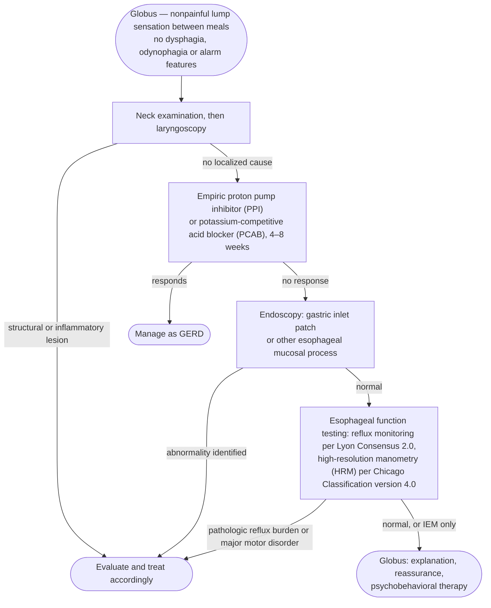

## Contents
- [[#Assessment]]
  - [[#Establishing the Diagnosis]]
  - [[#Epidemiology and Natural History]]
  - [[#Mechanism]]
- [[#Differential Diagnosis]]
- [[#Diagnostics]]
- [[#Therapeutics]]
- [[#See Also]]
- [[#Sources]]

---

## Assessment

### Establishing the Diagnosis

Globus is a **persistent or intermittent, nonpainful sensation of a lump or foreign body in the throat**, located in the midline between the thyroid cartilage and sternal notch, **unassociated with dysphagia or odynophagia**, and characteristically **improved by eating and swallowing**. It is an esophageal disorder of gut–brain interaction (E-DGBI) ([[disorders-of-gut-brain-interaction]]).

**Rome V criteria (A4)** ([[rome-v-2026-functional-esophageal-disorders]]):

> Must include **all** of the following:
> 1. **Persistent or intermittent, nonpainful, sensation of a lump or foreign body in the throat** with **no structural lesion identified on physical examination and laryngoscopy**
>    - a. **Occurrence of the sensation between meals**
>    - b. **Absence of dysphagia or odynophagia**
>    - c. **Absence of a gastric inlet patch in the proximal esophagus**
> 2. Absence of evidence that **[[gerd|gastroesophageal reflux disease (GERD)]]** (abnormal endoscopy ≥Los Angeles [LA] grade B esophagitis, or reflux burden by Lyon Consensus 2.0) **or nonreflux esophagitis** is the cause of the symptom
> 3. **Absence of disorders of esophagogastric junction (EGJ) obstruction and/or disorders of esophageal peristalsis** — [[achalasia]], conclusive [[esophagogastric-junction-outflow-obstruction|EGJ outflow obstruction (EGJOO)]], absent contractility, [[hypercontractile-esophagus|hypercontractile esophagus]], [[distal-esophageal-spasm|distal esophageal spasm]] — **except [[ineffective-esophageal-motility|ineffective esophageal motility (IEM)]]**, per [[chicago-classification-v4|Chicago Classification version 4.0]]
>
> Criteria fulfilled for the past 3 months, symptom onset ≥6 months before diagnosis, frequency **at least once a week**, following **optimized antisecretory therapy for at least 8 weeks**.

**Where the exclusion thresholds live:** the reflux-burden cut-offs behind criterion 2 (acid exposure time bands, reflux-episode counts, mean nocturnal baseline impedance, Lyon Consensus 2.0) are on [[ambulatory-reflux-monitoring]]; the manometric criteria for each exclusionary diagnosis in criterion 3 are on [[chicago-classification-v4]]. Across all five E-DGBIs, [[eosinophilic-esophagitis|eosinophilic esophagitis (EoE)]] must first be excluded by **histology (<15 eosinophils/high power field)** in the appropriate clinical context.

> [!pitfall] A gastric inlet patch rules out the diagnosis
> A disorder of gut–brain interaction requires the **absence of a mucosal abnormality**, so finding a proximal gastric inlet patch **precludes** the globus DGBI label ([[rome-v-2026-functional-esophageal-disorders]]). Rome V also **downgraded** the clinical impact of the inlet patch; Rome IV was more supportive of ablation.

- **Dysphagia or odynophagia is not globus.** Their presence, or any alarm feature (weight loss), redirects the workup — see [[dysphagia]].
- The sensation **occurring during meals** rather than between them also argues against the diagnosis.

### Epidemiology and Natural History

- **Common and benign, but chronic.** Up to **46%** of otherwise healthy individuals report the sensation at some point, peaking in middle age, **equally in both sexes** — though **women seek care more frequently**.
- Lifetime prevalence **21.5%** with peak onset at ages **35–54** (survey in China). Rome IV population study (United States, United Kingdom, Canada): **8.1%**. Rome Foundation global survey of >54,000 participants: **7.5%** reported something sticking in the throat more than twice weekly (highest rate in China, 18.9%).
- Feeling a lump between meals: **7.0%** — and **9.9% of those also reported dysphagia**, which excludes the diagnosis. Overall globus-sensation prevalence **0.8%**.
- **Persists in 75% of patients at 3 years and 50% at 7 years.** Accounts for about **4% of new ear, nose and throat referrals.**

### Mechanism

- **Visceral hypersensitivity is the key mechanism in idiopathic globus** — altered peripheral sensitivity or central processing amplifies normal sensory input. Balloon distention studies show symptoms at **lower thresholds** than controls despite similar motor responses, possibly with peripheral triggers and central viscerosomatic referral to the neck.
- Globus may also arise **in the presence of identifiable abnormalities** — GERD, esophageal motor disorders, gastric inlet patch — but in idiopathic cases neither a clear stimulus nor a mechanistic pathway is evident.
- **Upper esophageal sphincter (UES) pressure abnormalities have been inconsistently reported.** Some patients show elevated UES tone or exaggerated respiratory variation; these findings are not universal and can be influenced by emotional stress. Esophageal distention and impaired bolus transit may trigger reflex UES contraction via vagal pathways.
- **Psychological factors modulate, but are not required.** Anxiety and depression are reported at higher levels in some studies, with no significant difference from controls in others; **baseline psychopathology is not required for the diagnosis**, yet **up to 96% of patients report symptom worsening during strong emotional experiences**.

---

## Differential Diagnosis

*Workup: see [[dysphagia]].*

- **Structural lesion of the pharynx/larynx** — excluded by physical examination and laryngoscopy
- **Gastric inlet patch** — excluded at endoscopy; its presence precludes the DGBI diagnosis
- [[gerd|GERD]] — one of the identifiable causes to rule out; some patients respond to an empiric antisecretory trial, particularly when typical reflux symptoms coexist
- **EoE** and other nonreflux esophagitis / mucosal disease
- [[achalasia]] and other major motor disorders — **may rarely present as globus**; borderline motility such as IEM is unlikely to explain symptoms
- [[functional-dysphagia|Functional dysphagia]] — when the sensation is of food sticking rather than a lump between meals

---

## Diagnostics

*Evaluation pathway for suspected globus*
*Source: built from the Rome V globus Clinical Evaluation section and the globus branch of its Figure 1 global E-DGBI algorithm*
*[[rome-v-2026-functional-esophageal-disorders|Functional Esophageal Disorders (Rome V, 2026)]]*
*PPI = proton pump inhibitor · PCAB = potassium-competitive acid blocker · GERD = gastroesophageal reflux disease · HRM = high-resolution manometry · IEM = ineffective esophageal motility · E-DGBI = esophageal disorder of gut–brain interaction*

- **Neck examination then laryngoscopy is the advised initial evaluation** — before any endoscopy.
- **The endoscopic step for globus is laryngoscopy ± [[upper-endoscopy|upper endoscopy]], without routine biopsies** in Rome V's algorithm (biopsies are specified for dysphagia, and for chest pain occurring with eating); biopsy when the clinical context raises EoE.
- **[[high-resolution-manometry|HRM]] has no globus-specific pattern** — it serves only to exclude the major motor disorders; **there is limited data supporting a distinct motor pattern associated with globus.**
- Patients not responding to PPI and without an identifiable cause in the oropharynx, larynx and esophagus **are diagnosed with globus**.

---

## Therapeutics

Treatment follows a systematic order: rule out structural lesions → assess for GERD → psychobehavioral care.

- **Antisecretory therapy:** 8-week empiric PPI trial, particularly when typical reflux symptoms coexist. **Response rates are modest, and PPI therapy should be discontinued if ineffective.** PCABs have not been studied in this context.
- **[[antireflux-surgery|Antireflux surgery]] is not supported for globus alone.** In a trial of patients with proven GERD and atypical symptoms (including globus), both Nissen and Toupet fundoplication reduced reflux-symptom index scores — but more than half the cohort also had typical GERD symptoms and there was no control group, limiting interpretation.
- **Gastric inlet patch ablation** ([[argon-plasma-coagulation|argon plasma coagulation]] or [[radiofrequency-ablation|radiofrequency]]) has shown symptomatic benefit in **small, low-quality, non-definitive** studies.

> [!pearl] Behavioral care before drugs or procedures
> Given the benign course, **behavioral interventions with their low side-effect profile should be prioritized over medications or invasive procedures** ([[rome-v-2026-functional-esophageal-disorders]]).

- **Primary treatment once GERD and structural/motor abnormalities are excluded:** explanation, reassurance, and psychobehavioral approaches — **cognitive behavioral therapy (CBT)-based psychoeducation, speech therapy with pharyngolaryngeal relaxation exercises, and hypnosis** have shown symptom improvement in small studies ([[brain-gut-behavioral-therapy]]).
- **Neuromodulators — amitriptyline, paroxetine, and flupenthixol/melitracen combinations — demonstrated greater efficacy than PPIs** in randomized trials, supporting their use in selected patients. Rome V tabulates doses only for the two trials below; none is given for paroxetine or flupenthixol/melitracen in globus.

| Drug | Dose | n | Response | Side effects |
|---|---|---|---|---|
| Amitriptyline | 25 mg/day | 30 | Symptoms −75% | Mild |
| Gabapentin | 300 mg three times daily | 87 | Patients −66% | Mild |

*Randomized controlled trials of neuromodulators in globus*
*Source: redrawn from Table 2 of the Rome V functional esophageal disorders chapter (globus rows only; side effects graded none / mild / significant)*
*[[rome-v-2026-functional-esophageal-disorders|Functional Esophageal Disorders (Rome V, 2026)]]*

Response is reproduced as the chapter prints it — "Symptoms" = reduction in symptoms, "Patients" = reduction in patients; Rome V does not define the two metrics further.

---

## See Also

[[functional-heartburn]], [[reflux-hypersensitivity]], [[functional-chest-pain]], [[functional-dysphagia]], [[disorders-of-gut-brain-interaction]], [[dysphagia]], [[laryngopharyngeal-symptoms]], [[gerd]], [[upper-endoscopy]], [[high-resolution-manometry]], [[ambulatory-reflux-monitoring]], [[chicago-classification-v4]], [[achalasia]], [[esophagogastric-junction-outflow-obstruction]], [[ineffective-esophageal-motility]], [[hypercontractile-esophagus]], [[distal-esophageal-spasm]], [[eosinophilic-esophagitis]], [[antireflux-surgery]], [[brain-gut-behavioral-therapy]], [[proton-pump-inhibitors]], [[potassium-competitive-acid-blockers]]

---

## Sources

1. [[rome-v-2026-functional-esophageal-disorders|Functional Esophageal Disorders (Rome V, 2026)]]
