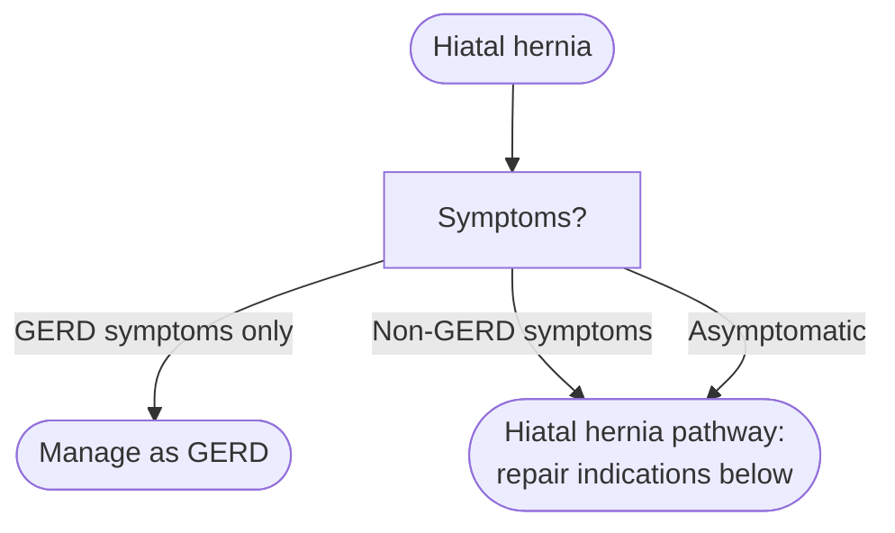
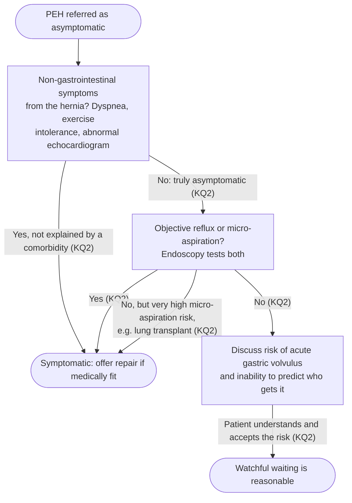

*Herniation of the stomach through the diaphragmatic hiatus. Two different problems: the **sliding (type I)** hernia is rarely repaired without [[gerd|gastroesophageal reflux disease (GERD)]] (exception: hernias found at bariatric operations) and is usually repaired as part of a GERD operation, where its size and the [[reflux-testing|Hill grade]] select the procedure; the **paraesophageal (types II–IV)** hernia is repaired for its own symptoms and complications.*

## Contents
- [[#Assessment]]
  - [[#Establishing the Diagnosis]]
  - [[#Severity Assessment]]
- [[#Differential Diagnosis]]
- [[#Diagnostics]]
- [[#Therapeutics]]
  - [[#The hernia selects the procedure]]
  - [[#When repair is indicated]]
  - [[#Paraesophageal (type II–IV) hernia — the surgical questions]]
  - [[#Gastric volvulus — the emergency]]
  - [[#What the guidelines deliberately do not say]]
- [[#See Also]]
- [[#Sources]]

---

## Assessment

### Establishing the Diagnosis

An anatomic diagnosis, made at endoscopy or imaging. **The four types are defined by what is herniated** ([[sages-2024-hiatal-hernia-surgery]]):

| Type | Gastroesophageal junction (GEJ) | What is above the hiatus | Share ([[sages-2013-hiatal-hernia]]) |
|---|---|---|---|
| **I** — *sliding* | **Above** the hiatus | The GEJ itself | **>95%** of all hiatal hernias |
| **II** | **Normal position** | The **gastric fundus** | Least common paraesophageal type |
| **III** | **Above** the hiatus | **Both** the stomach and the GEJ | **>90%** of paraesophageal hernias |
| **IV** | — | The stomach **plus any additional organ** | — |

*Hiatal hernia types I–IV*
*Source: definitions from Society of American Gastrointestinal and Endoscopic Surgeons (SAGES) 2024; distribution from SAGES 2013*
*[[sages-2024-hiatal-hernia-surgery|SAGES 2024 Hiatal Hernia Guideline]] · [[sages-2013-hiatal-hernia|SAGES 2013 Hiatal Hernia Guideline]]*
*GEJ = gastroesophageal junction · SAGES = Society of American Gastrointestinal and Endoscopic Surgeons*

- Types II–IV = **paraesophageal hernia (PEH)**. **"Giant PEH" has no consistent definition** — most mean **more than a third to a half of the stomach in the chest** ([[sages-2013-hiatal-hernia]]).
- Reflux in hiatal hernia: loss of the crural diaphragm's **"pinch" effect**; linked to [[barretts-esophagus|Barrett's esophagus]] and [[esophageal-adenocarcinoma|esophageal adenocarcinoma]] ([[sages-2024-hiatal-hernia-surgery]]).

> [!pitfall] A paraesophageal hernia does not present like reflux
> **Heartburn and regurgitation are uncommon with PEH.** Expect **postprandial chest fullness or shortness of breath** (pulmonary compression, reduced forced vital capacity), or **upper abdominal pain relieved by vomiting**. **[[iron-deficiency-anemia|Iron deficiency anemia]] in up to 50%**, from gastric mucosal ischemia and ulceration ([[sages-2013-hiatal-hernia]]).

**[[upper-endoscopy|Upper endoscopy]] — what to document at every GERD endoscopy** ([[asge-2024-gerd]], Strong / Very Low):
- **Hiatal hernia size**, against the GEJ landmarks: top of gastric folds, Z-line, diaphragmatic impression
- **Hill grade or American Foregut Society (AFS) grade**, in **forward view and retroflexion** — criteria for both scales live on [[reflux-testing]]
- Often skipped: hernia measured in only **51%** of reports, esophagitis graded in only 42% ([[asge-2024-gerd]])

> [!howto] Provoke the hernia before you measure it
> 1. **Insufflate ~30–45 s**, until the fundic rugal folds flatten.
> 2. **Retroflex; gently pull the tip along the lesser curvature** to induce sliding herniation.
> 3. Read the **hiatal aperture (cm)**; **real-time involution of the Z-line** shows the hernia.
> 4. Return to the **forward view** for **axial length**: Z-line to diaphragmatic indentation.
>
> Without these maneuvers the junction is often under-graded ([[afs-2022-egj-integrity-classification]]).

### Severity Assessment

**Size is measured in two dimensions; either one, or the flap valve, can rule out [[transoral-incisionless-fundoplication|transoral incisionless fundoplication (TIF)]].**

| Measure | How | Threshold that changes management |
|---|---|---|
| **Axial length** | Forward view, Z-line to diaphragmatic imprint ([[afs-2022-egj-integrity-classification]]) | **>2 cm** → not a TIF 2.0 candidate ([[afs-2023-transoral-incisionless-fundoplication]]) |
| **Hiatal aperture** (greatest transverse diameter of the hiatus) | Retroflexed, against the scope shaft — 1 conventional scope diameter ≈ 1 cm ([[afs-2022-egj-integrity-classification]]) | **>2 cm** → not a TIF 2.0 candidate ([[afs-2023-transoral-incisionless-fundoplication]]) |
| **Flap valve** — Hill grade | Retroflexed (and forward view, [[asge-2024-gerd]]) | **Hill III/IV** → concomitant TIF (cTIF) or laparoscopic antireflux surgery (LARS), not TIF alone ([[afs-2023-transoral-incisionless-fundoplication]]) |

*Hernia measurements that select an antireflux procedure*
*Source: built from the AFS 2022 classification and the AFS 2023 TIF selection rule*
*[[afs-2022-egj-integrity-classification|AFS 2022 EGJ Integrity Classification]] · [[afs-2023-transoral-incisionless-fundoplication|AFS 2023 TIF White Paper]]*
*TIF = transoral incisionless fundoplication · cTIF = concomitant TIF · LARS = laparoscopic antireflux surgery · AFS = American Foregut Society*

- **Endoscopy underestimates.** Size at laparoscopic repair is **often larger than it looked endoscopically** — extra caution even under 2 cm ([[afs-2023-transoral-incisionless-fundoplication]]).
- **The AFS grade (axial length, hiatal diameter, flap valve) is reporting nomenclature, not yet a selection criterion** — to be used for procedure choice only after validation in independent studies ([[afs-2023-transoral-incisionless-fundoplication]]).
- **No guideline names a hernia size at which repair becomes indicated** — see [[#What the guidelines deliberately do not say]].

---

## Differential Diagnosis

*Workup: the reflux-evaluation algorithm lives on [[reflux-testing]]; if dysphagia predominates, see [[dysphagia]].*

- **[[gerd|GERD]] without hernia** — reflux symptoms, GEJ in place
- **[[achalasia]]** — **3%** of patients having manometry before planned fundoplication had achalasia-spectrum disorders; fundoplication would have worsened the obstruction ([[acg-2020-esophageal-physiologic-testing]])
- **[[esophagogastric-junction-outflow-obstruction|Esophagogastric junction outflow obstruction (EGJOO)]]** — a PEH can cause *secondary* EGJOO by extraluminal compression, but an elevated integrated relaxation pressure (IRP) in a hiatal hernia is often artifact ([[bredenoord-2021-egjoo-technical-review]])
- **Prior fundoplication** — document an existing wrap at endoscopy ([[asge-2024-gerd]]); post-surgical assessment on [[hrm-antireflux-surgery]]

---

## Diagnostics

| Test | What it contributes | Source |
|---|---|---|
| **[[upper-endoscopy\|Esophagogastroduodenoscopy (EGD)]]** | Hernia size, Hill/AFS grade, GEJ landmarks; coexisting esophagitis, [[barretts-esophagus\|Barrett's]], peptic stricture | [[asge-2024-gerd]] |
| **Barium esophagram / contrast study** | Presence, size, type and reducibility; GEJ position relative to the hiatus; **raises suspicion of a short esophagus** before surgery | [[afs-2023-transoral-incisionless-fundoplication]], [[sages-2013-hiatal-hernia]] |
| **[[high-resolution-manometry\|High-resolution manometry (HRM)]]** | Before antireflux surgery or endoscopic therapy, to rule out [[achalasia]] and absent contractility (criteria: [[chicago-classification-v4\|Chicago Classification v4.0]]); also detects the hernia (below) | [[acg-2021-gerd]], [[acg-2020-esophageal-physiologic-testing]] |
| **[[ambulatory-reflux-monitoring\|pH monitoring off proton pump inhibitor (PPI)]]** | Confirms pathologic acid exposure before operating on a type I hernia — not needed when Los Angeles (LA) grade C/D esophagitis or long-segment Barrett's is already seen | [[sages-2013-hiatal-hernia]], [[afs-2023-transoral-incisionless-fundoplication]] |
| **Chest radiograph** | **Retrocardiac air–fluid level = pathognomonic for PEH** | [[sages-2013-hiatal-hernia]] |
| **Computed tomography (CT)** | Urgent setting — suspected complications of a volvulized PEH; which organs are herniated | [[sages-2013-hiatal-hernia]] |

*Tests in hiatal hernia and what each contributes*
*Source: built from American Society for Gastrointestinal Endoscopy (ASGE) 2025, American College of Gastroenterology (ACG) 2021, ACG 2020, AFS 2023 and SAGES 2013*
*[[asge-2024-gerd|ASGE GERD Guideline]] · [[acg-2021-gerd|ACG 2021 GERD]] · [[acg-2020-esophageal-physiologic-testing|ACG 2020 Physiologic Testing]] · [[afs-2023-transoral-incisionless-fundoplication|AFS 2023 TIF]] · [[sages-2013-hiatal-hernia|SAGES 2013]]*
*EGD = esophagogastroduodenoscopy · AFS = American Foregut Society · GEJ = gastroesophageal junction · HRM = high-resolution manometry · PPI = proton pump inhibitor · LA = Los Angeles · PEH = paraesophageal hernia · CT = computed tomography*

- **Order only investigations that will alter management** (Guideline 1, ⊕⊕⊕, strong — [[sages-2013-hiatal-hernia]]).
- **HRM before TIF — the sources differ:** ACG 2021 recommends HRM before any antireflux surgery or endoscopic therapy (key concept, [[acg-2021-gerd]]); AFS 2023 strongly advises it before TIF with dysphagia, but not routinely without ([[afs-2023-transoral-incisionless-fundoplication]]). Detail on [[transoral-incisionless-fundoplication]].
- **HRM complements endoscopy and barium for finding a hernia** (Key concept 10) — 94.3% sensitive, 91.5% specific against surgical measurement in one 100-patient study ([[acg-2020-esophageal-physiologic-testing]]).
- ⚠ **Avoid ionic water-soluble contrast** in PEH with acute [[gastric-outlet-obstruction|gastric outlet obstruction]] — aspiration pneumonitis risk ([[sages-2013-hiatal-hernia]]).
- **Manometry in PEH:** catheter placement across the lower esophageal sphincter and below the diaphragm can be difficult; a contrast swallow showing normal motility may substitute. In a **sliding hernia with reflux symptoms**, a motility study is critical to position the pH probe above the sphincter ([[sages-2013-hiatal-hernia]]).

> [!pitfall] Do not treat an elevated IRP in a hiatal hernia
> Catheter impingement in the hernia sac angulates a junction sensor and falsely raises the IRP. The junction in hernia is typically a *weakened* barrier, so the reading is often artifact — ignore it, and never treat it invasively; reposition the catheter if seen live ([[bredenoord-2021-egjoo-technical-review]]; [[high-resolution-manometry#Technical Artifacts That Fake an Elevated IRP]]).

---

## Therapeutics

### The hernia selects the procedure

A sliding hernia is repaired for its reflux: **when a type I hernia is repaired, a fundoplication must be performed** (Guideline 13, ⊕⊕, weak, [[sages-2013-hiatal-hernia]]). Full selection table on **[[antireflux-surgery]]**; TIF criteria and technique on **[[transoral-incisionless-fundoplication]]**.

- **A large hiatal hernia supports [[antireflux-surgery|antireflux surgery]]** by an experienced surgeon in patients with objective GERD — alongside LA grade C/D esophagitis and persistent troublesome symptoms (Strong / Moderate, [[acg-2021-gerd]]).
- **Confirmed GERD + hernia ≤2 cm + Hill I or II**, meeting TIF criteria (chronic GERD or PPI use ≥6 mo, refractory or regurgitation-predominant GERD, or wish to avoid long-term PPI) → TIF 2.0 evaluation (Conditional / Low, [[asge-2024-gerd]]).
- **Hernia >2 cm + Hill III or IV** → cTIF — laparoscopic hernia repair, then TIF in the same anesthetic — evaluated in multidisciplinary review (Conditional / Very Low, [[asge-2024-gerd]]); or LARS ([[afs-2023-transoral-incisionless-fundoplication]]).
- **cTIF target = 2–3 cm of intra-abdominal esophagus**, not a hernia-size cutoff; not obtainable → **do not perform the TIF** ([[afs-2023-transoral-incisionless-fundoplication]]).
- **PEH** → relative contraindication to TIF with the EsophyX device ([[afs-2023-transoral-incisionless-fundoplication]]).

### When repair is indicated

*Which pathway a hiatal hernia follows*
*Source: redrawn from SAGES 2013 Figure 1*
*[[sages-2013-hiatal-hernia|SAGES 2013 Hiatal Hernia Guideline]]*
*GERD = gastroesophageal reflux disease*

| Situation | Position ([[sages-2013-hiatal-hernia]]) | Grade |
|---|---|---|
| **Type I, no reflux disease** | **Repair not necessary** (Guideline 2) | ⊕⊕⊕, strong |
| **Symptomatic PEH** | **Repair all** — particularly with acute obstructive symptoms or after volvulus (Guideline 3) | ⊕⊕⊕⊕, strong |
| **Completely asymptomatic PEH** | **Routine elective repair may not always be indicated**; weigh age and comorbidities (Guideline 4). Current approach: SAGES 2024 flowchart [[#Paraesophageal (type II–IV) hernia — the surgical questions\|below]] | ⊕⊕⊕, weak |
| **Acute gastric volvulus** | **Reduce the stomach**, limited resection if needed (Guideline 5) | ⊕⊕⊕⊕, strong |
| **Hernia found during [[bariatric-surgery\|Roux-en-Y gastric bypass, sleeve gastrectomy or adjustable band]]** | **Repair all detected hiatal hernias** (Guideline 6) | ⊕⊕⊕, weak |

*Indications for hiatal hernia repair by situation*
*Source: SAGES 2013 Guidelines 2–6*
*[[sages-2013-hiatal-hernia|SAGES 2013 Hiatal Hernia Guideline]]*
*PEH = paraesophageal hernia*

**The numbers behind watchful waiting** ([[sages-2013-hiatal-hernia]]):
- Asymptomatic → symptomatic PEH **≈ 14% per year**; acute symptoms **requiring emergency surgery <2% per year**.
- **Emergency repair mortality 0–5.4%** in recent reports; average for emergency hiatal hernia surgery **~17%**.
- **Completely asymptomatic PEH:** decision modelling suggests repair be reserved for **gastric outlet obstruction symptoms, severe reflux or anemia, or possible strangulation**; at **age ≥65**, elective repair may **decrease** quality-adjusted life expectancy.
- **Only hernias with the fundus above the diaphragm (PEH) are at risk of obstruction.**

### Paraesophageal (type II–IV) hernia — the surgical questions

SAGES 2024 asked four key questions (KQ); certainty was low for all, and only one produced a graded recommendation ([[sages-2024-hiatal-hernia-surgery]]). It complements SAGES 2013.

**Asymptomatic PEH — repair or watch (KQ2, expert opinion; no literature on truly asymptomatic patients):**

*Asymptomatic paraesophageal hernia: repair or watchful waiting*
*Source: built from SAGES 2024 KQ2 expert opinion (the guideline has no flowchart)*
*[[sages-2024-hiatal-hernia-surgery|SAGES 2024 Hiatal Hernia Guideline]]*
*PEH = paraesophageal hernia · KQ = key question*

- **Pre-existing organo-axial rotation** is a concerning feature in the volvulus discussion.
- **Age alone must not disqualify** a patient from operation — decide on operative risk and the patient's values.

**Fundoplication with the repair (KQ3)** — patients **may benefit** from fundoplication vs none (**conditional, low certainty**):
- Favoring fundoplication: objective reflux relative risk (RR) **0.31** (**321 fewer per 1000**); recurrence RR 0.55; leak RR 0.33. Harm: late total dysphagia RR **2.94** (25 more per 1000). Benefit judged large, harm small.
- All comparative data used a **complete** wrap; **partial may be better for postoperative dysphagia** — indirect evidence from GERD patients without hiatal hernia.

**Mesh (KQ1) — no recommendation for or against**; a joint surgeon–patient decision. The panel considered recommending against routine mesh and declined (confidence intervals too wide). Only **late total dysphagia** reached significance (RR **0.49**, favoring mesh); **no mesh erosion** in 3 randomized controlled trials (RCTs), 270 patients. Supersedes SAGES 2013 Guideline 11 (mesh for **short-term** recurrence, ⊕⊕⊕, strong); 2013 Guideline 12 (ungraded) already found long-term data inadequate either way.

**Recurrence** in these data = **>2 cm in any direction, or symptomatic** ([[sages-2024-hiatal-hernia-surgery]]).

**Recurrent type II–IV hernia without obesity (KQ4, expert opinion):**
- **After a previous uncomplicated repair with fundoplication** → redo repair and fundoplication is appropriate.
- **Greater consideration for conversion to Roux-en-Y gastric bypass (RYGB)** with:
  - Diabetes mellitus
  - Severe esophageal dysmotility
  - Short esophagus
  - [[gastroparesis|Gastroparesis]]
  - Previous complicated repair with fundoplication, leaving poor-quality fundal tissue
  - **Multiple** recurrent failures by an expert
- **Multidisciplinary evaluation before RYGB.** See [[bariatric-surgery]].

### Gastric volvulus — the emergency

All from [[sages-2013-hiatal-hernia]]:
- **Organoaxial** rotation (long axis, GEJ to pylorus) is the most common; **mesenteroaxial** (short axis) less common. Secondary volvulus — the more common form — is associated with **PEH**, connective tissue disorders and anterior abdominal wall defects.
- **Borchardt triad = severe epigastric pain + unproductive retching + inability to pass a nasogastric tube** → total gastric obstruction. Acute intrathoracic volvulus: progressive chest pain, severe vomiting, epigastric distention.
- **EGD:** inability or difficulty reaching the duodenum with a large hiatal hernia is diagnostic of a volvulized PEH.
- **Decompress first** with a nasogastric tube, then chest radiograph and endoscopy; **excessive investigation delays treatment**. Gastric viability matters most at emergency surgery for incarceration. Treatment: [[#When repair is indicated|Guideline 5]].

### What the guidelines deliberately do not say

- **No hernia size at which repair becomes indicated.** SAGES 2024 offers repair after a patient–surgeon discussion of future complication and symptom risk that **weighs hernia size and the patient's condition** ([[sages-2024-hiatal-hernia-surgery]]). The only size figure in SAGES 2013 predicts **recurrence**, not indication: **hiatal surface area >5.6 cm²**, independent of height, weight and body mass index ([[sages-2013-hiatal-hernia]]).
- **No wrap-type rule for hernia repair.** SAGES 2024 says *that* a fundoplication helps, not *which* one. In adults SAGES 2021 leaves partial vs complete to patient values; its exclusion of large hiatal hernia applies to **children** ([[sages-2021-gerd-surgery]]; detail on [[antireflux-surgery]]).
- **No body mass index threshold for weight loss before repair.** Obesity raises both hernia development and recurrence ([[sages-2013-hiatal-hernia]]); SAGES 2024 calls the threshold a research question.
- **No way to predict who will develop gastric volvulus** — organo-axial rotation is the only feature named as concerning ([[sages-2024-hiatal-hernia-surgery]]).

---

## See Also

[[gerd]], [[antireflux-surgery]], [[transoral-incisionless-fundoplication]], [[reflux-testing]], [[upper-endoscopy]], [[high-resolution-manometry]], [[ambulatory-reflux-monitoring]], [[barretts-esophagus]], [[achalasia]], [[esophagogastric-junction-outflow-obstruction]], [[hrm-antireflux-surgery]], [[chicago-classification-v4]], [[dysphagia]], [[gastric-outlet-obstruction]], [[gastroparesis]], [[iron-deficiency-anemia]], [[bariatric-surgery]], [[esophageal-adenocarcinoma]], [[upper-gi-bleeding]]

---

## Sources

1. [[asge-2024-gerd|ASGE 2025: Diagnosis and Management of GERD]]
2. [[acg-2021-gerd|ACG 2021 Clinical Guideline: Diagnosis and Management of GERD]]
3. [[afs-2023-transoral-incisionless-fundoplication|American Foregut Society White Paper on Transoral Incisionless Fundoplication (2023)]]
4. [[acg-2020-esophageal-physiologic-testing|ACG 2020: Clinical Use of Esophageal Physiologic Testing]]
5. [[sages-2021-gerd-surgery|SAGES 2021 Guidelines for Surgical Treatment of Gastroesophageal Reflux (GERD)]]
6. [[sages-2024-hiatal-hernia-surgery|SAGES 2024: Guidelines for the Surgical Treatment of Hiatal Hernias]]
7. [[sages-2013-hiatal-hernia|SAGES 2013: Guidelines for the Management of Hiatal Hernia]]
8. [[afs-2022-egj-integrity-classification|The American Foregut Society White Paper on the Endoscopic Classification of Esophagogastric Junction Integrity (2022)]]
9. [[bredenoord-2021-egjoo-technical-review|Esophagogastric Junction Outflow Obstruction — Chicago Classification v4.0 Technical Review]]
