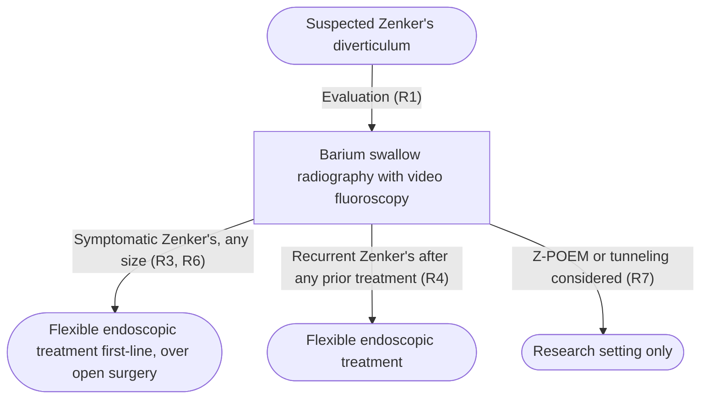

Pulsion diverticulum through the Killian triangle, between the thyropharyngeus and cricopharyngeal fibers of the inferior constrictor ([[esge-2020-gi-motility-part-2]]). Management follows the European Society of Gastrointestinal Endoscopy (ESGE) 2020 guideline; ESGE numbers none of its recommendations — R1–R11 below are the wiki's numbering, in document order.

## Contents
- [[#Assessment]]
  - [[#Establishing the Diagnosis]]
- [[#Differential Diagnosis]]
- [[#Diagnostics]]
- [[#Therapeutics]]
  - [[#Choice of Treatment]]
  - [[#Endoscopic Septotomy Technique]]
  - [[#Post-procedure Care]]
  - [[#Outcomes and Recurrence]]
- [[#See Also]]
- [[#Sources]]

## Assessment

### Establishing the Diagnosis

- Prevalence 0.01%–0.11% (American population); most often men in their 7th–8th decades ([[esge-2020-gi-motility-part-2]]).
- Symptoms: dysphagia, regurgitation ([[esge-2020-gi-motility-part-2]]).
- Diagnosis by barium swallow radiography with video fluoroscopy (R1, see [[#Diagnostics]]) ([[esge-2020-gi-motility-part-2]]).

## Differential Diagnosis

*Workup: see [[dysphagia]].*

- ESGE lists no specific differentials; in individual cases (e.g. a small Zenker's), esophageal [[high-resolution-manometry|manometry]] can rule out other causes of similar symptoms (R2 commentary) ([[esge-2020-gi-motility-part-2]]).
- Fluoroscopy helps decide whether the diverticulum is the real cause of the symptoms (R1 commentary) ([[esge-2020-gi-motility-part-2]]).

## Diagnostics

| R# | ESGE recommendation | Strength · evidence quality · agreement |
|---|---|---|
| R1 | **Recommends barium swallow radiography with video fluoroscopy** in the evaluation of patients with (suspected) Zenker's | Strong · very low · 100% |
| R2 | **Suggests against manometry as standard** in the diagnostic work-up | Weak · very low · 100% |

*ESGE 2020 diagnostic recommendations for Zenker's diverticulum ([[esge-2020-gi-motility-part-2]])*

- Suspected on symptoms, confirmed by barium swallow with video fluoroscopy; endoscopy can also diagnose it, but fluoroscopy is considered essential ([[esge-2020-gi-motility-part-2]]).
- Fluoroscopy gives **pouch size** plus "dynamic" information on **regurgitation and aspiration** ([[esge-2020-gi-motility-part-2]]).

## Therapeutics

### Choice of Treatment

- **Treatment is indicated for symptomatic Zenker's** ([[esge-2020-gi-motility-part-2]]).
- Three options; common step = **division of the cricopharyngeus muscle forming the septum** ([[esge-2020-gi-motility-part-2]]):
  - Open surgery — transcervical diverticulectomy, diverticulopexy with cricopharyngeal myotomy, or diverticular inversion
  - Rigid endoscopy — stapling or carbon dioxide (CO₂) laser
  - Flexible endoscopy (septotomy)

| R# | ESGE recommendation | Strength · evidence quality · agreement |
|---|---|---|
| R3 | **Suggests flexible endoscopic over open surgical treatment as first-line** for symptomatic Zenker's of **any size** | Weak · low · 100% |
| R4 | **Suggests flexible endoscopy for recurrent** Zenker's | Weak · low · 100% |
| R6 | Symptomatic Zenker's of **any size** is amenable to flexible endoscopic treatment; usefulness of a diverticuloscope uncertain for Zenker's **<2 cm** | Weak · very low · 100% |
| R7 | **Recommends** that emerging treatments such as **Zenker's peroral endoscopic myotomy (Z-POEM)** and tunneling be considered **experimental — research setting only** | Strong · low · 100% |

*ESGE 2020 treatment-choice recommendations for Zenker's diverticulum ([[esge-2020-gi-motility-part-2]])*

*Diagnosis and treatment choice in Zenker's diverticulum*
*Source: built from ESGE 2020 recommendations R1, R3, R4, R6 and R7 (wiki numbering; the guideline has no flowchart)*
*[[esge-2020-gi-motility-part-2|ESGE 2020 GI Motility Disorders Part 2]]*
*Z-POEM = Zenker's peroral endoscopic myotomy*

- Why flexible first: surgery and rigid endoscopy need general anesthesia and are often abandoned for restricted neck mobility in the elderly; surgery has seemingly higher complications with comparable success ([[esge-2020-gi-motility-part-2]]).
- Rigid endoscopy technical failure 6%–7% (not always possible in the elderly) ([[esge-2020-gi-motility-part-2]]).
- Size: published series mean 20–50 mm; possible optimal efficacy for 30–50 mm; **no minimum size** for symptomatic diverticula ([[esge-2020-gi-motility-part-2]]).
- Z-POEM evidence: mostly case reports/series, no long-term follow-up, publication bias; 75 patients, 10 centers — technical success 97%, complications 6.7%, clinical success 92% ([[esge-2020-gi-motility-part-2]]); [[poem|peroral endoscopic myotomy (POEM)]] for other indications.

### Endoscopic Septotomy Technique

| R# | ESGE recommendation | Strength · evidence quality · agreement |
|---|---|---|
| R5 | Whether to use a **diverticuloscope** is left to the **endoscopist's discretion** | Weak · low · 100% |
| R8 | **Recommends routine CO₂** in endoscopic treatment of Zenker's | Strong · very low · 100% |
| R9 | **Does not recommend routine prophylactic antibiotics** before or after endoscopic septotomy | Strong · low · 92.9% |
| R10 | **Recommends a complete myotomy of the cricopharyngeus muscle** at endoscopic septotomy | Strong · low · 93.8% |
| R11 | **Clips at the septotomy base** — dictated by endoscopist practice or clinical need (**bleeding or suspected perforation**) | Weak · low · 100% |

*ESGE 2020 septotomy technique recommendations ([[esge-2020-gi-motility-part-2]])*

- **Incision patterns** ([[esge-2020-gi-motility-part-2]]):
  - Single incision — midline incision of the cricopharyngeus; option to clip the base.
  - Double incision — two incisions 1 cm apart; septum between resected with a snare; base then clipped.
- **CO₂ (R8):** extrapolated from POEM for [[achalasia]] (less subcutaneous emphysema). After cricopharyngeal division only the buccopharyngeal fascia separates the field from the superior mediastinum; CO₂ reabsorbs faster than room air (less pneumomediastinum, subcutaneous emphysema) ([[esge-2020-gi-motility-part-2]]).
- **Antibiotics (R9):** meta-regression — no reduction in complications ([[esge-2020-gi-motility-part-2]]); general rules: [[antibiotic-prophylaxis-endoscopy]].
- **Clips (R11):** meta-regression (six studies with clips) — no impact on adverse events such as perforation ([[esge-2020-gi-motility-part-2]]).
- **Diverticuloscope (R5):** one retrospective series favored diverticuloscope over cap; meta-analysis — no impact on success or complications ([[esge-2020-gi-motility-part-2]]).

> [!pitfall] Cut the whole cricopharyngeus
> Full transection is advocated by all experts to prevent recurrence; direct evidence is lacking and the value of cutting deeper is controversial (R10) ([[esge-2020-gi-motility-part-2]]).

**Knives (ungraded)** ([[esge-2020-gi-motility-part-2]]):

| Knife | Features | Reported outcomes |
|---|---|---|
| Needle-knife | Cheap, available | Downward cutting linked with complications |
| HookKnife | Bent tip (hook 1.3 mm, arm 4.5 mm); hooks fibers upward before cutting — theoretically lowers perforation | Success 90.6%, complications 6.3%; another series success 91.7%, complications 8.4%, recurrence 12.5% |
| Stag Beetle knife Junior (SB knife Jr.) | Insulated scissor-type; cuts apex to base, pulling fibers toward the scope; 360° rotation | Median procedure 14 minutes, 83.9% remission at median 7 months (n = 31); recurrence 9.6% over 6 months, no perforation or mediastinitis (n = 52) |

- [[electrosurgery|Electrosurgical]] settings: obtain from the generator manufacturer ([[esge-2020-gi-motility-part-2]]).

### Post-procedure Care

- ESGE makes no graded recommendation on post-procedure care; practice described ([[esge-2020-gi-motility-part-2]]):
  - Monitor carefully for complications.
  - Nil per os for **24 hours** routinely; many series allowed **liquid diet the next day** if the course was unremarkable.
  - **No evidence that a contrast study is a prerequisite** to resume oral intake **unless perforation is suspected**; perforation management: [[endoscopic-management-of-perforation]].

### Outcomes and Recurrence

| Approach | Clinical success | Complications | Recurrence |
|---|---|---|---|
| Endoscopic (meta-analyses of 3079 and 596 patients; mostly rigid-endoscope laser/stapler by ear, nose and throat (ENT) surgeons) | 82%–87% | 7%–9% | — |
| Open surgery (same meta-analyses) | 94%–96% | 11%–15% | — |
| Flexible septotomy (meta-analysis, 813 patients) | 91% (pooled) | 11.3% | 11% |

*Pooled outcomes of Zenker's treatment cited by ESGE 2020 ([[esge-2020-gi-motility-part-2]])*

- No prospective comparison of flexible endoscopy with surgery; retrospective series (36 septotomy vs 31 diverticulectomy + myotomy): dysphagia recurrence at 2 months 39% vs 0% (P = 0.001); complications 13% vs 31% (P = 0.08) ([[esge-2020-gi-motility-part-2]]).
- **Predictors of symptom relapse within 48 months** of endoscopic therapy ([[esge-2020-gi-motility-part-2]]):
  - Pretreatment size **≥50 mm**
  - Post-treatment size **≥10 mm**
  - Septotomy length **≤25 mm**
- Same study, as cited in the myotomy section: failure at 6 months if septotomy <2.5 cm or pretreatment pouch >5 cm; at 48 months if septotomy <2.5 cm or post-procedure size >10 cm. ESGE prints the post-treatment size as ≥10 mm in its recurrence section and >10 cm here; septotomy-length measurement in that study is debated (pouch size assumed equal to septum length) ([[esge-2020-gi-motility-part-2]]).
- **Treating recurrence** ([[esge-2020-gi-motility-part-2]]):
  - Flexible septotomy, treatment-naïve (n = 34) vs recurrent (n = 25): success 84% vs 82%, recurrence 24% vs 15%, complications 8% vs 8.8% — performs equally well in recurrent disease.
  - Needle-knife + diverticuloscope series (n = 134): recurrence 23.1%; 78.3% of the 23 retreated achieved remission after redo myotomy.
  - Rigid stapler (two series, 20 and 18 patients): short-term remission 81%–90%, complications 20%–28%, recurrence 5%.

---

## See Also

[[dysphagia]], [[poem]], [[achalasia]], [[high-resolution-manometry]], [[antibiotic-prophylaxis-endoscopy]], [[electrosurgery]], [[endoscopic-management-of-perforation]]

---

## Sources

1. [[esge-2020-gi-motility-part-2|Endoscopic management of gastrointestinal motility disorders – part 2: European Society of Gastrointestinal Endoscopy (ESGE) Guideline (2020)]]
