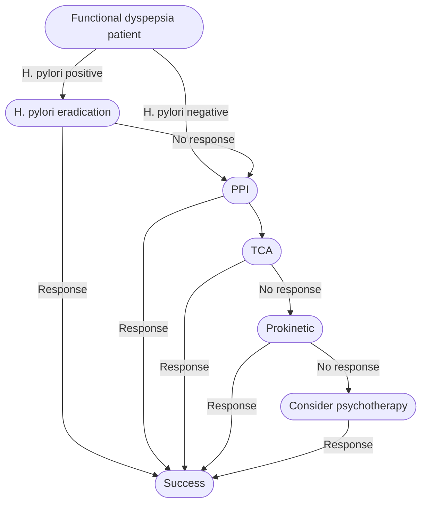

## Contents
- [[#Assessment]]
  - [[#Establishing the Diagnosis]]
  - [[#Severity Assessment]]
  - [[#Classification / Typing]]
- [[#Differential Diagnosis]]
- [[#Diagnostics]]
  - [[#Upper Endoscopy and Biopsy]]
  - [[#Motility and Accommodation Testing]]
- [[#Therapeutics]]
  - [[#The Sequential Ladder]]
  - [[#Step Detail and Stopping Rules]]
  - [[#Gut-Brain Neuromodulators]]
  - [[#Brain-Gut Psychotherapies]]
  - [[#Complementary and Alternative Medicine]]
  - [[#Where Rome V Differs]]
- [[#See Also]]
- [[#Sources]]

---

## Assessment

### Establishing the Diagnosis

Functional dyspepsia (FD) = dyspeptic symptoms (postprandial fullness, early satiation, epigastric pain, epigastric burning) **with no structural, systemic or metabolic disease to explain them** — a [[disorders-of-gut-brain-interaction|disorder of gut–brain interaction (DGBI)]], Rome V code **B1** ([[rome-v-2026-dgbi]]), and the endpoint of the dyspepsia workup.

- **Post-endoscopy definition:** dyspepsia with no pathology on [[upper-endoscopy|esophagogastroduodenoscopy (EGD)]] = FD ([[acg-cag-2017-dyspepsia]]).
- **EGD is not required for the label:** FD can also be diagnosed from clinical symptoms and history ([[acg-cag-2017-dyspepsia]]). Rome V: research diagnosis strictly requires a normal EGD; in practice it is not compulsory without risk or alarm features ([[rome-v-2026-gastroduodenal-disorders]]). Who needs EGD first (age, alarm features) → the dyspepsia workup (see [[#Differential Diagnosis]]).
- ***Helicobacter pylori* status should be determined in every patient with dyspeptic symptoms** ([[rome-v-2026-gastroduodenal-disorders]]). FD is an indication to test and treat [[helicobacter-pylori-infection|*H. pylori*]] (tests and regimens on that page); discuss the benefits and risks of antibiotics with the patient **before** testing ([[acg-2024-hp-treatment]]).
- ***H. pylori*-associated dyspepsia:** symptom remission lasting **≥6 months** after eradication → dyspepsia attributed to the infection, not FD ([[rome-v-2026-gastroduodenal-disorders]]).
- **No alarm features → stop unnecessary drugs and supplements** that could cause dyspepsia **before** further testing ([[rome-v-2026-gastroduodenal-disorders]]).
- **Not routine** ([[rome-v-2026-gastroduodenal-disorders]]): laboratory tests incl. [[celiac-disease|celiac]] serology (low yield) · imaging (consider case by case for abnormal examination findings or treatment failure) · duodenal biopsy (no international consensus recommends it). Motility testing → [[#Motility and Accommodation Testing]].

**Rome V criteria — functional dyspepsia (B1)** ([[rome-v-2026-gastroduodenal-disorders]]), fulfilled for the last 3 months with onset ≥6 months before diagnosis:

> 1. **One or more** of: bothersome postprandial fullness · bothersome early satiation · bothersome epigastric pain · bothersome epigastric burning
> 2. **No evidence of structural, systemic, or metabolic disease** likely to explain the symptoms
>
> **Must also fulfill criteria for postprandial distress syndrome (PDS) or epigastric pain syndrome (EPS), or both** — see Classification / Typing below.

**Clinic vs research threshold.** Rome V's **Rome Clinical Criteria** keep the qualitative features and require symptoms **bothersome** enough to seek care or interfere with daily activity and quality of life, but permit a **lower frequency** than the research criteria and replace the 6-month duration with a suggested **8 weeks** — aimed at the ~one-quarter of people with gastrointestinal (GI) symptoms below Rome thresholds, who still have poorer quality of life ([[rome-v-2026-dgbi]]).

### Severity Assessment

- No FD-specific severity score or stage. Operative qualifier = symptoms **bothersome** (Rome V).
- American College of Gastroenterology/Canadian Association of Gastroenterology (ACG/CAG) 2017 escalates on **failure of the previous step**, not on severity ([[#The Sequential Ladder]]).
- Rome V's mild / moderate / severe treatment-intensity profile is written for [[irritable-bowel-syndrome|irritable bowel syndrome (IBS)]] and "may apply to other DGBI" ([[rome-v-2026-dgbi]]).

### Classification / Typing

**Rome V prefers the subtype label over the umbrella term** — report PDS or EPS, or both, guided by the symptom profile ([[rome-v-2026-gastroduodenal-disorders]]).

| Rome V code | Subtype | Criteria |
|---|---|---|
| **B1a** | PDS | **One or both at least 2 days/week:** bothersome postprandial fullness (severe enough to impact usual activities) · bothersome early satiation (severe enough to prevent finishing a regular-sized meal). **Other bothersome symptoms elicited or worsened by food — postprandial epigastric pain or burning, nausea, upper abdominal bloating, excessive belching — are part of PDS** when 1a or 1b is present |
| **B1b** | EPS | **One or both at least 1 day/week:** bothersome epigastric pain · bothersome epigastric burning, each severe enough to affect usual activities. Either may be **induced or worsened postprandially or occur independently of meals**, but **PDS criteria must not be fulfilled** |

- **"Postprandial" = within 2 hours of the meal**; later onset suggests a different pathophysiology. **"Epigastric" = the central abdomen above the navel** ([[rome-v-2026-gastroduodenal-disorders]]).
- **⚠ Changed from Rome IV: postprandial epigastric pain with PDS symptoms now counts as PDS, not EPS.** Rome IV let it sit in EPS, creating heavy overlap. Postprandial fullness *plus* postprandial epigastric pain = PDS.
- **Provisional EPS split** (research-grade, only without PDS): **postprandial EPS** = pain/burning starts or worsens after meals **≥50%** of the time; **meal-unrelated EPS** = **<50%**.

> [!pitfall] Don't pick the drug off the subtype
> ACG/CAG 2017 advises against using FD symptom type to choose treatment: no evidence EPS responds better than PDS to a [[proton-pump-inhibitors|proton pump inhibitor (PPI)]]; only heartburn-predominant patients respond better ([[acg-cag-2017-dyspepsia]]). Rome V's subtype-specific suggestions → [[#Where Rome V Differs]].

---

## Differential Diagnosis

*Workup: see [[dyspepsia]].*

- **Predominant nausea or persisting vomiting** — excludes both PDS and EPS → chronic nausea vomiting syndrome ([[nausea-and-vomiting]]) or [[gastroparesis]] ([[rome-v-2026-gastroduodenal-disorders]]).
- **Gastroparesis** — overlaps with FD; the two likely form one spectrum of gastric sensorimotor disorders ([[acg-cag-2017-dyspepsia]]). Distinction matters: **FD has the better prognosis** ([[acg-2022-gastroparesis]]). Testing → [[#Motility and Accommodation Testing]].
- [[peptic-ulcer-disease]] · esophagitis ([[gerd|gastroesophageal reflux disease (GERD)]]) — organic findings at EGD, managed per their own guidelines ([[acg-cag-2017-dyspepsia]]).
- **Heartburn** — not a gastroduodenal symptom but often coexists; EPS pain must be epigastric so heartburn is not misclassified → GERD, [[functional-heartburn]] ([[rome-v-2026-gastroduodenal-disorders]]).
- **Epigastric pain or burning consistently relieved by bowel movements** → a bowel disorder, e.g. IBS ([[rome-v-2026-gastroduodenal-disorders]]).
- **Pain suggesting a pancreatic or biliary source** (e.g. radiating to the back) → ultrasound or computed tomography, outside the dyspepsia pathway ([[acg-cag-2017-dyspepsia]]).

---

## Diagnostics

### Upper Endoscopy and Biopsy

- A normal EGD defines FD. **At a normal EGD, take gastric biopsies for *H. pylori* if non-invasive testing has not been done** ([[acg-cag-2017-dyspepsia]]).

### Motility and Accommodation Testing

- **Statement 13 — against routine motility studies in FD** (conditional, very low quality): gastric-emptying delay is **not accurately related to symptoms**, and accommodation tests are unavailable or invasive ([[acg-cag-2017-dyspepsia]]).
- **Statement 14 — test selectively** (conditional, very low quality): **4-hour solid-phase gastric-emptying scan** in FD with **predominant severe nausea and vomiting that fails empiric therapy**. **Daily or intractable vomiting → investigate for gastroparesis, not FD.**
- What emptying studies show in FD ([[acg-cag-2017-dyspepsia]]):
  - **70%–80% have normal gastric emptying.**
  - Delay in up to **30%**, usually **mild — 10%–20% retained at 4 hours**; **21%** of Rome II FD patients in a large multicenter 4-hour solid-phase study read at one center.
  - **No randomized data** on how management should change once a marked delay is found.
- **Impaired gastric accommodation in up to 40%**, but measurable accurately only by **gastric barostat** or **single-photon emission computed tomography** — neither readily available; barostat is expensive, invasive and uncomfortable ([[acg-cag-2017-dyspepsia]]).
- **The FD/gastroparesis label is unstable:** despite generally unaltered symptoms, **42%** first diagnosed with gastroparesis and **37%** with FD were reclassified on repeat scintigraphy ([[acg-2022-gastroparesis]]).

---

## Therapeutics

### The Sequential Ladder

ACG/CAG 2017 treats FD in sequence, escalating on non-response: *H. pylori* eradication if infected → PPI → tricyclic antidepressant (TCA) → prokinetic → psychological therapy ([[acg-cag-2017-dyspepsia]]).

*Treatment of functional dyspepsia*
*Source: redrawn from the ACG/CAG 2017 functional dyspepsia treatment algorithm (Figure 2)*
*[[acg-cag-2017-dyspepsia|ACG/CAG 2017 Dyspepsia Guideline]]*
*H. pylori = Helicobacter pylori · PPI = proton pump inhibitor · TCA = tricyclic antidepressant*

| # | ACG/CAG 2017 statement for FD | Grade as printed |
|---|---|---|
| 7 | *H. pylori*-positive FD → prescribe therapy to treat the infection | Strong, high quality |
| 8 | *H. pylori*-negative, or still symptomatic despite eradication → **PPI therapy** | Strong, moderate quality |
| 9 | Not responding to PPI or eradication (if appropriate) → **TCA** | Conditional, moderate quality |
| 10 | Not responding to PPI, eradication or TCA → **prokinetic** | Conditional, very low quality |
| 11 | Not responding to drug therapy → **psychological therapies** | Conditional, very low quality |
| 12 | **Against routine** complementary and alternative medicine (CAM) for FD | Conditional, very low quality |
| 13 | **Against routine** motility studies | Conditional, very low quality |
| 14 | Motility studies in **selected** FD where gastroparesis is strongly suspected | Conditional, very low quality |

> [!pearl] In FD, TCA comes before prokinetic
> ACG/CAG 2017 puts TCA ahead of prokinetic in FD on the superior evidence for TCA; in uninvestigated dyspepsia it states no preference between them (Statements 5–6) ([[acg-cag-2017-dyspepsia]]).

### Step Detail and Stopping Rules

| Step | Effect size | Dosing and stopping rule |
|---|---|---|
| ***H. pylori* eradication** (22 randomized controlled trials [RCTs], 4,896 patients) | Relative risk (RR) of dyspepsia remaining **0.91 (95% confidence interval [CI] 0.88–0.94)**, **number needed to treat (NNT) 12.5 (10–20)** ([[acg-cag-2017-dyspepsia]]). Meta-analysis cited by ACG 2024 (29 RCTs, 6,781; eradication vs PPI, prokinetic or placebo): symptom cure **NNT 14 (11–21)**, improvement **NNT 9 (7–17)** — "only modest benefit" ([[acg-2024-hp-treatment]]) | Strong despite the modest effect — cost-effective, usually mild adverse events, may reduce future gastric cancer and ulcer risk |
| **PPI** (15 RCTs, 5,853 patients) | RR **0.87 (0.82–0.94)**, **NNT 10 (7–20)** | **Standard dose once daily; stop at 8 weeks if no response.** Doubling the dose adds nothing; low- and standard-dose arms did not differ |
| **TCA** (3 trials, 339 patients) | RR **0.74 (0.61–0.91)**, **NNT 6 (6–18)** | Conditional: effect-size uncertainty, adverse events (constipation, dry mouth, urinary retention, somnolence), reluctance to take an antidepressant. Dosing → [[#Gut-Brain Neuromodulators]] |
| **Prokinetic** (26 trials, 8,788 patients) | RR **0.92 (0.88–0.97)**, **NNT 12.5 (8–25)** | Quality very low for **publication bias** (small positive trials driving the result, Egger *P* = 0.004) plus unexplained heterogeneity |
| **Psychological therapy** (12 RCTs, 1,563 patients; 4 with a dichotomous outcome, 789 patients) | RR **0.53 (0.44–0.65)**, **NNT 3 (3–4)** | Very low quality despite the large effect — blinding impossible, subjective outcome, heterogeneous interventions; also costly and demanding of patient time |

*All rows [[acg-cag-2017-dyspepsia]] unless marked.*

- **Head-to-head:** PPI vs histamine-2 receptor antagonist (H2RA) (2 RCTs, 740 patients) — no significant difference (RR 1.27, 0.83–1.94), too few data to call H2RA non-inferior. **PPI beats prokinetic** (4 RCTs, 892 patients; RR 0.90, 0.81–1.00, *P* = 0.04).
- **Prokinetic availability:** none of the eligible prokinetics is available in the US, Canada or Europe; **no trials of metoclopramide in FD**. Domperidone (7 trials, 263 patients, synthesized although excluded a priori; available in Canada, not the US): RR **0.71 (0.53–0.97)**, **NNT 3 (2–8)**, very low quality.
- **Prokinetic harms:** metoclopramide — dystonia, parkinsonism-type movements, tardive dyskinesia; domperidone — QT prolongation, possible serious arrhythmia in pre-existing cardiac disease. Lowest effective dose — **metoclopramide <12 weeks**, **domperidone ≤30 mg daily** (stated under uninvestigated dyspepsia, Statements 5–6).
- **Long-term PPI:** stop if no longer helping; attempt withdrawal **every 6–12 months**.

### Gut-Brain Neuromodulators

The [[aga-2021-chronic-gi-pain-dgbi|American Gastroenterological Association (AGA) 2021]] update covers FD pain that **persists after therapy directed at visceral stimuli has failed**. Starting doses and titration for the class → [[disorders-of-gut-brain-interaction]].

- **TCAs ranked second for FD** in a network meta-analysis of RCTs — **ahead of PPIs** — although all 3 TCA trials recruited patients **already refractory to PPIs** ([[aga-2021-chronic-gi-pain-dgbi]]).
- **Selective serotonin reuptake inhibitors (SSRIs) do not work in FD:** 2 trials, 388 patients, RR **1.01 (0.89–1.15)** ([[acg-cag-2017-dyspepsia]]); no better than placebo in the AGA network meta-analysis. They act solely on 5-hydroxytryptamine (5-HT) receptors and have the least analgesic effect; TCAs, serotonin-norepinephrine reuptake inhibitors (SNRIs) and mirtazapine have norepinephric effects and greater effects on pain.
- **SNRIs not established in FD** — 1 venlafaxine trial, no benefit.
- **Mirtazapine** — 1 small FD trial; greater effect on **early satiety than on epigastric pain**.
- **Peripherally acting drugs:** mostly studied in IBS, but **tegaserod and [[rifaximin]] efficacious in RCTs in FD**.
- **Avoid opioids** in painful DGBI; low-dose naltrexone may have analgesic effects without GI side effects.

### Brain-Gut Psychotherapies

> [!pearl] Raise psychotherapy at the first visit
> Introduce brain–gut psychotherapy at the outset of care, not as a last resort — uptake is better and it is not read as a punishment for not improving ([[aga-2021-chronic-gi-pain-dgbi]]).

- Evidence in FD: **cognitive behavior therapy (CBT) efficacious in 3 RCTs**; **gut-directed hypnotherapy efficacious in 4 RCTs**; **no FD data for mindfulness-based stress reduction** ([[aga-2021-chronic-gi-pain-dgbi]]).
- CBT is brief (**4–12 sessions**); hypnotherapy deliverable in groups, online, and by non–mental health professionals. Leave the choice of psychotherapy to the mental health provider.

### Complementary and Alternative Medicine

- **Statement 12 is a non-recommendation about routine use, not a finding of no effect** — evidence insufficient to determine benefit or risk; CAM may suit an individual patient who understands that ([[acg-cag-2017-dyspepsia]]).
- **STW 5** (herbal preparation), 315 patients, 8 weeks: Gastrointestinal Symptom Score improved **6.9 ± 4.8 vs 5.9 ± 4.3 (*P* = 0.04)** — marginal, of unclear clinical meaning. Chinese herbal medicine (13 trials, 1,153 patients) and acupuncture (7 studies, 542 patients): quality too poor to conclude.

### Where Rome V Differs

Rome V (international consensus) proposes separate PDS and EPS treatment algorithms (Figures 3–4) that depart from the US ladder; **the ACG/CAG 2017 order governs** ([[rome-v-2026-gastroduodenal-disorders]]).

| Decision | ACG/CAG 2017 (governs) | Rome V 2026 |
|---|---|---|
| First drug | PPI (Statement 8) | After dietary and lifestyle advice: **PDS** — short-term standard-dose PPI, a first-line prokinetic (itopride, cinitapride, acotiamide, by availability) or herbal medicine; **EPS** — PPI or herbal medicine |
| Neuromodulator | TCA, before prokinetic (Statement 9) | Second line, with or without brain–gut behavior therapy. **PDS:** early satiety → 5-HT₁A agonist (tandospirone, buspirone); weight loss → mirtazapine; pain or postprandial fullness → TCA. **EPS:** TCA |
| Herbal medicine | Not routinely (Statement 12) | First-line option if established safety and efficacy (STW 5, STW 5-II, rikkunshito, peppermint oil/caraway oil) |
| Gastric-emptying test | Not routine (Statement 13); only for predominant severe nausea and vomiting failing empiric therapy (Statement 14) | Consider in PDS not responding to the above (stop drugs affecting emptying first). Delayed → "PDS with delayed gastric emptying" → second-line prokinetic (e.g., prucalopride); "gastroparesis" reserved for predominant nausea or recurrent vomiting |

- **ACG/CAG 2017 makes no diet or nutrition statement.** Rome V: reasonable to advise **frequent small meals and avoiding high-fat foods** (low evidence); **nutritional support for refractory symptoms causing weight loss or feeding restriction** (PDS and EPS) ([[rome-v-2026-gastroduodenal-disorders]]).
- The US (ACG 2022) definition of gastroparesis differs from Rome V's — see the gastroparesis page.

---

## See Also

[[dyspepsia]], [[disorders-of-gut-brain-interaction]], [[helicobacter-pylori-infection]], [[gastroparesis]], [[peptic-ulcer-disease]], [[gerd]], [[functional-heartburn]], [[irritable-bowel-syndrome]], [[proton-pump-inhibitors]], [[upper-endoscopy]], [[test-and-treat]], [[rifaximin]], [[celiac-disease]], [[nausea-and-vomiting]]

---

## Sources

1. [[acg-cag-2017-dyspepsia|ACG/CAG 2017: Management of Dyspepsia]]
2. [[rome-v-2026-gastroduodenal-disorders|Gastroduodenal Disorders (Rome V, 2026)]]
3. [[rome-v-2026-dgbi|Disorders of Gut–Brain Interaction and the Rome V Process]]
4. [[aga-2021-chronic-gi-pain-dgbi|AGA Clinical Practice Update on Management of Chronic Gastrointestinal Pain in Disorders of Gut–Brain Interaction (2021)]]
5. [[acg-2022-gastroparesis|ACG 2022: Gastroparesis]]
6. [[acg-2024-hp-treatment|ACG Clinical Guideline: Treatment of Helicobacter pylori Infection (2024)]]
