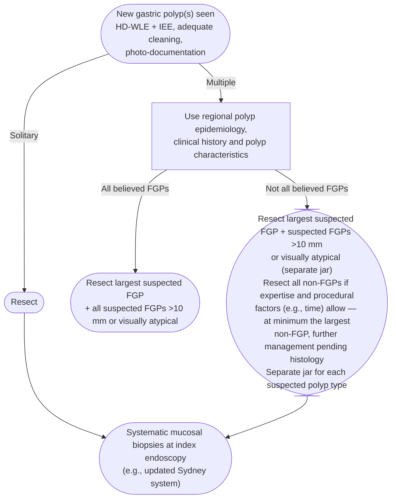

Raised **epithelial lesions of the gastric mucosa** arising from mucosal hyperplasia, adenoma, fundic gland proliferation, or enterochromaffin-like (ECL) cell proliferation — chiefly fundic gland polyps (FGPs), gastric hyperplastic polyps (GHPs), gastric adenomas (GAs), gastric neuroendocrine tumors (G-NETs) and hamartomatous polyps. Core principle: evaluate **both the polyp and the surrounding mucosa**, since field changes ([[helicobacter-pylori-infection|H. pylori]] gastritis, [[atrophic-gastritis|autoimmune/atrophic gastritis]], [[gastric-intestinal-metaplasia|gastric intestinal metaplasia (GIM)]]) drive malignant risk and surveillance ([[aga-2026-gastric-polyps]] Best Practice Advice [BPA] 3–4).

## Contents
- [[#Assessment]]
  - [[#Establishing the Diagnosis]]
  - [[#Severity Assessment]]
  - [[#Classification / Typing]]
- [[#Differential Diagnosis]]
- [[#Diagnostics]]
- [[#Therapeutics]]
  - [[#Resection]]
  - [[#Management Algorithm — Newly Detected Polyps]]
  - [[#Background Mucosa and Acid Suppression]]
  - [[#Surveillance]]
- [[#See Also]]
- [[#Sources]]

## Assessment

### Establishing the Diagnosis

> [!pearl] Resect a solitary polyp at the index exam
> American Gastroenterological Association (AGA) 2026 advises resecting every newly detected **solitary** polyp at the index endoscopy — diagnostic *and* therapeutic — rather than biopsy first, resect later ([[aga-2026-gastric-polyps]]).

- **Histology is the diagnosis** — polyps are biopsied or resected for definitive histopathology; endoscopic appearance alone cannot reliably separate dysplastic or early cancerous polyps.
- **Systematic mucosal sampling** at the index exam for a solitary polyp or any suspected non-FGP: **updated Sydney System** or the MAPPS II protocol. The topographic pattern of inflammation, atrophy and GIM separates H. pylori-related from autoimmune gastritis.
  - **Updated Sydney protocol (Figure 2):** biopsies from each of 5 zones — antrum lesser (A1) and greater (A2) curves, incisura (A3), body lesser (B1) and greater (B2) curves; biopsies may be directed by appearance within each zone.
  - **≥2 jars** — antrum (A) and body (B); targeted biopsies of any visible lesion in a **separate jar**.
- **H. pylori testing** — essential when adenomas or hyperplastic polyps are found (BPA 5): random biopsies of different gastric regions when GA or GHP is suspected; sampling unavailable → AGA lists **serology, breath test, or stool antigen**, no stated preference.

> [!pitfall] Serology conflicts with ACG 2024
> [[acg-2024-hp-treatment|American College of Gastroenterology (ACG) 2024]]: serological testing is **not recommended in low-prevalence populations** without a high pre-test probability (e.g., peptic ulcer); treatment is offered for a positive **non-serological** test. AGA 2026 (newer) still lists serology among its options.

- **Labs add little:** gastrin levels add no diagnostic information in most polyp patients; pepsinogen I:II ratio is not available in most clinical laboratories; **no noninvasive biomarker** screens or monitors polyps/dysplasia or separates low- from high-risk patients.
  - Gastrin, parietal cell antibodies and pepsinogen I:II may help screen for autoimmune gastritis with existing autoimmune disease, unexplained [[iron-deficiency-anemia|iron-deficiency anemia]], pernicious anemia, or a family history of autoimmune gastritis.
- **Miss rate:** neoplastic lesions missed at [[upper-endoscopy|upper endoscopy]] and diagnosed as cancer within 3 years — **4.7%–11.3%**; subtle mucosal lesions surrounding GIM are associated with interval early cancer.

### Severity Assessment

Polyp size (irrespective of type) and dysplasia guide management, read together with histologic type and the background mucosa:

| Input | Higher risk |
|---|---|
| **Size** | >10 mm (FGP/GHP surveillance and [[proton-pump-inhibitors\|proton pump inhibitor (PPI)]] decisions); **>20 mm** (adenoma cancer risk rises; refer for advanced resection); G-NET >2 cm (higher metastatic risk) |
| **Dysplasia** | Low-grade dysplasia (LGD) or high-grade dysplasia (HGD) → shortened surveillance (see [[#Surveillance]]) |
| **Background mucosa** | Atrophic gastritis (AG) and/or GIM confirmed on adjacent mucosa (see [[#Surveillance]]) |
| **Burden / syndromic context** | **Mucosal carpeting** = FGPs from fundus to antrum without intervening normal mucosa (>20 polyps); [[familial-adenomatous-polyposis\|familial adenomatous polyposis (FAP)]]; gastric adenocarcinoma and proximal polyposis syndrome of the stomach (GAPPS) |

> [!pearl] Many FGPs in a young patient off PPIs → think FAP
> Multiple FGPs at age 20–40 years (or in childhood) in a patient **not** taking a PPI should prompt consideration of FAP; >80% of syndromic patients develop FGPs, typically in the first 3 decades. Classic massive colonic polyposis may be absent — consider genetic evaluation ([[aga-2026-gastric-polyps]]).

- Syndromic FGPs are smaller, morphologically subtler, and not associated with parietal cell hyperplasia.
- **Anemia** occurs more often with GHPs, GAs, or G-NETs.

### Classification / Typing

Different polyp types **coexist** in 2%–3% of patients (FGP is the most common synchronous finding; GAs often accompany GHPs). Each type has characteristic site, appearance, size and background mucosa (BPA 3, 7; Table 1 of [[aga-2026-gastric-polyps]]).

| Type | Prevalence | Site / number / appearance | Background / association | Malignant potential |
|---|---|---|---|---|
| **Fundic gland polyp** | 47%–77% of polyps where GHPs are uncommon | Body/fundus; multiple, sessile, usually <1 cm, glassy surface | PPI-associated or sporadic; FAP/GAPPS; surrounding mucosa usually normal, non-inflamed | Dysplasia **<1% sporadic**; **25%–46%** (Table 1: up to 48%) in FAP; high in GAPPS. Adenocarcinoma in up to 15% of FAP cases; LGD→HGD/cancer slow (~4% over mean 6 y in FAP); higher with mucosal carpeting or polyps >1 cm |
| **Gastric hyperplastic polyp** | 17%–55% of polyps; common where H. pylori is prevalent | Antrum > body; single or multiple; sessile or pedunculated, <20 mm; surface erosions if larger | Chronic gastritis (H. pylori-related or autoimmune) | Dysplasia ~**4%**; malignant transformation **0.8%–10%**; neoplastic polyps tend to be **>20 mm**. Surrounding mucosa may show similar or higher dysplasia prevalence |
| **Gastric adenoma** | 1%–10% of polyps | Antrum > body; usually single, flat or sessile, <20 mm | Chronic gastritis (H. pylori-related or autoimmune) | [[gastric-adenocarcinoma\|Adenocarcinoma]] precursor — progression **3%–4% low-grade**, **5%–30% high-grade**; risk ↑ >20 mm and with villous histology. Variants: intestinal (56%) and foveolar (41%) most common. **Exception:** foveolar-type "raspberry-like" GA in the H. pylori-naïve stomach — very low to nonexistent risk |
| **Pyloric gland adenoma** | <3% of polyps | Body > antrum; usually single; sessile, pedunculated, or mass-like; **1–10 cm** | Autoimmune gastritis; 2nd most common polyp in FAP; also [[lynch-syndrome\|Lynch syndrome]] and [[juvenile-polyposis-syndrome\|juvenile polyposis]] | High-grade dysplasia in **42%**; progression **12%–30%** (adenocarcinoma reported 12%–47%). ↑ with size, tubulo-villous architecture, autoimmune gastritis |
| **Oxyntic gland adenoma** | Rare | Body; polypoid or raised-flat; solitary; 2–20 mm, typically <10 mm | Adjacent mucosa usually normal | Slow-growing low-grade malignancy; large polyps and mucous-neck-cell differentiation more likely to progress; endoscopic resection usually sufficient |
| **[[gastroenteropancreatic-neuroendocrine-tumors\|G-NET]]** | Up to 2% of polyps | Body > antrum. Types 1/2: polyps/nodules, sharply outlined, ± central depression, often multiple yellowish nodules; types 1/2 tend to be multifocal; type 3 may be solitary. **Size: type 1 ≤2 cm, type 2 ≤1 cm, type 3 >2 cm** | **Type 1** (>70% of G-NETs): body atrophy/GIM with ECL-cell proliferation (autoimmune gastritis, pernicious anemia, achlorhydria, hypergastrinemia). **Type 2:** multiple endocrine neoplasia type 1 (MEN-1)/gastrinoma (Zollinger-Ellison), hypertrophic mucosa with ECL hyperplasia. **Type 3:** normal surrounding mucosa, no hypergastrinemia | Limited metastatic rate for types 1–2 (high recurrence risk); **type 3 (~15%)** solitary, up to 5 cm, mass-like, higher metastatic rate, **worst prognosis** |
| **Hamartomatous polyps** — [[juvenile-polyposis-syndrome\|juvenile]], [[peutz-jeghers-syndrome\|Peutz–Jeghers (PJ)]], [[cowden-syndrome\|Cowden]], Cronkhite–Canada | Rare | Juvenile: body > antrum, pedunculated/sessile, 2–20 mm. PJ: any site, lobulated on a short broad stalk, 1–3 cm. Cowden: small sessile, multiple. Cronkhite–Canada: sessile/flat with diffuse mucosal thickening | Polyps elsewhere in the gastrointestinal (GI) tract; PJ skin changes; Cowden esophageal glycogenic acanthosis + colorectal polyps; Cronkhite–Canada alopecia, nail atrophy, hyperpigmentation, vitiligo | Juvenile up to **14%** (higher in polyposis); PJ **2%–3%**; Cowden low; Cronkhite–Canada very rare |

- **Epidemiology:** 70%–94% of Western gastric polyps are FGPs or GHPs; the mix has shifted from GHPs/GAs to **sporadic FGPs** as H. pylori declined. GA/GHP/G-NET prevalence rises with age; **FGP prevalence falls after age 60**.
- FGPs are **inversely** associated with gastric atrophy, H. pylori and GIM, and positively with [[gerd|gastroesophageal reflux disease (GERD)]] and PPI use.

## Differential Diagnosis

*Workup: see [[dyspepsia]].*

*Workup of a gastric bump that arises **beneath** the mucosa (normal overlying mucosa, no epithelial polyp) belongs to [[subepithelial-lesion]]; this page covers raised **epithelial/mucosal** polyps.*

- Between polyp types: see the [[#Classification / Typing]] table.
- **Hamartomatous polyp vs GHP** — considerable histologic overlap and not easily distinguished endoscopically; clinical and endoscopic evaluation (polyps elsewhere, syndromic stigmata) classifies the patient.
- Background-mucosa disease driving the polyps: [[helicobacter-pylori-infection|H. pylori gastritis]], [[atrophic-gastritis|autoimmune/atrophic gastritis]], [[gastric-intestinal-metaplasia|GIM]], reactive gastropathy — see [[gastric-premalignant-conditions]].
- Polyposis syndromes: [[familial-adenomatous-polyposis|FAP]], GAPPS, [[juvenile-polyposis-syndrome|juvenile polyposis]], [[peutz-jeghers-syndrome|Peutz–Jeghers]], [[cowden-syndrome|Cowden]], Cronkhite–Canada.

## Diagnostics

- **High-definition white-light endoscopy (HD-WLE)** with adequate distension, mucus clearance, and **photo-documentation** of landmarks, lesions and mucosal alterations (BPA 8). HD-WLE **alone is suboptimal** for atrophy/GIM and for spotting dysplastic or early cancerous polyps.
- **Image-enhanced endoscopy (IEE) / virtual chromoendoscopy** — narrow-band imaging (NBI), blue laser imaging (BLI), linked color imaging (LCI), ± magnification; improves detection and characterization of dysplasia and abnormal mucosa; **LCI highlights the purple color of GIM**. Recommended for routine use in assessing atrophic/metaplastic change and targeting dysplasia, but underused in the US.
- **Simplified NBI classification** (Pimentel-Nunes validation study):

| Pattern | Appearance | Histology | Performance |
|---|---|---|---|
| **A** | Regular vessels with circular mucosa | Normal | Accuracy 83% (95% confidence interval [CI] 75%–90%) |
| **B** | Tubulo-villous mucosa | GIM | Accuracy 84%; positive likelihood ratio (LR+) 4.75 |
| **C** | Irregular vessels and mucosa | Dysplasia | Accuracy 95% (95% CI 90%–99%); LR+ 44.33 |

- **"Light-blue crest" sign** — moderate reliability (κ 0.49), **87% specific** for GIM. **Variable vascular density** — best feature for H. pylori-related gastritis (accuracy 70%).
- **Vessel-plus-surface classification** (early gastric cancer): irregular microvascular and/or microsurface pattern **plus a demarcation line**; magnifying BLI and NBI have similar sensitivity for the demarcation line (96.1% vs 98.1%).
- **Kimura–Takemoto** (atrophy) and **endoscopic grading of GIM (EGGIM)** — not routinely used in the US; moderate, experience-dependent interobserver reliability. Until IEE skills spread, **meticulous inspection plus random and targeted biopsies per established protocols remain essential**. Artificial intelligence–assisted IEE: [[artificial-intelligence-endoscopy]].

## Therapeutics

### Resection

Options: biopsy (forceps) or snare polypectomy, endoscopic mucosal resection (EMR), or endoscopic submucosal dissection (ESD) (BPA 9). Technique follows **size**, plus presumed pathology, location, and endoscopist expertise (Figure 2 resection box):

| Polyp size | Technique |
|---|---|
| **≤3 mm** | Biopsy **or** cold snare [[polypectomy\|polypectomy]] |
| **4–9 mm** | Cold snare polypectomy **or** [[endoscopic-mucosal-resection\|EMR]] |
| **≥10 mm** | EMR or [[endoscopic-submucosal-dissection\|ESD]], depending on size, location, appearance — consider referral to an endoscopist with resection expertise |
| **>20 mm** | **Referral advised** to an endoscopist experienced in advanced resection (a >20 mm pedunculated polyp can still come out en bloc by EMR) |

> [!pitfall] No forceps for polyps ≥4 mm
> Polyps **≥4 mm should not be resected with forceps**; in 4 prospective studies of polyps ≥5 mm, forceps could not reliably establish underlying neoplasia ([[aga-2026-gastric-polyps]]).

- Cold forceps for ≤3 mm is supported by colon data (≤3 mm colonic polyps: cold forceps noninferior to cold snare for complete resection, and faster).
- **ESD is reserved** for polyps in which neoplasia is diagnosed or strongly suspected (282 gastric adenomatous polyps, single-centre Korean study: complete resection **96%**, bleeding **1.4%**, no perforations; **size >20 mm predicted early gastric cancer**).
- **Adverse events:** EMR bleeding ~**7%** (nearly all managed endoscopically), perforation rare; cold snare noninferior to EMR for adverse events and safe/effective for 3–8 mm FGPs.
- **Tattooing is not routine** for diagnostic or therapeutic gastric polypectomy — optional for the site of an incompletely resected large polyp, a suspected malignant polyp, or when surgery/EMR/ESD follow-up is planned.
- **Numerous polyps of varied size:** resect the **largest** when possible; sample or resect the smaller ones (BPA 10).
- **Older thresholds — [[asge-2015-gastric-premalignant|American Society for Gastrointestinal Endoscopy (ASGE) 2015]]:** polypectomy when possible of **FGP ≥1 cm, hyperplastic ≥0.5 cm, adenoma of any size**; surveillance 1 year after adenoma removal. AGA 2026 instead resects every solitary polyp and sets dysplasia-based intervals.

### Management Algorithm — Newly Detected Polyps

*Applies where H. pylori prevalence is low and PPI use is common (e.g., the US), in patients without a known genetic cancer syndrome (e.g., FAP).*

*Index-endoscopy management of newly seen gastric polyps*
*Source: redrawn from Figure 2 of the AGA 2026 gastric polyps clinical practice update (resection technique box is the size table above; surveillance is in [[#Surveillance]])*
*[[aga-2026-gastric-polyps|AGA 2026 Clinical Practice Update on Management of Gastric Polyps]]*
*HD-WLE = high-definition white-light endoscopy · IEE = image-enhanced endoscopy · FGP = fundic gland polyp*

### Background Mucosa and Acid Suppression

- **[[test-and-treat|Test and treat]] H. pylori in all patients with adenomatous or hyperplastic polyps** (BPA 5). Treatment is associated with a **59% (95% CI 43%–75%) reduction in GHP prevalence**, **79% (95% CI 72%–86%) after successful eradication**; eradication can also improve AG and lower gastric cancer risk.
- **Suspected GIM or AG in the surrounding mucosa → targeted biopsies per existing protocols** (BPA 11; see [[gastric-intestinal-metaplasia]], [[gastric-premalignant-conditions]]).
- **PPIs:**
  - **Valid indication** → need not be stopped when fundic gland hyperplasia-related polyps are documented (BPA 6).
  - **No clear indication** → discontinuing is beneficial and needs a systematic approach.
  - Table 2 advises **discontinuing PPI therapy** for FGP >10 mm without dysplasia and for mucosal carpeting (see [[#Surveillance]]).
  - PPI use: **1.5- to 2.5-fold** FGP risk, **up to 5-fold with ≥12 months**; partly confounded (age, sex, endoscopy indication).
- **[[potassium-competitive-acid-blockers|Potassium-competitive acid blockers (P-CABs)]]** show similar associations — hyperplastic polyps rose from **3.7% to 14.7% over 3 years** after starting a P-CAB (VISION trial); >3-fold higher risk with use >1 year; case reports of regression after stopping.

### Surveillance

Keyed to **polyp histology and the surrounding mucosa** (BPA 12). Table 2 of [[aga-2026-gastric-polyps]]:

| Polyp histology / characteristics | Endoscopic surveillance interval | Other management |
|---|---|---|
| **FGP**\* <10 mm, no dysplasia | No surveillance | — |
| FGP\* >10 mm, no dysplasia | **1 y** | Discontinue PPI therapy |
| FGP\* mucosal carpeting (>20 polyps) | **1 y** | Discontinue PPI therapy; consider evaluation for familial polyposis syndrome |
| FGP\* with dysplasia | **HGD 6 mo; LGD 1 y** | Evaluate for familial polyposis syndrome |
| **Hyperplastic** <10 mm, no dysplasia | Not clearly indicated if all polyps resected | Ensure H. pylori negativity; gastric premalignant conditions present → follow AGA advice† |
| Hyperplastic >10 mm, no dysplasia | **1 y** | — (text: resection advised for GHPs >10 mm) |
| Hyperplastic with dysplasia | **HGD 6 mo; LGD 1 y** | — |
| **Adenoma** (intestinal-type, pyloric gland, oxyntic gland) | Ensure complete removal of the index adenoma; consider referral to an endoscopist experienced in advanced resection. **HGD every 6 mo; LGD every 1 y; then annually** | Ensure H. pylori negativity; premalignant conditions present → follow AGA advice† |
| **G-NET type I or II** | **<2 cm: every 1–2 y.** ≥2 cm: consider referral to an oncologic center with expertise | Autoimmune gastritis present → follow existing AGA advice†; type II → evaluate for the source of inappropriate gastrin production |
| **G-NET type III** | Referral to an oncologic center with expertise | — |

*Whole table: for countries where H. pylori prevalence is low and PPI use is common (e.g., the US); if multiple polyp types are present, advice for the **highest-grade** polyp takes precedence.*
*\* FGP rows: patients without a known genetic cancer syndrome.*
*† Chronic AG or GIM detected at index endoscopy → existing AGA advice on chronic AG (see the gastric premalignant conditions page).*

- **Completely resected dysplastic polyp:** surveillance at **6 mo (HGD)** or **1 y (LGD)** (BPA 13).
- **Biopsy-only or incomplete resection:** repeat endoscopy within **3 months (HGD)** or **6 months (LGD)** (BPA 13).
- **Adjacent mucosa with GIM and/or AG** → endoscopic surveillance advised (BPA 14); biopsies from **antrum and corpus at a minimum**. Targeted biopsies **every 3 years** are considered for persistent H. pylori infection, advanced AG with **incomplete** GIM, or mild/focal GIM with a **family history of gastric cancer**. Surveillance duration is undetermined.

> [!pitfall] Ethnicity or family history alone does not shorten intervals
> Both are associated with gastric cancer risk, but AGA advises **not** altering surveillance frequency on those grounds — little evidence the risk acts other than through mucosal status ([[aga-2026-gastric-polyps]]). Population screening lives on [[gastric-cancer-screening]].

## See Also

[[gastric-intestinal-metaplasia]], [[atrophic-gastritis]], [[gastric-premalignant-conditions]], [[gastric-adenocarcinoma]], [[gastric-cancer-screening]], [[helicobacter-pylori-infection]], [[familial-adenomatous-polyposis]], [[dyspepsia]], [[upper-endoscopy]], [[polypectomy]], [[endoscopic-mucosal-resection]], [[endoscopic-submucosal-dissection]], [[gastroenteropancreatic-neuroendocrine-tumors]], [[subepithelial-lesion]], [[test-and-treat]], [[proton-pump-inhibitors]], [[potassium-competitive-acid-blockers]]

---

## Sources

1. [[aga-2026-gastric-polyps|AGA Clinical Practice Update on Management of Gastric Polyps: Expert Review]]
2. [[asge-2015-gastric-premalignant|ASGE Guideline: The Role of Endoscopy in the Management of Premalignant and Malignant Conditions of the Stomach (2015)]]
3. [[acg-2024-hp-treatment|ACG Clinical Guideline: Treatment of Helicobacter pylori Infection (2024)]]
