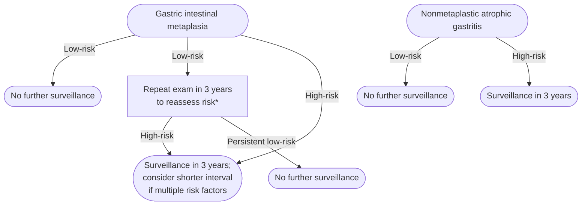
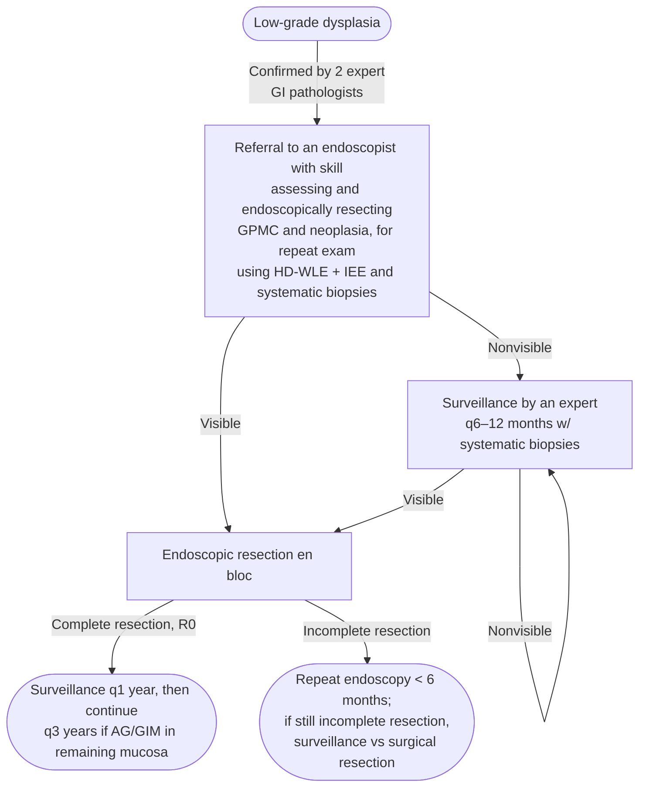
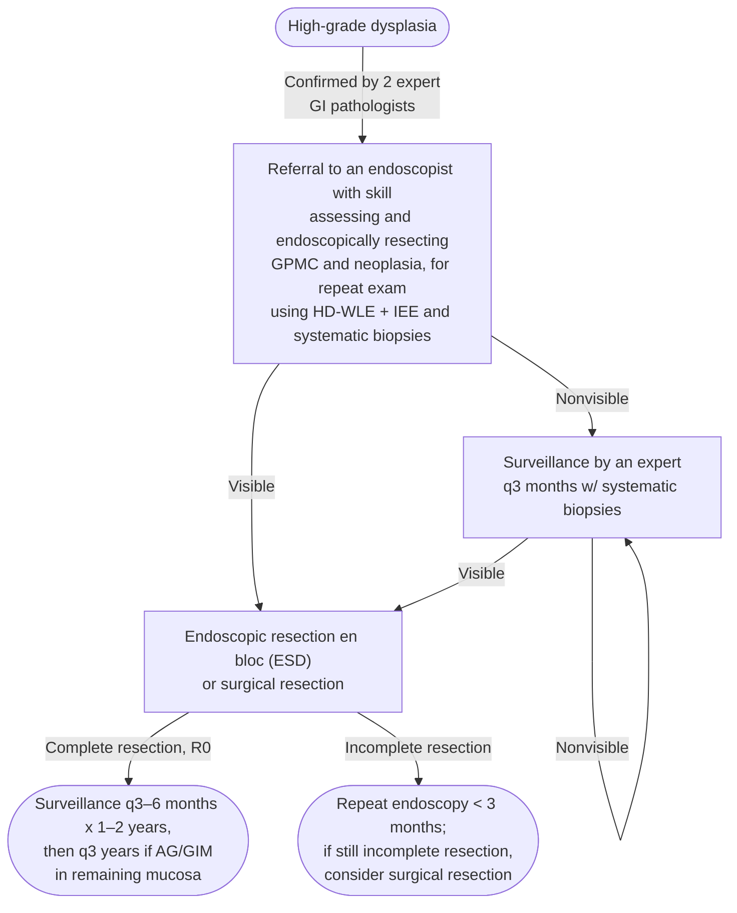

Histopathologic stages along the Correa cascade that precede [[gastric-adenocarcinoma|gastric adenocarcinoma]]: [[atrophic-gastritis|atrophic gastritis (AG)]] → [[gastric-intestinal-metaplasia|gastric intestinal metaplasia (GIM)]] → dysplasia (low-grade dysplasia [LGD]/high-grade dysplasia [HGD]). [[helicobacter-pylori-infection|H. pylori]] is the dominant risk factor — **attributable risk 75%–89% for *noncardia* gastric adenocarcinoma** (the qualifier matters; the figure is not for cardia gastric cancer [GC]). US 5-year GC survival is **36%**, because only ~15% are diagnosed at the curable early stage; resection of early GC is typically curative (**>95% 5-year overall survival**).

**GC disparity:** Incidence is 2–13× higher in non-White US populations (East Asian, Hispanic, Black, American Indian and Alaska Native [AIAN]) vs non-Hispanic White. Korean Americans have noncardia gastric adenocarcinoma (NCGA) rates comparable to [[colorectal-cancer|colorectal cancer (CRC)]] in the general population (70/100,000 py).

---

## Contents
- [[#Assessment]]
  - [[#Establishing the Diagnosis]]
  - [[#Severity Assessment — Risk Factors for GPMC/GC]]
  - [[#Classification / Typing — Correa Cascade]]
- [[#Differential Diagnosis]]
- [[#Diagnostics]]
  - [[#Endoscopic Evaluation (Required)]]
  - [[#Biopsy Protocol]]
  - [[#H. pylori Testing]]
- [[#Therapeutics]]
  - [[#Surveillance Strategy]]
  - [[#GC Screening (For Reference)]]
  - [[#Dysplasia Management]]
  - [[#H. pylori Eradication]]
  - [[#What NOT to Use]]
  - [[#Autoimmune Gastritis (Special Case)]]
  - [[#Gastric Epithelial Polyps]]
  - [[#Monitoring]]
- [[#See Also]]
- [[#Sources]]

---

## Assessment

### Establishing the Diagnosis

- Gastric premalignant condition (GPMC) is a **histopathologic** diagnosis — made on gastric biopsies, not on symptoms, serum tests, or endoscopic appearance alone. There is no clinical presentation specific to AG, GIM, or dysplasia; most are found incidentally at an [[upper-endoscopy|esophagogastroduodenoscopy (EGD)]] done for another indication.
- **Noninvasive biomarkers (serum pepsinogens, anti-H. pylori immunoglobulin G [IgG]) are recommended *against*** for GPMC screening or surveillance in the US (Very low) — so a normal serum panel does not exclude GPMC and cannot substitute for biopsy.
- The diagnosis therefore depends entirely on exam quality and sampling: high-quality endoscopy plus the updated Sydney protocol, both under [[#Diagnostics]].
- The three histopathologic stages each have their own page — [[atrophic-gastritis|AG]], [[gastric-intestinal-metaplasia|GIM]], and dysplasia (indefinite dysplasia [IND]/LGD/HGD, managed under [[#Dysplasia Management]]).

### Severity Assessment — Risk Factors for GPMC/GC

**Patient-level risk factors:**

- H. pylori infection (current or prior)
- Family history of GC in first-degree relative (2–10× increased risk)
- Race/ethnicity: East Asian, Latino/a, Black, AIAN
- Foreign-born, first-generation immigrant from high-GC country (East Asia, Eastern Europe, Central/Andean South America)
- Inherited cancer syndromes — e.g. [[hereditary-diffuse-gastric-cancer|hereditary diffuse gastric cancer (HDGC; CDH1)]], [[lynch-syndrome]], [[familial-adenomatous-polyposis|familial adenomatous polyposis (FAP)]], [[peutz-jeghers-syndrome|Peutz–Jeghers]]
- Tobacco use
- Male sex

**Lesion-level risk factors (after endoscopy)** — with the magnitudes the American College of Gastroenterology (ACG) cites, because these are what set the surveillance interval:

- GIM subtype: **incomplete** > complete — **odds ratio (OR) 4.06 (95% confidence interval [CI] 2.79–5.91)** for GC vs no GIM
- GIM extent: **corpus-extension** (antrum + incisura + corpus) > limited (antrum/incisura only) — **OR 7.39** vs no GIM; antrum-limited GIM was not significant (OR 2.1, 95% CI 0.7–6.6)
- **GIM/AG severity — the proportion of atrophy or GIM within individual biopsies from each compartment (antrum, incisura, corpus), and it has an operative cutoff.** GIM in **up to one-third** of glands = **mild**; **up to two-thirds** = **moderate**; **greater than two-thirds** = **severe**. (Mild *atrophy* is hard to appreciate histologically; extensive gland loss is readily apparent.) Increased severity raises progression risk **independently of anatomic extent** — so **moderate-to-severe AG/GIM is high-risk and warrants consideration of surveillance even when it is anatomically limited to the antrum**, which is the case a "limited GIM = low risk" reading misses
- **Focality:** **unifocal** = AG/GIM in **1** biopsy specimen; **multifocal** = AG/GIM in **≥2** biopsy specimens. Unifocal carries lower risk. Both determinations depend on having taken enough biopsies (Sydney protocol)
- Dysplasia grade: HGD > LGD > IND

### Classification / Typing — Correa Cascade

```
Normal mucosa
  ↓  H. pylori (dominant driver)
Chronic active gastritis
  ↓
Atrophic gastritis (AG)
  ↓
Multifocal AG (MAG)
  ↓
Gastric intestinal metaplasia (GIM)
  ↓  complete → incomplete (higher risk)
Low-grade dysplasia (LGD)
  ↓
High-grade dysplasia (HGD)
  ↓
Gastric adenocarcinoma
```

**Early gastric cancer (EGC):** adenocarcinoma not beyond submucosa (regardless of lymph node status); resection typically curative (>95% 5-year overall survival).

---

## Differential Diagnosis

*Workup: see [[dyspepsia]].*

| Condition | Distinguishing features |
|---|---|
| [[atrophic-gastritis\|Autoimmune gastritis (AIG)]] | Corpus-predominant atrophy; anti-parietal cell antibodies; B12 deficiency; achlorhydria; elevated gastrin; [[gastroenteropancreatic-neuroendocrine-tumors\|type 1 gastric carcinoid/neuroendocrine tumor]] risk |
| H. pylori-associated gastritis | Active H. pylori infection; antrum-predominant; resolved with eradication |
| Reactive (chemical) gastropathy | Nonsteroidal anti-inflammatory drug (NSAID) use, bile reflux; foveolar hyperplasia, no atrophy or GIM |
| Ménétrier's disease | Giant gastric folds; protein-losing gastropathy; TGF-α excess |
| [[gastric-malt-lymphoma\|Gastric mucosa-associated lymphoid tissue (MALT) lymphoma]] | H. pylori-driven; monoclonal B-cell proliferation; treat H. pylori first |
| Early [[gastric-adenocarcinoma\|gastric cancer]] | Flat or slightly raised lesion; requires endoscopic submucosal dissection (ESD)/resection |

---

## Diagnostics

### Endoscopic Evaluation (Required)

**High-quality endoscopy — 5 mandatory components:**

1. HDWLE (high-definition white light endoscopy)
2. Adequate gastric insufflation (CO₂ preferred) — flatten folds, expose mucosa
3. Mucosal cleansing — clear debris, mucus, bubbles
4. Standard photodocumentation of landmarks and abnormalities
5. Adequate gastric inspection time — the 2–3 min [[upper-endoscopy|upper endoscopy]] is substandard for GPMC evaluation

**Image-enhanced endoscopy (IEE):** Suggest narrow-band imaging (NBI), blue laser imaging, or equivalent for patients with suspected GPMC, high-risk features, or undergoing surveillance. Near-focus and optical zoom helpful but not mandatory.

### Biopsy Protocol

**Updated Sydney protocol (recommended):**

- Container 1: antrum + incisura (≥2 biopsies each)
- Container 2: corpus (≥2 biopsies each)
- Additional containers: targeted biopsies of any mucosal abnormalities

**Pathology report must include:**

- Location (antrum, incisura, corpus)
- AG severity (per compartment)
- GIM severity and extent (antrum/incisura only vs corpus-extension)
- GIM subtype: complete (type I) vs incomplete (types II/III) vs mixed
- Dysplasia grade: IND, LGD, HGD
- H. pylori organisms present/absent

**Against:**

- Noninvasive biomarkers (serum pepsinogens, anti-H. pylori IgG) for GPMC screening or surveillance in US (Very low evidence)
- Routine repeat EGD within 12 months for nondysplastic GPMC unless quality or protocol concern

### H. pylori Testing

- Test ALL patients with GPMC (see [[helicobacter-pylori-infection]] for methods)
- Preferred: urea breath test (UBT) or stool antigen (nonserological)
- Confirm eradication 4–8 weeks after treatment completion

---

## Therapeutics

### Surveillance Strategy


*Surveillance of nondysplastic gastric premalignant conditions after risk stratification*
*Source: redrawn from the ACG 2025 nondysplastic GPMC management algorithm*
*[[acg-2025-gastric-premalignant|ACG 2025 Gastric Premalignant Conditions Guideline]]*

\* Some studies in non-US populations show about 30% of patients classified as low-risk on the initial exam are upstaged to high-risk histology on repeat short-interval examination (1–2 years) with Sydney protocol biopsies; there are no US data. Repeat surveillance in 3 years can be considered for low-risk GIM if there is concern about the quality of the initial exam, or by patient preference and shared decision-making. Test for H. pylori, treat, and confirm eradication before surveillance, ideally at least 1–2 months before the exam ([[acg-2025-gastric-premalignant]]).

**High-risk GIM → surveillance q3y (Conditional/Very low):**

- Incomplete GIM histological subtype (vs complete)
- Corpus-extension (antrum/incisura + corpus involvement)
- OR any GIM with: family history of GC (first-degree) | foreign-born from high-GC country | high-risk race/ethnicity (East Asian, Latino/a, Black, AIAN)
  - ⚠ **This third criterion is contradicted by the newer [[aga-2026-gastric-polyps|American Gastroenterological Association (AGA) 2026]]**, which says surveillance frequency should not be altered for ethnicity or family history *alone*. Both agree once demography is paired with a mucosal finding. **Full contradiction and its resolution: [[gastric-intestinal-metaplasia#2. Surveillance Endoscopy — Guideline Disagreement|gastric intestinal metaplasia]].**

**Moderate/severe GIM or AG → surveillance q3y (Conditional/Very low)** — severity is graded by the proportion-of-glands cutoffs under [[#Severity Assessment — Risk Factors for GPMC/GC]] (>2/3 = severe), and it qualifies **even if the disease is limited to the antrum**

**Multiple risk factors** (e.g., extensive GIM + family history of GC): consider q1–2y interval

**Low-risk GIM or mild AG → against surveillance (Conditional/Very low):**

- Complete GIM only (no incomplete component)
- Anatomically limited to antrum
- None of the high-risk criteria above
- **Mild in severity** — AG mild, and GIM in **≤1/3 of glands**. Antrum-limited disease that is *moderate or severe* does **not** belong in this group

**Where Operative Link on Gastritis Assessment (OLGA)/Operative Link on Gastric Intestinal Metaplasia Assessment (OLGIM) staging is routinely used** (staging criteria and risk bands live on [[atrophic-gastritis#Severity Assessment|atrophic gastritis]]):

| Stage | Surveillance |
|---|---|
| **III–IV** (without dysplasia) | Every **3 years**; consider a **2-year** interval with any additional demographic/clinical risk factor (e.g. family history) |
| **II** (intermediate risk) | 3-year surveillance **may be considered** if multiple additional high-risk factors are present |
| **0–I** | Not indicated on stage alone |

**Refractory H. pylori** — infection persisting after several lines of appropriate therapy marks a particularly high-risk patient: offer surveillance endoscopy at a **3-year** interval (expert opinion; shorter if additional GC risk factors).

### GC Screening (For Reference)

- **Against** routine [[upper-endoscopy|upper endoscopy]] [[gastric-cancer-screening|GC/GPMC screening]] in general US population (Conditional/Very low)
- **Insufficient evidence** for opportunistic screening in high-risk groups — no formal recommendation
- **Key concept (individualized):** Consider screening in:
  - Family history of GC: start EGD at age 45–60 or 10y before youngest affected family member
  - First-generation immigrants from East Asia, Eastern Europe, Andean South America
  - Screen and eradicate H. pylori in all high-risk individuals

### Dysplasia Management


*Management of low-grade dysplasia in gastric premalignant conditions*
*Source: redrawn from the ACG 2025 dysplastic GPMC management algorithm (LGD arm)*
*[[acg-2025-gastric-premalignant|ACG 2025 Gastric Premalignant Conditions Guideline]]*
*GI = gastrointestinal · GPMC = gastric premalignant conditions · HD-WLE = high-definition white light endoscopy · IEE = image-enhanced endoscopy · R0 = complete resection with negative margins · AG = atrophic gastritis · GIM = gastric intestinal metaplasia*


*Management of high-grade dysplasia in gastric premalignant conditions*
*Source: redrawn from the ACG 2025 dysplastic GPMC management algorithm (HGD arm)*
*[[acg-2025-gastric-premalignant|ACG 2025 Gastric Premalignant Conditions Guideline]]*
*GI = gastrointestinal · GPMC = gastric premalignant conditions · HD-WLE = high-definition white light endoscopy · IEE = image-enhanced endoscopy · ESD = endoscopic submucosal dissection · R0 = complete resection with negative margins · AG = atrophic gastritis · GIM = gastric intestinal metaplasia*

| Scenario | Action |
|---|---|
| Dysplasia (IND/LGD/HGD) + visible margins | Endoscopic resection (Conditional) |
| IND/LGD without visible margins | Repeat EGD with HDWLE + IEE by experienced endoscopist; repeat in 12 months if advanced neoplasia confidently ruled out |
| HGD without visible margins | Repeat EGD within 3 months with expert endoscopist (high probability of prevalent GC or near-term progression) |
| [[endoscopic-submucosal-dissection\|ESD]] appropriate candidate | **Refer to high-volume center** with expertise in gastric neoplasia (Strong/Low) |
| Post-complete endoscopic resection | Periodic surveillance (HDWLE + IEE + Sydney protocol biopsies + targeted biopsies); individualize interval |

### H. pylori Eradication

- **[[test-and-treat|Test and eradicate]] all GPMC patients** and patients with resected early GC (Strong/Moderate)
- Reduces risk of progression to GC and metachronous GC
- See [[helicobacter-pylori-infection]] for eradication regimens

### What NOT to Use

- Aspirin, NSAIDs, cyclooxygenase-2 (COX-2) inhibitors, antioxidants: **against** for GC chemoprevention (Conditional/Very low)

### Autoimmune Gastritis (Special Case)

- H. pylori: test with nonserological method; eradicate if positive; confirm eradication (Strong/Low)
- Surveillance: no formal recommendation; individualized surveillance may be considered given risk of type I carcinoids and possible GC (Conditional/Low)
- Same GPMC risk stratification parameters apply — **except OLGA/OLGIM, which should not be applied to H. pylori-negative AIG** (atrophy and GIM occur only in the corpus)

### Gastric Epithelial Polyps

| Polyp type | Management |
|---|---|
| Gastric adenoma (any size) | Endoscopic resection; surgical referral if endoscopic resection not feasible (Conditional/Low) |
| Hyperplastic polyp >10mm | Insufficient evidence; individualized (consider resection/biopsy + 12-month surveillance) |
| Fundic gland polyp | No systematic biopsies of surrounding mucosa needed |
| All [[gastric-polyps\|gastric epithelial polyps (GEP)]] except fundic gland polyps | Sydney protocol biopsies of surrounding flat mucosa — high GPMC/H. pylori/AIG prevalence (Conditional/Very low) |

### Monitoring

- Every surveillance exam: HDWLE + IEE + systematic Sydney protocol biopsies + targeted biopsies of abnormalities
- Coordinate with pathology to ensure full reporting (subtype, extent, severity, dysplasia grade)

---

## See Also

[[helicobacter-pylori-infection]], [[test-and-treat]], [[atrophic-gastritis]], [[gastric-intestinal-metaplasia]], [[gastric-polyps]], [[gastric-adenocarcinoma]], [[gastric-malt-lymphoma]], [[hereditary-diffuse-gastric-cancer]], [[lynch-syndrome]], [[familial-adenomatous-polyposis]], [[peutz-jeghers-syndrome]], [[gastric-cancer-screening]], [[gastroenteropancreatic-neuroendocrine-tumors]], [[endoscopic-submucosal-dissection]], [[colorectal-cancer]], [[dyspepsia]], [[upper-endoscopy]]

---

## Sources

1. [[acg-2025-gastric-premalignant|ACG 2025: Diagnosis and Management of Gastric Premalignant Conditions]]
2. [[aga-2026-gastric-polyps|AGA Clinical Practice Update on Management of Gastric Polyps: Expert Review]]
