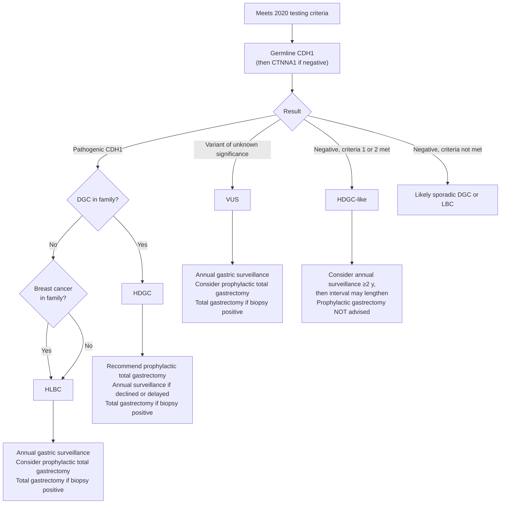

## Contents
- [[#Assessment]]
  - [[#Establishing the Diagnosis]]
  - [[#Genetic Testing Criteria]]
  - [[#Severity Assessment]]
  - [[#Classification / Typing]]
- [[#Differential Diagnosis]]
- [[#Diagnostics]]
  - [[#Genetic Testing]]
  - [[#Endoscopic Surveillance]]
  - [[#Histopathology]]
- [[#Therapeutics]]
  - [[#Management by Genetic Result]]
  - [[#Prophylactic Total Gastrectomy]]
  - [[#Breast Cancer Risk Management]]
  - [[#Life After Total Gastrectomy]]
- [[#See Also]]
- [[#Sources]]

## Assessment

### Establishing the Diagnosis

- Autosomal-dominant syndrome of **diffuse gastric cancer (DGC)** and **lobular breast cancer (LBC)**; worldwide incidence ~**5–10 per 100 000 births** ([[igclc-2020-hdgc]]).
- Caused mainly by inactivating germline variants in ***CDH1*** (E-cadherin, a cell-adhesion protein); a minority of families carry ***CTNNA1*** (α-catenin) variants.
- Only hereditary syndrome known to cause diffuse gastric cancer; ~1–3% of diffuse [[gastric-adenocarcinoma|gastric cancers]] ([[acg-2015-hereditary-gi-cancer]]).
- **Hereditary diffuse gastric cancer (HDGC) is now defined genetically, not clinically** — by the presence of a pathogenic variant, not by meeting clinical criteria ([[igclc-2020-hdgc]]). "Pathogenic variant" covers **likely pathogenic and pathogenic** together.
- Signet ring cell carcinoma is the pathological hallmark; **linitis plastica** is the advanced form.

> [!pearl] Lobular breast cancer is the other half of the syndrome
> A pathogenic *CDH1* variant raises risk of **lobular** breast cancer only — not invasive carcinoma of no special type (formerly ductal) or other types. So *CDH1* testing for breast cancer should **only be contemplated in women with confirmed LBC** ([[igclc-2020-hdgc]]).

### Genetic Testing Criteria

***CDH1* testing when any one criterion is met, and cancer diagnoses are confirmed** ([[igclc-2020-hdgc]]). Where a criterion involves ≥2 cancers, **at least one must have confirmed histology**. **Histologically confirmed intestinal-type gastric cancer and non-lobular breast cancer cannot be used to fulfil a criterion** — they are not part of HDGC.

| # | Family criteria — members must be first- or second-degree blood relatives of each other |
|---|---|
| 1 | **≥2 gastric cancers in the family regardless of age, at least one of them diffuse** |
| 2 | **≥1 DGC at any age *and* ≥1 lobular breast cancer at age <70 y, in different family members** |
| 3 | **≥2 lobular breast cancers in family members <50 y** |

| # | Individual criteria |
|---|---|
| 4 | **DGC at age <50 y** |
| 5 | **DGC at any age in an individual of Māori ethnicity** |
| 6 | **DGC at any age with personal or first-degree-relative history of cleft lip or cleft palate** |
| 7 | **History of DGC *and* lobular breast cancer, both diagnosed at age <70 y** |
| 8 | **Bilateral lobular breast cancer, diagnosed at age <70 y** |
| 9 | **Gastric in-situ signet ring cells, or pagetoid spread of signet ring cells, in an individual <50 y** |

- **Order:** analyse ***CDH1* first**; if negative, consider ***CTNNA1***.
- **No living affected relative?** Test an affected person where possible → else tissue (tumour or healthy) from an affected deceased relative → else indirect testing in unaffected family members.
- Also offer testing to patients with **multiple signet ring cell carcinoma lesions**, found endoscopically or in the gastrectomy specimen.
- **Māori:** ~**13%** of the New Zealand Māori population with advanced DGC carry a pathogenic germline *CDH1* variant — hence criterion 5.

> [!pitfall] The 2015 age limits are out of date
> IGCLC 2020 deliberately **relaxed** them. Isolated DGC moved from **<40 → <50 y**; bilateral LBC in women moved from **<50 → <70 y** (expected *CDH1* yield ~7%). Family criterion 1 no longer requires a case under 50 — **≥2 gastric cancers at any age, one diffuse**, is enough. The older [[acg-2015-hereditary-gi-cancer|ACG 2015]] set (≥2 DGC with one <50 y; ≥3 DGC in first/second-degree relatives any age; DGC <40 y; DGC + LBC with one <50 y) is **superseded** — a family that fails it may still qualify today.

### Severity Assessment

Penetrance is **strongly influenced by how the families were ascertained**, so IGCLC 2020 gives a range rather than one number ([[igclc-2020-hdgc]]):

| Estimate | Gastric cancer by age 80, male | Female | Families ascertained by |
|---|---|---|---|
| Hansford et al. | **70%** | **56%** | all met the **2010** criteria |
| Roberts et al. | **42%** | **33%** | only **37%** met the **2015** criteria |

- **Female breast cancer risk 39–55%** across studies, and converging.
- **Do not assume the historical risk equals the risk faced by younger generations** — genetic background and lifestyle drive much of the variation.
- Whether **missense** variants carry lower penetrance than truncating variants is **unknown**.
- **No strong evidence of increased risk of other cancer types.** Specifically, **insufficient evidence to screen for [[colorectal-cancer|colorectal cancer]] beyond national population guidelines** — this reverses the ACG 2015 advice to start [[colonoscopy]] at 40 in families that include colon cancer.

### Classification / Typing

The management pathway turns on which of these four labels applies ([[igclc-2020-hdgc]]):

| Label | Definition |
|---|---|
| **HDGC** | Pathogenic *CDH1* or *CTNNA1* variant in an **isolated individual with DGC**, or in a **family with ≥1 DGC in first- or second-degree relatives** |
| **Hereditary lobular breast cancer (HLBC)** | Pathogenic *CDH1* variant in an **isolated individual with LBC**, or a family with ≥1 LBC in first- or second-degree relatives, and **no known DGC** |
| **HDGC-like** | Family meets **family criterion 1 or 2** but **no pathogenic variant is found**. Needs ≥1 confirmed DGC plus another gastric cancer or LBC in a first- or second-degree relative |
| ***CDH1* variant of unknown significance** | Variant with unclear association to disease |

- An HLBC family is **recategorised as HDGC** if DGC or an HDGC precursor lesion later appears in a relative.
- The HDGC/HLBC split exists because **not all pathogenic *CDH1* families carry equal DGC risk**.

---

## Differential Diagnosis

*Workup: see [[dyspepsia]].*

- **Sporadic diffuse gastric cancer** — the large majority; no *CDH1* variant.
- **Hereditary intestinal-type gastric cancer** — component tumour of [[lynch-syndrome]] and [[familial-adenomatous-polyposis]]; intestinal histology cannot fulfil HDGC criteria.
- **[[peutz-jeghers-syndrome]]** — 29% gastric cancer risk; intestinal-type; *STK11*.
- **[[gastric-premalignant-conditions]]** — Correa cascade to intestinal-type cancer, [[helicobacter-pylori-infection|*H. pylori*]]-driven.
- **HDGC-like families** — meet criteria, no variant found; managed as above, not discharged.

---

## Diagnostics

### Genetic Testing

- Perform in a **certified molecular diagnostic laboratory** (CLIA-approved, ISO 15189 accredited, or equivalent) ([[igclc-2020-hdgc]]).
- Must include **sequencing of the entire open reading frame and intron–exon boundaries, plus copy number analysis of individual exons**. Large deletions are rare — **<5% of pathogenic variants**.
- **Direct-to-consumer results must be re-validated** in a certified laboratory.
- Interpret with **American College of Medical Genetics and Genomics / Association for Molecular Pathology (ACMG/AMP)** criteria. A **"likely pathogenic" call carries a 90% likelihood of pathogenicity** — a 10% chance of later reclassification to benign remains.
- **In-vitro and in-silico functional assays must not be used to classify *CDH1* variants** until clinically validated.
- **No presymptomatic testing** in families whose only finding is a variant of unknown significance, or a benign/likely benign variant.
- Offer testing from the **legal age of consent, generally 16–18 y**; younger based on family history.
- Where the increased risk stays unexplained, consider ***PALB2***, and the other genes linked to raised gastric cancer risk — *ATM*, *BRCA2*, the Lynch genes, *APC*, *TP53*.
- **Preimplantation and prenatal genetic diagnosis** should be discussed and made available; offer reproductive genetic advice to adults of childbearing age.

### Endoscopic Surveillance

**Where:** expert centres familiar with HDGC, with demonstrable expertise in recognising signet ring cell lesions; programmes should be audited ([[igclc-2020-hdgc]]).

> [!howto] Surveillance [[upper-endoscopy|esophagogastroduodenoscopy (EGD)]] in HDGC
> 1. Use a high-definition endoscope with image enhancement (e.g. narrow band imaging).
> 2. Take **targeted biopsies** of any visible lesion.
> 3. Take **28–30 random biopsies**: **3–5 cardia · 5 fundus · 10 body · 5 transition zone · 5 antrum**.
> 4. **Register, inspect and biopsy gastric inlet patches** in the oesophagus.
> 5. Eradicate *H. pylori* if present.

- **Detection rate:** signet ring cell lesions found in **40–61%** of *CDH1* carriers at expert centres, most often at the **baseline** endoscopy; older studies reported only **9–16%**.
- **Upper age limit** depends on fitness for gastrectomy, but surveillance **beyond age 70 is in general probably not purposeful**.
- **Every patient must be told the limitations:** DGC is hard to see endoscopically, and **whether surveillance improves life expectancy is unknown**.

> [!pearl] The goal is not to find every superficial lesion
> The a priori chance of ≥1 signet ring cell focus in a carrier's total gastrectomy specimen is **95%**, and superficial (T1a) foci can be indolent for years. For a patient postponing surgery the goals are: **exclude deeper infiltrating lesions · detect large or numerous T1a lesions · track changing histology and endoscopic appearance** ([[igclc-2020-hdgc]]).

**When a lesion is found — stage it if any of these are present:** erosive lesion · disturbed vascular or pit pattern · histopathological invasion into or beyond the muscularis mucosae. With **none** of these risk indicators, age and comorbidity may justify **postponing gastrectomy after multidisciplinary review**, with **intensified endoscopy every 6 months**.

### Histopathology

- **Two precursor lesions are seen exclusively in *CDH1* carriers** and are strong clues to the diagnosis:
  - **In-situ signet ring cell carcinoma** — signet cells with hyperchromatic, depolarised nuclei inside the basal membrane of a gland, replacing its normal cells.
  - **Pagetoid spread** — a row of signet cells below the preserved epithelium of glands and foveolae, within the basal membrane.
- **Predominant HDGC lesion:** tiny foci of typical signet cells confined to the **superficial lamina propria**, without infiltration beneath the muscularis mucosae; cells small at the neck gland zone, enlarging towards the surface.
- **Non-signet-ring poorly cohesive cancer with pleomorphic/bizarre, diffusely infiltrative cells ("aggressive phenotype")** suggests progression and **must be stated in the report** to trigger staging and intervention.
- **Prophylactic gastrectomy specimens:** use **both the World Health Organization (2019) and Lauren classifications**; **margin analysis is mandatory** to confirm no residual gastric mucosa or tumour. Japan and South Korea use the **Japanese Gastric Cancer Association classification** for DGC instead of Lauren.
- **Breast:** nothing distinguishes *CDH1*-related LBC from sporadic LBC. **p120-catenin shows cytoplasmic staining** (membranous in no-special-type and ductal carcinoma in situ) and **β-catenin is negative** in lobular neoplasia.

---

## Therapeutics

### Management by Genetic Result

*Management by genetic result, after [[igclc-2020-hdgc]] Figure 1. DGC = diffuse gastric cancer; HLBC = hereditary lobular breast cancer; VUS = variant of unknown significance.*

| Group | Gastric management | Breast management |
|---|---|---|
| **HDGC** (pathogenic *CDH1*, DGC in family) | **Prophylactic total gastrectomy recommended, irrespective of endoscopic findings.** Annual endoscopy if declined/delayed; total gastrectomy if a biopsy turns positive | Annual surveillance; consider bilateral risk-reducing mastectomy ± reconstruction |
| **HLBC** (pathogenic *CDH1*, no DGC in family) | **Annual endoscopic surveillance offered; prophylactic total gastrectomy also considered**, with attention to the uncertain gastric risk. Total gastrectomy if biopsy positive | **Annual surveillance recommended** even with no family history of DGC or breast cancer; or bilateral risk-reducing mastectomy |
| ***CDH1* variant of unknown significance** | Annual surveillance **≥2 y** may be considered **where the family is HDGC-like**, ideally within a research study; consider prophylactic total gastrectomy. **Not advised on a negative-endoscopy VUS alone** | Individualised risk assessment and surveillance |
| **HDGC-like** (no variant) | **Consider annual surveillance ≥2 y**, starting **age 40, or 10 y before the earliest family gastric cancer, minimum age 18**; interval may lengthen after 2 y at the endoscopist's discretion. **Prophylactic total gastrectomy NOT advised** when endoscopies are negative | Individualised assessment |
| **Pathogenic *CTNNA1*** | Asymptomatic carriers: **yearly endoscopic surveillance in an expert centre**; prophylactic total gastrectomy considered depending on biopsies **and DGC penetrance in the family** | Case-by-case — *CTNNA1* penetrance largely unknown |

- A **positive biopsy is most likely at the first endoscopy**, which is why the HDGC-like and VUS pathways allow the interval to lengthen only **after** two negative studies.
- There are **few data** to support surveillance in first-degree relatives of a young DGC patient when there is no family history and no pathogenic variant.

### Prophylactic Total Gastrectomy

**Timing** ([[igclc-2020-hdgc]]):

- **Early adulthood, generally between 20 and 30 years of age.**
- **Not recommended above age 70** unless there are noteworthy mitigating circumstances — perioperative risk and recovery time rise with age.

**Before surgery:**

- **Baseline endoscopy** — confirm no endoscopically evident cancer (which would mandate staging) and look for coincidental pathology such as [[barretts-esophagus|Barrett's oesophagus]] that would change the **proximal extent of resection**.
- Offer **preoperative psychological counselling**; involve patient, family and care coordinators early.
- **Address untreated addictions** (food, drug, alcohol, tobacco) preoperatively.

> [!pitfall] Some patients should not have this operation
> **Avoid gastrectomy in eating disorders** (anorexia, bulimia) and in other psychiatric diagnoses refractory to treatment that impair daily life — e.g. bipolar disorder or severe depression — because they interfere with both the decision and the recovery ([[igclc-2020-hdgc]]).

**Operation:**

- Only in **facilities with transparent outcome data** and demonstrable capability in preventing, recognising and managing total-gastrectomy complications. **Surgeon experience matters more than the approach** — minimally invasive versus open affects short-term, not long-term, outcomes.
- **Total** gastrectomy, with **intraoperative confirmation of oesophageal squamous mucosa at the proximal margin and duodenal mucosa at the distal margin**.
- **Extended D2 lymphadenectomy is not required and is generally discouraged** (perigastric nodal metastases are exceedingly uncommon without biopsy-proven DGC). A **perigastric D1 dissection** is the compromise that avoids understaging an unsuspected T2 tumour.

### Breast Cancer Risk Management

| Modality | IGCLC 2020 |
|---|---|
| **Clinical breast examination** | Yearly, **from age 30** |
| **Breast MRI with contrast** | **Yearly from age 30.** Stop age unclear — possible benefit beyond 50 even in non-dense breasts. Perform **mid-cycle (days 10–14)**; **abbreviated MRI not supported** |
| **Mammography** | **Yearly from age 40**; 35–40 case by case. **Alone it is inadequate in HDGC.** Not recommended under 35 unless clinically suspicious findings |
| **Ultrasound** | For women unable to have, or without access to, MRI — **combined with yearly mammography**; also for symptoms between screening intervals |
| **Bilateral risk-reducing mastectomy** | Considered in HDGC and HLBC. **Not usually recommended <30 y, nor generally >60 y.** Skin- and nipple-sparing acceptable if margins are adequate |
| **Chemoprevention** | Selective oestrogen receptor modulator (pre-menopausal) or aromatase inhibitor (post-menopausal) — ~**50% risk reduction**; **no studies specific to LBC**. Levels may be compromised after total gastrectomy |

- Teach **breast awareness** with the clinical features of LBC: indrawn nipple, skin tethering, thickening, subtle change in contour, shape or size. Discuss alcohol, exercise and weight.
- **Lobular carcinoma in situ does not mandate risk-reducing mastectomy** — usually a coincidental biopsy finding; discuss it alongside surveillance and chemoprevention.
- A pathogenic *CDH1* variant found on a panel in a woman with **invasive carcinoma of no special type and no family history** is likely incidental to a sporadic cancer; **breast-conserving surgery is acceptable** once pathological review excludes misclassification.

### Life After Total Gastrectomy

**Lifelong multidisciplinary follow-up** — nutritional, hormonal, immune, neurocognitive, pharmacokinetic and psychological ([[igclc-2020-hdgc]]).

> [!pitfall] Teach the symptoms of internal herniation before discharge
> Late internal herniation is an **urgent, potentially life-threatening** complication that can occur **at any time** after total gastrectomy.

| Problem | Management |
|---|---|
| **Early dumping** (15–30 min postprandial) | Smaller meals, chewed well, eaten slowly; no drinking with meals |
| **Late dumping** (90 min–3 h) | Low sugar, high protein; **six to eight small portions a day**; no drinking with meals |
| **Lactose intolerance** | Milk alternatives, lactase supplements |
| **Fat malabsorption** | Low-fat diet; consider pancreatic enzymes; monitor vitamins A, D, E, K; start vitamin D |
| **[[small-intestinal-bacterial-overgrowth\|Small bowel bacterial overgrowth]] / blind loop** | Antibiotics, with or without surgery |
| **Dysphagia, anastomotic stricture** | Smaller bites, deliberate mastication; [[esophageal-dilation\|upper endoscopy with balloon dilatation]] |
| **Nutritional deficiency** | High-potency multivitamin plus **vitamin B12, iron, calcium citrate** — **separate iron and calcium by 4–5 h**; for [[iron-deficiency-anemia\|iron-deficiency anaemia]] use **iron infusions** rather than oral |
| **Osteopenia / osteoporosis** | Bone density **baseline then every 2–5 y**; calcium citrate in divided doses + tailored vitamin D; weight-bearing exercise; if osteoporosis, **intravenous bisphosphonate** |
| **Gallstones** | Low-fat diet, active lifestyle, avoid gallstone-causing drugs (e.g. gemfibrozil) |
| **Bile reflux** | Adequate Roux limb length at surgery; **head of bed >30°**; **nothing by mouth 2–3 h before bed**; avoid spicy/large/fatty/sugary meals and large fluid volumes at once; soft dry cracker or Greek yoghurt may soothe; consider **bile acid sequestrants and sucralfate** |
| **Persistent nausea and vomiting** | Check and replace **thiamine**; avoid dairy; easy-to-digest foods; consider **ondansetron wafers** |
| **Early satiety** | Several small meals; set a timer so meals are not skipped |
| **Weight loss** | **~15–20% expected**, stabilising in **3–6 months**; six to eight smaller meals a day plus snacks; protein-fortified or high-calorie low-fat foods |
| **Increased effect of alcohol** | Avoid central-nervous-system depressants; no driving or heavy machinery; screen for alcohol use disorder |

**Oral drug absorption** — inform every patient:

- **Substitute chewable, dispersible or liquid forms**; or sublingual, topical, vaginal, rectal, parenteral routes. Crushing tablets or opening capsules is acceptable when nothing else exists and it is safe. Caution: high-sugar liquids can cause dumping; dispersible tablets can cause abdominal discomfort.
- **Use contraception other than the oral contraceptive pill** — absorption is impaired.
- **Avoid mucosal irritants** — non-steroidal anti-inflammatory drugs (NSAIDs), corticosteroids, oral bisphosphonates, aspirin, specific antibiotics, potassium chloride; **avoid doxycycline**.
- **Find alternatives to drugs needing an acidic environment** — carbamazepine, azole antifungals, phenytoin, selegiline. Raised intestinal pH conversely **increases** exposure to weak acids including NSAIDs.
- **Avoid extended- and delayed-release formulations.** Watch drug–nutrient interactions (iron, calcium) and narrow-therapeutic-window drugs.

**Fertility and pregnancy:** offer an intrauterine device or other contraception not requiring gastrointestinal absorption to women not seeking pregnancy. For those who are, counsel on preimplantation genetic diagnosis and nutrition. **Wait at least 6–12 months after surgery** for weight and nutritional recovery; pregnancies after total gastrectomy appear normal, though caution is warranted given the adverse perinatal outcomes seen after bariatric surgery.

---

## See Also

[[gastric-premalignant-conditions]], [[gastric-intestinal-metaplasia]], [[gastric-adenocarcinoma]], [[gastric-cancer-screening]], [[helicobacter-pylori-infection]], [[lynch-syndrome]], [[familial-adenomatous-polyposis]], [[peutz-jeghers-syndrome]], [[brca-pathogenic-variants]], [[colorectal-cancer]], [[dyspepsia]], [[upper-endoscopy]], [[colonoscopy]], [[barretts-esophagus]], [[small-intestinal-bacterial-overgrowth]], [[iron-deficiency-anemia]], [[esophageal-dilation]]

---

## Sources

1. [[igclc-2020-hdgc|Hereditary Diffuse Gastric Cancer: Updated Clinical Practice Guidelines (IGCLC 2020)]]
2. [[acg-2015-hereditary-gi-cancer|ACG 2015: Genetic Testing and Management of Hereditary Gastrointestinal Cancer Syndromes]]
3. [[nccn-2026-gastric-cancer|NCCN Clinical Practice Guidelines in Oncology: Gastric Cancer (Version 3.2026)]]
4. [[aga-2025-gastric-cancer-screening|AGA 2025 Clinical Practice Update: Screening and Surveillance in Individuals at Increased Risk for Gastric Cancer in the United States]]
