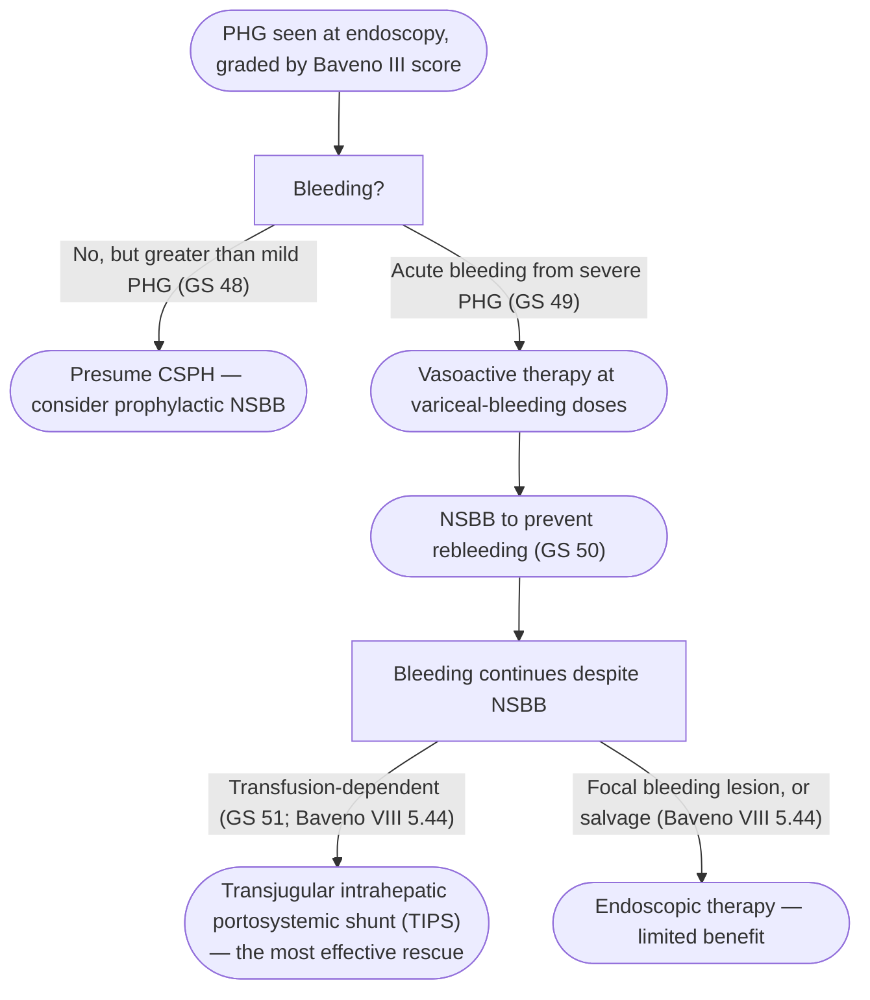

## Contents
- [[#Assessment]]
  - [[#Establishing the Diagnosis]]
  - [[#Severity Assessment]]
  - [[#Natural History]]
- [[#Differential Diagnosis]]
- [[#Diagnostics]]
  - [[#Upper Endoscopy]]
  - [[#Quantifying Blood Loss]]
- [[#Therapeutics]]
  - [[#Reducing Portal Pressure — the Primary Strategy]]
  - [[#Acute PHG Bleeding]]
  - [[#Preventing Recurrent Bleeding]]
  - [[#Endoscopic Therapy — a Limited Role]]
  - [[#Iron Repletion]]
  - [[#Portal Hypertension–Related Gastric Polyps]]
- [[#See Also]]
- [[#Sources]]

## Assessment

### Establishing the Diagnosis

- **Portal hypertensive gastropathy (PHG) is an endoscopic diagnosis** — it requires endoscopic visualization ([[aga-2024-ida-management]]). No serologic or imaging surrogate.
- **Appearance:** a **"snakeskin" mosaic mucosal pattern** with variable degrees of intraepithelial hemorrhage — a common observation in [[cirrhosis]].
- **Mechanism:** raised portal pressure → submucosal vascular hyperemia → mucosal venous and capillary ectasia. Gastric mucosal changes follow a typical histologic pattern, but the pathogenesis is complex and poorly understood.
- **[[portal-hypertension|Portal hypertension]] is necessary but not sufficient** — every patient with PHG has portal hypertension, but not every patient with portal hypertension has PHG. Development usually requires **clinically significant portal hypertension (CSPH)** — the CSPH cutoffs are on [[portal-hypertension]].
- **Frequency rises** with more severe portal hypertension, advanced liver disease, longer disease duration, and the presence of esophageal varices.

> [!pitfall] Exclude H. pylori before calling it PHG
> *[[helicobacter-pylori-infection|Helicobacter pylori]]* gastritis is the principal mimic of mucosal granularity; the evidence for prophylactic [[nonselective-beta-blockers|nonselective beta-blockers (NSBB)]] comes from studies that excluded it first ([[aasld-2023-portal-hypertension]]).

**Prevalence in compensated cirrhosis — 49%–80%**, stratified by variceal burden:

| Variceal status | Prevalence of PHG |
|---|---|
| No varices | 11% |
| Small varices | 35% |
| Medium or large varices | 80%–97% |

### Severity Assessment

**Baveno III classification (AASLD 2023 Table 6)** — the score that defines "greater than mild" PHG:

| Feature | Score |
|---|---|
| Mucosal mosaic pattern — mild | 1 |
| Mucosal mosaic pattern — severe | 2 |
| Red markings — isolated | 1 |
| Red markings — confluent | 2 |
| [[gastric-antral-vascular-ectasia\|Gastric antral vascular ectasia (GAVE)]] — absent | 1 |
| GAVE — present | 2 |

- **Mild PHG ≤3 · severe PHG ≥4.** This is the threshold behind the "greater than mild PHG" trigger for prophylactic NSBB below.
- Table 6 assigns **no score to an absent mosaic pattern or to absent red markings** — only to mild/severe and isolated/confluent — so the lowest total the table can produce is 3. Mild PHG is therefore a score of 3; anything above it is severe.
- The **New Italian Endoscopic Club (NIEC)** system also exists; [[aasld-2023-portal-hypertension]] names it but prints only the Baveno III criteria.
- **What the grading systems agree on:**
  - **Intramucosal hemorrhage** — cherry red spots, black-brown spots, or red point lesions — **separates severe from mild PHG**, with moderate correlation to clinical events on follow-up.
  - **Concomitant GAVE confers a higher risk of hemorrhage.**

### Natural History

- **Progression is frequent; regression is rare.** In the HALT-C cohort over 4 years: **97/170 (57%)** with cirrhosis and no baseline PHG developed it, and **115/174 (66%)** with baseline PHG worsened in grade.
- **Strongest predictors of progression:** presence of varices and/or **Child-Turcotte-Pugh (CTP) class B/C** cirrhosis.
- PHG features can **worsen transiently after sclerotherapy or [[endoscopic-band-ligation|band ligation]] of esophageal varices**, and that worsening correlates with poorer clinical outcomes.

## Differential Diagnosis

*Workup: see [[upper-gi-bleeding]].*

- **[[gastric-antral-vascular-ectasia|GAVE]] must be distinguished from PHG because the treatments differ** (Baveno VI/VII, retained as still valid in Baveno VIII) — the distinguishing features and the GAVE pathway live on [[gastric-antral-vascular-ectasia]].
- *H. pylori* gastritis — exclude it first (pitfall above).
- Portal hypertension–related [[gastric-polyps|gastric polyps]] (below).
- [[variceal-upper-gi-bleeding|Gastric varices]] — a separate lesion with a separate pathway.
- [[angioectasia|Angioectasia]] elsewhere in the gastrointestinal (GI) tract.

## Diagnostics

### Upper Endoscopy

- **[[upper-endoscopy|Esophagogastroduodenoscopy (EGD)]] is the only diagnostic test** — grade with the Baveno III features above in the same examination.
- Test for *H. pylori* in the same examination, since it is the alternative explanation for the mucosal appearance.

### Quantifying Blood Loss

The two sequelae of PHG are acute and chronic hemorrhage, and they are quantified differently:

| Sequela | Definition | Frequency |
|---|---|---|
| Acute bleeding | Overt upper GI hemorrhage | **2.5%–5%** · stops spontaneously in **over half** with supportive care |
| Chronic blood loss | **Fall in hemoglobin of 2 g/dL over a 6-month interval** | **4%–12%** — commoner than acute bleeding |

- Chronic loss presents as [[iron-deficiency-anemia|iron-deficiency anemia (IDA)]]; iron-study cutoffs live on that page.

## Therapeutics

*Management of portal hypertensive gastropathy, from prophylaxis through rescue*
*Built from AASLD 2023 guidance statements 48, 49, 50 and 51 and Baveno VIII statement 5.44 (neither document prints a flowchart)*
*[[aasld-2023-portal-hypertension|AASLD 2023 Practice Guidance on Portal Hypertension and Varices in Cirrhosis]] · [[baveno-viii-2026-portal-hypertension|Baveno VIII — Advancing Consensus in Portal Hypertension (2026)]]*
*PHG = portal hypertensive gastropathy · GS = AASLD guidance statement · CSPH = clinically significant portal hypertension · NSBB = nonselective beta-blockers · TIPS = transjugular intrahepatic portosystemic shunt*

### Reducing Portal Pressure — the Primary Strategy

- **Management focuses primarily on reducing portal pressure with NSBB** (Baveno VIII 5.44; level of evidence [LoE] 4, strength of recommendation strong, 91% agreement).
- **Greater-than-mild PHG → presume CSPH → consider prophylactic NSBB** to prevent decompensation; this may also prevent hemorrhagic complications or IDA from severe PHG ([[aasld-2023-portal-hypertension]] GS 48).
- Acute NSBB administration reduces gastric hyperemia and may attenuate bleeding during acute PHG hemorrhage.
- **The most effective portal-pressure reductions are [[tips|TIPS]] and [[liver-transplantation|liver transplantation]]** ([[aga-2024-ida-management]]).
- NSBB agent choice, dosing and contraindications: [[nonselective-beta-blockers]].

### Acute PHG Bleeding

- **Severe PHG with acute bleeding → vasoactive therapy for 2–5 days at variceal-bleeding doses** (GS 49): somatostatin, a [[somatostatin-analogs|somatostatin analogue]] such as **octreotide**, or **[[terlipressin]]** where available. AASLD 2023 points to its own Table 5 variceal doses; those doses live on the two drug pages.
- Evidence is low quality; the aim is to accelerate resolution and reduce transfusion need. Over half of episodes stop spontaneously on supportive care alone.

### Preventing Recurrent Bleeding

- **NSBB are recommended to prevent rebleeding from PHG** and from portal hypertension–related polyps (GS 50). Baveno VII 7.13 calls NSBB **first-line therapy for preventing recurrent PHG bleeding (A.1)**. A randomized controlled trial (RCT) showed a clear benefit from **propranolol** in preventing recurrent PHG bleeding.
- **Transfusion-dependent PHG bleeding despite NSBB → consider TIPS** (GS 51). **Baveno VIII 5.44 is more emphatic: for severe or refractory PHG bleeding, TIPS is the most effective rescue therapy.** Case series of portocaval shunts and TIPS report high rates of bleeding control with portosystemic decompression.
- **What changed:** Baveno VII 7.15 conditioned TIPS on transfusion dependence despite **both** traditional NSBB or carvedilol **and** endoscopic therapy (C.1). Baveno VIII 5.44 conditions it on severe or refractory bleeding alone.

### Endoscopic Therapy — a Limited Role

> [!pearl] Endoscopic therapy does not lower portal pressure
> That is why it helps so little here, and why it is reserved for focal bleeding lesions or salvage situations (Baveno VIII 5.44). The bleeding comes from **diffuse** mucosal lesions ([[aga-2024-ida-management]]).

- **This is a demotion.** Baveno VII had offered endoscopic therapy more freely — 7.14 said [[argon-plasma-coagulation|argon plasma coagulation (APC)]] or hemospray "may be used" for recurrent PHG bleeding (D.1), and 6.25 listed APC, [[radiofrequency-ablation|radiofrequency ablation (RFA)]] and band ligation as local options for PHG and GAVE alike (C.2). **Baveno VIII governs.**
- Nonrandomized data suggest **APC may attenuate chronic blood loss** in chronic PHG bleeding.
- A small case series documented some response of PHG- and GAVE-related acute bleeding to **hemostatic spray**.

### Iron Repletion

- **Oral iron first — there is no known malabsorptive defect in PHG**, so oral therapy should suffice ([[aga-2024-ida-management]] best practice advice [BPA] 10).
- **Intravenous (IV) iron** for patients with **ongoing bleeding who do not respond to oral iron**; there is no contraindication to IV iron in PHG and it is reasonable in profound IDA (BPA 10).
- **PHG with IDA and no other identified source of chronic blood loss → treatment of portal hypertension with NSBB can be considered** (BPA 11).
- All 15 BPA statements in that update are **unrated** — no systematic review was performed, so they carry no formal quality-of-evidence or strength rating.
- Formulations, dosing intervals and response targets: [[iron-deficiency-anemia]].

### Portal Hypertension–Related Gastric Polyps

- Found in the **gastric antrum**, occasionally the duodenum, in **~1%–10%** of patients with cirrhosis.
- **Predominantly hyperplastic with negligible risk of malignant transformation.**
- They can contribute to chronic GI bleeding, which **may respond to NSBB or TIPS** (and are covered by GS 50).

> [!pitfall] Do not routinely biopsy these polyps
> Routine biopsy should be discouraged — the natural history is benign, and feeding vessels deep within the submucosa can bleed significantly ([[aasld-2023-portal-hypertension]]).

## See Also

[[gastric-antral-vascular-ectasia]], [[portal-hypertension]], [[cirrhosis]], [[variceal-upper-gi-bleeding]], [[upper-gi-bleeding]], [[nonselective-beta-blockers]], [[tips]], [[liver-transplantation]], [[argon-plasma-coagulation]], [[iron-deficiency-anemia]], [[gastric-polyps]], [[helicobacter-pylori-infection]]

---

## Sources

1. [[aasld-2023-portal-hypertension|AASLD 2023 Practice Guidance on Portal Hypertension and Varices in Cirrhosis]]
2. [[baveno-viii-2026-portal-hypertension|Baveno VIII — Advancing Consensus in Portal Hypertension (2026)]]
3. [[baveno-vii-2022-portal-hypertension|Baveno VII — Renewing Consensus in Portal Hypertension (2022)]]
4. [[aga-2024-ida-management|AGA Clinical Practice Update on Management of Iron Deficiency Anemia: Expert Review]]
