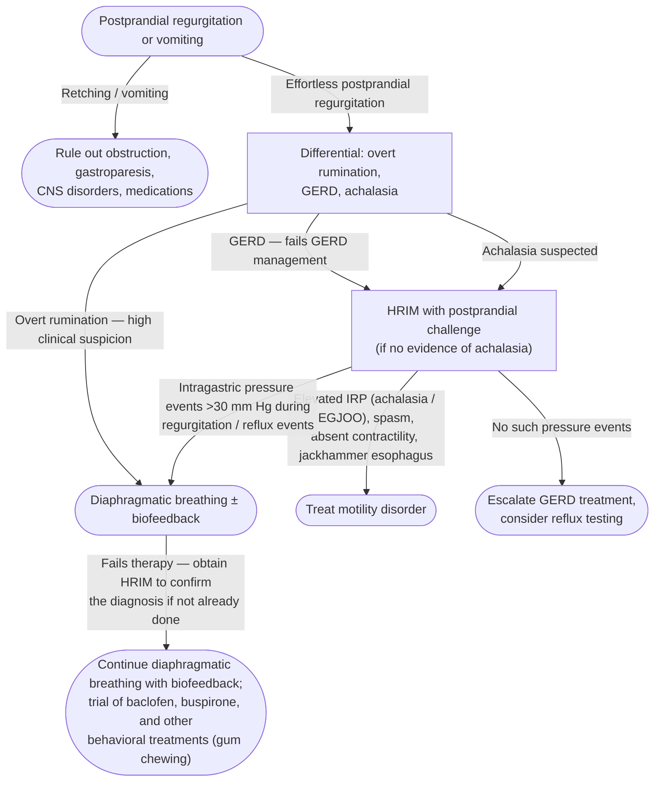

## Contents
- [[#Assessment]]
  - [[#Establishing the Diagnosis]]
  - [[#Severity Assessment]]
  - [[#Pathophysiology]]
- [[#Differential Diagnosis]]
- [[#Diagnostics]]
  - [[#Postprandial High-Resolution Impedance Manometry (HRIM) — Diagnostic Standard]]
  - [[#Adjunctive Testing]]
- [[#Therapeutics]]
  - [[#Diaphragmatic Breathing — First Line in All Cases]]
  - [[#Medical Therapy]]
- [[#See Also]]
- [[#Sources]]

---

## Assessment

### Establishing the Diagnosis

**Definition:** A clinical diagnosis resting on four cardinal features ([[acg-2020-esophageal-physiologic-testing]]):

- **Effortless, repetitive regurgitation** of recently ingested food into the mouth
- Subsequent **spitting or remastication and reswallowing**
- **No nausea, retching, or vomiting**
- Regurgitant is **recognized food with a pleasant taste** (not acidic/digested)

It is classified in **Rome V among the gastroduodenal [[disorders-of-gut-brain-interaction|disorders of gut–brain interaction]] at B5** ([[rome-v-2026-gastroduodenal-disorders]]) — a behavioral condition, not a primary structural or motility disease.

**Rome V criteria (B5)** — must include **all**, fulfilled for the last 3 months with onset ≥6 months before diagnosis:

> 1. **Recurrent, seemingly effortless regurgitation of recently ingested food into the mouth**, with subsequent oral expulsion or swallowing
> 2. **Regurgitation is not preceded by retching or nausea**
>
> *Supportive criteria:* regurgitated material contains recognizable food that might have a pleasant taste · the process tends to cease when the regurgitated material becomes acidic · **the presence of heartburn may help differentiate regurgitation in [[gerd|gastroesophageal reflux disease (GERD)]] from rumination** · combined manometry and impedance monitoring can establish an objective diagnosis.

- **Changed from Rome IV:** "not preceded by nausea" was **promoted out of the supportive criteria into diagnostic criterion 2** — the committee judged it diagnostically decisive. A new supportive remark underlines that objective diagnosis by esophageal impedance monitoring with concurrent manometry is available, and a supportive criterion was added to separate reflux disease from rumination.
- **Three event types** ([[rome-v-2026-gastroduodenal-disorders]]): most are **classic/primary** — an **intra-abdominal pressure rise from voluntary abdominal contraction**; a **secondary (reflux) rumination** subset has gastric contents entering the esophagus *before* straining, so the patient strains in response to a perceived reflux episode; **supragastric rumination** is immediately preceded by a supragastric belch. Whether the patterns change management is unknown ([[aga-2018-rumination-syndrome]]), so they do not drive therapy.
- **Timing:** regurgitation typically begins **10–15 min after a meal** and can persist **1–2 hours**; it stops once the material turns acidic and **does not occur during sleep**. Ingesting liquids facilitates rumination of solid food.
- **Ask about it in anyone with consistent postprandial regurgitation** (Best Practice Advice (BPA) 1) — these patients are routinely labelled refractory reflux or vomiting, and visit an average of 5 physicians over 2.7–4.9 y before the diagnosis is made. Diagnose **primarily on the Rome criteria after an appropriate medical work-up** (BPA 3).
- **Screen for psychiatric comorbidity in all of them** — anxiety and depression are more common than in the general population, and an underlying eating disorder is common enough to look for in every patient with consistent postprandial regurgitation.
- Prevalence **3.1%**, more common in women (54.5% vs 45.5%), mean age 44.5 y — **up to 12.8%** among patients evaluated for gastric symptoms. **Commonly misdiagnosed as GERD, [[gastroparesis]], unexplained vomiting, or an eating disorder.**

> [!pearl] Atypical features make it less likely — they don't exclude it
> **Nocturnal regurgitation, dysphagia, nausea, or symptoms away from meals do not exclude rumination syndrome** (BPA 2). Neither do heartburn, bloating, belching, abdominal pain, diarrhea — nor erosive esophagitis, which is usually absent but compatible when found ([[aga-2018-rumination-syndrome]]).

### Severity Assessment

- **No validated severity grade or symptom-measurement tool exists** for rumination syndrome, unlike most other disorders of gut–brain interaction ([[aga-2018-rumination-syndrome]]); the Rome V criteria are present/absent, not graded. Severity is judged from nutritional and social impact.
- Impact ranges from **minor social inconvenience to disabling nutritional impairment**.
- **Weight loss in ~40%**; electrolyte disturbance and malnutrition are much less common in adults.
- **Dental erosions and caries are rare in adults**, more common in pediatric patients.

### Pathophysiology

- Episodes are driven by a rise in intragastric pressure generated by a **voluntary but unperceived and unintentional contraction of the abdominal wall musculature**; once it overcomes lower esophageal sphincter (LES) pressure, gastric content flows freely into the esophagus and mouth ([[aga-2018-rumination-syndrome]]).
- Increased intra-abdominal pressure **plus negative intrathoracic pressure** creates a permissive esophagogastric gradient, and the esophagogastric junction moves **from the intra-abdominal cavity into the thorax** at episode onset ([[acg-2020-esophageal-physiologic-testing]]) — the mechanism the manometric criteria measure.
- The manoeuvre **passes unnoticed by the patient** because its three components — **thoracic suction, abdominal thrust and hiatal opening** — are coordinated into a brief, smooth movement.
- **Gastric function is largely normal:** gastric emptying is normal in the majority; accommodation data conflict (barostat study — abnormal in 50%; single-photon emission computed tomography study — no difference vs controls).
- Few if any healthy people can induce rumination, so an **unrecognized central reflex** may also be at play.

---

## Differential Diagnosis

*Workup: see [[nausea-and-vomiting]].*

| Mimic | What separates it from rumination |
|---|---|
| **GERD / refractory reflux symptoms** | Rumination episodes are **not distinguishable from GERD by standard reflux metrics** on pH-impedance (baseline impedance does not discriminate either), though more "reflux" tends to **extend to the proximal esophagus** in rumination. **Failure to improve on antisecretory therapy** is the clinical clue. |
| **Supragastric belching** | Confirmed on **pH-impedance monitoring** — impedance separates retrograde **gas** (belching) from **liquid/food** (rumination). See [[ambulatory-reflux-monitoring]]. |
| **[[gastroparesis\|Gastroparesis]]** | Vomiting is intermittent, **preceded by nausea and retching**, occurs **late postprandially**, and the vomitus is **no longer recognizable as ingested food**; gastric emptying is delayed. |
| **Vomiting disorders** ([[cyclic-vomiting-syndrome\|cyclic vomiting syndrome]], [[cannabinoid-hyperemesis-syndrome\|cannabinoid hyperemesis syndrome]]) | True emesis is forceful and preceded by nausea/retching, unlike effortless rumination. |
| **[[achalasia\|Achalasia]] / [[esophagogastric-junction-outflow-obstruction\|esophagogastric junction outflow obstruction]]** | Regurgitation of retained undigested food with [[dysphagia]]; **reswallowing is uncommon** and patients often **stop eating at the first regurgitation**. |
| **Eating disorders** (bulimia, anorexia nervosa) | Postprandial regurgitation or vomiting is self-induced or purgative; an eating disorder also **coexists in up to 20%** of rumination patients. |

> [!pearl] Failing acid suppression is the clue
> Rumination does **not** improve with antisecretory treatment — and these agents **may actually worsen** symptoms. Persistent postprandial regurgitation through an adequate [[proton-pump-inhibitors|proton pump inhibitor (PPI)]] trial should raise suspicion rather than prompt escalation ([[aga-2018-rumination-syndrome]]).

**Approach to postprandial regurgitation or vomiting:**

*Approach to the patient with postprandial regurgitation or vomiting — a key, but not exhaustive, differential*
*Source: redrawn from Figure 4 of the AGA 2018 rumination syndrome Clinical Practice Update*
*[[aga-2018-rumination-syndrome|AGA Clinical Practice Update on the Diagnosis and Treatment of Rumination Syndrome: Expert Review (2018)]]*
*CNS = central nervous system · EGJOO = esophagogastric junction outflow obstruction · GERD = gastroesophageal reflux disease · HRIM = high-resolution impedance manometry · IRP = integrated relaxation pressure*

---

## Diagnostics

Rumination syndrome is a **clinical diagnosis**; objective testing confirms it in selected or refractory cases and excludes mimics. Per American College of Gastroenterology (ACG) 2020 ([[acg-2020-esophageal-physiologic-testing]]), **esophagogastroduodenoscopy (EGD) should precede physiologic testing** to exclude structural/mucosal disease, and **no test should be ordered without a clear clinical hypothesis** ([[upper-endoscopy]]).

### Postprandial High-Resolution Impedance Manometry (HRIM) — Diagnostic Standard

- **ACG Recommendation 15 (conditional, low quality of evidence):** [[high-resolution-manometry|HRIM]] with **postprandial monitoring** is recommended to confirm the diagnosis of rumination when clinically needed. The American Gastroenterological Association (AGA) update agrees it **supports** rather than makes the diagnosis (BPA 6), and names its two limits: **required expertise and the absence of standardized protocols**, so it is offered at **select referral centres** only.
- **Manometric criteria:** increase in **intragastric pressure >30 mm Hg** with **proximal movement of gastric content**, **esophageal pressurization**, and a **clinically recognized rumination episode**.
- **Performance:** sensitivity **75–80%** and specificity **100%** for HRIM (study of 15 children/adolescents with rumination and 15 controls).
- **Postprandial protocol increases yield:** monitoring after a refluxogenic meal increases identification of rumination episodes. In a retrospective review of 94 patients with persistent esophageal symptoms despite PPI therapy, **20% had a rumination profile** during postprandial HRIM lasting up to **90 minutes** after the meal.
- **Combined high-resolution manometry (HRM) + pH-impedance:** in a small study of 5 patients, the combination had **86% sensitivity** for identifying rumination episodes.

> [!pitfall] Frequent swallowing during the study fakes the finding
> Repeated swallows relax the LES and can **confound the manometric diagnosis** ([[acg-2020-esophageal-physiologic-testing]]) — read pressure events against a recognized rumination episode, not in isolation.

### Adjunctive Testing

- **Ambulatory pH-impedance monitoring** ([[ambulatory-reflux-monitoring]] / [[reflux-testing]]) — used **off acid suppression** when supragastric belching or rumination is suspected as part of evaluating unproven GERD; impedance is what separates the two behaviors. Standard reflux metrics (acid exposure time (AET), baseline impedance) **do not discriminate** rumination from GERD, so the postprandial HRIM pattern is the key.
- **Abdominal wall and intercostal electromyography (EMG)** — **both diagnostic and therapeutic** (it is also the biofeedback signal). Regurgitation episodes carry a characteristic **abrupt (0.6 s), simultaneous rise in intercostal activity (thoracic suction) and anterior abdominal wall activity (abdominal compression)**. Available only at select expert centres ([[aga-2018-rumination-syndrome]]).
- **Gastroduodenal manometry** — shows the characteristic **"R wave"**, a spike pattern recorded simultaneously across all sensors and coinciding with regurgitation; used less often in practice because it is invasive and of limited availability.

---

## Therapeutics

*All from [[aga-2018-rumination-syndrome]] unless stated. It is an Expert Review Clinical Practice Update — its BPA statements are **ungraded**.*

**The cornerstone of treatment is a thorough explanation of the condition and of the mechanism behind the episodes** — recognition should **stop** escalation of acid suppression, not start it ([[acg-2020-esophageal-physiologic-testing]]).

### Diaphragmatic Breathing — First Line in All Cases

**BPA 4: diaphragmatic breathing, with or without biofeedback, is first-line therapy in *all* cases.** **BPA 5: speech therapists, psychologists, gastroenterologists and any practitioner familiar with the technique can teach it** — it does not require a specialist referral.

> [!howto] Teaching diaphragmatic breathing
> 1. **Learn the movement:** one hand on the chest, one on the abdomen — **only the abdominal hand moves outward** with inspiration; the chest stays still.
> 2. **Inhale slowly through the nose**, protruding the abdomen, chest stationary.
> 3. **Exhale slowly through the mouth**, letting the abdomen retract. Each breath slow and complete.
> 4. **Aim for 6–8 respirations per minute.**
> 5. **15 minutes after every meal** — longer if the sensation of impending rumination remains.
> 6. **Also practise away from meals**, to become expert at it.

- **Resolution or improvement in 20%–66%** across uncontrolled studies and case series.
- **Two mechanisms:** it **lowers postprandial intragastric pressure** *and* **raises esophagogastric junction pressure**.
- ⚠ **Effect is not durable on its own** — in an observational HRIM-biofeedback study, rumination episodes **restarted promptly once patients resumed their normal breathing pattern**.

**Biofeedback** (EMG-guided): patients watch real-time recordings and learn to **reduce intercostal and anterior abdominal wall activity while increasing diaphragmatic activity**, then practise **5 minutes before and after meals** at home.

- Randomized trial vs sham: rumination activity fell **74% ± 6%** (29 ± 6 → 7 ± 2 daily events) vs **1% ± 14%** with sham (*P* = .001).
- Observational: **18 → 8 episodes/day** (*P* < .001), falling to **<1/day at 6 months**, with improved meal tolerance.
- ⚠ **Equipment and expertise are not widely available**, which is why BPA 4 permits breathing training without it.

### Medical Therapy

**Only two pharmacotherapy studies exist in rumination syndrome.**

| Agent | Evidence | Verdict |
|---|---|---|
| **[[baclofen\|Baclofen]] 10 mg three times daily** (cautions on the drug page) | Randomized cross-over, 22 patients (16 with rumination): modest ↓ postprandial flow events; **symptom improvement 63% vs 26% placebo** | **BPA 7 — the named next step in refractory patients** |
| **Levosulpiride** (dopamine D2 antagonist, prokinetic) | 21 adults, 8 months, with supportive psychotherapy | **38% improved, 48% unchanged, ⚠ 14% worsened** |
| **Buspirone** (5-hydroxytryptamine 1A agonist, induces fundic relaxation) | ⚠ **No trials in rumination syndrome**; works in functional [[dyspepsia]] | "Reasonable" on mechanism (up to 50% have impaired fundic relaxation), but **anecdotal benefit appears limited** |
| **Chewing gum** | **2 case reports**, both pediatric/adolescent | Reported as beneficial; nothing more |

> [!pitfall] Don't send them to surgery
> **"We recommend avoiding surgery as a therapy for rumination syndrome."** Fundoplication rests on a 5-patient case series of non-responders — and ⚠ **prior rumination cohorts included patients still symptomatic *after* fundoplication**. One case report of subtotal gastrectomy exists. With no controlled data and real surgical risk, any role in refractory patients **remains investigational** ([[aga-2018-rumination-syndrome]]).

---

## See Also

[[nausea-and-vomiting]], [[disorders-of-gut-brain-interaction]], [[gerd]], [[gastroparesis]], [[cyclic-vomiting-syndrome]], [[cannabinoid-hyperemesis-syndrome]], [[achalasia]], [[esophagogastric-junction-outflow-obstruction]], [[ambulatory-reflux-monitoring]], [[reflux-testing]], [[high-resolution-manometry]], [[upper-endoscopy]], [[chicago-classification-v4]], [[dyspepsia]], [[baclofen]]

---

## Sources

1. [[aga-2018-rumination-syndrome|AGA Clinical Practice Update on the Diagnosis and Treatment of Rumination Syndrome: Expert Review (2018)]]
2. [[rome-v-2026-gastroduodenal-disorders|Gastroduodenal Disorders (Rome V, 2026)]]
3. [[rome-v-2026-dgbi|Disorders of Gut–Brain Interaction and the Rome V Process]]
4. [[acg-2020-esophageal-physiologic-testing|ACG 2020: Clinical Use of Esophageal Physiologic Testing]]
