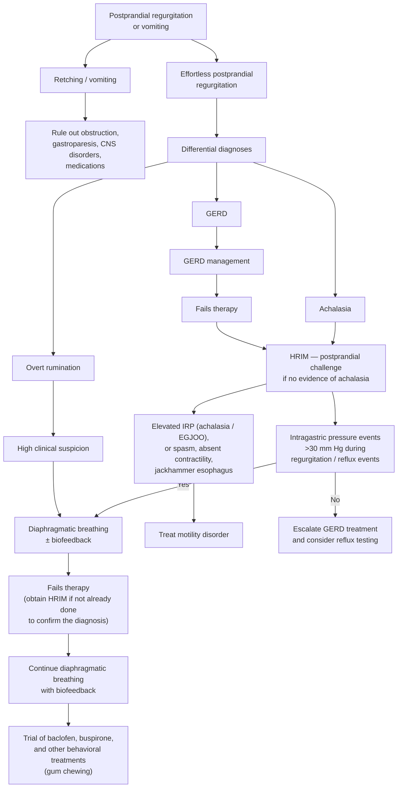

## Contents
- [[#Assessment]]
  - [[#Establishing the Diagnosis]]
  - [[#Severity Assessment]]
  - [[#Pathophysiology]]
- [[#Differential Diagnosis]]
- [[#Diagnostics]]
  - [[#Postprandial High-Resolution Impedance Manometry (HRIM) — Diagnostic Standard]]
  - [[#Adjunctive Testing]]
- [[#Therapeutics]]
  - [[#Diaphragmatic Breathing — First Line in All Cases]]
  - [[#Medical Therapy]]
- [[#See Also]]
- [[#Sources]]

---

## Assessment

### Establishing the Diagnosis

**Definition:** A clinical diagnosis resting on four cardinal features ([[acg-2020-esophageal-physiologic-testing]]):

- **Effortless, repetitive regurgitation** of recently ingested food into the mouth
- Subsequent **spitting or remastication and reswallowing**
- **No nausea, retching, or vomiting**
- Regurgitant is **recognized food with a pleasant taste** (not acidic/digested)

It is classified in **Rome V among the gastroduodenal [[disorders-of-gut-brain-interaction|disorders of gut–brain interaction]] (B4)** ([[rome-v-2026-dgbi]]) — a behavioral condition, not a primary structural or motility disease.

### Severity Assessment

- **Neither guideline gives a severity score, stratum, or grading system for rumination syndrome** — [[acg-2020-esophageal-physiologic-testing]] covers diagnosis only, and the [[rome-v-2026-dgbi]] overview article places rumination at **B4** without printing the criteria.
- The only ordinal element the guidelines give is the manometric bar itself — a **diagnostic threshold, not a severity grade** (criteria under [[#Postprandial High-Resolution Impedance Manometry (HRIM) — Diagnostic Standard]]).

### Pathophysiology

- Gastric content moves **from the intra-abdominal cavity into the thorax, driven by a rise in intra-abdominal pressure at the onset of the episode** ([[acg-2020-esophageal-physiologic-testing]]) — this is the mechanism the manometric criteria measure.
- An important **behavioral mimic of [[gerd|gastroesophageal reflux disease (GERD)]]** (see [[#Differential Diagnosis]]).

---

## Differential Diagnosis

*Workup: see [[nausea-and-vomiting]].*

**The approach to postprandial regurgitation or vomiting** ([[aga-2018-rumination-syndrome]], Figure 4 — a key, but not exhaustive, differential):

*Figure 4 — approach to the patient with postprandial regurgitation or vomiting. CNS = central nervous system; EGJOO = [[esophagogastric-junction-outflow-obstruction|esophagogastric junction outflow obstruction]]; IRP = integrated relaxation pressure. ([[aga-2018-rumination-syndrome]])*

- **GERD / refractory reflux symptoms** — rumination episodes are **not distinguishable from GERD using standard reflux metrics** on pH-impedance, though more "reflux" tends to **extend to the proximal esophagus** in rumination. Rumination has **suboptimal outcomes with standard antireflux therapies**, an important clinical clue.
- **Supragastric belching** — another atypical behavior that can mimic reflux; confirmed on **pH-impedance monitoring** (impedance distinguishes retrograde **gas** of belching from **liquid/food** of rumination). See [[ambulatory-reflux-monitoring]].
- **[[gastroparesis|Gastroparesis]]** — vomiting of partially digested food hours after meals, preceded by nausea, with delayed gastric emptying.
- **Vomiting disorders** — true emesis is forceful and preceded by nausea/retching, distinguishing it from effortless rumination.
- **[[achalasia|Achalasia]] / [[esophagogastric-junction-outflow-obstruction|esophageal outflow obstruction]]** — regurgitation of retained undigested food with [[dysphagia]].

---

## Diagnostics

Rumination syndrome is a **clinical diagnosis**; objective testing confirms it in selected or refractory cases and excludes mimics. Per American College of Gastroenterology (ACG) 2020 ([[acg-2020-esophageal-physiologic-testing]]), **esophagogastroduodenoscopy (EGD) should precede physiologic testing** to exclude structural/mucosal disease, and **no test should be ordered without a clear clinical hypothesis** ([[upper-endoscopy]]).

### Postprandial High-Resolution Impedance Manometry (HRIM) — Diagnostic Standard

- **ACG Recommendation 15:** [[high-resolution-manometry|HRIM]] with **postprandial monitoring** is recommended to confirm the diagnosis of rumination when clinically needed.
- **Manometric criteria:** increase in **intragastric pressure >30 mm Hg** with **proximal movement of gastric content**, **esophageal pressurization**, and a **clinically recognized rumination episode**.
- **Performance:** sensitivity **75–80%** and specificity **100%** for HRIM (study of 15 children/adolescents with rumination and 15 controls).
- **Postprandial protocol increases yield:** monitoring after a refluxogenic meal increases identification of rumination episodes. In a retrospective review of 94 patients with persistent esophageal symptoms despite [[proton-pump-inhibitors|proton pump inhibitor (PPI)]] therapy, **20% had a rumination profile** during postprandial HRIM lasting up to **90 minutes** after the meal.
- **Combined high-resolution manometry (HRM) + pH-impedance:** in a small study of 5 patients, the combination had **86% sensitivity** for identifying rumination episodes.

### Adjunctive Testing

- **Ambulatory pH-impedance monitoring** ([[ambulatory-reflux-monitoring]] / [[reflux-testing]]) — used **off acid suppression** when supragastric belching or rumination is suspected as part of evaluating unproven GERD; impedance is what separates the two behaviors.
- Standard reflux metrics (acid exposure time [AET], baseline impedance) **do not discriminate** rumination from GERD, so the postprandial HRIM pattern is the key.

---

## Therapeutics

*All from [[aga-2018-rumination-syndrome]] unless stated. It is an Expert Review Clinical Practice Update — its statements are **ungraded Best Practice Advice (BPA)**.*

**Recognizing it is itself the first intervention** — these patients are routinely labelled refractory reflux or vomiting (BPA 1), and recognition should **stop** escalation of acid suppression, not start it ([[acg-2020-esophageal-physiologic-testing]]).

### Diaphragmatic Breathing — First Line in All Cases

**BPA 4: diaphragmatic breathing, with or without biofeedback, is first-line therapy in *all* cases.** **BPA 5: speech therapists, psychologists, gastroenterologists and any practitioner familiar with the technique can teach it** — it does not require a specialist referral.

> [!howto] Teaching diaphragmatic breathing
> 1. **Learn the movement:** one hand on the chest, one on the abdomen — **only the abdominal hand moves outward** with inspiration; the chest stays still.
> 2. **Inhale slowly through the nose**, protruding the abdomen, chest stationary.
> 3. **Exhale slowly through the mouth**, letting the abdomen retract. Each breath slow and complete.
> 4. **Aim for 6–8 respirations per minute.**
> 5. **15 minutes after every meal** — longer if the sensation of impending rumination remains.
> 6. **Also practise away from meals**, to become expert at it.

- **Resolution or improvement in 20%–66%** across uncontrolled studies and case series.
- **Two mechanisms:** it **lowers postprandial intragastric pressure** *and* **raises esophagogastric junction pressure**.
- ⚠ **Effect is not durable on its own** — in an observational [[high-resolution-manometry|HRIM]]-biofeedback study, rumination episodes **restarted promptly once patients resumed their normal breathing pattern**.

**Biofeedback** (electromyography (EMG)-guided): patients watch real-time recordings and learn to **reduce intercostal and anterior abdominal wall activity while increasing diaphragmatic activity**, then practise **5 minutes before and after meals** at home.

- Randomized trial vs sham: rumination activity fell **74% ± 6%** (29 ± 6 → 7 ± 2 daily events) vs **1% ± 14%** with sham (*P* = .001).
- Observational: **18 → 8 episodes/day** (*P* < .001), falling to **<1/day at 6 months**, with improved meal tolerance.
- ⚠ **Equipment and expertise are not widely available**, which is why BPA 4 permits breathing training without it.

### Medical Therapy

**Only two pharmacotherapy studies exist in rumination syndrome.**

| Agent | Evidence | Verdict |
|---|---|---|
| **[[baclofen\|Baclofen]]** (dose and cautions on the drug page) | Randomized cross-over, 22 patients (16 with rumination): modest ↓ postprandial flow events; **symptom improvement 63% vs 26% placebo** | **BPA 7 — the named next step in refractory patients** |
| **Levosulpiride** (dopamine D2 antagonist, prokinetic) | 21 adults, 8 months, with supportive psychotherapy | **38% improved, 48% unchanged, ⚠ 14% worsened** |
| **Buspirone** (5-hydroxytryptamine 1A agonist, induces fundic relaxation) | ⚠ **No trials in rumination syndrome**; works in functional [[dyspepsia]] | "Reasonable" on mechanism (up to 50% have impaired fundic relaxation), but **anecdotal benefit appears limited** |
| **Chewing gum** | **2 case reports**, both pediatric/adolescent | Reported as beneficial; nothing more |

> [!pitfall] Don't send them to surgery
> **"We recommend avoiding surgery as a therapy for rumination syndrome."** Fundoplication rests on a 5-patient case series of non-responders — and ⚠ **prior rumination cohorts included patients still symptomatic *after* fundoplication**. One case report of subtotal gastrectomy exists. With no controlled data and real surgical risk, any role in refractory patients **remains investigational** ([[aga-2018-rumination-syndrome]]).

---

## See Also

[[nausea-and-vomiting]], [[disorders-of-gut-brain-interaction]], [[gerd]], [[gastroparesis]], [[cyclic-vomiting-syndrome]], [[cannabinoid-hyperemesis-syndrome]], [[achalasia]], [[esophagogastric-junction-outflow-obstruction]], [[ambulatory-reflux-monitoring]], [[reflux-testing]], [[high-resolution-manometry]], [[upper-endoscopy]], [[chicago-classification-v4]], [[dyspepsia]], [[baclofen]]

---

## Sources

1. [[aga-2018-rumination-syndrome|AGA Clinical Practice Update on the Diagnosis and Treatment of Rumination Syndrome: Expert Review (2018)]]
2. [[rome-v-2026-dgbi|Disorders of Gut–Brain Interaction and the Rome V Process]]
3. [[acg-2020-esophageal-physiologic-testing|ACG 2020: Clinical Use of Esophageal Physiologic Testing]]
