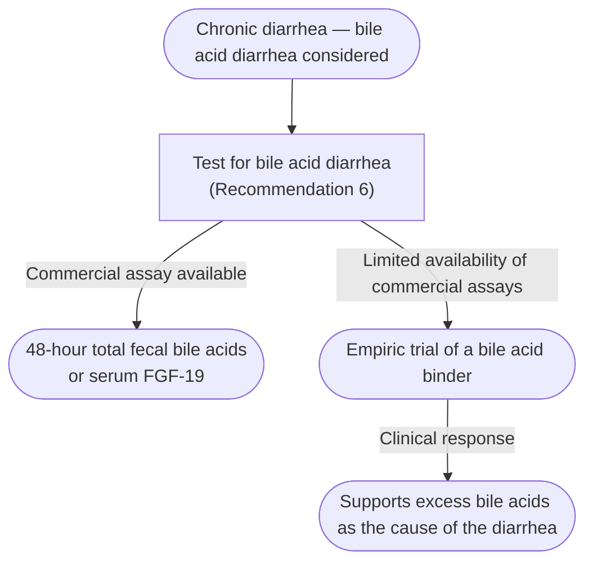

## Contents
- [[#Assessment]]
  - [[#Establishing the Diagnosis]]
  - [[#Severity Assessment]]
  - [[#Classification / Typing]]
- [[#Differential Diagnosis]]
- [[#Diagnostics]]
- [[#Therapeutics]]
- [[#See Also]]
- [[#Sources]]

## Assessment

### Establishing the Diagnosis

- **Definition:** bile acid malabsorption (BAM) = inability to reabsorb sufficient bile acids in the **terminal ileum**. Excess bile acids reaching the colon are exposed to colonic flora → **secondary bile acids** → increased colonic fluid secretion → diarrhea. [[acg-2020-ibs]]
- Presents as **watery (secretory) [[chronic-diarrhea|chronic diarrhea]]**; overlaps heavily with [[irritable-bowel-syndrome|diarrhea-predominant irritable bowel syndrome (IBS-D)]] — bile acid diarrhea is thought to contribute to symptoms in a **subset** of IBS-D patients. [[acg-2020-ibs]]
- **No pathognomonic finding; the diagnosis is made by testing or by response to treatment** (see [[#Diagnostics]], [[#Therapeutics]]). Testing for BAM in the United States "remains limited and incompletely validated," no study has compared testing against empiric therapy, and an **empiric bile acid sequestrant trial is a reasonable course of action if BAM is suspected** (American College of Gastroenterology [ACG]). [[acg-2020-ibs]]
- **How common in IBS-D:** pooled data from **6 studies using 23-seleno-25-homotaurocholic acid (SeHCAT) testing — 28.1% (confidence interval [CI] 22.6%–34%)** of IBS-D patients met the studies' predefined SeHCAT threshold for BAM (random-effects model; significant heterogeneity, I² 72.1%). [[acg-2020-ibs]]
- **Settings that should raise the question:** post-ileal-resection, post-cholecystectomy, and idiopathic (see [[#Classification / Typing]]); also an ostomate with **chronic (late) high ostomy output**, where bile acid diarrhea sits on the etiology list beside infection, stomal stricture/obstruction/fistula, recurrent [[crohns-disease|Crohn's disease]] and [[microscopic-colitis|microscopic colitis]] — definitions and output thresholds on [[ostomy-management]]. [[aga-2023-ostomies]]

### Severity Assessment

- **No severity score, stratum or grading system for bile acid diarrhea is defined in the sources below.**

### Classification / Typing

**Three mechanisms by which bile acids reach the colon** [[acg-2020-ibs]]:

| Mechanism | Setting / detail |
|---|---|
| **Loss of absorptive surface** | Iatrogenic loss of the **distal small bowel**, reducing capacity to reabsorb bile excreted by the biliary system during digestion |
| **Altered timing of bile delivery** | **Cholecystectomy** changes the timing of bile delivery to the small intestine — a potentially important cause of worsening irritable bowel syndrome (IBS) symptoms, since IBS carries an increased risk of cholecystectomy (**odds ratio [OR] 2.09, CI 1.89–2.31**) |
| **Idiopathic** | Differential potential for bile acid reabsorption between individuals |

- **In [[inflammatory-bowel-disease|inflammatory bowel disease (IBD)]]:** bile acid diarrhea arises from altered small-bowel structure or function — above all in Crohn's disease with **ileal disease or ileal resection** — and is a named cause of diarrhea persisting despite controlled inflammation. Outside IBD it is a common cause of [[functional-diarrhea|functional diarrhea]] and IBS-D. Treatment is a **bile salt sequestrant**. [[aga-2018-functional-gi-symptoms-ibd]]

*ACG 2020 describes these three mechanisms but does not use the Type 1 / Type 2 / Type 3 nomenclature often applied to them.*

## Differential Diagnosis

*Workup: see [[chronic-diarrhea]].*

- [[irritable-bowel-syndrome|IBS-D]] — the dominant overlap; BAM is present in a subset of IBS-D patients and IBS-D is also the label most such patients already carry. [[acg-2020-ibs]]
- [[exocrine-pancreatic-insufficiency|Exocrine pancreatic insufficiency (EPI)]] — bile acid diarrhea is named among the mimics that overlap EPI and **blunt the response to pancreatic enzyme replacement therapy (PERT)**, so it should be considered when PERT fails. [[aga-2023-epi]]
- Microscopic colitis — grouped with bile acid diarrhea among the common adult diarrhea causes to look for in a patient with high ostomy output. [[aga-2023-ostomies]]
- [[small-intestinal-bacterial-overgrowth|small intestinal bacterial overgrowth (SIBO)]], [[celiac-disease|celiac disease]], [[giardiasis|Giardia]] and the rest of the watery-diarrhea differential — see the schema.

## Diagnostics

**American Gastroenterological Association (AGA) Recommendation 6 (verbatim):** *"In patients presenting with chronic diarrhea, the AGA suggests testing for bile acid diarrhea."* **Conditional recommendation; low-quality evidence.** *Comment:* *"In settings with limited availability of commercial assays, an empiric trial of a bile acid binder could be considered."* [[aga-2019-lab-evaluation-functional-diarrhea-ibs-d]]

- **Population the recommendation was written for:** the immunocompetent adult with **watery diarrhea of at least 4 weeks' duration** — not bloody diarrhea, signs of fat malabsorption, alarm features (weight loss, anemia, hypoalbuminemia), a family history of IBD/colon cancer/celiac disease, or travel to a region with recognised diarrhea-related pathogens. [[aga-2019-lab-evaluation-functional-diarrhea-ibs-d]]

*Testing route in suspected bile acid diarrhea*
*Source: built from AGA 2019 Recommendation 6, its Comment and the accompanying text (the guideline has no flowchart)*
*[[aga-2019-lab-evaluation-functional-diarrhea-ibs-d|AGA 2019 Clinical Practice Guidelines on the Laboratory Evaluation of Functional Diarrhea and IBS-D]]*
*FGF-19 = fibroblast growth factor 19*

| Test | Result that suggests bile acid diarrhea | Availability | Notes |
|---|---|---|---|
| **SeHCAT retention** | Retention below the study-defined threshold | Used in **Europe**; **not available in North America** | Nuclear-medicine test, **moderate diagnostic efficiency**; the most common test where it exists. ACG cites a "predefined threshold" but states no % retention cut-off |
| **48-hour total fecal bile acids** | Increased fecal bile acids | Available in the **United States** | **Reasonable diagnostic yield** compared with SeHCAT retention — the practical first test where SeHCAT is unavailable. Higher stool bile acids also predicted higher stool wet weight (healthy subjects vs IBS-D vs IBS-C) |
| **Serum FGF-19** | **Low** FGF-19 | Available in the **United States** | Measures defective feedback of bile acid synthesis; **further clinical validation required** before it stands alone |
| **Serum 7α-hydroxy-4-cholesten-3-one (C4)** | **High** C4 | **Now available at some institutions** (ACG 2020); AGA 2019 called it "a test that is not yet available" | Marker of bile acid synthesis; higher in IBS-D than constipation-predominant IBS (IBS-C) and healthy subjects, and correlates with stool bile acids. **Further clinical validation required** |
| **Empiric bile acid binder trial** | Symptom response | — | Reasonable because no assay is widely available or Food and Drug Administration approved; response supports excess bile acids as the cause (see [[#Therapeutics]]) |

*Rows from [[acg-2020-ibs]], [[aga-2019-lab-evaluation-functional-diarrhea-ibs-d]] and [[aga-2018-functional-gi-symptoms-ibd]].*

- **No numeric cut-off is printed for any of these assays** — not SeHCAT % retention, serum C4, FGF-19 or 48-hour fecal bile acid excretion. Interpret each against the performing laboratory's reference range.

## Therapeutics

**ACG recommendation (verbatim):** *"We do not suggest the use of bile acid sequestrants to treat global IBS-D symptoms."* **Conditional recommendation; very low level of evidence.** [[acg-2020-ibs]]

> [!pitfall] "Against sequestrants" applies to global IBS-D symptoms
> The recommendation is about treating **global IBS-D symptoms** — not the patient in whom BAM is suspected or documented, for whom an empiric sequestrant trial is reasonable. Absent widely accessible, reliable testing and controlled trials, use of these agents **"should be at the discretion of the clinician"** ([[acg-2020-ibs]]).

- **Empiric trial, when testing is unavailable:** a bile acid sequestrant — **cholestyramine, colesevelam or colestipol** — for a **minimum of 4 weeks**. [[rome-v-2026-bowel-disorders]]

| Agent | Dose in the cited study | Result |
|---|---|---|
| **Colestipol** | Open-label; dose not stated in the guideline | 15/27 (**55.5%**) responders by study definition; significant improvement in IBS severity scores in IBS-D subjects assessed for BAM by SeHCAT, FGF-19 and C4 |
| **Colesevelam** | **1,875 mg daily**, open-label, n = 12 | Increased bile acid retrieval from stool; **modest reduction in Bristol Stool Score (P = 0.043)** |
| **Cholestyramine** | Dose not stated in the guidelines | Named (with colesevelam) as a **bile salt–binding agent** among the drugs used to manage diarrhea in [[fecal-incontinence\|fecal incontinence with diarrhea]] [[acg-2021-anorectal-disorders]] |

- **In ostomates:** bile acid diarrhea is one of the causes of chronic high ostomy output to identify before escalating antimotility/antisecretory therapy. [[aga-2023-ostomies]]
- **Evidence quality caveat:** the sequestrant data above are **open-label, single-centre, and small**; ACG explicitly calls for methodologically rigorous, adequately powered trials.
- **No sequestrant dose, titration schedule or monitoring plan for bile acid diarrhea itself** — and no drug-interaction spacing interval — is given in the sources below; the only printed doses are the trial doses in the table.

## See Also

[[chronic-diarrhea]], [[irritable-bowel-syndrome]], [[microscopic-colitis]], [[exocrine-pancreatic-insufficiency]], [[small-intestinal-bacterial-overgrowth]], [[celiac-disease]], [[chronic-pancreatitis]], [[crohns-disease]], [[fecal-incontinence]], [[ostomy-management]], [[short-bowel-syndrome]]

---

## Sources

1. [[acg-2020-ibs|ACG Clinical Guideline: Management of Irritable Bowel Syndrome]]
2. [[aga-2019-lab-evaluation-functional-diarrhea-ibs-d|AGA Clinical Practice Guidelines on the Laboratory Evaluation of Functional Diarrhea and Diarrhea-Predominant Irritable Bowel Syndrome in Adults (IBS-D) (2019)]]
3. [[acg-2021-anorectal-disorders|ACG 2021 Clinical Guidelines: Management of Benign Anorectal Disorders]]
4. [[aga-2023-epi|AGA Clinical Practice Update on the Epidemiology, Evaluation, and Management of Exocrine Pancreatic Insufficiency: Expert Review]]
5. [[aga-2023-ostomies|AGA 2023 Clinical Practice Update on Management of Ostomies]]
6. [[aga-2018-functional-gi-symptoms-ibd|AGA Clinical Practice Update: Functional Gastrointestinal Symptoms in Patients with Inflammatory Bowel Disease (2018)]]
7. [[rome-v-2026-bowel-disorders|Bowel Disorders (Rome V, 2026)]]
