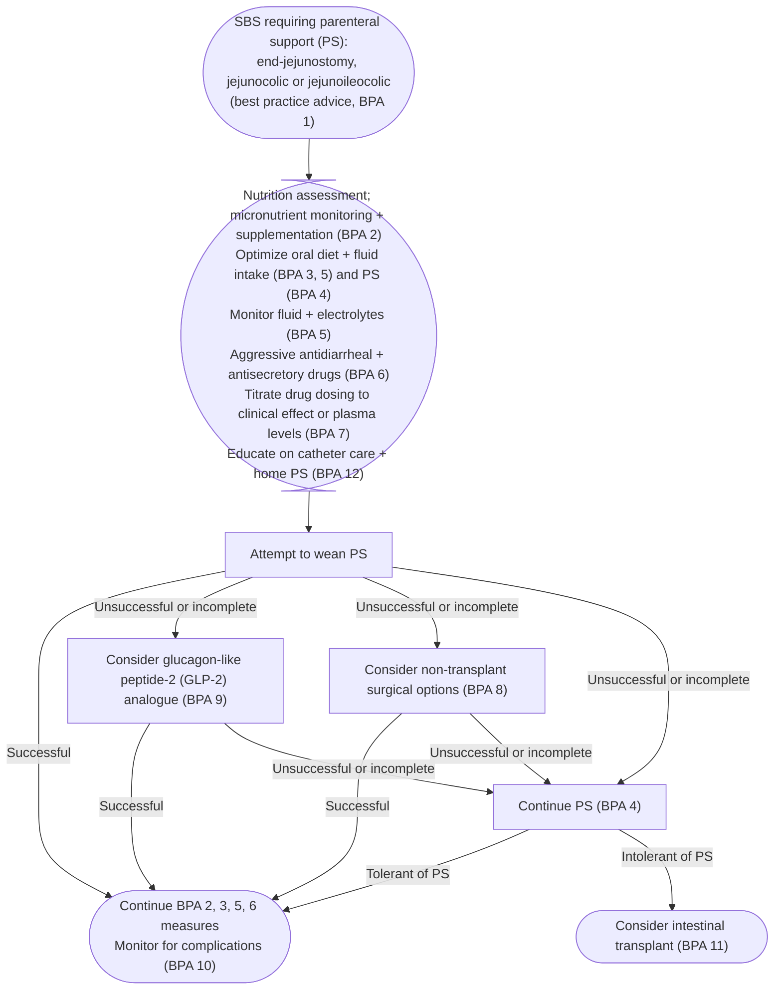

Syndrome from **loss of intestinal length** (disease or resection): diarrhea, dehydration, electrolyte abnormalities and weight loss, plus **region-specific** clues that refine management — e.g. vitamin B12 deficiency or [[bile-acid-diarrhea|bile acid–induced diarrhea]] after terminal ileal resection. ([[aga-2022-short-bowel-syndrome]])

## Contents
- [[#Assessment]]
  - [[#Establishing the Diagnosis]]
  - [[#Severity Assessment]]
  - [[#Classification / Typing]]
- [[#Differential Diagnosis]]
- [[#Diagnostics]]
  - [[#Nutrition Assessment and Monitoring]]
  - [[#Fluid, Electrolyte and Renal Monitoring]]
  - [[#Micronutrient Monitoring and Supplementation]]
  - [[#Metabolic Bone Disease]]
- [[#Therapeutics]]
  - [[#Management Algorithm]]
  - [[#Diet]]
  - [[#Enteral (Tube) Feeding]]
  - [[#Oral Rehydration Solution]]
  - [[#Parenteral Nutrition]]
  - [[#Pharmacologic Therapy]]
  - [[#Drug Dosing in a Short Gut]]
  - [[#GLP-2 / Teduglutide]]
  - [[#Surgery]]
  - [[#Complications and Their Prevention]]
  - [[#Intestinal Transplantation]]
  - [[#Education and Support]]
- [[#See Also]]
- [[#Sources]]

## Assessment

### Establishing the Diagnosis

- **Residual small intestinal length of 200 cm or less** = general agreement for short bowel syndrome (SBS); some reports suggest **150 cm or less** may be more appropriate. ([[aga-2022-short-bowel-syndrome]])
- **Measure at surgery**, along the **antimesenteric border** of **unstretched** bowel, from the **duodenojejunal flexure** to the ileocecal junction, any small bowel–colon anastomosis, or the end-ostomy.
- **Report residual length, not resected length** — only residual length dictates outcome, and it cannot be reliably estimated from resected length.

| | Definition | Relationship |
|---|---|---|
| **SBS** | Anatomic — loss of intestinal length | Most common cause of intestinal failure (IF) |
| **IF** | Gut function below the minimum needed to absorb macronutrients or water and electrolytes, so that **intravenous (IV) supplementation — often [[nutrition-in-hospitalized-patients\|parenteral nutrition (PN)]] — is required to maintain health or growth** | Also caused by chronic intestinal pseudo-obstruction and refractory intestinal malabsorptive syndromes |

- **SBS-IF** = SBS that has caused IF (needs IV supplementation).

### Severity Assessment

Prognosis is read from anatomy and PN dependence ([[aga-2022-short-bowel-syndrome]]):
- **Anatomic group** ([[#Classification / Typing]]) — group 1 most severe, group 3 most favorable.
- **Net secretors** — patients without a colon who lose more water and sodium from the stoma than they take in by mouth; tend to have **<100 cm residual jejunum**; daily jejunostomy output can be **>4 L**.
- **PN weaning window:**
  - **>50%** of adults with SBS wean completely off PN **within 5 years** of diagnosis.
  - Probability of eliminating PN is **<6%** if not achieved in the **first 2 years after the last bowel resection**.
- **PN failure** (onset of PN-associated complications) → transplant referral ([[#Intestinal Transplantation]]).

### Classification / Typing

By presence or absence of residual colon:

| Group | Residual anatomy | Notes |
|---|---|---|
| **1** | End-jejunostomy | **Most severe** phenotype; high-output end-jejunostomies are the most challenging to manage |
| **2** | Jejunum anastomosed to **partial colon** (jejunocolonic) | Colon in continuity |
| **3** | **Jejuno-ileo-colic** anastomosis, retaining **entire colon and ileocecal valve** | **Most favorable** phenotype |

*See Figure 1 in [[aga-2022-short-bowel-syndrome]] for the anatomic diagrams.*

## Differential Diagnosis

*Workup: see [[chronic-diarrhea]].*

- **Other causes of IF:** chronic intestinal pseudo-obstruction; refractory intestinal malabsorptive syndromes.
- **Treatable contributors to diarrhea within SBS:**
  - Bile acid–induced diarrhea after terminal ileal resection.
  - [[small-intestinal-bacterial-overgrowth|Small intestinal bacterial overgrowth (SIBO)]] — dilated segments (suboptimal anastomoses, watershed areas) are areas of stasis that set the stage for it, worsening malabsorption and diarrhea. The American Gastroenterological Association (AGA) 2022 update gives no SIBO diagnostic criteria or antibiotic regimen.

## Diagnostics

### Nutrition Assessment and Monitoring

**Initial comprehensive assessment by a dietitian experienced in SBS, in all patients** — AGA 2022 Supplementary Table 1:

| Domain | Items |
|---|---|
| History | Weight change; medications incl. supplements; gastrointestinal (GI) and other symptoms affecting oral intake or fluid loss; food diary (usual diet, daily energy intake); symptoms of micronutrient deficiency; medical and psychiatric comorbidities |
| Surgical | Bowel complications — anastomotic strictures, chronic obstruction, enterocutaneous fistulae, peritoneal drains |
| Access | Prior/current enteral or central venous access device; formula, route, method; complications |
| Examination | Signs of dehydration, malnutrition, micronutrient deficiency |
| Tests | Complete blood count, chemistry panel, micronutrient levels; bone mineral density |

- **Long-term monitoring:** labs (electrolytes, liver/kidney tests), fluid balance, **serial weights** (trend warns of nutrition or hydration compromise), serum micronutrients, bone density.

### Fluid, Electrolyte and Renal Monitoring

- Particularly in patients **without a colon** (large enteric losses): chronic dehydration and kidney disease; nephrolithiasis; **sodium deficiency, often without hyponatremia**; difficult-to-replete **hypokalemia, hypomagnesemia, hypocalcemia**.
- **Regular renal function and fluid balance monitoring**; teach patients to **measure daily urine output**, at a minimum.
- **Hydration goal: urine output >1 L/d and urinary sodium >20 mEq/L.**

### Micronutrient Monitoring and Supplementation

- Water-soluble vitamin deficiencies **uncommon** (proximal small-bowel absorption); **fat-soluble vitamin and essential fatty acid deficiencies relatively frequent** — large doses may be needed.
- **All patients, on or off PN:** serum vitamin and trace element levels **at baseline**, then **at least once per year**; more often with existing or prior deficiency. Home PN does not remove the risk.

| Micronutrient | Lab measurement | Typical supplementation |
|---|---|---|
| Vitamin A | Serum retinol | Oral: 5000–50,000 IU daily (sometimes more); intramuscular (IM) also available |
| Vitamin B12 | Serum vitamin B12, methylmalonic acid | Subcutaneous (SC)/IM: 300–1000 µg monthly; oral and intranasal also available |
| Vitamin C | Serum vitamin C (ascorbic acid) | Oral: 200–500 mg daily; IV also available |
| Vitamin D | Serum 25-hydroxyvitamin D, parathyroid hormone | Oral: 50,000 IU once weekly (or calcitriol 0.25–2 µg daily); IM also available |
| Vitamin E | Serum alpha-tocopherol | Oral: 400 IU up to 3 times daily |
| Folate | Serum, red blood cell folate | Oral: 1 mg daily |
| Iron | Serum ferritin, iron, iron-binding capacity | Oral: 100–200 mg once daily or every other day; IV and IM also available |
| Zinc | Serum zinc | Oral: 50 mg elemental zinc (220 mg tablet) once or twice daily |
| Selenium | Serum selenium | Oral: 100–200 µg daily |
| Chromium | Serum chromium | Oral: 100–200 µg up to 3 times daily |
| Multivitamin | — | Oral: 1–2 capsules daily |
| Copper | Serum copper | Oral: 2 mg elemental copper daily (higher dose may be needed); IV also available |
| Manganese (patients on home PN) | Serum manganese | None |

*Source: AGA 2022 Table 1 ([[aga-2022-short-bowel-syndrome]]).*

### Metabolic Bone Disease

- Common — effects of PN, malabsorption from altered anatomy, other patient factors.
- **Bone density in all patients, repeated every 2–3 years**; possibly more often in osteoporosis when initiating or changing therapy, until stable.
- **Periodic:** calcium, phosphorus, magnesium, 25-hydroxyvitamin D, parathyroid hormone, and **metabolic acidosis**.

## Therapeutics

### Management Algorithm

*Management of the patient with SBS requiring parenteral support*
*Source: redrawn from AGA 2022 Supplementary Figure 1*
*[[aga-2022-short-bowel-syndrome|AGA 2022 Short Bowel Syndrome Clinical Practice Update]]*
*SBS = short bowel syndrome · BPA = best practice advice · PS = parenteral support · PN = parenteral nutrition · GLP-2 = glucagon-like peptide-2*

### Diet

> [!pearl] Feed the hyperphagia — don't restrict it
> Most adults with SBS malabsorb significantly: **increase intake by at least 50% above estimated needs**, best tolerated **divided into 5–6 meals**. Avoid excessive dietary restriction. ([[aga-2022-short-bowel-syndrome]])

- Counseling by an **experienced dietitian**, guided by patient preference; adjust by symptoms, stool output, weight.

| Anatomy | Diet | Why |
|---|---|---|
| **Colon in continuity** (groups 2–3) | **High complex carbohydrate, relatively low fat** — studied as carbohydrate **60%**, fat **20%** | Less fecal calorie loss; more energy and wet weight absorption; less magnesium and calcium loss and oxalate absorption |
| **End-jejunostomy** (group 1) | **No fat restriction** | More fat is absorbed when more is consumed |

- **Oxalate restriction (e.g. peanuts, baked beans) is essential in patients with a colon who are at risk of hyperoxaluria and oxalate stones.**
- Evidence on diet composition is limited (few, small, heterogeneous studies).

### Enteral (Tube) Feeding

- Rarely used in adults; tube feeding (alone or with oral feeding) **increased net absorption of lipids, protein and energy** after the postoperative period (small randomized crossover study).
- **Consider enteral nutrition (EN) + oral feeding when all of:** stable SBS-IF; insufficient oral intake **despite an appetite stimulant** (e.g. mirtazapine, olanzapine, dronabinol, Megace); **stool output <2 L/d**; expected gains may allow PN weaning.
- **Long-term access:** intermittent self-placed nasogastric tube (e.g. nightly) or percutaneous gastrostomy — the latter **may be technically difficult** (altered anatomy, adhesions) → discuss risks/benefits/alternatives and consider a **temporary nasogastric trial first** to confirm tolerance. Options: [[enteral-access|enteral access]].
- **Delivery: slow continuous infusion into the stomach** — not bolus, not direct small-bowel infusion — to maximize transit and contact time and reduce diarrhea.

### Oral Rehydration Solution

- Replace **all** losses; keep urine output **at least 1 L/d**.
- **Limit** low-sodium **hypotonic** (water, tea, coffee, alcohol) and **hypertonic** fluids (fruit juices, sodas) — especially in net secretors with a high-output jejunostomy.
- **Preferred: glucose–electrolyte oral rehydration solution (ORS)** — luminal glucose drives sodium absorption (anions and water follow). Commercial and inexpensive homemade versions are widely available.
- ORS ≠ sports drink: **sodium considerably higher, sugar lower**.
- **SBS with a colon:** most maintain hydration with hypotonic fluids.

> [!pitfall] Drinking more water makes the output worse
> Patients often think they should drink large quantities of water; this **increases [[ostomy-management|ostomy]] output** and creates a vicious cycle of fluid and electrolyte loss. ([[aga-2022-short-bowel-syndrome]])

### Parenteral Nutrition

- **Virtually all patients need PN** after resection; few stop before discharge. Weaning odds: [[#Severity Assessment]].
- **Access: tunneled central venous catheter preferred** over a peripherally inserted central catheter (higher thrombosis risk, self-administration problems) and over a port (needs continual access and **weekly** exchange, losing its benefit).
- Set to fluid, electrolyte, energy, protein and micronutrient needs (energy and macronutrient mix depend on oral intake and repletion needed); AGA 2022 gives no kcal/kg or protein target. **Titrate on** weight, labs, stool/ostomy output, urine output, thirst.
- **High ostomy output → more fluid, potassium, magnesium and zinc losses** — monitor and replace.
- **Decrease PN** when oral intake is tolerated without excessive stool/ostomy output and weight is maintained or gained. **IV fluids without macronutrients** if stool output consistently exceeds intake.
- **Cycle over 10–14 hours overnight** to free the patient from the pump by day; in **hot summer months**, overnight-PN patients may need extra daytime IV fluids.

### Pharmacologic Therapy

**Antisecretory:**
- Massive enterectomy → **gastric hypersecretion and hypergastrinemia for 6–12 months**.
- **[[proton-pump-inhibitors|Proton pump inhibitors (PPIs)]] or histamine-2 receptor antagonists (H2RAs)** reduce gastric secretion volume, acid injury to upper-gut mucosa, and acid impairment of pancreatic enzymes.
- **Use sparingly beyond 12 months** (gastric acid suppresses upper-gut bacterial overgrowth), **particularly with documented SIBO**, unless clear persistent benefit on stool volume or dyspepsia.
- **Octreotide** ([[somatostatin-analogs|somatostatin analog]]) reduces GI secretions and slows jejunal transit but **has not been shown to improve absorption or reduce PN need**; may inhibit pancreatic enzymes and worsen malabsorption. **Reserve for large-volume stool losses with problematic fluid/electrolyte management** (e.g. high-output end-jejunostomy); **avoid during intestinal adaptation.**

**Antidiarrheal:**
- **[[loperamide|Loperamide]] preferred over opiates** (diphenoxylate with atropine, codeine, tincture of opium) — not addictive or sedative.
- **High doses often needed — up to 16 tablets (32 mg)/d** — enterohepatic circulation is disrupted without an ileum.
- **About 30 minutes before meals and at bedtime**; loperamide + codeine may be synergistic; guide by **objective stool-output measurement**.
- **Clonidine** (can be transdermal) — modest benefit for high-output losses.

> [!pitfall] Dilated bowel turns antimotility agents against you
> Where bowel dilatation has occurred, antimotility agents may **worsen** diarrhea by encouraging bacterial overgrowth. ([[aga-2022-short-bowel-syndrome]])

**Bile acids and pancreatic enzymes:**
- **Ox bile** improves fat absorption when **>100 cm ileum** is lost, without worsening stool losses — limited availability.
- **Avoid bile acid sequestrants** — may worsen steatorrhea and fat-soluble vitamin losses.
- **[[exocrine-pancreatic-insufficiency|Pancreatic enzyme supplementation]]** — no published report supports it in SBS.

### Drug Dosing in a Short Gut

- Most oral drugs are absorbed in the **proximal jejunum** → usable in SBS; **avoid sustained- and delayed-release formulations.**
- Consider liquids or topical routes; **monitor blood drug levels**.
- No response → escalate dose; change schedule; change formulation (crushed tablet, capsule, liquid); or change route (IV, SC, transdermal).

### GLP-2 / Teduglutide

- **Rationale:** GLP-2, secreted by **L cells of the distal ileum and right colon**, is intestinotrophic. **Teduglutide (Gattex)** — recombinant GLP-2 with an extended half-life, **daily SC injection** — improves absorption and allows PN weaning in SBS-IF; some patients reach enteral autonomy. ([[aga-2022-short-bowel-syndrome]])
- **Positioning:** significant side effects and cost → **only after diet and conventional treatment are optimized**, in **carefully selected SBS-IF** patients; **not "one more antidiarrheal."** Prescribe only with SBS experience and facilities to objectively weigh benefit against harm.
- **Inform the patient** of: chance of PN weaning and quality-of-life gain, expected treatment duration, course after stopping, adverse effects, cost, need for regular monitoring.
- **Label dose:** **0.05 mg/kg SC once daily**; estimated glomerular filtration rate **<60 mL/min/1.73 m²** → **0.025 mg/kg once daily**. ([[gattex-2025-teduglutide-label]])

| Issue | AGA 2022 | Label |
|---|---|---|
| **Before starting** | Screen by [[colonoscopy]] | Colonoscopy **and** [[upper-endoscopy\|upper GI endoscopy]] with polyp removal, within 6 months before starting |
| **On therapy** | Colonoscopy periodically | Both (or alternate imaging) at end of year 1; then, if no polyp, no less frequently than every 5 years ([[glp-2-agonists]]) |
| **Active GI malignancy** | **Contraindicated** (growth factor — can enhance GI polyp growth and accelerate cancer) | Develops on therapy (GI tract, hepatobiliary, pancreatic) → **discontinue** |
| **Other malignancy** | Authors' opinion: **do not use with active or recent (arbitrarily, 5 years) malignancy of any location** | Increased malignancy risk → use only if benefits outweigh risks; active non-GI malignancy → continue or stop on benefit–risk |

- **Duration:** neither source sets one; in the label's 30-month extension, patients were maintained on teduglutide even after no longer needing PN/IV support. **Stopping → monitor fluid and electrolytes** (label).
- Surveillance intervals, adverse events, trial efficacy: [[glp-2-agonists]].
- **Recombinant human growth hormone (Zorbtive)** — largely discontinued (side effects, questionable long-term efficacy).

### Surgery

> [!pitfall] Protect every centimeter of remaining bowel
> *Primum non nocere*: conservative approach to doubtful bowel ischemia, planned second-look operations, and no hasty abdominal closure (abdominal compartment syndrome → secondary ischemia). ([[aga-2022-short-bowel-syndrome]])

- **3 roles:** recruit unused distal bowel; augment residual bowel (lengthening/tapering); slow transit.
- **Restore continuity and recruit distal bowel as soon as safely possible** — improves function, reduces PN dependency. Converting group 1 **toward group 2 or 3** generally improves prognosis, subject to active underlying bowel disease ([[crohns-disease|Crohn's disease]], radiation enteritis).
- **Complex intra-abdominal problems** (massive desmoid tumors, [[acute-mesenteric-ischemia|mesenteric ischemia]], complex enterocutaneous fistulae) → multidisciplinary intestinal rehabilitation team with dedicated surgical expertise.

| Dilated bowel segment | Operation |
|---|---|
| Patient unequivocally **does not** have SBS | **Tapering enteroplasty** — remove an antimesenteric strip to restore normal caliber |
| Patient **with SBS on PN** (taper without losing surface area) | **Longitudinal intestinal lengthening and tapering (LILT, Bianchi)** or **serial transverse enteroplasty (STEP)** — see Figures 2–3 in [[aga-2022-short-bowel-syndrome]] |

- **No critical outcome difference between LILT and STEP** — surgeon preference.
- **50%–60%** after such autologous reconstruction may eventually wean off PN; **no single operation cures SBS**.

### Complications and Their Prevention

| Complication | Management considerations |
|---|---|
| **Central venous catheter** — infection, occlusion, thrombosis, breakage | Aseptic technique at placement and dressing changes; appropriate catheter and insertion site; proper care and infection monitoring; **remove when no longer needed** |
| **Hepatobiliary** — steatosis, cholestasis, [[cirrhosis]], cholelithiasis | Avoid excesses/deficiencies in the PN formula; **IV lipid <1 g/kg/d**; reduce/eliminate soybean-based IV lipid emulsion; use a non–soybean-based one; **cycle PN**; increase oral/enteral intake; treat sepsis or SIBO; **prophylactic cholecystectomy when abdominal surgery is done for other reasons** |
| **Metabolic bone disease** — osteoporosis, osteopenia, osteomalacia | Periodic bone mineral density; monitor calcium, magnesium, vitamin D and supplement; **correct metabolic acidosis**; specific osteoporosis treatments |
| **Kidney injury** — nephrolithiasis, oxalosis, acute and chronic kidney disease | Monitor urine output; maintain it with increased fluid intake; **low-fat, low-oxalate diet**; **potassium citrate**; **calcium carbonate** |
| **Chronic diarrhea** | Diet/oral fluid changes; ORS; antidiarrheal, antisecretory (PPI, H2RA) and somatostatin-analog agents; intestinotrophic factor |
| **Protein-energy malnutrition, dehydration, electrolyte/micronutrient deficiency** | Monitor and supplement vitamins, minerals, electrolytes; optimize oral diet and fluids; parenteral support (hydration, nutrition); intestinotrophic factor |

*Source: AGA 2022 Table 2 ([[aga-2022-short-bowel-syndrome]]).*

### Intestinal Transplantation

- **Centers for Medicare and Medicaid Services: consider intestinal transplantation (ITX) for IF (refractory PN dependency) with onset of PN failure.**
- **PN failure** = PN-associated complications, especially progressive **intestinal failure–associated liver disease**, **recurrent catheter-related sepsis**, or **loss of vascular access from central vein thromboses**.
- **Refer early:** nearly **50%** of ITX candidates also need **simultaneous [[liver-transplantation|liver transplantation]]** (a sign of late referral), and waiting-list mortality is much higher for them.
- **Consider early listing, even without strict PN-failure criteria:** SBS-IF with **high morbidity or low acceptance of PN** (case-by-case); **large abdominal desmoid tumors** (resection ± enterectomy, then ITX); **severe dysmotility with no prospect of PN weaning**.
- **Outcomes:** 5-year survival **>65%** at experienced centers; limited by severe acute cellular rejection, infections, [[post-transplant-lymphoproliferative-disorder|posttransplant lymphoproliferative disease]] and chronic allograft enteropathy.

### Education and Support

- **Multidisciplinary team:** dietitians, nurses, surgeons, gastroenterologists or internists, social workers experienced in IF.
- **Support groups** (e.g. Oley Foundation) may reduce complications and improve survival and quality of life on EN or PN.
- Nonspecialists: **Learn Intestinal Failure Tele-ECHO (Expanding Community Healthcare Outcomes) (LIFT-ECHO) project** — case-based virtual education.

## See Also

[[glp-2-agonists]], [[ostomy-management]], [[enteral-access]], [[nutrition-in-ibd]], [[nutrition-in-hospitalized-patients]], [[small-intestinal-bacterial-overgrowth]], [[bile-acid-diarrhea]], [[chronic-diarrhea]], [[loperamide]], [[proton-pump-inhibitors]], [[somatostatin-analogs]], [[exocrine-pancreatic-insufficiency]], [[crohns-disease]], [[acute-mesenteric-ischemia]], [[cirrhosis]], [[liver-transplantation]], [[post-transplant-lymphoproliferative-disorder]], [[colonoscopy]], [[upper-endoscopy]]

---

## Sources

1. [[aga-2022-short-bowel-syndrome|AGA Clinical Practice Update on Management of Short Bowel Syndrome: Expert Review (2022)]]
2. [[gattex-2025-teduglutide-label|GATTEX (Teduglutide) for Injection — FDA Prescribing Information (Takeda, revised 9/2025)]]
