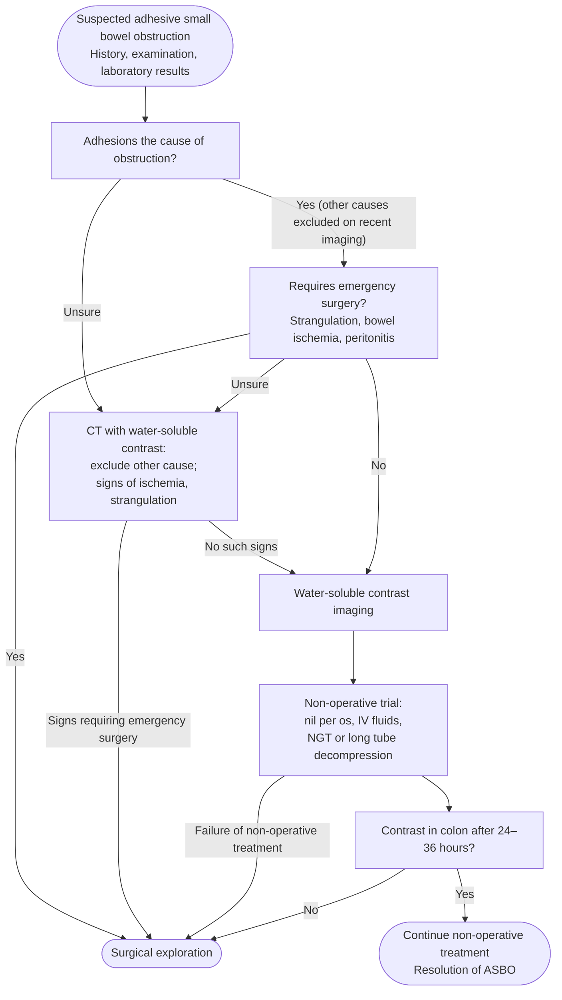

A surgical emergency in which obstruction of the small intestine hinders passage of intestinal contents — abdominal pain, vomiting, distention, constipation. **Adhesions are the single most common cause (60% of cases)**, typically the footprints of previous abdominal surgery ([[wses-2017-adhesive-sbo|World Society of Emergency Surgery (WSES) 2017]]). Mean stay 8 days, in-hospital mortality 3% per episode; **20–30% need an operation**. Failure to diagnose or delayed diagnosis accounts for **70% of malpractice claims** in adhesive small bowel obstruction (ASBO).

## Contents
- [[#Assessment]]
  - [[#Establishing the Diagnosis]]
  - [[#Severity Assessment]]
  - [[#Classification / Typing]]
- [[#Differential Diagnosis]]
- [[#Diagnostics]]
  - [[#Laboratory Tests]]
  - [[#Imaging]]
  - [[#Diagnostic and Treatment Algorithm]]
- [[#Therapeutics]]
  - [[#Non-Operative Management]]
  - [[#Operative Treatment]]
  - [[#Adhesion Prevention]]
  - [[#Special Patient Groups]]
- [[#See Also]]
- [[#Sources]]

## Assessment

### Establishing the Diagnosis

- Classic picture: **intermittent colicky abdominal pain, distention, nausea ± vomiting, ± absence of stools.** Diagnosis is fairly certain when all are present.
- History: previous operations, radiotherapy, prior obstruction episodes, nutritional status, signs of dehydration.
- Examination: signs of peritonitis (may reveal strangulation or ischemia); check for abdominal wall and groin hernias.
- **Adhesive etiology is definitively confirmed only at operation.** Non-invasive confirmation = prior episodes of adhesive obstruction, **or** exclusion of other causes by imaging (usually computed tomography (CT)).

> [!pitfall] Three ways the diagnosis gets missed
> **Watery diarrhea** in incomplete obstruction is mistaken for gastroenteritis; **stools are still present** in a high obstruction seen early after symptom onset; **pain is often less prominent in the elderly**, so not all classic features appear ([[wses-2017-adhesive-sbo|WSES 2017]]).

### Severity Assessment

The decision the assessment has to answer is **emergency surgery now vs a trial of non-operative management**.

| Finding | Where found | Implication |
|---|---|---|
| Peritonitis, strangulation, bowel ischemia | Clinical ± CT | **Contraindicate** non-operative management → emergent exploration (Level IIC) |
| Closed loop, bowel ischemia, free fluid | CT | Suggest the need for surgery **without delay** |
| C-reactive protein (CRP) >75, white blood cell count >10,000/mm³ | Labs | May indicate peritonitis; sensitivity and specificity relatively low |
| Large-volume pneumoperitoneum | Erect chest X-ray | Bowel perforation |

- **Physical examination alone has only 48% sensitivity for strangulation**, even in experienced hands — hence the reliance on CT.
- CT has **~90% accuracy** for predicting strangulation and the need for urgent surgery.

Two published models predict the need for surgery (the guideline describes them; it does not recommend either):

| Model | Components | Performance |
|---|---|---|
| Zielinski | Mesenteric edema · absence of the small-bowel feces sign · obstipation | Concordance index 0.77, validated in 100 ASBO cases |
| Baghdadi | Radiological findings + sepsis criteria + comorbidity index | Area under the curve 0.80 in 351 cases; complex to assess |

*WSES 2017 does not print the item weights or the strata of either model.*

### Classification / Typing

- **Adhesive vs non-adhesive** is the clinically operative split — it decides whether a non-operative trial is reasonable (see [[#Differential Diagnosis]]).
- **Adhesion severity scores require operative assessment**, so they do not help the admission decision; none has been validated against the long-term risk of adhesion-related complications.

| Score | What it measures | Notes |
|---|---|---|
| Zühlke (grades 0–4) | Tenacity/morphology: 0 none or insignificant · 1 filmy, blunt dissection · 2 blunt possible but some sharp needed, beginning vascularization · 3 sharp dissection only, clear vascularization · 4 sharp dissection only, organs strongly attached, organ damage hardly preventable | Most used in general surgery; easy, self-explanatory. Does not measure **extent**, and tenacity varies by region |
| American Fertility Society (AFS) | Extent + severity at right ovary, right tube, left ovary, left tube; sides summed, final score = the **lower** of the two sides | Designed for the small pelvis. A score of 0 does **not** mean no adhesions. Low inter-observer reproducibility; a modified AFS is used in newer studies |
| Peritoneal adhesion index (PAI) | Tenacity on a 1–3 scale at 10 predefined sites — integrates tenacity and extent in one score | WSES working group score; **the only one validated as prognostic** for convalescence after ASBO surgery and for injury risk during adhesiolysis |

*Bowel injury during adhesiolysis is classified as **seromuscular injury** (serosa + smooth muscle; lumen and contents not visible), **enterotomy** (full thickness; mucosa or lumen visible, or leakage), or **delayed diagnosed perforation** (unrecognised at closure; patient deteriorates post-operatively).*

## Differential Diagnosis

Non-adhesive causes of small bowel obstruction named by WSES 2017:

- Incarcerated hernias
- Obstructive lesions, malignant and benign (see [[colorectal-cancer]] for colonic malignancy)
- Bezoars
- [[inflammatory-bowel-disease|Inflammatory bowel disease (IBD)]] — see [[crohns-disease]]
- Volvulus

Related obstruction syndromes with their own pathways: [[gastric-outlet-obstruction]], [[acute-colonic-pseudo-obstruction]]. Bowel ischemia without mechanical obstruction: [[acute-mesenteric-ischemia]].

## Diagnostics

### Laboratory Tests

- **Minimum panel (Level IID, expert opinion): blood count, lactate, electrolytes, CRP, blood urea nitrogen (BUN)/creatinine**, together with assessment of nutritional status.
- Electrolytes are often deranged — **low potassium is frequent and needs correction.**
- BUN/creatinine: patients are frequently dehydrated, which can cause acute kidney injury.

### Imaging

| Modality | Role | Detail |
|---|---|---|
| Plain X-ray | **Not recommended** (Level IIC) — limited value | Triad of multiple air-fluid levels + distended small bowel loops + absent colonic gas is pathognomonic in high-grade obstruction, but overall sensitivity ~70%. Misses early peritonitis/strangulation; gives no anatomical information on cause |
| CT with oral water-soluble contrast | **Preferred initial imaging** (Level IB) | ~90% accuracy for strangulation / need for urgent surgery. Excludes other causes (adhesions are not directly visible). Separates complete from incomplete obstruction; localises the level (e.g. high jejunal vs deep pelvic) |
| Water-soluble contrast study alone | Sufficient when the ASBO diagnosis is **certain** (other causes excluded on recent imaging) **and** no sign suggests immediate surgery | — |
| Follow-up abdominal X-ray | Judges the non-operative trial | See protocol below |
| Ultrasound | Alternative when radiation is undesirable (pregnancy) or CT unavailable (low-income settings) | Operator dependent; in experienced hands gives more than plain X-ray — detects free fluid and gauges degree of shock in dehydration |
| Magnetic resonance imaging (MRI) | Adds anatomical detail after ultrasound confirms obstruction | Chiefly for pregnancy |

**Water-soluble contrast protocol (Level IB)**

- Give **oral water-soluble contrast**, with the CT or as a standalone study. *WSES 2017 does not specify the contrast agent, dose or volume.*
- **Follow-up plain abdominal X-ray at 24 h** after contrast administration (the guideline's algorithm asks "contrast in colon after **24–36 hours**?").
- **Contrast has reached the colon → resolution of the obstruction** → continue non-operative treatment.
- **Contrast has not reached the colon at 24 h → highly indicative of failure of non-operative management** → surgical exploration.
- The test accurately predicts the need for surgery and reduces hospital stay; some authors attribute an active therapeutic role to the contrast itself.

### Diagnostic and Treatment Algorithm

*Diagnosis and treatment of adhesive small bowel obstruction*
*Source: redrawn from Figure 2 of the WSES 2017 Bologna guideline*
*[[wses-2017-adhesive-sbo|WSES 2017 Bologna Guidelines: Adhesive Small Bowel Obstruction]]*
*ASBO = adhesive small bowel obstruction · CT = computed tomography · IV = intravenous · NGT = naso-gastric tube*

## Therapeutics

### Non-Operative Management

- **Default strategy (Level IIC): try non-operative management in every patient, unless there are signs of peritonitis, strangulation, or bowel ischemia.** The slightly lower recurrence rate after surgery is **not** a reason to operate primarily — emergency exploration carries high morbidity, considerable bowel-injury risk, and may reduce post-operative quality of life.
- Effective in approximately **70–90%** of patients.
- Components: **nil per os** · decompression with a naso-gastric tube or long intestinal tube · fluid resuscitation · correction of electrolyte disturbances · nutritional support · prevention of aspiration.
- **Long trilumen naso-intestinal tubes are more efficacious than naso-gastric tubes but require endoscopic placement** (Level IIC). In the supporting randomized trial of 186 patients, failure was 10.4% with the trilumen long tube vs 53.3% with a naso-gastric tube — a naso-gastric failure rate far higher than other literature, so interpret with care; an older trial found no difference.
- **Duration: a trial can be continued safely for 72 h (Level IIB).** Evidence for the optimal duration is absent; 72 h is the panel's and most authors' judgement. Delays in surgery increase morbidity and mortality. Continuing past 72 h for persistent high tube output without other clinical deterioration remains debated.
- Watch for the common medical complications: dehydration with kidney injury, electrolyte disturbance, malnutrition, aspiration.

**Failure of non-operative treatment — the algorithm's criteria:**

| Group | Criterion |
|---|---|
| Persistent obstruction | >72 hours |
| Drainage volume | >500 ml on the 3rd day |
| Peritonitis or ischemia | Exacerbation of pain · CRP >75 mg/l · white blood cell count 10,000/mm³ · free intraperitoneal fluid >500 ml |

### Operative Treatment

- Open exploration is the standard approach; **laparoscopic adhesiolysis might reduce morbidity in selected cases** (Level IIC), with the randomized trial still awaited.
- Evidence base: a meta-analysis of 14 non-randomized studies found lower morbidity, in-hospital mortality and surgical infections with laparoscopy, but with strong selection bias toward less severe cases.
- **Risk runs the other way too:** bowel injury in **6.3–26.9%** of laparoscopic adhesiolysis for ASBO, and in a population-based study bowel resection was more frequent laparoscopically (**53.5% vs 43.4%**). Very distended loops and multiple complex adhesions raise the risk of enterotomy and delayed-diagnosis perforation; adhesiolysis is also harder after previous radiotherapy.

> [!pearl] Select the laparoscopic candidate deliberately
> Attempt laparoscopy when there is **sufficient surgical experience**, **≤2 laparotomies in the history**, and a **single adhesive band is expected**. The reported predictors of success also include appendectomy as the prior operation and no previous median laparotomy incision ([[wses-2017-adhesive-sbo|WSES 2017]]).

### Adhesion Prevention

- **Laparoscopic surgery reduces adhesion formation and might reduce subsequent ASBO (Level IB)** — reoperation for ASBO 1.4% (95% confidence interval (CI) 1.0–1.8) after laparoscopic vs 3.8% (95% CI 3.1–4.4) after open surgery in cohort studies. After colorectal operations, odds ratio 0.62 (95% CI 0.54–0.72) favouring laparoscopy, but no significant difference across the three randomized trials (OR 0.50, 95% CI 0.20–1.2). **Laparoscopy is not a complete solution.**
- Technique factors that aggravate adhesion formation: foreign body reaction (starch-powdered gloves, abdominal wall meshes); monopolar electrocautery causes more peritoneal injury than bipolar or ultrasonic devices. Animal data suggest systemic and intraperitoneal antibiotics — metronidazole in particular — reduce adhesion formation in septic conditions.
- **Primary prevention: hyaluronate carboxymethylcellulose (Seprafilm) reduces adhesion formation and reoperations for ASBO (Level IA)** — relative risk 0.49 (95% CI 0.28–0.88) across three trials in 1132 colorectal surgery patients; cost-effective in open colorectal surgery. Solid barrier, best suited to open surgery.
- **Secondary prevention: adhesion barriers reduce recurrence after operative treatment of ASBO (Level IIB).** The trial evidence is **liquid 4% icodextrin (Adept)** applied at laparotomy for ASBO: recurrence **2.19% (2/91) vs 11.11% (10/90)** at mean follow-up 41.4 months. Icodextrin is cheap, safe, and applicable laparoscopically, though possibly less potent against adhesion *reformation* than hyaluronate carboxymethylcellulose, which is in turn less practical laparoscopically.
- **Oxidized regenerated cellulose (Interceed)** reduces adhesion formation (relative risk 0.51, 95% CI 0.31–0.86) but has only been studied in gynaecological procedures with no data on subsequent ASBO — **the working group does not recommend it to prevent ASBO in general surgery.**
- **Polyethylene glycol gels (Sprayshield/Spraygel)** reduce adhesion scores in general and gynaecological trials; studies are few and small and long-term adhesion-related outcomes are not described.

### Special Patient Groups

| Group | What changes |
|---|---|
| Young / pediatric | Lifelong risk — most obstructions occur within 2 years of surgery but new cases keep appearing for many years. ASBO in **12.6%** of a pediatric surgical cohort at median 14.7 years' follow-up. **Highest lifetime benefit from adhesion prevention (Level IIC);** no barrier trials in children, but a cohort showed ASBO in 2.0% with vs 4.5% without hyaluronate carboxymethylcellulose at 24 months |
| Elderly | Quality-of-life considerations dominate; high frailty index predicts prolonged recovery and possible failure to return to baseline function. **Diabetic patients operated >24 h after presentation had 7.5% acute kidney injury and 4.8% myocardial infarction** — significantly more than diabetics operated within 24 h and than non-diabetics with delayed operation, so diabetes might call for earlier intervention (Level C). No research guides stopping or withholding oral medications during nil per os |
| Pregnancy | Very rare, significant fetal risk. Use **ultrasound first**, with MRI for anatomical detail once obstruction is confirmed. In the pooled case literature (23 ASBO cases, 17 given a non-operative trial), **non-operative treatment failed in 16/17 (94%)**; fetal loss 17%, maternal death 2% |

## See Also

[[acute-colonic-pseudo-obstruction]], [[gastric-outlet-obstruction]], [[acute-mesenteric-ischemia]], [[crohns-disease]], [[inflammatory-bowel-disease]], [[colorectal-cancer]], [[short-bowel-syndrome]]

---

## Sources

1. [[wses-2017-adhesive-sbo|Bologna Guidelines for Diagnosis and Management of Adhesive Small Bowel Obstruction (ASBO): 2017 Update from the World Society of Emergency Surgery ASBO Working Group]]
