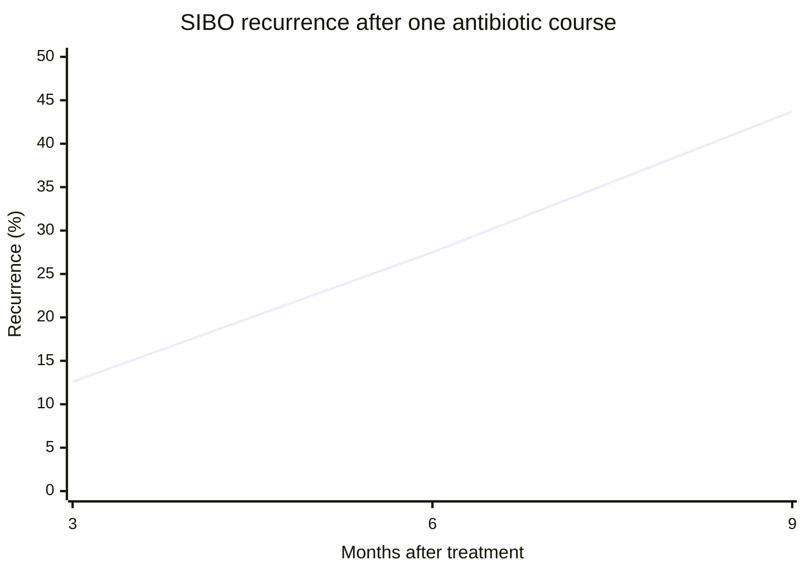

Small intestinal bacterial overgrowth (SIBO) = a clinical syndrome of gastrointestinal (GI) symptoms caused by excessive numbers of bacteria in the small intestine ([[acg-2020-sibo]]; the American Gastroenterological Association (AGA) clinical practice update (CPU), [[aga-2020-sibo]], adopts the same definition by citing the American College of Gastroenterology (ACG) guideline).

- Bacteria are usually coliforms — predominantly Gram-negative aerobic and anaerobic species that ferment carbohydrates, producing gas ([[acg-2020-sibo]]).
- In almost all instances an epiphenomenon of another condition, usually one causing small-intestinal stasis ([[acg-2020-sibo]]).
- **Definition is provisional:** AGA Best Practice Advice (BPA) 1 — the definition "lacks precision and consistency"; BPA 5 — normal small intestinal microbial populations are not yet characterized, and the definition will change with the technique used (culture vs next-generation sequencing) ([[aga-2020-sibo]]).
- Methane-predominant overgrowth is a separate entity, **[[intestinal-methanogen-overgrowth|intestinal methanogen overgrowth (IMO)]]** — methanogens are archaea, not bacteria ([[acg-2020-sibo]] Key Concept 7).

> [!pearl] Think of SIBO wherever there is stasis
> "A good rule is to consider SIBO any time there is small intestinal stasis" ([[aga-2020-sibo]] Table 3).

## Contents
- [[#Assessment]]
  - [[#Establishing the Diagnosis]]
  - [[#Severity Assessment]]
  - [[#Classification / Typing]]
- [[#Differential Diagnosis]]
- [[#Diagnostics]]
  - [[#Breath Testing (First-Line Non-Invasive Test)]]
  - [[#Small Bowel Aspirate and Culture (Historical Gold Standard)]]
  - [[#Laboratory Tests]]
  - [[#Emerging / Investigational Techniques]]
- [[#Therapeutics]]
  - [[#Antibiotics (First-Line — Conditional Recommendation)]]
  - [[#Recurrence and Retreatment]]
  - [[#Dietary Management]]
  - [[#Probiotics]]
  - [[#Fecal Microbiota Transplant (FMT)]]
  - [[#Prevention]]
  - [[#Monitoring]]
- [[#See Also]]
- [[#Sources]]

---

## Assessment

### Establishing the Diagnosis

**Clinical presentation:**

- Symptoms traditionally linked to SIBO: **bloating, diarrhea, abdominal pain/discomfort**; steatorrhea in more severe cases ([[aga-2020-sibo]] BPA 2).
- [[acg-2020-sibo]]: abdominal pain, bloating, gas, distension, flatulence and diarrhea are the most common symptoms, present in more than two-thirds of patients; nausea, cramping and constipation also occur.
- No single symptom is specific to SIBO ([[acg-2020-sibo]]); look-alikes in [[#Differential Diagnosis]].
- **In the very elderly:** an important cause of otherwise unexplained **diarrhea and weight loss** ([[aga-2020-sibo]]).

**Which symptom points to SIBO — the two 2020 documents disagree:**

| | [[acg-2020-sibo\|ACG 2020 guideline]] (Jan 2020) | [[aga-2020-sibo\|AGA 2020 CPU]] (Oct 2020) |
|---|---|---|
| Statement | Key Concept 1: "The most common symptom of SIBO is **bloating**" | "Contrary to common belief, **diarrhea and not bloating** has the strongest association with SIBO" |
| In irritable bowel syndrome (IBS) | — | "diarrhea or 'gas,' but not bloating, seem to be the most predictive symptoms of SIBO" |
| What it measures | Symptom frequency | Strength of association |

- AGA is the later publication; the two claims are not strictly opposite (frequency vs association), so [[abdominal-bloating-and-distention|bloating]] is common but does not discriminate.
- **Predisposed patients** (stasis or recirculation of colonic contents, impaired resistance to bacteria): SIBO "will lead to diarrhea and can progress to a full-blown malabsorption syndrome." **Without an obvious predisposing factor:** "symptoms are weakly predictive at best" ([[aga-2020-sibo]]).

**Risk factors — the pre-test step.** Organized by the mechanism that produces overgrowth ([[aga-2020-sibo]] Table 1):

| Abnormal small intestinal motility | Anatomic abnormalities | Hypochlorhydria | Immune deficiency | Multifactorial | Relationship to SIBO unclear |
|---|---|---|---|---|---|
| Diabetic autonomic neuropathy | Small intestinal diverticulosis | Post-surgical | Inherited immune deficiencies (eg, common variable immunodeficiency) | [[chronic-pancreatitis\|Chronic pancreatitis]] | Rosacea |
| Systemic sclerosis/scleroderma (see [[esophageal-dysfunction-systemic-disease\|GI involvement in systemic disease]]) | Surgically-induced alterations in anatomy (Billroth II gastrectomy, [[bariatric-surgery\|bariatric surgery]], end-to-side anastomosis) | Long-term acid suppression | Acquired immune deficiency (eg, acquired immunodeficiency syndrome [AIDS], severe malnutrition) | [[celiac-disease\|Celiac disease]] | Interstitial cystitis |
| Amyloidosis | Strictures ([[crohns-disease\|Crohn's disease]], radiation, surgery) | | | Diabetes mellitus | Restless legs syndrome |
| Hypothyroidism | Blind loops | | | Tropical sprue | Parkinson's disease |
| Idiopathic intestinal pseudo-obstruction | Gastrocolic or jejunocolic fistula | | | Crohn's disease | [[gerd\|Erosive esophagitis]] |
| Acromegaly | Ileocecal valve resection | | | Cystic fibrosis | Severe [[obesity\|obesity]] |
| [[gastroparesis\|Gastroparesis]] | | | | Intestinal failure (see [[short-bowel-syndrome]]) | [[irritable-bowel-syndrome\|Irritable bowel syndrome]] |
| Myotonic muscular dystrophy | | | | Radiation enteropathy | |
| Chronic opiate use | | | | Liver disease (see [[cirrhosis]]) | |
| Long-standing use of motility-suppressing drugs | | | | End-stage renal disease | |
| | | | | The elderly | |

- Also listed by [[acg-2020-sibo]] (Table 4 and text), not in the AGA table: **small bowel tumor, volvulus, intussusception, visceral myopathies, mitochondrial diseases, immunoglobulin A (IgA) deficiency, human immunodeficiency virus (HIV)**; post–Roux-en-Y, ileocolonic anastomosis and post-radiation stricture/adhesion formation carry a higher SIBO prevalence; **colectomy, partial or complete, especially with loss of the ileocecal valve**, allows retrograde movement of colonic contents.
- **[[proton-pump-inhibitors|Proton pump inhibitors (PPIs)]]:** meta-analysis of 19 studies (>7,000 subjects) — up to 3-fold higher SIBO risk, but the evidence conflicts ([[acg-2020-sibo]]); asymptomatic PPI users: Recommendation 4 below.
- **Risk factors borne out by culture:** in a large retrospective duodenal-aspirate series — **older age, steatorrhea, narcotic use**; significantly associated disorders **[[inflammatory-bowel-disease|inflammatory bowel disease (IBD)]], chronic pancreatitis, jejunal diverticulosis** ([[aga-2020-sibo]]).
- **Disease-specific predictors** ([[aga-2020-sibo]]): Crohn's disease — **fibrostenotic phenotype and prior surgery, especially ileocecal valve resection**; cirrhosis — complications such as [[hepatic-encephalopathy|encephalopathy]] and [[spontaneous-bacterial-peritonitis|spontaneous bacterial peritonitis]].
- In aggregate the Table 1 disorders likely account for "a small minority of those diagnosed with SIBO today" ([[aga-2020-sibo]]).

**What normally keeps the small bowel sparsely colonized** — failure of any one allows overgrowth ([[acg-2020-sibo]] Table 3):

| Mechanism | Rationale |
|---|---|
| Gastric acid | Most ingested bacteria cannot survive the acidic stomach |
| Pancreatic enzymes | Digest bacterial products; efficient digestion leaves less substrate |
| Bile acids | Detergent effect on bacterial membranes |
| [[small-bowel-motility\|Small bowel motility]] | Migrating motor complexes (MMC), especially phase III, cleanse the small intestine during fasting |
| Ileocecal valve | Blocks retrograde movement of colonic flora into the small bowel |
| Immune system | Mucosal immunity helps maintain a stable microbiota |

### Severity Assessment

- No validated patient-reported outcome (PRO) instrument for SIBO ([[acg-2020-sibo]]); no severity scale in either source.
- **Spectrum** ([[acg-2020-sibo]]):
  - Most patients — symptoms only; routine laboratory tests normal ([[aga-2020-sibo]]).
  - Severe — nutritional deficiencies (vitamin B12, vitamin D, iron), usually subtle or undetectable; some report fatigue and poor concentration.
  - Extreme — steatorrhea, weight loss, anemia, fat-soluble vitamin deficiency, small-bowel mucosal inflammation; usually with extraordinary causes (postsurgical blind loop, scleroderma).
- Malabsorption (steatorrhea, vitamin deficiency) is uncommon without blind loops or other structural causes ([[aga-2020-sibo]] Table 3); management of the underlying cause and nutrition matters most when there is significant maldigestion/malabsorption (BPA 7).

### Classification / Typing

Typed by the gas the breath test detects (cutoffs: [[#Breath Testing (First-Line Non-Invasive Test)]]):

| Type | Gas | Associated pattern | Term |
|---|---|---|---|
| Hydrogen-positive | H₂ | IBS with diarrhea ([[aga-2020-sibo]]) | SIBO |
| Methane-positive | CH₄ | Constipation ([[acg-2020-sibo]] Key Concept 9); constipation-predominant IBS ([[aga-2020-sibo]]) | [[intestinal-methanogen-overgrowth\|IMO]] |

- Hydrogen sulfide (H₂S) is a third gas, but no commercial test is yet available and a diagnostic cutoff still needs validation ([[acg-2020-sibo]]).

---

## Differential Diagnosis

*Workup: see [[chronic-diarrhea]].*

Symptoms are non-specific; the overlapping conditions can also coexist with SIBO.

- **IBS** — the main overlap; both an association and a mimic.
  - Meta-analysis: SIBO **odds ratio (OR) 4.9** in IBS on breath testing; **up to 33.5% of IBS subjects positive by culture vs 8.2% of controls**; lactulose breath testing yielded a higher rate of positive results than culture or glucose breath testing ([[aga-2020-sibo]]).
  - [[acg-2020-sibo]]: meta-analyses suggest up to 78% of IBS subjects have SIBO (Key Concept 11: a proportion have SIBO on both breath testing and culture).
  - Whether SIBO causes IBS symptoms remains controversial ([[aga-2020-sibo]] BPA 6, BPA 8).
- Functional diarrhea, [[functional-dyspepsia|functional dyspepsia]], functional bloating — other [[disorders-of-gut-brain-interaction|disorders of gut–brain interaction]] that SIBO symptoms masquerade as ([[acg-2020-sibo]]).
- Chronic pancreatitis / [[exocrine-pancreatic-insufficiency|exocrine pancreatic insufficiency]] — hard to tell whether diarrhea comes from exocrine insufficiency or coexisting SIBO ([[acg-2020-sibo]]).
- Crohn's disease — after ileocecal valve resection, pain, bloating and diarrhea could come from SIBO, active inflammation, bile acid malabsorption or postoperative strictures ([[acg-2020-sibo]]); 16.8% in endoscopic remission had SIBO, associated with ongoing GI complaints ([[acg-2020-sibo]]).
- **IBD with persistent symptoms** ([[aga-2018-functional-gi-symptoms-ibd]]):
  - SIBO occurs in **up to 30%** of Crohn's disease — particularly **stricturing or fistulizing phenotype**, and associated with **hypomotility or loss of the ileocecal valve**; in [[ulcerative-colitis|ulcerative colitis]] prevalence is lower and its role in symptoms less clear.
  - When inflammation does not explain the symptoms, weigh SIBO beside the other acquired mechanisms (Table 1): [[bile-acid-diarrhea|bile acid diarrhea]], pancreatic exocrine insufficiency (fecal elastase), lactose or fructose malabsorption (breath testing), and celiac disease (celiac serology, small intestinal biopsy).

---

## Diagnostics

### Breath Testing (First-Line Non-Invasive Test)

**Whom to test — [[acg-2020-sibo]] graded recommendations** (all conditional):

| Rec | Population | Test | Direction | Evidence |
|---|---|---|---|---|
| 1 | IBS | Glucose or lactulose hydrogen breath test | Suggest | Very low |
| 2 | Symptomatic, suspected motility disorder | Glucose or lactulose hydrogen breath test | Suggest | Very low |
| 3 | Symptomatic (abdominal pain, gas, bloating and/or diarrhea) **with previous luminal abdominal surgery** | Glucose or lactulose hydrogen breath test | Suggest | Very low |
| 4 | **Asymptomatic** patients on PPIs | Breath testing for SIBO | Suggest **against** | Very low |
| 5 | Symptomatic **with constipation** | Glucose or lactulose breath test for **methane** (IMO) | Suggest | Very low |

- [[aga-2020-sibo]] makes **no recommendation for or against** breath testing in any population and gives no cutoff, substrate preference or dose. It notes the test "has lacked universal acceptance," "was never fully validated compared with culture of small intestinal aspirates," and that thresholds vary widely — but also that it "appears to identify subjects likely to respond to treatment" (Table 3). The protocol and cutoffs below are ACG's (North American Consensus).

**Preparation** ([[acg-2020-sibo]]):

- No antibiotics for **4 weeks** before
- No promotility agents or laxatives for **≥1 week** before
- Day before: avoid fermentable foods (e.g., complex carbohydrates)
- Fast **8–12 h**; during the test avoid smoking and minimize physical exertion

**Substrate and dose:** **75 g glucose or 10 g lactulose**, taken with or followed by ~250 mL (1 cup) water; measure **both hydrogen and methane** (Key Concept 5 — the correct dose matters for standardization).

**Interpretation** ([[acg-2020-sibo]]):

| Result | Criterion |
|---|---|
| Positive for SIBO (H₂) | **Rise ≥20 ppm above baseline within 90 min** (≥20 ppm within 90–120 min has also been used) |
| Positive for IMO (CH₄) | **≥10 ppm at any point** during the test (some experts use a *rise* of 10 ppm; requires confirmation) |
| Lactulose, timing | A second (colonic) peak is **not** required; the first peak must occur **within 90 min** |
| Negative | Hydrogen or methane change/level stays below these thresholds |

*See Figure 1 in [[acg-2020-sibo]] for example hydrogen-positive, methane-positive and normal tracings.*

> [!pitfall] Methane hides a hydrogen-positive test
> 4 moles of H₂ are used to make 1 mole of CH₄, so methane suppresses hydrogen on the breath test — read the CH₄ trace before calling a flat H₂ curve negative ([[aga-2020-sibo]]).

- A 2-H₂-peak requirement for a positive test "has not been validated" ([[aga-2020-sibo]]).

**Performance vs aspirate culture** ([[acg-2020-sibo]]):

| Substrate | Sensitivity | Specificity | Limitation |
|---|---|---|---|
| Lactulose (10 g) | 31–68% | 44–100% | False positives from accelerated transit and colonic fermentation; higher positive rate than glucose breath test or culture ([[aga-2020-sibo]]); sensitivity/specificity from [[acg-2020-sibo]] |
| Glucose (75 g) | 20–93% | 30–86% | Absorbed in the proximal small bowel — low sensitivity for distal SIBO |

- Some have suggested avoiding lactulose breath testing because of its effects on small bowel transit and its sensitivity/specificity ([[aga-2018-functional-gi-symptoms-ibd]]).

> [!pitfall] Diabetes — the 75-g glucose load can distort the test
> In diabetes the glucose load can cause acute hyperglycemia and gut dysmotility. Fructose in diabetes gave sensitivity 48%, specificity 71%, accuracy 58% vs duodenal aspirates — similar to glucose in non-diabetics; "although not studied, lactulose may be preferred for diabetic subjects" ([[acg-2020-sibo]]).

*Post-treatment retesting: see [[#Monitoring]].*

### Small Bowel Aspirate and Culture (Historical Gold Standard)

**Diagnostic threshold — same order of magnitude, different wording:**

| | [[acg-2020-sibo\|ACG 2020]] | [[aga-2020-sibo\|AGA 2020 CPU]] |
|---|---|---|
| Threshold | **≥10³ colony-forming units (CFU)/mL** | **>10³ CFU/mL** |
| What is counted | Bacterial colony count | **Coliforms** |
| Specimen | Duodenal/jejunal aspirate | **Fresh** aspirate culture |

- Both follow the North American Consensus and **replace the historical ≥10⁵ CFU/mL** cutoff: healthy controls have <10³ CFU/mL; >10⁵ is seen almost exclusively after gastrectomy (Billroth I/II, blind loops), so it is "too stringent and lacks validation" ([[acg-2020-sibo]]). Normal subjects "rarely exceed 10² CFU/mL" ([[aga-2020-sibo]]).
- Time-consuming, expensive, invasive ([[upper-endoscopy|upper endoscopy]] with sedation and its risks), but technically simple ([[acg-2020-sibo]]).
- Agreement with breath testing ~65% — one test may not be definitive; further testing may be needed with persistent symptoms and a high likelihood of SIBO ([[acg-2020-sibo]]).

> [!howto] Aspirate collection ([[acg-2020-sibo]])
> 1. Deep duodenal intubation, minimizing suction while passing the mouth and stomach.
> 2. Pass a 2-mm catheter with multiple side holes through the biopsy channel into the third–fourth part of the duodenum.
> 3. Aspirate ~3–5 mL with gentle suction; sterile gloves for endoscopist and assistant, sterile cap on the syringe.
> 4. Send promptly for aerobic and anaerobic culture; ask the lab to report a precise CFU/mL count, not positive/negative.

- Oral-flora contamination as the scope passes the mouth is the main error; a **double-lumen protected catheter** mitigates it, and treating the mucoid aspirate with the mucolytic **dithiothreitol** increases culture and sequencing yield ([[aga-2020-sibo]]).
- Method drives results: a large culture-and-sequencing study found >10³ CFU/mL the ideal cutoff, agreeing with breath testing and symptoms; a single-lumen-catheter study using ≥10⁵ CFU/mL found no SIBO–symptom association ([[aga-2020-sibo]]).

### Laboratory Tests

**Expect them to be normal** in most patients ([[aga-2020-sibo]]). BPA 4: findings can include **elevated folate** and, less commonly, **vitamin B-12 deficiency** or other nutritional deficiencies.

- **High folate + low B-12** — bacterial folic acid synthesis can produce this "unusual combination" ([[aga-2020-sibo]]; [[acg-2020-sibo]] Key Concept 2: vitamin deficiencies are uncommon, usually with a structural abnormality such as blind loop).
- B-12 deficiency: anaerobes consume cobalamin; bacterial cobalamin metabolites compete at the ileal receptor; severe overgrowth injures the binding site ([[aga-2020-sibo]]).
- Also thiamine and nicotinamide deficiency; bile acid deconjugation → steatorrhea and fat-soluble vitamin deficiency ([[aga-2020-sibo]]).
- Severe overgrowth: brush-border enzyme loss → carbohydrate malabsorption; barrier damage → protein-losing enteropathy; competition for luminal protein → hypoproteinemia and edema ([[aga-2020-sibo]]).

> [!pitfall] Vitamin K can rise — recheck warfarin
> A vitamin-K–responsive coagulopathy has been described, but bacterial vitamin K plus increased absorption can raise levels enough that the warfarin dose may need adjusting ([[aga-2020-sibo]]).

- **Fecal calprotectin — BPA 3:** "insufficient evidence to support the use of inflammatory markers, such as fecal calprotectin, to detect SIBO"; studies are mixed (no elevation in one; a useful indicator in scleroderma and Crohn's disease) ([[aga-2020-sibo]]). Not addressed by ACG.

### Emerging / Investigational Techniques

- Emerging, not yet standard ([[acg-2020-sibo]]): ingestible capsule measuring hydrogen and carbon dioxide in vivo; small bowel capsule detection system; three-gas breath testing adding H₂S; breath volatile substances by mass spectroscopy.

---

## Therapeutics

### Antibiotics (First-Line — Conditional Recommendation)

**ACG Recommendation 6** (conditional, low level of evidence): "We suggest the use of antibiotics in symptomatic patients with SIBO to eradicate overgrowth and resolve symptoms" ([[acg-2020-sibo]]).

**AGA BPA 7** — management should focus on three things: identify and correct (where possible) **underlying causes** (blind loop, small bowel stricture, coloenteric fistula); correct **nutritional deficiencies**; give **antibiotics**. Especially important with significant maldigestion and malabsorption. When, as is more often the case, the cause cannot be corrected, focus on correcting nutritional deficits ([[aga-2020-sibo]]).

**Before and while treating:**

- Make an objective effort to diagnose SIBO before antibiotics — rising antibiotic use brings resistance, adverse reactions and opportunistic infection such as *[[clostridioides-difficile|Clostridioides difficile]]* ([[acg-2020-sibo]]).
- Goal = **modulate**, not eradicate, the small intestinal microbiota toward symptom improvement ([[aga-2020-sibo]]).
- BPA 9: limited database for antibiotic strategy; therapy is mostly empiric, mindful of the risks of long-term broad-spectrum antibiotics ([[aga-2020-sibo]]).
- Susceptibility testing is usually impractical (mixed species with different sensitivities); an effective regimen should in principle cover **both aerobic and anaerobic enteric bacteria** ([[aga-2020-sibo]]).
- **Duration:** a single **7- to 10-day course** improves symptoms for up to several months in **46%–90%** and renders breath tests negative in **20%–75%** ([[aga-2020-sibo]]). ACG Table 5 gives no duration.

**Antibiotic regimens — the two tables give different doses for several drugs.** ACG Table 5 lists "recommended dose" with efficacy; AGA Table 2 (the later 2020 document) lists "regimens that have been used," with no efficacy or duration and no agent preferred. Differences in bold.

| Antibiotic | [[aga-2020-sibo\|AGA 2020]] regimen | [[acg-2020-sibo\|ACG 2020]] regimen | Efficacy (ACG) |
|---|---|---|---|
| [[rifaximin\|Rifaximin]] (non-absorbable) | **800–1200 mg daily in divided doses** | 550 mg t.i.d. | 61–78% |
| Amoxicillin-clavulanic acid | **500/125 mg t.i.d.** | 875 mg b.i.d. | 50% |
| Ciprofloxacin | **250 mg b.i.d.** | 500 mg b.i.d. | 43–100% |
| Doxycycline | **100 mg b.i.d.** | 100 mg q.d.–b.i.d. | Not reported (no repeat SIBO testing) |
| Metronidazole | 250 mg t.i.d. | 250 mg t.i.d. | 43–87% |
| Neomycin | 500 mg b.i.d. | 500 mg b.i.d. | 33–55% |
| Norfloxacin | **800 mg daily** | 400 mg q.d. | 30–100% |
| Tetracycline | 250 mg q.i.d. | 250 mg q.i.d. | 87.5% |
| Trimethoprim-sulfamethoxazole (TMP-SMX) | 1 double strength b.i.d. | 160/800 mg b.i.d. | 95% |

- **Rifaximin:** ~70% eradication by meta-analysis in both sources; SIBO is not a US-recognized indication and it "might not be covered by the patient's insurance carrier" ([[aga-2020-sibo]]). Trial dosing, meta-analysis detail and adverse events: [[rifaximin]].
- **Methane-positive (IMO):** regimens differ (rifaximin 400 mg t.i.d. + neomycin) — see [[intestinal-methanogen-overgrowth]].
- **Presumed SIBO in IBD:** rifaximin is often used, but formal evaluation is one randomized study of 14 Crohn's disease patients with inactive ileal disease and breath-test–diagnosed SIBO — follow-up breath test negative in all 7 on rifaximin vs 2 of 7 on placebo. "For some patients, the suspicion of bacterial overgrowth may be high enough that empiric therapy is indicated" ([[aga-2018-functional-gi-symptoms-ibd]]).

### Recurrence and Retreatment

*SIBO recurrence at 3, 6 and 9 months after a course of antibiotics*
*Source: data from 80 adults followed after antibiotic therapy, cited in ACG 2020*
*[[acg-2020-sibo|ACG 2020 Small Intestinal Bacterial Overgrowth Guideline]]*
*SIBO = small intestinal bacterial overgrowth*

- AGA: recurrence after 1 course "up to 44% at 9 months"; more likely in **older subjects, prior appendectomy, chronic PPI use** ([[aga-2020-sibo]]).
- **Retreatment** ([[aga-2020-sibo]]): for recurrent symptoms, some patients need **repeated courses (e.g., the first 5–10 days of every month)** or **continuous** therapy; for continuous therapy, **rotating regimens are recommended to prevent resistance**. Individualize, weighing diarrhea, *C. difficile* infection, intolerance and cost.
- ACG: retreatment rests on anecdotal evidence and expert opinion; no universally accepted approach. In systemic sclerosis, **norfloxacin 400 mg twice daily × 7 days alternated monthly with metronidazole 250 mg three times daily × 7 days, for 3 consecutive months** → SIBO eradication in 52% with significant symptom improvement ([[acg-2020-sibo]]).

### Dietary Management

From [[acg-2020-sibo]]; data are mainly extended from IBS:

- [[low-fodmap-diet|Low fermentable oligosaccharides, disaccharides, monosaccharides and polyols (FODMAP) diet]] — aims to reduce fermentation products; associated with lower breath hydrogen. IBS meta-analysis: "very low quality evidence" for low FODMAP and no good evidence for gluten-free diets.
- Low-fiber approach; avoid alcohol sugars and other fermentable sweeteners such as sucralose; avoid prebiotics such as inulin.

### Probiotics

- Key Concept 12: "There is a lack of consistent data to support recommending specific probiotics in the treatment of SIBO" — no recommendation either way ([[acg-2020-sibo]]).
- Meta-analysis: [[probiotics]] appeared to reduce hydrogen production (OR 1.61, confidence interval [CI] 1.19–2.17), but studies were mostly small and of poor quality ([[acg-2020-sibo]]).
- Probiotics may cause SIBO and D-lactic acidosis with gas and bloating; probiotic withdrawal plus an antibiotic course resolved symptoms in a controlled study ([[acg-2020-sibo]]).

### Fecal Microbiota Transplant (FMT)

- Key Concept 13: no current basis for [[fmt|fecal microbiota transplant (FMT)]] in SIBO ([[acg-2020-sibo]]).
- Concerns: U.S. Food and Drug Administration (FDA) warnings on multidrug-resistant organisms transmitted by FMT; a recipient treated for *C. difficile* acquired constipation and a methane-positive breath test from the donor ([[acg-2020-sibo]]).

### Prevention

- Key Concept 14: focus on prevention to avoid repeated antibiotic courses; **treating the underlying cause is the primary mode of prevention** ([[acg-2020-sibo]]).

### Monitoring

**Retesting after treatment — the two documents differ:**

- AGA: "It is not necessary to repeat diagnostic tests for SIBO after antibiotic therapy should gastrointestinal symptoms respond" ([[aga-2020-sibo]], the later 2020 publication).
- ACG Key Concept 15: with an abnormal baseline breath test, retesting after treatment "may correlate with symptom improvement and may be confirmed by normalization of hydrogen or methane levels" ([[acg-2020-sibo]]).

---

## See Also

[[chronic-diarrhea]], [[abdominal-bloating-and-distention]], [[intestinal-methanogen-overgrowth]], [[irritable-bowel-syndrome]], [[functional-dyspepsia]], [[disorders-of-gut-brain-interaction]], [[celiac-disease]], [[chronic-pancreatitis]], [[exocrine-pancreatic-insufficiency]], [[bile-acid-diarrhea]], [[crohns-disease]], [[ulcerative-colitis]], [[inflammatory-bowel-disease]], [[gastroparesis]], [[small-bowel-motility]], [[rifaximin]], [[probiotics]], [[fmt]], [[low-fodmap-diet]], [[proton-pump-inhibitors]], [[upper-endoscopy]], [[clostridioides-difficile]], [[short-bowel-syndrome]], [[esophageal-dysfunction-systemic-disease]], [[bariatric-surgery]], [[obesity]], [[gerd]], [[cirrhosis]], [[hepatic-encephalopathy]], [[spontaneous-bacterial-peritonitis]]

---

## Sources

1. [[acg-2020-sibo|ACG 2020: Small Intestinal Bacterial Overgrowth]]
2. [[aga-2020-sibo|AGA 2020 Clinical Practice Update: Small Intestinal Bacterial Overgrowth (Expert Review)]]
3. [[aga-2018-functional-gi-symptoms-ibd|AGA Clinical Practice Update: Functional Gastrointestinal Symptoms in Patients with Inflammatory Bowel Disease (2018)]]
