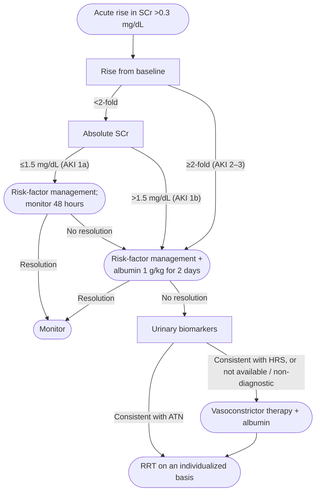

## Contents
- [[#Assessment]]
  - [[#Establishing the Diagnosis (KDIGO Criteria)]]
  - [[#Severity Assessment (ICA-AKI Staging)]]
  - [[#Classification / Typing]]
- [[#Differential Diagnosis]]
- [[#Diagnostics]]
  - [[#Initial Workup]]
  - [[#Infection Workup (Mandatory — BPA 4)]]
  - [[#Urine Studies]]
  - [[#Renal Biomarkers]]
  - [[#Imaging]]
  - [[#Volume Challenge (Diagnostic and Therapeutic)]]
- [[#Therapeutics]]
  - [[#Management Algorithm]]
  - [[#Prevention]]
  - [[#Initial Management — All AKI (BPA 5)]]
  - [[#HRS-AKI Treatment — Pharmacological (BPA 6)]]
  - [[#Monitoring During Vasoconstrictor Therapy (BPA 10–11)]]
  - [[#Renal Replacement Therapy (BPA 12)]]
  - [[#TIPS]]
  - [[#Liver Transplantation (BPA 14)]]
  - [[#Follow-up After AKI]]
- [[#See Also]]
- [[#Sources]]

---

## Assessment

### Establishing the Diagnosis (KDIGO Criteria)

Acute kidney injury (AKI) by Kidney Disease: Improving Global Outcomes (KDIGO) criteria — **any one** of ([[aga-2022-aki-cirrhosis|American Gastroenterological Association (AGA) 2022]] Best Practice Advice [BPA] 1):

- Serum creatinine (SCr) rise **≥0.3 mg/dL within 48 hours**
- SCr rise **≥50% from baseline** (presumed within the prior 7 days)
- Urine output **<0.5 mL/kg/h for >6 hours**

**Baseline SCr:** most recent value within the prior 3 months when none is available from the prior 7 days.

- *No value within 3 months* — [[adqi-ica-2024-aki-cirrhosis|Acute Disease Quality Initiative (ADQI)–International Club of Ascites (ICA) 2024]] fallbacks: most recent value up to **12 months** prior (Q2.1); no known baseline → the **lower of** admission SCr or SCr back-calculated from an **estimated glomerular filtration rate (eGFR) of 75 mL/min/1.73 m²** (Q2.2, weak recommendation)
- ADQI-ICA uses the **lowest stable** (not the most recent) value in the 3-month window; the AGA rule above governs

> [!pitfall] A "normal" creatinine can hide renal impairment
> In [[cirrhosis]], SCr underestimates loss of glomerular filtration rate (GFR): impaired hepatic creatine production, low muscle mass, female sex, tubular creatinine secretion, and hyperbilirubinemia (assay interference) ([[aga-2022-aki-cirrhosis]]).

### Severity Assessment (ICA-AKI Staging)

ICA staging, [[aga-2022-aki-cirrhosis]] Figure 1. Stage 1 is bounded by a **multiple of baseline**; the 1a/1b split turns on the **absolute** SCr — both are needed to stage.

| Stage | SCr threshold |
|---|---|
| Stage 1 | Rise >0.3 mg/dL but to **<2× baseline** |
| &nbsp;&nbsp;• Stage 1a | SCr **≤1.5 mg/dL** |
| &nbsp;&nbsp;• Stage 1b | SCr **>1.5 mg/dL** |
| Stage 2 | **≥2× baseline** |
| Stage 3 | **>3× baseline** — [[aasld-2024-aclf\|American Association for the Study of Liver Diseases (AASLD) 2024]] Table 3 adds: SCr **>4 mg/dL with an acute rise ≥0.3 mg/dL**, or **initiation of renal replacement therapy (RRT)** |

- **[[acute-on-chronic-liver-failure|Acute-on-chronic liver failure (ACLF)]] grading:** KDIGO **stage 2–3 or new RRT = renal failure**; stage 1 = renal dysfunction ([[aasld-easl-2026-aclf-global-consensus]] Statement 12, A1, for stage 2–3; Table 2 for new RRT and stage 1). Organ-failure table on the ACLF page.

### Classification / Typing

**Common pathophysiology:** splanchnic vasodilatation → low effective arterial blood volume → renin-angiotensin-aldosterone system, sympathetic nervous system and arginine vasopressin activated → renal sodium retention, impaired solute-free water excretion, renal vasoconstriction.

#### Updated ICA Nomenclature (replaces HRS Type 1 / Type 2)

| Old term | Current term | Definition ([[aga-2022-aki-cirrhosis]] Table 1) |
|---|---|---|
| Hepatorenal syndrome (HRS) type 1 (SCr doubling within 2 wk to >2.5 mg/dL) | **HRS–acute kidney injury (HRS-AKI)** | Criteria below |
| HRS type 2 (gradual SCr rise to >1.5 mg/dL) | **HRS–nonacute kidney injury (HRS-NAKI): HRS–acute kidney disease (HRS-AKD)** | eGFR **<60 mL/min/1.73 m² for <3 mo**, or SCr rise **≥1.5× baseline within 3 mo**, no other cause of kidney disease |
| | **HRS-NAKI: HRS–chronic kidney disease (HRS-CKD)** | eGFR **<60 mL/min/1.73 m² for ≥3 mo**, no other cause of kidney disease |

#### Types of AKI in Cirrhosis

| Type | Key feature ([[aga-2022-aki-cirrhosis]] BPA 3) | Distinguishing findings |
|---|---|---|
| **Hypovolemic** | Most common cause; volume responsive | SCr falls to **≤0.3 mg/dL of baseline** with volume replacement |
| **Acute tubular necrosis (ATN)** | Structural | Fractional excretion of sodium (FENa) >1%; tubular-injury biomarkers raised ([[#Urine Studies]]) |
| **HRS-AKI** | Functional — intense renal arteriolar vasoconstriction; persists despite volume repletion | No response; bland urine microscopy |
| **HRS-AKD** | Functional, <3 months, HRS-AKI criteria not met | — |
| **Postrenal** | Rare | — |

#### HRS-AKI Diagnostic Criteria (Current ICA/AGA 2022)

All required ([[aga-2022-aki-cirrhosis]] Table 1):

1. Cirrhosis with [[ascites]]
2. AKI: SCr rise **≥0.3 mg/dL within 48 h**, or **≥1.5× (>50%) baseline within 7 days** (baseline = value within the previous 3 mo closest to presentation)
3. No response to diuretic withdrawal + 2-day [[albumin]] volume challenge ([[#Volume Challenge (Diagnostic and Therapeutic)]])
4. No shock
5. No current or recent nephrotoxic drugs (nonsteroidal anti-inflammatory drugs [NSAIDs], contrast dye, etc.)
6. No structural kidney injury: no proteinuria **>500 mg/d**, no hematuria **>50 red blood cells per high-power field**, normal renal ultrasound

- ⚠ [[aasld-2024-aclf|AASLD 2024]] Table 3 also requires **Stage 2 AKI or higher** as an HRS-AKI criterion; AGA 2022 does not.

---

## Differential Diagnosis

*Workup: see [[ascites]].*

- **Hypovolemic AKI** — diarrhea (adjust [[lactulose]]), gastrointestinal (GI) bleeding, excessive diuretics, large-volume paracentesis without albumin
- **HRS-AKI** — commonest trigger [[spontaneous-bacterial-peritonitis|spontaneous bacterial peritonitis (SBP)]]
- **ATN** — structural; nephrotoxins (NSAIDs, radiographic contrast)
- **HRS-AKD** — functional, <3 months, HRS-AKI criteria not met
- **Postrenal obstruction** — rare in cirrhosis
- **AKI within ACLF** — kidney failure as one organ failure ([[acute-on-chronic-liver-failure]])

---

## Diagnostics

### Initial Workup

- **History (mandatory):** nephrotoxic drugs, [[nonselective-beta-blockers|nonselective beta-blocker]], radiographic contrast, diuretics, lactulose, excess alcohol, infection, vomiting, diarrhea, hematemesis, melena
- **Exam:** infection (cellulitis, pneumonia), volume status, hepatic and extrahepatic organ failure
- **Urinalysis** for hematuria, proteinuria, abnormal sediment (excludes structural disease)
- **Daily SCr** to stage AKI

### Infection Workup (Mandatory — BPA 4)

- Rigorous search for infection in **every** AKI: **diagnostic [[paracentesis]]** for SBP, blood and urine cultures, chest radiograph
- **No routine prophylactic antibiotics** for AKI; start **broad-spectrum antibiotics** whenever infection is strongly suspected

### Urine Studies

| Test | Suggests HRS / prerenal | Suggests ATN |
|---|---|---|
| Urine microscopy | Bland (HRS-AKI) | — |
| Urine sodium | HRS usually **<10 mEq/L** (may be higher after recent diuretics) | — |
| FENa | **<1%** (prerenal, incl. HRS) | **>1%** (structural, e.g. ATN) |
| Fractional excretion of urea (FEUrea) | **<28.16%** separates HRS from non-HRS (sensitivity 75%, specificity 83%; small retrospective study) | — |

- **FENa is unreliable in cirrhosis:** FENa <1% had sensitivity 100% but specificity **14%** for prerenal AKI; no correlation with biopsy etiology in transplant-list patients.
- **FEUrea** is not modified by diuretics → may discriminate HRS from prerenal azotemia or ATN better; may be used in the HRS-AKI differential ([[aga-2022-aki-cirrhosis]]).

### Renal Biomarkers

- **Neutrophil gelatinase–associated lipocalin (NGAL):** most studied; urinary beats serum when measured 2 days after a fluid challenge. Always much lower in HRS-AKI than ATN (even unresponsive HRS-AKI). Cutoff **220–244 µg/g creatinine** best separates ATN from prerenal/HRS; not widely available in the US.
- **Cystatin C:** more accurate GFR estimate, less influenced by age and diabetes than SCr; cystatin C + creatinine has the least bias in cirrhosis (few patients with ascites or on the transplant list studied).
- **Tubular injury markers** — kidney injury molecule 1 (KIM-1), N-acetyl-β-D-glucosaminidase, α-glutathione S-transferase, interleukin-18, α1- and β2-microglobulin, retinol binding protein: the **more that are elevated, the likelier ATN**.

### Imaging

- **Renal ultrasound:** small echogenic kidneys = structural renal disease; pelvic ultrasound usually not needed (postrenal obstruction uncommon).

### Volume Challenge (Diagnostic and Therapeutic)

- **20%–25% albumin 1 g/kg/day, max 100 g/day, for 2 consecutive days**, after diuretic withdrawal ([[aga-2022-aki-cirrhosis]] Table 1 and text; [[aga-2024-vasoactive-albumin-cirrhosis|AGA 2024]] BPA 8 — albumin is the volume expander of choice; [[aasld-2024-aclf|AASLD 2024]] Guidance Statement [GS] 23 gives the same dose for 48 h; its text specifies 25% albumin)
- SCr falls to **≤0.3 mg/dL of baseline** → hypovolemic AKI
- No response → HRS-AKI if the other criteria are met
- Significant blood loss → red cell transfusion to hemoglobin **≥8 g/dL**; avoid overtransfusion

---

## Therapeutics

### Management Algorithm

*Management of AKI in cirrhosis*
*Source: redrawn from AGA 2022 Figure 1*
*[[aga-2022-aki-cirrhosis|AGA 2022: Diagnosis and Management of AKI in Cirrhosis]]*
*SCr = serum creatinine · AKI = acute kidney injury · ATN = acute tubular necrosis · HRS = hepatorenal syndrome · RRT = renal replacement therapy*

- **Risk-factor management** (Figure 1 footnote) = hold diuretics, β-blockers and nephrotoxic drugs; stop NSAIDs; treat infection and other precipitants; expand plasma volume as required. Monitor fluid status closely whenever albumin is given (pulmonary edema).

### Prevention

[[aga-2022-aki-cirrhosis|AGA 2022]] BPA 2 and text:

- Avoid nephrotoxic drugs — NSAIDs, angiotensin-converting enzyme inhibitors, angiotensin II receptor blockers
- Avoid excessive or unmonitored diuretics or nonselective beta-blockade; check SCr and electrolytes on diuretics
- No large-volume paracentesis without albumin — dose per litre on [[paracentesis]]
- Antibiotics with GI bleeding; SBP prophylaxis ([[antibiotic-prophylaxis-cirrhosis]])
- Counsel against alcohol ([[alcohol-associated-liver-disease]])
- [[adqi-ica-2024-aki-cirrhosis|ADQI-ICA 2024]] Q6.3 (strong recommendation, grade A): **no systematic albumin** in decompensated cirrhosis to prevent AKI in **non-SBP infections**, or solely to keep serum albumin **>3.0 g/dL**

### Initial Management — All AKI (BPA 5)

1. **Hold diuretics and nonselective beta-blockers; stop NSAIDs**
2. **Treat the precipitating cause**
3. **Replace fluid losses**; if SCr has **doubled from baseline**, albumin **1 g/kg/day for 2 days** ([[#Volume Challenge (Diagnostic and Therapeutic)]])
4. Monitor fluid status — urine output, vital signs, and when indicated echocardiography or central venous pressure (if a central line is already in place)

### HRS-AKI Treatment — Pharmacological (BPA 6)

**Indication** — HRS-AKI criteria met **and** no response to 2 days of risk-factor management + albumin:

- [[aasld-2024-aclf|AASLD 2024]] GS 24: vasoconstrictors + albumin for **Stage 2 or greater** HRS-AKI without contraindications; **no recommendation for Stage 1**.
- [[aga-2022-aki-cirrhosis|AGA 2022]] (older): SCr still **>1.5 mg/dL (Stage 1b)** or **≥2× baseline (Stage 2–3)** (Figure 1 legend; BPA 6 words it as SCr "higher than twice the baseline value").

> [!pitfall] Stage 1b is where the guidelines split
> AGA 2022 calls vasoconstrictors "not currently indicated" in stage 1, then lists Stage 1b as an indication — i.e. it excludes **Stage 1a only**. AASLD 2024 starts at **Stage 2**. Know the fold-rise **and** the absolute SCr.

**Albumin** (intravenous [IV]):

- Day 1 **1 g/kg**, then **20–40 g/day** with the vasoconstrictor (AGA 2022 BPA 6; AASLD 2024 GS 24 — optimal duration unclear)
- [[aga-2024-vasoactive-albumin-cirrhosis|AGA 2024]] BPA 10: concurrent albumin *can be considered*, accounting for volume status — full schedule on [[albumin]]

**Duration and response** (AGA 2022):

- Continue albumin + vasoconstrictor until **24 h after SCr is within ≤0.3 mg/dL of baseline for 2 consecutive days**, or for a total of **14 days**
- **Complete response:** SCr back to **<0.3 mg/dL above baseline**; **partial:** SCr falls but stays **>0.3 mg/dL above baseline** (Figure 1 legend)
- **Start early** — higher pretreatment SCr predicts failure; each **1 mg/dL** fall in SCr on treatment ≈ **27% relative reduction in mortality**

**Vasoconstrictor choice** (one agent, always with albumin):

| Agent | When | Dose | Practicalities |
|---|---|---|---|
| [[terlipressin\|Terlipressin]] | **Drug of choice** (AGA 2024 BPA 10; AGA 2022 BPA 6) | Bolus or continuous infusion, max 12 mg/day (AGA 2022 BPA 7) — starting doses, escalation and the US Food and Drug Administration (FDA) schedule on [[terlipressin]] | No intensive care unit (ICU) needed; peripheral IV line (AGA 2024 BPA 11). **Not if SCr ≥5 mg/dL or oxygen saturation <90%** (FDA restriction, AGA 2022 BPA 7) |
| Midodrine + octreotide ([[somatostatin-analogs\|somatostatin analog]]) | Terlipressin unavailable (BPA 6) | Midodrine **7.5 mg** by mouth, titrated to **12.5 mg 3 times daily**; octreotide **100 µg** titrated to **200 µg subcutaneously 3 times daily** (BPA 8) | No ICU. Works very slowly; inferior to terlipressin. **Octreotide alone is ineffective** |
| Norepinephrine | Terlipressin unavailable (BPA 6); **may be preferred in shock** (AASLD 2024 GS 26) | **0.5 mg/h IV**, increase **0.5 mg/h every 4 h**, max **3 mg/h**; goal mean arterial pressure (MAP) **↑ ≥10 mmHg** and/or urine output **>50 mL/h for ≥4 h** (BPA 9) | ICU-monitored setting. Renal improvement 39%–70% in small trials, similar to terlipressin |

- **Terlipressin over norepinephrine in ACLF** (bilirubin >5 mg/dL and international normalized ratio >1.5 with onset of [[hepatic-encephalopathy|hepatic encephalopathy]] or ascites within 4 weeks) — terlipressin superior ([[aga-2022-aki-cirrhosis]]).
- **ACLF grade 3:** AASLD 2024 GS 25 limits terlipressin to patients **without ACLF-3** (European Association for the Study of the Liver–Chronic Liver Failure [EASL-CLIF]) or major cardiopulmonary or vascular disease; the earlier AGA 2024 BPA 12 says "use with caution" — the newer AASLD statement governs here. Grades on [[acute-on-chronic-liver-failure]].
- **Benefit may not outweigh risk** with SCr **>5 mg/dL**, or listed for transplant with Model for End-Stage Liver Disease (MELD) **≥35** (AGA 2024 BPA 12; MELD variant not specified — formulas on [[cirrhosis]]). Full contraindication list on [[terlipressin]].

### Monitoring During Vasoconstrictor Therapy (BPA 10–11)

- **Daily SCr**
- **Ischemia** (terlipressin, norepinephrine): angina; ischemia of fingers, skin, intestine — start at the lowest dose and titrate up (BPA 10). Terlipressin: **never resume** after cardiac or ischemic symptoms, even if resolved.
- **Fluid status** — pulmonary edema with excessive albumin (BPA 11). Respiratory failure on terlipressin tracked with more pre-treatment albumin → judicious albumin before and during ([[aga-2024-vasoactive-albumin-cirrhosis|AGA 2024]]). Oximetry rules on [[terlipressin]].
- Norepinephrine: ischemic complications, arrhythmias, respiratory side effects. Midodrine: headache, blurred vision, palpitations, rash. Octreotide: fatigue, nausea, emesis, abdominal or back pain.

### Renal Replacement Therapy (BPA 12)

| Situation | RRT ([[aga-2022-aki-cirrhosis\|AGA 2022]] BPA 12 and text) |
|---|---|
| Any AKI etiology, current or potential [[liver-transplantation\|liver transplantation (LT)]] candidate | Indicated |
| ATN | May be used (BPA 12A); **indicated even in non-LT candidates** |
| HRS-AKI unresponsive to drugs, LT candidate | **Bridge to LT** — for volume overload, electrolyte derangements, or uremia |
| HRS-AKI, **not** an LT candidate | **Not used** (BPA 12B). ⚠ The 2026 global ACLF consensus also reserves it for **potentially reversible** liver or extrahepatic organ dysfunction |
| Uncertain etiology | Individual basis (BPA 12C); in non-LT candidates, at least for a limited period |

- **Continuous RRT preferred** — lower fluid shifts, less hemodynamic instability.
- Prognosis guarded: mortality **59%** with **>7 days** of RRT.
- Two-thirds on pretransplant RRT recover renal function with LT; **~14 days** of RRT is the cutoff predicting recovery; each extra pretransplant dialysis day → **3.6%–6%** higher risk of renal nonrecovery.
- [[aasld-easl-2026-aclf-global-consensus|2026 global ACLF consensus]]: **consider RRT for HRS-AKI that failed pharmacotherapy** if listed for or being considered for LT (Statement 49, B1; AASLD 2024 GS 27 states it more strongly — RRT "is recommended" for this group, use individualised). HRS-AKI and ATN often coexist in ACLF — a spectrum. Timing individualised; **no routine pre-emptive RRT**, no routine intraoperative RRT during LT, no RRT for hyperammonemia alone without AKI (selected cases: right-sided volume overload, metabolic derangements).

### TIPS

- [[tips|Transjugular intrahepatic portosystemic shunt (TIPS)]] — **not** a specific treatment for HRS-AKI (BPA 13); no supporting data.

### Liver Transplantation (BPA 14)

- **LT is the most effective (definitive) treatment** for HRS-AKI; refer potential candidates for transplant evaluation **without delay** ([[aasld-2024-aclf|AASLD 2024]]).
- **Treat HRS-AKI before LT** — may improve post-LT outcomes.
- Non-responders who are not LT candidates → [[palliative-care-in-cirrhosis|palliative care]] (AASLD 2024).
- ~**25%** stay dialysis dependent after LT (especially younger, chronic renal disease, pretransplant RRT).

> [!pearl] Do not withhold treatment over the MELD paradox
> Reversal lowers SCr and the MELD-sodium score, and so transplant priority — treat anyway; the benefit outweighs the lost priority ([[aga-2022-aki-cirrhosis]]).

**Simultaneous liver-kidney transplantation** — Organ Procurement and Transplantation Network policy (United Network for Organ Sharing, 2017):

- On **dialysis**, or measured/calculated **GFR ≤25 mL/min for ≥6 consecutive weeks**
- After LT: kidney-alone listing with high priority for persistent renal dysfunction — end-stage renal disease or **GFR <20 mL/min**
- AASLD 2024: pretransplant RRT **>6 weeks** → consider simultaneous liver-kidney transplant

### Follow-up After AKI

[[adqi-ica-2024-aki-cirrhosis|ADQI-ICA 2024]] (Q10, Figure 6):

- Check kidney function **within 1 month of discharge** at minimum ("we suggest"); sooner as AKI severity rises — the Figure 6 timeline runs from within 30 days (short stage 1 AKI, SCr back to baseline) to **within 7 days** (stage 3 or dialysis-requiring AKI)
- **Persistent kidney dysfunction at 90 days → formal assessment for chronic kidney disease (CKD)**
- Routine **albuminuria** screening after AKI; SCr may overestimate kidney function → consider serum cystatin C
- Tailor follow-up to kidney and liver severity with hepatology–nephrology collaboration (Q10.1, best practice statement); nephrology, transplant and palliative evaluation at the severe end
- Personalised **palliative care evaluation** — symptom burden, patient/caregiver wellbeing, goals of care (Q10.2, best practice statement)

---

## See Also

[[cirrhosis]], [[ascites]], [[spontaneous-bacterial-peritonitis]], [[acute-on-chronic-liver-failure]], [[portal-hypertension]], [[albumin]], [[terlipressin]], [[somatostatin-analogs]], [[nonselective-beta-blockers]], [[paracentesis]], [[antibiotic-prophylaxis-cirrhosis]], [[hepatic-encephalopathy]], [[alcohol-associated-liver-disease]], [[liver-transplantation]], [[tips]], [[palliative-care-in-cirrhosis]], [[acute-liver-failure]], [[nutrition-in-liver-disease]]

---

## Sources

1. [[aga-2022-aki-cirrhosis|AGA 2022: Diagnosis and Management of AKI in Cirrhosis]]
2. [[aga-2024-vasoactive-albumin-cirrhosis|AGA 2024 Clinical Practice Update on the Use of Vasoactive Drugs and Intravenous Albumin in Cirrhosis]]
3. [[aasld-2024-aclf|AASLD 2024 Practice Guidance on Acute-on-Chronic Liver Failure]]
4. [[aasld-easl-2026-aclf-global-consensus|AASLD/EASL/APASL/ALEH/SOLDA 2026 Global Multisociety Consensus on ACLF Definitions]]
5. [[adqi-ica-2024-aki-cirrhosis|ADQI-ICA 2024: Acute Kidney Injury in Patients With Cirrhosis — Joint Multidisciplinary Consensus Meeting]]
