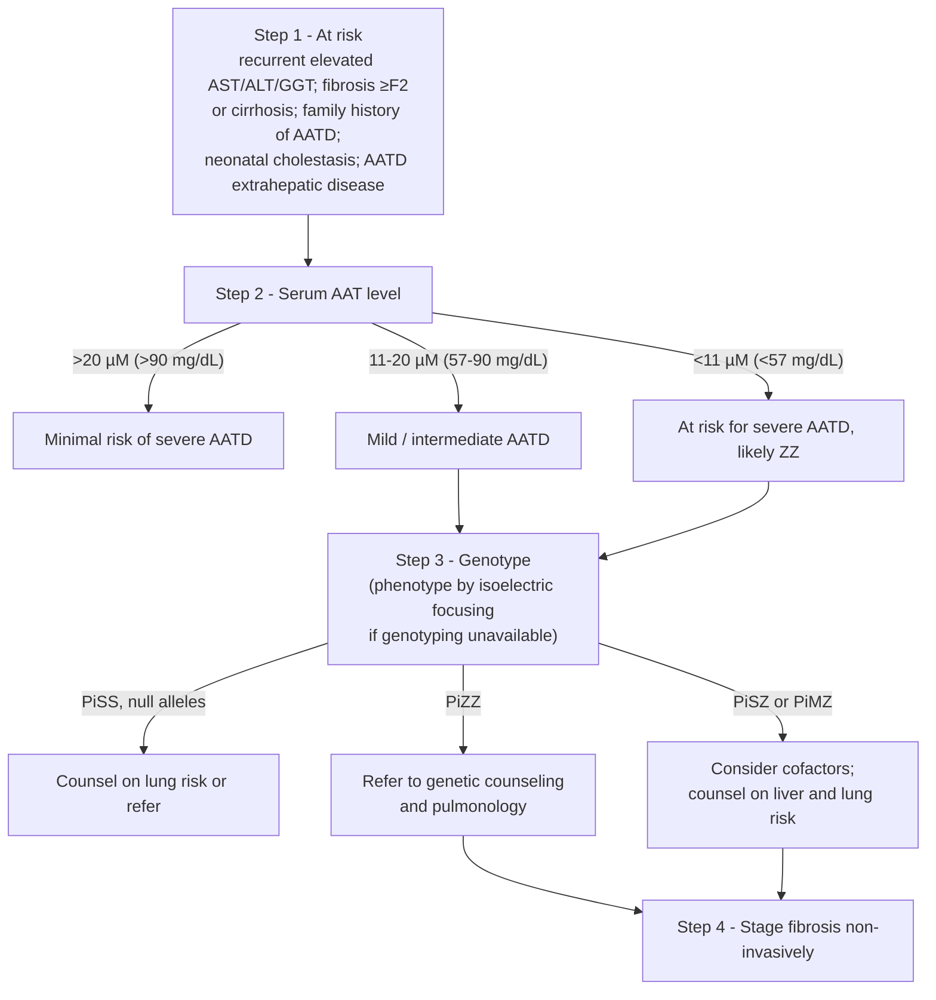

## Contents
- [[#Assessment]]
  - [[#Establishing the Diagnosis]]
  - [[#Severity Assessment]]
  - [[#Classification by Genotype]]
- [[#Differential Diagnosis]]
- [[#Diagnostics]]
  - [[#Serum AAT Level]]
  - [[#Genotyping]]
  - [[#Fibrosis Staging]]
  - [[#Liver Biopsy]]
- [[#Therapeutics]]
  - [[#Monitoring]]
  - [[#Cirrhosis Care and Transplantation]]
  - [[#Drug Therapy]]
- [[#See Also]]
- [[#Sources]]

## Assessment

### Establishing the Diagnosis

**Alpha-1 antitrypsin deficiency–associated liver disease (AATD-LD)** — the consensus nomenclature and case definition ([[aga-aasld-easl-2026-aatd-liver-disease|AGA/AASLD/EASL/Alpha-1 Foundation 2026]]):

> **AATD-LD = adults with the PiZZ genotype who exhibit recurrently elevated liver enzymes (aspartate aminotransferase [AST], alanine aminotransferase [ALT], or γ-glutamyl transferase [GGT]) and/or evidence of significant liver fibrosis (stage ≥2 on a 0–4 scale).**

- The fibrosis limb is operationalized as **liver stiffness measurement (LSM) ≥8 kPa by vibration-controlled transient elastography (VCTE)**
- Alpha-1 antitrypsin deficiency (AATD) itself is a rare inherited disorder of the **SERPINA1** gene — **autosomal codominant**, producing reduced serum levels and dysfunctional forms of the alpha-1 antitrypsin (AAT) protein
- The **Z allele** (**Glu342Lys** substitution) is the most common pathogenic variant
- **Pathogenesis is a toxic gain-of-function**: misfolded AAT accumulates in the hepatocyte endoplasmic reticulum → cellular stress, inflammation, fibrosis. This is a **different mechanism from the lung disease**, which is a protease–antiprotease imbalance — so hepatic and pulmonary severity do not track each other

> [!pitfall] Normal liver enzymes do not exclude significant fibrosis
> **20%–36% of PiZZ adults have clinically significant fibrosis**, but only **11%–24%** have elevated liver function tests (AST 13%–15%, ALT 11%–19%, GGT 13%–24%) — abnormalities being commoner with comorbid obesity or diabetes. Stage the fibrosis; don't wait for the enzymes ([[aga-aasld-easl-2026-aatd-liver-disease]]).

**Who to test** — case detection is indicated in any of:

- Recurrently elevated AST/ALT/GGT
- **Hepatic fibrosis ≥F2, including cirrhosis** — anyone with [[cirrhosis]] or being evaluated for [[liver-transplantation|liver transplantation]] should be tested for AATD
- **Family history of AATD**
- **History of neonatal cholestasis**
- **AATD-associated extrahepatic conditions** — emphysema, chronic obstructive pulmonary disease (COPD), asthma with airflow obstruction that is incompletely reversible, unexplained bronchiectasis, necrotizing panniculitis, or granulomatosis with polyangiitis

**Suspected or confirmed [[nafld-masld|steatotic liver disease does not preclude testing]]** — the two overlap and the Z allele amplifies fibrosis progression.

### Severity Assessment

- Approximately **10% of adults with the PiZZ genotype develop clinically significant liver disease**, including cirrhosis and [[hepatocellular-carcinoma|hepatocellular carcinoma (HCC)]]
- **Modifiers of progression:** age, **male sex**, metabolic syndrome, **alcohol use**, and other coexisting liver insults (e.g., viral hepatitis — [[chronic-hepatitis-b]], [[hepatitis-c]])
- Among the liver enzymes, **GGT correlates best with histologic fibrosis and with development of major adverse liver outcomes (MALOs)**; AST and ALT are somewhat less accurate. Persistently elevated liver function tests are associated with increased MALO risk
- **After a first hepatic decompensation** (clinically evident ascites, variceal bleeding, or overt [[hepatic-encephalopathy|hepatic encephalopathy]]), decompensated AATD-LD carries a **higher risk of further decompensation, acute-on-chronic liver failure, transplant requirement, or death than other etiologies** — which is why transplant evaluation comes earlier here

### Classification by Genotype

| Genotype | Prevalence (White individuals) | Liver disease risk from the mutation alone |
|---|---|---|
| **PiZZ** | **1:3000** | **Highest** — ~**20× risk of advanced fibrosis** vs wild type. Lowest prevalence, highest risk |
| **PiSZ** | 1:500 | ~**3×** elevated |
| **PiMZ** | 1:30 | ~**2×** elevated |
| **PiMM** | 9:10 | Normal (wild type) |

- **PiMZ and PiSZ patients commonly carry cofactors** — diabetes, obesity, or excessive alcohol use — at the time clinical liver disease is diagnosed, so their liver disease is usually not attributable to the genotype alone
- **Null variants produce no protein and carry no liver risk** (no misfolded protein to accumulate). About **5% of those with AAT <57 mg/dL and severe AATD-LD have non-Z alleles** and may not produce misfolded AAT in the liver
- Whether PiMZ and PiSZ belong inside the AATD-LD definition is **deliberately left open** — future trials modifying the Z protein will show how often these genotypes improve ([[aga-aasld-easl-2026-aatd-liver-disease]])

---

## Differential Diagnosis

*Workup: see [[abnormal-liver-chemistries]].*

- [[nafld-masld|Metabolic dysfunction–associated steatotic liver disease (MASLD)]] — **overlaps rather than excludes**; test for AATD anyway
- [[alcohol-associated-liver-disease|Alcohol-associated liver disease]] — alcohol is also a cofactor within AATD-LD
- Chronic viral hepatitis ([[chronic-hepatitis-b]], [[hepatitis-c]]) — a coexisting insult that modifies AATD-LD progression
- [[hereditary-hemochromatosis|Hereditary hemochromatosis]] and [[wilson-disease|Wilson disease]] — the other inherited metabolic liver diseases found in the same workup
- [[autoimmune-hepatitis]], [[primary-biliary-cholangitis]], [[primary-sclerosing-cholangitis]]

---

## Diagnostics

The pathway is four steps: identify the at-risk patient, screen the **serum AAT level**, confirm by **genotype**, then stage fibrosis **non-invasively** ([[aga-aasld-easl-2026-aatd-liver-disease]]).

*Figure — screening, diagnosis and risk stratification of AATD-LD, recreated from Figure 2. ([[aga-aasld-easl-2026-aatd-liver-disease]])*

### Serum AAT Level

**The diagnostic evaluation of chronic liver disease should include a serum AAT level** — inexpensive, and typically abnormal in severe deficiency genotypes.

| Serum AAT | Interpretation |
|---|---|
| **>20 μM (>90 mg/dL)** | Minimal risk of severe AATD |
| **11–20 μM (57–90 mg/dL)** | Mild / intermediate AATD |
| **<11 μM (<57 mg/dL)** | At risk for **severe** AATD, likely ZZ |

> [!pitfall] AAT is an acute-phase reactant — check it when CRP is normal
> Serum levels can read normal under physiologic stress, and some patients with chronic liver disease carry a persistent mild C-reactive protein (CRP) elevation. **Measure the level in the absence of systemic inflammation**, and remember a **PiMZ patient may have a normal AAT level entirely** — that one needs a genotype ([[aga-aasld-easl-2026-aatd-liver-disease]]).

### Genotyping

- **Genotyping is necessary** to comprehensively determine carrier genotypes (MZ), and is the **preferred** confirmatory test after a low level
- **Phenotyping by isoelectric focusing** is the alternative where genotyping is unavailable
- More expensive than the level, but embraced by many liver centers. An experienced AATD center should be involved for genotyping, family counseling, and management
- **PiZZ → refer to genetic counseling and pulmonology**

### Fibrosis Staging

Stage every PiZZ patient non-invasively — **blood-based and imaging-based**, with **VCTE preferred**.

**Blood-based non-invasive test (NIT), first line:**

- **Low risk: fibrosis-4 index (FIB-4) <1.3 or AST-to-platelet ratio index (APRI) <0.5** → repeat the blood-based NIT **annually during pulmonary monitoring**
- **FIB-4 ≥1.3 or APRI ≥0.5** → requires a second-line NIT
- **Caveat the panel states plainly:** values below those cutoffs carried very low MALO risk over a median 3.5 y, but **FIB-4 <1.3 was seen in about 50% of the cohort, limiting its utility as a triage tool**

**Imaging-based NIT — LSM by VCTE (preferred) or magnetic resonance elastography (MRE):**

| VCTE LSM | Risk stratum | Repeat LSM |
|---|---|---|
| **<8 kPa** | **Low** — significant fibrosis unlikely | **2–3 years** |
| **8–15 kPa** | **Intermediate** — likely significant to advanced fibrosis; *consider liver biopsy for definitive diagnosis* | **1–2 years** |
| **≥15 kPa** | **High** — likely cirrhosis and MALOs | **Annually** |

- **MRE ~3 kPa** has been associated with clinically significant fibrosis in other liver diseases and is likely appropriate in AATD
- Shear-wave elastography and MRE are alternatives to VCTE by local availability and cost; neither is specifically validated in AATD
- The **enhanced liver fibrosis test is not validated** against biopsy or clinical outcomes in AATD-LD — its staging role is uncertain
- **Ultrasound** may be considered at diagnosis, but is **currently only recommended for HCC screening/surveillance in patients with cirrhosis**
- General NIT cutoffs and test characteristics: [[noninvasive-liver-disease-assessment]]

### Liver Biopsy

- **Not required** to establish the diagnosis of AATD-LD
- **May be indicated in select cases** to establish or exclude additional factors contributing to liver disease — and is worth considering in the **intermediate 8–15 kPa** band for a definitive answer
- Histologic staging is an **imperfect reference standard**; NITs validated against histology and/or MALOs are **preferable to biopsy for staging and monitoring**, biopsy being impractical for tracking a lifelong genetic liver disease

---

## Therapeutics

### Monitoring

- **Re-stage on the schedule set by the LSM stratum** (2–3 y / 1–2 y / annual — table above)
- **Individualize** the interval for fibrosis cofactors — in particular **obesity**, and potentially diabetes
- **Longitudinal reassessment during routine pulmonary follow-up** is a practical way to keep the liver monitored in a patient already attending for lung disease
- **LSM >15 kPa (advanced chronic liver disease)** → yearly VCTE **plus** HCC surveillance and portal hypertension management
- **[[obesity]]** is an important lifestyle-intervention target in AATD-LD
- **Alcohol:** caution all patients about the risks; **anyone who is a candidate for treatment should completely and permanently stop drinking**

### Cirrhosis Care and Transplantation

- **HCC surveillance and [[portal-hypertension|portal hypertension]] management follow the general cirrhosis recommendations for any etiology** — see [[cirrhosis]] and [[hepatocellular-carcinoma]]
- **Transplant referral is earlier than in other etiologies.** Early consideration for [[liver-transplantation|liver transplantation]] is warranted in decompensated AATD-LD; transplantation is the **only curative option**
- **Any patient with decompensation** — ascites, variceal bleeding, or hepatic encephalopathy — **should be evaluated promptly** to allow timely listing and optimize pretransplant care
- Refer to a center with **expertise in both transplant hepatology and AATD-LD**; post-transplant complication risk may be higher than in other etiologies, and concurrent pulmonary disease complicates the transplant

### Drug Therapy

- **No approved therapy exists for the liver disease**, and no regulatory guidance for AATD-LD drug development is available ([[aga-aasld-easl-2026-aatd-liver-disease]])
- Agents in human trials, by target organ:

| Target | Candidate | Mechanism | Stage |
|---|---|---|---|
| Liver and lung | BEAM-302 | DNA editing | Phase 1/2b |
| Liver and lung | WVE-006 | RNA editing | Phase 1/2b |
| Liver and lung | KRRO-110 | RNA editing | Phase 1/2a |
| **Liver** | **Fazirsiran** | Small interfering RNA (silencing) | **Phase 3** |
| Liver | BMN-349 | Chaperone — stabilizes monomeric Z-AAT to prevent polymerization | Phase 1 |
| Lung | Kamada-AAT | AAT protein replacement | Phase 3 |
| Lung | INBRX-101 | AAT protein replacement (bivalent Fc fusion) | Phase 2/3 |
| Lung | Alvelestat | Neutrophil elastase inhibitor | Phase 2 |
| Lung | KB-408 | Gene therapy (SERPINA1 via HSV-1 vector) | Phase 1 |

- Phase 2 studies of **fazirsiran** showed promise
- **AAT augmentation therapy treats the lung, not the liver** — the liver injury is accumulation of misfolded protein, not deficiency of circulating protein

---

## See Also

[[abnormal-liver-chemistries]], [[cirrhosis]], [[portal-hypertension]], [[hepatocellular-carcinoma]], [[liver-transplantation]], [[hepatic-encephalopathy]], [[noninvasive-liver-disease-assessment]], [[nafld-masld]], [[alcohol-associated-liver-disease]], [[hereditary-hemochromatosis]], [[wilson-disease]], [[autoimmune-hepatitis]], [[obesity]]

---

## Sources

1. [[aga-aasld-easl-2026-aatd-liver-disease|Multi-Society Expert Panel Consensus Guidance Regarding Clinical Assessment and Clinical Trial Endpoints in Adults With Alpha-1 Antitrypsin Deficiency–Associated Liver Disease (2026)]]
