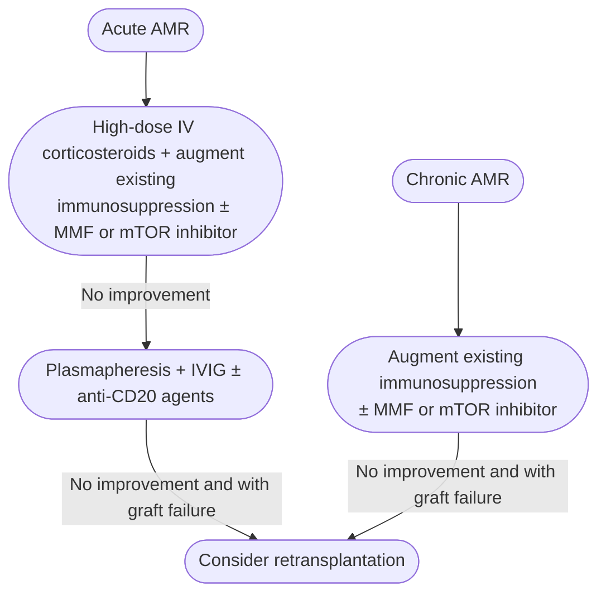

Rejection of a [[liver-transplantation|liver allograft]] mediated by **donor-specific antibodies (DSA)** against human leukocyte antigen (HLA) (or non-HLA) antigens on graft endothelium. The liver is relatively resistant to antibody-mediated injury — its regenerative capacity, large sinusoidal network, secreted soluble class I HLA that binds DSA, and variable class II microvascular expression all blunt the attack — so **acute antibody-mediated rejection (AMR) is rare in ABO-compatible recipients** and is seen mainly in ABO-incompatible grafts and highly sensitized recipients.

## Contents
- [[#Assessment]]
  - [[#Establishing the Diagnosis]]
  - [[#Severity Assessment]]
  - [[#Classification / Typing]]
- [[#Differential Diagnosis]]
- [[#Diagnostics]]
  - [[#Liver Biopsy and C4d Staining]]
  - [[#Donor-Specific Antibody Testing]]
- [[#Therapeutics]]
  - [[#Acute AMR]]
  - [[#Chronic AMR]]
  - [[#Graft Failure]]
  - [[#ABO-Incompatible Transplantation]]
- [[#See Also]]
- [[#Sources]]

## Assessment

### Establishing the Diagnosis

- **Acute AMR — Rec 47 (Strong, Level 3):** suspect in a recipient with **unexplained graft dysfunction + thrombocytopenia + hypocomplementemia**; obtain **DSA testing and liver biopsy with complement component 4d (C4d) staining** for the signature histologic features.
  - Clinically: graft dysfunction in a highly sensitized recipient with otherwise unexplained thrombocytopenia, low complement levels, and circulating immune complexes.
  - Diagnosis rests on the signature histology **in the presence of high DSA** — not on any single element.
- **Chronic AMR — Rec 50 (Strong, Level 4):** diagnosis is challenging; workup should include **DSA** and typical liver-biopsy findings, and **other liver diseases causing a similar injury pattern must be excluded**.

### Severity Assessment

- **Acute AMR** — graded clinically by depth of unexplained graft dysfunction, thrombocytopenia and hypocomplementemia; AASLD/AST 2025 gives no numeric severity scale.
- **Chronic AMR** — occurs in **<10%** of liver transplant recipients; most episodes are **mixed chronic AMR + T-cell–mediated rejection (TCMR)**, which is why the features are hard to characterize. Endpoint is graft fibrosis and graft loss.
- **Chronic AMR score** — histologic findings + presence of DSA + exclusion of other etiologies that cause a similar injury pattern; associated with graft loss, **area under the curve (AUC) 0.70–0.81**. AASLD/AST 2025 does not publish the score's point values or a cut-off, so it cannot be calculated from the guideline.
- **DSA titre — what counts as "elevated":** preformed DSA of potential clinical significance was **tentatively defined as mean fluorescence intensity (MFI) ≥5,000** at the 2015 Banff Conference on Allograft Pathology. No agreed-upon MFI cut-off correlates with chronic AMR, though most studies show correlation at **MFI >5,000**.

> [!pitfall] Read an MFI against the reporting lab's own cutoff
> The positivity cutoff varies by laboratory and by study, and the optimal range is undetermined — the reason Rec 55 declines routine pre-transplant DSA testing ([[aasld-ast-2025-liver-transplant-graft-complications]]).

### Classification / Typing

Signature features ([[aasld-ast-2025-liver-transplant-graft-complications]], Table 6):

| | **Acute AMR** | **Chronic AMR** |
|---|---|---|
| Histology | 1. Endothelial hypertrophy 2. Portal capillary dilatation 3. Microvasculitis 4. Periportal edema | 1. Unexplained mononuclear and/or perivenular inflammation 2. Low-grade interface and/or perivenular necroinflammatory activity 3. Moderate portal/periportal sinusoidal and/or perivenular fibrosis 4. Nodular regenerative hyperplasia and obliterative arteriopathy in some cases |
| C4d | Staining in **sinusoidal endothelium**; portal vein/capillary + sinusoidal endothelial staining is **most specific** for acute AMR | **Focal** staining in **>10%** of portal tract endothelia |
| DSA | **Elevated titers** | Elevated titers in **some** cases; typically **de novo class II, especially DQ** |
| Other | Unexplained graft dysfunction, thrombocytopenia, hypocomplementemia, circulating immune complexes, vasculitis on biopsy with diffuse C4d staining | Frequently coexists with TCMR |

*See Figure 2 in [[aasld-ast-2025-liver-transplant-graft-complications]] for example histology of each rejection pattern.*

## Differential Diagnosis

*Workup: see [[abnormal-liver-chemistries]] — post-transplant AMR presents as otherwise unexplained graft dysfunction.*

- **TCMR**, early and late — the main alternative; late TCMR shows fewer blastic lymphocytes, more interface/perivenular necroinflammation, less venous endotheliitis.
- **Plasma cell-rich rejection (PCR)** — >30% plasma cells in portal/perivenular infiltrates, prevalent central perivenulitis, higher incidence of portal microvascular C4d deposition. Whether PCR is a presentation of AMR or a separate entity is unresolved.
- **Chronic ductopenic rejection (CDR)** — bile duct atrophy/pyknosis in the majority of ducts, foam-cell obliterative arteriopathy or duct loss in >50% of portal tracts, perivenular fibrosis.
- **Recurrent disease**, [[biliary-stricture|biliary]] and vascular complications (e.g. hepatic artery thrombosis) — must be excluded, particularly for chronic AMR.

> [!pearl] Plasma cell-rich rejection can hide an AMR component
> In one series DSA was positive in 6/19 and C4d in 9/10 — send DSA and C4d staining whenever PCR is diagnosed ([[aasld-ast-2025-liver-transplant-graft-complications]]).

## Diagnostics

### Liver Biopsy and C4d Staining

- [[liver-biopsy|Liver biopsy]] with C4d immunostaining is the diagnostic test; C4d alone is not diagnostic — interpret it with the DSA result and the histologic pattern.
- Staining of **portal vein and portal capillaries plus sinusoidal endothelial cells** is the most specific pattern for acute AMR.

### Donor-Specific Antibody Testing

- **Rec 54 (Strong, Level 3):** assess DSA in **severe or steroid-resistant rejection, PCR, AMR, or allograft dysfunction of unknown etiology**.
- **Rec 55 (Weak, Level 3):** routine **pre-transplant** DSA testing for all candidates **cannot be recommended** — high DSA is not always associated with graft complications, and MFI thresholds and measurement techniques are not standardized.
- **Rec 56 (Weak, Level 4):** **serial DSA measurement can be individualized** in verified or suspected AMR being treated or monitored; no frequency is specified.
- **Preformed DSA** — uncommon without prior alloantigen exposure (pregnancy, transfusion, prior transplant). Low-level class I DSA may be absorbed after transplant; persistence is associated with higher rejection at 1 year, graft loss and CDR.
- **De novo DSA** — 12.2% at 1 year, 13.4% at 5 years, 19.5% at 10 years; usually directed at class II HLA. At a cutoff of **MFI 3,000**, associated with graft rejection (odds ratio [OR] 6.43, 95% confidence interval [CI] 3.17–13.04) and with graft loss/CDR (OR 3.61, 95% CI 1.94–6.71).
- **Risk factors for de novo DSA:** female sex, longer interval from transplant to screening, **lower total [[tacrolimus]] exposure**, deliberate lowering of immunosuppression, and non-adherence.

## Therapeutics

*Management ladder for acute and chronic antibody-mediated rejection*
*Source: redrawn from the AASLD/AST 2025 rejection management algorithm, panel D*
*[[aasld-ast-2025-liver-transplant-graft-complications|AASLD/AST 2025 Liver Transplant Graft Complications]]*
*AMR = antibody-mediated rejection · IV = intravenous · MMF = mycophenolate mofetil · mTOR = mammalian target of rapamycin · IVIG = intravenous immunoglobulin*

- **Augmenting existing immunosuppression** in either ladder includes switching cyclosporine → [[tacrolimus]] ([[calcineurin-inhibitors|calcineurin inhibitor (CNI)]] switch) where applicable, with or without adding another class of immunosuppressant.

### Acute AMR

- **Rec 48 (Strong, Level 3) — initial:** **high-dose corticosteroids** + augmentation of existing immunosuppression, with or without adding an immunosuppressant **from a different class** (antimetabolite or mTOR inhibitor).
- **Rec 49 (Weak, Level 4) — refractory:** **IVIG + plasma exchange, with or without anti-CD20 agents**, may be considered. Rituximab, bortezomib and/or eculizumab have been used, but efficacy and safety data are lacking.

### Chronic AMR

- **Rec 51 (Strong, Level 5) — initial:** augment existing immunosuppression — **increase plasma tacrolimus levels**; cyclosporine → tacrolimus — with or without a **second class** of immunosuppressant.
- **Rec 52 (Strong, Level 4):** **insufficient data** to recommend anti-CD20 therapy, proteasome inhibitors, plasma exchange, or IVIG in chronic AMR.

### Graft Failure

- **Rec 53 (Strong, Level 5):** **retransplantation (re-LT)** should be considered for acute or chronic AMR resulting in graft failure.
- Optimal immunosuppression after re-LT is not established. With recurrent graft failure requiring multiple re-LT, consider unrecognized AMR from immune dysregulation when choosing regimen intensity.

### ABO-Incompatible Transplantation

- Limited by severe TCMR, AMR, hyperacute rejection, hepatic artery thrombosis, hepatic necrosis and biliary complications.
- Desensitization protocols (rituximab, plasmapheresis before and immediately after transplant) are still being developed; no conclusive data support induction immunosuppression in this population.

**Evidence quality:** treatment data are retrospective, from small single-center series, pediatric recipients, or ABO-incompatible transplants — no randomized controlled trial (RCT)-level evidence for any AMR treatment in liver transplantation.

---

## See Also

[[liver-transplantation]], [[calcineurin-inhibitors]], [[post-transplant-lymphoproliferative-disorder]], [[tacrolimus]], [[operational-tolerance]], [[liver-biopsy]], [[abnormal-liver-chemistries]]

---

## Sources

1. [[aasld-ast-2025-liver-transplant-graft-complications|AASLD/AST 2025: Practice Guideline on Adult Liver Transplantation — Diagnosis and Management of Graft-Related Complications]]
