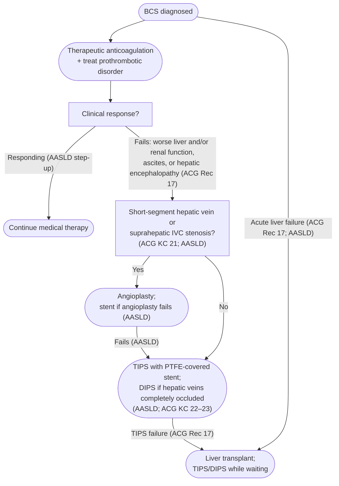

## Contents
- [[#Assessment]]
  - [[#Establishing the Diagnosis]]
  - [[#Severity Assessment]]
    - [[#BCS-TIPS Prognostic Index]]
    - [[#Rotterdam Prognostic Index]]
- [[#Differential Diagnosis]]
- [[#Diagnostics]]
- [[#Therapeutics]]
  - [[#Stepwise Management Algorithm]]
  - [[#Step 1 — Anticoagulation]]
  - [[#Step 2 — Angioplasty / Stenting]]
  - [[#Step 3 — TIPS]]
  - [[#Step 4 — Liver Transplantation]]
  - [[#HCC Surveillance]]

## Assessment

### Establishing the Diagnosis

**Definition.** Budd-Chiari syndrome (BCS; hepatic vein thrombosis) = hepatic venous outflow obstruction anywhere from the small hepatic veins to the inferior vena cava (IVC)–right atrium junction, **without intracardiac or pericardial obstruction** ([[aasld-2021-vascular-pvt|American Association for the Study of Liver Diseases (AASLD) 2021]]).
- **Primary** = endoluminal venous lesion, usually thrombus or web (AASLD)
- **Secondary** = extrinsic compression **or endoluminal neoplastic/parasitic obstruction** ([[baveno-viii-2026-portal-hypertension|Baveno VIII]] 8.23); [[acg-2020-hepatic-mesenteric-circulation|American College of Gastroenterology (ACG) 2020]] excludes secondary BCS from its guidance

**When to suspect:**
- Any liver disease, recent or chronic, of **unknown etiology**; more so with a known prothrombotic disorder (AASLD)
- ACG Key Concept (KC) 17: especially **new-onset [[ascites]] and/or abdominal pain**

**Presentation** — asymptomatic to [[acute-liver-failure|acute liver failure]] (extensive, rapid thrombosis; AASLD); chronic form most common (ACG):
- Early: acute-onset ascites, abdominal pain, abnormal liver tests → then [[portal-hypertension|portal hypertension]] complications ([[variceal-upper-gi-bleeding|variceal bleeding]], [[hepatic-encephalopathy|hepatic encephalopathy]]) (ACG)
- At diagnosis: ascites **83%**, hepatomegaly **67%**, abdominal pain **61%**; esophageal varices **>50%** (AASLD)
- **~15%–20% asymptomatic** — usually partial thrombosis with decompressive collaterals (AASLD)
- Labs: raised bilirubin and aminotransferases, prothrombin time prolonged when severe; **high ascitic fluid protein** (AASLD)
- IVC obstruction: abdominal varices, lower-limb edema or ulcers (AASLD)

**Diagnostic criterion** (Baveno VIII 8.25): **venous luminal obstruction**, or **hepatic vein collaterals + no patent hepatic veins**. Imaging and biopsy: [[#Diagnostics]].

**Etiology:** prothrombotic disorder in **~75%** (AASLD; ACG ≥1 in 79%–84%); **≥2 coexist in ≥35%** (ACG 25%–46%); none found in 15%–30% (AASLD).

| Cause | Prevalence in BCS | Note |
|---|---|---|
| Myeloproliferative neoplasm (MPN) | **41%** (ACG: ~half) | Most common in Western patients; often **masked by hypersplenism**; JAK2 V617F in 86% |
| Oral contraceptives or recent pregnancy | **23%** | Over-represented in Western patients |
| Antiphospholipid syndrome | **10%** | Isolated anticardiolipin antibodies: low specificity in liver disease |
| Paroxysmal nocturnal hemoglobinuria (PNH) | **7%** | Uncommon |
| Protein C / protein S / antithrombin deficiency | **5% / 4% / 1%** | Plasma levels nonspecific with liver dysfunction |
| Behçet disease | **2%–3%** | Major cause in the Mediterranean |
| [[celiac-disease\|Celiac disease]] | **1%** | Over-represented in North Africa |
| Factor V Leiden / prothrombin G20210A | 8% / 3% **population** prevalence in Europeans (no BCS rate given) | Molecular diagnosis |

*Thrombotic risk factors in hepatic vein thrombosis/BCS without cirrhosis*
*Source: data from AASLD 2021 Table 7, hepatic vein thrombosis/BCS column*
*[[aasld-2021-vascular-pvt|AASLD 2021 Vascular Liver Disorders Guidance]]*
*BCS = Budd-Chiari syndrome · MPN = myeloproliferative neoplasm · PNH = paroxysmal nocturnal hemoglobinuria · JAK2 = Janus kinase 2*

> [!pearl] One cause found is not the end of the workup
> ≥2 risk factors are common → keep looking for a second prothrombotic factor after a conspicuous one is found; refer to hematology (ACG KC 16, KC 19; AASLD).

### Severity Assessment

**Prognostic scores do not decide management.** ACG KC 26: not helpful in choosing therapy (Rotterdam validated for intervention-free survival; transplant-free prediction "remains unsatisfactory"). Baveno VIII 8.36: "should not determine individual patient management alone, but can be used for research purposes" (level of evidence 3, strong).
- ⚠ **Changed:** [[baveno-vii-2022-portal-hypertension|Baveno VII]] 8.24–8.25 used **BCS-TIPS index >7** to consider transplant before [[tips|transjugular intrahepatic portosystemic shunt (TIPS)]]; Baveno VIII withdrew it. Scores below = understanding only

#### BCS-TIPS Prognostic Index

124 patients given TIPS, 6 European centres, 1993–2006 ([[garcia-pagan-2008-bcs-tips-prognostic-index]]).

> **BCS-TIPS index = age (years) × 0.08 + bilirubin (mg/dL) × 0.16 + international normalized ratio (INR) × 0.63**

- Predicts death or transplant **within 1 year after TIPS**; **>7**: sensitivity **58%**, specificity **99%**; only 8 of 122 scored >7
- Authors: not externally validated; "cannot be recommended until prospectively validated"

> [!pitfall] A low BCS-TIPS index is not reassurance
> At 58% sensitivity it misses ~4 in 10 deaths/transplants. And high-risk Rotterdam patients in its cohort had **71%** 5-year transplant-free survival with TIPS vs **42%** predicted — no case for withholding TIPS on a score ([[garcia-pagan-2008-bcs-tips-prognostic-index]]).

#### Rotterdam Prognostic Index

237 patients with non-malignant BCS, 1984–2001; no external validation in the paper ([[darwish-murad-2004-rotterdam-bcs-score]]).

> **Score = (1.27 × encephalopathy) + (1.04 × ascites) + (0.72 × prothrombin time) + (0.004 × bilirubin)**

| Variable | Coding |
|---|---|
| Encephalopathy | present = 1, absent = 0 |
| Ascites | present = 1, absent = 0 |
| Prothrombin time | INR **>2.3** = 1; **≤2.3** = 0 |
| Bilirubin | continuous, **µmol/L** (not mg/dL) |

| Class | Score | 5-year transplantation-free survival (95% confidence interval [CI]) |
|---|---|---|
| **I** — good | 0 to 1.1 | **89%** (79–99) |
| **II** — intermediate | >1.1 to 1.5 | **74%** (65–83) |
| **III** — poor | ≥1.5 | **42%** (28–56) |

**[[hepatocellular-carcinoma|Hepatocellular carcinoma (HCC)]] risk** — raised, **without cirrhosis**:

| Estimate | Source |
|---|---|
| Pooled **prevalence 15.4%** (95% CI 6.8%–26.7%), 16 studies, mostly Asian, viral hepatitis excluded; heterogeneous | ACG |
| **Cumulative incidence 4%**, European cohort (n=97, median follow-up 5 y) | ACG |
| **6% at 7 years** (French study); higher with **long-term IVC obstruction** | AASLD |

- **~40%** develop nodules — mostly benign regenerative ([[focal-liver-lesions|nodular regenerative hyperplasia, adenomas]]): typically **multiple (>10), small (<4 cm), hypervascular, disseminated** (AASLD)
- ~1/3 of benign lesions **wash out**; ~25% have a [[hepatocellular-adenoma|hepatic-adenoma]] phenotype (ACG) → imaging alone misleads

---

## Differential Diagnosis

*Workup: see [[ascites]] for the ascites/portal-hypertension arm and [[abnormal-liver-chemistries]] for the aetiologic liver-test evaluation.*

- **Sinusoidal obstruction syndrome (SOS)** — small hepatic venule occlusion; acute SOS can present **1–3 weeks after exposure** (e.g., hematopoietic stem cell transplantation); subacute SOS months to years later, most commonly with chronic low-dose pyrrolizidine alkaloids; right upper quadrant pain, weight gain, hepatomegaly, ascites. Uncertain → transjugular biopsy with [[hepatic-venous-pressure-gradient|hepatic venous pressure gradient (HVPG)]] (AASLD)
- **Intracardiac or pericardial obstruction** — excluded by the BCS definition (AASLD); congestive heart disease excluded as a separate entity ([[darwish-murad-2004-rotterdam-bcs-score]])
- **Other acute, acute-on-chronic or chronic liver disease** — consider BCS in each (Baveno VIII 8.24)

---

## Diagnostics

**Imaging:**
- **Doppler ultrasound (US), experienced operator = first-line** (AASLD; ACG Rec 16, Conditional/Low); **sensitivity >75%**
  - Thrombus, non-visualized or flowless-cord hepatic vein, collaterals, caudate hypertrophy, **caudate vein >3 mm** (AASLD)
- **Contrast-enhanced computed tomography (CT) or magnetic resonance imaging (MRI)** (ACG Rec 16): thrombus extension, tumor thrombus, response to anticoagulation, indeterminate nodules, and **high suspicion despite negative/inconclusive Doppler**; study of choice without an experienced US operator (AASLD)
- **Hepatic venography** — uncertain cases; **"spider web"** collaterals (AASLD); rarely needed (ACG KC 18)

**[[liver-biopsy|Liver biopsy]]** — not needed when imaging confirms BCS (ACG KC 18; Baveno VIII 8.26); **needed when imaging shows no large hepatic vein obstruction** and small-vein BCS is suspected (AASLD; 8.27).

**Thrombophilia workup** — at diagnosis, with a hematologist; not every test in every patient (AASLD):

| Test | Who | Caveats |
|---|---|---|
| **JAK2 V617F** | All without a major provoking factor | **Even if complete blood count (CBC) not suggestive** — occult MPN frequent |
| **CALR mutation** | If JAK2 negative | Significant positive predictive value with **platelets >200,000/µL + spleen >15 cm** in severe portal hypertension |
| **Bone marrow biopsy** | JAK2 and CALR negative, but thrombocytosis or concern for polycythemia vera | Diagnoses mutation-negative MPN |
| **Antiphospholipid antibodies** — anticardiolipin, anti-β2-glycoprotein-1, lupus anticoagulant | All without a major provoking factor | Solid-phase IgG/IgM **can be drawn acutely**; **lupus anticoagulant must not be**. Significant if **>40 IgG/IgM phospholipid (GPL/MPL) units or >99th percentile**; syndrome needs **persistence ≥12 weeks** |
| **PNH flow cytometry** | All without a major provoking factor | More suspicion with hemolytic anemia and/or cytopenias |
| **Heritable thrombophilia** — factor V Leiden, prothrombin gene, protein C, protein S, antithrombin | **Not routinely recommended** | Doesn't change management; protein C/S and antithrombin fall with acute thrombosis or liver disease |

*Specialty thrombophilia testing in BCS*
*Source: data from AASLD 2021 Tables 7–8 (BCS/hepatic vein thrombosis rows)*
*[[aasld-2021-vascular-pvt|AASLD 2021 Vascular Liver Disorders Guidance]]*
*JAK2 = Janus kinase 2 · CALR = calreticulin · CBC = complete blood count · MPN = myeloproliferative neoplasm · GPL/MPL = IgG/IgM phospholipid units · PNH = paroxysmal nocturnal hemoglobinuria*

- Not required after **recent major abdominal surgery/trauma or significant intra-abdominal inflammation**; generally not with pre-existing cirrhosis (AASLD Table 8)
- ⚠ ACG KC 16 tests acquired **and inherited** thrombophilia in all BCS; AASLD (newer) does not routinely test heritable thrombophilia — the page follows AASLD

---

## Therapeutics

### Stepwise Management Algorithm

**Step-up**, less to more invasive by clinical response; (AASLD; ACG Rec 17, Strong/Moderate; Baveno VIII 8.31); early referral to a tertiary center (AASLD).

*Step-up management of Budd-Chiari syndrome*
*Source: built from ACG 2020 Rec 17 and Key Concepts 21–23 and the AASLD 2021 BCS guidance statements (neither guideline has a BCS flowchart)*
*[[acg-2020-hepatic-mesenteric-circulation|ACG 2020 Hepatic and Mesenteric Circulation]] · [[aasld-2021-vascular-pvt|AASLD 2021 Vascular Liver Disorders Guidance]]*
*BCS = Budd-Chiari syndrome · IVC = inferior vena cava · TIPS = transjugular intrahepatic portosystemic shunt · DIPS = direct intrahepatic portosystemic shunt · PTFE = polytetrafluoroethylene · KC = Key Concept · Rec = Recommendation*

- **Evidence** (ACG): European prospective cohort, n=157 — survival **77%**; **44%** needed no invasive intervention
- **Medical therapy alone: one quarter alive at 5 years**; recognizing when to step up is the main challenge (AASLD)
- **"Improvement"** (Baveno VIII 8.35; ACG/AASLD give no criteria): combination of decreasing ascites formation, bilirubin, creatinine and/or INR when elevated (or rising factor V on vitamin K antagonist), **assessed periodically, e.g. every 2 weeks**

### Step 1 — Anticoagulation

- **All BCS — even without a recognized prothrombotic disorder — therapeutic anticoagulation** (AASLD; ACG Rec 17), started early (AASLD; Baveno VIII 8.32 "as soon as possible")
- **Agent** (AASLD; ACG):
  - Immediate low-molecular-weight heparin (LMWH) → vitamin K antagonist (VKA) = most frequent; warfarin long-term
  - **Avoid long-term unfractionated heparin (UFH)** — heparin-induced thrombocytopenia (AASLD); Baveno VIII 8.5 reserves UFH for glomerular filtration rate (GFR) <30 mL/min or pending procedures
  - **Direct oral anticoagulants (DOACs): data very limited** (AASLD); not investigated in BCS (ACG)
- **Major bleeding up to 22.8 episodes/100 patient-years**, mostly from invasive procedures and portal hypertension (ACG)
- **Varices don't contraindicate anticoagulation** — standard variceal prophylaxis (ACG KC 20); don't postpone anticoagulation for it (Baveno VIII 8.10); endoscopic variceal ligation is safe on LMWH or VKA, no DOAC data (8.11)
- **Treat the underlying disorder** with hematology (ACG KC 19): MPN → cytoreduction (hydroxyurea, pegylated interferon, busulfan, ruxolitinib); PNH → eculizumab may be considered (ACG)
- **Pregnancy:** stop oral anticoagulants once detected → therapeutic LMWH (Baveno VIII 8.16); full vascular-liver-disease pregnancy rules on [[porto-sinusoidal-vascular-disorder]] and [[liver-disease-in-pregnancy]]

> ⚠ **DOAC contradiction.** Baveno VIII 8.6 (international consensus): DOACs "may be the primary choice" except double/triple-positive antiphospholipid syndrome, pregnancy, Child-Pugh C–equivalent dysfunction or GFR <30 mL/min. ACG/AASLD call the BCS data limited; the page follows ACG/AASLD.

### Step 2 — Angioplasty / Stenting

- **Only short-segment stenosis** of a hepatic vein (ACG KC 21) or suprahepatic IVC (AASLD) — ~10% of Western cases, **>80% in China** (AASLD)
- **Stent only after angioplasty fails** — the one randomized trial favouring routine stenting had selection bias and no survival difference (AASLD)
- Long-term success only **about one third** (ACG)
- Thrombolysis: systemic ineffective; local infusion + angioplasty only in selected recent, incomplete thrombosis (ACG; AASLD)

### Step 3 — TIPS

- **TIPS or DIPS with PTFE-covered stents = treatment of choice** when medical therapy or angioplasty fails or isn't feasible (AASLD; Baveno VIII 8.34)
  - Covered stents (ACG KC 22): dysfunction **87% → ≤30%–40%** (ACG)
  - **DIPS** (direct IVC-to-portal-vein puncture) in **>40%** (AASLD); US-guided when complete hepatic vein occlusion prevents TIPS (ACG KC 23)
  - Centers of expertise (AASLD); technique: [[tips]]
- **Outcome:** 5-year transplant-free survival **72%–78%** (ACG); 124-patient series: technical success **93%**, post-TIPS encephalopathy **21% at 1 year** ([[garcia-pagan-2008-bcs-tips-prognostic-index]])
- **Surgical shunts only if TIPS/DIPS not feasible or fails** (AASLD; ACG KC 24); perioperative mortality 10%–20% (ACG)

> [!pearl] Escalate promptly, not indefinitely
> Step-up is safe only with close follow-up and **TIPS soon after less invasive therapy fails to improve** (AASLD). Rotterdam cohort (portosystemic shunts, mostly surgical; 15% TIPS): mortality relative risk 1.07 if shunted <1 month after diagnosis (not significant), **3.05 at 1–6 months**, **4.15 at >6 months** (observational; [[darwish-murad-2004-rotterdam-bcs-score]]).

### Step 4 — Liver Transplantation

- **For failure of medical and interventional therapy** (AASLD) / **TIPS failure** (ACG Rec 17)
- **[[acute-liver-failure|Acute liver failure]]: liver transplantation (LT) may be the first step** (ACG Rec 17; AASLD) — **TIPS/DIPS while waiting** may improve liver function and avoid LT (AASLD); Baveno VIII 8.37: salvage TIPS "independent of LT listing"
- Pretransplant TIPS did **not** worsen post-LT prognosis (AASLD)
- ~7% need LT; 5-year survival **>70%** (AASLD). **Recurrent thrombosis up to 20%** (ACG)
- **After LT:** consider long-term anticoagulation, especially with persistent prothrombotic risk such as MPN (ACG KC 25); keep treating a disorder LT doesn't cure (AASLD). Baveno VIII 8.32 continues anticoagulation after LT outright; ACG's "consider" governs. See [[liver-transplantation]]

### HCC Surveillance

- **Chronic BCS: US every 6 months ± alpha-fetoprotein (AFP)**, as in cirrhosis (AASLD) — for all chronic BCS, not only those with cirrhosis
  - ACG Rec 18 (Conditional/Low): US **+** AFP every 6 months; AASLD (newer) makes AFP optional. Program: [[hcc-surveillance]]
- **Nodules:** triphasic contrast CT or MRI (ACG KC 27); uncertain → contrast cross-sectional imaging and/or biopsy (AASLD); Baveno VIII 8.30 adds MRI with hepatobiliary contrast; refer to expert centers (ACG Rec 18)

> [!pitfall] Imaging criteria cannot diagnose HCC in BCS
> [[li-rads|Liver Imaging Reporting and Data System (LI-RADS)]] excludes BCS — altered perfusion makes arterially enhancing benign lesions common. **HCC needs histological confirmation** (AASLD; Baveno VIII 8.30).

> ⚠ **AFP cut-off contradiction.** Baveno VIII 8.29: AFP **>15 ng/mL** should raise HCC suspicion. AASLD: that threshold **cannot be recommended until validated** (ACG cites one study: positive predictive value 100%, negative 91%). The page follows AASLD — no AFP action threshold.

---

## See Also

[[portal-vein-thrombosis]], [[porto-sinusoidal-vascular-disorder]], [[hepatocellular-carcinoma]], [[hepatocellular-adenoma]], [[acute-liver-failure]], [[liver-transplantation]], [[cirrhosis-hemostasis]], [[portal-hypertension]], [[tips]], [[hepatic-encephalopathy]], [[ascites]], [[hcc-surveillance]], [[liver-biopsy]], [[hepatic-venous-pressure-gradient]], [[focal-liver-lesions]], [[li-rads]], [[cirrhosis]], [[variceal-upper-gi-bleeding]], [[liver-disease-in-pregnancy]], [[celiac-disease]]

---

## Sources

1. [[baveno-viii-2026-portal-hypertension|Baveno VIII — Advancing Consensus in Portal Hypertension (2026)]]
2. [[acg-2020-hepatic-mesenteric-circulation|ACG Clinical Guideline: Disorders of the Hepatic and Mesenteric Circulation]]
3. [[baveno-vii-2022-portal-hypertension|Baveno VII — Renewing Consensus in Portal Hypertension (2022)]]
4. [[aasld-2021-vascular-pvt|AASLD Practice Guidance: Vascular Liver Disorders, Portal Vein Thrombosis, and Procedural Bleeding in Cirrhosis (2021)]]
5. [[darwish-murad-2004-rotterdam-bcs-score|Determinants of Survival and the Effect of Portosystemic Shunting in Patients With Budd-Chiari Syndrome (Hepatology 2004)]]
6. [[garcia-pagan-2008-bcs-tips-prognostic-index|TIPS for Budd-Chiari Syndrome: Long-Term Results and Prognostic Factors in 124 Patients (Gastroenterology 2008)]]
