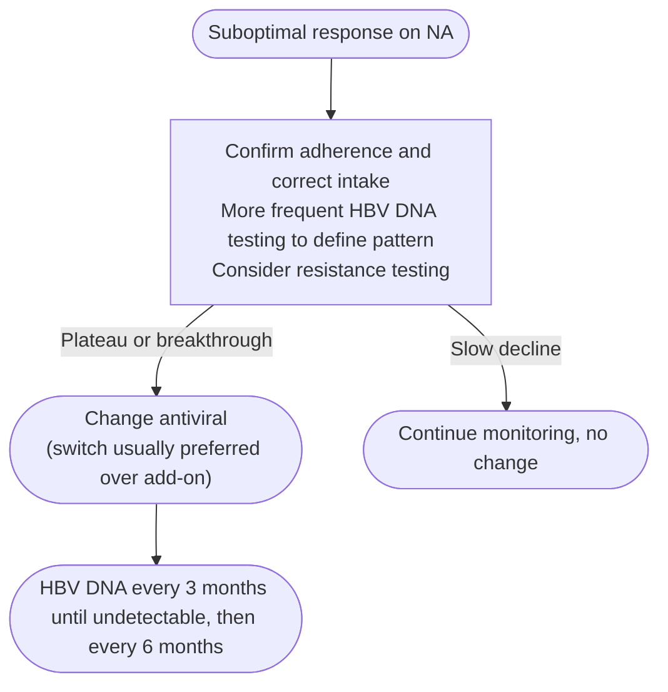
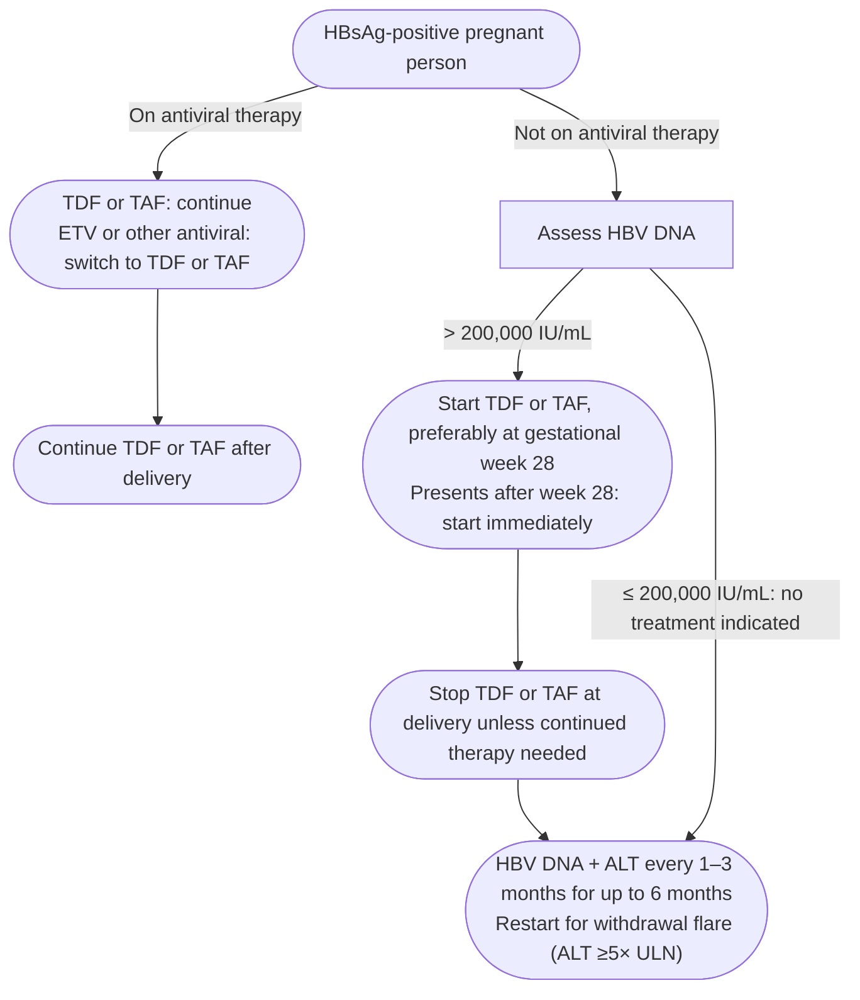

## Contents
- [[#Assessment]]
  - [[#Establishing the Diagnosis]]
  - [[#Severity Assessment]]
  - [[#Classification / Typing]]
- [[#Differential Diagnosis]]
- [[#Diagnostics]]
- [[#Therapeutics]]
  - [[#Approved Drug Classes]]
  - [[#Treatment Decisions by Phase]]
  - [[#NA Discontinuation]]
  - [[#Suboptimal Virologic Response to NA]]
  - [[#HBV Reactivation on Immunosuppression]]
  - [[#HBV-Triggered Acute-on-Chronic Liver Failure]]
  - [[#Prevention of Mother-to-Child Transmission (MTCT)]]
  - [[#Post–Liver Transplant Prophylaxis]]
  - [[#HCC Surveillance]]
  - [[#Horizontal Transmission Prevention]]

## Assessment

### Establishing the Diagnosis

- **Screening** (Centers for Disease Control and Prevention [CDC] advice, restated by the American Association for the Study of Liver Diseases/Infectious Diseases Society of America [AASLD/IDSA] 2025): all adults **≥18 y at least once**; every pregnant person **each pregnancy** (preferably first trimester), regardless of vaccination or prior testing — **triple panel**: hepatitis B surface antigen (HBsAg), antibody to HBsAg (anti-HBs), total antibody to hepatitis B core antigen (anti-HBc) ([[aasld-idsa-2025-chb-treatment]]).
- **HBsAg-positive (chronic hepatitis B [CHB]) → next:** quantitative hepatitis B virus (HBV) DNA (polymerase chain reaction [PCR]-based), hepatitis B e antigen (HBeAg), alanine aminotransferase (ALT) (AASLD/IDSA 2025 states this sequence in pregnancy); fibrosis staging for all HBsAg-positive persons (Figure 5; below).
- **ALT upper limit of normal (ULN): 35 U/L men, 25 U/L women** — recommended to guide management (AASLD/IDSA 2025 Figures 2–3).
- [[liver-biopsy|Liver biopsy]]: infrequently used; most accurate measure of inflammation severity.
- **Hepatitis D virus (HDV):** the American Gastroenterological Association (AGA) 2025 clinical practice update suggests **universal anti-HDV screening of all HBV patients**; anti-HDV-positive → HDV RNA to confirm viremia; automated (double) reflex testing where feasible ([[aga-2025-hepatitis-delta]]). Management: [[hepatitis-d]].

### Severity Assessment

- Noninvasive tests ([[noninvasive-liver-disease-assessment]]): [[liver-stiffness-measurement|vibration-controlled transient elastography (VCTE)]] or Fibrosis-4 index (FIB-4); elastography performs better.
  - VCTE **7 kPa** → F2 or higher: sensitivity 69%, specificity 83%.
  - High-sensitivity thresholds for advanced fibrosis (F3/F4): **FIB-4 >1.45**, **VCTE ≥8 kPa**.
- **[[cirrhosis|Cirrhosis]] — any one of:** imaging consistent with cirrhosis (nodular liver with splenomegaly or varices); elastography liver stiffness measurement (LSM) **≥11 kPa**; FIB-4 **≥3.25**; biopsy F4 (AASLD/IDSA 2025 cirrhosis criteria, printed with Figures 3–4).
- Pregnancy: noninvasive fibrosis tests may not be reliable — assess for cirrhosis by ultrasound and/or clinical evaluation.

### Classification / Typing

- **Phases** (AASLD/IDSA 2025 Table 1): immune-tolerant, immune active (HBeAg-positive or -negative), inactive, indeterminate ("grey zone"), and HBsAg-negative immune clearance (HBV DNA undetectable, ± anti-HBs). HBV DNA and ALT criteria for each, with management: [[#Treatment Decisions by Phase]].
- Assign from ALT and HBV DNA on **≥2 occasions over 6–12 months** — both fluctuate.
- Indeterminate phases: up to 40% of adults with CHB; more common when HBeAg-negative.
- **Functional cure:** HBsAg-negative + HBV DNA undetectable ≥6 months off treatment (± anti-HBs) — the desired endpoint, infrequent with current drugs.
- **Partial cure:** HBsAg <100 IU/mL + HBV DNA undetectable ≥6 months off treatment.

---

## Differential Diagnosis

*Workup: see [[abnormal-liver-chemistries]].*

- [[hepatitis-d|Hepatitis D]] co-infection
- [[hepatitis-c|Hepatitis C]]
- [[hepatitis-a|Hepatitis A]]
- [[autoimmune-hepatitis|Autoimmune hepatitis]]
- [[drug-induced-liver-injury|Drug-induced liver injury]]
- [[alcohol-associated-liver-disease|Alcohol-associated liver disease]]
- [[nafld-masld|Metabolic dysfunction-associated steatotic liver disease (MASLD)]]
- [[wilson-disease|Wilson disease]]

---

## Diagnostics

- **Treatment endpoints:** virologic (HBV DNA undetectable by PCR; HBeAg loss and seroconversion to antibody to HBeAg [anti-HBe]; HBsAg loss), biochemical (normal ALT), occasionally histologic (necroinflammation down ≥2 points, no fibrosis worsening).
- **Quantitative HBsAg (qHBsAg):** best end-of-treatment predictor of outcome after stopping nucleos(t)ide analogue (NA) therapy; **<100 IU/mL** = conservative stopping cutoff, no guarantee ([[#NA Discontinuation]]).
- Hepatocellular carcinoma (HCC) surveillance: [[#HCC Surveillance]].

---

## Therapeutics

### Approved Drug Classes

- **[[hbv-nucleoside-analogs|NAs]] — preferred: entecavir (ETV), tenofovir disoproxil fumarate (TDF), tenofovir alafenamide (TAF).** High efficacy, low resistance, well tolerated; usable in decompensated cirrhosis and immunocompromise. Choosing among them (pregnancy, prior lamivudine, renal/bone disease, human immunodeficiency virus [HIV]), renal dosing and adverse effects: [[hbv-nucleoside-analogs]].
- **[[peginterferon-alfa-2a|Peginterferon]]:** rarely used (applicability, safety, tolerability); functional-cure rate higher than NAs.

### Treatment Decisions by Phase

**HBeAg-positive, no cirrhosis**

| HBV DNA (IU/mL) | ALT | Phase | Management |
|---|---|---|---|
| ≥10,000,000 | ≤ULN | Immune-tolerant | Monitor ALT + HBV DNA every 3–6 mo for the first year, then every 6 mo. Age ≥40 y or ≥F2 fibrosis (biopsy or imaging-based noninvasive test [NIT]) → suggest considering treatment; <40 y → shared decision-making if treatment considered |
| ≥10,000,000 | 1–2× ULN | Indeterminate | Monitor every 3–6 mo; age ≥40 y or ≥F2 → suggest considering treatment |
| 20,000 to <10,000,000 | ≤ULN or 1–2× ULN | Indeterminate | Same (likely transitioning to immune active) |
| ≥20,000 | >2× ULN | Immune active | Treat |

*Management of HBeAg-positive CHB without cirrhosis*
*Source: redrawn from the AASLD/IDSA 2025 HBeAg-positive algorithm (Figure 2)*
*[[aasld-idsa-2025-chb-treatment|AASLD/IDSA 2025 CHB Treatment Guideline]]*
*HBV = hepatitis B virus · ALT = alanine aminotransferase · ULN = upper limit of normal · NIT = noninvasive test*

- Every untreated stratum: assess for fibrosis and reassess the need for treatment at each visit. HBeAg-positive with HBV DNA <20,000 IU/mL is extremely rare — same approach as ≥20,000. (Table 1 words the cutoffs as immune-tolerant >10,000,000, immune active >20,000 and >2× ULN.)
- **Immune-tolerant — Rec 3 (Conditional, Very low):** age **over 40 y**, inflammation **grade ≥2**, or fibrosis **≥F2** → suggest therapy. Under 40 y → shared decision-making: child/adolescent vs adult, family history of HCC, likely long-term adherence, transmission. Rec 3 text: untreated monitoring **at least every 6 mo**.

**HBeAg-negative, no cirrhosis**

| HBV DNA (IU/mL) | ALT | Phase | Management |
|---|---|---|---|
| <2,000 | ≤ULN | Inactive | Monitor HBV DNA + ALT every 3–6 mo for the first year, then every 6–12 mo; assess for cirrhosis |
| <2,000 | >ULN | Indeterminate | Evaluate for other causes of liver disease and treat them; monitor every 3–6 mo for the first year, then every 6 mo |
| >2,000 | <2× ULN | Indeterminate | Suggest treatment by shared decision-making; higher HCC risk with male sex, age >40, platelets <180 k/mm³. Not treating → monitor every 3 mo for the first year, then every 6 mo |
| >2,000 | >2× ULN | Immune active | Treat |

*Management of HBeAg-negative CHB without cirrhosis*
*Source: redrawn from the AASLD/IDSA 2025 HBeAg-negative algorithm (Figure 3)*
*[[aasld-idsa-2025-chb-treatment|AASLD/IDSA 2025 CHB Treatment Guideline]]*
*HBV = hepatitis B virus · ALT = alanine aminotransferase · ULN = upper limit of normal · HCC = hepatocellular carcinoma*

- **Indeterminate — Rec 4 (Conditional, Very low):** adults, HBeAg-negative, no cirrhosis → suggest antiviral therapy by shared decision-making; revisit at every visit if untreated (2018 advised monitoring only).
  - **Advanced fibrosis (F3/F4) → treat** (high-sensitivity cutoffs under [[#Severity Assessment]]); progression to advanced fibrosis/cirrhosis or immune active → start.
  - Rec 4 text gives untreated monitoring every 3–6 mo in year 1 (figure: every 3 mo), then every 6 mo.

**Cirrhosis (compensated or decompensated) — treat at any HBV DNA or ALT level**

| | Compensated | Decompensated ([[variceal-upper-gi-bleeding\|variceal hemorrhage]], [[ascites]], [[hepatic-encephalopathy\|hepatic encephalopathy]], [[aki-in-cirrhosis\|hepatorenal syndrome]]) |
|---|---|---|
| Antiviral | ETV, TDF or TAF until HBsAg loss | ETV, TDF or TAF indefinitely; monitor for lactic acidosis (rare, likelier with NA therapy in decompensation) |
| Other | Assess for [[portal-hypertension\|clinically significant portal hypertension]]; HCC surveillance every 6 mo | Refer for [[liver-transplantation\|liver transplant]] evaluation; HCC surveillance every 6 mo |

*Management of HBsAg-positive persons with cirrhosis (includes liver cancer at any stage)*
*Source: redrawn from the AASLD/IDSA 2025 cirrhosis algorithm*
*[[aasld-idsa-2025-chb-treatment|AASLD/IDSA 2025 CHB Treatment Guideline]]*
*ETV = entecavir · TDF = tenofovir disoproxil fumarate · TAF = tenofovir alafenamide · HBsAg = hepatitis B surface antigen · NA = nucleos(t)ide analogue · HCC = hepatocellular carcinoma*

### NA Discontinuation

- **Rec 5 (Conditional, Very low):** adults, HBeAg-negative, no cirrhosis, sustained undetectable HBV DNA on NA → suggest **not** stopping until HBsAg loss ([[aasld-idsa-2025-chb-treatment]]).
- Why: after stopping, HBsAg loss ~11% at 2 y vs ALT flares 27% at 2 y and retreatment 42% at 5 y; cohorts report decompensation and death. (European Association for the Study of the Liver [EASL] and Asian Pacific guidance consider stopping after 2–4 y of suppression.)

> [!pitfall] Never stop with cirrhosis, decompensation or HCC
> History or evidence of cirrhosis, prior decompensation or HCC → keep the NA; relapse risks flare and decompensation ([[aasld-idsa-2025-chb-treatment]]).

**Strong wish to stop (Table 3) — ALL required:**

- No history of cirrhosis/advanced fibrosis, hepatic decompensation (variceal bleed, ascites, hepatic encephalopathy, hepatorenal syndrome), HCC, or extrahepatic HBV complications
- HBV DNA undetectable ≥2 years
- HBeAg-positive at start → HBeAg-negative/anti-HBe-positive ≥1 year
- qHBsAg <100 IU/mL
- No HIV or HDV co-infection
- Agrees to frequent monitoring

**After stopping:** HBV DNA + ALT every 1–3 months for 6 months, then every 3 months for the next 6–12 months, then every 3–6 months.

**Restart immediately — ANY one:**

- HBV DNA ≥10,000 IU/mL (4 log IU/mL), regardless of ALT
- ALT ≥5× ULN, regardless of HBV DNA (Table 3 prints >5× ULN)
- Total bilirubin >2.5 mg/dL
- Hepatic decompensation

**May also restart any time:** personal wish; extrahepatic HBV complications; treatment-initiation criteria met (**HBV DNA >2,000 IU/mL and ALT >2× ULN**).

### Suboptimal Virologic Response to NA

- **Plateau:** HBV DNA decline ≤1 log IU/mL over the past 6 months.
- **Breakthrough:** HBV DNA rise ≥1 log, or >100 IU/mL after reaching undetectable.
- **Slow decline:** HBV DNA still quantifiable after 96 weeks, with <5-log decline from baseline.

*Suboptimal virologic response to nucleos(t)ide analogue therapy*
*Source: redrawn from the AASLD/IDSA 2025 suboptimal-response algorithm*
*[[aasld-idsa-2025-chb-treatment|AASLD/IDSA 2025 CHB Treatment Guideline]]*
*NA = nucleos(t)ide analogue · HBV = hepatitis B virus*

- Correct intake: tenofovir with food, entecavir on an empty stomach. Resistance testing may not be possible at HBV DNA <1,000 IU/mL; none exists for tenofovir.
- Switch and add-on options by drug: [[hbv-nucleoside-analogs#Suboptimal Virologic Response — Switch and Add-On]].

### HBV Reactivation on Immunosuppression

*Prophylaxis-vs-monitoring per [[aga-2025-hbv-reactivation]] (supersedes AGA 2014).*

- **At risk of HBV reactivation (HBVr):** HBsAg-positive *or* anti-HBc-positive — including "resolved" infection (HBsAg-negative, HBV DNA-negative, anti-HBc-positive).
- **Rec 4 (Strong, moderate certainty) — test before immunosuppression:** HBsAg + total anti-HBc (± anti-HBs); HBV DNA if either is positive. Universal CDC screening → **no risk-stratified screening** (change from 2014).

| Baseline HBVr risk off prophylaxis | Strategy | Recommendation |
|---|---|---|
| **High (>10%)** | **Antiviral prophylaxis** over monitoring alone | Rec 1 — Strong, moderate certainty |
| **Moderate (1–10%)** | Prophylaxis *suggested*; monitoring reasonable if avoiding long-term antivirals/cost matters more (esp. HBsAg-negative) | Rec 2 — Conditional, moderate certainty |
| **Low (<1%)** | **Monitoring alone**; assumes reliable follow-up | Rec 3 — Conditional, moderate certainty |

- Antiviral with a **high barrier to resistance** (assumption behind Recs 1–2).
- **Start before** the risk-imposing therapy; **continue ≥6 months after** it stops — **≥12 months after B-cell-depleting agents**.
- Risk estimates assume **one agent**, for the risk-imposing period or **up to 1 year**; combinations raise risk — re-categorize if exposure changes.

> [!pitfall] Monitoring must include HBV DNA
> Monitoring instead of prophylaxis = every **1–3 months**, with HBV DNA as well as ALT — never ALT alone ([[aga-2025-hbv-reactivation]] Rec 2).

**Baseline HBVr risk by exposure and serology** ([[aga-2025-hbv-reactivation]] Table 6):

| Exposure (example agents) | HBsAg-positive | HBsAg-negative / anti-HBc-positive |
|---|---|---|
| Anthracyclines (doxorubicin, epirubicin) | High | Moderate |
| [[anti-tnf-agents\|Anti-tumor necrosis factor (TNF)]] (infliximab, adalimumab) | High | Low |
| Anti-interleukin-6 (tocilizumab) | High | Moderate |
| Anti-T-cell (abatacept) | Moderate | Moderate |
| **B-cell-depleting (rituximab, ofatumumab)** | **High** | **High** |
| Chimeric antigen receptor (CAR)-T cell therapy | High | Moderate |
| Cytokine/integrin inhibitors ([[il-23-and-il-12-23-inhibitors\|ustekinumab]], secukinumab) | High | Moderate |
| Hepatitis C virus (HCV) co-infection on [[direct-acting-antivirals\|direct-acting antiviral (DAA)]] therapy | High | Low |
| Immune checkpoint inhibitors (nivolumab, pembrolizumab, ipilimumab) | Moderate | Low |
| [[jak-inhibitors\|Janus kinase (JAK) inhibitors]] (tofacitinib, baricitinib) | High | Moderate |
| Transarterial chemoembolization (TACE) | High | Moderate |
| Tyrosine kinase inhibitors (imatinib, sunitinib) | High | Moderate |
| Methotrexate, [[thiopurines\|6-mercaptopurine, azathioprine]] | Low | Low |
| Corticosteroid **≥4 wk**, moderate (10–20 mg) or high (>20 mg) dose | High | Moderate |
| Corticosteroid **≥4 wk**, low dose (<10 mg) | Moderate | Low |
| Corticosteroid **<1 wk**, any dose | Low | Low |
| Corticosteroid, intra-articular | Low | Low |

*Prednisone-equivalent daily doses; corticosteroid categories unchanged from AGA 2014.*

- **[[autoimmune-hepatitis|Autoimmune hepatitis]] — EASL 2025 differs** ([[easl-2025-autoimmune-hepatitis]]): counts **infliximab** as high risk in anti-HBc-positive/HBsAg-negative patients, keeps prophylaxis **≥18 months** after immunosuppression, monitors every 3 months. AGA 2025 (US; infliximab low risk in this serology, ≥6 or ≥12 months) applies.

### HBV-Triggered Acute-on-Chronic Liver Failure

- HBV primary infection or reactivation can precipitate acute-on-chronic liver failure (ACLF): **HBV DNA immediately**; **potent NA (ETV, TDF or TAF) preferably within 24 h** of aetiological confirmation, continued long term; don't change therapy on early kinetics alone ([[aasld-easl-2026-aclf-global-consensus]], Statements 31, 33, 35). Grading, critical care and the per-virus list: [[acute-on-chronic-liver-failure]].
- Pre-transplant HBV DNA guides prophylaxis ([[#Post–Liver Transplant Prophylaxis]]); **transplant is not delayed to reach suppression** (Statement 38, B1). Chinese Group on the Study of Severe Hepatitis B (COSSH) score: HBV-related ACLF.

### Prevention of Mother-to-Child Transmission (MTCT)

*Management of chronic hepatitis B in pregnancy*
*Source: redrawn from the AASLD/IDSA 2025 pregnancy algorithm (Figure 1)*
*[[aasld-idsa-2025-chb-treatment|AASLD/IDSA 2025 CHB Treatment Guideline]]*
*HBsAg = hepatitis B surface antigen · TDF = tenofovir disoproxil fumarate · TAF = tenofovir alafenamide · ETV = entecavir · HBV = hepatitis B virus · ALT = alanine aminotransferase · ULN = upper limit of normal*

- **Rec 1 (Strong, Moderate):** HBV DNA **>200,000 IU/mL at any point in pregnancy, regardless of HBeAg** → TDF or TAF from gestational **week 28**; TDF has the longer pregnancy safety record ([[aasld-idsa-2025-chb-treatment]]).
- Infant hepatitis B immune globulin (HBIG) unavailable → start TDF or TAF at **week 16**, plus infant vaccination.
- Invasive procedure such as amniocentesis anticipated (raises transmission at HBV DNA **>2,000,000 IU/mL**), or high preterm-labor risk → consider starting earlier.
- Breastfeeding safe on TDF or TAF. Infant: HBIG + first vaccine dose within 12 h of birth; test HBsAg + anti-HBs at 9–12 months.
- **American College of Gastroenterology (ACG) 2016** ([[acg-2016-liver-disease-pregnancy]]): **no elective cesarean** to prevent transmission (Rec 24 — strong, very low); breastfeeding allowed (Rec 25 — strong, very low) unless nipples cracked or bleeding; Rec 23 also allowed telbivudine — AASLD/IDSA 2025 prefers TDF/TAF.
- **AGA 2024** commentary to Best Practice Advice (BPA) 12 ([[aga-2024-pregnancy-gi-liver]]) allows continuing to 12 weeks postpartum; AASLD/IDSA 2025 (newer) stops at delivery when prevention is the only indication. Monitor for postpartum flare.
- Obstetric context: [[liver-disease-in-pregnancy]].

### Post–Liver Transplant Prophylaxis

AASLD/American Society of Transplantation (AST) 2025 ([[aasld-ast-2025-liver-transplant-graft-complications]]); candidacy and non-HBV care: [[liver-transplantation]].

- **All HBV recipients:** first-line NA — ETV, TDF or TAF — started **before** transplant and continued indefinitely (Rec 58 — Strong, Level 3).
- **HBV alone — HBIG individualized by risk** (Rec 59 — Strong, Level 2; Figure 4), alongside indefinite NA and HBIG access:
  - **Low risk** (good adherence; low/undetectable HBV DNA) → perioperative or no HBIG.
  - **High risk** (patient: limited adherence, HCC at high risk of recurrence; virological: HIV infection, high HBV DNA at transplant, HDV co-infection, NA-resistant mutations) → long-term HBIG; consider withdrawal in select patients.
- **HBV + [[hepatitis-d|HDV]]:** HBIG **plus** NA in **all** recipients (Rec 60 — Strong, Level 4).
- **HBsAg-negative recipient of an anti-HBc-positive graft** (transmission up to 75%, highest without anti-HBs and anti-HBc): ETV, TDF or TAF from immediately after transplant, indefinitely; no HBIG needed (Rec 57 — Strong, Level 3). De novo HBV → lifelong first-line NA.
- AASLD 2012 had advised antivirals + low-dose HBIG long term, stopping HBIG only at low risk (Recs 74–75, [[aasld-2012-liver-transplant-long-term]]).

### HCC Surveillance

Ultrasound + alpha-fetoprotein (AFP) about every 6 months: cirrhosis, higher-risk non-cirrhotic CHB, after HBsAg loss (Rec 6), HDV (Rec 7), HIV (Rec 8) or HCV (Rec 9) co-infection ([[aasld-idsa-2025-chb-treatment]] Table 4) — criteria on [[hcc-surveillance]]. HBV/HCV → treat HCV, then survey per HBV criteria.

### Horizontal Transmission Prevention

- **Rec 2 (Conditional, Very low):** HBsAg-positive with viremia, not meeting disease-specific treatment criteria, in a high-risk scenario for transmission → shared decision-making on antivirals ([[aasld-idsa-2025-chb-treatment]]).
- High-risk: unprotected sex or multiple partners; injecting drugs without consistent harm reduction; susceptible household members; health care workers doing Society for Healthcare Epidemiology of America (SHEA) category III procedures (SHEA: HBV DNA <1,000 IU/mL).
- Favors treatment: exposed person unvaccinated, poor vaccine responder, immunocompromised, or vaccine status unknown. Goal: HBV DNA below lower limit of quantification, while risk stays high.
- Not spread by routine contact, shared meals or hugging; avoid stigmatizing restrictions.

---

## See Also

[[hbv-nucleoside-analogs]], [[peginterferon-alfa-2a]], [[hepatitis-d]], [[hepatitis-c]], [[hepatocellular-carcinoma]], [[hcc-surveillance]], [[cirrhosis]], [[acute-on-chronic-liver-failure]], [[liver-transplantation]], [[liver-disease-in-pregnancy]], [[abnormal-liver-chemistries]], [[noninvasive-liver-disease-assessment]], [[autoimmune-hepatitis]], [[direct-acting-antivirals]]

---

## Sources

1. [[aasld-idsa-2025-chb-treatment|AASLD/IDSA 2025 Practice Guideline on Treatment of Chronic Hepatitis B]]
2. [[acg-2016-liver-disease-pregnancy|ACG Clinical Guideline: Liver Disease and Pregnancy (2016)]]
3. [[aga-2025-hbv-reactivation|AGA Clinical Practice Guideline: Prevention and Treatment of HBV Reactivation (2025)]]
4. [[aga-2024-pregnancy-gi-liver|AGA Clinical Practice Update on Pregnancy-Related Gastrointestinal and Liver Disease: Expert Review]]
5. [[aga-2025-hepatitis-delta|AGA Clinical Practice Update on Management of Hepatitis Delta: Commentary]]
6. [[aasld-ast-2025-liver-transplant-graft-complications|AASLD/AST 2025: Practice Guideline on Adult Liver Transplantation — Diagnosis and Management of Graft-Related Complications]]
7. [[aasld-2012-liver-transplant-long-term|AASLD/AST 2012: Long-Term Management of the Successful Adult Liver Transplant]]
8. [[aasld-easl-2026-aclf-global-consensus|AASLD/EASL/APASL/ALEH/SOLDA 2026 Global Multisociety Consensus on ACLF Definitions]]
9. [[easl-2025-autoimmune-hepatitis|EASL Clinical Practice Guidelines on the management of autoimmune hepatitis (2025)]]
