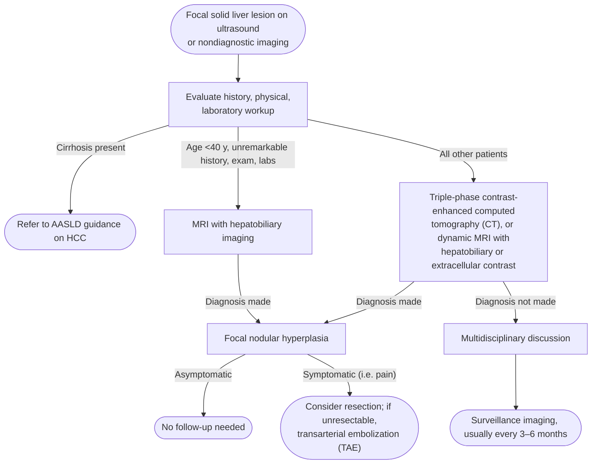

# Focal Nodular Hyperplasia

---

## Contents
- [[#Assessment]]
  - [[#Establishing the Diagnosis]]
  - [[#Severity Assessment]]
- [[#Differential Diagnosis]]
- [[#Diagnostics]]
  - [[#Imaging]]
  - [[#Biopsy]]
  - [[#Indeterminate Lesions]]
- [[#Therapeutics]]
  - [[#Once Confirmed]]
  - [[#Hormones and Pregnancy]]
  - [[#Symptomatic Lesions]]
- [[#See Also]]
- [[#Sources]]

---

## Assessment

### Establishing the Diagnosis

**Focal nodular hyperplasia (FNH)** — the **second most common solid liver lesion**; a hyperplastic reaction to abnormal local blood flow, not a true neoplasm ([[acg-2024-focal-liver-lesions]]).

**Epidemiology:**

- Prevalence **0.3%–3%** on autopsy series
- Female preponderance; compared with men, women develop **larger** lesions that **present earlier**
- **No causative role for sex hormones** — no correlation between oral contraceptive pill (OCP) use and FNH growth or prevalence, and no evidence of change during pregnancy (unlike [[hepatocellular-adenoma|hepatocellular adenoma (HCA)]])
- Up to **20%** of patients with FNH also have a coexisting [[hepatic-hemangioma|hepatic hemangioma]]

**Pathophysiology:** local reaction to a vascular abnormality — usually an **aberrant dystrophic artery or vascular injury** → disturbed local blood flow → hyperperfusion, oxidative stress from hypoxia, hepatic stellate cell response → hyperplastic microenvironment. Same mechanism underlies FNH-like lesions (e.g. nodular regenerative hyperplasia) in livers with abnormal vascular flow, such as cardiac [[cirrhosis]].

**Presentation:** most are found **incidentally**; symptoms (e.g. pain) are rare, and most FNH are *incidental to* rather than the cause of symptoms.

### Severity Assessment

No severity or staging system. Chance of malignancy is described as *extremely slim*, so resection is not recommended for the lesion itself.

The whole assessment problem is **separating FNH from [[hepatocellular-adenoma|HCA]]**, whose management is entirely different.

---

## Differential Diagnosis

*Workup & cross-lesion imaging comparison: see [[focal-liver-lesions]].*

- **[[hepatocellular-adenoma|Hepatocellular adenoma]]** — the critical distinction; on the hepatobiliary phase (HBP) of [[mri-mrcp|magnetic resonance imaging (MRI)]] HCA is **usually devoid of signal**, in contradistinction to FNH.
- **[[hepatocellular-carcinoma|Hepatocellular carcinoma (HCC)]]** — any lesion arising in a [[cirrhosis|cirrhotic]] liver is HCC until proven otherwise; follow American Association for the Study of Liver Diseases (AASLD) HCC guidance rather than this pathway.
- **Fibrolamellar HCC (FLHCC)** — <1% of US primary liver tumors; highest incidence in White men <40 y; arises in a **non-cirrhotic** liver; large, often solitary, heterogeneous early enhancement ± calcification. **A central scar is present in up to half of cases, so confusion with FNH occurs** — the discriminator is the HBP: **FLHCC is HBP-hypointense, FNH is HBP-hyperintense**. Unlike conventional HCC, FLHCC **must be diagnosed by biopsy**.
- **[[hepatic-hemangioma|Hepatic hemangioma]]** — light-bulb bright on T2; peripheral nodular enhancement with centripetal fill-in.
- **Hypervascular metastasis** — consider with a known or suspected extrahepatic primary; MRI with hepatobiliary contrast + diffusion-weighted imaging (DWI) is the recommended modality (Key Concept [KC] 32).

---

## Diagnostics

*Focal nodular hyperplasia branch of the solid focal liver lesion pathway*
*Source: redrawn from the ACG 2024 focal liver lesions Figure 1a (solid-lesion arm)*
*[[acg-2024-focal-liver-lesions|ACG Clinical Guideline: Focal Liver Lesions (2024)]]*
*AASLD = American Association for the Study of Liver Diseases · CT = computed tomography · HCC = hepatocellular carcinoma · MRI = magnetic resonance imaging · TAE = transarterial embolization*

### Imaging

**MRI with a hepatobiliary contrast agent (e.g. gadoxetic acid) is the preferred modality** to distinguish FNH from HCA (Recommendation 9, conditional recommendation / low quality of evidence):

- Correctly classifies FNH vs HCA with accuracy **>90%**; MRI **specificity almost 100%** for FNH
- Contraindication to MRI → **multiphase CT**
- **Contrast-enhanced ultrasound (CEUS)** can also diagnose FNH; diagnostic accuracy increases in lesions **<3 cm**

| Sequence / phase | Appearance |
|---|---|
| Noncontrast CT / T1 MRI | Central scar hypodense / hypointense |
| T2 | Central scar isointense to hyperintense |
| Late arterial | Well-circumscribed, homogeneously hyperenhancing mass |
| Portal venous + delayed | Lesion becomes isoenhancing; central scar shows delayed enhancement |
| Hepatobiliary phase (20 min) | Hyperintense — diagnosis with nearly 100% confidence; only **2%** of FNH are hypointense |

*Imaging appearance of focal nodular hyperplasia by sequence and phase*
*Source: built from the focal nodular hyperplasia imaging description in the ACG 2024 guideline (the document gives no table)*
*[[acg-2024-focal-liver-lesions|ACG Clinical Guideline: Focal Liver Lesions (2024)]]*
*CT = computed tomography · MRI = magnetic resonance imaging*

*See Figure 6 in [[acg-2024-focal-liver-lesions]] for example images.*

Hepatobiliary-phase uptake occurs because FNH contains hepatocyte-specific membrane transport proteins.

> [!pitfall] Hepatobiliary uptake is not unique to FNH
> **11% of inflammatory** and **59% of β-catenin–mutated** [[hepatocellular-adenoma|HCA]] express the OATP1B3 receptor and can therefore appear HBP-hyperintense. Any lesion with an **atypical dynamic appearance for FNH that is HBP-hyperintense must be followed closely** — do not call it FNH and discharge it ([[acg-2024-focal-liver-lesions]]).

### Biopsy

- **Not routinely needed** — advanced imaging (contrast-enhanced multiphase MRI with hepatobiliary-specific contrast) diagnoses FNH in most cases (KC 19)
- If imaging cannot make the diagnosis, [[liver-biopsy|liver biopsy]] may be considered **after multidisciplinary tumor board discussion**; interpretation is difficult (case series report diagnostic yield as low as **58%**) and is aided by immunohistochemistry
- Immunohistochemical subtyping panel used to call HCA instead: see [[hepatocellular-adenoma]]

### Indeterminate Lesions

- Inadequately characterized and/or atypical focal liver lesions should be **reviewed at a multidisciplinary liver tumor board** (KC 2)
- Imaging non-diagnostic and biopsy not pursued → **surveillance imaging, usually every 3–6 months**
- HBP-hyperintense but atypical for FNH on dynamic imaging → **follow closely**, do not discharge

---

## Therapeutics

### Once Confirmed

**No further follow-up is required** (KC 20):

- Little to no change over time in most cases → no benefit to continued imaging
- Lesions that do grow **do not cause life-threatening complications**

> [!pearl] Growth is not a reason to resect
> Once the diagnosis of FNH is confirmed, resection is not required **even in the case of growth** (KC 21, [[acg-2024-focal-liver-lesions]]).

### Hormones and Pregnancy

- **Do not routinely discontinue oral contraceptives** in a patient diagnosed with FNH (Recommendation 10, conditional recommendation / very low quality of evidence) — no indication to avoid or discontinue OCPs or hormonal therapy
- **No monitoring during pregnancy** — no evidence of change in FNH during pregnancy
- **Men need no different evaluation, monitoring, or treatment than women** (KC 23)

### Symptomatic Lesions

- **Surgical resection** may be considered in the rare case of symptoms such as pain. Counsel the patient that **symptoms may not improve after surgery**, as FNH rarely causes symptoms (KC 21)
- **Surgery not an option** (comorbidities, anatomic considerations) → **TAE with or without bleomycin** may be considered to decrease size (KC 22). FNH is usually supplied by a single artery, making TAE a logical minimally invasive option; which embolic agent is best remains debated — a few small case series report ~**50%** decrease in tumor size with bleomycin TAE, but **bland embolization is often used**

Key concepts are ungraded; the numbering of both recommendations and key concepts is the guideline's own.

---

## See Also

[[focal-liver-lesions]], [[hepatocellular-adenoma]], [[hepatic-hemangioma]], [[hepatocellular-carcinoma]], [[hepatic-cysts]], [[li-rads]], [[mri-mrcp]], [[liver-biopsy]], [[cirrhosis]]

---

## Sources

1. [[acg-2024-focal-liver-lesions|ACG Clinical Guideline: Focal Liver Lesions (2024)]]
</content>
</invoke>
