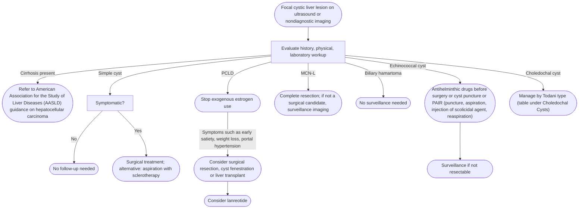

# Hepatic Cysts

---

## Contents
- [[#Assessment]]
  - [[#Establishing the Diagnosis]]
  - [[#Severity Assessment]]
  - [[#Classification / Typing]]
- [[#Differential Diagnosis]]
- [[#Diagnostics]]
  - [[#Imaging Appearance of a Simple Cyst]]
  - [[#Imaging Appearance of MCN-L]]
  - [[#Tumor Markers and Aspiration — Both Unhelpful]]
- [[#Therapeutics]]
  - [[#Simple Hepatic Cysts]]
  - [[#Polycystic Liver Disease (PCLD)]]
  - [[#Mucinous Cystic Neoplasm of the Liver (MCN-L)]]
  - [[#Choledochal Cysts]]
  - [[#Hydatid / Echinococcal Cysts]]
  - [[#Biliary Hamartomas, Peribiliary Cysts, and IPNB]]
- [[#See Also]]
- [[#Sources]]

---

## Assessment

### Establishing the Diagnosis

**Simple hepatic cyst:** thin-walled, lined by **cuboidal bile duct epithelium**, filled with isotonic fluid; a **ductal plate malformation with no communication with the biliary tree** ([[acg-2024-focal-liver-lesions]]).

- **Female predominance**, rises with age; **no established link to oral contraceptive pill (OCP) use or pregnancy**
- Usually **asymptomatic and incidental** unless very large
- Diagnosed on conventional **gray-scale ultrasound (US) — sensitivity and specificity 90%**

**The diagnostic question is simple vs complex.** High-risk US features — **septations, fenestrations, calcifications, mural thickening or nodularity, heterogeneity, daughter cysts** — separate a simple cyst from lesions with malignant or infectious potential (next step under [[#Diagnostics]]).

> [!pearl] Up to 2 septa can still be a simple cyst
> **2.5%–5% of simple cysts have up to 2 septa** (congenital cysts, Caroli disease, biliary hamartomas, polycystic liver disease). Seen on US with these characteristics → **no further imaging or follow-up** ([[acg-2024-focal-liver-lesions]]).

### Severity Assessment

No score. Management turns on **simple vs complex** on US, **symptoms**, and, in polycystic liver disease (PCLD), **cyst burden**.

### Classification / Typing

| Type | Key features | Malignant potential |
|---|---|---|
| **Simple hepatic cyst** | See [[#Establishing the Diagnosis]] and [[#Imaging Appearance of a Simple Cyst]] | No follow-up needed (Rec 12) |
| **PCLD** | **At least >10–20** hepatic cysts with simple-cyst characteristics; few or no kidney cysts; no biliary connection; a ciliopathy. Isolated (autosomal dominant PCLD) or with **autosomal dominant polycystic kidney disease (ADPKD)** | None |
| **Mucinous cystic neoplasm of the liver (MCN-L)** | Formerly biliary cystadenoma/cystadenocarcinoma (2019 World Health Organization [WHO] reclassification); ± **ovarian-type subepithelial stroma**; multilocular (90%); **no biliary communication**; **<5% of liver cysts** | **Up to 10%** with the updated 2010 WHO criteria; historically 20%–30% |
| **Choledochal cyst (Todani I–V)** | Cystic dilation of the intrahepatic and/or extrahepatic bile ducts; types under [[#Choledochal Cysts]] | **7.5%–30%**; types I and IV highest |
| **Hydatid cyst** | *Echinococcus granulosus*; staged on US (Table 7) | Infectious |
| **Biliary hamartoma** (von Meyenburg complex) | Multiple, often peripheral, usually **<1.5 cm**; no biliary communication | Rare (case reports) |
| **Peribiliary cyst** | Perihilar, **<1 cm**, "string of pearls" around hilar portal veins; no biliary communication; common with chronic liver disease and/or [[portal-hypertension]] | Benign malformation |
| **Intraductal papillary neoplasm of the bile duct (IPNB)** | Intraductal mass and/or ductal dilation; a precursor of [[cholangiocarcinoma]] | **High — 40%–80% harbor malignancy** |

---

## Differential Diagnosis

*Workup: see [[focal-liver-lesions]].*

**Complex cyst on US — computed tomography (CT) or magnetic resonance imaging (MRI) excludes** ([[acg-2024-focal-liver-lesions]]):

- Infected cyst · pyogenic abscess · cystic metastasis
- Hydatid cyst — daughter cysts, detached membranes
- MCN-L — septa features under [[#Imaging Appearance of MCN-L]]
- **IPNB** — MCN-L, unlike IPNB, shows **no biliary communication, no intraductal mass, and no dominant bile duct dilation**
- Choledochal cyst — see [[#Choledochal Cysts]]

---

## Diagnostics

### Imaging Appearance of a Simple Cyst

| Modality | Findings |
|---|---|
| **US** (first line) | Homogeneously **anechoic**, through transmission, smooth margins |
| **CT** | **No internal architecture**; hypodense, **fluid attenuation <20 Hounsfield units**; **absent** post-contrast enhancement |
| **MRI** | T1 hypointense, T2 hyperintense, **no enhancement**; **decreasing** intensity at higher b-value diffusion-weighted imaging |

- **Complex cyst on US → CT or MRI** (Rec 13, Strong / Low); **MRI is the preferred modality for cystic lesions in general**

### Imaging Appearance of MCN-L

| Finding | Performance for MCN-L |
|---|---|
| Septations present | **95% sensitive** |
| Septations arising directly from the cyst wall (vs within a lobulation) | **100% sensitive, 56% specific** vs simple cyst |
| Mural calcifications | **90% specific**; seen in up to **65%** |
| Septal enhancement and mural nodularity on MRI | Nearly **100% sensitive** |
| Upstream biliary ductal dilation from the cyst | Highly specific |

- Also favoring MCN-L: multiple septations; septa that indent the cyst wall or enhance. **Up to 76% in the left lobe**, predilection for **segment IV**

### Tumor Markers and Aspiration — Both Unhelpful

- **Serum carbohydrate antigen (CA) 19-9** is elevated in **up to 50%** of patients with simple cysts, **~50% of PCLD without malignancy**, and **28%–73% of biliary cystadenocarcinomas**; serum or cyst-fluid CA 19-9 does **not** separate simple from malignant cysts, or MCN-L from cystadenocarcinoma ([[acg-2024-focal-liver-lesions]])
- **Fluid aspiration or [[liver-biopsy|biopsy]] of MCN-L is not recommended** to separate benign from malignant — **low sensitivity** (Key Concept [KC] 45)

---

## Therapeutics

*Management of a focal cystic liver lesion by cyst type*
*Source: redrawn from Figure 1b of the ACG 2024 focal liver lesions guideline; its choledochal-cyst branch is the Todani table below*
*[[acg-2024-focal-liver-lesions|ACG Clinical Guideline: Focal Liver Lesions (2024)]]*
*AASLD = American Association for the Study of Liver Diseases · MCN-L = mucinous cystic neoplasm of the liver · PAIR = puncture, aspiration, injection of scolicidal agent, reaspiration · PCLD = polycystic liver disease*

### Simple Hepatic Cysts

- **Asymptomatic, regardless of size → expectant management; no routine surveillance or intervention** (Rec 12, Strong / Low)
- **Asymptomatic *complex* cyst, regardless of size → multidisciplinary tumor board + consider surveillance imaging in 6–12 months** (KC 41)
- **Symptoms** arise when cysts enlarge, rupture, or compress: significant abdominal pain or pressure, shortness of breath, early satiety, epigastric fullness, or **lower-extremity edema from inferior vena cava (IVC) compression**

**Symptomatic → surgical cyst fenestration or aspiration with sclerotherapy** (Rec 14, Conditional / Low); **no post-intervention imaging needed**.

| Option | Detail |
|---|---|
| **Surgical fenestration** (deroofing / marsupialization) | **Lowest recurrence**; allows histology. Surgery and open vs laparoscopic by operative candidacy, preference, center expertise |
| **Aspiration + sclerotherapy** | 100% ethanol, tetracycline, or other sclerosants. **Maximum benefit may take up to 6 months → do not repeat within 6 months** |
| **Aspiration alone** | Helps confirm the cyst causes the symptoms; **not definitive treatment** — high recurrence |

### Polycystic Liver Disease (PCLD)

**Screening and genetics:**

- **ADPKD → screen for PCLD with abdominal US** (60%–80% have hepatic cysts); **PCLD → initial kidney US to exclude ADPKD**
- **Genetic testing generally not recommended** (the 6 known PCLD genes explain only **30%–45%**); may help exclude ADPKD in a **young patient with PCLD and few renal cysts who does not meet diagnostic criteria**
- Isolated PCLD: prevalence **1–10 per million**; no extrarenal ADPKD manifestations (e.g. intracranial aneurysms). ADPKD carries germline **PKD1** or **PKD2** mutations
- **Female predominance (>80%)**; associated with pregnancy and OCP use — estrogen-containing OCPs in premenopausal women → **15.5% higher height-adjusted total liver volume per 10 years of use**

**Clinical course:**

- Cyst burden → hepatomegaly, early satiety, dyspnea, edema, weight loss → malnutrition, frailty, poor quality of life (QoL) ([[nutrition-in-liver-disease]]); rupture, infection, bleeding, compression of IVC, portal vein, or bile ducts
- **Liver enzymes and synthetic function usually preserved** except in advanced cases; commonest elevations **gamma-glutamyltransferase (GGT) and alkaline phosphatase**
- **No imaging surveillance in asymptomatic PCLD** — no malignant potential

**Treatment** — goals are **symptom relief and preservation of QoL** (KC 42); choice by cyst characteristics, underlying hepatic reserve, and center expertise (KC 43):

| Option | Detail |
|---|---|
| **Discontinue exogenous estrogen** (women) | Rec 15 (Conditional / Very low) — cyst volume increases with continued use |
| **Aspiration + sclerotherapy** | Primarily for **large** cysts; immediately effective but **high recurrence** |
| **Surgical fenestration** | Significant volume reduction and immediate relief, but **30% recurrence**; complications — [[ascites]], bile leak, pleural effusion, bleeding |
| **Hepatic resection** | When fenestration is unlikely to succeed and transplant is not required; **laparoscopic preferred** when feasible; outcomes excellent |
| **[[liver-transplantation\|Liver transplantation]] ± simultaneous kidney transplant** | The **only curative option** — consider for **refractory symptoms from significant cyst burden** (KC 44); excellent long-term survival with marked synthetic dysfunction, malnutrition, or major QoL impairment |
| **[[somatostatin-analogs\|Somatostatin analogs]]** | **Rec 16 (Strong / Moderate)** — **numerous small- to medium-sized cysts throughout the liver not amenable to surgical resection, cyst fenestration, or aspiration sclerotherapy**, or **symptomatic ADPKD with concurrent PCLD** |

**Somatostatin analogs — what to expect** ([[acg-2024-focal-liver-lesions]]):

- Largest randomized controlled trial (RCT): **lanreotide long-acting release (LAR) 120 mg intramuscularly every 4 weeks** → height-adjusted liver volume down **almost 6%** (≈ **140 mL**); symptom improvement has been shown with decreases **>100 mL**
- Biggest reductions in the **first 6 months**, lasting up to **2–4 years**; **symptoms recur after discontinuation**; **<5% discontinue**; steatorrhea-type symptoms commonest, self-limited
- Not effective: everolimus (a mammalian target of rapamycin [mTOR] inhibitor) added to octreotide; ursodiol in isolated PCLD (RCTs)

**Model for End-Stage Liver Disease (MELD) exception points (Table 6)** — PCLD **not clinically eligible for resection/fenestration or alternative therapy**, with **severe PCLD-related symptoms plus any one of**:

- Hepatic decompensation or severe portal hypertensive complications
- Concurrent hemodialysis
- Glomerular filtration rate (GFR) **<20 mL/min**
- Previous kidney transplant
- Moderate-to-severe protein-calorie malnutrition documented by a registered dietitian (Global Leadership Initiative on Malnutrition phenotypic criteria, American Society for Enteral and Parenteral Nutrition criteria, Nutrition Focused Physical Examination, or Subjective Global Assessment score)
- Severe sarcopenia by skeletal muscle index (SMI) **<39 cm²/m² in women or <50 cm²/m² in men**, or equivalent

**Severe symptoms + dialysis, GFR <20 mL/min, or needing a kidney transplant → simultaneous liver–kidney transplant**, with waitlist exception points.

### Mucinous Cystic Neoplasm of the Liver (MCN-L)

- **Female predominance (1:4)**, fifth–sixth decade. Subtype **without ovarian-type stroma**: men and women equally, **high rate of malignant recurrence, poor prognosis**
- **Complete surgical resection (laparoscopic or open) is the gold standard** — incomplete resection risks recurrence or progression to cystadenocarcinoma
- Thick septations, fenestrations, nodularity, calcifications, or mixed solid-and-cystic components → **prompt evaluation for complete surgical resection** (KC 46a)
- Not a surgical candidate → **surveillance imaging** (interval cannot be specified); changes suggesting malignant degeneration → **multidisciplinary tumor board** for nonsurgical options (KC 46b)

> [!pitfall] Do not fenestrate or sclerose a suspected MCN-L
> Cyst aspiration, sclerosis, partial resection, and fenestration are not recommended — recurrence reported at 81% in some studies ([[acg-2024-focal-liver-lesions]]).

### Choledochal Cysts

- **1:4 male-to-female**; more common in Asian populations; **80% present in the first decade**, adult incidence rising; thought to arise from **reflux of pancreatic enzymes through an anomalous pancreaticobiliary junction (APBJ)**
- Commonest symptom **abdominal pain (60%)**; the triad of pain + [[jaundice]] + palpable mass is rare
- **Diagnosis:** [[mri-mrcp|MRI with magnetic resonance cholangiopancreatography (MRCP)]], [[ercp|endoscopic retrograde cholangiopancreatography (ERCP)]], or percutaneous transhepatic cholangiography; MRCP detects an APBJ without instrumentation
- **Imaging discriminator:** choledochal cyst → **focal** intrahepatic ductal dilation; malignant obstruction → usually **diffuse**
- **Malignancy 7.5%–30%** — **<1%** in young children, rising each decade to **30%–40% over age 50**; [[cholangiocarcinoma]] **~70%**, then [[gallbladder-cancer|gallbladder cancer]] **23.5%**; **types I and IV** most associated, **extremely rare in II and III**; an APBJ adds risk

**Todani classification** — anatomic, by location and extent of biliary involvement; management is based on type and malignancy risk (KC 49a). *See Figure 15 in [[acg-2024-focal-liver-lesions]] for the Todani diagrams.*

| Todani type | Anatomic definition | Treatment | Surveillance after treatment (Figure 1b) |
|---|---|---|---|
| **I** | Cystic or **fusiform dilation of the extrahepatic bile duct** — **most common** in children and adults | Complete cyst excision with **Roux-en-Y hepaticoenterostomy** | **Continue even after resection**, with MRI/MRCP — ongoing malignancy risk; interval cannot be specified (KC 49b) |
| **II** | **Extrahepatic (supraduodenal) diverticulum** | Simple cyst excision or diverticulectomy | None needed |
| **III** | **Intraduodenal diverticulum (choledochocele)** — no female predominance | Endoscopic unroofing (endoscopic or transduodenal sphincteroplasty) or transduodenal excision for larger cysts | None needed |
| **IV** | **Extrahepatic + intrahepatic** dilation (**IVA**) or **multiple extrahepatic** dilations (**IVB**) — **second most common** | Extrahepatic cyst excision ± partial hepatectomy + hepaticoenterostomy; rarely liver transplant | **Continue even after resection** (KC 49b) |
| **V (Caroli disease)** | **Intrahepatic bile ducts only** — **least common**. Caroli *syndrome* adds congenital hepatic fibrosis and kidney cysts | Hepatic resection or, in select cases, liver transplantation, by extent of disease | None needed |

- **Types IV and V, resection not feasible → consider liver transplantation** (KC 50)

### Hydatid / Echinococcal Cysts

- Cystic echinococcosis (CE); rural sheep-grazing areas; **liver 70%**, lungs 20%
- Large cysts are **high-pressure** with **over a liter of highly antigenic fluid** → **rupture after trauma or surgical manipulation** → **anaphylaxis**, peritonitis, septic shock; bile duct compression → obstructive jaundice or [[acute-cholangitis|cholangitis]]
- Diagnosis is by imaging (serology useful but limited by availability and assay heterogeneity): initial phase — anechoic, well-defined, small floating echogenic foci; active — septated with daughter cysts, enhancing walls/septa; **"water-lily" sign** = floating membranes from a **detached endocyst**; inactive — dense rim or septal calcification

**WHO Informal Working Group on Echinococcosis (WHO-IWGE) classification and treatment (Table 7)** ([[acg-2024-focal-liver-lesions]]):

| Class | Echographic aspect | Stage | Treatment |
|---|---|---|---|
| **CE 1** | Univesicular fluid collection / simple cyst | Active | **<5 cm: albendazole**; **>5 cm: PAIR + albendazole** |
| **CE 2** | Multivesicular fluid collection with multiple daughter cysts or septa (honeycomb) | Active | Catheterization or surgery + albendazole |
| **CE 3A** | Fluid collection with detached membrane (water-lily sign) | Transitional | **<5 cm: albendazole**; **>5 cm: PAIR + albendazole** |
| **CE 3B** | Daughter cysts in a solid matrix | Transitional | Catheterization or surgery + albendazole |
| **CE 4** | Heterogeneous matrix, no daughter cysts ("wool clew") | Inactive / degenerative | Watch and wait |
| **CE 5** | Solid matrix with calcified wall | Inactive / degenerative | Watch and wait |

**Medical therapy:**

- **Albendazole** (superior to mebendazole) **before surgery or cyst puncture in symptomatic or active cysts** — prevents recurrence and seeding, lowers cyst pressure, **mitigates anaphylaxis risk of percutaneous drainage**; also inoperable cases (multiple cysts and peritoneal involvement, or poor surgical candidate) (KC 51a)
- Start before the procedure and **continue 1–6 months afterward** (exact duration varies by expert); **cyclical regimens are no longer recommended**. ACG 2024 gives no albendazole dose
- **Monitor white cell count and liver tests** — hepatic dysfunction and agranulocytosis
- **Medical therapy alone is not recommended** unless percutaneous aspiration or surgery is contraindicated — **>40% remain active or reactivate after 2 years** of monotherapy (KC 51b)

**Procedural therapy** — for **large cysts (>5 cm)**, cysts likely to rupture, non-response to medical therapy, or contraindications to it (liver or bone-marrow disorders):

- **Uncomplicated cyst, surgery not an option → PAIR + adjunct antihelminthic** (Rec 18, Conditional / Low)
- **PAIR is contraindicated** with biliary fistula or a cyst communicating with the biliary tree, complex multiseptated cysts, or percutaneously inaccessible cysts
- **Complicated cyst → surgery**, provided no contraindication to surgery (Rec 17, Conditional / Very low): **biliary fistula or biliary communication, multiseptated cyst, rupture or hemorrhage, secondary infection, or percutaneously inaccessible cyst**; simple cyst resection to radical pericystectomy, occasionally hepatic resection
- Asymptomatic, inactive, or calcified cysts may be observed with surveillance imaging (not required in all cases)
- Treat where surgical and infectious-disease expertise are available

### Biliary Hamartomas, Peribiliary Cysts, and IPNB

- **Biliary hamartomas and peribiliary cysts** are benign malformations — **no surveillance imaging** (KC 47)
- **IPNB** — premalignant with a high risk of malignant transformation (KC 48)
  - Risk factors: hepatolithiasis, clonorchiasis, [[primary-sclerosing-cholangitis|primary sclerosing cholangitis]], choledochal cysts, [[familial-adenomatous-polyposis|familial adenomatous polyposis]], Gardner syndrome
  - **Treatment: surgical resection of the bile duct ± hepatectomy**, by size, extent, and invasiveness
  - **Continued surveillance imaging even after resection** — undetected lesions remote from the main tumor cause recurrence (KC 48)

---

## See Also

[[focal-liver-lesions]], [[hepatocellular-adenoma]], [[focal-nodular-hyperplasia]], [[hepatic-hemangioma]], [[hepatocellular-carcinoma]], [[cholangiocarcinoma]], [[gallbladder-cancer]], [[primary-sclerosing-cholangitis]], [[familial-adenomatous-polyposis]], [[li-rads]], [[cirrhosis]], [[portal-hypertension]], [[liver-transplantation]], [[somatostatin-analogs]], [[mri-mrcp]], [[ercp]], [[liver-biopsy]], [[nutrition-in-liver-disease]], [[jaundice]], [[ascites]], [[acute-cholangitis]], [[endoscopic-ultrasound]]

---

## Sources

1. [[acg-2024-focal-liver-lesions|ACG Clinical Guideline: Focal Liver Lesions (2024)]]
