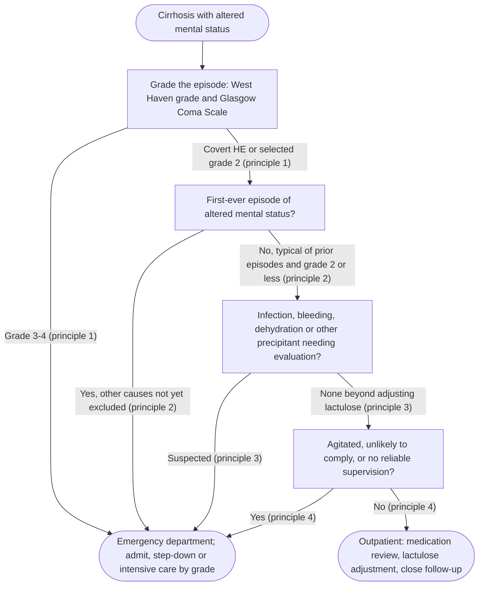

Hepatic encephalopathy (HE) is **brain dysfunction caused by liver insufficiency and/or portosystemic shunting (PSS)** — a spectrum from subclinical change to coma, and a continuum rather than a single entity ([[aasld-easl-2014-hepatic-encephalopathy]]). It occurs without [[cirrhosis]] when simple shunting is present. The American College of Gastroenterology (ACG) 2026 reframes HE as a [[disorders-of-gut-brain-interaction|disorder of gut–brain interaction (DGBI)]] and de-emphasizes ammonia throughout ([[acg-2026-hepatic-encephalopathy]]).

## Contents
- [[#Assessment]]
  - [[#Establishing the Diagnosis]]
  - [[#Severity Assessment]]
  - [[#Classification / Typing]]
- [[#Differential Diagnosis]]
- [[#Diagnostics]]
  - [[#Diagnosing Overt HE]]
  - [[#Diagnosing Minimal and Covert HE]]
  - [[#Serum Ammonia]]
  - [[#Nonresponse to Therapy]]
- [[#Therapeutics]]
  - [[#Where to Treat]]
  - [[#Acute Overt HE]]
  - [[#Secondary Prophylaxis]]
  - [[#Alternative and Adjunct Therapies]]
  - [[#Minimal and Covert HE]]
  - [[#Nutrition and Exercise]]
  - [[#TIPS and Portosystemic Shunts]]
  - [[#Liver Transplantation]]
  - [[#De-escalation of Therapy]]
  - [[#Follow-Up After Hospitalization]]
- [[#See Also]]
- [[#Sources]]

---

## Assessment

### Establishing the Diagnosis

- **Overt HE (OHE) is a clinical diagnosis of exclusion.** No test confirms it; it is assumed to be the explanation once careful evaluation for other conditions is negative ([[acg-2026-hepatic-encephalopathy]]).
- **Covert HE (CHE) is defined by *excluding* OHE** (grade 2 or higher) in the appropriate clinical context — the clinical diagnosis of CHE has low reproducibility (ACG 2026, Key concept 1).
- **Minimal HE (MHE)** = no clinical signs, diagnosed only by psychometric/neurophysiological testing. **CHE** = MHE + West Haven grade 1. **OHE** = grades 2–4, a defining decompensating event in cirrhosis.
- New **focal** neurological findings make HE less likely and point to a neurological condition needing brain imaging and neurology input.
- Serum ammonia does not make the diagnosis — see [[#Serum Ammonia]].

> [!pitfall] Isolated asterixis is not overt HE
> Asterixis (flapping tremor on wrist hyperextension) appears in lower-grade HE but also in metabolic encephalopathy of other cause such as uremia; without altered behavior or alertness it is not enough to diagnose OHE ([[acg-2026-hepatic-encephalopathy]], Key concept 2).

### Severity Assessment

**West Haven criteria + International Society for Hepatic Encephalopathy and Nitrogen Metabolism (ISHEN) (Table 2, [[aasld-easl-2014-hepatic-encephalopathy]]):**

| Grade | Category | Clinical Manifestations | Operative Criteria |
|---|---|---|---|
| Unimpaired | — | No encephalopathy; no history | Tested and proved normal |
| Minimal | Covert HE | Psychometric/neurophysiological abnormalities only; no clinical symptoms | Abnormal psychometric or neurophysiological tests; no clinical HE |
| Grade 1 | Covert HE | Trivial lack of awareness; euphoria/anxiety; shortened attention span; altered sleep rhythm; impaired addition/subtraction | Oriented; some cognitive/behavioral decay perceived by caregivers |
| Grade 2 | Overt HE | Lethargy/apathy; disorientation for time; obvious personality change; dyspraxia; asterixis | Disoriented for time (≥3 of: day of month, day of week, month, season, year) |
| Grade 3 | Overt HE | Somnolence to semistupor; responsive to stimuli; confusion; bizarre behavior; gross disorientation | Disoriented for space (country, state, city, or place) |
| Grade 4 | Overt HE | Coma | Does not respond even to painful stimuli |

- **Grade on presentation and throughout the hospital course**; add the Glasgow Coma Scale (GCS) to assess and monitor significant impairment of consciousness (ACG 2026).
- **Triage:** West Haven grade + GCS identify high-grade HE needing step-down/intensive care unit (ICU) transfer, preventing complications such as aspiration pneumonia (ACG 2026, Key concept 9).
  - **West Haven 3–4 or GCS <12 = severe impairment, aspiration risk → ICU where possible; GCS <9 → consider intubation** ([[aasld-easl-2026-aclf-global-consensus|2026 global multisociety acute-on-chronic liver failure (ACLF) consensus]], Statement 41, C1). The grade 3–4 course is unpredictable → early high-dependency/ICU referral.
  - ⚠ [[aasld-2024-aclf|American Association for the Study of Liver Diseases (AASLD) 2024 ACLF guidance]] (Guidance Statement 4) put the severe cutoff at GCS <8; the newer 2026 consensus supersedes it.
- **In [[acute-on-chronic-liver-failure|ACLF]]:** West Haven 3–4 (or mechanical ventilation for HE) = organ failure; West Haven 2 = organ dysfunction (2026 consensus, Statement 11, A1) — full organ table and grading on the ACLF page.
- **Wording (2026 consensus, ungraded):** call altered mental status in cirrhosis/ACLF **"acute encephalopathy"**, never "brain failure"; it is not a synonym for HE, which may coexist with other cerebral or systemic causes.
- **Hepatic Encephalopathy Scoring Algorithm** — point-based clinical + paper-pencil tool validated across all grades (attention, memory, psychomotor function), but ~20 min to administer → used in research to standardize OHE severity, not in clinical practice.

### Classification / Typing

Characterize **every bout along all five axes simultaneously** — the 2014 four axes plus a fifth (social infrastructure) added by ACG 2026.

| Axis | Options |
|---|---|
| 1. Underlying disease | **A** — [[acute-liver-failure\|acute liver failure]] (high cerebral-edema risk, distinct management) · **B** — portosystemic bypass/shunting without intrinsic hepatocellular disease · **C** — [[cirrhosis]] (most common; the focus of both guidelines) |
| 2. Severity | West Haven grade (table above) |
| 3. Time course | **Episodic** · **Recurrent** = ≥2 bouts within 6 months · **Persistent** = behavioral alterations always present, with relapses of OHE |
| 4. Precipitating factors | **Spontaneous** (none identified) vs **precipitated** (specify which) |
| 5. Social infrastructure (ACG 2026) | Social/family support · financial support for medication adherence and for lost earning or driving capability · institutional support for timely follow-up |

- Used as a checklist to surface addressable determinants of recurrence and readmission.
- **Episodic precipitants, by decreasing frequency:** infections > [[upper-gi-bleeding|gastrointestinal (GI) bleeding]] > diuretic overdose > electrolyte disorder > constipation > unidentified.
- **Recurrent precipitants:** electrolyte disorder > infections > unidentified > constipation > diuretic overdose > GI bleeding.
- *Infections dominate, but only unpublished case series support that ranking ([[aasld-easl-2014-hepatic-encephalopathy]], Table 3).*

---

## Differential Diagnosis

*OHE is a diagnosis of exclusion; the decompensation framework it sits within is on [[cirrhosis]].*

> [!pearl] One in four has another cause
> Alternative or additional causes of acute encephalopathy are identified in **up to one-quarter** of patients with cirrhosis initially suspected of having HE ([[aasld-easl-2026-aclf-global-consensus]]).

**Altered mental status in cirrhosis (Table 4, [[aasld-easl-2014-hepatic-encephalopathy]]; Table 5, [[acg-2026-hepatic-encephalopathy]]):**

- **Metabolic** — hypoglycemia, ketoacidosis, hyperosmolar states, lactic acidosis, uremic encephalopathy (may coexist in ACLF), hypoxic/hypercapnic encephalopathy
- **Electrolyte** — hyponatremia (an independent risk factor for HE), hypercalcemia. Hyponatremia, hyperglycemia and sepsis can each independently cause metabolic encephalopathy *or* precipitate HE
- **Toxic** — alcohol intoxication or withdrawal; benzodiazepines, neuroleptics, opioids; carbon monoxide, heavy metals
- **Wernicke encephalopathy** — ataxia, confusion and memory loss occur in **both** HE and Wernicke's; **nystagmus, ptosis and paralysis of lateral conjugate gaze** point to Wernicke's ([[ishen-2013-nutrition-hepatic-encephalopathy|ISHEN 2013]]). Parenteral thiamine is mandatory whenever it is suspected, and is given **before** intravenous (IV) glucose. Suspect it in [[alcohol-associated-liver-disease|alcohol-associated liver disease]] and in end-stage cirrhosis of any cause
- **Neurological** — intracranial bleeding, stroke, recent head trauma or falls, neuroinfection, brain malignancy, nonconvulsive seizures (electroencephalography [EEG] if needed)
- **Endocrine** — thyroid disease, adrenal insufficiency, panhypopituitarism
- **Psychiatric** — acute psychosis, dementia
- **Severe metabolic stress** — organ failure, systemic inflammation

**Cirrhosis with *cognitive complaints* (not overt confusion):** a large proportion have something other than MHE, especially with isolated delayed-memory or isolated sleep complaints — assess specifically, ideally in a specialized clinic (ACG 2026, Key concept 4; Table 5).

| Condition | How to assess |
|---|---|
| Mild cognitive impairment, dementia | Mini-Mental State Examination (MMSE) or Montreal Cognitive Assessment (MoCA) |
| Sleep disorders, incl. obstructive sleep apnea | STOP-BANG; adherence if already on continuous positive airway pressure; PROMIS8 sleep |
| Alcohol and substance use | Toxicology screen; Drug Abuse Screen Test; Alcohol Use Disorder Identification Test–Consumption |
| Mood disorders | Patient Health Questionnaire-9 (depression); Beck Anxiety Inventory |
| Post-traumatic stress disorder | PCL-5 checklist |
| Endocrine/electrolyte — diabetes mellitus, thyroid, sodium, calcium | Hemoglobin A1c; thyroid panel; chemistry panel |
| Medication effect | Review pain (opioids, gabapentin), anxiety (benzodiazepines) and insomnia drugs |
| Neurologic — stroke, mass, bleed, neuroinfection, epilepsy | Brain computed tomography (CT) or magnetic resonance imaging (MRI); EEG; lumbar puncture |

---

## Diagnostics

### Diagnosing Overt HE

Initial evaluation answers three questions (ACG 2026): **how severe** (to set the level of care), **is HE actually the cause**, and **what precipitated it**.

- **Clinical** — West Haven grade + GCS; there is no confirmatory test.
- **Precipitant search is part of the diagnosis** (ACG 2026, Key concept 10): bleeding, infection (pan-culture, **[[paracentesis|diagnostic paracentesis]]**, chest x-ray), sedating medications, toxic and metabolic abnormalities. Common precipitants are constipation, GI bleeding, infection, hyponatremia and dehydration/diuretic overdose.
  - **Do not start empirical broad-spectrum antibiotics** without symptoms or laboratory findings of active infection; tailor or stop quickly on culture results.
- **Workup of acute encephalopathy in cirrhosis/ACLF:** routine labs, blood ammonia, toxicology where indicated, and **brain imaging**; lumbar puncture or EEG only in selected cases (2026 ACLF consensus, ungraded).
- **Brain imaging — guidelines disagree:**
  - ACG 2026 Rec 6 (*conditional, very low certainty*): cirrhosis + confusion **without new focal neurologic deficits → routine brain imaging NOT required**; CT/MRI neither diagnoses nor grades HE. Image for **focal deficits, seizures, or HE not responding to therapy**.
  - ⚠ The newer 2026 consensus lists brain imaging in the workup, as did [[aasld-easl-2014-hepatic-encephalopathy]] ("usually part of the workup of first-time HE"; **≥5-fold intracerebral hemorrhage risk** in cirrhosis).

### Diagnosing Minimal and Covert HE

- **Use a single-test strategy, not a 2-test combination** (ACG 2026, Rec 1, *conditional, very low certainty*) — this supersedes the 2014 advice to use ≥2 testing modalities.
- **Who to prioritize for testing** (ACG 2026, Key concept 3) — cirrhosis plus ≥1 of: hypoalbuminemia · decompensated cirrhosis ([[ascites]], variceal bleeding or [[jaundice]]) · clinically significant [[portal-hypertension|portal hypertension]] or portosystemic shunts · nonspecific cognitive complaints, poor concentration, impaired quality of life (QoL), navigation problems/traffic violations, falls · difficulty operating heavy machinery · commercial drivers and pilots. *2014 Rec 8 (Grade III, B, 2) likewise limited testing to impaired QoL or employment/public-safety implications.*
- **Choose the test by local expertise and available norms** (ACG 2026, Key concept 6):

| Test | Resources / time | Domains tested | Reported MHE/CHE prevalence | Clinical utility / caveats |
|---|---|---|---|---|
| **EncephalApp Stroop** (full) | Smartphone or tablet; 5–15 min | Psychomotor speed, cognitive flexibility | 45%–55% | Predicts OHE; easy to apply, but full version is long for some patients |
| **QuickStroop** | Smartphone or tablet; 1–2 min | Psychomotor speed | 45%–55% | Predicts HE; **not for color-blind subjects** |
| **Animal naming test** | None; 1 min | Memory, verbal retrieval, recall self-monitoring | 30%–40% | Predicts OHE and death; practical and transcultural, but **not specific** for MHE/CHE |
| **Critical flicker frequency** | Computer + specialized viewing chamber, or smartphone + light source | Integrity of visual tract, reaction time | 40%–55% | Predicts OHE and death; transcultural, but needs equipment and is **invalid if visual acuity is impaired** |
| **Psychometric hepatic encephalopathy score** | Paper-pencil battery | — | — | Most widely used; validated in many countries |
| **Inhibitory control test** | Computerized | — | — | Freely downloadable; requires highly functional patients |
| **Continuous reaction time** | Neurophysiological | Motor reaction time | — | — |
| SCAN test | Computerized digit memory | — | — | Prognostic value |
| EEG | Neurophysiological | — | — | Sensitive but nonspecific; useful quantitatively |

*Rows 1–4 = Table 4, [[acg-2026-hepatic-encephalopathy]]; remaining rows from [[aasld-easl-2014-hepatic-encephalopathy]].*

- **Do not substitute the MMSE or MoCA.** Both can be abnormal in CHE, and **no threshold distinguishes the CHE spectrum from delirium or dementia**; they add nothing to CHE-dedicated testing. Refer to a specialist when mild cognitive impairment, dementia or delirium is suspected.

### Serum Ammonia

- **Do not use serum ammonia alone to diagnose MHE/CHE** (ACG 2026, Rec 2, *conditional, very low certainty*).
- **Suggest against routine ammonia testing to guide inpatient HE treatment decisions** (ACG 2026, Rec 5, *conditional, very low certainty*), or to guide initiation, titration or the evaluation of recurrence in the outpatient setting (Key concept 14).
- **Do check blood ammonia in the workup of acute encephalopathy:** elevated supports HE; normal makes HE unlikely (2026 ACLF consensus, ungraded; ACG 2026, Key concept 11).
- ⚠ **Older guidance disagrees:** [[aasld-2024-aclf|AASLD 2024 ACLF guidance]] Statement 11 — routine ammonia testing in cirrhosis with altered mental status not recommended; [[aasld-easl-2014-hepatic-encephalopathy|2014 guideline]] Rec 9 (Grade II-3, A, 1) — elevated ammonia adds no diagnostic, staging or prognostic value. The 2026 consensus is newer and wins for the diagnostic workup.

> [!pitfall] A normal ammonia is a reason to look elsewhere
> Low or normal ammonia has negative predictive value for HE as the cause of altered mentation — but a high level is not a treatment target, and therapy is never titrated to it ([[acg-2026-hepatic-encephalopathy]], Rec 5 and Key concepts 11, 14).

### Nonresponse to Therapy

Improvement is expected within **24–48 h**. If delirium persists **beyond 48–72 h** despite adequate bowel movements and reversal of precipitants (ACG 2026, Key concept 12), work through three tracks:

1. **Alternative diagnosis** — re-check ammonia (normal/low argues against HE); consider recent head trauma, falls, seizures, surgery.
2. **Undiagnosed precipitant** — electrolytes, [[aki-in-cirrhosis|renal failure]], centrally acting or recreational drugs (urine drug screen, phosphatidylethanol), overt GI bleeding, and above all **infection** (pan-culture, paracentesis, chest x-ray) — OHE will not improve until a specific infection is treated.
3. **Shunts** — **cross-sectional imaging (CT or MRI)** to identify prior [[tips|transjugular intrahepatic portosystemic shunt (TIPS)]] vs **spontaneous portosystemic shunts (SPSS)**; SPSS are present in **46%–71%** of medically refractory HE vs 14% without.

---

## Therapeutics

### Where to Treat

*Where to manage a patient with cirrhosis and altered mental status*
*Source: built from ACG 2026 guiding principles 1–4 for outpatient vs inpatient management*
*[[acg-2026-hepatic-encephalopathy|ACG Clinical Guideline: Hepatic Encephalopathy (2026)]]*
*HE = hepatic encephalopathy*

- Adjusting HE treatment early prevents progression and complications such as aspiration pneumonia.

### Acute Overt HE

All four elements are started simultaneously ([[aasld-easl-2014-hepatic-encephalopathy]], Recs 14–17, Grade II-2, A, 1):

1. Care for the altered consciousness
2. Identify and treat alternative causes of altered mental status
3. Identify and correct precipitating factors — **nearly 90% can be treated by precipitant correction alone**
4. Commence empirical HE treatment

- **[[lactulose]] is first-line** (ACG 2026, Rec 7, *strong, moderate certainty*; 2014 Rec 19, Grade II-1, B, 1). **10–20 g (15–30 mL) every 2 h** until 2 soft bowel movements (BMs), then **2–4× daily** to maintain 2–3 BMs/day.
  - **Grade 3–4, unable to swallow, or aspiration risk** → nasogastric administration at similar dosing, or a lactulose enema with preserved anal sphincter tone. **Impaired gastrointestinal motility → the rectal route may be preferable** (2026 ACLF consensus). Enema recipe, overuse harms and ICU titration: [[lactulose]].
- **Add [[rifaximin]] 550 mg twice daily to lactulose** (ACG 2026, Rec 9, *conditional, low certainty*) — combination gave higher complete-reversal rates, shorter stay and lower mortality than lactulose alone.
- **Critically ill (incl. ACLF) already on broad-spectrum antibiotics: no routine rifaximin add-on** (2026 ACLF consensus; ACG 2026) — a double-blind trial found similar OHE reversal with antibiotics alone.
- **Grade 3–4 HE: IV L-ornithine L-aspartate (LOLA) added to lactulose + rifaximin** lowered HE grade, shortened recovery and reduced 28-day mortality vs lactulose + rifaximin alone (2026 ACLF consensus, ungraded); LOLA is unavailable in many countries.
- **Intubated patients: sedate with short-acting agents (propofol, dexmedetomidine); avoid benzodiazepines** (2026 ACLF consensus, Statement 42, B1) — titrate to the minimum and interrupt regularly for neurological reassessment.

### Secondary Prophylaxis

**~40%–60% recur within 1 year of an index OHE episode → secondary prophylaxis is indicated in every patient with cirrhosis who develops OHE.**

- **Lactulose, titrated to 2–3 soft BMs daily, is outpatient first-line** (ACG 2026, Rec 10, *strong, high certainty*; 2014 Rec 25, Grade II-1, A, 1).
- **Titrate with the [[bristol-stool-form-scale|Bristol Stool Scale (BSS)]] plus BM frequency** to reduce readmissions (ACG 2026, Rec 11, *conditional, very low certainty*). **BSS ≥5 → cut lactulose back, or add rifaximin if already on lactulose. BSS ≥5 *before* starting lactulose → consider a non-laxative therapy de novo** for adherence.
- Breakthrough HE on lactulose is usually **nonadherence or dehydration**.
- **Outpatient rifaximin to prevent recurrence** (ACG 2026, Rec 12, *conditional, low certainty*; 2014 Rec 20, Grade I, A, 1). **Recurrent episodes despite lactulose maintenance → add rifaximin** (ACG 2026, Rec 13, *strong, high certainty*; 2014 Rec 26 placed this after the second episode). Trial data and dosing: [[rifaximin]].
- **Combination > monotherapy:** monotherapy data exist, but the preponderance of evidence favors rifaximin **with** lactulose in patients who tolerate dual therapy. Cost drives adherence — even brief lapses in rifaximin are associated with readmission, so assess affordability per patient.
- **Deprescribe** (ACG 2026, Key concept 15): review the medication list and minimize agents that affect mental-status assessment or HE risk — **opiates** (also slow transit → more ammonia absorption), **benzodiazepines**, **gabapentin/pregabalin**, **sleep aids (zolpidem, zaleplon, eszopiclone)** and **[[proton-pump-inhibitors|proton pump inhibitors]]** (increased HE risk, likely via microbiota change from acid suppression). Deprescribe multidisciplinarily and with the patient.

### Alternative and Adjunct Therapies

| Agent | Recommendation | Comment |
|---|---|---|
| **High-volume polyethylene glycol (e.g., 4 L)** | ACG 2026 Rec 8 (*conditional, low certainty*) — alternative to lactulose | Randomized controlled trial (RCT): faster HE resolution than standard lactulose; oral or nasogastric. Favor when lactulose causes abdominal discomfort, gas distension or ileus; an option in selected critically ill patients (2026 ACLF consensus) |
| **Zinc** | ACG 2026 Rec 14 (*conditional, very low certainty*) — add for persistent symptoms despite lactulose + rifaximin **in those with low blood zinc** | Cofactor in the urea cycle; efficacy data conflicting but a safe adjunct |
| **Oral branched-chain amino acids (BCAAs)** | 2014 Rec 21 (Grade I, B, 2) — alternative/additional for OHE not responding to conventional therapy | IV BCAAs have no effect on episodic bouts |
| **LOLA** | 2014 Rec 22 (Grade I, B, 2) — IV, alternative/additional for refractory OHE. **[[baveno-viii-2026-portal-hypertension\|Baveno VIII]] 6.13 (new, level of evidence [LoE] 3, weak): can be considered in recurrent/persistent HE** | Baveno VIII specifies neither route nor dose. Oral LOLA ineffective per the 2014 guideline |
| l-carnitine | ACG 2026 Key concept 7 — second-line for MHE/CHE | Consider when there are concomitant skeletal muscle cramps |
| Neomycin | 2014 Rec 23 (Grade II-1, B, 2) | Long-term ototoxicity/nephrotoxicity |
| Metronidazole | 2014 Rec 24 (Grade II-3, B, 2) — short-term only | Neurotoxicity/nephrotoxicity |
| Glycerol phenylbutyrate | Investigational | Reduces episodes + time-to-event; needs validation |
| [[probiotics\|Probiotics]] | Not routinely recommended (case-by-case) | Limited high-quality RCT data |
| [[fmt\|Fecal microbiota transplant]] | **Clinical trials only** | Phase 1/2a trials (enema and capsule) safe with reduced recurrence; route/dose not contributory |
| Flumazenil | Not routinely recommended | Transient benefit, no survival effect; useful diagnostically or to temporize in benzodiazepine toxicity |
| [[albumin\|Albumin (IV)]] | Role unclear | Limited data suggest higher complete-reversal rate and lower mortality as an adjunct |
| Renal replacement therapy / plasma exchange / albumin dialysis | **Not supported in cirrhosis** | Ammonia is dialyzable and early renal replacement may help in [[acute-liver-failure\|acute liver failure]] or urea-cycle disorders; insufficient data in cirrhosis. Molecular adsorbent recirculating system reduces HE grade but its role is undefined |
| Health-information-technology tools | ACG 2026 Rec 15 (*conditional, very low certainty*) | Patient Buddy App, electronic order sets/clinical reminders — reduced 30-day readmissions ~40% in one study |

### Minimal and Covert HE

- **Treat with lactulose rather than no treatment** (ACG 2026, Rec 3, *conditional, low certainty*) — a shift from the 2014 position (Rec 29, Grade II-2, B, 1) that MHE treatment is not routinely recommended.
- **Insufficient evidence for or against routine MHE/CHE treatment specifically to prevent OHE** (ACG 2026, Rec 4).
- **Do not add rifaximin as *primary* prevention of overt HE in MHE** ([[acg-2026-preventive-care-cirrhosis]], Rec 3, *conditional, low certainty*). Rifaximin **reverses** MHE (odds ratio 7.53) but did **not** prevent progression to OHE (odds ratio 0.44, 95% confidence interval 0.11–1.81) in the same network meta-analysis — the reason a drug with proven *secondary* prophylaxis value carries a negative recommendation here.
- **Second-line by phenotype** (Key concept 7): BCAA or LOLA if sarcopenia/frailty; zinc if low serum zinc; l-carnitine if muscle cramps.
- **Theragnostic lactulose trial:** reassess adherence and symptom improvement at **4–8 weeks** to decide on continuation (Key concept 8).
- Cognitive testing plus lactulose or rifaximin may improve health-related QoL (Key concept 5).

### Nutrition and Exercise

- **Protein 1.2–1.5 g/kg/day** (ACG 2026, Rec 17, *strong, moderate certainty*; 2014 Rec 31, Grade I, A, 1); **critically ill up to 2 g/kg/day** (Key concept 22).
- **Do NOT protein-restrict** (ACG 2026, Rec 20) — it increases muscle breakdown and does not shorten HE.
- **BCAA supplementation when protein needs cannot be met by food alone** (ACG 2026, Rec 18, *strong, moderate certainty*; 2014 Rec 33, Grade II-2, B, 2).
- **Energy 35–40 kcal/kg ideal body weight**, small meals evenly distributed, with a **late-night snack** of **≥50 g complex carbohydrate**, and **no daytime fast longer than 3–6 hours** (2014 Recs 30 & 32, Grade I, A, 1; ACG 2026, Rec 19; [[ishen-2013-nutrition-hepatic-encephalopathy|ISHEN 2013]] 1A).
- **Prefer vegetable and dairy protein to meat and fish protein** in recurrent or persistent HE (ISHEN 2B) — targets and the full screening tool are on [[nutrition-in-liver-disease]].
- **Exercise** to reduce falls, lower portal pressure and increase skeletal-muscle ammonia metabolism (ACG 2026, Rec 21, *conditional, low certainty*). Post-exercise ammonia rises are **not** associated with elevated HE risk and should not deter prescribing (Key concept 24); supervise, since any degree of HE raises exercise-injury risk (Key concept 25).
- **Assess muscle health in all patients with HE including MHE/CHE** — sarcopenia/myosteatosis, strength, physical function, frailty, cardiorespiratory fitness (Key concept 20); impaired muscle health and myosteatosis increase HE risk (Key concept 21). See [[nutrition-in-liver-disease]].

### TIPS and Portosystemic Shunts

- **Before elective TIPS, assess prior overt HE and current HE medications** ([[baveno-viii-2026-portal-hypertension|Baveno VIII]] 6.14) — but **prior overt HE is *not* an absolute contraindication**; individualise on the clinical context (6.15).
- **Start rifaximin 14 days before elective TIPS and continue ≥6 months** in decompensated cirrhosis, with or without prior OHE (ACG 2026, **Rec 22, strong, moderate certainty**). ⚠ This **supersedes** [[aasld-easl-2014-hepatic-encephalopathy]] Rec 27 (Grade III, B, 1), which advised against routine post-TIPS prophylaxis. **Baveno VIII 6.16 agrees and drops the prior-HE restriction** (LoE 2, strong), where [[baveno-vii-2022-portal-hypertension|Baveno VII]] 4.9 had limited it to patients with previous overt HE.
  - The pre-TIPS rifaximin RCT enrolled **mostly refractory-ascites patients with alcohol etiology** — note the population when generalizing. Lactulose/lactitol prophylaxis was **unsuccessful** vs placebo in smaller studies.
- **Embolize extrahepatic collaterals at the time of TIPS** to reduce post-TIPS HE (ACG 2026, Rec 23, *conditional, low certainty*).
- In recurrent/refractory [[ascites]], dilate the TIPS to the **smallest diameter that achieves an adequate response**, and stepwise if ascites does not improve — explicitly to limit **overshunting (HE, cardiac failure)** (Baveno VIII 6.5–6.6). See [[tips]].
- **Post-TIPS HE occurs in 30%–40%**; **refractory post-TIPS HE in 3%–7%**, most when the **portal-systemic gradient falls by >60%**. Risk factors: older age, worse liver function, hyponatremia, pre-TIPS SPSS, prior HE, larger stent diameter, greater gradient reduction, sarcopenia. **Sarcopenia is neither an indication nor a contraindication to TIPS** but tracks with more post-TIPS HE and mortality (Key concept 23).
- **Treat post-TIPS HE as non-TIPS HE** (lactulose + rifaximin). Refractory after removing precipitants → **reduce the TIPS diameter** (ballooning, or a smaller TIPS within the TIPS) and/or embolize the shunt (Baveno VIII 6.17); overt HE refractory to medical *and* interventional therapy after TIPS may be a reason to **prioritise for [[liver-transplantation|liver transplantation (LT)]]** (Baveno VIII 5.34).
- **SPSS** occur in up to 60% of cirrhosis, mark clinically significant portal hypertension, and predict decompensation and recurrent HE ("flow steal" bypassing hepatic clearance of neurotoxins). Pre-transplant, identify large shunts and consider embolization to reduce recurrent HE.
- **Shunt embolization for refractory HE** on optimized medical therapy with adequate hepatic function and no contraindications (ACG 2026, Rec 16, *conditional, very low certainty*).
  - **Operative criteria:** refractory HE despite optimal medical therapy, **Model for End-Stage Liver Disease (MELD) usually <15**, and **shunts ≥8 mm in diameter**. Decide with hepatology and radiology — embolization can increase varices and ascites.
  - **Baveno VIII 6.12** independently recommends embolisation of large shunts for **recurrent/persistent HE despite optimal pharmacological therapy**, alongside a transplant discussion, and **particularly when liver function is preserved** (LoE 3, strong) — the same gate ACG expresses as MELD <15, though Baveno gives no number.
  - **After embolization:** HE symptoms, labs and liver Doppler ultrasound at **1 month** (thrombosis, new ascites); upper endoscopy at **6 months** (new or worsening esophageal varices); repeat cross-sectional imaging at **1 year** (new shunts).

### Liver Transplantation

- **Recurrent intractable OHE together with liver failure = an indication for LT** ([[aasld-easl-2014-hepatic-encephalopathy]], Rec 13, Grade I). HE by itself is not an indication unless liver function is poor or QoL is severely impaired.
- MELD and MELD 3.0 give HE **no extra allocation priority**; **adding 4–5 MELD points** (any iteration) more accurately reflects the 90-day mortality of inpatient OHE and outpatient CHE (Key concept 26).
- **Evaluate early** with a high MELD 3.0, severe HE (grades III–IV) or frequent episodes (Key concept 28); multiple episodes cause cumulative cognitive impairment that may not fully recover after LT (Key concept 27).
- **Multiple HE episodes with MELD <15 → evaluate candidacy for living-donor LT** (ACG 2026, Rec 24, *conditional, low certainty*).
- **Persistent inpatient confusion is a relative contraindication to transplant** (Key concept 29).

### De-escalation of Therapy

- **HE therapy may be de-escalated and potentially discontinued stepwise in patients who clinically recompensate** (ACG 2026, Key concept 16): if asymptomatic on therapy, stop HE medications **sequentially** with close monitoring. 2014 Rec 28 (Grade III, C, 2) similarly allowed discontinuation once precipitants are well controlled or liver function and nutrition significantly improve.
- ⚠ **The recompensation definition ACG cites has been revised.** ACG 2026 Key concept 16 uses the [[baveno-vii-2022-portal-hypertension|Baveno VII]] wording — ascites resolved off diuretics, no [[variceal-upper-gi-bleeding|variceal bleeding]] for 12 months, plus improved albumin, international normalized ratio and bilirubin. **Baveno VIII 7.4** shortens the sustained-resolution window to **>6 consecutive months** and replaces "improved liver function tests" with **Child-Turcotte-Pugh (CTP) A5/A6**. Full criteria and the CTP point table: [[cirrhosis]].

> [!pitfall] Being free of HE on the drug is not recompensation
> Baveno VIII 7.7: absence of HE *while on* lactulose, rifaximin or LOLA is **not** evidence of recompensation. Withdraw the HE medication once the aetiology is cured or controlled and synthetic function reaches CTP A laboratory criteria, then judge by what happens next.

### Follow-Up After Hospitalization

1. **Multidisciplinary medication reconciliation at discharge** — ensure appropriate prophylaxis is prescribed and harmful medications are reduced or stopped (ACG 2026, Key concept 13).
2. **Driving:** give **oral and written advice to avoid driving** to patients with a **recent (<3 months) OHE episode** and their caregivers (Key concept 17); take a driving history at clinic visits.
3. **Education for every patient and caregiver** (Key concept 18); **screen caregivers for burnout** and refer to palliative care or social work as needed (Key concept 19).
4. Monitor for MHE/CHE between episodes; continue nutritional optimization and monitoring of muscle mass and strength.
5. Address the fifth axis — social, financial and institutional support.

---

## See Also

[[acute-liver-failure]], [[acute-on-chronic-liver-failure]], [[cirrhosis]], [[portal-hypertension]], [[tips]], [[aki-in-cirrhosis]], [[spontaneous-bacterial-peritonitis]], [[ascites]], [[variceal-upper-gi-bleeding]], [[upper-gi-bleeding]], [[liver-transplantation]], [[lactulose]], [[rifaximin]], [[albumin]], [[probiotics]], [[fmt]], [[proton-pump-inhibitors]], [[bristol-stool-form-scale]], [[paracentesis]], [[alcohol-associated-liver-disease]], [[nutrition-in-liver-disease]], [[disorders-of-gut-brain-interaction]], [[jaundice]]

---

## Sources

1. [[aasld-easl-2026-aclf-global-consensus|AASLD/EASL/APASL/ALEH/SOLDA 2026 Global Multisociety Consensus on ACLF Definitions]]
2. [[acg-2026-hepatic-encephalopathy|ACG Clinical Guideline: Hepatic Encephalopathy (2026)]]
3. [[acg-2026-preventive-care-cirrhosis|ACG Clinical Guideline: Preventive Care for Patients With Cirrhosis (2026)]]
4. [[baveno-viii-2026-portal-hypertension|Baveno VIII — Advancing Consensus in Portal Hypertension (2026)]]
5. [[aasld-easl-2014-hepatic-encephalopathy|AASLD/EASL 2014 Practice Guideline: Hepatic Encephalopathy in Chronic Liver Disease]]
6. [[baveno-vii-2022-portal-hypertension|Baveno VII — Renewing Consensus in Portal Hypertension (2022)]]
7. [[ishen-2013-nutrition-hepatic-encephalopathy|The Nutritional Management of Hepatic Encephalopathy in Patients With Cirrhosis: ISHEN Consensus (2013)]]
8. [[aasld-2024-aclf|AASLD 2024 Practice Guidance on Acute-on-Chronic Liver Failure]]
