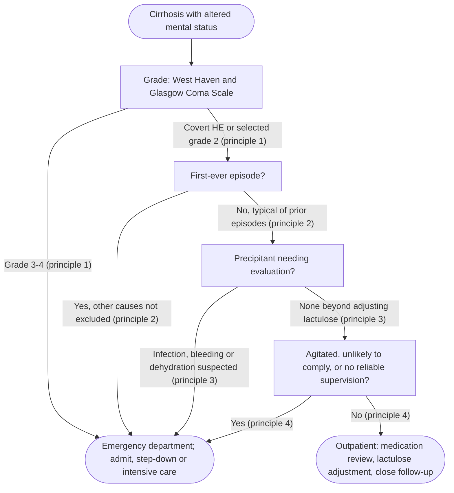

Hepatic encephalopathy (HE) is **brain dysfunction caused by liver insufficiency and/or portosystemic shunting** — a continuum from subclinical change to coma, not a single entity ([[aasld-easl-2014-hepatic-encephalopathy]]). It occurs without [[cirrhosis]] when simple shunting is present. The American College of Gastroenterology (ACG) 2026 reframes HE as a [[disorders-of-gut-brain-interaction|disorder of gut–brain interaction]] and de-emphasizes ammonia throughout ([[acg-2026-hepatic-encephalopathy]]).

## Contents
- [[#Assessment]]
  - [[#Establishing the Diagnosis]]
  - [[#Severity Assessment]]
  - [[#Classification / Typing]]
- [[#Differential Diagnosis]]
- [[#Diagnostics]]
  - [[#Diagnosing Overt HE]]
  - [[#Diagnosing Minimal and Covert HE]]
  - [[#Serum Ammonia]]
  - [[#Nonresponse to Therapy]]
- [[#Therapeutics]]
  - [[#Where to Treat]]
  - [[#Acute Overt HE]]
  - [[#Secondary Prophylaxis]]
  - [[#Alternative and Adjunct Therapies]]
  - [[#Minimal and Covert HE]]
  - [[#Nutrition and Exercise]]
  - [[#TIPS and Portosystemic Shunts]]
  - [[#Liver Transplantation]]
  - [[#De-escalation of Therapy]]
  - [[#Follow-Up After Hospitalization]]
- [[#See Also]]
- [[#Sources]]

---

## Assessment

### Establishing the Diagnosis

- **Overt HE (OHE) is a clinical diagnosis of exclusion** — no test confirms it; HE is the explanation once evaluation for other causes is negative ([[acg-2026-hepatic-encephalopathy]]).
- **Covert HE (CHE) is defined by *excluding* OHE** (grade ≥2) in the appropriate context — clinical diagnosis of CHE has low reproducibility (Key concept 1).
- **Minimal HE (MHE)** = no clinical signs, diagnosed only on psychometric/neurophysiological testing. **CHE** = MHE + grade 1. **OHE** = grades 2–4, a defining decompensating event in [[cirrhosis]].
- New **focal** neurological findings make HE less likely → brain imaging and neurology input.
- Serum ammonia does not make the diagnosis — see [[#Serum Ammonia]].

> [!pitfall] Isolated asterixis is not overt HE
> Asterixis (flapping tremor on wrist hyperextension) occurs in lower-grade HE but also in metabolic encephalopathy of other cause such as uremia; without altered behavior or alertness it is not enough to diagnose OHE ([[acg-2026-hepatic-encephalopathy]], Key concept 2).

### Severity Assessment

**West Haven criteria + International Society for Hepatic Encephalopathy and Nitrogen Metabolism (ISHEN) (Table 2, [[aasld-easl-2014-hepatic-encephalopathy]]):**

| Grade | Category | Clinical Manifestations | Operative Criteria |
|---|---|---|---|
| Unimpaired | — | No encephalopathy, no history | Tested and proved normal |
| Minimal | Covert HE | Psychometric/neurophysiological abnormalities only | Abnormal testing; no clinical HE |
| Grade 1 | Covert HE | Trivial lack of awareness; euphoria/anxiety; shortened attention span; altered sleep rhythm; impaired addition/subtraction | Oriented; cognitive/behavioral decay perceived by caregivers |
| Grade 2 | Overt HE | Lethargy/apathy; disorientation for time; personality change; dyspraxia; asterixis | Disoriented for time (≥3 of: day of month, day of week, month, season, year) |
| Grade 3 | Overt HE | Somnolence to semistupor, responsive to stimuli; confusion; bizarre behavior; gross disorientation | Disoriented for space (country, state, city, or place) |
| Grade 4 | Overt HE | Coma | No response even to painful stimuli |

- Grade on presentation **and throughout the hospital course**; add the Glasgow Coma Scale (GCS) where consciousness is significantly impaired (ACG 2026).
- **Triage** — West Haven grade + GCS identify high-grade HE needing step-down/intensive care unit (ICU) transfer, preventing aspiration pneumonia (Key concept 9).
  - **West Haven 3–4 or GCS <12 = severe impairment with aspiration risk → ICU where possible; GCS <9 → consider intubation** ([[aasld-easl-2026-aclf-global-consensus|2026 multisociety acute-on-chronic liver failure (ACLF) consensus]], Statement 41, C1). The grade 3–4 course is unpredictable → refer early.
  - ⚠ [[aasld-2024-aclf|American Association for the Study of Liver Diseases (AASLD) 2024 ACLF guidance]] (Statement 4) used GCS <8; the 2026 consensus supersedes it.
- **In [[acute-on-chronic-liver-failure|ACLF]]:** West Haven 3–4 (or mechanical ventilation for HE) = organ failure; West Haven 2 = organ dysfunction (2026 consensus, Statement 11, A1).

### Classification / Typing

Characterize **every bout along all five axes** — the 2014 four axes plus a fifth (social infrastructure) added by ACG 2026 as a checklist for addressable drivers of recurrence and readmission.

| Axis | Options |
|---|---|
| 1. Underlying disease | **A** — [[acute-liver-failure\|acute liver failure]] (high cerebral-edema risk, distinct management) · **B** — portosystemic bypass/shunting without hepatocellular disease · **C** — cirrhosis (most common; focus of both guidelines) |
| 2. Severity | West Haven grade (above) |
| 3. Time course | **Episodic** · **Recurrent** = ≥2 bouts in 6 months · **Persistent** = behavioral alterations always present, with relapses of OHE |
| 4. Precipitating factors | **Spontaneous** (none identified) vs **precipitated** (specify) |
| 5. Social infrastructure | Social/family support · financial support for medication adherence and lost earning or driving capability · institutional support for timely follow-up |

- **Episodic precipitants, by decreasing frequency:** infections > [[upper-gi-bleeding|gastrointestinal (GI) bleeding]] > diuretic overdose > electrolyte disorder > constipation > unidentified.
- **Recurrent:** electrolyte disorder > infections > unidentified > constipation > diuretic overdose > GI bleeding.
- *Infections dominate, but only unpublished case series support that ranking (Table 3, [[aasld-easl-2014-hepatic-encephalopathy]]).*

---

## Differential Diagnosis

*OHE is a diagnosis of exclusion; the decompensation framework it sits within is on [[cirrhosis]].*

> [!pearl] One in four has another cause
> Alternative or additional causes are identified in **up to one-quarter** of patients with cirrhosis initially suspected of having HE ([[aasld-easl-2026-aclf-global-consensus]]).

**Altered mental status in cirrhosis** (Table 4, [[aasld-easl-2014-hepatic-encephalopathy]]; Table 5, [[acg-2026-hepatic-encephalopathy]]):

- **Metabolic** — hypoglycemia, ketoacidosis, hyperosmolar states, lactic acidosis, uremic encephalopathy, hypoxic/hypercapnic encephalopathy
- **Electrolyte** — hyponatremia (independent HE risk factor), hypercalcemia; hyponatremia, hyperglycemia and sepsis can each cause encephalopathy *or* precipitate HE
- **Toxic** — alcohol intoxication/withdrawal; benzodiazepines, neuroleptics, opioids; carbon monoxide, heavy metals
- **Wernicke encephalopathy** — ataxia, confusion, memory loss occur in **both**; **nystagmus, ptosis, paralysis of lateral conjugate gaze** point to Wernicke's. Parenteral thiamine is mandatory when suspected and precedes intravenous (IV) glucose; suspect deficiency in [[alcohol-associated-liver-disease|alcohol-associated liver disease]] and end-stage cirrhosis of any cause ([[ishen-2013-nutrition-hepatic-encephalopathy|ISHEN 2013]])
- **Neurological** — intracranial bleed, stroke, head trauma/falls, neuroinfection, malignancy, nonconvulsive seizures (electroencephalography [EEG])
- **Endocrine** — thyroid disease, adrenal insufficiency, panhypopituitarism
- **Psychiatric** — acute psychosis, dementia; **severe metabolic stress** — organ failure, systemic inflammation

**Cirrhosis with *cognitive complaints* (not overt confusion):** a large proportion have something other than MHE — especially with isolated delayed-memory or isolated sleep complaints. Assess specifically, ideally in a specialized clinic (Key concept 4; Table 5):

| Condition | How to assess |
|---|---|
| Mild cognitive impairment, dementia | Mini-Mental State Examination (MMSE) or Montreal Cognitive Assessment (MoCA) |
| Sleep disorders incl. obstructive sleep apnea | STOP-BANG; adherence if already on positive airway pressure; PROMIS8 sleep |
| Alcohol and substance use | Toxicology screen; Drug Abuse Screen Test; Alcohol Use Disorder Identification Test–Consumption |
| Mood disorders | Patient Health Questionnaire-9; Beck Anxiety Inventory |
| Post-traumatic stress disorder | PCL-5 checklist |
| Endocrine/electrolyte (diabetes, thyroid, sodium, calcium) | Hemoglobin A1c; thyroid panel; chemistry panel |
| Medication effect | Review pain (opioids, gabapentin), anxiety and insomnia drugs |
| Neurologic (stroke, mass, bleed, infection, epilepsy) | Brain computed tomography (CT) or magnetic resonance imaging (MRI); EEG; lumbar puncture |

---

## Diagnostics

### Diagnosing Overt HE

Initial evaluation answers three questions (ACG 2026): **how severe** (sets level of care), **is HE the cause**, and **what precipitated it**.

- **Precipitant search is part of the diagnosis** (Key concept 10): bleeding, infection (pan-culture, **[[paracentesis|diagnostic paracentesis]]**, chest x-ray), sedating medications, toxic and metabolic abnormalities. Commonest are constipation, GI bleeding, infection, hyponatremia, dehydration/diuretic overdose.
- **No empirical broad-spectrum antibiotics** without symptoms or laboratory findings of active infection; tailor or stop quickly on cultures.
- **Workup of acute encephalopathy in cirrhosis/ACLF:** routine labs, blood ammonia, toxicology where indicated, **brain imaging**; lumbar puncture or EEG in selected cases (2026 consensus, ungraded).
- **Brain imaging — guidelines disagree.** ACG 2026 Rec 6 (*conditional, very low*): confusion **without new focal deficits → routine imaging NOT required**; CT/MRI neither diagnoses nor grades HE — image for **focal deficits, seizures, or nonresponse**. ⚠ The 2026 consensus and [[aasld-easl-2014-hepatic-encephalopathy|the 2014 guideline]] both list imaging in the first-time workup (**≥5-fold intracerebral hemorrhage risk** in cirrhosis).

### Diagnosing Minimal and Covert HE

- **Single-test strategy, not a 2-test combination** (Rec 1, *conditional, very low*) — supersedes the 2014 advice to use ≥2 modalities.
- **Who to prioritize for testing** (Key concept 3) — cirrhosis plus ≥1 of: hypoalbuminemia · decompensation ([[ascites]], [[variceal-upper-gi-bleeding|variceal bleeding]] or [[jaundice]]) · clinically significant [[portal-hypertension|portal hypertension]] or portosystemic shunts · cognitive complaints, poor concentration, impaired quality of life (QoL), navigation problems/traffic violations, falls · operating heavy machinery · commercial drivers and pilots. *2014 Rec 8 (Grade III, B, 2) likewise limited testing to impaired QoL or employment/public-safety implications.*
- **Choose by local expertise and available norms** (Key concept 6):

| Test | Resources / time | Domains | Reported MHE/CHE prevalence | Utility / caveats |
|---|---|---|---|---|
| **EncephalApp Stroop** (full) | Smartphone/tablet; 5–15 min | Psychomotor speed, cognitive flexibility | 45%–55% | Predicts OHE; full version long for some patients |
| **QuickStroop** | Smartphone/tablet; 1–2 min | Psychomotor speed | 45%–55% | Predicts HE; **not for color-blind subjects** |
| **Animal naming test** | None; 1 min | Memory, verbal retrieval, recall self-monitoring | 30%–40% | Predicts OHE and death; transcultural but **not specific** |
| **Critical flicker frequency** | Viewing chamber, or smartphone + light source | Visual tract integrity, reaction time | 40%–55% | Predicts OHE and death; **invalid if visual acuity impaired** |

*Table 4, [[acg-2026-hepatic-encephalopathy]].* Also acceptable (Key concept 6; [[aasld-easl-2014-hepatic-encephalopathy]]): the psychometric hepatic encephalopathy score (most widely used, validated in many countries), the inhibitory control test (needs highly functional patients), continuous reaction time, the SCAN test, and EEG (sensitive but nonspecific).

- **Do not substitute the MMSE or MoCA.** Both can be abnormal in CHE and **no threshold separates the CHE spectrum from delirium or dementia**; they add nothing to CHE-dedicated testing. Refer when mild cognitive impairment, dementia or delirium is suspected.

### Serum Ammonia

- **Not for diagnosing MHE/CHE alone** (Rec 2, *conditional, very low*).
- **Against routine ammonia testing to guide inpatient treatment decisions** (Rec 5, *conditional, very low*), or to guide initiation, titration or evaluation of recurrence as an outpatient (Key concept 14).
- **Do check it in the workup of acute encephalopathy:** elevated supports HE, normal makes HE unlikely (2026 consensus, ungraded; Key concept 11).
- ⚠ **Older guidance disagrees:** [[aasld-2024-aclf|AASLD 2024]] Statement 11 — no routine ammonia in cirrhosis with altered mental status; 2014 Rec 9 (Grade II-3, A, 1) — elevated ammonia adds no diagnostic, staging or prognostic value. The 2026 consensus is newer and governs the workup.

> [!pitfall] A normal ammonia is a reason to look elsewhere
> Low or normal ammonia has negative predictive value for HE as the cause of altered mentation — but a high level is not a treatment target, and therapy is never titrated to it ([[acg-2026-hepatic-encephalopathy]], Rec 5, Key concepts 11 and 14).

### Nonresponse to Therapy

Improvement is expected within **24–48 h**. Delirium persisting **beyond 48–72 h** despite adequate bowel movements and reversed precipitants (Key concept 12) → three tracks:

1. **Alternative diagnosis** — recheck ammonia (normal/low argues against HE); recent head trauma, falls, seizures, surgery.
2. **Undiagnosed precipitant** — electrolytes, [[aki-in-cirrhosis|renal failure]], centrally acting or recreational drugs (urine drug screen, phosphatidylethanol), overt GI bleeding, and above all **infection** (pan-culture, paracentesis, chest x-ray) — OHE will not improve until the infection is treated.
3. **Shunts** — **cross-sectional imaging** for a prior transjugular intrahepatic portosystemic shunt (TIPS) vs **spontaneous portosystemic shunts (SPSS)**; SPSS are present in **46%–71%** of medically refractory HE vs 14% without.

---

## Therapeutics

### Where to Treat

*Where to manage a patient with cirrhosis and altered mental status*
*Source: built from ACG 2026 guiding principles 1–4 for outpatient vs inpatient management*
*[[acg-2026-hepatic-encephalopathy|ACG Clinical Guideline: Hepatic Encephalopathy (2026)]]*
*HE = hepatic encephalopathy*

Adjusting treatment early prevents progression and aspiration pneumonia.

### Acute Overt HE

Four elements, started together ([[aasld-easl-2014-hepatic-encephalopathy]], Recs 14–17, Grade II-2, A, 1): care for altered consciousness · treat alternative causes · correct precipitants (**nearly 90% respond to precipitant correction alone**) · start empirical HE therapy.

- **[[lactulose]] first-line** (Rec 7, *strong, moderate*; 2014 Rec 19, Grade II-1, B, 1): **10–20 g (15–30 mL) every 2 h** until 2 soft bowel movements (BMs), then **2–4× daily** for 2–3 BMs/day. Grade 3–4, unable to swallow or aspiration risk → nasogastric dosing or enema; **impaired GI motility → rectal route may be preferable** (2026 consensus). Enema recipe, overuse harms, ICU titration: [[lactulose]].
- **Add [[rifaximin]] 550 mg twice daily** (Rec 9, *conditional, low*) — combination gave higher complete reversal, shorter stay and lower mortality than lactulose alone.
- **Critically ill already on broad-spectrum antibiotics: no routine rifaximin add-on** (2026 consensus; ACG 2026) — a double-blind trial found similar OHE reversal with antibiotics alone.
- **Grade 3–4: IV L-ornithine L-aspartate (LOLA) added to lactulose + rifaximin** lowered HE grade, shortened recovery and reduced 28-day mortality (2026 consensus, ungraded); unavailable in many countries.
- **Intubated: short-acting sedation (propofol, dexmedetomidine), avoid benzodiazepines** (Statement 42, B1) — minimum dose, interrupted regularly for neurological reassessment.

### Secondary Prophylaxis

**~40%–60% recur within 1 year of the index episode → prophylaxis is indicated in every patient with cirrhosis who develops OHE.**

- **Lactulose titrated to 2–3 soft BMs daily is outpatient first-line** (Rec 10, *strong, high*; 2014 Rec 25, Grade II-1, A, 1).
- **Titrate with the [[bristol-stool-form-scale|Bristol Stool Scale (BSS)]] plus BM frequency** to reduce readmissions (Rec 11, *conditional, very low*). **BSS ≥5 → cut lactulose back, or add rifaximin if already on it. BSS ≥5 *before* starting lactulose → consider a non-laxative therapy de novo.**
- Breakthrough HE on lactulose is usually **nonadherence or dehydration**.
- **Outpatient rifaximin to prevent recurrence** (Rec 12, *conditional, low*; 2014 Rec 20, Grade I, A, 1); **recurrent episodes on lactulose maintenance → add rifaximin** (Rec 13, *strong, high*; 2014 Rec 26 placed this after the second episode). Trial data: [[rifaximin]].
- **Combination beats monotherapy** where dual therapy is tolerated. Cost drives adherence — brief lapses in rifaximin are associated with readmission; assess affordability per patient.
- **Deprescribe** (Key concept 15) agents that affect mental-status assessment or HE risk: **opiates** (also slow transit → more ammonia absorption), **benzodiazepines**, **gabapentin/pregabalin**, **sleep aids (zolpidem, zaleplon, eszopiclone)**, **[[proton-pump-inhibitors|proton pump inhibitors]]** (risk likely via acid-suppression microbiota change). Multidisciplinary, with the patient.

### Alternative and Adjunct Therapies

| Agent | Recommendation | Comment |
|---|---|---|
| **High-volume polyethylene glycol (e.g., 4 L)** | Rec 8 (*conditional, low*) — alternative to lactulose | Faster HE resolution than standard lactulose in a randomized controlled trial (RCT); oral or nasogastric. Favor when lactulose causes discomfort, distension or ileus |
| **Zinc** | Rec 14 (*conditional, very low*) — add for persistent symptoms despite lactulose + rifaximin, **only if blood zinc is low** | Urea-cycle cofactor; conflicting efficacy, safe adjunct |
| **Branched-chain amino acids (BCAAs), oral** | 2014 Rec 21 (Grade I, B, 2) — alternative/additional when OHE does not respond | IV BCAAs have no effect on episodic bouts |
| **LOLA** | 2014 Rec 22 (Grade I, B, 2) — IV, for refractory OHE. **[[baveno-viii-2026-portal-hypertension\|Baveno VIII]] 6.13 (level of evidence [LoE] 3, weak): may be considered in recurrent/persistent HE** | Baveno VIII gives neither route nor dose; oral LOLA ineffective per 2014 |
| l-carnitine | Key concept 7 — second-line for MHE/CHE | When skeletal muscle cramps coexist |
| Neomycin | 2014 Rec 23 (Grade II-1, B, 2) | Ototoxicity/nephrotoxicity long term |
| Metronidazole | 2014 Rec 24 (Grade II-3, B, 2) — short term only | Neurotoxicity/nephrotoxicity |
| [[probiotics\|Probiotics]] | Not routinely recommended (case-by-case) | Limited high-quality RCT data |
| [[fmt\|Fecal microbiota transplant]] | **Clinical trials only** | Phase 1/2a trials safe with reduced recurrence; route/dose not contributory |
| Flumazenil | Not routinely recommended | Transient benefit, no survival effect; temporizes in benzodiazepine toxicity |
| [[albumin\|Albumin (IV)]] | Role unclear | Limited data suggest higher reversal rate and lower mortality as an adjunct |
| Glycerol phenylbutyrate | Investigational | Reduces episodes; needs validation |
| Renal replacement, plasma exchange, albumin dialysis | **Not supported in cirrhosis** | Ammonia is dialyzable (a role in acute liver failure and urea-cycle disorders), but data in cirrhosis are insufficient |
| Health-information-technology tools | Rec 15 (*conditional, very low*) | Patient Buddy App, electronic order sets/reminders — 30-day readmissions fell ~40% in one study |

### Minimal and Covert HE

- **Treat with lactulose rather than no treatment** (Rec 3, *conditional, low*) — a shift from 2014 Rec 29 (Grade II-2, B, 1), which did not routinely recommend treating MHE.
- **Insufficient evidence for or against routine MHE/CHE treatment specifically to prevent OHE** (Rec 4).
- **Do not add rifaximin as *primary* prevention of overt HE in MHE** ([[acg-2026-preventive-care-cirrhosis]], Rec 3, *conditional, low*): rifaximin **reverses** MHE (odds ratio 7.53) but did **not** prevent progression to OHE (odds ratio 0.44, 95% confidence interval 0.11–1.81) in the same network meta-analysis.
- **Second-line by phenotype** (Key concept 7): BCAA or LOLA if sarcopenia/frailty; zinc if low serum zinc; l-carnitine if cramps.
- **Theragnostic lactulose trial:** reassess adherence and symptom improvement at **4–8 weeks** to decide on continuation (Key concept 8). Cognitive testing plus lactulose or rifaximin may improve health-related QoL (Key concept 5).

### Nutrition and Exercise

- **Protein 1.2–1.5 g/kg/day** (Rec 17, *strong, moderate*; 2014 Rec 31, Grade I, A, 1); **critically ill up to 2 g/kg/day** (Key concept 22). **Never protein-restrict** — it increases muscle breakdown without shortening HE (Rec 20).
- **BCAA supplementation when protein needs cannot be met by food alone** (Rec 18, *strong, moderate*; 2014 Rec 33, Grade II-2, B, 2).
- **Energy 35–40 kcal/kg ideal body weight**, small evenly spaced meals, **late-night snack of ≥50 g complex carbohydrate**, and **no daytime fast longer than 3–6 h** (2014 Recs 30 & 32, Grade I, A, 1; Rec 19; ISHEN 2013, 1A).
- **Prefer vegetable and dairy protein to meat and fish** in recurrent or persistent HE (ISHEN 2B). Targets and screening tools: [[nutrition-in-liver-disease]].
- **Exercise** to reduce falls, lower portal pressure and raise skeletal-muscle ammonia metabolism (Rec 21, *conditional, low*). Post-exercise ammonia rises do **not** raise HE risk and should not deter prescribing (Key concept 24); supervise, since any degree of HE raises injury risk (Key concept 25).
- **Assess muscle health in everyone with HE, including MHE/CHE** — sarcopenia/myosteatosis, strength, physical function, frailty, cardiorespiratory fitness (Key concepts 20–21).

### TIPS and Portosystemic Shunts

- **Before elective TIPS, assess prior overt HE and current HE medications** ([[baveno-viii-2026-portal-hypertension|Baveno VIII]] 6.14); **prior overt HE is *not* an absolute contraindication** — individualise (6.15). Dilating the TIPS to the smallest diameter that achieves an adequate response limits overshunting (6.5–6.6; see [[tips]]).
- **Rifaximin 14 days before elective TIPS, continued ≥6 months**, in decompensated cirrhosis **with or without** prior OHE (**Rec 22, strong, moderate**). ⚠ Supersedes 2014 Rec 27 (Grade III, B, 1), which advised against routine post-TIPS prophylaxis. **Baveno VIII 6.16 agrees and drops the prior-HE restriction** (LoE 2, strong), where [[baveno-vii-2022-portal-hypertension|Baveno VII]] 4.9 required previous overt HE. Lactulose/lactitol prophylaxis failed vs placebo.
- **Embolize extrahepatic collaterals at the time of TIPS** (Rec 23, *conditional, low*).
- **Post-TIPS HE in 30%–40%; refractory in 3%–7%**, mostly when the **portal-systemic gradient falls by >60%**. Risk factors: older age, worse liver function, hyponatremia, pre-TIPS SPSS, prior HE, larger stent diameter, greater gradient reduction, sarcopenia. **Sarcopenia is neither an indication nor a contraindication to TIPS** but tracks with more post-TIPS HE and mortality (Key concept 23).
- **Treat post-TIPS HE as non-TIPS HE** (lactulose + rifaximin). Refractory after removing precipitants → **reduce the TIPS diameter** (ballooning, or a smaller TIPS within the TIPS) and/or embolize the shunt (Baveno VIII 6.17); refractory to medical *and* interventional therapy may justify prioritising for [[liver-transplantation|liver transplantation (LT)]] (Baveno VIII 5.34).
- **SPSS** occur in up to 60% of cirrhosis, mark clinically significant portal hypertension, and predict decompensation and recurrent HE.
- **Shunt embolization for refractory HE** on optimized medical therapy with adequate hepatic function and no contraindications (Rec 16, *conditional, very low*).
  - **Operative criteria:** refractory HE despite optimal therapy, **Model for End-Stage Liver Disease (MELD) usually <15**, **shunts ≥8 mm in diameter**. Decide with hepatology and radiology — embolization can provoke varices and ascites.
  - **Baveno VIII 6.12:** embolise large shunts for **recurrent/persistent HE despite optimal pharmacological therapy**, alongside a transplant discussion, **particularly when liver function is preserved** (LoE 3, strong) — the gate ACG expresses as MELD <15.
  - **After embolization:** symptoms, labs and liver Doppler at **1 month**; upper endoscopy at **6 months**; cross-sectional imaging at **1 year**.

### Liver Transplantation

- **Recurrent intractable OHE together with liver failure is an indication for LT** (2014 Rec 13, Grade I); HE alone is not, unless liver function is poor or QoL severely impaired.
- MELD and MELD 3.0 give HE **no extra allocation priority**; **adding 4–5 MELD points** (any iteration) better reflects 90-day mortality of inpatient OHE and outpatient CHE (Key concept 26).
- **Evaluate early** with high MELD 3.0, severe HE (grades III–IV) or frequent episodes (Key concept 28) — repeated episodes cause cumulative cognitive impairment that may not fully recover after LT (Key concept 27).
- **Multiple HE episodes with MELD <15 → assess candidacy for living-donor LT** (Rec 24, *conditional, low*).
- **Persistent inpatient confusion is a relative contraindication to transplant** (Key concept 29).

### De-escalation of Therapy

- **De-escalate and potentially stop HE therapy stepwise in patients who clinically recompensate** (Key concept 16): if asymptomatic on therapy, withdraw HE medications **sequentially** with close monitoring. 2014 Rec 28 (Grade III, C, 2) similarly allowed discontinuation once precipitants are controlled or liver function and nutrition improve.
- ⚠ **The recompensation definition ACG cites has been revised.** Key concept 16 uses the [[baveno-vii-2022-portal-hypertension|Baveno VII]] wording (ascites resolved off diuretics, no variceal bleeding for 12 months, improved albumin, international normalized ratio and bilirubin); **Baveno VIII 7.4** shortens sustained resolution to **>6 consecutive months** and replaces "improved liver function tests" with **Child-Turcotte-Pugh (CTP) A5/A6**. Full criteria and the CTP table: [[cirrhosis]].

> [!pitfall] Being free of HE on the drug is not recompensation
> Baveno VIII 7.7: absence of HE *while on* lactulose, rifaximin or LOLA is **not** evidence of recompensation. Withdraw the HE medication once the aetiology is cured or controlled and synthetic function reaches CTP A laboratory criteria, then judge by what happens next.

### Follow-Up After Hospitalization

1. **Multidisciplinary medication reconciliation at discharge** — prophylaxis prescribed, harmful medications reduced or stopped (Key concept 13).
2. **Driving:** oral *and* written advice to avoid driving for a **recent (<3 months) OHE episode**, to patient and caregivers (Key concept 17); take a driving history at clinic visits.
3. **Educate every patient and caregiver** (Key concept 18); **screen caregivers for burnout**, refer to palliative care or social work (Key concept 19).
4. Monitor for MHE/CHE between episodes; continue nutrition and muscle-health monitoring; address the fifth axis.

---

## See Also

[[acute-liver-failure]], [[acute-on-chronic-liver-failure]], [[cirrhosis]], [[portal-hypertension]], [[tips]], [[aki-in-cirrhosis]], [[spontaneous-bacterial-peritonitis]], [[ascites]], [[variceal-upper-gi-bleeding]], [[upper-gi-bleeding]], [[liver-transplantation]], [[lactulose]], [[rifaximin]], [[albumin]], [[probiotics]], [[fmt]], [[proton-pump-inhibitors]], [[bristol-stool-form-scale]], [[paracentesis]], [[alcohol-associated-liver-disease]], [[nutrition-in-liver-disease]], [[disorders-of-gut-brain-interaction]], [[jaundice]]

---

## Sources

1. [[aasld-easl-2026-aclf-global-consensus|AASLD/EASL/APASL/ALEH/SOLDA 2026 Global Multisociety Consensus on ACLF Definitions]]
2. [[acg-2026-hepatic-encephalopathy|ACG Clinical Guideline: Hepatic Encephalopathy (2026)]]
3. [[acg-2026-preventive-care-cirrhosis|ACG Clinical Guideline: Preventive Care for Patients With Cirrhosis (2026)]]
4. [[baveno-viii-2026-portal-hypertension|Baveno VIII — Advancing Consensus in Portal Hypertension (2026)]]
5. [[aasld-easl-2014-hepatic-encephalopathy|AASLD/EASL 2014 Practice Guideline: Hepatic Encephalopathy in Chronic Liver Disease]]
6. [[baveno-vii-2022-portal-hypertension|Baveno VII — Renewing Consensus in Portal Hypertension (2022)]]
7. [[ishen-2013-nutrition-hepatic-encephalopathy|The Nutritional Management of Hepatic Encephalopathy in Patients With Cirrhosis: ISHEN Consensus (2013)]]
8. [[aasld-2024-aclf|AASLD 2024 Practice Guidance on Acute-on-Chronic Liver Failure]]
