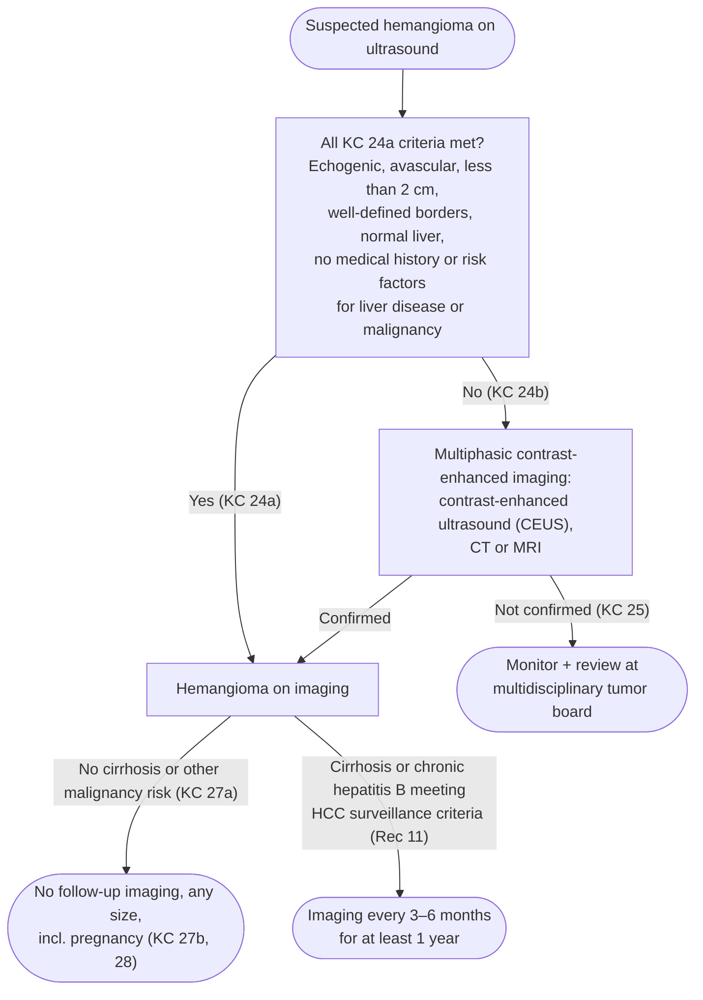

# Hepatic Hemangioma

---

## Contents
- [[#Assessment]]
  - [[#Establishing the Diagnosis]]
  - [[#Severity Assessment]]
  - [[#Classification / Typing]]
- [[#Differential Diagnosis]]
- [[#Diagnostics]]
  - [[#Diagnostic Pathway]]
  - [[#Modality Performance]]
  - [[#MRI / CT Hallmarks]]
  - [[#Biopsy]]
- [[#Therapeutics]]
  - [[#Follow-Up — Almost Never]]
  - [[#When to Treat (KC 29)]]
  - [[#How to Treat]]
  - [[#Hormones and Contraception]]
- [[#See Also]]
- [[#Sources]]

---

## Assessment

### Establishing the Diagnosis

**Hepatic hemangioma:** the most common benign **noncystic** liver lesion — occurs in **up to 20% of the population**, female preponderance **4:1** ([[acg-2024-focal-liver-lesions]]). Benign mesenchymal vascular lesion: clusters of blood-filled cavities lined by endothelium, ranging from a few millimetres to **>20 cm**.

- Believed to arise from a **congenital abnormality in vasculogenesis**, growing slowly from birth
- Enlargement is due to **progressive ectasia of the vasculature**, not hypertrophy of the lesion
- **No clear causative link to female sex hormones** (management consequence under [[#Hormones and Contraception]])

**Presentation:**

- **Usually asymptomatic** — detected incidentally on imaging
- Larger lesions: pain, poor appetite, abdominal fullness
- **Kasabach–Merritt syndrome:** rare consumptive coagulopathy — **thrombocytopenia, systemic bleeding, disseminated intravascular coagulation (DIC)** — usually seen in **giant cavernous** hemangiomas
- **Spontaneous rupture is exceedingly rare**

### Severity Assessment

No grading system — hemangioma is uniformly benign. Three variables actually drive management:

1. **Is the diagnosis confirmed on imaging?** (if not → monitor + multidisciplinary tumor board, Key Concept [KC] 25)
2. **Does the patient have [[cirrhosis]], [[chronic-hepatitis-b|chronic hepatitis B]], or another malignancy risk?** — the only situation requiring surveillance
3. **Is there a lesion-related complication?** — the clearest indication for treatment

### Classification / Typing

**Three classic types — cavernous, capillary, and sclerosed** ([[acg-2024-focal-liver-lesions]]); *giant cavernous* is a size-defined subtype of the cavernous form.

| Type | Size | Imaging behaviour | Why it matters |
|---|---|---|---|
| **Cavernous** | classic ultrasound (US) appearance usually seen **<3 cm**; a few mm to >20 cm | Homogeneous hyperechoic with posterior acoustic enhancement on US; **"avascular" on color Doppler** (slow flow in large vascular spaces); T2 light-bulb bright; peripheral nodular → centripetal fill-in | Classic type |
| **Giant cavernous** | **>10 cm** (some authors use >4–5 cm) | Same features, but may also show **calcification, large central non-enhancement, heterogeneous post-contrast enhancement** | Asymptomatic large cavernous (generally >10 cm): **no resection** (KC 28) |
| **Capillary ("flash-filling")** | usually **<1 cm** | Rapid **homogeneous** arterial-phase enhancement on computed tomography (CT)/magnetic resonance imaging (MRI), persisting on portal venous and delayed phases; **may show vascular flow on US** (smaller vascular spaces) | Unlike cavernous, not "avascular" on US |
| **Sclerosed** (thrombosed / hyalinized) | — | Usually a **degenerated cavernous** hemangioma with large amounts of fibrosis. **Thick peripheral rim** enhancement early, progressive enhancement that is **non-centripetal and non-nodular**; **heterogeneous** on T2; **increasing** restricted diffusion at high b-value; **upstream capsular retraction** | Mimics [[cholangiocarcinoma\|intrahepatic cholangiocarcinoma (iCCA)]] or hypovascular metastasis — a diagnostic dilemma |

*See Figures 7 (flash-filling and classic cavernous) and 8 (sclerosed) in [[acg-2024-focal-liver-lesions]] for example MRI images.*

---

## Differential Diagnosis

*Workup & imaging comparison: see [[focal-liver-lesions]].*

- **[[focal-nodular-hyperplasia|Focal nodular hyperplasia]] (FNH)** — homogeneous arterial hyperenhancement → isoenhancing on portal venous/delayed phases; central scar; almost always **hyperintense on the 20-minute hepatobiliary phase (HBP)**
- **[[hepatocellular-adenoma|Hepatocellular adenoma]]** — usually devoid of signal on HBP MRI; hormonal risk factors
- **[[hepatocellular-carcinoma|Hepatocellular carcinoma (HCC)]]** — always top of the differential with underlying liver disease. Early in malignant development a lesion can **mimic** a hemangioma — the reason cirrhosis or hepatitis B changes follow-up
- **Hepatic metastases** — history of malignancy; suspected metastases → MRI with hepatobiliary contrast + diffusion-weighted imaging (KC 32)
- **iCCA / hypovascular metastasis** — share the rim-enhancement + capsular-retraction pattern of a **sclerosed hemangioma**; careful comparison with prior imaging (stable lesion, or a typical hemangioma in the same location) is required
- **Hepatic angiosarcoma** — rare, aggressive; multiple masses to a single heterogeneous mass; CT hypoenhancing on all phases, MRI heterogeneous on all sequences
- **Hepatic epithelioid hemangioendothelioma** — rare; stage with whole-body contrast-enhanced CT or MRI; resect whenever possible, and if not feasible, [[liver-transplantation|liver transplantation]] offers the best survival even with extrahepatic disease (KC 34–35)

---

## Diagnostics

### Diagnostic Pathway

*Suspected hepatic hemangioma: imaging workup and follow-up*
*Source: built from ACG 2024 Key Concepts 24a, 24b, 25, 27a, 27b and 28 and Recommendation 11 (the guideline's Figure 1a shows hemangioma only as asymptomatic vs symptomatic)*
*[[acg-2024-focal-liver-lesions|ACG 2024 Focal Liver Lesions Guideline]]*
*KC = key concept · CEUS = contrast-enhanced ultrasound · CT = computed tomography · MRI = magnetic resonance imaging · Rec = recommendation · HCC = hepatocellular carcinoma*

- US alone is sometimes diagnostic, but most suspected hemangiomas need cross-sectional imaging — especially with hepatitis B, cirrhosis or a history of malignancy

### Modality Performance

| Modality | Sensitivity | Specificity |
|---|---|---|
| **[[mri-mrcp\|MRI]]** (best) | 92%–100% | 85.7%–99.4% |
| **CT** | 98.3% | **55.0%** |
| **CEUS** | accuracy 97.3% (other series: accuracy 92.7%; diagnostic rate 90.2%) | — |

*Diagnostic performance for hepatic hemangioma. ([[acg-2024-focal-liver-lesions]])*

### MRI / CT Hallmarks

- **T2-weighted:** markedly **hyperintense** ("light-bulb bright")
- **Non-contrast:** hypodense on CT / T1-hypointense on MRI
- **Arterial phase:** peripheral **nodular** enhancement
- **Portal venous / delayed phases:** progressive **centripetal fill-in**, following the arterial blood pool
- **Diffusion:** hyperintense on **low** b-value diffusion-weighted imaging (DWI) with **decreasing** signal as b-value increases — useful in atypical lesions

### Biopsy

- **[[liver-biopsy|Biopsy]] should be avoided when possible** because of bleeding risk (KC 26) — hemangiomas are "do not touch" lesions since imaging is near-diagnostic
- Reported bleeding risk **0.15%** when small-gauge needles are used
- Occasionally required for a **sclerosed** hemangioma that cannot be separated from malignancy

---

## Therapeutics

### Follow-Up — Almost Never

- Who needs follow-up, and how often: [[#Diagnostic Pathway]]
- **Asymptomatic hemangiomas: no intervention or follow-up regardless of size**
- **The one exception — malignancy risk (Rec 11, strong recommendation, low quality of evidence):** applies to cirrhosis or chronic hepatitis B meeting criteria for [[hcc-surveillance|HCC surveillance]] with a **suspected** hemangioma
  - Why: lesions can mimic hemangioma early in the course of malignancy
  - These patients follow the American Association for the Study of Liver Diseases (AASLD) HCC Guidance imaging for focal liver lesions

### When to Treat (KC 29)

> [!pitfall] Do not operate for discomfort or anxiety
> Avoid surgery — including for giant cavernous hemangiomas — when discomfort and anxiety are the main indication: these symptoms nearly always recur ([[acg-2024-focal-liver-lesions]]).

The clearest indications for treatment are **complications of the lesion**, all of which are rare:

- Rupture
- Intratumoral hemorrhage
- Consumptive coagulopathy (**Kasabach–Merritt**)
- Organ or vessel compression

The guideline's summary flowchart (Figure 1a) sends "symptomatic" hemangiomas to resection or alternative therapy; its text and KC 29 define the indications as the complications above.

### How to Treat

- **Surgery** — open or laparoscopic; **enucleation** is the most common operation, non-anatomical resection second. Lesions **>15 cm** are more likely to have surgical complications (blood loss, transfusion, prolonged recovery)
- **If not a surgical candidate** (anatomy or comorbidity) — options are **[[radiofrequency-ablation|ablation]] (radiofrequency or microwave) for lesions <3.5 cm**, radiation therapy, **transarterial embolization**, and — in a few reports of life-threatening Kasabach–Merritt — **[[liver-transplantation|liver transplantation]]**. Decide these at a **multidisciplinary tumor board** (KC 30)

### Hormones and Contraception

- No clear causative link between hemangioma and female sex hormones → **oral contraceptive pill (OCP) use and pregnancy need not be avoided** in patients with hemangiomas ([[acg-2024-focal-liver-lesions]])

---

## See Also

[[focal-liver-lesions]], [[focal-nodular-hyperplasia]], [[hepatocellular-adenoma]], [[hepatic-cysts]], [[hepatocellular-carcinoma]], [[hcc-surveillance]], [[cholangiocarcinoma]], [[li-rads]], [[mri-mrcp]], [[liver-biopsy]], [[radiofrequency-ablation]], [[liver-transplantation]], [[cirrhosis]], [[chronic-hepatitis-b]]

---

## Sources

1. [[acg-2024-focal-liver-lesions|ACG Clinical Guideline: Focal Liver Lesions (2024)]]
