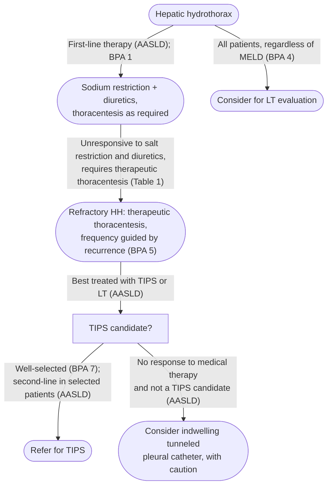

*Hepatic hydrothorax (HH): a pleural effusion occurring in [[portal-hypertension|portal hypertension]] without another cause (heart failure, lung disease, malignancy) ([[aga-2025-ascites-cirrhosis]]); transudative ([[aasld-2021-ascites-sbp-hrs]]). Ascitic fluid is drawn from the peritoneal cavity through diaphragmatic defects by negative intrathoracic pressure at inspiration; prevalence in [[cirrhosis|cirrhosis]] 4%–12% ([[aasld-2021-ascites-sbp-hrs]]).*

## Contents
- [[#Assessment]]
  - [[#Establishing the Diagnosis]]
  - [[#Severity Assessment]]
  - [[#Classification / Typing]]
- [[#Differential Diagnosis]]
- [[#Diagnostics]]
  - [[#Pleural Fluid Analysis]]
  - [[#Spontaneous Bacterial Empyema (SBE)]]
- [[#Therapeutics]]
  - [[#First-Line Medical Therapy]]
  - [[#Therapeutic Thoracentesis]]
  - [[#Refractory Hepatic Hydrothorax]]
  - [[#What Not To Do]]
  - [[#Liver Transplantation]]
- [[#See Also]]
- [[#Sources]]

## Assessment

### Establishing the Diagnosis

- Pleural effusion + portal hypertension, **with other causes excluded** — heart failure, lung disease, malignancy, infection, pancreatitis ([[aga-2025-ascites-cirrhosis]], [[aasld-2021-ascites-sbp-hrs]]).
- **Serum-to-pleural-fluid albumin gradient >1.1 g/dL suggests HH** ([[aasld-2021-ascites-sbp-hrs]]).
- A diagnostic thoracentesis helps exclude other causes of the effusion ([[aga-2025-ascites-cirrhosis]]); who must be tapped: *Pleural Fluid Analysis*.
- **Typically unilateral and right-sided.** In a series of 77 patients: right 73%, left 17%, bilateral 10% ([[aasld-2021-ascites-sbp-hrs]]).
- **9% had no clinical [[ascites|ascites]]** — absence of ascites does not exclude HH, but should raise suspicion for another cause.

### Severity Assessment

- **Prognosis is worse than the Model for End-Stage Liver Disease (MELD) score predicts** — the central management point.
  - 90-day mortality after hospitalization with HH **74%**, despite mean MELD 14 (which predicts 6%–8%) ([[aasld-2021-ascites-sbp-hrs]]).
  - 1-year mortality **20%–50%**; HH is independently associated with significantly higher mortality than ascites regardless of MELD, and with a **>4-fold increase in mortality vs refractory ascites** ([[aga-2025-ascites-cirrhosis]]).
- **HH causes symptoms at much lower fluid volumes than ascites** — dyspnea rather than distention ([[aga-2025-ascites-cirrhosis]]).
- Complications: spontaneous bacterial empyema, progressive respiratory failure, trapped lung, and thoracentesis complications (pneumothorax, bleeding) ([[aasld-2021-ascites-sbp-hrs]]).

### Classification / Typing

| Category | Definition | Implication |
|---|---|---|
| Hepatic hydrothorax | Transudative pleural effusion in portal hypertension, other causes excluded | Sodium restriction + diuretics; therapeutic thoracentesis if symptomatic |
| **Refractory HH** | HH **unresponsive to salt restriction and diuretic therapy** that requires therapeutic thoracentesis ([[aga-2025-ascites-cirrhosis]] Table 1) | Serial thoracentesis, [[tips\|transjugular intrahepatic portosystemic shunt (TIPS)]] referral, [[liver-transplantation\|liver transplantation (LT)]] evaluation |
| Spontaneous bacterial empyema (SBE) | Pleural fluid neutrophils **>250/mm³**, with or without culture positivity, without an alternative infectious source ([[aga-2025-ascites-cirrhosis]]) | Empirical intravenous (IV) antibiotics; no chest tube |

- **First decompensating event.** Clinically evident ascites **or hepatic hydrothorax** caused by portal hypertension defines first decompensation, alongside variceal bleeding and overt [[hepatic-encephalopathy|hepatic encephalopathy]] (West Haven grade ≥II) — [[baveno-viii-2026-portal-hypertension|Baveno VIII]] 3.3 (level of evidence [LoE] 2).

## Differential Diagnosis

*Workup: see [[ascites]].*

Consider another cause — particularly when the serum-to-pleural-fluid albumin gradient is **≤1.1 g/dL**, the effusion is **left-sided**, or there is **no ascites** ([[aasld-2021-ascites-sbp-hrs]]):

- Infection
- Pancreatitis
- Malignancy
- Cardiopulmonary causes — heart failure, lung disease ([[aga-2025-ascites-cirrhosis]])
- Coexisting cirrhosis-related pulmonary disease — [[hepatopulmonary-syndrome-portopulmonary-hypertension|hepatopulmonary syndrome and portopulmonary hypertension]] are evaluated alongside HH in respiratory failure ([[aasld-2024-aclf]])
- Spontaneous bacterial empyema — infection of the HH, not an alternative to it

## Diagnostics

### Pleural Fluid Analysis

- **American Gastroenterological Association (AGA) 2025 — who to tap** ([[aga-2025-ascites-cirrhosis]]):
  - **Every hospitalized patient with cirrhosis and new-onset HH, even without signs of infection** — high risk of SBE.
  - Hospitalized patients with HH-related symptoms, hepatic encephalopathy, or unexplained liver decompensation — to evaluate for SBE.
- **American Association for the Study of Liver Diseases (AASLD) 2021 — narrower trigger:** with a pleural effusion, diagnostic thoracentesis **when there is no ascites, or when diagnostic [[paracentesis]] has ruled out [[spontaneous-bacterial-peritonitis|spontaneous bacterial peritonitis (SBP)]] while bacterial infection is suspected** ([[aasld-2021-ascites-sbp-hrs]]). AGA 2025 is newer and broader (all hospitalized new-onset HH).
- Fluid: polymorphonuclear (PMN) neutrophil count, culture, and albumin for the serum-to-pleural-fluid gradient.
- **Pleural fluid protein may exceed that of the concurrent ascites** (hydrostatic pressure gradient) — a higher protein than the ascites does **not** argue against HH ([[aasld-2021-ascites-sbp-hrs]]).
- Negative cultures and benign cytology on 2 occasions are also **documentation a MELD exception requires** — see *Liver Transplantation*.

### Spontaneous Bacterial Empyema (SBE)

AASLD 2021 manages SBE within its SBP section; MDRO regimens and culture technique: [[spontaneous-bacterial-peritonitis]] ([[aasld-2021-ascites-sbp-hrs]]).

- **Pleural fluid PMN >250/mm³ → start IV antibiotics empirically**, before culture results.
- **Community-acquired → IV third-generation cephalosporin**; example IV cefotaxime 2 g every 12 hours where multidrug-resistant organisms (MDRO) are not prevalent.
- **Health care–associated or nosocomial infection, recent broad-spectrum antibiotic exposure, or sepsis/septic shock on admission → broad-spectrum antibiotics first line.**
- **Duration 5–7 days** (stated in the SBP section).
- **Repeat thoracentesis 2 days after starting antibiotics.** PMN decrease **<25% from baseline = lack of response** → broaden coverage and evaluate for secondary bacterial peritonitis. Repeat tap may be unnecessary if an organism is isolated, it is susceptible to the antibiotic used, and the patient is improving.
- **Prevention of SBE has not been studied.**
- AASLD's IV albumin (1.5 g/kg day 1, 1 g/kg day 3) and nonselective beta-blocker hold statements are written for **SBP**; neither is stated for SBE.

## Therapeutics

Pathway built from AASLD 2021 guidance statements and AGA 2025 Best Practice Advice (BPA) statements:

*Hepatic hydrothorax management*
*Source: built from the AASLD 2021 hepatic hydrothorax section (text and guidance statements) and AGA 2025 BPA 1, 4, 5, 7 and Table 1 (neither has an HH flowchart)*
*[[aasld-2021-ascites-sbp-hrs|AASLD 2021 Ascites, SBP and HRS Guidance]] · [[aga-2025-ascites-cirrhosis|AGA 2025 CPU Ascites in Cirrhosis]]*
*HH = hepatic hydrothorax · AASLD = American Association for the Study of Liver Diseases · BPA = Best Practice Advice · MELD = Model for End-Stage Liver Disease · LT = liver transplantation · TIPS = transjugular intrahepatic portosystemic shunt*

### First-Line Medical Therapy

- **Sodium restriction + diuretics at the lowest effective dose**, escalated by symptoms, weight, urine output and electrolyte/renal monitoring; dietitian referral; identify and address triggers of decompensation ([[aga-2025-ascites-cirrhosis]] BPA 1). AASLD: initial management similar to that of ascites; first-line = sodium restriction + diuretics plus thoracentesis as required ([[aasld-2021-ascites-sbp-hrs]]).
- **Sodium ideally <2,000 mg/day** ([[aga-2025-ascites-cirrhosis]]); AASLD: 2 g or 90 mmol/day ([[aasld-2021-ascites-sbp-hrs]]).
- Diuretics as for ascites — combined furosemide + spironolactone (**40:100 ratio**), spironolactone 100 mg + furosemide 40 mg daily to start ([[aga-2025-ascites-cirrhosis]]); AASLD: spironolactone with or without furosemide, same starting doses ([[aasld-2021-ascites-sbp-hrs]]); titration, ranges and weight-loss targets: [[ascites]].
- **Fluid restriction not needed** absent significant hyponatremia ([[aga-2025-ascites-cirrhosis]]); AASLD (for ascites) sets it at moderate or severe hyponatremia, **serum sodium ≤125 mmol/L**.
- **Do not over-restrict the diet** — often malnourished: **≥35 kcal/kg/day** (nonobese), protein **1.2–1.5 g/kg**, micronutrient repletion ([[aga-2025-ascites-cirrhosis]]).
- Concurrent ascites: large-volume paracentesis (LVP) with IV [[albumin|albumin]] may improve ventilatory function, **but thoracentesis is generally also required** ([[aasld-2021-ascites-sbp-hrs]]).
- **No data on intermittent albumin infusions in HH**; AASLD calls benefit plausible only if albumin improves ascites control.

### Therapeutic Thoracentesis

- **Dyspnea and/or hypoxemia → therapeutic thoracentesis**, for symptom relief and expansion of the underlying lung ([[aga-2025-ascites-cirrhosis]] BPA 3). Also for symptomatic patients or recurrent effusions despite treatment.
- Cirrhosis with respiratory compromise from hydrothorax or tense ascites → **therapeutic thoracentesis/paracentesis is recommended** ([[aasld-2024-aclf]] guidance statement [GS] 18).
- **No data guide the upper limit of pleural fluid volume** to remove in one session ([[aasld-2021-ascites-sbp-hrs]]).
- **Fluid can reaccumulate rapidly** — repeated thoracenteses are commonly required.
- **Higher risk than in other effusion causes** — bleeding, infection, pneumothorax, re-expansion edema; **bleeding from chest wall portosystemic collaterals is rare but can be catastrophic**. Complication and death risk **rise with repeated thoracenteses** ([[aga-2025-ascites-cirrhosis]]).

### Refractory Hepatic Hydrothorax

- **Serial therapeutic thoracentesis**, frequency guided by recurrence ([[aga-2025-ascites-cirrhosis]] BPA 5).
- **TIPS:** refractory or recurrent HH "is best treated with TIPS or LT"; TIPS **can be considered in selected patients as second-line** treatment for refractory HH ([[aasld-2021-ascites-sbp-hrs]]). Well-selected patients **should be referred for TIPS** ([[aga-2025-ascites-cirrhosis]] BPA 7).
- **Discuss TIPS and LT together** in recurrent/refractory ascites or hydrothorax ([[baveno-viii-2026-portal-hypertension]] 6.4; LoE 2, strong).
- **TIPS selection** (full criteria: [[tips]]) ([[aga-2025-ascites-cirrhosis]]):
  - Absolute contraindications — congestive heart failure, severe pulmonary hypertension, uncontrolled hepatic encephalopathy, sepsis.
  - **Avoid if ejection fraction <50%, severe diastolic/valvular dysfunction, or right ventricular systolic pressure >45 mm Hg**; echocardiography beforehand.
  - **Caution if age >70 y or MELD >18**, though the indication is increasingly being expanded in this population.
  - Hepatic encephalopathy in **up to 50%** post-TIPS; cardiac decompensation in **up to 20%** within 1 year.
- **Hepatocellular carcinoma (HCC) is not an absolute contraindication** to TIPS for recurrent/refractory HH **unless the tumor lies along the TIPS trajectory**; better decompensation control may facilitate oncologic treatment (Baveno VIII 4.15; LoE 3, weak).
- **Indwelling tunneled pleural catheter** — may be considered in **carefully selected patients who do not respond to medical therapy and are not TIPS candidates**, with caution, as an alternative to repeated thoracentesis ([[aasld-2021-ascites-sbp-hrs]]):
  - Infection **4.5%**, fluid reaccumulation **20%**, spontaneous pleurodesis **31%**.
  - **Frequent drainage risks protein depletion and malnutrition.**
  - AGA 2025: palliation for non-transplant candidates, or a **bridge to transplant with short wait times** ([[aga-2025-ascites-cirrhosis]]).
- **Video-assisted thoracoscopic surgery repair of diaphragmatic defects has been reported** ([[aasld-2021-ascites-sbp-hrs]]).
- **After [[variceal-obliteration|balloon-occluded retrograde transvenous obliteration (BRTO)]]** for gastric varices, ascites or hydrothorax can develop or worsen: clinically evident or symptomatic, requiring intervention, in **~15% within a year**; present on imaging in up to **35%–40%** ([[aga-2021-bleeding-gastric-varices]]).

### What Not To Do

- **No chest tube.** High morbidity, clinical deterioration resulting in death or necessitating urgent TIPS/LT, and fistula formation ([[aasld-2021-ascites-sbp-hrs]], [[aga-2025-ascites-cirrhosis]]).
- **No chemical pleurodesis** — often leads to loculated collections; not recommended ([[aasld-2021-ascites-sbp-hrs]]).
- **No platelet or plasma transfusion needed** before thoracentesis ([[aasld-2021-ascites-sbp-hrs]]).

> [!pitfall] "Empyema" does not mean a chest tube
> Although the term implies drainage, a chest tube should not be placed in SBE ([[aasld-2021-ascites-sbp-hrs]]).

### Liver Transplantation

- **Patients with HH should be considered for LT** ([[aasld-2021-ascites-sbp-hrs]]) — mortality exceeds that predicted by MELD.
- **All patients with ascites and/or HH should be considered for LT evaluation regardless of MELD** ([[aga-2025-ascites-cirrhosis]] BPA 4).
- **MELD exception.** Organ Procurement and Transplantation Network guidance offers **no standard MELD exception for HH**; **nonstandard exceptions may be granted individually** to patients meeting criteria ([[aga-2025-ascites-cirrhosis]]). AASLD 2021 Table 8: adult LT candidates with **chronic, recurrent, confirmed HH, infectious and malignant causes ruled out**, could be considered individually for a MELD exception; documentation should include ([[aasld-2021-ascites-sbp-hrs]]):

  | Requirement | Detail |
  |---|---|
  | Thoracentesis burden | **≥1 thoracentesis >1 L weekly in the last 4 weeks** — date and volume of each reported |
  | Fluid character | Transudative by **pleural albumin–serum albumin gradient of at least 1.1** *and* by cell count |
  | Heart failure | **None**, with objective evidence excluding it |
  | Culture | **Negative on 2 separate occasions** |
  | Cytology | **Benign on 2 separate occasions** |
  | TIPS | A **contraindication to TIPS**, specified |
  | Diuretics | **Diuretic refractory** |

---

## See Also

[[ascites]], [[cirrhosis]], [[portal-hypertension]], [[spontaneous-bacterial-peritonitis]], [[tips]], [[liver-transplantation]], [[albumin]], [[hepatopulmonary-syndrome-portopulmonary-hypertension]], [[acute-on-chronic-liver-failure]], [[hepatic-encephalopathy]], [[aki-in-cirrhosis]], [[hepatocellular-carcinoma]]

---

## Sources

1. [[aasld-2021-ascites-sbp-hrs|AASLD 2021: Diagnosis, Evaluation, and Management of Ascites, SBP, and HRS in Cirrhosis]]
2. [[aga-2025-ascites-cirrhosis|AGA Clinical Practice Update on the Management of Ascites, Volume Overload, and Hyponatremia in Cirrhosis: Expert Review]]
3. [[baveno-viii-2026-portal-hypertension|Baveno VIII — Advancing Consensus in Portal Hypertension (2026)]]
4. [[aasld-2024-aclf|AASLD 2024 Practice Guidance on Acute-on-Chronic Liver Failure]]
5. [[aga-2021-bleeding-gastric-varices|AGA Clinical Practice Update on Management of Bleeding Gastric Varices: Expert Review]]
