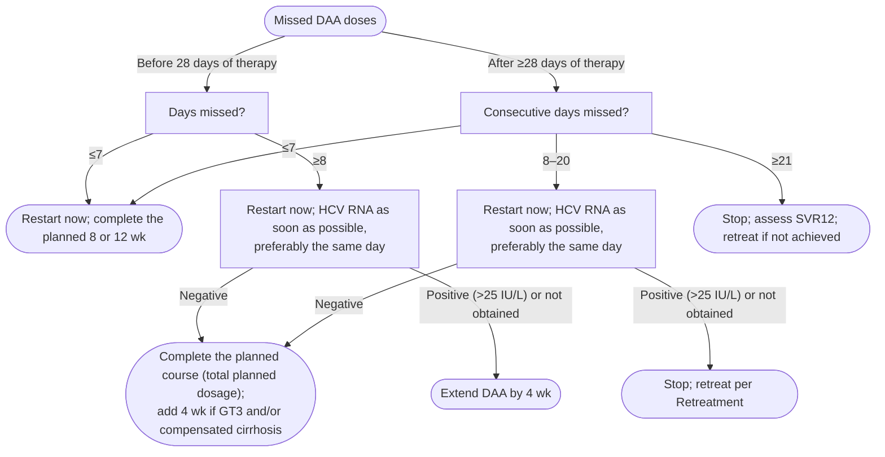

## Contents
- [[#Assessment]]
  - [[#Establishing the Diagnosis]]
  - [[#Severity Assessment]]
- [[#Differential Diagnosis]]
- [[#Diagnostics]]
- [[#Therapeutics]]
  - [[#Guiding Principle]]
  - [[#Treatment-Naive Without Cirrhosis or With Compensated Cirrhosis]]
  - [[#Treatment-Naive With Decompensated Cirrhosis]]
  - [[#Timing When HCC Is Present or Treated]]
  - [[#Incomplete Adherence Management]]
  - [[#Retreatment]]
  - [[#Children and Adolescents]]
  - [[#Posttransplant HCV]]
  - [[#SVR and Posttreatment Care]]

## Assessment

### Establishing the Diagnosis

Hepatitis C virus (HCV) infection. Recommendations below are the American Association for the Study of Liver Diseases–Infectious Diseases Society of America (AASLD-IDSA) 2023 guidance unless another source is cited; ratings (e.g. I, A) are the guidance's own, and it numbers no recommendations ([[aasld-idsa-2023-hcv]]).

**Who to test:**

| Population | Test | How often |
|---|---|---|
| All adults ≥18 y | HCV antibody with reflex HCV ribonucleic acid (RNA) | Universal screening (panel; no USPSTF grade given). Centers for Disease Control and Prevention (CDC) 2020 — at least once, except where prevalence <0.1%; US Preventive Services Task Force (USPSTF) 2020 — ages 18–79 |
| [[hepatitis-c-in-pregnancy\|Pregnant persons]] | Antibody → reflex RNA | Each pregnancy |
| People who inject drugs (PWID) with ongoing injection drug use (IDU) | HCV testing | Annually, whether never tested or previously negative |
| PWID with recent IDU after spontaneous clearance or cure | HCV RNA | At least annually |
| Men who have sex with men (MSM) not living with human immunodeficiency virus (HIV), on HIV pre-exposure prophylaxis (PrEP) | HCV testing | At PrEP start, then at least annually while on PrEP |
| High-risk sexually active MSM after cure or spontaneous clearance | HCV RNA | At least annually (and risk-based) |
| Jails and prisons; substance use disorder treatment and needle/syringe programs | Opt-out antibody → confirmatory RNA | Routine |

- **Antibody with reflex RNA** separates active infection from spontaneous or treatment-induced clearance.
- **Acute HCV (RNA-positive):** treat as chronic infection, without waiting for spontaneous clearance; abbreviated 6-week direct-acting antiviral (DAA) courses are **not** recommended.

### Severity Assessment

**Cirrhosis** — presumed if **any one** of (Figures 3–4 of [[aasld-idsa-2023-hcv]]):
- Fibrosis-4 index (FIB-4) >3.25 — (age [y] × aspartate aminotransferase [AST, U/L]) ÷ (platelets [10⁹/L] × √alanine aminotransferase [ALT, U/L])
- [[liver-stiffness-measurement|Transient elastography (FibroScan)]] >12.5 kPa
- [[noninvasive-liver-disease-assessment|Noninvasive serologic test]] (FibroSure, enhanced liver fibrosis test) above the test's proprietary cirrhosis cutoff
- Liver nodularity and/or splenomegaly on imaging, or platelets <150,000/mm³
- Prior [[liver-biopsy]] showing cirrhosis

**Decompensated cirrhosis = Child-Turcotte-Pugh (CTP) score ≥7 (class B or C)**, scored from [[ascites]], [[hepatic-encephalopathy|hepatic encephalopathy]], total bilirubin >2.0 mg/dL, albumin ≤3.5 g/dL, international normalized ratio (INR) ≥1.7; current **or prior** decompensation counts. Point table on [[cirrhosis]].

> [!pitfall] CTP is a point sum, not an any-one rule
> One abnormal variable does not make a patient decompensated — score the full table on [[cirrhosis]]. The CTP class decides whether NS3/4A protease inhibitors can be used.

**Vibration-controlled transient elastography (VCTE)** ([[aga-2017-elastography-liver-fibrosis]]):
- VCTE, if available, **rather than** the aspartate aminotransferase-to-platelet ratio index (APRI) or FIB-4 to detect cirrhosis — strong recommendation, moderate-quality evidence (sensitivity/specificity: VCTE 0.89/0.91, APRI 0.77/0.78, FIB-4 0.87/0.91).
- VCTE rather than magnetic resonance elastography (MRE) to detect cirrhosis — conditional, very-low quality (MRE 0.94/0.81: more false positives).
- **12.5 kPa cutoff** for cirrhosis — conditional, low quality (0.86/0.91); misclassifies <5% as not cirrhotic and <10% as cirrhotic. Interpret with other clinical information; don't base invasive tests (e.g. variceal screening endoscopy) on 12.5 kPa alone — that threshold is on [[liver-stiffness-measurement]].
- Unreliable with obesity (technical limit), acute hepatitis, alcohol abuse, food within 2–3 h, congestive heart failure, extrahepatic cholestasis. Stiffness often falls after cure.

---

## Differential Diagnosis

*Workup: see [[abnormal-liver-chemistries]].*

- ALT and/or AST still elevated after sustained virologic response (SVR) → assess for other causes of liver disease ([[aasld-idsa-2023-hcv]], Figures 4–5).
- [[chronic-hepatitis-b]], [[autoimmune-hepatitis]], [[alcohol-associated-liver-disease]], [[nafld-masld|MASLD]], [[drug-induced-liver-injury]]

---

## Diagnostics

**Pretreatment evaluation** — simplified algorithm (Figures 4–5 of [[aasld-idsa-2023-hcv]]):

| Item | No cirrhosis | Compensated cirrhosis |
|---|---|---|
| Fibrosis / liver function | FIB-4; assess for cirrhosis | CTP score; INR |
| Imaging | — | Liver ultrasound within 6 mo before treatment (exclude [[hepatocellular-carcinoma\|hepatocellular carcinoma (HCC)]] and subclinical ascites) |
| Labs | Complete blood count (CBC); hepatic function panel (total and direct bilirubin, albumin, ALT, AST); estimated glomerular filtration rate (eGFR) | Same |
| Virology | Quantitative HCV RNA; HIV antibody; hepatitis B surface antigen (HBsAg) | Same + **HCV genotype if treating with sofosbuvir/velpatasvir** |
| Medications | Reconciliation (prescription, over-the-counter, herbal/supplements); drug–drug interaction check (HCV Guidance table or University of Liverpool checker) | Same |
| Pregnancy | Serum pregnancy test; counsel on pregnancy risks of DAAs | Same |
| Education | DAA use and adherence, preventing reinfection, avoiding excess alcohol | Same |

- **Pretreatment genotyping** is not part of the no-cirrhosis algorithm.
- **Hepatitis B virus (HBV) reactivation** ([[aga-2025-hbv-reactivation]]): test HBsAg and antibody to hepatitis B core antigen (anti-HBc) before DAAs. HBsAg-positive = **high risk (>10%)** → antiviral prophylaxis (Rec 1, strong); HBsAg-negative/anti-HBc-positive = **low risk** → monitoring alone (Rec 3, conditional). Duration and monitoring: [[direct-acting-antivirals]] → HBV Reactivation Risk on DAA Therapy. HBsAg-positive patients are excluded from the simplified algorithm.
- **Advanced fibrosis (F3) or cirrhosis:** HCC surveillance imaging before starting DAAs ([[aga-2019-daa-hcc]], Best Practice Advice [BPA] 2).

---

## Therapeutics

### Guiding Principle

- **Treat everyone** with acute or chronic HCV, except those with a short life expectancy that cannot be remediated by HCV therapy, [[liver-transplantation|liver transplantation (LT)]], or other directed therapy.
- **Active or recent drug use, or concern for reinfection, is not a contraindication** to treatment.
- Drug details: [[direct-acting-antivirals]].

### Treatment-Naive Without Cirrhosis or With Compensated Cirrhosis

**Simplified treatment algorithm** — eligibility (Figure 3 of [[aasld-idsa-2023-hcv]]):

| Eligible (adults, incl. people living with HIV) | Excluded |
|---|---|
| Any genotype | Prior HCV treatment |
| No prior HCV treatment | HBsAg-positive |
| No cirrhosis, or compensated cirrhosis (CTP A) by the criteria under [[#Severity Assessment]] | Compensated cirrhosis with end-stage renal disease (eGFR <30 mL/min/m²) |
| | Current or prior decompensated cirrhosis (CTP ≥7) |
| | Current pregnancy |
| | Known or suspected HCC |
| | Prior LT |

- **Regimens:** glecaprevir 300 mg/pibrentasvir 120 mg (G/P) with food × **8 wk**, or sofosbuvir 400 mg/velpatasvir 100 mg (SOF/VEL) × **12 wk**. Compensated cirrhosis: G/P for genotypes (GT) 1–6; SOF/VEL for GT 1, 2, 4, 5, 6 only.
- **On treatment:** watch for hypoglycemia on diabetes drugs and for subtherapeutic INR on warfarin; no other lab monitoring (no cirrhosis). Compensated cirrhosis: also monitor for liver injury (decompensation is rare); refer to a specialist for worsening liver tests, jaundice, ascites, encephalopathy or new liver symptoms.
- **Evidence (MINMON trial):** no pretreatment genotyping, whole course dispensed at entry, no scheduled on-treatment visits or labs, remote contact at week 4 (adherence) and **week 22 to schedule SVR assessment at week 24** — SVR 95%.

**Full initial-regimen table** (Table 1):

| Regimen | GT | Class | Duration | Rating | Caveats |
|---|---|---|---|---|---|
| G/P | 1–6 | Recommended | 8 wk | I, A (I, B compensated cirrhosis) | — |
| SOF/VEL | 1–6 | Recommended | 12 wk | I, A (I, B GT 5–6) | GT3 + compensated cirrhosis: NS5A resistance-associated substitution (RAS) testing; Y93H present → add weight-based ribavirin (RBV) or another recommended regimen |
| Ledipasvir/sofosbuvir (LDV/SOF) | 1, 4, 5, 6 | Recommended | 12 wk | I, A (IIa, B GT 5–6, and GT4 + compensated cirrhosis) | Not for GT6e if subtype known |
| LDV/SOF | 1, no cirrhosis | Recommended | 8 wk | I, B | Not living with HIV and HCV RNA <6 million IU/mL |
| Elbasvir/grazoprevir (EBR/GZR) | 1b, 4 | Recommended | 12 wk | I, A (IIa, B GT4 + compensated cirrhosis) | — |
| EBR/GZR | 1a | Alternative | 12 wk | I, A | NS5A RAS testing; RAS at position 28, 30, 31 or 93 → another recommended regimen |
| SOF/VEL + weight-based RBV | 3 | Alternative | 12 wk | IIa, A | GT3 + compensated cirrhosis + baseline NS5A Y93 RAS |
| SOF/VEL/voxilaprevir (VOX) | 3 (per caveat) | Alternative | 12 wk | IIa, B | GT3 + compensated cirrhosis + baseline NS5A Y93 RAS |

### Treatment-Naive With Decompensated Cirrhosis

NS3/4A protease inhibitors (glecaprevir, grazoprevir, voxilaprevir) cannot be used in decompensated cirrhosis.

| Regimen | GT | Duration | Rating | Notes |
|---|---|---|---|---|
| SOF/VEL + weight-based RBV | 1–6 | 12 wk | I, A | Low initial RBV dose (600 mg) for CTP class C; increase as tolerated |
| SOF/VEL | 1–6 | 24 wk | I, A | RBV-ineligible |
| LDV/SOF + weight-based RBV | 1, 4, 5, 6 | 12 wk | I, A | Low initial RBV dose (600 mg) for CTP class C; increase as tolerated |
| LDV/SOF | 1, 4, 5, 6 | 24 wk | I, A | RBV-ineligible |

All Recommended; GT6 data (SOF/VEL) and GT 5–6 data (LDV/SOF) come only from compensated cirrhosis (Table 1).

**HCV-triggered [[acute-on-chronic-liver-failure|acute-on-chronic liver failure (ACLF)]]:** start antiviral therapy as soon as possible, preferably within 24 h of confirmation (Statement 33); pangenotypic DAAs, avoiding protease inhibitor regimens; no routine on-treatment RNA — judge response by SVR 12 weeks after treatment (SVR12); DAAs before or after LT depending on severity and transplant timing ([[aasld-easl-2026-aclf-global-consensus]]).

### Timing When HCC Is Present or Treated

([[aga-2019-daa-hcc]]; recurrence data on [[direct-acting-antivirals]] → DAAs and HCC)

- **Active HCC eligible for resection or ablation** → defer DAAs until HCC treatment is completed (BPA 7). Active HCC slightly lowers SVR (BPA 6).
- **Complete response to HCC therapy** → do not withhold DAAs; they **can be** deferred 4–6 mo to confirm response (BPA 11). No conclusive data that DAAs raise or lower recurrence (BPA 10).
- **Listed for LT with HCC** → timing by regional median wait times, availability of HCV-positive organs, and degree of liver dysfunction (BPA 8).
- **Active intermediate or advanced HCC** → decide on tumor burden, liver dysfunction, life expectancy and preference (BPA 9).

### Incomplete Adherence Management

Applies to treatment-naive patients without cirrhosis or with compensated cirrhosis on G/P or SOF/VEL; others → manage with an HCV specialist.

*Management of DAA treatment interruptions*
*Source: redrawn from Figure 2 of the AASLD-IDSA 2023 HCV guidance*
*[[aasld-idsa-2023-hcv|AASLD-IDSA 2023 Hepatitis C Guidance]]*
*DAA = direct-acting antiviral · HCV = hepatitis C virus · RNA = ribonucleic acid · GT3 = genotype 3 · SVR12 = sustained virologic response 12 weeks after treatment*

- Restarting takes precedence over drawing the RNA.
- "Total planned dosage" = total number of daily pills (10 days missed of an 8-wk course → 8 wk + 10 days).

### Retreatment

Adults, by prior exposure (Table 2); all GT 1–6 unless stated.

| Prior failure | Regimen | Class | Duration | Rating | Caveats |
|---|---|---|---|---|---|
| Sofosbuvir-based; no cirrhosis or compensated | SOF/VEL/VOX | Recommended | 12 wk | I, A | GT3 + compensated cirrhosis: add weight-based RBV if no contraindication |
| | G/P (GT 1, 2, 4, 5, 6) | Alternative | 16 wk | I, A | Not after an NS5A inhibitor + NS3/4A protease inhibitor regimen (e.g. EBR/GZR); not for GT3 with prior sofosbuvir/NS5A exposure |
| G/P; no cirrhosis or compensated | G/P + sofosbuvir + weight-based RBV | Recommended | 16 wk | IIa, B | — |
| | SOF/VEL/VOX | Recommended | 12 wk | IIa, B | Compensated cirrhosis: add weight-based RBV (IIa, C) |
| SOF/VEL/VOX or sofosbuvir + G/P; no cirrhosis or compensated | G/P + sofosbuvir + weight-based RBV | Recommended | 16 wk | IIa, B | Consider 24 wk in extremely difficult cases (e.g. GT3 + compensated cirrhosis) or after sofosbuvir + G/P failure |
| | SOF/VEL/VOX + weight-based RBV | Recommended | 24 wk | IIa, B | — |
| Sofosbuvir- or NS5A inhibitor-based; **decompensated** | SOF/VEL + weight-based RBV | Recommended | 24 wk | II, C | Low initial RBV dose (600 mg) for CTP class C; increase as tolerated |
| | LDV/SOF + weight-based RBV (GT 1, 4, 5, 6) | Recommended | 24 wk | II, C | Same RBV dosing |

### Children and Adolescents

- **Treat all HCV-infected children and adolescents ≥3 y** with an approved DAA regimen, regardless of disease severity.
- **Initial (no cirrhosis or compensated; Table 3):** G/P 8 wk (GT 1–6), SOF/VEL 12 wk (GT 1–6), LDV/SOF 12 wk (GT 1, 4, 5, 6) — all Recommended, I, B.
- **Retreatment** uses its own table (Table 4; all Recommended, I, C):

| Prior failure | Regimen (GT) | Duration | Cirrhosis status |
|---|---|---|---|
| Interferon (±RBV) and/or sofosbuvir, no NS3/4A or NS5A inhibitor | G/P (1, 2, 4, 5, 6) | 8 wk | None |
| | G/P (1, 2, 4, 5, 6) | 12 wk | Compensated |
| | G/P (3) | 16 wk | None or compensated |
| | SOF/VEL (1–6) | 12 wk | None or compensated |
| | SOF/VEL + weight-based RBV (1–6) | 12 wk | Decompensated |
| NS3/4A inhibitor, no NS5A | G/P (1–6) | 12 wk | None or compensated |
| NS5A inhibitor, no NS3/4A | G/P (1–6) | 16 wk | None or compensated |
| Interferon (±RBV) + HCV protease inhibitor | LDV/SOF (4, 5, 6) | 12 wk | None or compensated |
| | LDV/SOF (1) | 12 wk | None |
| | LDV/SOF (1) | 24 wk | Compensated |

### Posttransplant HCV

**Recurrent HCV after liver or kidney transplant** (Table 5; all 12 wk):

| Setting | Recommended (rating) | Alternative |
|---|---|---|
| Post-liver, no cirrhosis | G/P (I, B); SOF/VEL (I, B); LDV/SOF GT 1, 4, 5, 6 (I, B) | — |
| Post-liver, compensated cirrhosis | SOF/VEL (I, B); G/P (I, C); LDV/SOF GT 1, 4, 5, 6 (I, A) | — |
| Post-kidney, no or compensated cirrhosis | G/P (I, A no cirrhosis; IIa, C compensated); SOF/VEL (IIa, C); LDV/SOF GT 1, 4, 5, 6 (I, A) | EBR/GZR GT 1, 4 (I, B), only without baseline NS5A RASs |

- **Drug interactions:** cyclosporine ([[calcineurin-inhibitors]]) raises EBR/GZR and SOF/VEL/VOX exposure — do not coadminister; G/P with cyclosporine >100 mg/d not recommended.

**HCV-uninfected recipient of an HCV-viremic donor organ** (all I, C):

| Graft | Regimen | Start |
|---|---|---|
| Liver | G/P 12 wk or SOF/VEL 12 wk | Within the first 2 wk posttransplant, preferably within the first week |
| Non-liver | G/P 8 wk (12 wk if started after the first week) or SOF/VEL 12 wk | Before HCV RNA results: immediately pretransplant or day 0 if possible; otherwise day 0 to within the first week, when clinically stable |

- Non-liver grafts: recipient viremia need not be shown before starting. Abbreviated durations are not recommended outside a trial.
- Transplant centers should have specific HCV consent and follow-up; detail on [[liver-transplantation]].

### SVR and Posttreatment Care

**Confirm cure:** quantitative HCV RNA and hepatic function ≥12 wk after treatment ends — undetectable RNA = SVR (virologic cure).

**Follow-up** (Figures 4–5 of [[aasld-idsa-2023-hcv]]):

| | No cirrhosis | Compensated cirrhosis |
|---|---|---|
| Everyone | Advise against excess alcohol | Advise abstinence from alcohol; ultrasound ± alpha-fetoprotein every 6 mo; varices per AASLD guidance ([[portal-hypertension]]) |
| Cure achieved | No follow-up; if at reinfection risk, counsel and test HCV RNA annually or with raised ALT/AST | Same reinfection testing |
| Cure not achieved | Refer for retreatment; until then, hepatic function panel, CBC and INR every 6–12 mo | Same + creatinine |

**[[hcc-surveillance|HCC surveillance]] after SVR** ([[aga-2019-daa-hcc]]):
- **F3 or cirrhosis at the time of DAA treatment** → stay in surveillance (BPA 3): ultrasound ± alpha-fetoprotein every 6 mo (BPA 4), **indefinitely** if eligible for potentially curative therapy (BPA 5).
- Why: residual HCC risk after SVR with cirrhosis is at or above the cost-effectiveness threshold, highest with CTP class B (3.6–7.8% in the first year) — rates on [[direct-acting-antivirals]] → DAAs and HCC.
- **Complete response to prior HCC** → dynamic contrast-enhanced computed tomography (CT) or magnetic resonance imaging (MRI) every 3–6 mo, indefinitely (BPA 12).

**Post-SVR VCTE <9.5 kPa** rules out advanced fibrosis (F3–F4) in noncirrhotic patients and may support discharge from a liver clinic — conditional, very-low quality (sensitivity 0.78/specificity 0.86); misses ~1% of low-risk and ~7% of high-risk patients (obesity, diabetes, excess alcohol, HIV or HBV co-infection) ([[aga-2017-elastography-liver-fibrosis]]). Patients who value avoiding the small HCC risk may stay in specialty care.

> [!pitfall] Low post-SVR stiffness does not stop HCC surveillance
> Surveillance follows fibrosis stage at the time of DAA treatment (F3 or cirrhosis); 9.5 kPa is a clinic-discharge threshold for noncirrhotic patients only ([[aga-2019-daa-hcc]], [[aga-2017-elastography-liver-fibrosis]]).

---

## See Also

[[chronic-hepatitis-b]], [[direct-acting-antivirals]], [[portal-hypertension]], [[hepatocellular-carcinoma]], [[hcc-surveillance]], [[liver-transplantation]], [[acute-on-chronic-liver-failure]], [[liver-disease-in-pregnancy]], [[hepatitis-c-in-pregnancy]], [[aki-in-cirrhosis]], [[hepatic-encephalopathy]], [[ascites]], [[variceal-upper-gi-bleeding]], [[abnormal-liver-chemistries]], [[noninvasive-liver-disease-assessment]], [[autoimmune-hepatitis]], [[alcohol-associated-liver-disease]], [[nafld-masld]], [[drug-induced-liver-injury]], [[cirrhosis]], [[liver-biopsy]], [[liver-stiffness-measurement]], [[obesity]], [[calcineurin-inhibitors]]

---

## Sources

1. [[aasld-idsa-2023-hcv|AASLD-IDSA 2023 Hepatitis C Guidance Update]]
2. [[aasld-idsa-2011-hcv-genotype1|AASLD 2011: Treatment of Genotype 1 Chronic HCV (historical — boceprevir/telaprevir era)]]
3. [[aga-2025-hbv-reactivation|AGA Clinical Practice Guideline: Prevention and Treatment of HBV Reactivation (2025)]]
4. [[aga-2019-daa-hcc|AGA Clinical Practice Update on Interaction Between Oral Direct-Acting Antivirals for Chronic Hepatitis C Infection and Hepatocellular Carcinoma: Expert Review (2019)]]
5. [[aga-2017-elastography-liver-fibrosis|American Gastroenterological Association Institute Guideline on the Role of Elastography in the Evaluation of Liver Fibrosis (2017)]]
6. [[aasld-easl-2026-aclf-global-consensus|AASLD/EASL/APASL/ALEH/SOLDA 2026 Global Multisociety Consensus on ACLF Definitions]]
