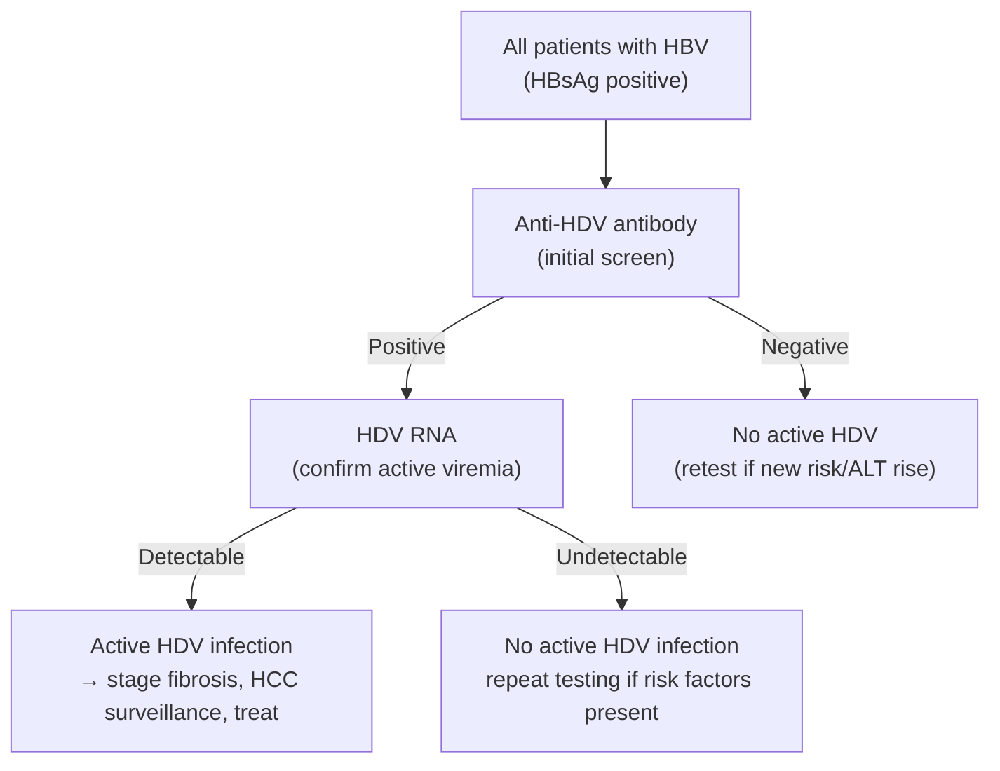
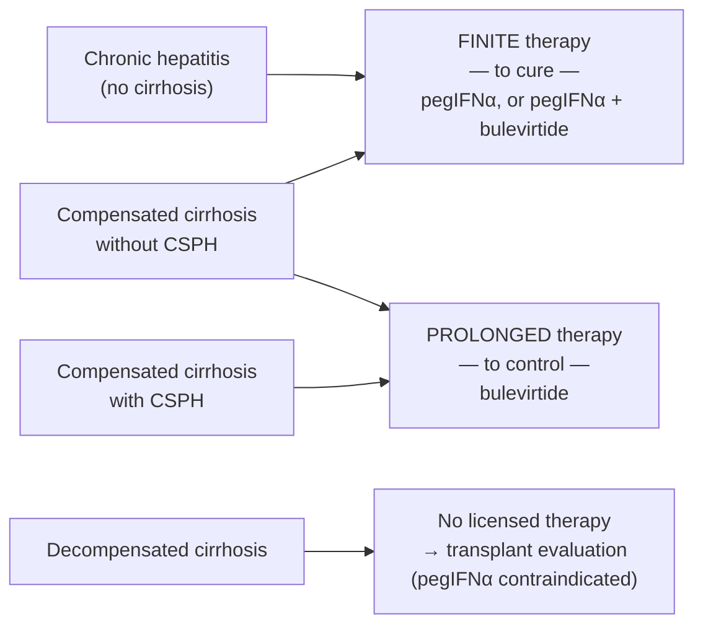

Hepatitis delta virus (HDV) is a defective RNA virus that occurs **only in the setting of [[chronic-hepatitis-b|hepatitis B virus (HBV)]] infection** (it requires hepatitis B surface antigen [HBsAg] to assemble), as coinfection or superinfection. Concurrent HDV is a **particularly aggressive** infection — it substantially increases the risk of [[cirrhosis]], [[hepatocellular-carcinoma|hepatocellular carcinoma (HCC)]], and liver-related mortality versus HBV monoinfection [[aga-2025-hepatitis-delta]].

**Excess risk vs chronic hepatitis B (CHB) alone** (viremic HDV, risk ratio): decompensated cirrhosis **3.8×** · liver-related mortality **3.8×** · HCC **3.0×** · compensated cirrhosis **1.7×** — the basis for universal screening and surveillance below.

---

## Contents
- [[#Assessment]]
  - [[#Establishing the Diagnosis]]
  - [[#Severity Assessment]]
- [[#Differential Diagnosis]]
- [[#Diagnostics]]
- [[#Therapeutics]]
  - [[#Who to Treat]]
  - [[#Choosing the Strategy]]
  - [[#Current (US-available)]]
  - [[#Emerging / investigational]]
  - [[#Monitoring On and After Treatment]]
  - [[#Liver Transplantation]]
- [[#See Also]]
- [[#Sources]]

---

## Assessment

### Establishing the Diagnosis

- **Two patterns:**
  - **Coinfection** — simultaneous acute HBV + HDV; usually self-limited, low chronicity.
  - **Superinfection** — HDV acquired on existing [[chronic-hepatitis-b|chronic hepatitis B]]; high rate of chronic HDV, accelerated fibrosis, may present as a flare/decompensation.
- **Who to test — universal screening (American Gastroenterological Association [AGA] 2025):** test **all patients with HBV/HBsAg** for HDV (aligns with European Association for the Study of the Liver [EASL], Asian Pacific Association for the Study of the Liver [APASL], World Health Organization [WHO] 2024; one-time universal testing is cost-effective). *This extends beyond prior American Association for the Study of Liver Diseases (AASLD) risk-based testing.*
- **Superseded: prior AASLD risk-based testing** — restricted to [[chronic-hepatitis-b|CHB]] patients who were human immunodeficiency virus (HIV)-positive, people who inject drugs (PWID), men who have sex with men, at risk of sexually transmitted disease, or immigrants from high-endemicity areas, plus CHB with persistently low HBV DNA + elevated alanine aminotransferase (ALT). It did not improve real-world testing (10.7% of a 41,658-veteran HBsAg-positive cohort tested, no difference among those meeting criteria), and **60% of cases found by universal reflex testing had no conventional risk factor**. Where risk *is* present, anti-HDV prevalence runs ~15% (HIV), 30% (institutionalised), up to 67% (PWID).
- **Retest** patients with ongoing risk behaviors, residence in high-prevalence areas, or new liver test elevation / hepatic decompensation.
  - **EASL 2023 names the triggers:** re-test **whenever clinically indicated** — aminotransferase flares, or acute decompensation of chronic liver disease (strong); **yearly** in those remaining at risk (weak) [[easl-2023-hepatitis-delta]].
  - **Reflex testing works:** automated anti-HDV on every HBsAg-positive result raised HDV diagnoses **5-fold**; 60% of those found had **no conventional risk factor** and 60% had **advanced fibrosis**.

### Severity Assessment

- Assess for **cirrhosis** with **imaging and** [[noninvasive-liver-disease-assessment|noninvasive testing]] — **[[liver-stiffness-measurement|vibration-controlled transient elastography (VCTE)]]** is most accurate (area under the receiver operating characteristic curve [AUROC] 0.90) vs **Fibrosis-4 index (FIB-4)** 0.88 and aspartate aminotransferase-to-platelet ratio index (APRI) 0.83.
  - **VCTE ≥14.0 kPa** for cirrhosis in HDV: sensitivity 0.78, specificity 0.86, **negative predictive value (NPV) 0.93, positive predictive value (PPV) 0.64**.
- **Liver biopsy is recommended when it would change management, or to grade and stage when clinical or imaging signs of cirrhosis are absent** (EASL 2023, strong). Routine follow-up biopsies are not recommended outside trials.

> [!pitfall] Don't stage hepatitis D off a stiffness number
> EASL 2023 states plainly that **NIT cut-offs are not established in chronic hepatitis D (CHD)** — the necro-inflammation that characterises CHD inflates stiffness and defeats fibrosis scores. **53% of 230 patients** with biopsy-proven cirrhosis were misclassified by fibrosis scores (29% by elastography); score sensitivity for cirrhosis ran 13–31%. Elastography **rules out better than it rules in**. The CHD-specific **delta-4 fibrosis score (D4FS)** (elastography + gamma-glutamyltransferase [GGT] + platelets + ALT, AUROC 0.94) is promising but unvalidated ([[easl-2023-hepatitis-delta]]).

- **Factors marking higher risk of progression** (EASL 2023, strong): elevated aminotransferases and GGT · advanced stage of liver disease · **persistent HDV viraemia** · high HBV DNA · viral coinfections ([[hepatitis-c]], HIV). Modifiable cofactors to address: **alcohol, obesity, diabetes**.
- **[[hcc-surveillance|HCC surveillance]] in all HDV patients** given elevated risk, **independent of cirrhosis status** ([[aasld-idsa-2025-chb-treatment]]; HCC incidence 18.65 vs 4.84 per 1,000 person-years vs monoinfection). See [[hepatocellular-carcinoma]].
  - Surveillance = **abdominal ultrasound every 6 months**; alpha-fetoprotein optional; computed tomography or contrast-enhanced magnetic resonance imaging where ultrasound is technically inadequate.
  - *EASL 2023 restricted surveillance to advanced fibrosis (bridging fibrosis, METAVIR F3 or Ishak 4–5) or cirrhosis (METAVIR F4, Ishak 6). The newer AASLD-IDSA 2025 position is broader and is what this page follows.*

---

## Differential Diagnosis

*Workup: see [[abnormal-liver-chemistries]]; HDV itself is confirmed serologically/virologically — see Diagnostics.*

- [[chronic-hepatitis-b|Chronic hepatitis B]] monoinfection (HDV requires HBV — always coexists)
- [[hepatitis-c]]
- [[autoimmune-hepatitis]]
- [[alcohol-associated-liver-disease|Alcohol-associated]] / [[nafld-masld|metabolic]] liver disease
- [[drug-induced-liver-injury|Drug-induced liver injury]]

---

## Diagnostics

**Testing cascade (AGA 2025):**

- **Initial test:** anti-HDV antibody. **~50–70% of anti-HDV–positive patients have detectable HDV RNA** (active infection).
- **Confirm viremia:** reflex **HDV RNA** in all anti-HDV–positive patients. **Double-reflex** laboratory protocols (anti-HDV on all HBsAg+, HDV RNA on all anti-HDV+) dramatically raise cascade completion (anti-HDV testing 8% → 93% with automated reflex).
- ⚠ **One HDV RNA result does not settle status.** Levels fluctuate and may become transiently undetectable, so **repeat testing 3–6 months apart** is required to call clearance rather than fluctuation ([[easl-2023-hepatitis-delta]]).
- **Not advised:** HDV antigen (detectable only ~2 weeks in *acute* infection; immune-complexed and undetectable in chronic) and anti-HDV IgM (tracks disease activity, **not** replication).
- **Which HBV markers to send alongside** (EASL 2023, strong):
  - **Acute hepatitis → anti-HBc IgM**, to separate HBV/HDV **coinfection** (high anti-HBc IgM) from HDV **superinfection** of chronic HBV (absent or low anti-HBc IgM). In superinfection HBV replication is often suppressed.
  - **HBeAg/anti-HBe status and HBV DNA level** in all — active HBV worsens the outcome of hepatitis D, and drives the nucleos(t)ide analogue (NA) decision below.
- US HDV RNA testing is **send-out** (Quest, ARUP, LabCorp, Mayo Clinic Laboratories, Centers for Disease Control and Prevention).

> [!pitfall] Track HDV RNA in one lab, with one assay, in IU/mL
> Assays are not comparable: in the World Health Organization quality-control exercise only **46.3% of 28 laboratories** quantified the panel properly, and African sub-genotype 1 and genotypes 5–8 are under-estimated by several commercial assays. Serial monitoring must use **the same assay in the same laboratory**, reported in **IU/mL** ([[easl-2023-hepatitis-delta]]).

---

## Therapeutics

### Who to Treat

- **Consider antiviral treatment in every patient with CHD** ([[easl-2023-hepatitis-delta]], strong). **No HDV RNA or ALT threshold gates the decision** — the driver of progression is persistence of viral replication, and cirrhosis develops subclinically in patients with mild but long-lasting necro-inflammation. The choice is then individualised.
  - *This resolves a long-standing ambiguity: AASLD hepatitis B guidance frames the indication as "elevated HDV RNA **and** elevated ALT" without quantifying either ([[aga-2025-hepatitis-delta]]). EASL uses no threshold, so the missing numbers do not gate treatment.*
- **Decompensated cirrhosis → evaluate for [[liver-transplantation|liver transplantation]]** (strong) — no licensed therapy exists and peg-IFN is contraindicated.
- **HCC present → treat the HCC first** (including transplantation); antiviral therapy is individualised (weak).
- **Mild disease (F0–F1):** weigh interferon toxicity against the agents in development before committing.

### Choosing the Strategy

Two approaches, selected mainly by **stage of liver disease**:

*Figure 3 recreated — [[easl-2023-hepatitis-delta]]. CSPH = clinically significant [[portal-hypertension|portal hypertension]].*

- **Other factors that shift the schedule:** phase of HBV infection (HBeAg/anti-HBe status, HBV DNA and HBsAg levels) · interferon contraindication or intolerance · the patient's own wishes and likely compliance.
- In compensated cirrhosis being considered for peg-IFN, **look specifically for CSPH and [[variceal-upper-gi-bleeding|oesophageal varices]]** — major adverse events are commoner in that subset.

### Current (US-available)

**Endpoint definitions** (FDA-specified; used by every trial cited here): **on-treatment response** = ≥2-log decline in HDV RNA **and/or** ALT normalization · **sustained virological response (SVR)** = **undetectable HDV RNA off treatment** (for pegylated interferon [peg-IFN], at 6 months post-treatment).

- **Pegylated interferon-α (peg-IFN-α-2a/2b)** — the **only US-available** therapy; weekly subcutaneous (SC).
  - **Consider in all CHD with compensated liver disease, cirrhotic or not** ([[easl-2023-hepatitis-delta]], strong).
  - **Dose — off-label, borrowed from the hepatitis B regimen.** [[peginterferon-alfa-2a]] is **not labelled for HDV at all**; its indications are chronic hepatitis C and [[chronic-hepatitis-b|chronic hepatitis B (CHB)]]. The labelled adult CHB regimen is **180 mcg subcutaneously once weekly for 48 weeks** ([[pegasys-2023-peginterferon-alfa-2a-label]]).
  - **Duration: 48 weeks is the preferred schedule** (EASL 2023, strong); durations may be personalised on HDV RNA and HBsAg kinetics and tolerability (weak). ⚠ AASLD's HDV course is **12 months**; no document reconciles the two.
    - **Prolonging beyond 48 weeks** (to 2 years) raised virologic response in some studies but **did not improve liver histology in most patients** — reserve for good compliance with a slow virologic response or a progressive HBsAg decline.
  - 48-week SVR **23%–57%** (undetectable HDV RNA + normal ALT in 21%–50% at 48 wk). **Relapse ~50%** even after prolonged therapy, up to **9–10 years** after completing therapy. Responders have improved survival and fewer liver-related events — *the benefit survives the relapse*.
  - **Combining with an NA or ribavirin does not improve the virologic response.**
  - **Contraindicated** in **decompensated cirrhosis** and in major extrahepatic disease; significant **neuropsychiatric and hematologic** toxicity limits use. *Contraindications, the boxed warning, cytopenia/renal/ALT/depression dose modifications, monitoring and the colitis and pancreatitis stop rules: [[peginterferon-alfa-2a]].*

> [!pearl] Week 24 on peg-IFN tells you whether to continue
> Undetectable HDV RNA at **week 24** had a **positive predictive value of 100%** for virologic response 24 weeks post-treatment. A **<1 log decline at the end of therapy** predicted non-response (sensitivity 67%, specificity 85%, **NPV 91%**). Secondary separators at week 24: **HBsAg <1,000 IU/mL**, and a **1.61 log HDV RNA decline** (AUROC 0.791). Formal futility rules are still under investigation ([[easl-2023-hepatitis-delta]]).

- **Nucleos(t)ide analogue** — controls HBV only; **no efficacy against HDV**. See [[chronic-hepatitis-b]]. Famciclovir, lamivudine, clevudine, entecavir, adefovir and tenofovir have all been tried for 6–12 months and were ineffective; **NAs are not part of therapy aimed at controlling CHD**.
  - Give an NA only when **HBV replication independently warrants control** — EASL 2023 prints three triggers (all strong):

| Setting | HBV DNA required | Give NA? |
|---|---|---|
| **Decompensated cirrhosis** | **any — detectable or not** | **Yes** |
| **Compensated cirrhosis** | **detectable** | **Yes** |
| **No cirrhosis** | **>2,000 IU/mL** | **Yes** |

  - *AASLD says only to add an NA "if HBV DNA is elevated", with no cut-point ([[aga-2025-hepatitis-delta]]); the numbers above are EASL's.*
  - **Start an NA when bulevirtide is stopped**, or if HBV replication relapses — blocking entry of both viruses leaves the patient exposed to HBV reactivation on discontinuation.
- **After treatment:** close ongoing laboratory *and* imaging surveillance, given the ~50% relapse rate.

### Emerging / investigational

*What to refer for, and how to access it. Trial-by-trial efficacy: [[aga-2025-hepatitis-delta]] Table 1.*

| Agent | Mechanism / route | Access status |
|---|---|---|
| **Bulevirtide** (Gilead) | NTCP (sodium taurocholate co-transporting polypeptide) blocker — blocks viral entry; **daily SC** | **EMA-approved 2 mg since 2020**; **not FDA-approved** — US access is the **10 mg expanded-access program** for chronic HDV with **compensated cirrhosis** (NCT06780579) |
| **Bulevirtide + peg-IFN** | Combination; finite duration | Phase 2b. Best finite-therapy signal so far — **46% undetectable HDV RNA 24 wk post-treatment** vs 12% with bulevirtide alone |
| **Tobevibart + elebsiran** (VIR) | Anti-HBsAg monoclonal antibody + small interfering RNA (siRNA); 2 SC injections every 2–4 wk | Phase 3 (SOLSTICE; global **ECLIPSE** enrolling) — **100% ≥2-log HDV RNA decline** at 24 wk |
| **Brelovitug (BJT-778)** | Anti-HBsAg monoclonal antibody; SC every 1–4 wk | Phase 2b/3 |
| **Lonafarnib** | Farnesyltransferase (prenylation) inhibitor; **oral twice daily**, ± ritonavir ± peg-IFN-α-2a | Phase 3; weakest responses of the group (10–19% at 48 wk) |
| **Nucleic acid polymer (REP2139)** | Blocks HBV subviral particle assembly | Phase 2 / compassionate use in Europe |
| **Peg-IFN-λ** | Liver-targeted peg-IFN; weekly SC | **Phase 3 discontinued** — do not seek |

**Bulevirtide — practical points where it is available** ([[easl-2023-hepatitis-delta]]):

- **Consider in all CHD with compensated liver disease** (strong). **Optimal dose and duration are formally undefined**; until data arrive, **2 mg once daily subcutaneously, long-term** (weak) — EMA authorisation is conditional on **maintaining treatment until clinical benefit is observed**. **2 mg, not 10 mg:** it does not saturate the bile acid transporter, and phase III found **no efficacy advantage for 10 mg**.
- **Combination with peg-IFN may be considered** without interferon intolerance or contraindications (weak), preferably within a protocol.
- **Stopping means relapse:** 89% of virologic responders relapsed, with **aminotransferase flares in 22%** — hence long-term therapy and the dense post-stop monitoring below.
- ⚠ **Total bile acids rise in essentially everyone** — transient and dose-related (median up to **20 µmol/L on 2 mg**, **80 µmol/L on 10 mg**) and **symptomless, including no pruritus**. Do not mistake it for drug-induced cholestasis.
- ⚠ **Interactions:** bulevirtide partially inhibits **OATP1B1/OATP1B3** at higher doses (not usually reached at 2 mg SC) — where possible avoid co-administering transporter substrates, including **fluvastatin, atorvastatin, pravastatin, rosuvastatin and thyroid hormones**. With tenofovir it reduced clearance of the CYP3A substrate midazolam.

### Monitoring On and After Treatment

*Intervals are EASL 2023's; they differ by strategy because peg-IFN relapse is late and bulevirtide relapse is early.*

| | **On treatment** | **Peg-IFN, after a finite course** | **After stopping bulevirtide** |
|---|---|---|---|
| **HDV RNA** | every 6 mo (+ any clinical indication) | end of treatment (EOT), 6 and 12 mo, then yearly | at stop, then 1, 3, 6, 12 mo, then yearly |
| **HBsAg** | yearly (quantitative every 6 mo on peg-IFN) | yearly; quantitative every 12 mo | yearly |
| **HBV DNA** | every 6 mo if **not** on an NA | every 6 mo | more frequently than 6 mo |
| **Aminotransferases, blood count, liver function tests** | at least every 3–6 mo | EOT, ≥6 and 12 mo, then yearly | at stop, then ≥1, 3, 6, 12 mo |
| **Liver stiffness** | yearly (weak) | yearly | yearly |

- **Peg-IFN specifics:** aminotransferases every **4 weeks for the first 12 weeks**, then every **6–8 weeks**; post-treatment weeks 24 and 48, with extra checks at weeks 4, 8 and 12 by disease stage. Complete blood count on the standard interferon schedule.
- **Bulevirtide specifics:** aminotransferases every **12 weeks**; blood count at least every **3 months**. After stopping, concentrate monitoring in the **first 6 months** to catch the ALT flare of recurrent HDV replication.
- ⚠ **Rising stiffness on peg-IFN can be the drug, not the disease** — interferon-driven immune activation raises it; on bulevirtide it falls by weeks 24–48. Significance of both uncertain.
- **Investigate an unexplained ALT flare on interferon with biopsy** — it may be treatment-triggered [[autoimmune-hepatitis]], needing corticosteroids rather than a dose change (anti-liver-kidney microsomal [LKM]-3 antibodies in up to 13% of CHD).
- **HBcrAg and HBV RNA are not recommended** in routine CHD practice.
- **In advanced fibrosis or cirrhosis, follow-up continues even after HDV RNA clears** — liver disease still progresses, and HBV can relapse once HDV is suppressed.

### Liver Transplantation

- **Liver failure, not HCC, is the usual indication** in CHD — the reverse of [[chronic-hepatitis-b|CHB]]. Outcomes are excellent.
- **Prophylaxis = hepatitis B immunoglobulin (HBIG) + a high-genetic-barrier NA**, combined (strong). **NA monoprophylaxis is not acceptable** here: the small HBsAg-recurrence risk tolerated in HBV monoinfection is not tolerable when HDV is present.
  - **Early period** (dose not formally defined; most experienced centres): **HBIG 10,000 IU IV in the anhepatic phase → 600–1,000 IU IM/IV daily × 7 days → weekly × 3 weeks → monthly until month 3–6.**
  - **After 6 months:** dose HBIG to maintain **anti-HBs >100 mIU/mL** (strong).
  - **NA choice: entecavir or tenofovir alafenamide preferred**; avoid tenofovir disoproxil fumarate where possible — its nephrotoxicity risk is exacerbated by concomitant calcineurin inhibitors.
- Indefinite HBIG + NA is the current gold standard; **evidence on stopping HBIG after 1–2 years is still accumulating**. Intrahepatic HDV recurs in >70% of grafts, but without HBV re-infection causes no progressive disease.

---

## See Also

[[chronic-hepatitis-b]], [[peginterferon-alfa-2a]], [[hepatitis-c]], [[hepatocellular-carcinoma]], [[hcc-surveillance]], [[abnormal-liver-chemistries]], [[noninvasive-liver-disease-assessment]], [[autoimmune-hepatitis]], [[drug-induced-liver-injury]], [[alcohol-associated-liver-disease]], [[nafld-masld]], [[liver-transplantation]], [[nutrition-in-liver-disease]], [[liver-stiffness-measurement]], [[cirrhosis]], [[portal-hypertension]]

---

## Sources

1. [[aga-2025-hepatitis-delta|AGA Clinical Practice Update on Management of Hepatitis Delta: Commentary (2025)]]
2. [[easl-2023-hepatitis-delta|EASL Clinical Practice Guidelines on hepatitis delta virus (2023)]]
3. [[aasld-idsa-2025-chb-treatment|AASLD-IDSA Hepatitis B Guidance: Treatment of Chronic Hepatitis B (2025)]]
4. [[pegasys-2023-peginterferon-alfa-2a-label|PEGASYS (Peginterferon Alfa-2a) Injection — FDA Prescribing Information]]
