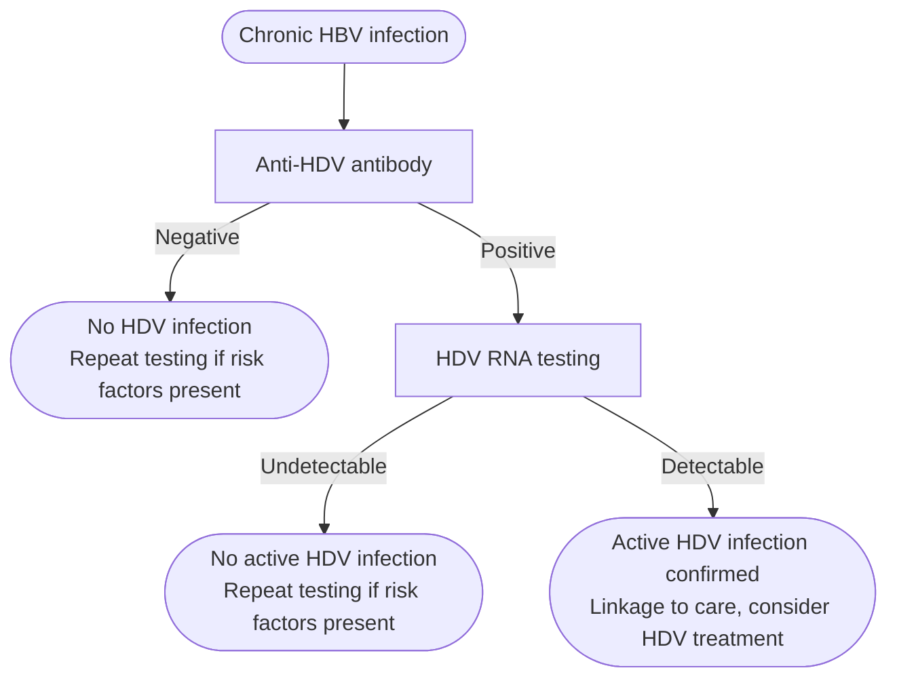

Hepatitis delta virus (HDV) is a defective RNA virus that occurs **only with [[chronic-hepatitis-b|hepatitis B virus (HBV)]] infection** — it needs HBV, using hepatitis B surface antigen (HBsAg) as its envelope, to complete its life cycle — as coinfection or superinfection ([[easl-2023-hepatitis-delta]]). It is a **particularly aggressive** infection, with more [[cirrhosis]], [[hepatocellular-carcinoma|hepatocellular carcinoma (HCC)]] and liver-related death than HBV monoinfection [[aga-2025-hepatitis-delta]].

**Excess risk vs chronic hepatitis B (CHB) alone** (viremic HDV, meta-analysis of 12 studies, risk ratio): decompensated cirrhosis **3.82** · liver-related mortality **3.78** · HCC **2.97** · compensated cirrhosis **1.74** [[aga-2025-hepatitis-delta]].

---

## Contents
- [[#Assessment]]
  - [[#Establishing the Diagnosis]]
  - [[#Severity Assessment]]
- [[#Differential Diagnosis]]
- [[#Diagnostics]]
- [[#Therapeutics]]
  - [[#Who to Treat]]
  - [[#Choosing the Strategy]]
  - [[#Current (US-available)]]
  - [[#Emerging / investigational]]
  - [[#Monitoring On and After Treatment]]
  - [[#Liver Transplantation]]
- [[#See Also]]
- [[#Sources]]

---

## Assessment

### Establishing the Diagnosis

- **Two patterns** ([[easl-2023-hepatitis-delta]]):
  - **Coinfection** — simultaneous acute HBV + HDV; usually self-limited, chronic in only **2%**.
  - **Superinfection** — HDV on existing CHB; often severe acute hepatitis, chronic hepatitis D (CHD) in **up to 90%**. May look like an unexplained flare of known CHB, or be misdiagnosed as acute hepatitis B when prior HBsAg status is unknown.
- **Who to test — universal (American Gastroenterological Association [AGA] 2025):** anti-HDV in **all patients with HBV** — aligns with the European Association for the Study of the Liver (EASL), Asian Pacific Association for the Study of the Liver (APASL) and World Health Organization (WHO) 2024; one-time universal testing is cost-effective [[aga-2025-hepatitis-delta]].
  - Departs from the current American Association for the Study of Liver Diseases (AASLD) **risk-based** testing, which left most patients untested; AGA expects US guidelines may be updated.
- **Retest** those at risk of superinfection — ongoing risk behaviours, living in a high-prevalence area, or new liver test elevation / hepatitis B decompensation [[aga-2025-hepatitis-delta]]. EASL adds an interval: **yearly** while risk persists (weak) [[easl-2023-hepatitis-delta]].

### Severity Assessment

- Assess for **cirrhosis with imaging *and* [[noninvasive-liver-disease-assessment|noninvasive testing]]** — **[[liver-stiffness-measurement|vibration-controlled transient elastography (VCTE)]]** is most accurate (area under the receiver operating characteristic curve [AUROC] 0.90) vs Fibrosis-4 index (FIB-4) 0.88 and aspartate aminotransferase-to-platelet ratio index (APRI) 0.83 [[aga-2025-hepatitis-delta]].
  - **VCTE ≥14.0 kPa** for cirrhosis in HDV: sensitivity 0.78, specificity 0.86, **negative predictive value (NPV) 0.93, positive predictive value (PPV) 0.64**.
  - EASL: use the **Baveno VII elastography thresholds** to identify compensated advanced chronic liver disease and clinically significant [[portal-hypertension|portal hypertension]] (CSPH) [[easl-2023-hepatitis-delta]].
- **Liver biopsy** when it would change management, or to grade and stage when clinical or imaging signs of cirrhosis are absent (EASL, strong). No routine follow-up biopsies outside trials.

> [!pitfall] Stiffness rules cirrhosis out better than in
> EASL 2023: noninvasive cut-offs are **not well established** in CHD — inflammation inflates stiffness and fibrosis scores. Published elastography cirrhosis cut-offs vary (10, 12 and 12.5 kPa; 14 kPa proposed), and fibrosis scores **misclassified 53% of 230 patients as having cirrhosis** (only 29% had biopsy-proven cirrhosis) ([[easl-2023-hepatitis-delta]]).

- **Factors marking higher risk of progression** (EASL, strong): elevated aminotransferases and gamma-glutamyltransferase (GGT) · advanced liver disease · **persistent HDV viraemia** · high HBV DNA · viral coinfections ([[hepatitis-c]], human immunodeficiency virus [HIV]). Cofactors to address: **alcohol, obesity, diabetes**.
- **[[hcc-surveillance|HCC surveillance]] in all adults with HBV–HDV coinfection, independent of cirrhosis** (AASLD–Infectious Diseases Society of America [IDSA] 2025 Rec 7, Conditional, Very Low; AGA advises it for all patients with HDV) — HCC incidence 18.65 vs 4.84 per 1,000 person-years in HBV monoinfection [[aasld-idsa-2025-chb-treatment]].
  - **Ultrasound + alpha-fetoprotein (AFP) about every 6 months.**
  - **Children/adolescents:** individualise — age, family history, fibrosis stage.
  - **Prior HDV (anti-HDV positive, HDV RNA negative):** surveil as for HBV alone.
  - EASL 2023 limits it to advanced fibrosis or cirrhosis; the broader US rule applies. See [[hepatocellular-carcinoma]].

---

## Differential Diagnosis

*Workup: see [[abnormal-liver-chemistries]]; HDV itself is confirmed serologically/virologically — see Diagnostics.*

- [[chronic-hepatitis-b|Chronic hepatitis B]] monoinfection (HDV requires HBV — always coexists)
- [[hepatitis-c]]
- [[autoimmune-hepatitis]]
- [[alcohol-associated-liver-disease|Alcohol-associated]] / [[nafld-masld|metabolic]] liver disease
- [[drug-induced-liver-injury|Drug-induced liver injury]]

---

## Diagnostics

*HDV diagnostic testing cascade*
*Source: redrawn from AGA 2025 Figure 1*
*[[aga-2025-hepatitis-delta|AGA 2025 Hepatitis Delta Clinical Practice Update]]*
*HBV = hepatitis B virus · HDV = hepatitis delta virus*

- **Anti-HDV antibody first**; ~50–70% of anti-HDV–positive patients have detectable HDV RNA (active infection) [[aga-2025-hepatitis-delta]].
- **Double reflex** — anti-HDV on every HBsAg-positive sample, HDV RNA on every anti-HDV–positive one — should be implemented.
- ⚠ **One HDV RNA result does not settle status** — levels fluctuate and may be transiently undetectable; status needs **≥2 tests 3–6 months apart** ([[easl-2023-hepatitis-delta]]).
- **Not advised:** HDV antigen and anti-HDV immunoglobulin M (IgM) — limited availability, sensitivity and specificity [[aga-2025-hepatitis-delta]].
- **HBV markers to send** (EASL, strong):
  - **Acute hepatitis → IgM antibody to hepatitis B core antigen (anti-HBc IgM):** high = **coinfection**; absent or low = **superinfection** of CHB (where HBV replication may be suppressed).
  - **All:** hepatitis B e antigen (HBeAg)/anti-HBe status and HBV DNA — active HBV may worsen hepatitis D and drives the nucleos(t)ide analogue (NA) decision below.
- US HDV RNA testing is **send-out** (Quest Diagnostics, ARUP Laboratories, LabCorp, Centers for Disease Control and Prevention) [[aga-2025-hepatitis-delta]].

> [!pitfall] Track HDV RNA in one lab, with one assay, in IU/mL
> Assays are not comparable (only **46.3% of 28 laboratories** passed a WHO quality-control panel), and African sub-genotype 1 and genotypes 5–8 are under-estimated by several commercial assays. Serial monitoring must use **the same assay in the same laboratory**, reported in **IU/mL** ([[easl-2023-hepatitis-delta]]).

---

## Therapeutics

### Who to Treat

- **US indication (AASLD hepatitis B guidance, relayed by AGA 2025):** pegylated interferon-α (peg-IFN-α) for **elevated HDV RNA and elevated alanine aminotransferase (ALT)** — neither is quantified [[aga-2025-hepatitis-delta]].
  - EASL 2023 uses no threshold: **all patients with CHD should be considered for antiviral treatment** (strong) — persistent replication drives progression, and cirrhosis can develop silently; decide individually [[easl-2023-hepatitis-delta]].
- **Decompensated cirrhosis → evaluate for [[liver-transplantation|liver transplantation]]** (EASL, strong) — no licensed therapy, and peg-IFN-α is contraindicated.
- **[[acute-on-chronic-liver-failure|Acute-on-chronic liver failure (ACLF)]]:** test for HDV immediately (Statement 31, B1); start antivirals as soon as possible, preferably **within 24 h** of confirming the cause (Statement 33, B1). For HBV/HDV the text adds: consider HDV-directed therapy, including bulevirtide where available and approved locally — **not approved for decompensated cirrhosis** ([[aasld-easl-2026-aclf-global-consensus]]). HBV component: [[chronic-hepatitis-b#HBV-Triggered Acute-on-Chronic Liver Failure]].
- **HCC present → treat the HCC first** (including transplantation); antiviral therapy individualised (EASL, weak).
- **Mild disease (F0–F1):** weigh interferon toxicity against the agents in development.

### Choosing the Strategy

EASL frames two approaches — **finite** (to cure) and **prolonged** (to control) — chosen mainly by **stage of liver disease**. In the US, peg-IFN-α is the only available treatment; bulevirtide is reachable only through expanded access ([[aga-2025-hepatitis-delta]]).

| Liver disease stage | Finite: peg-IFN-α, or peg-IFN-α + bulevirtide | Prolonged: bulevirtide |
|---|---|---|
| Chronic hepatitis (no cirrhosis) | Dominant | Minor |
| Compensated cirrhosis without CSPH | Narrowing | Widening |
| Compensated cirrhosis with CSPH | Tapered out | Dominant |

*Treatment approach by stage of chronic hepatitis D*
*Source: redrawn as a table from EASL 2023 Figure 3 (relative band widths of a shaded diagram)*
*[[easl-2023-hepatitis-delta|EASL 2023 Hepatitis Delta Guideline]]*
*peg-IFN-α = pegylated interferon-α · CSPH = clinically significant portal hypertension*

- **Other factors that shift the schedule:** HBV phase (HBeAg/anti-HBe status, HBV DNA and HBsAg levels) · interferon contraindication or intolerance · the patient's wishes and likely compliance.
- Compensated cirrhosis being considered for peg-IFN-α → **look specifically for CSPH and [[variceal-upper-gi-bleeding|oesophageal varices]]** — major adverse events are commoner in that subset.

### Current (US-available)

**Response definitions** ([[aga-2025-hepatitis-delta]]): US Food and Drug Administration (FDA)-specified **on-treatment response** = ≥2-log HDV RNA decline and/or ALT normalization · **sustained virologic response (SVR)** = undetectable HDV RNA off treatment.

- **Peg-IFN-α-2a or -2b** — the only treatment available in the US; weekly subcutaneous (SC) injection [[aga-2025-hepatitis-delta]].
  - **Duration:** AASLD — weekly for **12 months** (via AGA). EASL — **48 weeks** preferred (strong); durations may be personalised on HDV RNA and HBsAg kinetics and tolerability (weak).
  - **Longer courses:** some studies link >2 years to higher response rates (AGA). EASL: extending to 2 years did not raise virologic response in most studies, but **histology improved in most patients treated 96 weeks**; prolongation or re-treatment may be considered with good compliance and a slow virologic response or progressive HBsAg decline.
  - **Dose — off-label.** [[peginterferon-alfa-2a]] is **not labelled for HDV**; its labelled adult CHB regimen is **180 mcg SC once weekly for 48 weeks** ([[pegasys-2023-peginterferon-alfa-2a-label]]).
  - **Outcomes (48 weeks):** SVR at 6 months post-treatment **23%–57%**; undetectable HDV RNA + normal ALT at week 48 in 21%–50%. **Relapse ~50%** even after prolonged therapy, up to **9–10 years** later. Responders have improved survival and fewer liver-related events.
  - **Adding an NA or ribavirin does not improve the virologic response** (EASL).
  - **Contraindicated** in advanced liver disease and major extrahepatic disease (AGA) — EASL specifies **decompensated cirrhosis** and considers compensated disease, cirrhotic or not (strong). Neuropsychiatric and hematologic toxicity limit use. *Boxed warning, dose modifications, monitoring and stop rules: [[peginterferon-alfa-2a]].*

> [!pearl] Week-24 HDV RNA predicts peg-IFN response
> Undetectable HDV RNA at **week 24** had a **PPV of 100%** for virologic response 24 weeks post-treatment. A **≤1 log decline at week 24** identified non-response (sensitivity 67%, specificity 85%, **NPV 91%**) — yet some late decliners still respond. HBsAg **<1,000 IU/mL** and a **1.61 log HDV RNA decline** at week 24 also separate responders ([[easl-2023-hepatitis-delta]]).

- **NAs** — control HBV only; **no efficacy against HDV** and **not part of therapy aimed at CHD**. See [[chronic-hepatitis-b]].
  - AASLD: add an NA "if HBV DNA is elevated", no cut-point ([[aga-2025-hepatitis-delta]]). EASL prints the triggers (all strong):

| Setting | HBV DNA | Give NA? |
|---|---|---|
| Decompensated cirrhosis | Any — detectable or not | **Yes** |
| Compensated cirrhosis | Detectable | **Yes** |
| No cirrhosis | **>2,000 IU/mL** | **Yes** |

  - **Consider an NA when bulevirtide is stopped**, and start it if HBV replication relapses — blocking entry of both viruses exposes the patient to HBV reactivation on discontinuation.
- **After peg-IFN-α:** close laboratory *and* imaging follow-up, given the high relapse rate ([[aga-2025-hepatitis-delta]]).

### Emerging / investigational

| Agent | Mechanism / route | Status | Efficacy on treatment* |
|---|---|---|---|
| **Bulevirtide** (Gilead) | Sodium taurocholate co-transporting polypeptide (NTCP) entry inhibitor; **daily SC** | European Medicines Agency (EMA)-approved 2 mg since 2020; **not FDA-approved** — US: **10 mg expanded access** for chronic HDV with **compensated cirrhosis** (NCT06780579) | 45%–48% at week 48 |
| **Bulevirtide + peg-IFN-α** | Finite combination | Phase 2b | Up to **46%** undetectable HDV RNA 24 weeks post-treatment (bulevirtide 10 mg arm) vs 12% bulevirtide alone |
| **Tobevibart + elebsiran** (VIR) | Anti-HBsAg monoclonal antibody + small interfering RNA; 2 SC injections every 2–4 weeks | Phase 3 (SOLSTICE); ECLIPSE expected 2025 | 47% at week 24 |
| **Brelovitug (BJT-778)** | Anti-HBsAg monoclonal antibody; SC every 1–4 weeks | Phase 2b/3 | 67% at week 24 |
| **Lonafarnib** | Farnesyltransferase inhibitor; **oral twice daily** ± ritonavir ± peg-IFN-α-2a | Phase 3 | 10%–19% at week 48 |
| **Nucleic acid polymer (REP2139)** | Blocks HBV subviral particle assembly; SC weekly ± peg-IFN | Phase 2 / compassionate use in Europe | 73% HDV RNA 2-log decline; 61% HDV RNA negative |
| **Peg-IFN-λ** | Liver-targeted peg-IFN; weekly SC | Phase 3 discontinued | — |

*\*HDV RNA 2-log decline and ALT normalization, from AGA 2025 Table 1 unless stated ([[aga-2025-hepatitis-delta]]).*

**Bulevirtide — practical points where available** ([[easl-2023-hepatitis-delta]]):

- **Consider in all CHD with compensated liver disease** (strong). Optimal dose and duration undefined; until data arrive, **long-term 2 mg once daily** may be considered (weak) — EMA authorisation says maintain treatment until clinical benefit is observed. 10 mg gave **no efficacy advantage** over 2 mg, and 2 mg does not saturate the bile acid transporter (US expanded access supplies 10 mg).
- **Combination with peg-IFN-α:** finite bulevirtide + peg-IFN may be considered in **select patients** (AGA); EASL — in patients **without peg-IFN intolerance or contraindications** (weak), offered to compliant patients and possibly within clinical protocols.
- **Stopping means relapse:** 89% of virologic responders relapsed, with **aminotransferase flares in 22%** — hence prolonged therapy.
- ⚠ **Total bile acids rise in essentially everyone** — transient, dose-related (median up to **20 µmol/L on 2 mg**, **80 µmol/L on 10 mg**) and **symptomless, including no pruritus**.
- ⚠ **Interactions:** avoid co-administering **NTCP substrates** where possible — **fluvastatin, atorvastatin, pravastatin, rosuvastatin and thyroid hormones**. In vitro it partially inhibits OATP1B1/OATP1B3 at doses not usually reached at 2 mg SC; with tenofovir it reduced clearance of the CYP3A substrate midazolam.

### Monitoring On and After Treatment

*EASL 2023 intervals; they differ by strategy because peg-IFN-α relapse is late and bulevirtide relapse is early.*

| | **On treatment** | **After finite peg-IFN-α** | **After stopping bulevirtide** |
|---|---|---|---|
| **HDV RNA** | every 6 mo (+ any clinical indication) | end of treatment (EOT), 6 and 12 mo, then yearly | at stop, then 1, 3, 6, 12 mo, then yearly |
| **HBsAg** | yearly (quantitative every 6 mo on peg-IFN-α) | yearly; quantitative every 12 mo | yearly |
| **HBV DNA** | every 6 mo if **not** on an NA | every 6 mo if not on an NA | more often (weak) |
| **Aminotransferases, blood count, liver function tests** | at least every 3–6 mo | EOT, ≥6 and 12 mo, then yearly | at stop, then ≥1, 3, 6, 12 mo |
| **Liver stiffness** | yearly (weak) | yearly (weak) | yearly (weak) |

- **Peg-IFN-α specifics:** aminotransferases every **4 weeks for the first 12 weeks**, then every **6–8 weeks**; post-treatment weeks 24 and 48, plus weeks 4, 8 and 12 by disease stage. Blood count on the standard interferon schedule.
- **Bulevirtide specifics:** aminotransferases every **12 weeks**; blood count at least every **3 months**. After stopping, concentrate monitoring in the **first 6 months** to catch the ALT flare of recurrent HDV replication.
- ⚠ **Stiffness may rise on peg-IFN-α** (immune activation) and falls by weeks 24–48 on bulevirtide — significance of both uncertain.
- **Histology may be useful for an unexplained ALT flare on interferon** — it may be treatment-triggered [[autoimmune-hepatitis]] needing corticosteroids (anti-liver-kidney microsomal [LKM]-3 antibodies in up to 13% of CHD in Italian cohorts).
- **Advanced fibrosis or cirrhosis: follow-up continues after HDV RNA clears** — liver disease can still progress, and HBV can relapse once HDV is suppressed.

### Liver Transplantation

([[easl-2023-hepatitis-delta]])

- **Liver failure, not HCC, is the usual indication** in CHD — the reverse of CHB. Outcomes are excellent.
- **Prophylaxis = hepatitis B immunoglobulin (HBIG) + a high-genetic-barrier NA**, combined (strong). **NA monoprophylaxis is not acceptable**: the small HBsAg-recurrence risk tolerated in HBV monoinfection is not tolerable with HDV.
  - **Early period** (dose not formally defined; most experienced centres): **HBIG 10,000 IU intravenously in the anhepatic phase → 600–1,000 IU intramuscularly or intravenously daily × 7 days → weekly × 3 weeks → monthly until month 3–6.**
  - **After 6 months:** dose HBIG to keep antibody to HBsAg (**anti-HBs) >100 mIU/mL** (strong).
  - **NA: entecavir or tenofovir alafenamide preferred**; avoid tenofovir disoproxil fumarate where possible — calcineurin inhibitors can worsen its nephrotoxicity.
- Indefinite HBIG + NA is the current gold standard; **evidence on stopping HBIG after 1–2 years is still accumulating**. Intrahepatic HDV recurs in >70% of grafts, but without HBV re-infection causes no progressive disease.

---

## See Also

[[chronic-hepatitis-b]], [[peginterferon-alfa-2a]], [[hepatitis-c]], [[hepatocellular-carcinoma]], [[hcc-surveillance]], [[abnormal-liver-chemistries]], [[noninvasive-liver-disease-assessment]], [[autoimmune-hepatitis]], [[drug-induced-liver-injury]], [[alcohol-associated-liver-disease]], [[nafld-masld]], [[liver-transplantation]], [[acute-on-chronic-liver-failure]], [[nutrition-in-liver-disease]], [[liver-stiffness-measurement]], [[cirrhosis]], [[portal-hypertension]]

---

## Sources

1. [[aga-2025-hepatitis-delta|AGA Clinical Practice Update on Management of Hepatitis Delta: Commentary (2025)]]
2. [[easl-2023-hepatitis-delta|EASL Clinical Practice Guidelines on hepatitis delta virus (2023)]]
3. [[aasld-idsa-2025-chb-treatment|AASLD-IDSA Hepatitis B Guidance: Treatment of Chronic Hepatitis B (2025)]]
4. [[pegasys-2023-peginterferon-alfa-2a-label|PEGASYS (Peginterferon Alfa-2a) Injection — FDA Prescribing Information]]
5. [[aasld-easl-2026-aclf-global-consensus|AASLD/EASL/APASL/ALEH/SOLDA 2026 Global Multisociety Consensus on ACLF Definitions]]
