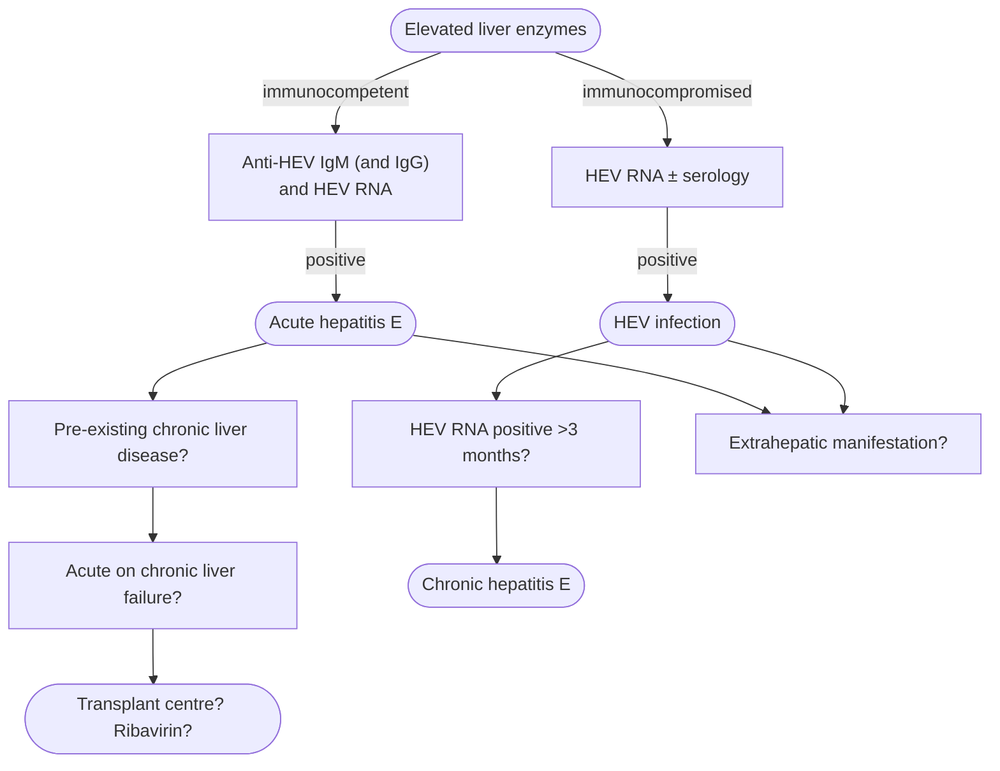
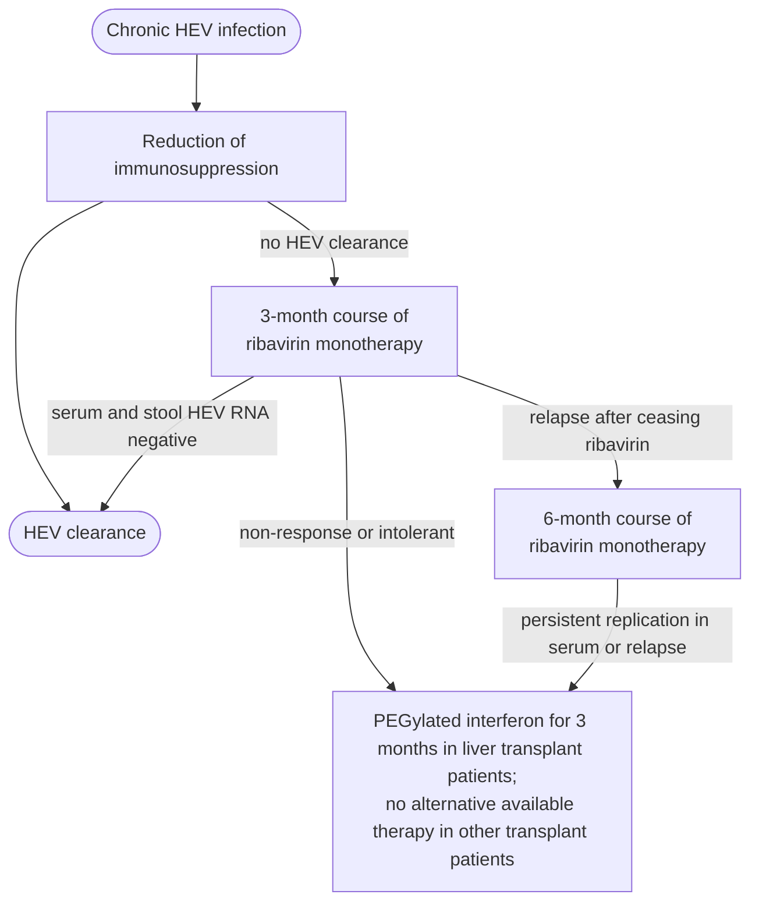

*Hepatitis E virus (HEV) infection — acute (usually self-limiting) and chronic (immunosuppressed only). Guidance below is the European Association for the Study of the Liver (EASL) 2018 guideline ([[easl-2018-hepatitis-e]]), which deliberately covers zoonotic genotype 3 and 4 disease in developed countries; management of genotype 1/2 outbreaks in resource-limited settings is deferred to the World Health Organization (WHO).*

*Grades are EASL's own: level of evidence **A** (meta-analyses/systematic reviews or multiple high-quality randomised controlled trials), **B** (single randomised controlled trial or multiple non-randomised studies), **C** (small studies, retrospective observational studies, registries); grade of recommendation **1 = strong** ("must", "should", "EASL recommends"), **2 = weak** ("can", "may", "EASL suggests"). The guideline numbers none of its recommendations.*

## Contents
- [[#Assessment]]
  - [[#Establishing the Diagnosis]]
  - [[#Severity Assessment]]
  - [[#Classification / Typing]]
- [[#Differential Diagnosis]]
- [[#Diagnostics]]
  - [[#Serology and Nucleic Acid Testing]]
  - [[#Extrahepatic Disease]]
  - [[#Blood Supply]]
- [[#Therapeutics]]
  - [[#Acute Infection]]
  - [[#Chronic Infection in Solid Organ Transplant Recipients]]
  - [[#Chronic Infection in Other Immunosuppressed Patients]]
  - [[#Extrahepatic Disease Treatment]]
  - [[#Prevention]]
- [[#See Also]]
- [[#Sources]]

## Assessment

### Establishing the Diagnosis

- **Test every patient with hepatitis for HEV as part of the first-line virological investigation, irrespective of travel history (A1).** Locally acquired genotype (gt) 3 is now the commonest cause of acute viral hepatitis in many European countries; testing only after hepatitis A, B and C come back negative is no longer appropriate.
- **Immunocompetent — serology *and* nucleic acid amplification testing (NAT) in combination (A1).** A negative polymerase chain reaction (PCR) does not exclude acute infection.
- **Immunosuppressed — NAT, not serology, to diagnose chronic HEV infection (A1).** NAT on serum or plasma, and where possible stool.

> [!pitfall] In the immunosuppressed, serology can be falsely reassuring
> Anti-HEV immunoglobulin M (IgM) and immunoglobulin G (IgG) are often undetectable in patients with chronic hepatitis E despite active replication — diagnose by NAT, never by serology alone ([[easl-2018-hepatitis-e]]).

#### Who to test

| Setting | Grade |
|---|---|
| Any patient with biochemical evidence of hepatitis — test as first-line virology, irrespective of travel history | A1 |
| Symptoms consistent with acute hepatitis | A1 |
| Suspected [[drug-induced-liver-injury\|drug-induced liver injury (DILI)]] | A1 |
| Travellers with hepatitis returning from areas endemic for gt 1 or 2 | A1 |
| Unexplained flare of chronic liver disease | C2 |
| Decompensated chronic liver disease\* | — |
| Neuralgic amyotrophy (NA)\* | B1 |
| Guillain-Barré syndrome (GBS)\* | B1 |
| Encephalitis / myelitis\* | C2 |
| Unexplained acute neurology with a raised alanine aminotransferase (ALT)\*\* | — |
| Abnormal liver function tests after receiving blood products | A1 |
| Immunosuppressed with unexplained abnormal liver function tests / persistently abnormal ALT\*\*\* | A1 |

\*Test at disease onset, irrespective of ALT results. \*\*Test at disease onset, if ALT is abnormal. \*\*\*ALT above the limit of normal on more than one occasion.
Rows are the guideline's suggested-testing table; grades come from its recommendations — rows marked "—" appear in the table without a graded recommendation of their own.

*Diagnostic algorithm for HEV infection*
*Source: redrawn from the EASL 2018 diagnostic algorithm (guideline Fig. 1)*
*[[easl-2018-hepatitis-e|EASL Clinical Practice Guidelines on Hepatitis E Virus Infection]]*
*HEV = hepatitis E virus · IgM = immunoglobulin M · IgG = immunoglobulin G · RNA = ribonucleic acid*

### Severity Assessment

- gt 3 infection is clinically silent in the vast majority; **probably fewer than 5% develop symptoms** — raised liver enzymes, jaundice, fatigue, itching, nausea.
- Monitor confirmed acute hepatitis E with **ALT, aspartate aminotransferase (AST), bilirubin and international normalized ratio (INR)**. In patients without other chronic disease, monitoring liver enzymes and liver function parameters is sufficient.
- Disproportionately older males: M:F 3:1, **median age 63 years** in an English series; likely host factors (subclinical steatosis/fibrosis, alcohol, diabetes) rather than differential exposure.
- **[[acute-liver-failure|Acute liver failure (ALF)]] is rare** in immunocompetent gt 3 infection — in a German single-centre series of 80 ALF patients, HEV RNA was found in 10% and considered the probable cause in 7.5%.
- **Pre-existing chronic liver disease** — acute hepatitis E can cause [[acute-on-chronic-liver-failure|acute-on-chronic liver failure (ACLF)]]; the course may be more severe in the elderly. Only 11/343 patients with decompensated chronic liver disease followed in France and the UK had acute hepatitis E (three died), and HEV did not drive mortality in that study. gt 1 super-infection of chronic liver disease in Asia: reported mortality 0–67%, with an Indian study putting 12-month mortality at approximately 70%.
- **Pregnancy (gt 1/2 only)** — mortality in pregnant women is **approximately 25%**, from fulminant hepatic failure plus obstetric complications (eclampsia, haemorrhage), with high perinatal infant mortality. **Care in a high-dependency setting and transfer to a [[liver-transplantation|liver transplant]] unit if liver failure occurs (A1).** There are no data to support ribavirin in pregnancy, which is potentially teratogenic. Excess maternal mortality has **not** been observed with gt 3/4.

### Classification / Typing

| Genotype | Host / transmission | Geography | Clinical profile |
|---|---|---|---|
| gt 1, 2 | Obligate human pathogens; faecal-oral via contaminated water | gt 1 Asia and Africa; gt 2 Africa and Mexico | Brief, self-limiting hepatitis in young adults; clinical attack rate on exposure ~1 in 5; ~25% mortality in pregnancy; **chronic infection never reported** |
| gt 3, 4 | Zoonotic — pigs, wild boar, deer; undercooked pork products, shellfish, irrigated produce, blood products | gt 3 Europe, USA, Japan, South America; gt 4 mainly China and Japan | Usually silent; symptomatic disease in middle-aged/older men; **the only genotypes causing chronic infection** |
| gt 5, 6 | Wild boar | — | Not yet reported in humans |
| gt 7, 8 | Camels | — | One chronic human infection, in a transplant recipient who consumed camel meat and milk |

**Acute vs chronic**
- **Acute** — self-limiting; viraemia lasts approximately three to six weeks. Immunity after clearance is **not sterilising**; re-infection is possible, though symptomatic hepatitis is less likely.
- **Chronic** — persistent HEV replication, seen **only with gt 3 and 4 and only in the immunosuppressed**. Originally defined as replication persisting six months; because no spontaneous clearance occurred between three and six months in an observational transplant study, **patients viraemic beyond three months can be regarded as chronically infected and considered for treatment** (a small number of clearances between three and six months have been reported).
- **Who becomes chronic:** solid organ transplant (SOT) recipients, haematological disorders, human immunodeficiency virus (HIV), heavy immunosuppression for rheumatic disease. In SOT recipients one-third have resolving hepatitis and the remainder become chronic. Risk factors: **low lymphocyte count at diagnosis** and **[[tacrolimus]] rather than [[calcineurin-inhibitors|cyclosporine A]]**. In HIV, chronic HEV is mostly described at a **CD4⁺ T-cell count <200/mm³**.
- Only about one-third of chronically infected SOT recipients are symptomatic (mainly fatigue); liver enzymes may be normal or only mildly raised. Fibrosis can progress rapidly to [[cirrhosis]], decompensation and death — and can **regress after HEV clearance**.

## Differential Diagnosis

*Workup: see [[abnormal-liver-chemistries]].*

| Setting | Differential |
|---|---|
| Acute infection\* | [[drug-induced-liver-injury\|DILI]] · [[autoimmune-hepatitis\|autoimmune hepatitis]] · acute hepatitis E · sero-negative hepatitis · Epstein-Barr virus (EBV) hepatitis · acute [[chronic-hepatitis-b\|hepatitis B]] · acute hepatitis A · acute [[hepatitis-c\|hepatitis C]] · cytomegalovirus (CMV) hepatitis |
| Chronic infection in the immunosuppressed | Graft rejection · DILI · recurrence of primary liver pathology in liver transplant recipients · graft vs host disease · intercurrent infections (e.g. sepsis) · chronic hepatitis E · EBV and CMV reactivation |

\*In order of frequency as seen at a rapid-access jaundice clinic in south-west England.

- **DILI is the key mimic.** In a UK cohort with criterion-referenced DILI, **13% were misdiagnosed** — they had gt 3 acute hepatitis E. Polypharmacy, DILI and acute hepatitis E are all commonest in the elderly.
- **False-positive HEV serology** occurs with non-specific "sticky" cross-reacting antibodies (a problem in older patients presenting with autoimmune hepatitis) and in EBV infection.

## Diagnostics

### Serology and Nucleic Acid Testing

- **Incubation approximately 15 to 60 days.** HEV RNA detectable in blood and stool from around three weeks post-infection; **viraemia ~3–6 weeks**, **stool shedding ~4–6 weeks**.
- IgM appears first, shortly before symptom onset, then IgG. **IgM is short-lived** (usually no longer than three to four months, may persist up to a year); the IgG response is long lasting with increasing avidity.
- NAT assays target the highly conserved ORF2/ORF3 overlap region and detect all four human genotypes; **analytical sensitivity can be lower than 10 IU/ml**. A WHO International Standard and International Reference Panel (gt 1–4) exist. Sequence analysis determines genotype.
- In chronic infection, viral load testing is used to assess response to modified immunosuppression or antiviral therapy and to identify relapse.
- **Antigen assays** (enzyme immunoassay) can diagnose acute and chronic infection; newer versions are more sensitive. Levels are lower in acute than chronic infection, and an **optical density 450/630 ratio >15** was suggested to discriminate the two. Antigen may persist for months after ribavirin-induced RNA clearance and does not necessarily correlate with infectious virions; its role in diagnosis remains to be determined.
- **Immunohistochemistry** for HEV ORF2 protein can establish a histopathological diagnosis.

| Infection status | Positive markers |
|---|---|
| Current — acute | HEV RNA · HEV RNA + anti-HEV IgM · HEV RNA + anti-HEV IgG\* · HEV RNA + anti-HEV IgM + anti-HEV IgG · anti-HEV IgM + anti-HEV IgG (rising) · HEV antigen |
| Current — chronic | HEV RNA (± anti-HEV) ≥3 months · HEV antigen |
| Past | Anti-HEV IgG |

\*Patients with re-infection are typically anti-HEV IgM negative, but IgG and PCR positive.

### Extrahepatic Disease

**Test irrespective of liver function test results** in NA (B1) and GBS (B1); testing is suggested in encephalitis/myelitis (C2). Patients with HEV-associated neurological injury generally have only modest liver test abnormalities and are mostly anicteric; some have normal liver tests.

| System | Syndromes | Notes |
|---|---|---|
| Neurological (causality supported) | NA · GBS · meningoencephalitis/encephalitis-myelitis · mononeuritis multiplex · myositis · Bell's palsy, vestibular neuritis, peripheral neuropathy | ~150 gt 3 cases described, mainly European, **>90% immunocompetent**; occurs in acute *and* chronic infection. Of 450 consecutive patients with acute non-traumatic neurological injury, **2.4% had HEV infection**, three-quarters of them NA with bilateral involvement. GBS case-control studies: HEV at neurological onset in **5–11%**; a Belgian cohort found 6/73 (8%) |
| Renal (causality supported) | Membranoproliferative and membranous glomerulonephritis (± cryoglobulinaemia) · IgA nephropathy | Immunocompetent and immunosuppressed. **Renal function improves and proteinuria decreases after HEV clearance**, spontaneous or treatment-induced |
| Haematological | Thrombocytopenia · monoclonal immunoglobulin · cryoglobulinaemia · aplastic anaemia · haemolytic anaemia | Mild thrombocytopenia common, occasionally severe. Monoclonal immunoglobulin in 25% of acute HEV in a UK study, significance uncertain. Aplastic and haemolytic anaemia: case reports only |
| Other | Acute pancreatitis · arthritis · myocarditis · autoimmune thyroiditis | Pancreatitis: 55 cases worldwide, **gt 1 only**, usually mild — none documented with gt 3 or 4. The rest are case reports only |

- **Test patients with HEV infection for proteinuria (C2);** new-onset proteinuria in acute or chronic HEV **may be considered for renal biopsy (C2)**.

> [!pearl] Bilateral shoulder pain and abnormal liver tests in a middle-aged man
> In one centre's experience that triad is highly predictive of HEV infection. HEV-associated NA has a distinct phenotype — bilateral brachial plexus involvement, more extensive damage, and damage outside the plexus, particularly the phrenic nerve ([[easl-2018-hepatitis-e]]).

### Blood Supply

- HEV is transmitted by infected blood and blood products. Most transfusion-transmitted infection is asymptomatic; **the risk that matters is chronic infection in an immunosuppressed recipient** — easily overlooked, because recipients have no symptoms and only minor persistent liver test abnormalities, which may be delayed for months.
- **Minimum infective dose 2 × 10⁴ IU HEV RNA** (English series; 55% of components containing at least that dose transmitted infection) and **3.6 × 10⁴ IU** in a Japanese analysis. Anti-HEV IgG in the recipient does not necessarily protect.
- **Blood donor services should screen donors for HEV by NAT, informed by local risk-assessment and cost-effectiveness studies, both of which may vary considerably by geographical location (A1).** NAT is the method of choice — infected donors usually have normal liver tests and are IgM and IgG negative.
- Solvent/detergent-treated plasma has transmitted HEV and has been tested for HEV in Europe since 2015; no transmission has been reported from virally inactivated fractionated blood products.
- Transmission by liver and kidney grafts is extremely rare; **there are no current recommendations for organ donor screening**.

## Therapeutics

### Acute Infection

- **Acute HEV infection does not usually require antiviral therapy (Statement, A)** — almost all cases clear spontaneously.
- **Ribavirin may be considered in severe acute hepatitis E or acute-on-chronic liver failure (C2).** Dose and duration in ALF are not defined, and whether ribavirin reduces morbidity in acute hepatitis E is unknown.
- Corticosteroids have been used in individual cases of HEV-related ALF with improved liver function parameters, but **evidence is currently insufficient to support corticosteroid treatment in ALF due to HEV**.

### Chronic Infection in Solid Organ Transplant Recipients

*Treatment algorithm for chronic HEV infection*
*Source: redrawn from the EASL 2018 treatment algorithm (guideline Fig. 2)*
*[[easl-2018-hepatitis-e|EASL Clinical Practice Guidelines on Hepatitis E Virus Infection]]*
*HEV = hepatitis E virus · RNA = ribonucleic acid*

- **Step 1 — decrease immunosuppression at diagnosis, if possible (B1).** This clears HEV in **about 30%**. Patients who clear spontaneously have lower tacrolimus trough levels and lower daily steroid doses, implicating T-cell-targeting drugs.
- **Step 2 — persisting HEV replication three months after detection of HEV RNA → ribavirin monotherapy for 12 weeks (B1).**
- **At the end of the scheduled therapy, assess HEV RNA in the serum *and* in the stool (B1); undetectable in both → stop ribavirin (C2).** Persistence of stool HEV RNA despite undetectable serum RNA is associated with increased risk of viraemia relapse after stopping.
- **Still detectable in serum and/or stool after 12 weeks → ribavirin monotherapy may continue a further three months (six months overall) (C2).**
- **Liver transplant recipients who show no response to ribavirin can be considered for [[peginterferon-alfa-2a|PEGylated interferon-α]] (C2)** — a three-month course. **Generally contraindicated in kidney, pancreas and heart/lung transplant recipients**: it stimulates the immune system and increases the risk of acute rejection.
- Optimal duration is unknown for patients HEV RNA positive at four or eight weeks but negative at 12 weeks (Statement, C); the optimal approach is unknown for ribavirin non-responders and post-retreatment relapsers (Statement, C).

**Ribavirin — dosing, safety, response**
- Evidence base: multicentre retrospective study of **59 SOT recipients**, median dose **600 mg/day (range 29–1,200)** for a median of **three months (range 1–18)** → **sustained virological response (SVR) 78%**. Relapsers retreated for six months cleared the virus and achieved SVR. No SVR difference between ≤3 months and >3 months of therapy. There are no placebo-controlled trials.
- Adverse effects: dose-dependent anaemia, dry cough, skin reactions. **Dose adaptations that consider haemoglobin and estimated glomerular filtration rate are strongly recommended** — these patients frequently have renal impairment or anaemia.
- Response predictors: a **high lymphocyte count** independently predicts SVR; a **fall in HEV RNA ≥0.5 log₁₀ IU/ml at day seven** predicts SVR; ribavirin trough level at day seven or two months does not.
- Resistance: a **G1634R mutation in the HEV polymerase** was described in two ribavirin treatment failures and appeared on therapy in relapsers; pre-treatment G1634R did not affect SVR in a SOT series.
- No other antiviral is known to be effective. [[direct-acting-antivirals|Sofosbuvir]] has in vitro anti-HEV activity additive with ribavirin; clinical efficacy is unknown.
- [[mycophenolate-mofetil|Mycophenolate]] was associated with a lower likelihood of chronic hepatitis E in one heart-transplant study, but mycophenolate-treated patients can still develop it.

### Chronic Infection in Other Immunosuppressed Patients

- Haematological disorders and HIV: PEGylated interferon-α, ribavirin, or the combination has been effective in case reports and small series. **9 of 12 stem-cell transplant recipients treated with ribavirin achieved SVR.**

### Extrahepatic Disease Treatment

- **Antiviral treatment is suggested for chronic HEV infection with associated glomerular disease (C2).**
- Cryoglobulinaemia in chronic HEV disappears after antiviral therapy.
- Treatment of most other extrahepatic manifestations remains to be determined.

### Prevention

- **Immunocompromised individuals and those with chronic liver disease should avoid undercooked meat (pork, wild boar and venison) and shellfish (B1).**
- **Immunocompromised patients should consume meat only if thoroughly cooked to temperatures of at least 70 °C (B2).** In cell culture, heating virus stocks for more than two minutes at 70 °C eliminates infectivity, 80 °C for one minute was required to prevent infection when heating, and infective HEV can be recovered after 28 days at room temperature — how far this translates to food preparation is unclear.
- Advising the **general population** to avoid undercooked pork is **not currently justified**; immunocompetent individuals are likely to tolerate exposure without significant health threat.
- Stool contains high amounts of infectious HEV and is more infectious than plasma-derived HEV — **strict hygiene measures** should be observed to prevent spread by contaminated stool, e.g. in hospitals or nursing homes. HEV RNA is detectable in urine; transmission by saliva, sweat, semen or breast milk is unclear.
- **Vaccine** — licensed in China in 2011; **97% efficacy for preventing episodes of symptomatic acute hepatitis**, with long-term efficacy confirmed on further follow-up. Based on a protein containing 239 amino acids of HEV ORF2 (aa 368–606) derived from gt 1. It prevented symptomatic gt 4 infections (suggesting cross-genotype efficacy), but immunity is **not sterilising** and subclinical infections still occur. Appears safe in pregnant women; long-term efficacy and safety in chronic liver disease and the immunosuppressed remain to be determined. **Not licensed outside China.**

## See Also

[[abnormal-liver-chemistries]], [[acute-liver-failure]], [[acute-on-chronic-liver-failure]], [[cirrhosis]], [[drug-induced-liver-injury]], [[autoimmune-hepatitis]], [[chronic-hepatitis-b]], [[hepatitis-c]], [[liver-disease-in-pregnancy]], [[liver-transplantation]], [[tacrolimus]], [[calcineurin-inhibitors]], [[mycophenolate-mofetil]], [[peginterferon-alfa-2a]], [[direct-acting-antivirals]]

---

## Sources

1. [[easl-2018-hepatitis-e|EASL Clinical Practice Guidelines on Hepatitis E Virus Infection]]
