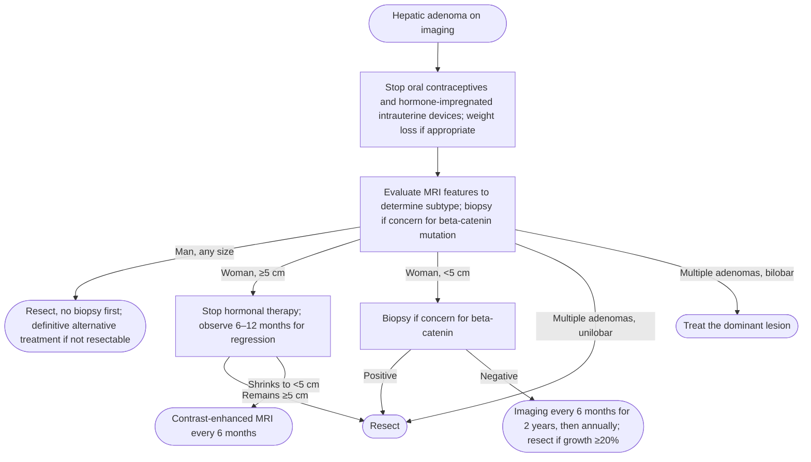

# Hepatocellular Adenoma

---

## Contents
- [[#Assessment]]
  - [[#Establishing the Diagnosis]]
  - [[#Severity Assessment]]
  - [[#Classification / Typing]]
- [[#Differential Diagnosis]]
- [[#Diagnostics]]
  - [[#Imaging]]
  - [[#Biopsy and Pathology]]
  - [[#Serum Biomarkers]]
- [[#Therapeutics]]
  - [[#Risk-Factor Modification]]
  - [[#Management Pathway]]
  - [[#Surveillance]]
  - [[#Rupture]]
  - [[#Pregnancy]]
  - [[#Hepatic Adenomatosis]]
  - [[#Liver Transplantation]]
- [[#See Also]]
- [[#Sources]]

---

## Assessment

### Establishing the Diagnosis

**Hepatocellular adenoma (HCA)** — benign, frequently asymptomatic neoplasm of mature hepatocytes. Usually well-defined, rarely encapsulated, highly vascular, variable in size, solitary or multifocal; arises in a normal liver or one affected by steatosis or glycogenosis ([[acg-2024-focal-liver-lesions]]).

**Why it matters:** unlike other benign liver lesions, HCA carries a risk of **hemorrhage (up to 15%)** and **malignant transformation to [[hepatocellular-carcinoma|hepatocellular carcinoma (HCC)]] (up to 5%)**.

**Epidemiology and risk factors:**

- Prevalence data limited; reported around **0.007%–0.012%**
- **Oral contraceptive pill (OCP)** users: **3–4 per 100,000** vs **0.13–1.0 per 100,000** in non-users (modern OCPs have markedly lower estrogen and progesterone than 1960s formulations)
- Key Concept (KC) 5 risk factors: anabolic steroid use, [[obesity]], polycystic ovarian syndrome (PCOS), glycogen storage disease (GSD), and **possibly** exogenous hormonal therapy in men, women, and transgender individuals
- Metabolic syndrome and hepatic steatosis also confer risk; in lean patients, weight gain is discouraged (HCA growth tracks with rising body mass index)
- **GSD types Ia and III** — high lifetime incidence including adenomatosis; male predominance 2:1; presents as early as the second or third decade
- **No formal recommendation exists for HCA screening** based on metabolic risk factors or duration of OCP exposure

**Presentation:**

- Most often **incidental** on abdominal imaging; alternatively abdominal pain
- **Rupture with hemorrhage** — acute abdominal pain, anemia, and/or hemorrhagic shock
- Larger or multiple adenomas may raise alkaline phosphatase; the inflammatory subtype may raise inflammatory markers (see *Serum Biomarkers*)

> [!pitfall] A lesion in a cirrhotic liver is HCC until proven otherwise
> Adenomas can form in a [[cirrhosis|cirrhotic]] liver, but benign lesions rarely form de novo in cirrhosis — any lesion in a patient with cirrhosis must be considered HCC until proven otherwise ([[acg-2024-focal-liver-lesions]]).

### Severity Assessment

Management rests on **symptoms, risk-factor modification, clinical and molecular subtype, lesion size, and lesion number**.

| Risk factor | Significance |
|---|---|
| Size **>5 cm** | Complications (hemorrhage, malignant transformation) typically occur above 5 cm — **but can arise in smaller lesions** |
| **Male sex** | Malignant transformation **10× more likely than in women**; men are commonly diagnosed with the β-catenin mutated variant (KC 12) |
| **β-catenin activated subtype (exon 3)** | Highest malignant-transformation risk of any subtype (KC 11) |
| **Glycogen storage disease** | Believed to carry higher malignant-transformation risk |
| **Growth of the lesion / exophytic location** | Together with size ≥5 cm, the established risk factors for spontaneous rupture |
| **Pregnancy** | Estrogen-driven growth; greatest complication risk in the **third trimester** |
| **≥10 lesions (adenomatosis)** | Substantially higher complication risk — see *Hepatic Adenomatosis* |

**Highest-risk cohort for malignant transformation:** men, β-catenin exon 3 mutated HCA, and lesions ≥5 cm.

### Classification / Typing

Three main molecular subtypes (inflammatory, hepatocyte nuclear factor-1α [HNF-1α], β-catenin activated) and two less well-understood ones (sonic hedgehog, unclassified). Improved imaging and histology allow subtyping of **up to 90%** of HCAs.

| Subtype | Frequency | Risk factors | Molecular / immunostains | Hemorrhage | Malignancy |
|---|---|---|---|---|---|
| **Inflammatory** | ~35%–45% | Excess estrogen (moderate association), obesity, hepatic steatosis, excess alcohol, GSD | Activated Janus kinase/signal transducer and activation transcription (JAK/STAT) pathway; elevated alkaline phosphatase, C-reactive protein (CRP), ± fibrinogen. Inflammatory infiltrates, sinusoidal dilatation, dystrophic vessels; CRP+, amyloid A+, liver fatty acid–binding protein (FABP)+ | Low | **Moderate** |
| **HNF-1α inactivated** | ~35%–40% | Excess estrogen (**strong** association; OCP use, excess estrogen, anabolic steroids); maturity-onset diabetes of the young type 3 (MODY3) | Inactivation of the HNF-1α transcription factor; significant intralesional fat; **loss** of liver FABP staining | Low | Low |
| **β-catenin activated** | Exon 3 mutation ~10%, male predominant (exon 7/8 mutation in <10% of β-catenin mutated HCAs) | Anabolic steroid use, androgen therapy, male sex with adenoma, GSD | β-catenin mutation → increased glutamine synthase; nuclear atypia, nuclear and cytoplasmic β-catenin staining, heterogeneous glutamine synthase | Low | **High, up to 46% (exon 3)** |
| **Sonic hedgehog** | <5% | Exogenous hormonal stimuli, obesity | Sonic hedgehog pathway activation; inhibin βE (INHβE)/glioma-associated oncogene homolog 1 (GLI1) fusion; liver FABP+ | **High** | Low |
| **Unclassified** | 5%–10% | — | Liver FABP+ | — | — |

*Hepatic adenoma subtype clinical characteristics*
*Source: recreated from Table 4 of the American College of Gastroenterology (ACG) 2024 focal liver lesions guideline*
*[[acg-2024-focal-liver-lesions|ACG Clinical Guideline: Focal Liver Lesions (2024)]]*
*JAK/STAT = Janus kinase/signal transducer and activation transcription · CRP = C-reactive protein · FABP = fatty acid–binding protein · HNF-1α = hepatocyte nuclear factor-1α · MODY3 = maturity-onset diabetes of the young type 3 · OCP = oral contraceptive pill · GSD = glycogen storage disease · INHβE = inhibin βE · GLI1 = glioma-associated oncogene homolog 1*

- ACG 2024 gives no risk-factor or complication data for the unclassified subtype.
- **Inflammatory:** malignant transformation risk is low **unless a β-catenin mutation coexists**; larger size, subcapsular location, and high vascularity make these prone to hemorrhage.
- **β-catenin:** the **exon 3** mutation carries ~10% or greater malignant potential; a cadherin-associated protein β1 (**CTNNβ1**) **exon 7/8** mutation carries **no significant increased malignancy risk**.

> [!pearl] Male sex is itself an indication to resect
> Adenomas in men are commonly β-catenin mutated with a higher risk of malignant transformation (KC 12), so resection is advised **regardless of size and irrespective of subtype** (KC 14, [[acg-2024-focal-liver-lesions]]).

---

## Differential Diagnosis

*Workup and cross-lesion imaging comparison: see [[focal-liver-lesions]].*

- **[[focal-nodular-hyperplasia|Focal nodular hyperplasia]] (FNH)** — central scar with delayed enhancement; **takes up gadoxetate** on the hepatobiliary phase (HCA usually does not); extremely slim chance of malignancy; no follow-up once confirmed
- **[[hepatic-hemangioma|Hepatic hemangioma]]** — T2 hyperintense; peripheral nodular enhancement with centripetal fill-in
- **[[hepatocellular-carcinoma|Hepatocellular carcinoma]]** — arterial phase hyperenhancement (APHE), washout, and capsule; [[li-rads|Liver Imaging Reporting and Data System (LI-RADS)]] applies in at-risk livers. Imaging cannot reliably separate well-differentiated HCC from β-catenin mutated HCA; absent chronic liver disease risk factors, adenoma is the more likely diagnosis
- **Metastasis** — known primary malignancy; often multiple lesions
- **Malignant transformation of a known HCA** — a **change in imaging characteristics** or **rapid growth**; biopsy or resection often required

---

## Diagnostics

### Imaging

- **First step (KC 7):** multiphasic contrast-enhanced [[mri-mrcp|magnetic resonance imaging (MRI)]] or computed tomography (CT) when a solid hepatic mass is found incidentally — often sufficient for diagnosis and subtyping
- **Recommendation (Rec) 4 (Conditional / Very low):** use multiphasic liver imaging (preferably MRI) over standard cross-sectional imaging to distinguish hepatic adenomas from other benign or malignant liver lesions
- **Typical appearance:** APHE becoming isoenhancing on portal-venous and equilibrium phases; on MRI mild T2 hyperintensity with T1 hypo- to isointense signal, ± intralesional lipid; on the hepatobiliary phase usually **devoid of signal**, in contradistinction to FNH
- **Prior hemorrhage:** hyperdense on non-contrast CT, hyperintense on T1 pre-contrast MRI
- **Contrast-enhanced ultrasound (CEUS):** aids diagnosis but is **not specific enough to subtype** an adenoma
- **Subtyping by MRI is reliable for two subtypes only (KC 9)** — useful for inflammatory and HNF-1α adenomas, **not specific** for β-catenin mutated, sonic hedgehog, or unclassified adenomas

| Feature | Inflammatory | HNF-1α | β-catenin |
|---|---|---|---|
| T2 signal | Marked hyperintense; **atoll sign** | Isointense / mildly hyperintense | Heterogeneously hyperintense |
| Intralesional lipid | −/+ (17%) | + (78%) | +/− |
| Arterial phase enhancement | ++ | + | ++ |
| Portal-venous / delayed phase | ++ | +/− | — |
| Hepatobiliary phase | 11% isointense to hyperintense (OATP1B3) | Hypointense | 59% isointense to hyperintense (OATP1B3) |

*Radiographic characteristics of hepatic adenoma subtypes*
*Source: recreated from Table 5 of the ACG 2024 focal liver lesions guideline*
*[[acg-2024-focal-liver-lesions|ACG Clinical Guideline: Focal Liver Lesions (2024)]]*
*HNF-1α = hepatocyte nuclear factor-1α · OATP1B3 = organic anion transporting polypeptide 1B3*

Atoll sign = T2-hyperintense rim with central isointensity.

> [!pitfall] Gadoxetate uptake does not exclude an adenoma
> Atypical inflammatory and β-catenin mutated HCAs express the biliary transporter OATP1B1/B3, retain gadoxetic acid, and appear **hyperintense** on the hepatobiliary phase — mimicking FNH. Such lesions are definitive for neither; biopsy, follow, and/or take to a multidisciplinary liver tumor board ([[acg-2024-focal-liver-lesions]]).

### Biopsy and Pathology

- **Do biopsy (KC 8):** uncharacteristic imaging appearance, or a change in imaging features concerning for malignant transformation (rapid increase in size, new intralesional lipid, new washout on portal-venous or delayed phase)
- **Do not biopsy routinely:** for subtyping alone in women with lesions <5 cm, until prospective data support it; and not before planned resection in men — but **do** biopsy a man who is not a surgical candidate and will need ablation or embolization
- [[liver-biopsy|Percutaneous biopsy]] carries bleeding risk given the lesion's vascularity
- **Immunostains:** liver FABP (lost in HNF-1α), CRP/amyloid A (inflammatory), β-catenin/glutamine synthase (β-catenin activated)
- Pathology of an adenoma often returns **well-differentiated HCC**; a glypican-3 / heat shock protein 70 / glutamine synthase panel helps separate the two. Inconclusive biopsy → multidisciplinary discussion to choose resection vs close imaging surveillance
- **Next-generation sequencing** can enhance histopathological diagnosis and subtyping when tissue is adequate and subtype would influence management

### Serum Biomarkers

- **No serum biomarker is diagnostic of HCA.**
- **Alpha-fetoprotein (AFP)** — order **only when there is concern for malignant transformation**; it has **low sensitivity** for detecting HCC in this setting and AFP levels are **not reliable** for identifying transformation. Next-generation sequencing can help.
- Alkaline phosphatase may rise with larger or multiple adenomas, and CRP/fibrinogen in the inflammatory subtype, but **evidence is insufficient to check CRP or fibrinogen routinely**.

---

## Therapeutics

### Risk-Factor Modification

First step in every patient:

- **Rec 2 (Strong / Low):** discontinue OCPs or **hormone-impregnated intrauterine devices (IUDs)**; also stop anabolic-androgenic steroids
- **Rec 3 (Conditional / Very low):** encourage weight loss in overweight or obese patients — no specific weight-loss target for adenoma regression has been established
- **Rec 5 (Conditional / Very low):** in women with HCA <5 cm, discontinue exogenous hormones and advise weight loss if applicable
- Stabilization or regression follows elimination of hormonal stimuli and aggressive management of metabolic risk factors

### Management Pathway

*Management of hepatocellular adenoma by sex, size, and lesion number*
*Source: redrawn from Figure 1a of the ACG 2024 focal liver lesions algorithm, hepatic adenoma branch, with the size threshold stated as in Key Concept 13 (pregnancy branch below)*
*[[acg-2024-focal-liver-lesions|ACG Clinical Guideline: Focal Liver Lesions (2024)]]*
*MRI = magnetic resonance imaging*

Triggers for definitive treatment outside the pathway above:

- **β-catenin mutated HCA → resect regardless of size** (KC 11); biopsy positive for an exon 3 mutation, or transformation to HCC, proceeds to resection
- **Any size with imaging features concerning for malignant transformation → treat as HCC** — surgical resection, locoregional therapy, and/or [[liver-transplantation|liver transplantation]] (KC 16). In women ≥5 cm, concerning features mean **immediate treatment without a period of observation**
- **Requires treatment but not a resection candidate → embolization or [[radiofrequency-ablation|ablation]]** (Rec 7, Conditional / Low). Outside this setting, routine elective locoregional therapy cannot be recommended — the evidence is case reports and small series. Ablation has limited success in larger lesions; embolization risks incomplete eradication and retreatment, so both may serve as a bridge to definitive therapy
- **Laparoscopic liver resection is strongly preferred** over non-surgical modalities

### Surveillance

**Women with HCA <5 cm (Rec 6, Conditional / Low):**

- Repeat contrast-enhanced MRI at **6 months** to assess stability or regression, **regardless of subtype**
- Then contrast-enhanced imaging **every 6 months for 2 years, then annually thereafter**
- After 2 years ultrasound may be used; any change in the adenoma → contrast-enhanced CT or MRI
- **Growth ≥20%** (extrapolated from Response Evaluation Criteria in Solid Tumors [RECIST]) → consider resection or definitive treatment; also reasonable for patients who prefer treatment to surveillance
- Data are insufficient to say whether or when to stop imaging surveillance; it has been suggested that monitoring may no longer be needed after menopause

**Women whose HCA regressed to <5 cm:** continued observation with contrast-enhanced MRI every 6 months, interval adjusted over time for age, premenopausal state, and stability. Malignancy is unlikely after regression below 5 cm but has been infrequently reported; biopsy for subtype has not been shown to help this group.

**After resection, embolization, or ablation:** continue surveillance imaging **every 6–12 months** — frequency and duration are not well established.

### Rupture

- Intralesional hemorrhage matters less than frank tumor rupture, which risks hemoperitoneum
- **Risk factors:** HCA **≥5 cm**, growth of the lesion, exophytic location
- Emergent cross-sectional imaging to assess for rupture, then angiography for embolization of active extravasation
- **Rec 8 (Conditional / Very low):** hemodynamic stabilization followed by embolization and/or surgical resection. Start with supportive care, stabilization, and transfusion; persistent instability → emergent **transarterial embolization (TAE)** until resection can be performed
- Bleeding that stops spontaneously: in a surgical candidate, resect residual HCA laparoscopically to minimize recurrent hemorrhage, then continue monitoring
- Subtype has not been shown to predict future hemorrhage, and rupture has not been consistently linked to malignant transformation

### Pregnancy

- HCAs may grow and progress; **greatest complication (hemorrhage) risk is the third trimester**, from increased hepatic vascularity and hyperdynamic circulation
- No single validated monitoring approach; **repeat ultrasound every 6–12 weeks** is a recommended strategy
- **<5 cm, nonexophytic, no growth** during pregnancy → safely monitored, and **does not change the mode of delivery**. In a prospective study of 51 pregnant women with HCA <5 cm, a quarter grew, a quarter regressed, and **no hemorrhage occurred**
- **Growth during pregnancy, particularly to >6.5 cm, or high-risk features for hemorrhagic rupture (including exophytic lesions)** → **resection if early in pregnancy, or embolization before 26 weeks' gestation** (KC 15). Lesions >6.5 cm have demonstrated hemorrhage risk during pregnancy, delivery, and immediately postpartum
- **Third trimester:** emergent surgery for hemorrhagic rupture, performed jointly with obstetrics
- **Preemptive treatment during pregnancy of HCAs without high-risk features is not recommended** (added risks in pregnancy)
- **Before planned conception:** HCA <5 cm — consider resection or embolization only if at particularly high risk of growth or hemorrhage (prior growth under hormonal stimulation, or exophytic). **HCA ≥5 cm should be treated** to minimize the need for treatment during pregnancy. Preconception counselling covers the risk and the optimal management strategy

### Hepatic Adenomatosis

- **≥10 hepatic adenomas** (KC 17) — a distinct entity, not simply multiple adenomas
- Usually a background of hepatic steatosis ([[nafld-masld|metabolic dysfunction-associated steatotic liver disease (MASLD)]]) and metabolic risk factors, often the HNF-1α subtype; coexisting [[hepatic-hemangioma|hemangiomas]] or FNH are not uncommon. Can also arise with GSD — if not already diagnosed, pursue genetic testing
- **Substantially higher complication risk: bleeding up to 46% in some case series, malignancy reported in up to 7%**
- **Unilobar** → surgical resection, or resection of a dominant larger adenoma. **Bilobar** → treat the largest or dominant lesion, or any lesion suspicious for hemorrhage or malignant transformation
- Imaging monitoring **at least annually**
- Lifestyle modification (removing exogenous hormone therapy, managing metabolic risk factors) reduces overall burden and size

### Liver Transplantation

- Reserved for HCA hemorrhage or malignant transformation in patients who are not candidates for resection or other curative-intent therapy
- Organ Procurement and Transplant Network (OPTN) policy makes HCA a **rare** indication: considered for HCA on a background of GSD, unresectable β-catenin positive adenoma, or unresectable progressive HCA despite medical management and/or with complications of hemorrhage or malignant transformation (KC 18). Patients meeting these highly select criteria may be offered a priority score

---

## See Also

[[focal-liver-lesions]], [[focal-nodular-hyperplasia]], [[hepatic-hemangioma]], [[hepatocellular-carcinoma]], [[hepatic-cysts]], [[li-rads]], [[mri-mrcp]], [[liver-biopsy]], [[radiofrequency-ablation]], [[liver-transplantation]], [[nafld-masld]], [[obesity]], [[cirrhosis]]

---

## Sources

1. [[acg-2024-focal-liver-lesions|ACG Clinical Guideline: Focal Liver Lesions (2024)]]
